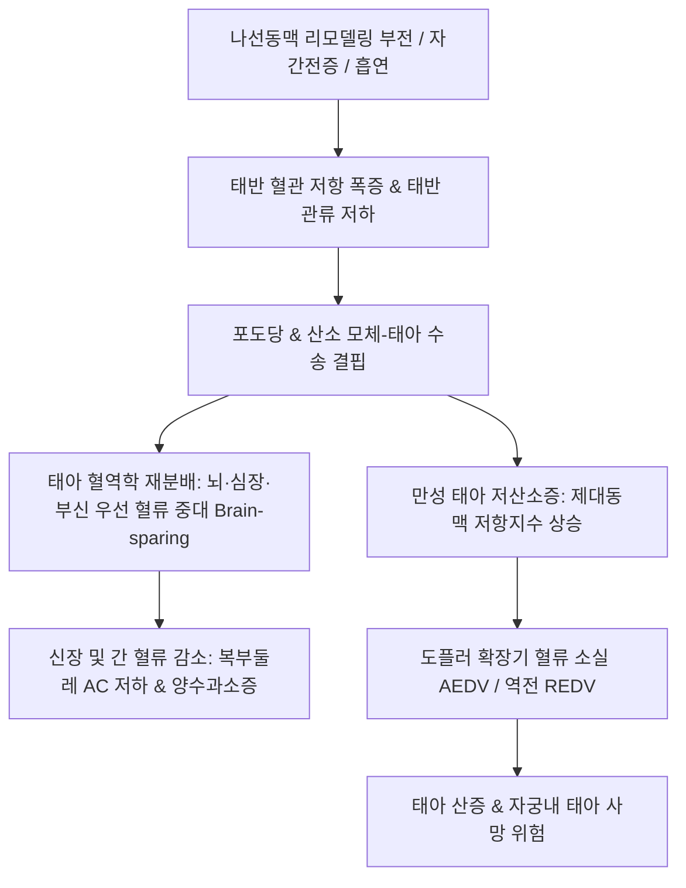

# 🩺 부당 경량아 (Small for Gestational Age, SGA / Fetal Growth Restriction, FGR)

> **핵심 3줄 요약 (Key Summary)**:
> - 📍 **정의 & 병태생리**: 해당 재태 연령의 표준 성장 곡선에서 출생 체중(또는 초음파 추정 체중)이 10백분위수 미만(< 10th percentile)인 신생아 및 태아. 태반 기능 부전(자궁태반 혈류 저하, 임신중독증), 산모의 만성 질환(고혈압, 신질환, 영양실조, 흡연), 태아 유전체 이상 및 선천성 감염이 핵심 기전이다.
> - 🚩 **임상 양상**: 체중 및 피하지방 결핍, 헐렁한 피부, 상대적으로 큰 머리(비대칭형 뇌보존 효과 Brain sparing), 출생 직후 신생아 저혈당([[저혈당]]), 저체온증, 다혈구증, 태변 흡인 증후군.
> - 🛠️ **치료 원칙**: 산전 제대동맥/자궁동맥 도플러 초음파 추적을 통한 태아 곤란증 감시 및 최적 분만 시점 결정, 출생 후 조기 수유 및 체온 유지, 한의학적으로 모체 기혈허약(氣血虛弱)·태위불장(胎萎不長) 변증에 따른 [[태산반석산]], [[보중익기탕]], [[팔진탕]] 투여.
> - ⚠️ **응급 의뢰 레드플래그**: 산전 제대동맥 도플러 검사상 확장기 혈류 소실(AEDV) 또는 역전(REDV), 정맥관(Ductus venosus) 박동성 파형 출현 시 급성 자궁내 태아 사망 위험으로 즉시 응급 제왕절개 분만 의뢰.

---

## 📌 목차
1. [질환 개요 & 해부학적 병태생리](#1-질환-개요--해부학적-병태생리)
2. [병태생리 메커니즘 & 대칭형 대 비대칭형 FGR 네트워크](#2-병태생리-메커니즘--대칭형-대-비대칭형-fgr-네트워크)
3. [임상 증상 & 산전 도플러·출생 후 평가 알고리즘](#3-임상-증상--산전-도플러출생-후-평가-알고리즘)
4. [감별 진단 매트릭스 (Differential Diagnosis)](#4-감별-진단-매트릭스-differential-diagnosis)
5. [한의 통합 치료 프로토콜 (침·약침·한약)](#5-한의-통합-치료-프로토콜-침약침한약)
6. [양방 산과 치료 & 도플러 추적·분만 시기 결정 (Conventional Treatment & Referral)](#6-양방-산과-치료--도플러-추적분만-시기-결정-conventional-treatment--referral)
7. [신생아 대사 관리 & 장기 성인병 예방 가이드](#7-신생아-대사-관리--장기-성인병-예방-가이드)
8. [💡 사용자 진료실 핵심 필기 & 임상 노하우 (Melt-In 잔여 심화 집약)](#8-💡-사용자-진료실-핵심-필기--임상-노하우-melt-in-잔여-심화-집약)
9. [출처 및 학술 참고 문헌 (References)](#9-출처-및-학술-참고-문헌-references)

---

## 1. 질환 개요 & 해부학적 병태생리

### 1) 질환 정의 및 SGA 대 FGR의 구별
- **부당 경량아(Small for Gestational Age, SGA)**: 통계학적으로 출생 체중이 성별 및 재태 연령 기준 **하위 10백분위수 미만**인 경우를 총칭한다. (체질적으로 단순히 작은 정상아도 포함).
- **태아 성장 제한(Fetal Growth Restriction, FGR / IUGR)**: 태반 병리 등으로 인해 태아가 유전적으로 타고난 성장 잠재력(Growth potential)에 도달하지 못한 병리적 상태를 뜻한다.

### 2) 태반 순환 해부학과 나선동맥 리모델링 부전
- **영양막세포 침윤 결함**: 정상 임신 시 영양막세포가 모체 나선동맥을 직경이 크고 저항이 낮은 혈관으로 재형성해야 하나, FGR에서는 리모델링이 실패하여 혈관 저항이 높은 상태로 유지된다.
- **태반 관류 저하 및 경색**: 융모간강(Intervillous space)으로의 혈류 공급이 급감하고 태반 미세경색과 섬유소 침착이 진행되어 영양소(포도당, 아미노산) 및 산소 전달이 차단된다.

---

## 2. 병태생리 메커니즘 & 대칭형 대 비대칭형 FGR 네트워크

### 1) 2대 해부학적 유형의 기전적 차이
- **대칭형 FGR (Symmetrical / Early-onset, 20~30%)**:
  - 발병 시기: 임신 초기(1~2분기) 세포 증식기.
  - 원인: 태아 염색체 이상(18번/13번 삼염색체성), 선천성 바이러스 감염(TORCH), 심한 기형.
  - 소견: 머리둘레(HC), 복부둘레(AC), 대퇴골길이(FL)가 모두 비례하여 작음. 뇌보존 효과 없음. 예후 불량.
- **비대칭형 FGR (Asymmetrical / Late-onset, 70~80%)**:
  - 발병 시기: 임신 후기(3분기) 세포 비대기.
  - 원인: 태반 기능 부전, 임신중독증(자간전증), 만성 모체 혈관 질환.
  - 소견: 복부둘레(간의 글리코겐 고갈 및 복부지방 결핍)만 현저히 작고, 머리둘레는 상대적으로 보존됨(**뇌보존 효과, Brain-sparing effect**).

### 2) FGR 혈역학적 악순환 도식

---

## 3. 임상 증상 & 산전 도플러·출생 후 평가 알고리즘

### 1) 산전 진단 및 도플러 혈류 검사
- **초음파 계측**: 복부둘레(AC) 및 추정 태아 체중(EFW)이 10백분위수 미만.
- **제대동맥(Umbilical artery) 도플러**: 박동지수(PI) 상승 -> 확장기 혈류 소실(AEDV) -> 확장기 혈류 역전(REDV).
- **중대뇌동맥(MCA) 도플러**: 혈관 확장으로 PI 감소(뇌보존 효과 확인).
- **정맥관(Ductus venosus) 도플러**: A파 역전 출현 시 태아 심부전 및 임박한 태아 사망 징후.

### 2) 신생아기 임상 징후
- 마르고 노인 같은 외모, 건조하고 벗겨지는 피부, 얇은 제대, 갈비뼈가 두드러짐.
- 출생 후 4대 급성 합병증: 저혈당([[저혈당]]), 저체온증, 저칼슘혈증, 다혈구증(저산소증 자극으로 EPO 상승).

---

## 4. 감별 진단 매트릭스 (Differential Diagnosis)

| 감별 질환 | 호발 특징 및 검사 소견 | 감별 포인트 |
| :--- | :--- | :--- |
| **체질적 소아 (Constitutionally small)** | 부모 체격 작음, 도플러 정상, 양수량 정상 | 병리적 질환이 아닌 유전적 정상 소아 |
| **태아 선천성 감염 (TORCH)** | 대칭형 FGR, 뇌내 석회화, 간비종대 | 혈청 CMV, 풍진, 톡소플라즈마 항체 |
| **태아 염색체 이상** | 심장 기형, 삼염색체성 초음파 마커 | 양수천자 태아 핵형 분석/CMA |
| **재태 연령 오류 (Dating error)** | 생리 주기 불규칙으로 인한 주수 오인 | 임신 1분기 초음파 CRL로 주수 재산정 |

---

## 5. 한의 통합 치료 프로토콜 (침·약침·한약)

### 1) 변증별 한약 처방 프로토콜 (태위불장 — 산전 모체 치료)
- **기혈허약(氣血虛弱) / 비신양허(脾腎兩虛)**:
  - 주증: 임신 주수 대비 복부 팽창 미흡, 태동 미약, 임산부 안색 창백, 극심한 피로, 설담치흔, 맥세약.
  - 대표 처방: [[태산반석산]], [[팔진탕]], [[보중익기탕]] 가감([[황기]], [[백출]], [[당귀]], [[숙지황]], [[인삼]], [[두충]], [[속단]]).
  - 치법: 보기보신(補氣補腎), 양혈양태(養血養胎).
- **어혈조체(瘀血阻滯) / 포궁어조(胞宮瘀阻)**:
  - 주증: 자궁태반 순환 저항 상승, 임산부 하지 부종, 혀 자암 어점, 맥삽.
  - 대표 처방: [[당귀작약산]] 가감([[당귀]], [[백작약]], [[천궁]], [[복령]], [[택사]], [[백출]]).
  - 치법: 활혈화어(活血化瘀), 이수안태(利水安胎).

### 2) 침구 치료
- **주요 혈위**: [[족삼리]](ST36), [[내관]](PC6), [[비수]](BL20), [[신수]](BL23). 자궁 수축을 유발하지 않는 온화한 보법 자침으로 모체 소화흡수 및 태반 순환 보조.

---

## 6. 양방 산과 치료 & 도플러 추적·분만 시기 결정 (Conventional Treatment & Referral)

### 1) 산전 집중 감시 프로토콜
- 1~2주 간격 태아 체중 및 양수지수(AFI) 추적, 주 2회 제대동맥 도플러 및 무자극검사(NST).
- 임신 37주 도달 시 분만 고려.

### 2) 즉각 분만 적응증
- 제대동맥 확장기 역전(REDV) 관찰 시 임신 30~32주 이상이면 즉시 [[제왕절개]] 분만.
- 정맥관 도플러 이상 또는 생물리학적 계수(BPP) 저하 시 즉각 분만.

---

## 7. 신생아 대사 관리 & 장기 성인병 예방 가이드

### 1) 출생 직후 대사 관리
- 출생 후 1~2시간 내 신속한 모유/분유 수유 시작 및 혈당 모니터링([[저혈당증]] 시 10% 포도당 정맥투여).
- 보육기(인큐베이터) 관리로 [[저체온증]] 방지.

### 2) 바커 가설(Barker's hypothesis)과 성인 [[대사증후군]]
- 자궁 내 기아 상태에 적응한 태아는 대사 절약 유전자형(Thrifty phenotype)을 획득하므로, 성인기 급격한 체중 증가 시 [[당뇨병]](제2형), [[고혈압]], [[관상동맥 질환]] 이환율이 폭증함. 과도한 급속 체중 증가(Catch-up growth)를 피하고 균형 성장 유도.

---

## 8. 💡 사용자 진료실 핵심 필기 & 임상 노하우 (Melt-In 잔여 심화 집약)

### 1) 태위불장(胎萎不長)의 한의학적 본질
- 한의학에서 태아가 주수에 맞지 않게 자라지 못하는 병태를 '태위불장'이라 부르며, 모체의 기혈이 허약하여 태아에게 영양을 공급하지 못하거나 비위 기능 저하로 후천지기(後天之氣)를 만들지 못해 발생한다.
- 임신 중기 이후 산모의 체중 증가가 멈추고 자궁저 높이가 주수보다 3cm 이상 작을 때는 즉시 초음파를 의뢰하여 태반 혈류 부전 여부를 확인해야 한다.

### 2) 도플러 혈류와 태아 안녕 평가의 중요성
- SGA 아동에서 단순 체질적 저체중과 병리적 FGR을 가르는 가장 결정적인 기준은 **제대동맥 및 중대뇌동맥 도플러 혈류 검사**이다.
- 태아가 뇌를 살리기 위해 뇌혈관을 확장시키는 '뇌보존 효과(Brain sparing)'가 관찰되면 이는 자궁 내가 한계에 달했다는 신호이므로, 무리한 임신 유지를 고집하지 말고 산부인과와 협진하여 안전한 조기 분만 시점을 잡아야 한다.

---

## 9. 출처 및 학술 참고 문헌 (References)

Duncan. (2026). Controversies in the management of fetal growth restriction: a state-of-the-art review. *J Matern Fetal Neonatal Med*. PMID: 42578972.

Wang. (2026). Comparison of three Doppler ratio indices for predicting adverse perinatal outcomes in late-onset fetal growth restriction. *J Matern Fetal Neonatal Med*. PMID: 42235951.

Kehl. (2026). Ultrasound in fetal growth restriction. *Ultraschall Med*. PMID: 42906572.
