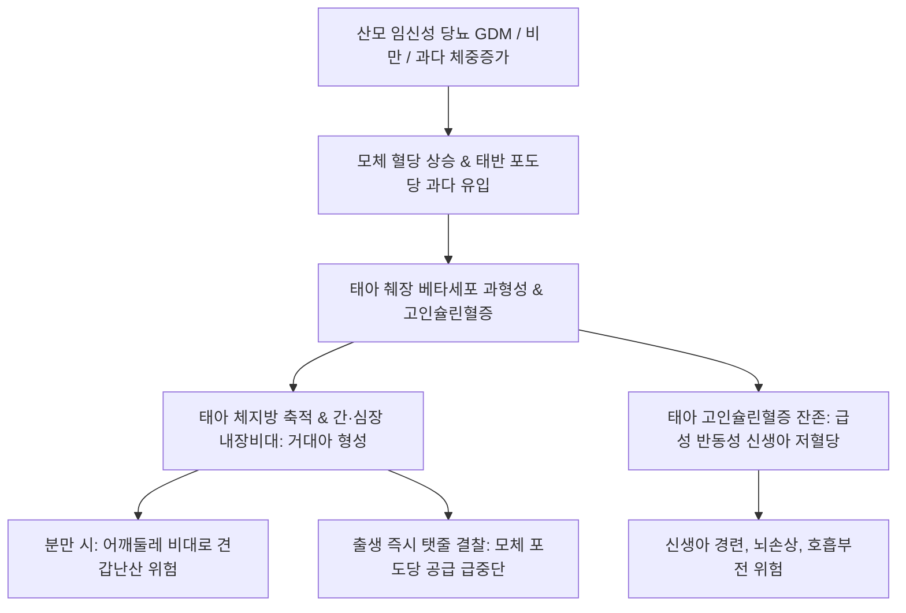

# 🩺 부당 중량아 (Large for Gestational Age, LGA / Fetal Macrosomia, 巨大兒)

> **핵심 3줄 요약 (Key Summary)**:
> - 📍 **정의 & 병태생리**: 해당 재태 연령 및 성별 기준 출생 체중(또는 초음파 추정 체중)이 90백분위수 초과(> 90th percentile)이거나, 출생 체중이 4,000 g(당뇨 산모) 또는 4,500 g(비당뇨 산모) 이상인 거대아. 모체의 고혈당이 태반을 통해 유입되어 태아 췌장의 고인슐린혈증을 촉발하고, 과도한 단백질 합성 및 체지방 축적을 일으키는 페더슨 가설(Pedersen hypothesis)이 핵심 기전이다.
> - 🚩 **임상 양상**: 체격 거대, 복부 및 어깨 둘레 비대, 분만 중 난산(견갑난산 Shoulder dystocia), 쇄골 골절, 상완신경총 손상, 출생 직후 탯줄 결찰 후 인슐린 과다 지속에 따른 **급성 반동성 신생아 저혈당([[저혈당]])**, 호흡곤란 증후군, 적혈구과다증.
> - 🛠️ **치료 원칙**: 산전 모체 혈당의 엄격한 조절(GDM 관리), 초음파 추정 체중 기반 분만 방식 결정(EFW > 4,500~5,000g 시 제왕절개 고려), 출생 즉시 신생아 혈당 모니터링 및 조기 수유, 한의학적으로 모체 비만·습열(濕熱) 관리.
> - ⚠️ **응급 의뢰 레드플래그**: 분만 도중 태아 머리가 분출된 후 어깨가 치골결합에 걸려 분만이 정체되는 [[견갑난산]](Shoulder dystocia) 발생 시 즉시 헬퍼 호출 및 산과 응급 수기(McRoberts 체위, 치골상부 압박 등) 신속 시행.

---

## 📌 목차
1. [질환 개요 & 해부학적 병태생리](#1-질환-개요--해부학적-병태생리)
2. [병태생리 메커니즘 & 페더슨 가설 네트워크](#2-병태생리-메커니즘--페더슨-가설-네트워크)
3. [임상 증상 & 견갑난산·대사 합병증 진단 알고리즘](#3-임상-증상--견갑난산대사-합병증-진단-알고리즘)
4. [감별 진단 매트릭스 (Differential Diagnosis)](#4-감별-진단-매트릭스-differential-diagnosis)
5. [한의 통합 치료 프로토콜 (침·약침·한약)](#5-한의-통합-치료-프로토콜-침약침한약)
6. [양방 산과 치료 & 모체 혈당 관리·분만 결정 (Conventional Treatment & Referral)](#6-양방-산과-치료--모체-혈당-관리분만-결정-conventional-treatment--referral)
7. [신생아 저혈당 감시 & 장기 소아비만 예방 가이드](#7-신생아-저혈당-감시--장기-소아비만-예방-가이드)
8. [💡 사용자 진료실 핵심 필기 & 임상 노하우 (Melt-In 잔여 심화 집약)](#8-💡-사용자-진료실-핵심-필기--임상-노하우-melt-in-잔여-심화-집약)
9. [출처 및 학술 참고 문헌 (References)](#9-출처-및-학술-참고-문헌-references)

---

## 1. 질환 개요 & 해부학적 병태생리

### 1) 질환 정의 및 용어 구분
- **부당 중량아(Large for Gestational Age, LGA)**: 출생 체중이 해당 재태 연령 곡선에서 **상위 10% 초과(> 90th percentile)**인 신생아.
- **거대아(Fetal Macrosomia)**: 재태 주수와 무관하게 절대적인 출생 체중이 **4,000 g 또는 4,500 g 이상**인 경우를 뜻한다.
- 임신의 약 5~10%에서 관찰되며, 산모 및 신생아 모두에게 심각한 주산기 이환율과 분만 손상을 유발한다.

### 2) 태아 조직 비대의 해부학적 특성
- **선택적 내장 및 연조직 비대**: 당뇨 산모의 거대아는 단순히 키가 큰 것이 아니라 간비종대(Hepatomegaly), 심장비대(심실중격 비후), 피하지방 및 어깨 근육량이 불균형하게 비대해진다.
- **머리 대 어깨 비율 역전**: 정상아는 머리둘레(HC)가 가장 크나, 거대아는 흉곽 및 어깨 둘레가 머리둘레보다 커져 질식 분만 시 어깨가 치골결합 후면에 감돈(Impaction)된다.

---

## 2. 병태생리 메커니즘 & 페더슨 가설 네트워크

### 1) 페더슨 가설(Pedersen Hypothesis)
- **모체 고혈당의 태반 통과**: 산모의 혈중 포도당은 촉진확산(GLUT 수송체)을 통해 자유롭게 태반을 통과하여 태아에게 전달된다. (반면 모체 인슐린은 태반을 통과하지 못함).
- **태아 췌장 베타세포 과형성**: 만성 고혈당 자극을 받은 태아 췌장에서 인슐린 분비가 폭발적으로 증가한다.
- **단백질 및 지방 과다 합성**: 강력한 동화 호르몬인 태아 인슐린과 IGF-1이 작용하여 글리코겐 합성, 단백질 축적, 체지방 형성을 가속화하여 비정상적 거대 체형을 유도한다.

### 2) LGA 병태생리 도식

---

## 3. 임상 증상 & 견갑난산·대사 합병증 진단 알고리즘

### 1) 주요 임상 양상
- **분만 합병증**:
  - [[견갑난산]](Shoulder dystocia): 거북이 징후(Turtle sign — 머리가 나온 후 회음부로 도로 들어감).
  - [[상완신경총 손상]](Erb 마비: 팔이 축 늘어지고 손목이 굴곡되는 웨이터 팁 자세).
  - [[쇄골 골절]], [[두부혈종]].
- **신생아 대사 이상**:
  - 출생 후 1~2시간 내 급격한 **반동성 저혈당([[저혈당]])** (혈당 < 40 mg/dL).
  - [[신생아 일과성 빈호흡]](TTN) 및 [[신생아 호흡곤란증후군]](인슐린이 계면활성제 합성을 억제).
  - 적혈구과다증(Polycythemia: 저산소증 자극) 및 [[신생아 황달]].

### 2) 산전 평가
- 초음파 추정 체중(EFW): 복부둘레(AC) > 35 cm, EFW > 4,000~4,500 g.

---

## 4. 감별 진단 매트릭스 (Differential Diagnosis)

| 감별 질환 | 호발 특징 및 검사 소견 | 감별 포인트 |
| :--- | :--- | :--- |
| **모체 당뇨 관련 거대아** | 심장 비대, 어깨 비대, 신생아 저혈당 호발 | 페더슨 기전, 불균형 성장 |
| **체질적 대아 (Constitutionally large)** | 부모 체격 장대, 신체 비례 균형 | 대사 합병증 빈도 낮음 |
| **베크위드-위드만 증후군(BWS)** | 거설증(Macroglossia), 제대탈장, 거구증 | 11p15 유전체 각인 이상 희귀질환 |
| **소토스 증후군(Sotos syndrome)** | 대두증, 특이한 안면 기형, 발달 지연 | NSD1 유전자 돌연변이 |

---

## 5. 한의 통합 치료 프로토콜 (침·약침·한약)

### 1) 산전 모체 대사 관리 한약 프로토콜 ([[임신성 당뇨병]] 및 [[비만]] 관리)
- **비허습열(脾虛濕熱) / 위열치성(胃熱熾盛)**:
  - 주증: 임신 중 급격한 체중 증가, 구갈, 다식, 부종, 소변 황적, 설홍태황니, 맥활삭.
  - 대표 처방: [[백호가인삼탕]] 가감, [[당귀작약산]] 합 [[이진탕]] 가감([[황금]], [[백출]], [[복령]], [[택사]]).
  - 치법: 청열제습(淸熱除濕), 건비화담(健脾化痰).
- **산후 모체 회복**:
  - 분만 손상(회음부 열상, 골반통)에 대해 [[생화탕]] 및 활혈지통 한약 처방.

### 2) 침구 치료
- **주요 혈위**: [[족삼리]](ST36), [[내관]](PC6), [[삼음교]](SP6), [[곡지]](LI11). 모체의 인슐린 감수성을 개선하고 과도한 식욕 억제.

---

## 6. 양방 산과 치료 & 모체 혈당 관리·분만 결정 (Conventional Treatment & Referral)

### 1) 산전 모체 혈당 관리
- 목표 혈당: 공복 < 95 mg/dL, 식후 1시간 < 140 mg/dL, 식후 2시간 < 120 mg/dL.
- 식단 및 운동 요법으로 조절 실패 시 즉시 인슐린 주사 치료.

### 2) 분만 방식 결정 가이드라인 (ACOG)
- 당뇨 산모에서 초음파 추정 체중(EFW) **> 4,500 g**, 비당뇨 산모에서 **> 5,000 g**인 경우 견갑난산 및 영구적 신경 손상 예방을 위해 **선택적 [[제왕절개]](Elective Cesarean delivery)** 강력 권고.

---

## 7. 신생아 저혈당 감시 & 장기 소아비만 예방 가이드

### 1) 출생 직후 신생아 집중 관리
- 출생 후 30분 이내 첫 수유 시작, 출생 후 30분, 1시간, 2시간, 4시간 혈당 연속 측정.
- 혈당 < 40 mg/dL 지속 시 10% 포도당 정맥주사 즉각 투여(포도당 주입속도 4~8 mg/kg/min).

### 2) 소아기 및 청소년기 대사 모니터링
- 거대아 출생아는 [[소아비만]], 조기 [[인슐린 저항성]], [[대사증후군]] 위험이 높으므로 성장기 체중 조절 및 영양 교육 필수.

---

## 8. 💡 사용자 진료실 핵심 필기 & 임상 노하우 (Melt-In 잔여 심화 집약)

### 1) 페더슨 가설의 임상적 경고: 탯줄 결찰 후의 위기
- 거대아의 가장 무서운 급성 합병증은 출생 직후에 일어나는 반동성 저혈당이다.
- 태아는 엄마 뱃속에서 고혈당에 대응하여 인슐린을 뿜어내고 있었는데, 출생과 동시에 탯줄이 잘리면서 엄마로부터 오던 당 공급이 끊기게 된다.
- 그러나 신생아 췌장은 인슐린을 계속 뿜어내고 있으므로 수시간 내에 치명적인 저혈당 쇼크와 경련이 올 수 있다.
- 따라서 거대아로 태어난 아이는 출생 즉시 혈당을 측정하고 조기 수유를 해야 함을 산모에게 반드시 티칭해야 한다.

### 2) 견갑난산 예방을 위한 분만 계획
- 거대아는 단순히 체중만 많이 나가는 것이 아니라 어깨 둘레가 머리둘레보다 비정상적으로 넓은 신체적 기형성을 띤다.
- 초음파상 추정 체중이 4.5kg을 초과할 때는 자연분만을 고집하다가 견갑난산으로 아기 팔 신경(상완신경총)이 마비되거나 쇄골이 부러지는 사고가 빈발하므로, 안전한 제왕절개 분만을 산부인과와 선제적으로 상담하도록 안내해야 한다.

---

## 9. 출처 및 학술 참고 문헌 (References)

Carbone. (2026). The impact of composite maternal & fetal ultrasound assessment on the mode of delivery in large-for-gestational-age fetuses: the macrodia trial. *J Matern Fetal Neonatal Med*. PMID: 42036405.

Dominsky. (2026). Late-onset diagnosis of gestational diabetes after normal mid-pregnancy screening in women with large for gestational age or polyhydramnios: a systematic review and meta-analysis. *Am J Obstet Gynecol*. PMID: 42055184.

Krueger. (2026). Ultrasound suspicion of fetal large for gestational age: A population-based cohort study using propensity score overlap weighting. *Eur J Obstet Gynecol Reprod Biol*. PMID: 42700706.
