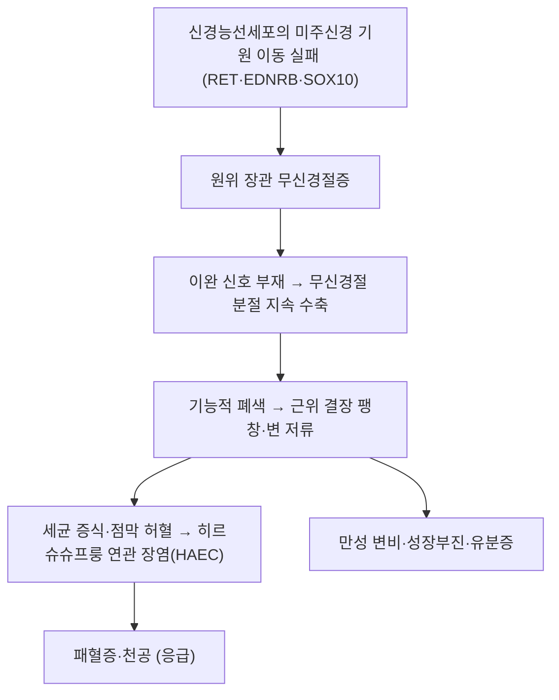

# 🩺 히르슈슈프룽병 (Hirschsprung Disease, HSCR / 先天性 巨大結腸症, ICD-10 Q43.1)

> **핵심 3줄 요약 (Key Summary)**:
> - 📍 **병소 부위 & 병태생리**: [[결장]] 원위부(대개 직장·[[S상결장]])의 근층신경총·점막하신경총에 신경절세포가 없는 상태(무신경절증). 해당 분절은 이완되지 못해 지속 수축하고, 근위부 [[결장]]이 이차적으로 확장된다.
> - 🚩 **전형적 임상 양상**: 신생아 **태변 배출 48시간 지연**, 복부팽만, 담즙성 구토. 영아·소아에서는 만성 변비·성장부진, 직장수지검사 후 폭발적 배변(gush)이 특징이다.
> - 🛠️ **핵심 감별 & 치료 전략**: [[소아 변비]]와의 감별이 전부다. 조영관장 → [[직장 흡인 생검]](아세틸콜린에스테라제 염색)으로 확진하고, **치료는 수술(pull-through)** 이다. 한의 치료는 수술을 대체할 수 없고 수술 전후 보조에 한정된다.
> - ⚠️ **응급 의뢰 레드플래그**: 발열 + 복부팽만 + 혈성 설사는 **히르슈슈프룽 연관 장염(HAEC)** 으로 사망 가능한 응급이다. 태변 지연 + 담즙성 구토 + 장음 소실도 즉시 소아외과 의뢰.

## 📌 목차
1. [질환 개요 & 병태생리](#1-질환-개요--병태생리)
2. [병태생리 메커니즘 & 악순환 네트워크](#2-병태생리-메커니즘--악순환-네트워크)
3. [임상 증상 & 환자 소견](#3-임상-증상--환자-소견)
4. [감별 진단 매트릭스](#4-감별-진단-매트릭스)
5. [한의 통합 치료 프로토콜](#5-한의-통합-치료-프로토콜)
6. [양방 치료 & 병용·의뢰 기준](#6-양방-치료--병용의뢰-기준)
7. [식이·생활습관 & 자가관리 티칭 가이드](#7-식이생활습관--자가관리-티칭-가이드)
8. [💡 진료실 핵심 필기 & 임상 노하우](#8--진료실-핵심-필기--임상-노하우)
9. [출처 및 학술 참고 문헌](#9-출처-및-학술-참고-문헌)

## 1. 질환 개요 & 병태생리

![[히르슈슈프룽병_01_대장_해부_도해.png|420]]
> [그림 1: 복부 장기와 결장의 해부 도해 — 무신경절 분절(직장·S상결장)과 근위 확장부의 위치 관계를 이해하는 기준 도해. 출처: Wikimedia Commons File:Hirschsprung's disease hariadhi.svg, CC BY-SA 4.0]

- **정의 및 분류**: 장관 벽의 근층신경총(Auerbach)과 점막하신경총(Meissner)에 신경절세포가 선천적으로 결여된 질환이다. 무신경절 분절의 길이에 따라 **짧은 분절형(직장·S상결장, 약 80%)**, 긴 분절형, 전결장형(total colonic aganglionosis)으로 나뉜다. 짧은 분절형이 가장 흔하고 예후도 가장 좋다.
- **역학**: 출생아 5,000명당 1명 수준. 남아에서 여아보다 약 3~4배 흔하나, 긴 분절형으로 갈수록 남녀비가 1:1에 가까워진다.
- **관련 장기**: 주 이환 부위는 [[직장]]과 [[S상결장]]. 이차적으로 [[결장]] 전체가 확장되고, 드물게 [[소장]]까지 무신경절이면 전장(whole-gut) 무신경절증으로 예후가 매우 나쁘다.
- **동반 질환**: [[다운증후군]](21삼염색체)이 가장 흔하고, Waardenburg-Shah 증후군(SOX10), MEN 2A(RET), Mowat-Wilson 증후군(ZEB2)이 알려져 있다. 동반 기형이 있으면 예후와 유전 상담 계획이 달라진다.

## 2. 병태생리 메커니즘 & 악순환 네트워크

![[히르슈슈프룽병_02_바륨관장_이행대.jpg|420]]
> [그림 2: 조영검사에서 좁은 원위부(무신경절 분절)와 근위 확장부 사이의 이행대가 관찰된다 — 짧은 분절형 증례. 출처: Wikimedia Commons File:Short segment Hirschsprung disease.jpg, CC BY-SA 4.0]

![[히르슈슈프룽병_03_아세틸콜린_조직화학.jpg|420]]
> [그림 3: 직장 점막 생검의 아세틸콜린에스테라제(AChE) 염색 — 무신경절 분절에서 비후된 콜린성 신경섬유가 점막하층에 진하게 염색된다(갈색). 확진 검사의 대표 소견. 출처: Wikimedia Commons File:Hirschsprung acetylcholine.jpg, CC BY-SA 3.0]

### 1) 분자·세포 수준 기전
- 장관 신경계는 재태 4~12주에 미주신경 기원 [[신경능선세포]]가 두경부에서 항문 방향으로 이동하며 형성된다. 이 이동·증식·분화가 원위부에서 멈추면 그 이하가 무신경절 상태로 남는다. 그래서 **항문 쪽이 항상 무신경절**이고 병변은 연속적이다.
- 주요 유전자: **RET**(가장 중요, 기능상실 변이), EDNRB·EDN3·GDNF, 전사인자 SOX10·ZEB2·PHOX2B. 단일 유전자 질환이라기보다 여러 유전자와 환경이 겹치는 다인성 질환으로 이해된다.

### 2) 장기·계통 수준 결과
- 무신경절 분절은 이완하지 못해 좁아진 관을 유지하고, 그 위의 정상 결장이 대변을 밀어내지 못해 풍선처럼 확장된다. 이 상태가 오래되면 [[결장]] 평활근과 장벽신경총이 이차적으로 변성되어 수술 후에도 기능 회복이 지연된다.
- 확장부에 정체된 대변은 세균 과증식을 일으키고, 점막 방어벽이 무너지면 세균 전위로 **HAEC**(장염)가 발생한다. HAEC는 수술 전후 모두 사망의 주된 원인이다.

## 3. 임상 증상 & 환자 소견

![[히르슈슈프룽병_04_대장조영_확장.jpg|420]]
> [그림 4: 대장조영술에서 현저히 확장된 결장과 상대적으로 좁은 원위부가 대비된다 — 대변 저류가 오래된 증례. 출처: Wikimedia Commons File:Hirschsprungs.jpg, CC0]

> 🖼️ 복부팽만 환아의 임상 외부 사진과 수술(pull-through) 술기 실사는 확보하지 못했다(Open-i 이미지 API 응답 장애). 사진으로 채우지 않고 본문·표로 대체한다.

### 1) 주소증 및 핵심 증상
- **신생아기**: 태변 배출이 48시간 이후로 지연(정상 신생아의 99%는 48시간 내 배출), 복부팽만, 담즙성(녹색) 구토, 수유 곤란, 체중 증가 부진.
- **영아·소아기**: 만성 변비, 가는 리본 모양 변, 복부팽만, 성장 지연. **직장수지검사 후 폭발적으로 변과 가스가 나오는 현상**은 이 질환의 전형적 단서다.
- **HAEC(장염)**: 발열, 복부팽만 급증, 혈성 설사, 기면. 수술 전 신생아와 수술 후 소아 모두에서 발생할 수 있다.

### 2) 객관적 소견 (Signs & Labs)
- 복부 진찰: 팽만, 고음의 장음 또는 장음 소실(폐색 진행 시).
- 직장 진찰: 직장 내 공간이 비어 있거나 단단한 변이 만져지고, 손가락을 빼면 변·가스가 분출.
- 영상: 조영관장에서 **이행대(transition zone)** 와 역(逆)직장-S상결장 비(정상은 직장이 S상결장보다 넓지만, 이 질환에서는 반대)가 관찰된다.
- 확진: [[직장 흡인 생검]] — 신경절세포 소실 + 아세틸콜린에스테라제 염색에서 비후 신경섬유 증가. 칼레티닌 면역염색 소실도 보조 지표다. 2022년 진단 정확도 연구(PMID 35513609)는 두 염색의 조합이 진단 정확도를 높인다고 정리했다.

### 3) 병기·중증도 판정
- 분절 길이(짧은 분절 / 긴 분절 / 전결장형)와 진단 시 연령, HAEC 병력이 예후를 가른다. 진단이 늦으면 확장된 결장이 회복되지 않아 수술 후에도 변비·유분증이 남기 쉽다.

## 4. 감별 진단 매트릭스

| 감별 질환 | 특징적 양상 | 감별 포인트 (검사·수치) |
| :--- | :--- | :--- |
| [[히르슈슈프룽병]] (본 질환) | 태변 지연, 직장이 비어 있고 폭발적 배변 | 조영관장 이행대, 직장 생검에서 신경절세포 소실 |
| [[소아 변비]] (기능성) | 유분증·참기 행동, 발병이 배변훈련기 | 태변 지연 병력 없음, 성장 정상, 생검 정상 |
| 태변 마개 증후군 | 태변 지연이지만 관장 후 호전 | 관장 후 재발 없음, 생검 정상 |
| 좌측결장 증후군 | 당뇨병 산모의 신생아 | 조영관장에서 좌측 결장이 가늘고 일시적 |
| 낭성섬유증 태변 장폐색 | 태변 지연 + 태변 장폐색 | 발한 염화물 검사, 유전자 검사 |
| [[영아와 소아의 갑상선기능저하증]] | 변비·처짐·성장 지연 | TSH·유리 T4 |
| 척추이분증·천골 기형 | 하지·괄약근 이상, 천골 피부 함몰 | 척추 MRI, 신경학적 검진 |

> 🚩 **레드플래그 감별**: 발열 + 혈성 설사 + 복부팽만은 **HAEC**로, 감별이 아니라 즉시 치료 대상이다.

## 5. 한의 통합 치료 프로토콜 (침·약침·한약)

> ⚠️ **대전제**: 이 질환은 **해부학적 결손**이다. 한약·침·추나로 무신경절 분절을 만들 수 없다. 한의 치료는 ① 수술 전 전신 상태·장염 위험 관리 보조 ② 수술 후 장운동 회복과 유분증 관리 ③ 보호자 교육의 세 층위에 한정하며, 이 한계를 보호자에게 먼저 밝힌다.

- **변증 분류(수술 후 변비·유분증 관리 맥락)**:
  - 비허기약(脾虛氣弱): 배변에 힘이 없고 변이 무르다가 굳는 양상, 자한, 면색 창백 → [[보중익기탕]]·[[황기탕]] 가감.
  - 장조진휴(腸燥津虧): 변이 단단하고 구갈, 설홍소태 → [[증액탕]]·[[마자인환]] 가감.
  - 기체혈어(氣滯血瘀): 수술 후 유착성 복통, 창통 거안 → [[소복축어탕]]·[[계지복령환]] 계열을 신중히 검토.
- **침구**: 수술 후 장마비(ileus) 회복을 목표로 천추(ST25)·족삼리(ST36)·상거허(ST37)·합곡(LI4)에 자침. 소아는 무통 자극(이침·레이저침)을 우선하고, **문진상 장폐색·발열·복부팽만이 있으면 자침을 보류하고 의뢰**한다.
- **소아추나**: 마복(摩腹) 시계방향, 승구미(揉龜尾), 퇴육부(退六腑) — 수술 부위가 안정된 뒤 시행하며 상처 부위 직접 자극은 금한다.
- **뜸**: 복부 온열은 수술 후 장운동 회복 보조로 쓰이나, 감각이 미숙한 영아에서는 저온화상 위험이 커 가정 지도용으로 권하지 않는다.

## 6. 양방 치료 & 병용·의뢰 기준 (Conventional Treatment & Referral)

- **표준 치료는 수술**이다. 무신경절 분절을 절제하고 정상 신경절 부위를 항문으로 끌어내리는 **pull-through** 술식(Swenson, Duhamel, Soave 및 복강경 보조 변형)이 근간이다. 수술 중 동결절편으로 신경절 존재를 확인하며 절제 범위를 정한다.
- **단계적 수술**: 신생아기에 장염·천공·영양 불량이 있으면 일차 장루 조성 후 2차로 근치 수술을 한다.
- **HAEC 치료**: 금식·정맥 수액·광범위 항생제·직장 세척. 보호자에게 **직장 세척액(생리식염수) 처방과 시행법**을 교육하는 것이 재발 예방의 핵심이다.
- **수술 후 흔한 문제**: 변비(10~30%), 유분증, 소장결장염 반복. 장기 추적이 필요하며, 수술받았다고 변비약을 모두 끊는 것이 아니다.
- **한의 병용 판단**: 수술 전후 급성기에는 **병용 금기**(장염·폐색 위험). 안정기 보조는 가능하나, 복부팽만·발열·구토가 새로 생기면 한약을 중단하고 즉시 소아외과에 연락한다.

## 7. 식이·생활습관 & 자가관리 티칭 가이드

- **수분·섬유소**: 수술 후에도 수분 섭취와 적절한 섬유소가 필요하다. 다만 섬유소만 늘리면 단단한 변이 더 막힐 수 있어 **완하제 유지가 우선**이다.
- **배변 훈련**: 식후 15~30분 위대장반사를 이용해 5~10분 앉히기, 발받침으로 무릎을 골반보다 높게.
- **직장 세척 교육**: HAEC 예방을 위해 보호자가 시행법을 익혀야 한다. 통상 1일 1~2회, 처방된 용량의 생리식염수로 시행한다.
- **정기 추적**: 수술 후 1년은 3~6개월 간격으로 성장·배변·장염 증상을 확인한다.
- **환자 교육 스크립트**: "이 병은 장의 신경세포가 태어날 때 일부 빠져서 생깁니다. 약으로 신경을 새로 만들 수는 없어서 수술이 필요합니다. 수술 후에도 변비가 남을 수 있어서 약과 배변 습관을 계속 관리해야 하고, 열이 나면서 배가 부풀고 변에 피가 섞이면 바로 응급실로 오셔야 합니다."

## 8. 💡 진료실 핵심 필기 & 임상 노하우

- **한의원에서 가장 위험한 착각**: "변비가 심한 아이"로 보이고 태변 지연 병력을 안 물어보는 것. **첫 문진에서 반드시 "태어나서 첫 변(태변)을 언제 봤는지"** 를 묻는다. 48시간을 넘겼다면 기능성 변비 치료를 시작하지 말고 영상 검사 의뢰가 먼저다.
- **직장 진찰의 가치**: 직장에 변이 없는데 복부에 종괴가 만져지면 폐색을 의심한다. 손가락을 뺄 때 가스·변이 폭발하면 이 질환을 강하게 의심한다.
- **수술 후 환아 관리 포인트**: 유분증이 남아 보호자가 체벌을 하는 사례가 흔하다. 유분증은 **감각·기능 문제이지 훈육 문제가 아님**을 설명하는 것이 치료 순응도의 갈림길이다.
- **한약 선택 주의**: 수술 후 유착성 복통에 활혈거어제를 쓸 때는 출혈 경향·항생제 복용력을 먼저 확인한다. 영아에서는 탕제보다 과립·산제로 용량을 정밀 조절한다.

## 9. 출처 및 학술 참고 문헌 (References)

- Tang CS, Karim A, Zhong Y, et al. Genetics of Hirschsprung's disease. *Pediatr Surg Int*. 2023;39(1):132. [PMID 36749416](https://pubmed.ncbi.nlm.nih.gov/36749416/)
  - [연구 요약] RET를 중심으로 한 유전 구조와 동반 증후군을 정리한 최신 고찰로, 가족력 상담 근거를 제공한다.
- Burkardt DD, Graham JM Jr, Short SS, et al. Advances in Hirschsprung disease genetics and treatment strategies: an update for the primary care pediatrician. *Clin Pediatr (Phila)*. 2014;53(1):100-111. [PMID 24002048](https://pubmed.ncbi.nlm.nih.gov/24002048/)
  - [연구 요약] 일차진료에서의 조기 인지·감별·의뢰 시점을 정리해, 태변 지연과 폭발적 배변의 임상적 의미를 강조했다.
- Beltman L, Windster JD, Roelofs JJTH, et al. Diagnostic accuracy of calretinin and acetylcholinesterase staining of rectal suction biopsies in Hirschsprung disease examined by a pediatric pathology panel. *Virchows Arch*. 2022;481(2):235-244. [PMID 35513609](https://pubmed.ncbi.nlm.nih.gov/35513609/)
  - [연구 요약] 직장 흡인 생검에서 칼레티닌·아세틸콜린에스테라제 염색의 진단 정확도를 평가해 병리 판독 조합의 근거를 제시했다.
- Tabbers MM, DiLorenzo C, Berger MY, et al. Evaluation and treatment of functional constipation in infants and children: ESPGHAN/NASPGHAN evidence-based recommendations. *J Pediatr Gastroenterol Nutr*. 2014;58(2):258-274. [PMID 24345831](https://pubmed.ncbi.nlm.nih.gov/24345831/)
  - [연구 요약] 기능성 변비의 감별에서 기질적 원인(특히 이 질환)을 배제해야 하는 레드플래그 목록의 표준 출처다.
- 질병관리청 국가건강정보포털 — [health.kdca.go.kr](https://health.kdca.go.kr)
  - [연구 요약] 보호자용 한국어 질환 설명 자료의 공식 경로로, 진료실 교육 자료로 활용한다.
