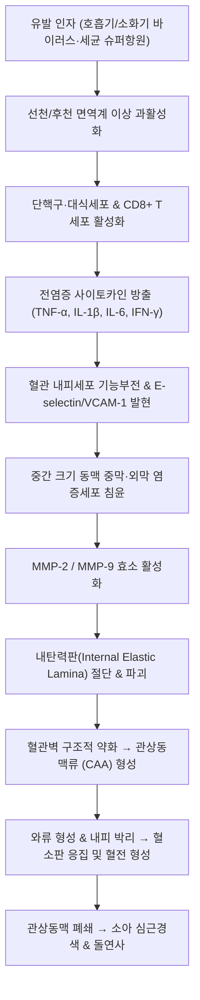

# 🩺 [[가와사키병]] (Kawasaki Disease / 점막피부림프절증후군, M30.3)

> **핵심 3줄 요약 (Key Summary)**:
> - 📍 **병소 부위 & 병태생리**: 주로 5세 이하 영유아의 전신 중간 크기 근육성 동맥을 침범하는 급성 열성 [[혈관염]]으로, 특히 [[관상동맥]](Coronary artery) 전층에 심각한 염증과 탄력섬유 파괴를 유발하여 [[관상동맥류]](Coronary artery aneurysm) 및 혈전성 폐색을 초래하는 선진국 소아 후천성 심장병 1위 질환임.
> - 🚩 **전형적 임상 양상 & 5대 징후**: 5일 이상 지속되는 불명열($\ge 38.5^\circ\text{C}$)과 함께 ① 양측 비삼출성 결막 충혈, ② 구순 균열·[[딸기혀]]·구강 점막 발적, ③ 부정형 다형 피부 발진, ④ 손발 경성 부종/홍반(회복기 막양 낙설), ⑤ 편측 비화농성 경부 림프절 종대($\ge 1.5\text{ cm}$) 중 4가지 이상 발현.
> - 🛠️ **핵심 감별 & 한·양방 치료 전략**: 발열 10일 이내에 조기 진단하여 고용량 [[면역글로불린]](IVIG $2\text{ g/kg}$) 단회 정맥 투여와 고용량 [[아스피린]] 병용으로 관상동맥 합병증을 25%에서 5% 미만으로 억제하며, 한의학에서는 온병(溫病) 기영양혈(氣營兩血) 및 혈어(血瘀) 변증으로 [[청영탕]], [[은교산]], [[생맥산]], [[혈부축어탕]]을 병용하여 혈관 내피 염증과 기음 손상을 회복시킴.
> - <font color="#fa7e7e">⚠️ **응급 의뢰 레드플래그**: 5일 이상 지속되는 소아 고열에서 항생제 반응이 없거나, 6개월 미만 영아에서 원인 불명의 발열과 염증 수치(CRP $\ge 3.0\text{ mg/dL}$, ESR $\ge 40\text{ mm/hr}$) 급상승, [[심초음파]]상 관상동맥 확장/동맥류(Z-score $\ge 2.5$) 또는 저혈압 쇼크(Kawasaki Disease Shock Syndrome, KDSS) 소견 확인 시 1초의 지체 없이 3차 상급병원 소아청소년과 응급센터로 긴급 전원.</font>

---

## 📌 목차
1. [질환 개요 & 병태생리 (Disease Overview)](#1-질환-개요--병태생리-disease-overview)
2. [병태생리 메커니즘 & 대사·장기부전 악순환 네트워크](#2-병태생리-메커니즘--대사장기부전-악순환-네트워크)
3. [임상 증상 & 환자 소견 (Clinical Presentation)](#3-임상-증상--환자-소견-clinical-presentation)
4. [감별 진단 매트릭스 (Differential Diagnosis)](#4-감별-진단-매트릭스-differential-diagnosis)
5. [한의 통합 치료 프로토콜 (침·약침·한약)](#5-한의-통합-치료-프로토콜-침약침한약)
6. [양방 치료 & 병용·의뢰 기준 (Conventional Treatment & Referral)](#6-양방-치료--병용의뢰-기준-conventional-treatment--referral)
7. [식이·생활습관 & 자가관리 티칭 가이드](#7-식이생활습관--자가관리-티칭-가이드)
8. [💡 진료실 핵심 필기 & 임상 노하우 (Melt-In 잔여 심화 집약)](#8--진료실-핵심-필기--임상-노하우-melt-in-잔여-심화-집약)
9. [출처 및 학술 참고 문헌 (References)](#9-출처-및-학술-참고-문헌-references)

---

## 1. 질환 개요 & 병태생리 (Disease Overview)

### 1) 질환 정의 및 역학적 특성
* **정의**: 가와사키병(Kawasaki Disease, KD)은 원인 미상의 전신성 중간 및 소동맥 [[혈관염]](Vasculitis)으로, 1967년 일본의 소아과 의사 가와사키 토미사쿠(川崎富作)에 의해 점막피부림프절증후군(Mucocutaneous lymph node syndrome)으로 최초 보고되었다.
* **역학**:
  * **호발 연령**: 전체 환자의 80~85%가 5세 미만 영유아이며, 특히 6개월~2세 사이에서 최고 발병률을 보인다.
  * **성별 및 인종**: 남아가 여아보다 약 1.5배 호발하며, 동아시아인(한국, 일본, 대만)에서 서양인에 비해 10~15배 높은 발병률을 나타낸다. 한국은 일본에 이어 세계에서 두 번째로 발병률이 높은 국가이다(5세 미만 인구 10만 명당 약 130~200명 발생).
  * **계절성**: 늦겨울과 봄철에 호발하는 경향이 있어 감염성 유발 인자와 유전적 소인(ITPKC, CASP3, FCGR2A 유전자 다형성)의 상호작용이 강력히 시사된다.
* **임상적 중요성**: 과거 소아 후천 심장병의 주원인이었던 [[류마티스열]](Rheumatic fever)을 제치고, 현재 선진국에서 **소아 후천성 심장병 원인 1위**를 차지한다. 급성기 적절한 치료를 받지 못할 경우 20~25%에서 [[관상동맥류]](Coronary artery aneurysm)가 발생하며, 이는 소아 및 청년기 허혈성 심질환, [[심근경색증]], 돌연사의 주원인이 된다.

```
[가와사키병의 전신 혈관 침범 및 관상동맥 손상 스펙트럼]
                     ┌────────────────────────────────┐
                     │ 감염 유발원 + 유전적 면역 감수성 │
                     └────────────────┬───────────────┘
                                      ▼
                     ┌────────────────────────────────┐
                     │ 전신 혈관 내피 활성화 및 사이토카인 폭풍 │
                     └────────────────┬───────────────┘
                                      ▼
       ┌──────────────────────────────┼──────────────────────────────┐
       ▼                              ▼                              ▼
┌───────────────┐              ┌───────────────┐              ┌───────────────┐
│ 미세혈관 누출  │              │ 중간 크기 근육형│              │ 전신 다장기 침범 │
│ 점막/피부 부종 │              │ 동맥염 전층 침윤│              │ 간염, 무균성뇌수│
│ 결막/구순 발적 │              │ (주로 관상동맥)│              │ 막염, 담낭수종 │
└───────────────┘              └───────┬───────┘              └───────────────┘
                                       ▼
                       ┌──────────────────────────────┐
                       │ 내탄력판 파괴 및 혈관벽 약화 │
                       │    관상동맥 확장 및 동맥류   │
                       └───────────────┬──────────────┘
                                       ▼
                       ┌──────────────────────────────┐
                       │ 혈전 형성, 협착, 심근경색증  │
                       └──────────────────────────────┘
```

### 2) 관련 장기 및 조직 손상
* **주 이환 장기**:
  * **[[심장]] 및 [[관상동맥]]**: 좌주간부(LMCA), 좌전하행지(LAD), 우관상동맥(RCA)의 외막염(Perivasculitis)으로 시작하여 전층 동맥염(Panarteritis)으로 진행. 급성 심근염(Myocarditis, 50~70%), 심낭삼출(Pericardial effusion), 승모판 역류(Mitral regurgitation) 동반.
  * **피부 및 점막**: 모세혈관 확장 및 혈관 투과성 증가로 인한 구강 점막 미만성 발적, 결막 혈관 충혈, 수족 부종.
* **연관 조절계 및 사이토카인**:
  * [[인터루킨-1]](IL-1$\beta$), [[인터루킨-6]](IL-6), [[종양괴사인자]](TNF-$\alpha$), [[감마인터페론]](IFN-$\gamma$) 폭풍 분비.
  * 기질금속단백분해효소([[MMP-2]], [[MMP-9]]) 활성화로 혈관벽 콜라겐 및 엘라스틴 융해.
* **합병증 표적 장기**: 관상동맥(동맥류, 혈전), [[심근]](허혈, 섬유화), [[간]](급성 반응성 간염, 황달), [[담낭]](무결석성 담낭수종), [[신장]](무균성 농뇨, 간질성 신염), [[뇌]] 및 뇌막(무균성 수막염).

---

## 2. 병태생리 메커니즘 & 대사·장기부전 악순환 네트워크



### 1) 분자·세포 수준 기전
* **면역 활성화 및 사이토카인 폭풍**: 감염원(슈퍼항원 등)이 유전적으로 취약한 소아의 항원제시세포(APC)와 T세포 수용체(TCR) V$\beta$ 체인에 결합하여 비특이적 면역 폭주를 유발한다. 단핵구, 대식세포, CD8+ 세포독성 T림프구가 대량 동원되어 고농도의 [[TNF-alpha]], [[IL-1beta]], [[IL-6]]를 혈류로 분비한다.
* **내피세포 활성화와 백혈구 혈관벽 침윤**: 사이토카인 자극에 의해 혈관 내피세포는 ICAM-1, VCAM-1, E-selectin 등 부착 분자를 표면에 대량 발현한다. 호중구가 발열 1~9일차에 혈관 외막 및 중막으로 급격히 침윤하여 급성 괴사성 동맥염(Necrotizing arteritis)을 일으킨다.
* **MMP 활성화 및 탄력판 융해**: 침윤된 대식세포와 평활근세포에서 분비된 Matrix Metalloproteinase-9 (MMP-9) 및 MMP-2가 혈관의 탄력성을 지탱하는 내탄력판(Internal elastic lamina)과 중막 엘라스틴 섬유를 소화·절단한다.

### 2) 장기·계통 수준 결과 및 관상동맥류 악순환 고리
* **동맥류 형성 및 확장**: 중막의 구조적 지지력이 소실된 혈관벽은 심실 수축기 혈압을 견디지 못하고 외측으로 팽창하여 방추상(Fusiform) 또는 낭상(Saccular) 관상동맥류를 형성한다.
* **혈류 역학과 혈전 형성의 악순환**:
  * 동맥류 내부에서는 혈류 속도가 급격히 저하되고 와류(Turbulence)가 발생한다.
  * 발열 10일 이후 아급성기에 접어들면 골수에서 혈소판 생성이 폭발적으로 증가하여 혈소판 수치가 $500,000\sim 1,000,000/\mu\text{L}$ 이상으로 치솟는다.
  * 손상된 내피하 조직 노출 + 와류 + 고혈소판혈증(Thrombocytosis)의 3요소가 결합하여 동맥류 내강에 거대 혈전(Mural thrombus)이 형성되며, 이는 급성 심근경색증을 유발한다.

### 3) 질환 진행 3단계 병기별 특징
1. **급성기 (Acute Febrile Phase, 1~11일)**:
   * 고열, 결막 충혈, 구강 점막 변화, 발진, 림프절 비대 발현.
   * 급성 심근염(빈맥, 심음 저하, 심낭삼출) 및 전신 소동맥염 발생.
2. **아급성기 (Subacute Phase, 11~25일)**:
   * 열이 서서히 내리면서 손발톱 주위 막양 낙설(Periungual desquamation) 시작.
   * 혈소판 수치가 정점에 도달하며, **관상동맥류 형성 및 파열/혈전증 위험이 가장 높은 시기**.
3. **회복기 (Convalescent Phase, 6~8주 이후)**:
   * 모든 임상 증상이 소실되고 염증 지표(ESR, CRP)가 정상화됨.
   * 형성된 동맥류의 퇴행(Regression) 또는 섬유성 협착, 석회화가 진행됨.

---

## 3. 임상 증상 & 환자 소견 (Clinical Presentation)

### 1) 전형적 가와사키병의 진단 기준 (AHA/AAP 가이드라인)
5일 이상 지속되는 발열(또는 4일째 IVIG 투여로 해열된 경우 포함)과 함께 다음 5가지 주요 임상 징후 중 **4가지 이상**을 만족해야 한다:

```
[가와사키병 5대 핵심 임상 징후 체크리스트]
 1. 양측성 결막 충혈      : 분비물(삼출물/눈곱)이 없는 무통성 안구 결막 충혈 (각막 주변부 보존)
 2. 구강 및 구순 변화     : 입술의 홍반 및 출혈성 균열, 딸기혀 (Strawberry tongue), 구강 인두 점막 발적
 3. 부정형 다형 피부 발진 : 몸통과 사지의 홍반성 반구진 발진, 표피박리, BCG 접종 부위의 급성 홍반·가피
 4. 사지 말단 변화        : [급성기] 손발바닥의 경성 부종 및 홍반 / [회복기] 손발톱 경계부 막양 낙설
 5. 경부 림프절 종대      : 통상 편측성, 직경 1.5 cm 이상의 비화농성 림프절 비대 (압통 경미)
```

### 2) 비전형 / 불완전 가와사키병 (Incomplete / Atypical Kawasaki Disease)
* **임상적 위험성**: 특히 6개월 미만 영아 또는 연장아에서 흔하며, 5일 이상의 발열이 있으나 진단 기준을 2~3가지만 충족하여 진단이 지연되기 쉽다. 조기 치료를 놓쳐 거대 관상동맥류 발생 위험이 전형적 가와사키병보다 유의하게 높다(Benitez et al., 2026).
* **평가 알고리즘 (AHA 권고)**:
  * 5일 이상 발열 + 2~3개 기준 충족 시: 염증 지표 확인 (CRP $\ge 3.0\text{ mg/dL}$ 또는 ESR $\ge 40\text{ mm/hr}$).
  * 염증 지표 상승 시 보조 검사 기준 6개 중 3개 이상 만족 시 IVIG 투여:
    1. 빈혈 (연령 기준치 이하)
    2. 혈소판 수치 $\ge 450,000/\mu\text{L}$ (발열 7일 이후)
    3. 혈청 알부민 $\le 3.0\text{ g/dL}$
    4. 간효소치(ALT) 상승
    5. 백혈구 수치 $\ge 15,000/\mu\text{L}$
    6. 소변 검사상 농뇨 ($\ge 10\text{ WBC/HPF}$)
  * 심초음파상 관상동맥 확장 확인 시 즉시 확진 및 치료.

### 3) 객관적 검사 소견 및 심초음파 Z-score 평가
* **혈액 검사 소견**:
  * 백혈구 증가(호중구 좌방이동), ESR 및 CRP의 현저한 상승.
  * 프로칼시토닌(Procalcitonin) 및 혈청 페리틴(Ferritin) 상승.
  * 저나트륨혈증, 저알부민혈증(모세혈관 누출 반영).
  * NT-proBNP 상승: 심근염 및 심실 기능 저하를 예민하게 반영.
* **[[심초음파]](Echocardiography) 관상동맥 내경 Z-score 분류**:
  * 환아의 체표면적(BSA) 대비 관상동맥 내경을 표준화한 값:
    * **정상 (Normal)**: $Z < 2.0$
    * **단순 확장 (Dilation only)**: $2.0 \le Z < 2.5$
    * **소형 동맥류 (Small aneurysm)**: $2.5 \le Z < 5.0$
    * **중형 동맥류 (Medium aneurysm)**: $5.0 \le Z < 10.0$ (절대 내경 $< 8\text{ mm}$)
    * **거대 동맥류 (Giant aneurysm)**: $Z \ge 10.0$ (또는 절대 내경 $\ge 8\text{ mm}$)

---

## 4. 감별 진단 매트릭스 (Differential Diagnosis)

| 감별 질환 | 주요 임상 양상 | 구별 포인트 (진단 검사 및 특이 소견) |
| :--- | :--- | :--- |
| **[[가와사키병]]** (본 질환) | 5일 이상 고열, 비삼출성 결막 충혈, 딸기혀, 사지 부종, BCG 발적 | CRP/ESR 현저 상승, 백혈구 증가, 심초음파상 관상동맥 확장(Z $\ge 2.5$), 항생제 무반응 |
| **소아 다기관 염증증후군 (MIS-C)** | SARS-CoV-2 감염 2~6주 후 발생, 심한 복통, 쇼크, 심기능 부전 | 연장아 호발(중앙값 8~10세), 심근 손상(Troponin, NT-proBNP 극단적 상승), COVID-19 항체 양성 |
| **[[성홍열]] (Scarlet Fever)** | 인두통, 딸기혀, 사포 모양(Sandpaper)의 미세 발진, 구주 창백 | A군 연쇄상구균(GAS) 신속항원 양성, 배양 양성, 결막염 없음, 페니실린 투여 시 24시간 내 해열 |
| **[[홍역]] (Measles)** | 고열, 기침(Cough), 콧물(Coryza), 결막염(Conjunctivitis) 3C 증상 | 삼출성 결막염(눈곱 동반), 구강 협점막의 [[코플릭 반점]](Koplik spots), 발진이 융합되며 색소침착 |
| **아데노바이러스 감염** | 고열, 인두염, 삼출성 결막염, 경부 림프절 비대 (인두결막열) | 화농성 결막 분비물, 호흡기 PCR 양성, 사지 말단 변화 없음, 혈소판 증가증 드묾 |
| **전신 홍반성 루푸스 (SLE)** | 장기 발열, 협부 발진, 관절통, 혈구감소증, 신염 | 연장아/사춘기 여성 호발, ANA 양성, Anti-dsDNA 양성, 보체(C3/C4) 저하, 관상동맥염 드묾 |
| **약물 발진 (스티븐스-존슨 증후군)** | 약물 복용력, 광범위한 표피 박리, 구강/성기 다발성 점막 궤양 | 투약력 선행, 니콜스키 징후(Nikolsky sign) 양성, 심근염이나 관상동맥염 미동반 |

> 🚩 **레드플래그 감별 포인트**:
> - **가와사키병 쇼크 증후군 (KDSS)**: 환아의 5~7%에서 수축기 혈압이 연령 기준 20% 이상 급락하며 저혈압 쇼크, 말초 관류 저하 발현. 패혈성 쇼크로 오인하여 수액만 과다 투여할 경우 심근염 상태에서 급성 폐부종 유발 위험.
> - **거대 동맥류 급속 진행**: 6개월 미만 영아에서 열이 내리지 않고 지속되는 경우 며칠 만에 거대 동맥류로 진행하므로 조기 심초음파 필수.

---

## 5. 한의 통합 치료 프로토콜 (침·약침·한약)

*한의학에서 가와사키병은 온병학(溫病學)의 **풍온(風溫)**, **온독(溫毒)**, **대두온(大頭瘟)**, **역진(疫疹)** 범주에 속하며, 온사(溫邪)가 위기영혈(衛氣營血)의 영분(營分)과 혈분(血分)으로 직절(直截) 전입하여 발생한다.*

### 1) 변증 분류 및 단계별 병리
1. **위기동병 / 사표기분 (衛氣同病 / 邪在氣分 - 초기 1~3일)**:
   * 증상: 발열, 오한, 두통, 인두 발적, 피부 발진 시작, 맥부삭.
   * 치법: 소풍청열(疏風淸熱), 해독투표(解毒透表).
2. **기영양번 / 열입영혈 (氣營兩燔 / 熱入營血 - 급성기 4~10일)**:
   * 증상: 장열불퇴(壯熱不退), 번조불녕(煩躁不寧), 양목홍적(兩目紅赤), 구순초열(口脣焦裂), 설홍강여매(舌紅絳如莓, 딸기혀), 맥홍삭(脈洪數).
   * 치법: 청영해독(淸營解毒), 양혈생진(凉血生津).
3. **기음양허 / 혈어조락 (氣陰兩虛 / 血瘀阻絡 - 아급성기 및 회복기)**:
   * 증상: 신열진퇴(身熱漸退), 구건인조, 신피핍력, 손발톱 막양 낙설, 설홍소태, 맥세삭(脈細數). 관상동맥벽 섬유화 및 어혈 정체.
   * 치법: 익기양음(益氣養陰), 활혈화어(活血化瘀), 통락지통(通絡止痛).

### 2) 변증별 한약 처방 (Herbal Medicine)
* **급성기 기영양번 (양방 IVIG 투여 병용 시점)**:
  * **[[청영탕]](淸營湯) 가감**:
    * 구성: [[생지황]] 12g, [[현삼]] 10g, [[맥문동]] 10g, [[금은화]] 12g, [[연교]] 10g, [[황련]] 4g, [[죽엽]] 6g, [[단삼]] 8g, [[목단피]] 6g.
    * 해설: 영분(營分)의 사열을 맑히고 혈액 점도를 낮추며, 내피세포 염증성 사이토카인(TNF-$\alpha$, IL-6) 분비를 억제한다.
  * 열독이 극심하여 번조가 심한 경우: [[은교산]](銀翹散) 합 [[황련해독탕]](黃連解毒湯) 가미.
* **아급성기 및 관상동맥 보호기 (해열 후 회복기)**:
  * **[[생맥산]](生脈散) 합 [[혈부축어탕]](血府逐瘀湯) 가감**:
    * 구성: [[인삼]] (또는 [[당삼]]) 8g, [[맥문동]] 10g, [[오미자]] 4g, [[황기]] 12g, [[단삼]] 12g, [[적작약]] 8g, [[천궁]] 6g, [[도인]] 6g, [[홍화]] 4g, [[감초]] 4g.
    * 해설: 고열로 고갈된 기음(氣陰)을 보충하고 심근 손상을 회복하며, 활혈화어(活血化瘀) 약재를 통해 관상동맥 내 미세혈전 형성을 억제하고 내피 리모델링을 촉진한다.

### 3) 침구 치료 프로토콜 (Acupuncture)
*소아 침치료는 자침 통증을 최소화하기 위해 소아전침기나 피내침, 또는 쾌침(자입 후 즉시 발침) 기법을 적용한다.*
* **해열 및 청열해독 주혈**:
  * **[[대추]](GV14)**: 해열의 요혈. 사열을 체외로 발산.
  * **[[곡지]](LI11) & [[합곡]](LI4)**: 청열양혈, 안면 및 두경부 점막 염증 완화.
  * **[[소상]](LU11) & [[상양]](LI1) (점자출혈)**: 급성기 인두통 및 고열 시 1~2방울 삼릉침 점자출혈.
* **심장 및 혈맥 통락 배혈**:
  * **[[내관]](PC6)**: 심포경의 락혈로 심기능 안정, 부정맥 및 흉부 불쾌감 개선.
  * **[[심수]](BL15) & [[궐음수]](BL14)**: 심근염 완화, 심혈관 순환 촉진.
  * **[[태충]](LR3) & [[삼음교]](SP6)**: 평간식풍, 혈열(血熱) 청열, 미세혈류 개선.

### 4) 약침 치료 (Pharmacopuncture)
* **급성기 회복 후 관상동맥류 잔류 환아**:
  * **황련해독탕 약침**: 배수혈([[심수]], [[폐수]]) 부위에 미량(각 0.1~0.2 cc) 주입하여 잔여 혈관벽 염증 완화.
  * **신바로 또는 중성어혈 약침**: [[내관]], [[심수]]에 시술하여 미세혈관 혈류 개선 및 섬유화 예방 (반드시 급성기 경과 후 시행).

---

## 6. 양방 치료 & 병용·의뢰 기준 (Conventional Treatment & Referral)

### 1) 표준 약물 요법 (AHA/AAP 가이드라인)
* **1차 표준 치료 (First-line Therapy)**:
  * **정맥 면역글로불린 ([[면역글로불린]], IVIG)**:
    * 용량: **$2\text{ g/kg}$ 단회 정맥 점적 투여** (10~12시간에 걸쳐 서서히 주입).
    * 투여 시점: **발열 시작 후 10일 이내(가능한 5~7일경) 투여**. 조기 투여 시 관상동맥류 발생률을 20~25%에서 3~5%로 극적으로 감소시킴(Bonanni et al., 2026).
  * **[[아스피린]](Aspirin, ASA)**:
    * **급성기 고용량**: $30\sim 50\text{ mg/kg/day}$ (과거 80~100 mg/kg/day 사용되었으나 최근 중등도 용량으로 변경 추세)을 1일 4회 분복. 해열 및 소염 작용.
    * **아급성/유지기 저용량**: 발열이 가라앉고 48~72시간 후 $3\sim 5\text{ mg/kg/day}$ 1일 1회로 감량. 항혈소판 작용으로 혈전 형성 억제. 발병 후 6~8주간 복용 유지(관상동맥 이상이 없을 경우 ESR/CRP 및 심초음파 확인 후 중단).
* **IVIG 불응성 가와사키병 (IVIG-Resistant KD)**:
  * 정의: IVIG $2\text{ g/kg}$ 주입 완료 후 36시간이 지난 뒤에도 $\ge 38.0^\circ\text{C}$ 발열이 지속되거나 재발하는 경우(전체 환자의 10~20%).
  * **2차 치료 옵션**:
    1. **추가 IVIG 재투여**: $2\text{ g/kg}$ 단회 추가 투여.
    2. **항-TNF 제제 ([[인플릭시맙]], Infliximab)**: $5\text{ mg/kg}$ 단회 정맥 주사 (혈관벽 염증 및 해열에 매우 신속한 반응).
    3. **정맥 [[메틸프레드니솔론]] 충격요법 (Pulse IV Methylprednisolone)**: $30\text{ mg/kg/day}$ 1일 1회, 2~3일간 점적 투여.
    4. 칼시뉴린 억제제(Cyclosporine) 경구 투여 고려.

### 2) 관상동맥 병변(Z-score)에 따른 장기 항혈전 프로토콜
* **Level 1 (이상 없음, $Z < 2$)**: 6~8주간 저용량 아스피린 복용 후 중단.
* **Level 2 (일과성 확장, $2 \le Z < 2.5$)**: 6~8주 후 정상화 확인 시 아스피린 중단.
* **Level 3 (소형 동맥류, $2.5 \le Z < 5$)**: 병변이 완전히 퇴행할 때까지 저용량 아스피린 장기 단독 유지.
* **Level 4 (중형 동맥류, $5 \le Z < 10$)**: 저용량 아스피린 + 클로피도그렐(Clopidogrel $1\text{ mg/kg/day}$) 이중 항혈소판 요법.
* **Level 5 (거대 동맥류, $Z \ge 10$ 또는 직경 $\ge 8\text{ mm}$)**: 저용량 아스피린 + 전신 항응고제(와파린 Warfarin 목표 INR 2.0~3.0, 또는 저분자량 헤파린 LMWH) 병용.

### 3) 한·양방 병용 시 주의사항 및 상호작용
* **아스피린 복용 중 한약 투여 시 주의점**:
  * 저용량 아스피린 복용 중 활혈화어제([[당귀]], [[천궁]], [[도인]], [[홍화]])를 고용량 병용할 경우 출혈 경향(비출혈, 피하 반상출혈)이 증가할 수 있으므로, 초기에는 보기양음([[황기]], [[맥문동]], [[생지황]]) 위주로 배오하고 활혈제는 완만한 용량으로 조절한다.
  * 소아 아스피린 장기 복용 환아에게 인플루엔자나 수두 감염 시 **라이 증후군(Reye syndrome)** 발생 위험이 있으므로, 독감 유행 시기 발열 관리 및 백신 접종 상황을 철저히 모니터링해야 한다.
* **면역글로불린(IVIG) 투여 후 생백신 접종 지연**:
  * 고용량 IVIG는 체내에 항체를 수개월간 유지시키므로, 홍역-유행성이하선염-풍진(MMR) 및 수두(Varicella) 등 **생백신 접종은 최소 11개월간 연기**해야 한다.

### 4) 응급 전원 및 의뢰 기준
* **즉각적 응급실 전원 (Red Flags)**:
  * 5일 이상 해열되지 않는 소아에서 가와사키병 임상 징후 2개 이상 동반.
  * 쇼크 징후: 맥박수 분당 160회 이상, 혈압 저하, 사지 냉감, 모세혈관 재충혈 시간 $> 3$초.
  * 심초음파상 관상동맥의 급격한 확장($Z \ge 2.5$) 또는 박출률 저하($\text{EF} < 50\%$).
  * 심전도상 허혈성 ST절 변화 또는 부정맥 발생.

---

## 7. 식이·생활습관 & 자가관리 티칭 가이드

### 1) 급성기 및 아급성기 식이 지도
* **충분한 수분 및 전해질 공급**: 지속적인 고열과 빈호흡으로 인한 불감 수분 손실(Insensible water loss)이 극심하므로 미온수, 보리차, 이온 음료를 수시로 소량씩 자주 섭취하도록 한다.
* **구강 점막 보호식**: 입술 균열과 딸기혀, 구강 발적으로 식음 전폐가 발생하기 쉬우므로 뜨겁거나 맵고 짠 자극적인 음식을 엄격히 금하고, 식힌 미음, 연두부, 계란찜 등 부드러운 유동식을 제공한다.
* **한의 식이 배합**: 열독(熱毒)을 가라앉히고 진액을 생성하는 배즙, 수박즙, 오이, 녹두죽을 간식으로 활용한다.

### 2) 생활습관 및 활동 관리
* **급성기 절대 안정(Bed Rest)**: 발열 및 심근염이 지속되는 시기에는 심장의 산소 요구량을 줄이기 위해 최소 2~3주간 격렬한 신체 놀이를 제한한다.
* **피부 및 손발 간호**:
  * 아급성기 손발톱 주위 피부가 벗겨질 때 억지로 뜯어내면 2차 세균 감염이 발생하므로 보습제를 충분히 도포하고 손톱을 짧게 깎아준다.
  * BCG 접종 부위가 붉게 부풀어 오르고 가피가 앉을 수 있으나 자연 탈락되도록 소독하며 보존적 처치한다.
* **체온 기록지 작성**: 해열 후에도 재발 위험이 있으므로 최소 1개월간 매일 아침, 저녁 및 이상 시 체온을 측정하여 기록한다.

### 3) 운동 및 신체 활동 제한 (관상동맥류 병변별)
* 동맥류가 없거나 완전히 퇴행한 환아: 8주 경과 후 모든 운동 및 체육 활동 정상 허용.
* 중형~거대 동맥류 잔류 환아: 격투기, 축구, 농구 등 외상이나 충돌 위험이 있는 접촉성 운동(Contact sports) 엄격히 금지 (혈종 및 혈관 파열 위험, 아스피린/와파린 복용에 따른 출혈 위험).

---

## 8. 💡 진료실 핵심 필기 & 임상 노하우 (Melt-In 잔여 심화 집약)

### 1) 진료실 감별 직관: "목의 림프절 하나만 불쑥 붓고 열이 4일째라면?"
* 전형적인 림프절염(화농성 림프절염)으로 오인하여 경구 항생제(아목시실린-클라불라네이트 등)를 복용시키며 지켜보다가 치료 골든타임을 놓치는 경우가 흔하다.
* **핵심 감별 포인트**:
  * 화농성 림프절염은 국소 부위 피부가 붉게 달아오르고 낭포성 파동(Fluctuation)과 극심한 압통이 동반된다.
  * 반면 가와사키병의 경부 림프절 종대는 **단단하고(Firm) 압통이 거의 없으며, 화농(Pus formation)이 없다**.
  * 아이의 목에 단단한 림프절이 만져지는데 38.5도 이상의 열이 지속되고 항생제에 전혀 반응이 없다면, 눈의 결막(눈곱 없는 충혈)과 입술을 반드시 뒤집어 보아야 한다.

### 2) "BCG 접종 부위의 발적은 가장 강력하고 빠른 신호다"
* 한국 소아의 95% 이상은 생후 4주 이내에 경피용 또는 피내용 BCG 접종을 받는다.
* 가와사키병 급성기 초기(발열 2~4일차)에 체내 교차 반응성 면역 폭주로 인해 **과거 접종했던 왼쪽 팔의 BCG 흉터 부위가 새빨갛게 부어오르고 가피가 형성**되는 특이 반응이 나타난다.
* 이는 다른 바이러스성 발진성 질환(홍역, 돌발진, 풍진)에서는 거의 나타나지 않는 가와사키병 특이 소견이므로, 영유아가 불명열을 보일 때 옷을 벗겨 왼쪽 상완의 BCG 접종 부위를 확인하는 것은 10초 만에 진단의 결정적 단서를 얻는 임상 팁이다.

### 3) "해열 후 손가락 끝 껍질이 벗겨질 때 안도하지 마라"
* 부모들은 10~14일경 열이 내리고 아이의 컨디션이 좋아지면서 손가락 끝 피부가 벗겨지기 시작하면 병이 다 나았다고 생각하여 안심한다.
* 그러나 **손발톱 주위 낙설(Desquamation)이 일어나는 아급성기는 혈소판 수치가 $1,000,000/\mu\text{L}$에 육박하며 관상동맥류 내 혈전 폐색이 가장 호발하는 가장 위험한 시기**이다.
* "열이 떨어졌으니 끝난 것이 아니라, 이제부터 관상동맥 합병증을 막는 심초음파 추적과 항혈소판제 복용이 본격적으로 시작되는 골든타임"임을 보호자에게 명확히 주지시켜야 한다.

---

## 9. 출처 및 학술 참고 문헌 (References)

* Bonanni F, Claudi G, Vanacore C, et al. (2026). Treatment and Outcomes of Kawasaki Disease Over 40 Years. *Pediatrics*. 158(4):e2025071204. PMID: 42722374.

* Benitez D, Meena H, Mendoza JU, et al. (2026). Incomplete Kawasaki Disease With Rapid Coronary Aneurysm Progression. *JACC Case Rep*. 29(18):102450. PMID: 42808936.

---

## 관련 노트

- [[관상동맥]]
- [[혈관염]]
- [[면역글로불린]]
- [[아스피린]]
- [[심초음파]]
- [[인플릭시맙]]
- [[메틸프레드니솔론]]
- [[청영탕]]
- [[은교산]]
- [[생맥산]]
- [[황련해독탕]]
- [[혈부축어탕]]
- [[죽엽석고탕]]
- [[보중익기탕]]
- [[금은화]]
- [[연교]]
- [[현삼]]
- [[맥문동]]
- [[생지황]]
- [[목단피]]
- [[적작약]]
- [[단삼]]
- [[치자]]
- [[황련]]
- [[지모]]
- [[석고]]
- [[황기]]
- [[인삼]]
- [[당귀]]
- [[천궁]]
- [[도인]]
- [[홍화]]
- [[곡지]]
- [[합곡]]
- [[대추]]
- [[소상]]
- [[상양]]
- [[내관]]
- [[심수]]
- [[족삼리]]
- [[태충]]
- [[삼음교]]
- [[심방과 심실 중격 결손]]
- [[홍역]]
- [[성홍열]]
- [[소아 천식]]
- [[류마티스열]]
