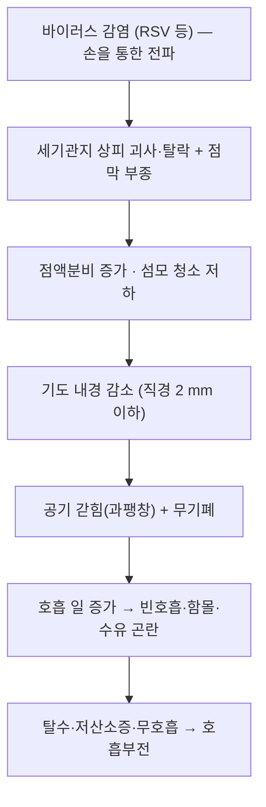

# 🩺 모세기관지염 (Bronchiolitis, 급성 세기관지염)

> **핵심 3줄 요약 (Key Summary)**:
> - 📍 병소 부위 & 병태생리: 직경 2 mm 이하 세기관지의 바이러스성 염증 — 부종·점액분비 증가·괴사세포 탈락으로 기도가 좁아지고 공기 갇힘(과팽창)과 무기폐가 생긴다.
> - 🚩 전형적 임상 양상: 2세 미만 영아에서 콧물·기침 후 2~4일 뒤 천명·빈호흡·흉곽 함몰·수유량 감소. 3개월 미만에서는 무호흡이 첫 증상일 수 있다.
> - 🛠️ 핵심 감별 & 치료 전략: 진단은 임상. 치료는 보존(수분·수유·산소)이며 기관지확장제·스테로이드·항생제는 routine 사용하지 않는다. 예방은 손위생과 RSV 예방 항체([[니르세비맙]])다.
> - ⚠️ 응급 의뢰 레드플래그: 무호흡·청색증·SpO₂ 90% 미만·흉곽 함몰 심함·수유 불가·탈수·축 처짐, 그리고 3개월 미만 영아의 첫 천명은 즉시 응급 평가.

---

## 📌 목차
1. [질환 개요 & 병태생리](#1-질환-개요--병태생리-disease-overview)
2. [병태생리 메커니즘 & 악순환 네트워크](#2-병태생리-메커니즘--악순환-네트워크)
3. [임상 증상 & 환자 소견](#3-임상-증상--환자-소견-clinical-presentation)
4. [감별 진단 매트릭스](#4-감별-진단-매트릭스-differential-diagnosis)
5. [한의 통합 치료 프로토콜](#5-한의-통합-치료-프로토콜-침약침한약)
6. [양방 치료 & 병용·의뢰 기준](#6-양방-치료--병용의뢰-기준-conventional-treatment--referral)
7. [식이·생활습관 & 자가관리 티칭](#7-식이생활습관--자가관리-티칭-가이드)
8. [💡 진료실 핵심 필기 & 임상 노하우](#8--진료실-핵심-필기--임상-노하우)
9. [출처 및 학술 참고 문헌](#9-출처-및-학술-참고-문헌-references)

---

## 1. 질환 개요 & 병태생리 (Disease Overview)

![[모세기관지염_01_병태_정상세기관지_비교도해.jpg|450]]
> [그림 1: 폐·세기관지 위치와 정상 세기관지(상피세포·점액) 대비 세기관지염(부종·점액분비 증가·기도 폐쇄) 단면 비교 — 질병관리청 국가건강정보포털 '세기관지염' <그림. 세기관지염이란>]

* **질환 정의 및 분류**:
  * 모세기관지염은 세기관지(직경 2 mm 이하)의 급성 바이러스성 염증으로, 영아 하기도 폐쇄의 가장 흔한 원인이다. 임상적으로는 첫 발병의 천명·습음이 동반된 급성 하기도 감염으로 정의한다.
  * 호발: 생후 2세 미만, 특히 6개월 미만. 가을~봄 유행. 원인은 호흡기세포융합바이러스(RSV)가 가장 흔하고, 리노바이러스·파라인플루엔자·메타뉴모바이러스·인플루엔자가 뒤를 잇는다.
  * 분류: 중증도에 따라 경증(수유 유지·SpO₂ 정상) / 중등도(빈호흡·함몰·산소 필요) / 중증(무호흡·호흡부전·ICU)으로 나눈다.
* **관련 장기 및 조직**:
  * 주 이환 부위: 세기관지 상피(섬모세포 괴사·탈락)와 점막하 부종.
  * 연관 구조: [[폐렴]]과 달리 폐포 침윤이 주 병변이 아니다(무기폐·과팽창이 동반될 수 있다).
  * 고위험군: [[미숙아]], 기관지폐이형성증, 선천성 심질환, 면역저하, 다태아·어린이집 재원.

---

## 2. 병태생리 메커니즘 & 악순환 네트워크

### 1) 분자·세포 수준 기전
* 바이러스가 기도 상피에 침입하면 염증성 사이토카인·케모카인 분비가 늘고, 점액 생성과 기도 평활근 수축이 함께 증가한다. 괴사 상피와 섬유소가 기도를 막아 “한쪽은 막히고 한쪽은 부풀어 오르는” 불균일 폐쇄를 만든다.
* 영아는 기도 직경이 작고 측부 환기(콘 인공호흡) 통로가 미성숙해, 같은 염증에도 폐쇄가 빠르게 진행한다.

### 2) 장기·계통 수준 결과
* 불균일 폐쇄 → 환기/관류 불균형 → 저산소증. 호흡 일이 늘면 수유량이 떨어지고 탈수가 진행되어 점액이 더 걸쭉해지는 악순환이 생긴다.
* 3개월 미만 영아는 호흡중추 미성숙으로 무호흡이 먼저 나타날 수 있다.

### 3) 위험인자와 진행 단계
* 위험인자 → 상기도 감염기(콧물·기침) → 하기도 침범기(천명·빈호흡, 2~4일) → 회복기(7~10일, 기침은 수주 지속).

---

## 3. 임상 증상 & 환자 소견 (Clinical Presentation)

![[모세기관지염_02_증상_호흡곤란징후_도해.jpg|420]]
> [그림 2: 늑간 함몰·늑골하 함몰·콧구멍 벌렁거림·복부 호흡 등 호흡곤란 징후를 표시한 영아 전신 도해 — 질병관리청 국가건강정보포털 '세기관지염' <그림. 호흡곤란 징후>]

### 1) 주소증 및 핵심 증상
* 전형: 콧물·기침 → 2~4일 뒤 천명(쌕쌕거림)·빈호흡·흉곽 함몰·수유량 감소.
* 비전형: 3개월 미만에서 무호흡, 보챔·수유 거부만 있는 경우, 열은 낮거나 없을 수 있다(고열이 뚜렷하면 다른 감염 감별).
* 악화 인자: 흡연 노출, 건조한 환경, 어린이집 접촉, 조기 이유식.

### 2) 객관적 소견 (Signs & Labs)
* 청진: 미세 수포음·천명, 호기 연장. 빈호흡(연령별 정상 상한 초과), 흉곽 함몰, 코 벌렁거림.
* 산소포화도 측정이 중증도 판단의 핵심. 탈수 소견(소변량 감소·점막 건조·체중 감소).
* 검사: 진단은 임상. RSV 신속검사는 입원·격리 판단에 도움. 흉부 X선은 전형적 모세기관지염에서 routine으로 찍지 않는다(무기폐·폐렴 감별이 필요할 때만).

### 3) 병기·중증도 판정
* 경증: SpO₂ 정상, 수유 유지 → 가정 관리·재방문 교육.
* 중등도: 빈호흡·함몰·산소 필요 → 입원 관찰·수액·산소.
* 중증: 무호흡·SpO₂ 저하 지속·호흡부전 → 고유량 산소·ICU.

---

## 4. 감별 진단 매트릭스 (Differential Diagnosis)

| 감별 질환 | 특징적 양상 | 감별 포인트 (검사·수치) |
| :--- | :--- | :--- |
| [[모세기관지염]] (본 질환) | 첫 발병, 천명+빈호흡, 2세 미만 | 임상 진단, RSV 검사(선택) |
| [[천식]] | 반복성 천명, 아토피 병력, 기관지확장제 반응 | 병력(재발), 가족력, 시험적 치료 반응 |
| [[폐렴]] | 고열·국소 수포음, 전신 상태 저하 | 흉부 X선 침윤, 염증 수치 |
| [[백일해]] | 발작성 기침·흡기성 whoop, 예방접종력 | 백일해 PCR, 접촉력 |
| 이물 흡인 | 갑작스러운 발병, 편측 천명 | 병력·흉부 X선(과투과·편측 과팽창) |
| [[심부전 hf]] | 수유 시 발한·체중 증가 불량, 간비대 | 심초음파 |

> 🚩 레드플래그 감별: 이물 흡인·백일해·세균성 폐렴은 치료 경로가 완전히 다르다. 첫 천명이 3개월 미만이거나 갑작스러우면 이 세 가지를 먼저 배제한다.

---

## 5. 한의 통합 치료 프로토콜 (침·약침·한약)

* **변증 분류**:
  * 풍열폐위(風熱閉肺): 발열·인후 발적·천명·황색 콧물 → 청열 선폐.
  * 풍한속폐(風寒束肺): 맑은 콧물·오한·천명 → 산한 선폐.
  * 담열옹폐(痰熱壅肺): 걸쭉한 가래·수포음·빈호흡 → 청열 화담.
  * 폐비허(肺脾虛): 반복 천명·식욕 저하·땀 → 보폐 건비(회복기).
* **침구 치료 (Acupuncture)**:
  * 영아에는 침습 자극을 최소화한다. 필요 시 30호 이하 세침으로 폐수(BL13)·대추(GV14)·합곡(LI4)에 단자(자극 후 즉시 발침) 수준.
  * 급성기 발열·호흡곤란에는 침보다 산소·수분·수유 관리가 우선이다. 침은 회복기 기침·식욕 관리의 보조로 위치시킨다.
* **약침 치료 (Pharmacopuncture)**:
  * 영아 약침은 근거·안전 자료가 부족해 routine 적용하지 않는다(진료실 원칙).
* **한약 치료 (Herbal Medicine)**:
  * 풍열: [[마행감석탕]] 계열, 담열: [[소청룡탕]]·[[마행감석탕]] 가미(천식 영역의 근거를 준용하되 모세기관지염 자체의 대규모 RCT는 없다).
  * 영아 한약은 용량·맛·복용 순응도 문제로 1~2일 단위 처방과 세심한 관찰이 필요하다.
* **뜸·부항·기타**:
  * [[소아추나]](배부·흉부 경배 5~10분), [[경혈 첩부요법]](폐수·천돌 부위)이 보조로 쓰이나, 급성 호흡곤란에서는 자극을 최소화하고 산소 포화도 확인이 우선이다.

---

## 6. 양방 치료 & 병용·의뢰 기준 (Conventional Treatment & Referral)

![[모세기관지염_03_치료_산소치료방법_도해.jpg|420]]
> [그림 3: 비강 캐뉼라·마스크·고유량 산소치료 세 가지 적용 모습 — 질병관리청 국가건강정보포털 '세기관지염' <그림. 산소 치료 방법>]

* **약물 치료 (Medication)**:
  * 근거 중심 원칙: 기관지확장제(살부타몰)·전신 스테로이드·항생제·거담제는 routine 사용하지 않는다(이득이 일관되지 않음). 항생제는 세균 중복감염이 확인된 경우에만.
  * 흡입 고장성 식염수(3%)는 일부 중증·입원 환자에서 시도되나 모든 환자에 권고되지는 않는다.
  * 해열·수분 보충은 증상 조절 목적.
* **비약물 치료 (Procedures)**:
  * 산소: 저산소증이 있으면 비강 캐뉼라 → 필요 시 고유량 비강 산소(HFNC). 목표 SpO₂는 기관 프로토콜을 따른다(일반적으로 90~92% 이상 유지).
  * 수유·수분: 소량씩 자주. 경구 섭취 불가 시 비위관·정맥 수액.
  * 비강 흡인·생리식염수 점적은 코막힘으로 수유가 어려울 때.
* **수술·시술 적응증 (Surgical Indication)**:
  * 호흡부전 시 기관삽관·기계환기. 무기폐가 지속되면 물리치료·기관지 내시경 고려(드묾).
* **한의 병용 판단 (Combination Therapy)**:
  * 병용 가능: 회복기 한약·소아추나. 주의: 급성기 발열·빈호흡에서 한약 복용이 수유·수분 섭취를 방해하지 않도록 소량·분복.
  * 금기: 산소 치료 중인 영아에 흉부 온열·부항 등 피부 자극은 화상·피부 손상 위험으로 피한다.
* **양방·전문과 의뢰 기준 (Referral Criteria)**:
  * 즉시 응급: 무호흡, 청색증, SpO₂ 90% 미만, 심한 함몰호흡, 수유 불가·탈수, 3개월 미만 첫 천명.
  * 입원 고려: 산소 필요, 수유량 50% 미만 지속, 보호자 관리 역량 부족.

---

## 7. 식이·생활습관 & 자가관리 티칭 가이드

* **식이 지도 (Diet)**:
  * 모유·분유는 농도를 바꾸지 말고 횟수를 늘려 소량씩. 이유식은 급성기에 새로 시작하지 않는다.
  * 물만 먹이는 것은 영아 저나트륨혈증 위험이 있어 권하지 않는다.
* **생활습관 (Lifestyle)**:
  * 실내 습도 30~50% 유지, 가습기 청결 관리(세균·곰팡이 번식 주의). 간접흡연 완전 차단.
  * 손위생: 보호자·형제가 영아를 만지기 전 20초 이상 손 씻기. 호흡기 증상자는 접촉을 피한다.
* **자가관리 (Self-monitoring)**:
  * 집에서 관찰할 4가지 — ① 호흡수와 함몰 ② 수유량(평소의 절반 이하인가) ③ 소변 기저귀 횟수 ④ 처짐·보챔 정도. 야간에 악화될 수 있어 밤중 1회 확인.
* **환자 교육 스크립트**:
  * “이 병은 항생제로 빨리 낫는 병이 아닙니다. 숨쉬기 편하게 하고 물과 수유를 충분히 하는 것이 치료의 중심입니다. 숨이 가빠지거나 갈비뼈 사이가 들어가고, 평소의 절반도 못 먹거나 소변이 줄면 바로 응급실로 오셔야 합니다.”
* **정기 추적 항목**:
  * 48시간 내 재평가(악화 시 즉시), 회복 후 2~4주 기침 지속 여부, 반복 천명 시 [[천식]] 감별.

---

## 8. 💡 진료실 핵심 필기 & 임상 노하우

* **실전 문진 체크리스트**:
  * ① 생후 월령(3개월 미만은 기준이 다르다) ② 수유량 변화(%) ③ 소변 횟수 ④ 열의 정도와 지속 ⑤ 형제·어린이집 접촉력 ⑥ 미숙아·심질환 병력.
* **치료 순서 및 노하우**:
  * 한의원에서 가장 중요한 역할은 치료가 아니라 선별·의뢰다. 청진과 SpO₂ 측정 없이 “감기”로 넘기면 위험하다.
  * 회복기 기침이 2주 이상 남으면 한약·소아추나의 좋은 적응이지만, 그 전에 무기폐·폐렴·백일해를 배제한다.
  * RSV 시즌(10~3월)에는 산모 진료 때 “아기 예방항체 접종 여부”를 함께 확인한다 — 시즌 중 출생아는 출생 직후 접종이 원칙이다.
* **환자 티칭 스크립트**:
  * “예방 주사(니르세비맙)는 백신이 아니라 바이러스를 막는 항체입니다. 한 번 맞으면 시즌 내내 도움이 되지만 100% 예방은 아니어서 손 씻기와 환기가 여전히 중요합니다.”
* **상부에 담지 못한 고유 필기**:
  * 흉부 X선은 “전형적 모세기관지염에서는 찍지 않는다”가 최근 권고다. 찍어서 나온 과팽창을 폐렴으로 오독하지 않도록, 영상은 임상 경과와 불일치할 때만 의뢰 검사로 쓴다.

---

## 9. 출처 및 학술 참고 문헌 (References)

1. **질병관리청 국가건강정보포털 — 세기관지염(콘텐츠 6736)** [링크](https://health.kdca.go.kr)
   - [연구 요약] 정의·원인·증상·진단·치료·합병증·예방(팔리비주맙·니르세비맙·산모 백신)을 한국어로 정리한 환자·임상 교육 자료. 본 노트의 §3·§6·§7 서술과 그림 1~3의 출처다(공공저작물 제4유형, 출처표시·변경금지).
   - 포털 참고문헌: 대한소아알레르기호흡기학회. 소아알레르기호흡기학 제4판(2025) · Dalziel SR, et al. *Bronchiolitis*. Lancet 2022;400(10349):392–406 · Friedman JN, et al. *Avoid doing chest x rays in infants with typical bronchiolitis*. BMJ 2021;375:e064132.
2. **Hammitt LL, et al. (2022)**. *Nirsevimab for Prevention of RSV in Healthy Late-Preterm and Term Infants*. **New England Journal of Medicine**, 386(9), 837–846. [PMID 35235726](https://pubmed.ncbi.nlm.nih.gov/35235726/)
   - [연구 요약] 건강한 후기 조산아·만삭아 1,490명에서 RSV 하기도 감염이 1.2% vs 5.0%(예방효과 74.5%) — 예방 항체의 임상 근거.
3. **EMA Beyfortus 제품정보(SmPC)** — [링크](https://www.ema.europa.eu/en/documents/product-information/beyfortus-epar-product-information_en.pdf)
   - [연구 요약] RSV F 단백질 prefusion 형태 차단 기전과 용량(5 kg 미만 50 mg / 이상 100 mg) 기준.
