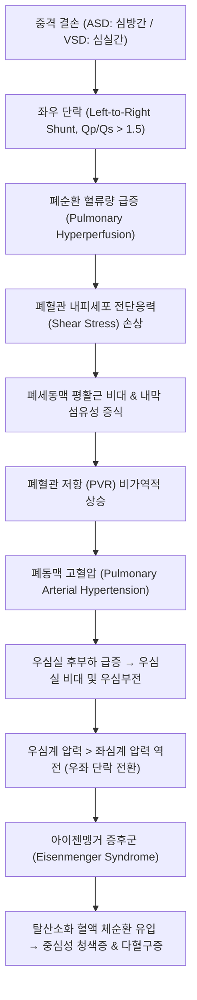

# 🩺 [[심방과 심실 중격 결손]] (Atrial & Ventricular Septal Defects, Q21.0 / Q21.1)

> **핵심 3줄 요약 (Key Summary)**:
> - 📍 **병소 부위 & 병태생리**: 좌우 심방 사이의 중격 결손([[심방 중격 결손]], ASD) 또는 좌우 심실 사이의 중격 결손([[심실 중격 결손]], VSD)으로 인해 체순환계에서 폐순환계로 혈류가 누출되는 **좌우 단락(Left-to-right shunt)**이 발생하며, 폐혈류량 증가($\text{Qp/Qs} > 1.5$)에 따른 폐동맥압 상승 및 비가역적 폐혈관 폐쇄 질환인 [[아이젠멩거 증후군]](Eisenmenger syndrome)으로 진행할 수 있는 선천성 심장병(CHD) 최다 빈도 질환임.
> - 🚩 **전형적 임상 양상 & 핵심 청진 소견**:
>   - **ASD**: 광범위하고 호흡 주기에 변동이 없는 **고정성 제2심음 분열(Wide fixed split S2)**과 폐동맥 판막 부위의 수축기 구혈성 잡음.
>   - **VSD**: 좌측 흉골하연(3~4번째 늑간)의 거칠고 날카로운 **전수축기 잡음(Pansystolic murmur)**, 대형 결손 시 생후 2~8주경 심부전(수유 시 발한, 호흡곤란, 체중 미달, 잦은 폐렴) 발현.
> - 🛠️ **핵심 감별 & 한·양방 치료 전략**: 소형 결손은 자연 폐쇄(Spontaneous closure)를 관찰하며, 혈역학적 유의한 단락($\text{Qp/Qs} \ge 1.5$)이나 심부전 동반 시 이뇨제([[푸로세마이드]], [[스피로놀락톤]]) 및 [[ACE 억제제]]로 내과적 조절 후 **경피적 도관 폐쇄술(Transcatheter device closure)** 또는 **개심 패치 봉합술**을 시행하고, 한의학에서는 심기허(心氣虛), 심양허(心陽虛), 수음능심(水飮凌心) 변증에 따라 [[생맥산]], [[영계출감탕]], [[진무탕]]으로 심폐 기능 및 성장 발육을 보조함.
> - <font color="#fa7e7e">⚠️ **응급 의뢰 레드플래그**: 안정 시 흉곽 함몰을 동반한 호흡곤란(호흡수 분당 60회 이상), 수유 곤란으로 인한 체중 감소 및 탈수, 중심성 청색증(입술 및 조갑 청자색), 산소포화도 $\text{SpO}_2 < 90\%$ 강하, 또는 기존 수축기 잡음이 갑자기 약해지며 제2심음이 극단적으로 항진되는 아이젠멩거 증후군 전환 의심 시 소아청소년과/소아심장과 응급센터 즉시 전원.</font>

---

## 📌 목차
1. [질환 개요 & 병태생리 (Disease Overview)](#1-질환-개요--병태생리-disease-overview)
2. [병태생리 메커니즘 & 대사·장기부전 악순환 네트워크](#2-병태생리-메커니즘--대사장기부전-악순환-네트워크)
3. [임상 증상 & 환자 소견 (Clinical Presentation)](#3-임상-증상--환자-소견-clinical-presentation)
4. [감별 진단 매트릭스 (Differential Diagnosis)](#4-감별-진단-매트릭스-differential-diagnosis)
5. [한의 통합 치료 프로토콜 (침·약침·한약)](#5-한의-통합-치료-프로토콜-침약침한약)
6. [양방 치료 & 병용·의뢰 기준 (Conventional Treatment & Referral)](#6-양방-치료--병용의뢰-기준-conventional-treatment--referral)
7. [식이·생활습관 & 자가관리 티칭 가이드](#7-식이생활습관--자가관리-티칭-가이드)
8. [💡 진료실 핵심 필기 & 임상 노하우 (Melt-In 잔여 심화 집약)](#8--진료실-핵심-필기--임상-노하우-melt-in-잔여-심화-집약)
9. [출처 및 학술 참고 문헌 (References)](#9-출처-및-학술-참고-문헌-references)

---

## 1. 질환 개요 & 병태생리 (Disease Overview)

### 1) 질환 정의 및 발생학적 분류
* **선천성 심장병(Congenital Heart Disease, CHD)의 역학**:
  * 출생아 1,000명당 약 8~10명에서 선천성 심기형이 발생하며, 이 중 심실 중격 결손(VSD)과 심방 중격 결손(ASD)이 전체의 40% 이상을 차지한다.
  * **[[심실 중격 결손]](VSD)**: 단독 선천 심기형 중 **발생 빈도 1위(25~35%)**.
  * **[[심방 중격 결손]](ASD)**: 단독 선천 심기형 중 3~4위(7~10%)이며, 성인에서 뒤늦게 발견되는 선천 심기형 중에서는 1위를 차지한다.

```
[심방 중격 결손(ASD) 및 심실 중격 결손(VSD)의 해부학적 아형 분류]

 ┌───────────────────────────────────────────────┐
 │             심방 중격 결손 (ASD)               │
 ├───────────────────────────────────────────────┤
 │ 1. 이차공 결손 (Ostium secundum, 75~80%)      │ → 난원와(Fossa ovalis) 부위 결손, 도관 폐쇄술 적응증
 │ 2. 일차공 결손 (Ostium primum, 15%)          │ → 심방 중격 하부, 승모판/삼첨판 기형(방실중격결손) 동반
 │ 3. 정맥동 결손 (Sinus venosus, 5~10%)        │ → 상대정맥/하대정맥 입구부, 부분 폐정맥 환류 이상 동반
 │ 4. 관상정맥동 결손 (Coronary sinus, < 1%)     │ → 관상정맥동 지붕 결손으로 인한 좌우 단락
 └───────────────────────────────────────────────┘

 ┌───────────────────────────────────────────────┐
 │             심실 중격 결손 (VSD)               │
 ├───────────────────────────────────────────────┤
 │ 1. 막양부 결손 (Perimembranous, 70~80%)       │ → 삼첨판 중격엽 인접부 결손, 자연 폐쇄율 높음
 │ 2. 근성부 결손 (Muscular, 15~20%)             │ → 심실 근육층 결손, 소아기 자연 폐쇄율 가장 높음
 │ 3. 누두부/판막하 결손 (Subarterial/Conal, 5~10%)│ → 대동맥판 및 폐동맥판 직하부, 대동맥판 탈출 및 AR 위험
 │ 4. 유입부 결손 (Inlet, 5%)                    │ → 삼첨판륜 직하부 결손, 다운 증후군 방실중격결손과 연관
 └───────────────────────────────────────────────┘
```

### 2) 주 이환 장기 및 혈역학적 특성
* **주 이환 부위**:
  * **ASD**: 좌심방압($5\sim 8\text{ mmHg}$)이 우심방압($2\sim 4\text{ mmHg}$)보다 높고, 우심실의 순응도(Compliance)가 좌심실보다 훨씬 우수하므로 좌심방에서 우심방으로 혈류가 지속 유입된다. 이로 인해 **우심방·우심실 용적 과부하(Volume overload)** 및 폐혈관 순환량 증가가 초래된다.
  * **VSD**: 좌심실 수축기압($100\text{ mmHg}$)과 우심실 수축기압($25\text{ mmHg}$)의 거대한 압력 구배(Pressure gradient)로 인해 수축기 동안 대량의 혈액이 좌심실에서 우심실로 분출된다. 이 혈류는 우심실을 거쳐 즉시 폐동맥으로 뿜어져 나가므로, **폐혈관 용적 및 압력 과부하**, 나아가 폐정맥을 통해 좌심방으로 돌아오는 혈류량 증가로 **좌심방·좌심실 용적 과부하**가 동시에 발생한다.
* **합병증 표적 장기**:
  * 폐혈관(폐동맥고혈압, 폐세동맥 섬유화), 우심실(비대, 심실부전), 좌심실(용적 과부하에 따른 심부전), 심장 판막(대동맥판 탈출 및 역류, 삼첨판 역류), 심전도 전도계(부정맥, 각차단, 심방세동).

---

## 2. 병태생리 메커니즘 & 대사·장기부전 악순환 네트워크



### 1) 혈류 역학적 메커니즘 (Hemodynamics)
* **단락량(Shunt Volume) 결정 요인**:
  1. 결손의 해부학적 크기 (절대 직경 및 체표면적 대비 크기).
  2. 체순환계와 폐순환계의 혈관 저항 비율($\text{SVR} / \text{PVR}$).
  3. 좌심실과 우심실의 이완기 순응도(Compliance) 차이.
* **신생아기 폐혈관 저항의 변화**:
  * 태아기에는 높은 폐혈관 저항으로 인해 폐혈류가 적지만, 출생 후 첫 호흡과 함께 PVR이 급격히 떨어진다.
  * 그러나 만삭아에서도 PVR이 성인 수준으로 완전히 떨어지는 데는 **생후 2~8주**가 소요된다.
  * 따라서 대형 VSD 환아라도 출생 직후에는 PVR이 높아 단락량이 적어 잡음이 작고 증상이 없다가, **생후 1~2개월경 PVR이 최저로 떨어지면서 좌우 단락이 폭발적으로 증가하여 급성 심부전 증상이 발현**한다.

### 2) 폐혈관 폐쇄 질환 및 아이젠멩거 증후군(Eisenmenger Syndrome) 기전
* **병리학적 진행 4단계 (Heath-Edwards 분류)**:
  1. **1단계 (내측 비대)**: 과도한 혈류량에 반응하여 중막 평활근 세포가 증식하고 세동맥 중막이 두꺼워짐 (가역적).
  2. **2단계 (내막 세포 증식)**: 내피세포가 박리되고 내막에 섬유모세포 침윤 (가역적).
  3. **3단계 (내막 섬유화 및 혈관 폐쇄)**: 내막의 동심원상 층판상(Onion-skin) 섬유화로 혈관 내강이 좁아지고 폐쇄됨 (부분 가역적/비가역적 경계).
  4. **4~6단계 (총상 병변 Plexiform lesion 및 괴사성 동맥염)**: 혈관벽의 탄력 섬유가 파괴되고 동맥류성 확장과 혈관망 형성, 비가역적 폐쇄 완료.
* **아이젠멩거 증후군 전환**:
  * 비가역적 폐혈관 폐쇄로 인해 PVR이 전신 체혈관 저항(SVR)을 초과하면, 단락의 방향이 **우좌 단락(Right-to-Left Shunt)**으로 뒤집힌다.
  * 정맥혈(산소포화도 70%)이 산소화되지 못한 채 대동맥으로 흘러들어가 전신 조직으로 공급되므로, **비가역적 중심성 청색증(Cyanosis), 곤봉지(Clubbing of fingers), 속발성 다혈구증(Erythrocytosis), 뇌농양, 객혈, 급성 우심부전**이 발생한다.
  * 이 단계에 도달하면 결손을 막는 수술은 우심실에 급성 후부하 파탄을 일으켜 사망을 초래하므로 **수술적 교정의 절대 금기**가 된다.

---

## 3. 임상 증상 & 환자 소견 (Clinical Presentation)

### 1) 심방 중격 결손(ASD)의 임상 양상
* **소아기 무증상성 특성**: 영유아기 및 소아기에는 우심방과 우심실의 순응도가 높아 증상이 거의 없거나 매우 경미하다. 경미한 피로감, 운동 시 호흡곤란, 또래에 비해 잦은 상기도 감염 정도로 내원하여 진찰 중 우연히 발견된다.
* **핵심 이학적 청진 소견**:
  * **고정성 제2심음 분열 (Wide fixed split S2)**: 호흡(흡기/호기)에 따른 흉강 내 음압 변화와 무관하게 대동맥판 폐쇄음($\text{A}_2$)과 폐동맥판 폐쇄음($\text{P}_2$)의 간격이 항상 넓게 벌어져 고정되어 들림. (좌우 심방 단락으로 우심실 확장기 유입량이 항상 과다하여 폐동맥판 폐쇄가 지연되기 때문).
  * **수축기 구혈성 잡음 (Systolic ejection murmur)**: 좌측 흉골연 상부(2번째 늑간)에서 Grade 2~3/6의 부드러운 수축기 잡음 청진. 이는 **중격 결손 부위를 통과하는 혈류 소리가 아니라, 과다한 혈류가 정상 폐동맥 판막을 통과하면서 생기는 상대적 협착음(Relative pulmonary stenosis)**이다.
  * 삼첨판 부위 확장기 잔류 잡음: 단락량이 많을 경우 삼첨판을 지나는 혈류 증가로 좌측 흉골하연에서 중이완기 잡음(Mid-diastolic rumble) 청진 가능.

### 2) 심실 중격 결손(VSD)의 임상 양상
* **소형 결손 (Maladie de Roger, 결손 직경 $< 3\text{ mm}$)**:
  * 혈역학적으로 무증상이며 정상 성장 발달을 보임.
  * **청진**: 좌측 흉골하연(3~4번째 늑간)에서 **매우 날카롭고 시끄러운 Grade 3~5/6 전수축기 잡음(Harsh pansystolic murmur)** 및 수축기 진전(Thrills) 촉지. 결손이 작을수록 좌우 심실 간의 압력차가 극대화되어 잡음 강도가 오히려 더 크고 거칠다.
* **대형 결손 (결손 직경 $> 6\text{ mm}$ 또는 대동맥 판막륜 크기 이상)**:
  * 생후 2~8주경 PVR 저하와 함께 **급성 울혈성 심부전(Congestive heart failure)** 증상 발현:
    * **수유 곤란(Feeding difficulty)**: 젖을 빨 때 땀을 비 오듯 흘리며 숨이 차서 몇 모금 빨지 못하고 멈춤.
    * **체중 증가 부전(Failure to thrive)**: 대사량 급증과 섭취량 저하로 성장 곡선이 3백분위수 이하로 정체.
    * **빈호흡 및 함몰 호흡**: 안정 시 호흡수 $> 60\text{회/분}$, 늑골하 함몰(Subcostal retraction).
    * **잦은 폐렴**: 폐혈관 울혈로 인한 하기도 감염 취약성.
  * **청진**: 좌우 심실 압력이 같아지면 전수축기 잡음은 오히려 부드러워지거나 짧아지며, 심첨부(승모판 영역)에서 폐정맥 환류 증가로 인한 **중이완기 굴림 잡음(Mid-diastolic rumble)**과 제2심음의 폐동맥 성분($\text{P}_2$)이 강하게 들림.

### 3) 영상 및 특수 검사 소견
* **흉부 X-선 (Chest PA)**:
  * ASD: 우심방 및 우심실 비대, 폐동맥 분절 돌출, 폐혈관 음영 증가(Pulmonary plethora).
  * VSD: 좌심실 및 좌심방 비대(대형 결손), 심비대(Cardiothoracic ratio $\text{CTR} > 55\%$), 폐울혈 소견.
* **[[심초음파]](Transthoracic Echocardiography, TTE)**:
  * 진단의 표준(Gold Standard). 결손의 정확한 위치, 크기, 림(Rim)의 경계 확인.
  * 컬러 도플러로 좌우 단락 분출 제트(Jet)의 유속 및 방향 측정.
  * 삼첨판 역류 제트 속도로부터 우심실 수축기압 및 폐동맥압 추정.
  * 폐혈류량/체혈류량 비($\text{Qp/Qs}$) 계산: $\text{Qp/Qs} > 1.5$이면 혈역학적으로 유의한 중등도 이상 단락.

---

## 4. 감별 진단 매트릭스 (Differential Diagnosis)

| 감별 질환 | 호발 연령 및 핵심 기전 | 핵심 청진 및 영상 감별 포인트 |
| :--- | :--- | :--- |
| **[[심방 중격 결손]] (ASD)** | 소아기~성인기, 좌우 심방간 결손 | 호흡 무관 **고정성 제2심음 분열**, 좌측 흉골연 상부 수축기 구혈성 잡음, 심초음파상 우심계 확장 |
| **[[심실 중격 결손]] (VSD)** | 신생아~영아기 심부전, 좌우 심실간 결손 | 좌측 흉골하연 **거친 전수축기 잡음**, 심첨부 이완기 굴림 잡음, 심초음파상 좌심방/좌심실 확장 |
| **동맥관 개존증 (PDA)** | 조산아 또는 만삭아, 대동맥-폐동맥 연결 | 좌측 쇄골하부 **연속성 기계양 잡음 (Continuous machinery murmur)**, 도약맥 (Bounding pulse) |
| **[[팔로 4징]] (Tetralogy of Fallot, TOF)** | 영아기, 대형 VSD + 폐동맥협착 + 대동맥기승 + 우심실비대 | **청색증성 선천 심장병 1위**, 심실 중격 결손 잡음이 아닌 폐동맥 협착에 의한 수축기 잡음, 무산소 발작(Squatting) |
| **방실 중격 결손 (AVSD)** | 다운 증후군 환아 다발, 심내막상 결손 | 심방 및 심실 중격 동시 결손 + 공통 방실판막, 심전도상 좌축 편위(Superior axis), 중증 심부전 |
| **기능성/무해성 심잡음 (Innocent murmur)** | 학령기 소아 건강검진 시 우연 발견 | Still 잡음(진동성·음악적), 제2심음 정상 분열, 전신 증상 및 심비대 전혀 없음, 자세 변화에 따라 잡음 소실 |

> 🚩 **레드플래그 감별 (즉시 전원 요건)**:
> - **아이젠멩거 증후군(Eisenmenger syndrome) 징후**: VSD 환아에서 거칠던 전수축기 잡음이 갑자기 작아지거나 들리지 않고, 제2심음 폐동맥 성분($\text{P}_2$)이 총소리처럼 쾅쾅 울리며(Loud single/accentuated S2), 입술과 손끝에 청색증이 관찰될 때. (결손이 막힌 것이 아니라 폐고혈압 파탄으로 단락이 멈추거나 우좌로 뒤집힌 신호!).
> - **감염성 심내막염(Infective Endocarditis)**: 결손을 통과하는 고속 와류 부위에 세균이 증식하여 고열, 심잡음 변화, 점상 출혈, 비장 비대 발현.

---

## 5. 한의 통합 치료 프로토콜 (침·약침·한약)

*한의학에서 선천성 심장 중격 결손은 선천 품부부족(先天稟賦不足), 태겁(胎怯), 심기부족(心氣不足)으로 인해 장부 기능이 완성되지 못하여 발생하며, **심계(心悸)**, **정충(怔忡)**, **천증(喘證)**, **수종(水腫)**, **감증(疳證)**의 범주에서 변증 시치한다.*

### 1) 변증 분류 및 병기별 병전
1. **심기허약 / 심양부족 (心氣虛弱 / 心陽不足 - 대다수 안정기 및 소형 결손)**:
   * 증상: 안색창백(面色蒼白), 수유 시 다한(多汗), 호흡단속(呼吸短促), 쉽게 피로해함, 사지미랭, 설담태백, 맥침세미(脈沈細微).
   * 치법: 익기보혈(益氣補血), 온양영심(溫陽寧心).
2. **수음능심 / 양허수범 (水飮凌心 / 陽虛水汎 - 심부전 및 울혈 진행기)**:
   * 증상: 기천천촉(氣喘喘促), 해수, 흉협함몰, 안면 및 사지 부종, 간비종대(肝脾腫大), 뇨소(尿少), 설담체(舌淡滯), 태백활(苔白滑).
   * 치법: 온양화음(溫陽化飮), 건비이수(健脾利水), 사폐평천(瀉肺平喘).
3. **기체혈어 / 어혈조체 (氣滯血瘀 / 瘀血阻滯 - 폐고혈압 진행기)**:
   * 증상: 구순자암(口脣紫黯), 조갑청자(爪甲靑紫), 흉협창만, 발육 정체, 설자어점(舌紫瘀點), 맥세삽(脈細澁).
   * 치법: 활혈화어(活血化瘀), 통락개규(通絡開竅).

### 2) 변증별 한약 처방 (Herbal Medicine)
* **심기양허 및 발육 부전 (소형 결손 및 자연 폐쇄 관찰기)**:
  * **[[생맥산]](生脈散) 합 [[보중익기탕]](補中益氣湯) 가감**:
    * 구성: [[인삼]] (또는 [[당삼]]) 6g, [[맥문동]] 8g, [[오미자]] 3g, [[황기]] 10g, [[백출]] 6g, [[진피]] 4g, [[당귀]] 4g, [[원지]] 4g, [[산조인]] 6g, [[감초]] 3g.
    * 해설: 선천적 심기 부족을 보하고 기운을 북돋우며 심근 세포의 산소 대사를 개선하고 영양 섭취 및 체중 증가를 촉진한다.
* **수음능심 및 폐울혈 (심부전 양약 복용 병용기)**:
  * **[[영계출감탕]](苓桂朮甘湯) 합 [[진무탕]](眞武湯) 가감**:
    * 구성: [[복령]] 12g, [[계지]] 4g, [[백출]] 8g, [[포부자]] 2g, [[백작약]] 6g, [[생강]] 3g, [[택사]] 6g, [[저령]] 6g, [[상백피]] 6g, [[정력자]] 4g.
    * 해설: 신양(腎陽)과 비양(脾陽)을 덥혀 수습(水濕)을 배출하고 폐세동맥 울혈을 완화하며, 심실의 용적 과부하를 덜어준다. 양방 이뇨제와 병용 시 전해질 불균형을 예방하는 보신건비 효과를 발휘한다.
* **폐혈관 어혈 정체 및 청색증 경향**:
  * **[[혈부축어탕]](血府逐瘀湯) 합 [[단삼음]](丹蔘飮) 가감**:
    * 구성: [[단삼]] 10g, [[적작약]] 6g, [[천궁]] 4g, [[도인]] 4g, [[홍화]] 3g, [[사인]] 3g, [[단향]] 2g, [[울금]] 4g.

### 3) 소아 침구 치료 프로토콜 (Acupuncture)
*유소아의 경우 유침(留針)을 하지 않고 단자침(점자 후 즉시 발침) 또는 소아 침도(피부 마사지식 접촉침)를 시행한다.*
* **심폐 기능 강화 및 호흡 안정 주혈**:
  * **[[내관]](PC6)**: 심포경 락혈로 심기능 조절, 빈맥 및 호흡곤란 완화.
  * **[[전중]](CV17)**: 기회(氣會) 혈자리로 흉강 내 기운 소통 및 심폐 혈류 순환 촉진.
  * **[[심수]](BL15) & [[폐수]](BL13) & [[궐음수]](BL14)**: 배수혈 자극을 통한 심근 및 폐순환 조절.
* **비위 보양 및 수액 대사 촉진 배혈**:
  * **[[족삼리]](ST36) & [[음릉천]](SP9)**: 후천지본(後天之本) 비위 기능 강화, 체내 저류된 수습 배출.
  * **[[신궐]](CV8) 간접 뜸(온구법)**: 배꼽 부위 뜸 치료로 온양보기(溫陽補氣), 유소아 소화흡수 및 체온 유지 보조.

---

## 6. 양방 치료 & 병용·의뢰 기준 (Conventional Treatment & Referral)

### 1) 내과적 약물 요법 (심부전 조절 및 단락 감소)
* **이뇨제 요법 (용적 과부하 경감)**:
  * **[[푸로세마이드]](Furosemide)**: 루프 이뇨제, $1\sim 2\text{ mg/kg/day}$ 분2~분3 경구 투여. 폐혈관 울혈 및 전신 부종 신속 완화.
  * **[[스피로놀락톤]](Spironolactone)**: 칼륨 보존성 알도스테론 길항제, $1\sim 2\text{ mg/kg/day}$ 병용 투여하여 저칼륨혈증 방지 및 심근 섬유화 억제.
* **후부하 감소제 ([[ACE 억제제]], ACEI)**:
  * **캡토프릴(Captopril)** 또는 **에날라프릴(Enalapril)**: 전신 체혈관 저항(SVR)을 낮춤으로써 체순환 압력을 감소시켜, 좌심실에서 우심실로 새어나가는 **좌우 단락 혈류량을 물리적으로 줄여주는 효과**를 발휘한다. 저혈압 및 신기능 저하 모니터링 필수.
* **강심제 ([[디곡신]], Digoxin)**: 심근 수축력 저하가 동반된 중증 심부전 시 선택적 사용 (치료 농도 범위 $0.5\sim 0.9\text{ ng/mL}$ 엄격 유지).

### 2) 자연 폐쇄율(Spontaneous Closure) 및 경과 관찰
* **VSD의 자연 폐쇄**:
  * 소형 근성부 VSD: 생후 1~2년 이내에 **70~80%가 자연 폐쇄**된다.
  * 막양부 VSD: 삼첨판 중격엽 조직이 결손부를 덮어 주머니 모양의 동맥류 조직(Aneurysm of ventricular septum)을 형성하면서 30~50%에서 자연 폐쇄 또는 현저한 축소가 일어난다(Karagozlu et al., 2026).
  * 판막하(누두부) VSD: 자연 폐쇄가 거의 없으며, Venturi 효과로 대동맥판막이 결손부로 빨려 들어가 탈출(Prolapse)되고 대동맥판 역류(AR)를 초래하므로 **크기가 작더라도 진단 시 조기 수술**이 원칙이다.
* **ASD의 자연 폐쇄**:
  * 영아기 진단된 직경 $3\sim 5\text{ mm}$ 미만의 이차공 ASD는 80% 이상 저절로 닫히거나 임상적 문제가 없으나, 직경 $\ge 8\text{ mm}$ 결손은 자연 폐쇄가 드물다.

### 3) 중재 시술 및 수술적 교정 (Intervention & Surgery)
* **경피적 도관 폐쇄술 (Transcatheter Device Closure)**:
  * **이차공 결손 ASD의 1차 표준 치료**: 대퇴정맥을 통해 기구(Amplatzer Septal Occluder 등)를 진입시켜 결손부를 샌드위치 형태로 막는 시술(Aktas et al., 2026). 개심술에 비해 흉터가 없고 회복이 매우 빠름(입원 기간 2~3일). 결손 주변부 림(Rim)이 $5\text{ mm}$ 이상 유지되어야 안전함.
  * 선택된 근성부 및 막양부 VSD에서도 기구 폐쇄술 적용 확대 추세.
* **개심 패치 봉합술 (Open Heart Surgery with Patch Closure)**:
  * 체외순환기(인공심폐기) 하에 우심방을 열어 자가 심낭편이나 합성 패치(Dacron/Bovine pericardium)로 결손을 봉합.
  * **수술 적응증**:
    1. 약물 치료에 반응하지 않는 심부전 및 성장 부전(Failure to thrive).
    2. 혈역학적 유의한 단락 ($\text{Qp/Qs} \ge 1.5$).
    3. 폐고혈압 진행 징후 (비가역적 혈관 폐쇄 이전인 1세 미만 수술 시행).
    4. 대동맥판막 탈출 및 대동맥판 폐쇄부전(AR)을 동반한 누두부 VSD.

### 4) 감염성 심내막염(Infective Endocarditis) 예방 지침
* 미국심장협회(AHA) 가이드라인 기준:
  * 수술/시술 후 첫 6개월 동안(기구 내피화 기간)은 치과 치료, 침습적 시술 전 **아목시실린(Amoxicillin $50\text{ mg/kg}$ 경구)** 예방적 투여 필수.
  * 결손이 완전히 막힌 후 6개월이 경과하고 잔류 결손이 없다면 더 이상 일상적 항생제 예방요법은 권고되지 않음.

---

## 7. 식이·생활습관 & 자가관리 티칭 가이드

### 1) 고열량 영양 공급 및 수유 지도 (대형 VSD 환아)
* **농축 수유 (High-calorie Feeding)**:
  * 심부전 환아는 호흡근 과다 사용과 교감신경 항진으로 기초대사량이 성인에 비해 30~50% 이상 높다.
  * 일반 분유($20\text{ kcal/oz}$)로는 충분한 열량을 채우기 전에 심장 용적 과부하가 오므로, 특수 분유나 모유 강화제(HMF)를 첨가하여 **$24\sim 27\text{ kcal/oz}$로 농축 수유**한다.
* **소량 분할 수유 (Small Frequent Feeding)**:
  * 1회 수유 시간을 **20~30분 이내**로 제한한다. 그 이상 젖병을 물리면 수유로 소모되는 에너지가 섭취 칼로리를 초과하게 된다.
  * 빨기 힘들어할 경우 십자형 젖꼭지(Cross-cut nipple)를 사용하여 쉽게 나오도록 하고, 필요 시 비위관(L-tube) 영양을 병행한다.

### 2) 생활 관리 및 호흡기 감염 예방
* **RSV(호흡기세포융합바이러스) 예방 접종**:
  * 혈역학적으로 유의한 선천 심장병 환아는 겨울철 유행 시기(10월~3월)에 단클론항체인 **팔리비주맙(Palivizumab, 시나지스)**을 매월 1회 근육 주사하여 중증 모세기관지염 및 폐렴을 예방해야 한다.
* **수분 관리 및 나트륨 제한**:
  * 부종이나 심부전이 심한 경우 소금기가 많은 이유식이나 간식을 피하고 수분 섭취량을 소아심장 전문의와 상의하여 일정 수준으로 조절한다.

---

## 8. 💡 진료실 핵심 필기 & 임상 노하우 (Melt-In 잔여 심화 집약)

### 1) "심잡음 소리가 클수록 병이 가볍고, 잡음이 작아질 때 가장 위험하다"
* 초보 임상의가 가장 흔히 저지르는 실수는 청진기에서 들리는 잡음의 크기(Loudness)와 질환의 중증도를 비례하여 생각하는 것이다.
* **진실의 법칙**:
  * VSD에서 결손이 $1\sim 2\text{ mm}$로 바늘구멍처럼 작으면(Maladie de Roger), 좌심실과 우심실의 거대한 압력 구배 때문에 피가 뿜어져 나오며 **천둥 치듯 시끄러운 잡음**이 들린다. 그러나 아이는 매우 건강하고 정상적으로 성장한다.
  * 반면 결손이 거대하면 양 심실의 압력이 똑같아져(Equilibration) 피가 큰 저항 없이 흘러가므로 **수축기 잡음이 매우 부드럽고 작게 들리거나 거의 들리지 않는다**.
  * 만약 이전에 크게 들리던 수축기 잡음이 사라지면서 아이의 입술이 파래지고 호흡이 가빠진다면, 병이 나은 것이 아니라 **폐고혈압이 극에 달해 아이젠멩거 증후군으로 진입한 절체절명의 위기**이다.

### 2) "ASD의 고정성 분열음(Fixed Splitting)을 잡아내는 30초 청진 팁"
* 정상 소아의 제2심음 분열은 숨을 들이쉴 때(흡기) 흉강 음압으로 정맥 환류가 늘어 $\text{A}_2-\text{P}_2$ 간격이 벌어지고, 숨을 내쉴 때(호기)는 하나로 합쳐진다(호흡성 분열).
* ASD 환아를 진찰할 때는 아이에게 "숨을 깊게 들이쉬어 봐, 이제 천천히 내쉬어 봐" 하고 호흡을 유도하면서 좌측 2번째 늑간에 청진기를 대고 집중한다.
* **들이쉴 때나 내쉴 때나 똑같이 '두-둑, 두-둑' 하고 두 소리가 일정한 간격으로 고정되어 분열**된다면, 묻지도 따지지도 말고 심방 중격 결손을 의심하고 심초음파를 처방해야 한다.

### 3) "수유할 때 이마에 맺히는 식은땀을 보모에게 반드시 물어라"
* 영아기 대형 VSD의 조기 발견에서 가장 예민한 임상 질문은 **"아기가 젖을 빨 때 이마나 콧등에 땀을 유독 많이 흘리나요?"**이다.
* 심부전 상태의 아기는 심박출량을 유지하기 위해 교감신경계(SNS)가 극단적으로 항진되어 있다. 젖을 빠는 것은 아기에게 100미터 전력 질주와 같은 과부하이므로, 교감신경 폭주로 이마에 땀이 흥건해지고 호흡이 가빠져 젖꼭지를 입에 물고 헐떡이게 된다. 이 한마디의 문진이 심부전 돌연사를 막는다.

---

## 9. 출처 및 학술 참고 문헌 (References)

* Karagozlu S, Ramoglu MG, Alimoglu B, et al. (2026). Natural history and management of restrictive perimembranous ventricular septal defects in children: insights from a 30-year experience. *Cardiol Young*. 36(5):712-720. PMID: 42210745.

* Aktas R, Narin N, Yildiz K, et al. (2026). An Encouraging Approach to Complex ASDs: A Multicenter Study. *Pediatr Cardiol*. 47(7):1580-1590. PMID: 41269259.

---

## 관련 노트

- [[심방 중격 결손]]
- [[심실 중격 결손]]
- [[아이젠멩거 증후군]]
- [[심초음파]]
- [[푸로세마이드]]
- [[스피로놀락톤]]
- [[ACE 억제제]]
- [[디곡신]]
- [[생맥산]]
- [[보중익기탕]]
- [[영계출감탕]]
- [[진무탕]]
- [[오령산]]
- [[혈부축어탕]]
- [[단삼음]]
- [[인삼]]
- [[당삼]]
- [[맥문동]]
- [[오미자]]
- [[황기]]
- [[백출]]
- [[복령]]
- [[계지]]
- [[포부자]]
- [[단삼]]
- [[택사]]
- [[저령]]
- [[상백피]]
- [[정력자]]
- [[적작약]]
- [[천궁]]
- [[도인]]
- [[홍화]]
- [[감초]]
- [[내관]]
- [[전중]]
- [[심수]]
- [[폐수]]
- [[궐음수]]
- [[족삼리]]
- [[음릉천]]
- [[신궐]]
- [[공손]]
- [[가와사키병]]
- [[팔로 4징]]
- [[류마티스열]]
- [[소아 고혈압]]
- [[소아 천식]]
