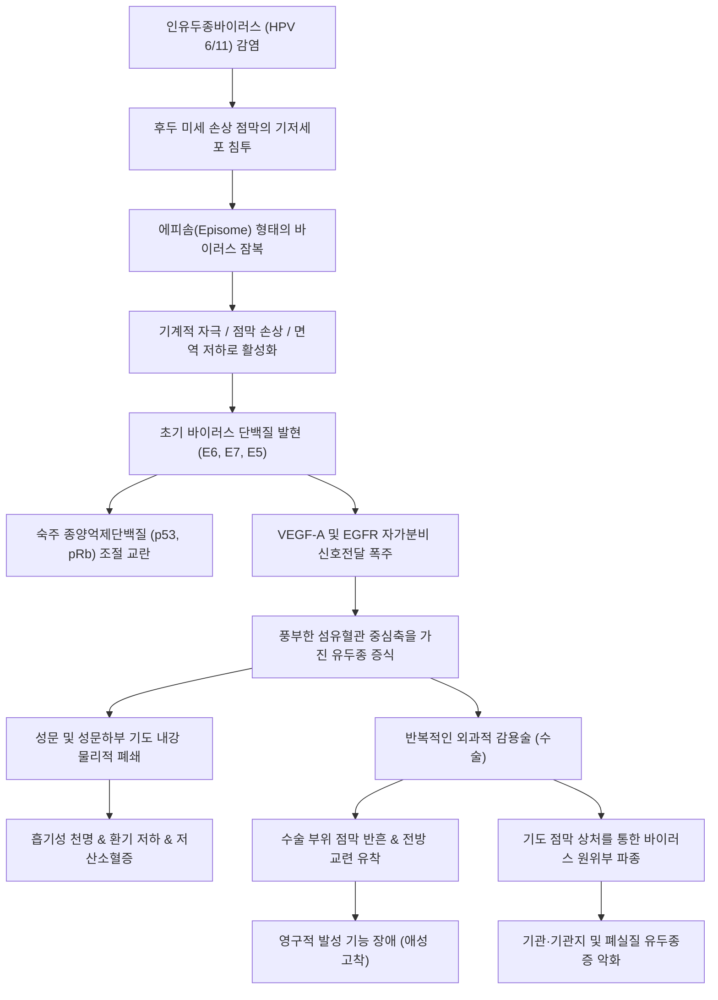

# 🩺 [[재발성 호흡기 유두종증]] (Recurrent Respiratory Papillomatosis, RRP / 復發性呼吸器乳頭腫症, J38.1 / D14.1)

> **핵심 3줄 요약 (Key Summary)**:
> - 📍 **병소 부위 & 병태생리**: 주로 [[성대]](Vocal cord), [[후두]](Larynx), 성문하부 및 기관·기관지의 호흡기 점막-상피 이행부(Squamociliary junction)를 침범하는 양성 상피성 신생물로, 저위험군 [[인유두종바이러스]](Human Papillomavirus, 특히 [[HPV 6]], [[HPV 11]])의 주산기 수직 감염에 의해 기저상피세포가 감염되어 다발성 외장성(Exophytic) 콜리플라워 양상의 사마귀상 유두종이 증식함.
> - 🚩 **전형적 임상 양상 & 3대 징후**: 소아기(생후 수개월~5세경)에 은밀히 시작되어 점진적으로 악화되는 만성 진행성 [[애성]](Hoarseness / 쉰 목소리 및 발성 곤란), 흡기성 및 이상성 [[천명]](Stridor), 기도 폐색에 의한 만성 [[호흡곤란]](Dyspnea)과 흉벽 함몰이 3대 핵심 징후이며, 초기 증상이 흔히 [[크룹]](Croup)이나 [[소아 천식]]으로 오인됨.
> - 🛠️ **핵심 감별 & 한·양방 치료 전략**: 소아 연성 후두내시경을 통해 성대 및 후두의 다발성 유두종 병변을 직시 하에 확인하여 확진하며, 양방적으로는 성대 점막 손상을 최소화하는 [[미세절삭기]](Microdebrider) 및 CO2/KTP 레이저를 통한 감용술(Debulking)을 반복 시행하고 잦은 재발 시 전신/병변내 항-VEGF 제제인 [[베바시주맙]](Bevacizumab) 및 [[시도포비르]](Cidofovir) 보조요법을 적용함. 한의학에서는 풍열급후(風熱急喉)·담어조체(痰瘀阻滯)·기음양허(氣陰兩虛) 변증 하에 [[비파청폐음]], [[청인이후탕]], [[해표이진탕]], [[보중익기탕]] 가감과 [[인영]], [[조해]], [[수돌]], [[합곡]] 자침을 병용하여 수술 후 점막 면역 환경 개선 및 재발 주기 연장을 도모함.
> - <font color="#fa7e7e">⚠️ **응급 의뢰 레드플래그**: 안정 시에도 뚜렷한 흡기성 천명, 흉골상부 및 늑간극 함몰, 비익 호흡, 청색증, 수유 곤란, 기면, 산소포화도 저하($\text{SpO}_2 < 92\%$) 등 급성 상기도 폐쇄 및 호흡부전 징후가 확인되는 경우 즉각적인 소아 기도 확보(기관내삽관 또는 기관절개술 준비) 및 소아 이비인후과 전문 수술팀이 상주하는 3차 상급병원 응급의료센터로 긴급 후송.</font>

---

## 📌 목차
1. [질환 개요 & 병태생리 (Disease Overview)](#1-질환-개요--병태생리-disease-overview)
2. [병태생리 메커니즘 & 대사·장기부전 악순환 네트워크](#2-병태생리-메커니즘--대사장기부전-악순환-네트워크)
3. [임상 증상 & 환자 소견 (Clinical Presentation)](#3-임상-증상--환자-소견-clinical-presentation)
4. [감별 진단 매트릭스 (Differential Diagnosis)](#4-감별-진단-매트릭스-differential-diagnosis)
5. [한의 통합 치료 프로토콜 (침·약침·한약)](#5-한의-통합-치료-프로토콜-침약침한약)
6. [양방 치료 & 병용·의뢰 기준 (Conventional Treatment & Referral)](#6-양방-치료--병용의뢰-기준-conventional-treatment--referral)
7. [식이·생활습관 & 자가관리 티칭 가이드](#7-식이생활습관--자가관리-티칭-가이드)
8. [💡 진료실 핵심 필기 & 임상 노하우 (Melt-In 잔여 심화 집약)](#8--진료실-핵심-필기--임상-노하우-melt-in-잔여-심화-집약)
9. [출처 및 학술 참고 문헌 (References)](#9-출처-및-학술-참고-문헌-references)

---

## 1. 질환 개요 & 병태생리 (Disease Overview)

### 1) 질환 정의 및 임상적 분류
* **정의**: 재발성 호흡기 유두종증(Recurrent Respiratory Papillomatosis, RRP)은 주로 상기도의 호흡기 점막 상피에 양성의 다발성 유두종(Papilloma)이 지속적 또는 반복적으로 발생하는 질환으로, 과거에는 소아기 후두 유두종증(Juvenile Laryngeal Papillomatosis)으로 불렸다. 조직학적으로는 양성이지만, 끊임없이 재발하여 상기도를 폐색하고 수술적 절제를 반복해야 하며, 드물게 기관지 및 폐실질로 파종되어 악성 변성을 일으키는 난치성 만성 기도 질환이다.
* **임상적 분류**:
  * **소아형 (Juvenile-Onset RRP, JORRP)**:
    * 대개 5세 미만(중앙값 2~4세)에 발병하며, 출생 시 모체 산도(Birth canal)를 통과하는 과정에서 수직 감염(Vertical transmission)되는 경우가 주를 이룬다.
    * 성인형에 비해 병변의 증식이 매우 공격적이고 광범위하며, 연간 수회에서 수십 회에 이르는 반복적인 외과적 절제 수술을 요한다.
  * **성인형 (Adult-Onset RRP, AORRP)**:
    * 20~40대에 주로 발병하며, 구강성교 등 성적 접촉을 통한 HPV 전파가 주된 기전으로 간주된다.
    * 단발성 또는 국소적인 경우가 비교적 많고 재발 빈도가 소아형보다 낮으나, 흡연 및 만성 위식도 역류 등과 결합할 경우 편평상피세포암(Squamous cell carcinoma)으로의 악성 전환 위험이 존재한다.

```
[재발성 호흡기 유두종증의 감염 경로, 해부학적 침범 부위 및 진행 스펙트럼]

                     ┌─────────────────────────────────────────┐
                     │ 산모 생식기 HPV 6 / 11 잠재 감염        │
                     └────────────────────┬────────────────────┘
                                          │ 질식 분만 시 양수/분비물 흡인 (주산기 수직 감염)
                                          ▼
                     ┌─────────────────────────────────────────┐
                     │ 후두 점막 미세손상 부위 기저상피세포 감염 │
                     └────────────────────┬────────────────────┘
                                          │ 수개월~수년 잠복기 후 바이러스 활성화
                                          ▼
                     ┌─────────────────────────────────────────┐
                     │ 편평상피 과증식 & 외장성 혈관성 유두종 형성 │
                     └────────────────────┬────────────────────┘
                                          │
        ┌─────────────────────────────────┼─────────────────────────────────┐
        ▼                                 ▼                                 ▼
┌───────────────┐                 ┌───────────────┐                 ┌───────────────┐
│ 성대 / 전교련  │                 │ 성문하부 / 기관│                 │ 원위부 기관지  │
│  (진성대 침범) │                 │  (기도 직경 협착)│                │  및 폐포 파종   │
│ - 지속성 애성  │                 │ - 흡기성 천명   │                 │ - 낭종성 폐병변 │
│ - 발성 완전소실│                 │ - 급성 기도폐쇄 │                 │ - 폐포 파괴·질식│
└───────┬───────┘                 └───────┬───────┘                 └───────┬───────┘
        │                                 │                                 │
        └─────────────────────────────────┴─────────────────────────────────┘
                                          ▼
                     ┌─────────────────────────────────────────┐
                     │ 잦은 수술 절제 → 반흔 유착 & 기도 협착   │
                     │ 만성 호흡부전 및 항-VEGF 전신 요법 필요 │
                     └─────────────────────────────────────────┘
```

### 2) 역학 및 호발 인자
* **발생률 및 유병률**:
  * 소아 10만 명당 약 4명 내외의 유병률을 보이며, 미국 및 유럽 코호트 기준 신규 발생률은 소아 10만 명당 약 0.7~1.2명으로 보고된다.
  * 사회경제적 수준이 낮거나 첫 출산 연령이 어린 산모, 질식 분만(자연분만)을 통해 태어난 환아에서 위험도가 높다.
* **주요 호발 부위 및 이환 조직**:
  * 호흡기 내 섬모원주상피(Ciliated columnar epithelium)와 중층편평상피(Stratified squamous epithelium)가 만나는 **상피-점막 이행부(Squamociliary junction)**에 유두종이 극도로 호발한다.
  * **[[성대]](진성대 및 가성대)**: 전체 환자의 95% 이상에서 침범되며, 특히 발성 시 기계적 마찰이 집중되는 전방 교련(Anterior commissure)에 유두종 군집이 다발한다.
  * **성문하부(Subglottis) 및 기도**: 유두종이 성문하부를 침범하여 기도 단면적을 좁히면 흉부 함몰을 동반한 천명이 발생한다.
  * **기관 및 폐실질(Tracheobronchial and pulmonary tree)**: 환아의 2~5%에서 병변이 기관지를 타고 폐포까지 하향 파종되며, 폐실질 침범 시 낭포성(Cavitary) 폐병변을 형성하고 호흡부전으로 인한 사망률이 급격히 증가한다.

---

## 2. 병태생리 메커니즘 & 대사·장기부전 악순환 네트워크



### 1) 분자·세포 수준 기전
* **바이러스 침투 및 잠복 감염**:
  * 저위험군 점막형 인유두종바이러스인 [[HPV 6]] 및 [[HPV 11]]은 이중나선 DNA 바이러스로, 호흡기 상피 점막의 미세 균열을 통해 기저층(Basal layer)의 원시 상피세포에 감염된다.
  * 바이러스 DNA는 숙주 염색체에 통합되지 않고 에피솜(Episomal form) 상태로 핵 내에 유지되며, 세포 분열 주기에 맞추어 잠복 복제된다.
* **초기 단백질(E6, E7)의 세포 주기 조절 교란**:
  * 비록 고위험군(HPV 16, 18)에 비해 p53의 유비퀴틴화 분해능은 낮으나, HPV 6/11의 E6 및 E7 온코프로틴은 숙주의 망막아세포종 단백질(pRb) 및 p53 경로에 결합하여 세포 분열 억제 신호를 완화시킨다.
  * 기저세포의 분화가 정지되지 않고 비정상적인 유절성 가시세포증(Acanthosis), 각화부전(Parakeratosis), 유두상 돌기 증식을 초래한다.
* **신생혈관 증식과 VEGF-A 경로**:
  * 유두종 병변의 중심부에는 모세혈관이 풍부한 섬유혈관성 기질(Fibrovascular core)이 형성된다.
  * 감염된 상피세포는 혈관내피성장인자([[VEGF-A]])와 표피성장인자수용체([[EGFR]])를 대량 분비하여 신생혈관 형성을 자극하고 종양 증식을 가속화한다. 이 기전이 바로 항-VEGF 표적제제인 [[베바시주맙]] 투여의 핵심 생물학적 근거가 된다.
* **국소 면역 도피 기전**:
  * 감염 부위에서 세포독성 T림프구(CD8+ T cell)의 활성이 억제되고, 조절 T세포(Treg)의 침윤이 증가하며, [[인터페론-감마]](IFN-$\gamma$) 및 IL-2 분비가 억제되는 국소 Th1/Th2 면역 불균형이 발생하여 바이러스를 자연적으로 제거하지 못하고 만성 재발 경로로 접어든다.

### 2) 기도 폐쇄와 반복 수술의 악순환 네트워크
* **생체역학적 협착과 기도 저항**:
  * 유아의 기도는 성인에 비해 직경이 매우 작기 때문에(유아 정상 성문하부 직경 약 4~5 mm), 유두종이 점막을 불과 1 mm만 비후시켜도 포아죄유 법칙(Poiseuille's law, 저항 $\propto 1/r^4$)에 의해 기도 저항은 16배 이상 폭증한다.
* **외과적 수술의 딜레마 (외상-파종 악순환)**:
  * 외과적 절제술(미세절삭기, 레이저 등)은 즉각적인 기도 확보를 위해 불가피하지만, 수술 자체가 정상 점막에 새로운 미세 창상(Epithelial breakdown)을 만든다.
  * 바이러스는 상처 입은 정상 기저세포로 재침투하여 상처 치유 과정에서 새로운 유두종을 증식시킨다.
  * 반복 수술은 전방 성대 교련 유착(Anterior glottic web), 성대 위축, 후두 협착(Laryngeal stenosis) 등 비가역적 음성 파괴와 해부학적 변형을 유발한다.
  * 특히 응급 기도를 위해 시행되는 [[기관절개술]](Tracheostomy)은 절개창 부위로 바이러스를 물리적으로 하향 파종시켜 기관 및 폐포 유두종증을 유발하는 결정적 계기가 될 수 있다.

### 3) 임상 중증도 평가 체계: Derkay 스코어링 시스템
* 유두종의 임상 경과 및 수술 전후 침범도를 객관화하기 위해 국제적으로 널리 통용되는 **Derkay 중증도 점수(Derkay Staging Score)**를 적용한다:
  * **해부학적 점수 (Anatomic Score)**:
    * 후두(진성대 양측, 가성대, 후두실, 후두개, 피열연골, 전방교련, 후방교련), 성문하부, 기관(상/중/하), 기관지, 구강, 인두, 비강 등 25개 해부학적 부위별로 병변의 중증도를 0점(병변 없음)부터 3점(표면의 2/3 이상을 덮거나 50% 이상 내강 협착)까지 매김.
  * **임상적 점수 (Clinical Score)**:
    * 목소리 이상(애성), 천명의 중증도(안정 시/운동 시), 호흡곤란 및 기도 폐쇄 정도를 0~3점으로 평가.
  * 연간 수술 횟수가 4회 이상이거나 Derkay 점수가 20점 이상으로 유지되는 경우 **공격형(Aggressive phenotype)**으로 분류하여 조기에 보조 전신 요법을 검토한다(Arshad et al., 2026).

---

## 3. 임상 증상 & 환자 소견 (Clinical Presentation)

### 1) 주소증 및 질환 진행 단계별 임상 양상
* **초기 단계 (생후 6개월~2세경)**:
  * **만성 진행성 [[애성]](Hoarseness)**: 울음소리가 약해지거나 탁해지며, 쉰 목소리가 수주에서 수개월간 호전 없이 점진적으로 굵어짐. 종종 상기도 감염 후 잔여 증상으로 오인되어 방치됨.
  * **흡기성 이상음**: 활동 시 또는 울 때 가벼운 쌕쌕거림(천명)이 감지됨.
* **진행 단계 (기도 협착기)**:
  * **흡기성 및 양방향성 [[천명]](Biphasic stridor)**: 종양이 자라 성문 틈을 심각하게 가로막으면서 숨을 들이쉴 때뿐만 아니라 내쉴 때도 거친 협착음이 발생.
  * **흡기성 흉벽 함몰**: 흉골상부(Suprasternal notch), 늑간극(Intercostal space), 흉골하부(Subcostal)가 숨을 쉴 때마다 깊게 쑥쑥 빨려 들어감.
  * **발성 소실(Aphonia)**: 진성대의 자유연(Free margin) 전체가 종양으로 덮여 진동이 완전히 소실됨.
* **위험 단계 (급성 기도 폐쇄 및 파종기)**:
  * 수면 시 무호흡, 연하 곤란, 식은땀, 호흡 곤란으로 인한 잦은 수면 분절.
  * 상기도 감염(감기, 후두염)이 겹치면 분비물과 점막 부종이 더해져 수시간 만에 질식 위기(Acute asphyxia)에 직면.
  * 폐실질 파종 시 만성 기침, 객혈, 반복성 폐렴, 체중 감소 발현.

```
[재발성 호흡기 유두종증 환아의 임상 징후 진행 타임라인]

 [초기 잠행기]             [기도 협착기]             [임계 폐쇄기]
 (생후 6~18개월)           (생후 18~36개월)          (응급 상태)
  ├─────────────────────────┼─────────────────────────┤
  │                         │                         │
  ▼                         ▼                         ▼
 · 울음소리 둔화/갈라짐    · 뚜렷한 흡기성 천명      · 안정 시에도 심한 협착음
 · 지속적 쉰 목소리       · 이상성(흡기+호기) 천명  · 흉골상부/늑간 깊은 함몰
 · 기침 시 쇳소리          · 운동 시 호흡곤란        · 발한, 불안, 청색증
 · 감기로 오진(치료 지연)  · 목소리 완전 상실(실성)  · 저산소혈증, 질식 위기
```

### 2) 객관적 신체 검진 및 내시경 소견
* **신체 진찰 소견**:
  * 경부 청진 시 후두 및 기관 부위에서 가장 강하게 들리는 고조도의 거친 흡기성 천명(Stridor).
  * 흉부 청진 시 양측 폐야의 호흡음이 전반적으로 감소되어 있으며 천식과 달리 천명음이 폐포 말초보다 중심 기도에서 현저함.
* **소아 굴곡성 비인두후두경(Flexible Nasopharyngoscopy)**:
  * 외래 진료실에서 즉시 시행 가능한 **표준 확진 검사**.
  * 진성대, 가성대, 후두실, 전방 교련 부위에 다발성의 붉거나 분홍빛을 띠는 외장성(Exophytic), 무경성(Sessile) 또는 유경성(Pedunculated)의 **콜리플라워(Cauliflower) 또는 포도송이 모양 종괴**가 관찰됨.
  * 양측 성대의 접합을 방해하고 성문 틈새(Glottic chink)를 심각하게 협착시키는 양상을 확인.
* **조직병리학적 소견 (생검)**:
  * 중심부의 섬유혈관성 결합조직을 둘러싸고 있는 분화가 잘 된 중층편평상피의 유두상 증식.
  * 기저세포 과형성(Basal cell hyperplasia), 각화부전(Parakeratosis), 및 세포질 내 공포 형성을 보이는 특징적인 **공포세포(Koilocyte)** 관찰.
  * 악성 소견인 이형성증(Dysplasia) 유무를 반드시 확인해야 함.

---

## 4. 감별 진단 매트릭스 (Differential Diagnosis)

| 감별 질환 | 주요 임상 양상 | 감별 포인트 (진단 검사 및 특이 소견) |
| :--- | :--- | :--- |
| **[[재발성 호흡기 유두종증]] (RRP)** (본 질환) | 수개월간 지속되는 진행성 애성, 흡기성 천명, 반복 재발 | **후두경 검사상 콜리플라워 양상 유두종**, HPV 6/11 DNA 양성, 항생제/스테로이드 무반응 |
| **[[후두연화증]] (Laryngomalacia)** | 생후 수주 내 시작되는 흡기성 천명, 수유/앙와위 시 악화 | **목소리 정상(애성 없음)**, 후두경 검사상 흡기 시 피열연골/후두개의 성문 내 허탈, 생후 12~18개월 내 자연 호전 |
| **[[크룹]] (급성 후두기관기관지염)** | 발열, 컹컹거리는 개 짖는 기침(Barking cough), 급성 천명 | 급성 발열 선행, 파라인플루엔자 바이러스 호발, **경구 덱사메사손 및 에피네프린 흡입에 즉각 호전**, 경과 3~7일 |
| **[[급성 후두개염]] (Acute Epiglottitis)** | 급격한 고열, 침흘림(Drooling), 연하 곤란, 삼각대 자세 | 응급 질환, Hib 백신 미접종아, **체리 레드빛(Cherry-red)으로 종창된 후두개**, 경부 X-ray상 엄지징후(Thumb sign) |
| **[[소아 천식]] (Pediatric Asthma)** | 발작성 호기성 천명, 야간 기침, 호흡곤란, 알레르기 소인 | **호기성(Expiratory) 천명 및 나음**, 기관지 확장제(살부타몰)에 반응, 애성(목소리 변화) 없음 |
| **[[성대 결절]] 및 [[성대 폴립]]** | 만성 쉰 목소리, 과도한 소리지름(음성 남용) 병력 | 학령기 소아 호발, 성대 전·중 1/3 경계부 대칭성 결절, **천명이나 기도 폐색 증상 없음**, 종괴가 작고 평활함 |
| **[[기도 이물 흡인]] (Foreign Body)** | 건강하던 소아의 갑작스러운 질식, 기침 발작, 편측 천명 | 이물 흡입의 급성 병력, 청진상 편측 호흡음 감소, 흉부 X-ray상 공기 포획(Air trapping) 또는 무기폐 |
| **[[후두 혈관종]] (Subglottic Hemangioma)** | 생후 수주~수개월경 시작되는 이상성 천명, 피부 혈관종 동반 | 성문하부 편측성 적자색 평활 종괴, 피부 혈관종 동반 흔함, **프로프라놀롤(Propranolol) 경구제에 극적 퇴행** |

> 🚩 **레드플래그 감별 포인트**:
> - **크룹/천식 오진의 위험**: RRP 소아의 대다수가 첫 진단 전 수개월 동안 '재발성 크룹'이나 '난치성 천식'으로 오진되어 흡입 스테로이드만 사용하다가 성문 틈이 1 mm 이하로 좁아진 뒤에야 응급실로 실려온다. **소아에서 3주 이상 쉰 목소리가 지속되거나 천명이 동반된다면 예외 없이 이비인후과 후두경 검사를 시행해야 한다.**
> - **폐실질 파종**: 유두종이 기관지벽을 뚫고 폐포로 전이되면 다발성 폐 공동(Cavity)과 낭종을 형성하며 2차 세균 감염으로 인한 패혈증 및 악성 전환(SCC) 위험이 폭증한다.

---

## 5. 한의 통합 치료 프로토콜 (침·약침·한약)

*한의학에서 재발성 호흡기 유두종증은 전통 한의학의 **풍열급후(風熱急喉)**, **후비(喉痺)**, **음아(瘖啞)**, **후담(喉痰)**, **매핵기(梅核氣)** 의 중증 형태 및 **악창(惡瘡)·식육(息肉)** 범주에 속한다. 주산기 사독(邪毒)의 잠복과 폐신음허(肺腎陰虛), 담탁어체(痰濁瘀滯)가 결합하여 성대 후두에 기체혈어의 식육이 생기는 것으로 파악한다.*

### 1) 변증 분류 및 단계별 병리
1. **풍열온독 / 열독상음 (風熱溫毒 / 熱毒傷陰 - 초기 발현 및 급성 증식기)**:
   * 증상: 갑작스러운 애성 악화, 인두 건조감 및 작열통, 미열, 붉은 설질, 박황태, 부삭맥.
   * 치법: 소풍청열(疏風淸熱), 해독소종(解毒消腫), 청인양음(淸咽養陰).
2. **담탁어체 / 기체담어 (痰濁瘀滯 / 氣滯痰瘀 - 유두종 만성 재발 및 성대 비후기)**:
   * 증상: 쉰 목소리가 장기간 고착됨, 성대에 단단한 콜리플라워양 식육 다발, 가래가 끈적하고 뱉기 어려움, 흉민, 설암자(舌暗紫), 설하낙맥 노창, 활삭맥(滑數脈) 또는 현삽맥.
   * 치법: 화담산결(化痰散結), 활혈화어(活血化瘀), 연견소종(軟堅消腫).
3. **폐신음허 / 허화상충 (肺腎陰虛 / 虛火上衝 - 수술 후 점막 건조 및 위축기)**:
   * 증상: 반복된 수술 후 발성 쇠약, 조금만 말을 해도 목이 잠김, 마른기침, 조열, 도한, 수족심열, 설홍소태, 세삭맥.
   * 치법: 자음강화(滋陰降火), 윤폐생진(潤肺生津), 개음이후(開音利喉).
4. **폐비기허 / 기음양허 (肺脾氣虛 / 氣陰兩虛 - 만성 쇠약 및 면역 저하기)**:
   * 증상: 환아가 안색이 창백하고 잦은 감기에 걸림, 식욕 부진, 자한, 호흡 단촉, 설담태백, 세약맥.
   * 치법: 익기건비(益氣健脾), 보폐고표(補肺固表), 탁독생기(托毒生肌).

```
[재발성 호흡기 유두종증의 한의 변증별 병리 및 치법 매트릭스]

┌───────────────┐     ┌───────────────┐     ┌───────────────┐
│ 풍열온독형    │     │ 담탁어체형    │     │ 폐신음허형    │
│ (급성 증식기) │     │ (만성 재발기) │     │ (수술 후기)   │
└───────┬───────┘     └───────┬───────┘     └───────┬───────┘
        │                     │                     │
        ▼                     ▼                     ▼
 · 인후 작열감/발열   · 성대 식육성 유두종 · 성대 반흔/건조감
 · 급격한 애성 진행   · 끈적한 가래/천명   · 발성 피로/마른기침
        │                     │                     │
        ▼                     ▼                     ▼
 [소풍청열·해독]     [화담산결·활혈]     [자음윤폐·개음]
 [[비파청폐음]] 가감  [[해표이진탕]] 가감  [[백합고금탕]] 가감
 [[청인이후탕]] 합방  [[도홍사물탕]] 가미  [[생맥산]] 합방
```

### 2) 변증별 한약 처방 (Herbal Medicine)
* **초기 급성 증식기 (풍열온독)**:
  * **[[비파청폐음]](枇杷淸肺飮) 합 [[청인이후탕]](淸咽利喉湯) 가감**:
    * 처방 구성: [[비파엽]] 8g, [[황금]] 8g, [[금은화]] 10g, [[연교]] 8g, [[길경]] 6g, [[현삼]] 8g, [[맥문동]] 8g, [[산두근]] 4g, [[사간]] 4g, [[우방자]] 6g, [[감초]] 3g.
    * 방약 해설: [[비파엽]]과 [[황금]]이 폐열(肺熱)을 내리고, [[산두근]], [[사간]], [[금은화]]가 인후 국소의 바이러스성 열독(熱毒)을 청열해독하며, [[길경]]과 [[감초]]가 배농 및 점막 부종을 완화함.
* **만성 반복 증식 및 식육 형성기 (담탁어체)**:
  * **[[해표이진탕]](海藻二陳湯) 가감**:
    * 처방 구성: [[반하]] 6g, [[진피]] 6g, [[복령]] 8g, [[해조]] 8g, [[곤포]] 8g, [[패모]](절패모) 8g, [[하고초]] 10g, [[포공영]] 10g, [[단삼]] 8g, [[도인]] 6g, [[아출]] 4g, [[감초]] 3g.
    * 방약 해설: [[해조]], [[곤포]], [[절패모]], [[하고초]]가 강력한 연견산결(軟堅散結) 작용을 하여 양성 상피성 증식물(유두종)의 성장을 억제하고, [[단삼]], [[도인]], [[아출]]이 미세혈관 신생과 혈액 어체를 제거함.
* **반복 수술 후 성대 반흔 및 만성 쇠약기 (폐비기허 / 기음양허)**:
  * **[[보중익기탕]](補中益氣湯) 합 [[생맥산]](生脈散) 가감**:
    * 처방 구성: [[황기]] 12g, [[인삼]](또는 당삼) 8g, [[백출]] 8g, [[맥문동]] 10g, [[오미자]] 4g, [[백합]] 8g, [[당귀]] 6g, [[진피]] 4g, [[시호]] 3g, [[승마]] 3g, [[감초]] 3g.
    * 방약 해설: 잦은 전신마취 수술로 극도로 손상된 환아의 면역 기능(폐비 원기)을 회복시키고 기도 점막의 상피 재생과 국소 면역 감시 능력을 강화함.

### 3) 침구 치료 프로토콜 (Acupuncture)
* *소아 침치료는 자침 공포를 줄이기 위해 자입 즉시 발침하는 쾌침(단자법) 또는 무통 피내침, 소아 롤러침(이침/접촉침)을 활용한다.*
* **인후 및 성대 국소 기혈 순환 주혈**:
  * **[[인영]](ST9)**: 갑상연골 상연 외측 경동맥 박동부. 후두 순환을 직접 개선하고 점막 부종 완화.
  * **[[수돌]](ST10)**: 갑상연골과 흉쇄유돌근 전연 사이. 후두 및 기관지 통로 개통.
  * **[[천돌]](CV22)**: 흉골병 상연 오목한 중심. 기도 폐쇄 완화, 호흡곤란 및 천명 개선의 요혈.
  * **[[염천]](CV23)**: 설골 상연 중앙. 설하 및 후두근육 긴장 완화, 발성 촉진.
* **원위부 청열해독 및 폐기 선발 배혈**:
  * **[[합곡]](LI4)**: 면구합곡수(面口合谷收). 두경부 및 인후 점막 염증 제어.
  * **[[조해]](KI6) & [[열결]](LU7)**: 팔맥교회혈(음교맥-임맥 배합). 만성 인후 질환, 건조감, 실성(失聲) 치료의 명혈.
  * **[[폐수]](BL13)**: 폐기 숙강 및 선발 기능 강화, 전신 호흡기 면역 증강.
  * **[[풍지]](GB20)**: 두경부 림프 순환 촉진, 바이러스 사기 발산.

### 4) 약침 치료 (Pharmacopuncture)
* **황련해독탕 약침**:
  * 시술 부위: [[인영]](ST9), [[폐수]](BL13), [[풍지]](GB20).
  * 용량 및 방법: 0.1~0.2 cc씩 극미량 피내 또는 얕은 근막에 주입하여 후두 국소의 바이러스성 열독과 염증 반응 억제.
* **신바로 및 중성어혈 약침**:
  * 시술 부위: 외과적 수술 후 성대 유착이나 흉터가 우려되는 시기에 [[수돌]], [[천돌]] 주변 근막에 시술하여 미세혈류 순환 촉진 및 섬유화 반흔 구축 억제.

---

## 6. 양방 치료 & 병용·의뢰 기준 (Conventional Treatment & Referral)

### 1) 수술적 표준 절제술 (Surgical Management)
* **수술의 대원칙**: 완치 목적의 무리한 완전 절제는 성대 구조를 영구 파괴하므로, **"환아의 안전한 기도 확보(Airway Patency)와 음성 보존(Voice Preservation)"**을 치료 목표로 하는 감용술(Debulking)을 원칙으로 한다.
* **외과적 도구의 비교**:
  * **[[미세절삭기]](Microdebrider)**:
    * 현재 소아 RRP의 **1차 표준 절제 도구**.
    * 종양 조직을 흡입하면서 정밀하게 회전 절삭하므로, 레이저와 달리 열 손상(Thermal injury)이 전혀 없어 성대 고유층(Lamina propria) 보존 및 수술 후 전방 교련 유착 빈도를 유의하게 낮춤.
  * **CO2 레이저**:
    * 지혈 효과가 우수하여 출혈성 유두종에 유용하나, 성대 깊은 층으로의 열 전달로 인한 섬유화 및 음성 손상 위험이 미세절삭기보다 높음.
  * **KTP 레이저 및 펄스다이(PDL) 레이저**:
    * 532 nm/585 nm 파장으로 유두종 내부의 비정상적 신생혈관(헤모글로빈)만을 선택적으로 응고·파괴하여 정상 상피 손상을 극소화함.
* **[[기관절개술]](Tracheostomy)의 원칙적 회피**:
  * 기관절개 튜브 삽입은 절개창 부위로 바이러스를 물리적으로 하향 전파시켜 기관 및 폐포 유두종증을 유발하는 강력한 유발 인자임. 생명을 위협하는 극한의 기도 폐쇄를 제외하고는 가급적 피해야 함.

### 2) 보조 약물 요법 (Adjuvant Therapy)
* *연간 4회 이상의 수술이 필요하거나, 기도 폐쇄가 급속히 진행되거나, 후두 외 부위(기관/폐)로 전파될 때 보조 요법을 병용한다.*
* **항-VEGF 표적 항체: [[베바시주맙]](Bevacizumab)**:
  * **병변내 주입(Intralesional injection)**: 수술 시 유두종 기저부에 $2.5\sim 7.5\text{ mg/mL}$ 농도로 국소 주사하여 신생혈관을 퇴행시키고 재발 간격을 연장함.
  * **전신 정맥 투여(Systemic Bevacizumab)**: 기관 및 폐실질까지 침범한 난치성 소아 환아에서 $5\sim 10\text{ mg/kg}$ 용량으로 2~3주 간격 정맥 투여 시 병변의 극적인 퇴행 및 수술 횟수 감소 효과가 입증됨(Almeida et al., 2026).
* **항바이러스제: [[시도포비르]](Cidofovir)**:
  * DNA 중합효소 억제제로, 병변내 국소 주입($1.25\sim 5\text{ mg/mL}$)으로 활용되어 왔으나 잠재적 신독성 및 전암성 이형성증 유발 논란으로 최근 사용 빈도가 감소하고 베바시주맙으로 대체되는 추세임.
* **HPV 백신 (4가 및 9가 백신)**:
  * 치료적 목적으로 가다실9(Gardasil 9) 접종 시 체액성 면역 및 교차 면역 반응을 증강시켜 수술 간격을 연장하고 유두종 성장 속도를 늦추는 보조 효과가 보고됨.

### 3) 한·양방 병용 시 주의사항 및 상호작용
* **외과 수술 직후 한약 투여 타이밍**:
  * 수술 직후 3~5일간은 수술 부위 출혈 예방을 위해 활혈화어제([[도인]], [[홍화]], [[아출]])의 고용량 사용을 배제하고, 지혈 및 점막 재생을 돕는 [[백급]], [[연교]], [[길경]] 위주로 투여함.
* **베바시주맙 투여 환아 병용 주의**:
  * 베바시주맙은 혈관신생을 억제하므로 상처 치유 지연 및 단백뇨, 고혈압 부작용이 발생할 수 있음. 신장 부담을 주는 신독성 약재를 피하고 혈압 및 뇨단백을 모니터링해야 함.

### 4) 응급 전원 및 전문과 의뢰 기준
* **즉시 상급병원 응급실 전원 기준**:
  1. 안정 시에도 흉골상부와 늑간극이 깊게 함몰되는 흡기성 호흡곤란.
  2. 말초 산소포화도가 92% 이하로 급락하거나 입술/손끝의 청색증 발현.
  3. 환아가 숨을 쉬기 위해 안절부절못하며 기면 상태로 빠져드는 경우.
  4. 상기도 감염 증상(고열, 콧물) 발생 후 급격한 천명 악화.

---

## 7. 식이·생활습관 & 자가관리 티칭 가이드

### 1) 발성 위생 및 성대 관리 (Vocal Hygiene)
* **소리지르기 및 속삭이기 금지**:
  * 성대에 무리한 마찰이 가해지면 미세 상처가 발생하여 바이러스 증식이 촉진된다. 환아가 고함을 지르거나 격렬하게 우는 행동을 부드럽게 제한한다.
  * 목소리를 아끼기 위해 '속삭이는 행위(Whispering)'는 성대 내측근에 비정상적인 긴장을 유발하므로 편안하게 낼 수 있는 작은 육성으로 말하도록 교육한다.
* **실내 습도 유지**:
  * 성대 점막이 건조해지면 점막-섬모 청소율(Mucociliary clearance)이 저하되고 감염에 취약해진다. 실내 습도를 50~60%로 상시 유지하고 찬 공기에 노출되지 않도록 마스크를 착용시킨다.

### 2) 위식도 역류(GERD)의 철저한 차단
* 위산과 펩신이 후두로 역류(인후두 역류증, LPR)하면 후두 점막 상피의 보호 장벽이 파괴되어 유두종의 재발률이 2~3배 이상 급증한다.
* **식이 수칙**:
  * 취침 2~3시간 전에는 일체의 음식물 및 우유 수유를 금한다.
  * 초콜릿, 탄산음료, 기름진 음식, 토마토 등 하부식도괄약근을 이완시키는 식품을 철저히 배제한다.
  * 영유아의 경우 수유 후 반드시 20분 이상 트림을 시키고 상체를 30도 정도 높여 재운다.

### 3) 영양 지도 및 면역 식단
* **충분한 수분 섭취**: 미온수를 소량씩 자주 마시게 하여 후두 점막을 촉촉하게 유지한다.
* **항산화 및 점막 재생 식품**:
  * 비타민 A, C가 풍부한 당근, 단호박, 시금치, 브로콜리를 부드러운 죽 형태로 조리하여 공급한다.
  * 한의학적으로 폐음을 자양하는 배즙, 백합죽, 은이버섯 스프를 간식으로 권장한다.
* **자극적 음식 배제**: 맵고 짜거나 거친 질감의 튀김류는 후두 기계적 자극을 유발하므로 금한다.

---

## 8. 💡 진료실 핵심 필기 & 임상 노하우 (Melt-In 잔여 심화 집약)

### 1) "6개월 이상 호전 없는 소아 천식과 만성 크룹, 반드시 성대를 보아라"
* 임상에서 가장 안타까운 경우는 수개월 동안 소아과나 한의원에서 '소아 천식', '기관지염', '감기 뒤끝'이라는 진단 하에 진해거담제나 네뷸라이저(풀미코트, 벤토린)만 반복 흡입하며 치료 골든타임을 놓친 환아들이다.
* **결정적 감별 팁**:
  * 천식의 천명음(Wheezing)은 기본적으로 **호기성(숨을 내쉴 때)**이며 폐야 전반에서 들린다.
  * RRP의 천명음(Stridor)은 **흡기성(숨을 들이쉴 때)**이며, 청진기를 환아의 목(갑상연골 부위)에 대었을 때 가장 크고 거칠게 들린다.
  * 아이가 기침할 때 쉰 소리가 나고 울음소리가 수주 이상 맑게 돌아오지 않는다면, 천식 약을 처방하기 전에 반드시 굴곡성 후두경 검사를 의뢰해야 한다.

### 2) "기관절개술은 악마와의 거래가 될 수 있다"
* 성문 틈이 좁아져 응급 상황이 발생했을 때 성인 기도 관리 습관대로 섣불리 기관절개술(Tracheostomy)을 시행하면 비극적인 결과를 낳을 수 있다.
* 기관지 벽에 절개창을 내고 튜브를 거치하는 순간, 후두에만 국한되어 있던 HPV가 상처 부위를 타고 기관, 주기관지, 분지 기관지, 폐포 말초까지 고속도로를 타듯 파종(Seeding)된다.
* 일단 폐실질로 유두종이 퍼지면 수술적 제거가 불가능해지고 낭종 파열로 인한 기흉, 호흡부전으로 생명이 위태로워진다. 따라서 유두종 환아의 기도는 가급적 미세절삭기를 통한 반복적 성대 감용술로 유지하고 기관절개술은 뇌사 직전의 최후의 순간까지 미루어야 한다.

### 3) "미세절삭기 시대의 발성 보존 전략과 한의학의 역할"
* 과거 CO2 레이저로 유두종을 태워 없애던 시절에는 성대 상피 아래의 고유층(Reinke's space)까지 열 손상을 입어 성대가 뻣뻣하게 굳고 전방 교련이 붙어버리는 영구적 불구가 잦았다.
* 최근에는 미세절삭기로 정상 점막을 최대한 보존하는 최소 침습 감용술이 표준으로 자리잡았다.
* 이 시점에서 한의학의 목표는 종양 자체를 녹여 없애는 것이 아니라(외과적 절제 병행), **수술 후 성대 점막의 혈류 순환을 촉진하여 반흔 유착을 방지하고, 국소 점막의 Th1 면역계를 자극하여 바이러스 재활성화 주기를 늦추는 것**이다. 실제로 [[보중익기탕]]과 [[해표이진탕]] 병용군은 수술 주기(Inter-surgical interval)를 유의하게 연장시키는 임상적 강점을 지닌다.

---

## 9. 출처 및 학술 참고 문헌 (References)

* Almeida FJ, Dos Santos ACC, Almeida Farias CG, et al. (2026). Juvenile recurrent respiratory papillomatosis treated with systemic bevacizumab: A single-center pediatric case series. *Int J Pediatr Otorhinolaryngol*. 210:113024. PMID: 42777554.

* Arshad E, Arshad A, Shafique A, et al. (2026). Long-term predictors of recurrence in pediatric recurrent respiratory papillomatosis. *Eur Arch Otorhinolaryngol*. 283(9):5861-5872. PMID: 42472951.

---

## 관련 노트

- [[성대]]
- [[후두]]
- [[인유두종바이러스]]
- [[HPV 6]]
- [[HPV 11]]
- [[애성]]
- [[천명]]
- [[호흡곤란]]
- [[미세절삭기]]
- [[베바시주맙]]
- [[시도포비르]]
- [[기관절개술]]
- [[크룹]]
- [[소아 천식]]
- [[급성 후두개염]]
- [[후두연화증]]
- [[성대 결절]]
- [[성대 폴립]]
- [[기도 이물 흡인]]
- [[후두 혈관종]]
- [[비파청폐음]]
- [[청인이후탕]]
- [[해표이진탕]]
- [[보중익기탕]]
- [[생맥산]]
- [[도홍사물탕]]
- [[백합고금탕]]
- [[황련해독탕]]
- [[은교산]]
- [[인영]]
- [[수돌]]
- [[조해]]
- [[합곡]]
- [[천돌]]
- [[염천]]
- [[열결]]
- [[폐수]]
- [[풍지]]
- [[곡지]]
- [[음곡]]
- [[금은화]]
- [[연교]]
- [[길경]]
- [[현삼]]
- [[맥문동]]
- [[황금]]
- [[비파엽]]
- [[해조]]
- [[곤포]]
- [[하고초]]
- [[포공영]]
- [[단삼]]
- [[반하]]
- [[진피]]
- [[복령]]
- [[황기]]
- [[인삼]]
- [[백출]]
- [[감초]]
- [[식도 역류증]]
