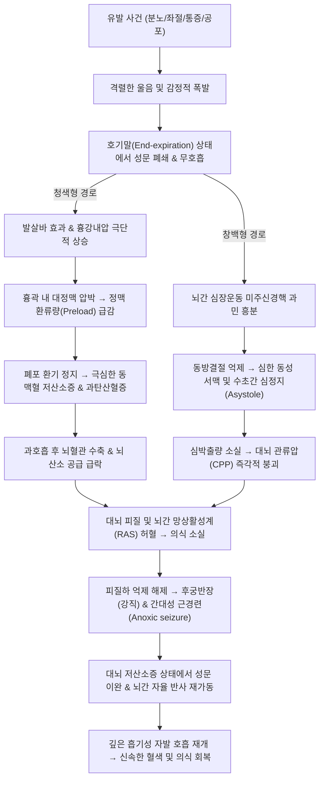

# 🩺 [[호흡 정지 발작]] (Breath-Holding Spells, BHS / 呼吸停止發作, R06.8 / R55)

> **핵심 3줄 요약 (Key Summary)**:
> - 📍 **병소 부위 & 병태생리**: 주로 생후 6~24개월 영유아의 [[뇌간]](Brainstem) 호흡조절중추 및 [[자율신경계]](Autonomic nervous system)의 일과성 미성숙과 철분 대사 이상에 기인하는 비뇌전증성 발작성 사건(Paroxysmal non-epileptic event)으로, 분노·좌절·통증·공포 자극 직후 격렬하게 울다가 날숨(End-expiration) 상태에서 호흡이 불수의적으로 정지되어 흉강내압 상승과 과탄산혈증(청색형) 또는 미주신경 과반사에 의한 급격한 심정지/서맥(창백형)으로 인해 일과성 뇌허혈 및 [[실신]](Syncope)이 발생함.
> - 🚩 **전형적 임상 양상 & 3대 징후**: ① 감정적 자극(분노/좌절)이나 경미한 신체 외상 직후 격렬하게 울다가 호기말 상태에서 소리 없이 숨이 멎음(Silent apnea), ② 안면 및 입술의 급격한 [[청색증]](Cyanosis) 또는 창백화(Pallor), ③ 수초 내의 의식 소실 및 전신 이완(Flaccidity) 또는 후궁반장(Opisthotonos)과 간대성 경련(Clonic jerks)이 이어지며, 30~60초 이내에 깊은 한숨과 함께 의식이 완전히 회복됨.
> - 🛠️ **핵심 감별 & 한·양방 치료 전략**: [[뇌전증]](Epilepsy) 및 심인성 실신([[Long QT 증후군]])과의 감별을 위해 병력 청취(자극 선행성, 발작 후 혼돈 부재)와 정상 [[뇌파검사]](EEG) 및 [[심전도]](ECG)를 확인하며, 높은 상관성을 보이는 [[철분 결핍성 빈혈]]에 대해 경구 철분제(원소철 3~6 mg/kg/day)를 보충하여 발작 빈도를 극적으로 억제함. 한의학에서는 경풍(驚風) 전조, 간기울결(肝氣鬱結), 심담허겁(心膽虛怯), 비허간왕(脾虛肝旺) 변증 하에 [[억간산]], [[포룡환]], [[소건중탕]], [[귀비탕]] 가감과 [[백회]], [[인중]], [[내관]], [[신문]], [[태충]] 자침으로 자율신경 균형과 뇌간 순환을 안정시킴.
> - <font color="#fa7e7e">⚠️ **응급 의뢰 레드플래그**: 울음이나 감정적/통증 유발 인자가 전혀 없이 안정 시 또는 수면 중에 발생하는 호흡 정지, 발작 지속 시간이 1분 이상 지속되는 경우, 발작 회복 후에도 장시간 기면, 혼돈이나 사지 편측 마비(Todd 마비)가 잔류하는 경우, 생후 6개월 미만 영아에서 첫 발작이 시작되거나 심질환 및 급사 가족력이 확인되는 경우 즉시 소아신경과 및 소아심장과 전문 정밀 검사 의뢰.</font>

---

## 📌 목차
1. [질환 개요 & 병태생리 (Disease Overview)](#1-질환-개요--병태생리-disease-overview)
2. [병태생리 메커니즘 & 대사·장기부전 악순환 네트워크](#2-병태생리-메커니즘--대사장기부전-악순환-네트워크)
3. [임상 증상 & 환자 소견 (Clinical Presentation)](#3-임상-증상--환자-소견-clinical-presentation)
4. [감별 진단 매트릭스 (Differential Diagnosis)](#4-감별-진단-매트릭스-differential-diagnosis)
5. [한의 통합 치료 프로토콜 (침·약침·한약)](#5-한의-통합-치료-프로토콜-침약침한약)
6. [양방 치료 & 병용·의뢰 기준 (Conventional Treatment & Referral)](#6-양방-치료--병용의뢰-기준-conventional-treatment--referral)
7. [식이·생활습관 & 자가관리 티칭 가이드](#7-식이생활습관--자가관리-티칭-가이드)
8. [💡 진료실 핵심 필기 & 임상 노하우 (Melt-In 잔여 심화 집약)](#8--진료실-핵심-필기--임상-노하우-melt-in-잔여-심화-집약)
9. [출처 및 학술 참고 문헌 (References)](#9-출처-및-학술-참고-문헌-references)

---

## 1. 질환 개요 & 병태생리 (Disease Overview)

### 1) 질환 정의 및 임상적 아형
* **정의**: 호흡 정지 발작(Breath-Holding Spells, BHS)은 건강한 영유아가 분노, 통증, 좌절, 공포 등 강한 정서적 또는 신체적 자극을 경험한 직후, 울음의 날숨 끝(End-expiration)에서 불수의적으로 호흡을 멈추며 의식 소실과 자세 긴장 변화를 일으키는 흔한 양성 반사성 실신 증후군이다.
* **임상적 아형 (Clinical Subtypes)**:
  * **청색형 (Cyanotic BHS, 약 80~85%)**:
    * 가장 흔한 형태로, 환아가 원하는 것을 얻지 못하거나 혼날 때 분노와 좌절로 격렬하게 소리 내어 울다가 마지막 날숨 상태에서 호흡을 정지함.
    * 수초 내에 입술과 얼굴이 짙은 암적색~청자색으로 변하며, 저산소증과 뇌혈류 감소로 의식을 잃고 전신 강직이나 가벼운 간대성 경련을 나타냄.
  * **창백형 (Pallid BHS / Reflex Anoxic Seizures, 약 15~20%)**:
    * 주로 가벼운 넘어짐, 머리 찧음, 주사 바늘 찔림, 갑작스러운 놀람 등 경미한 통증이나 공포 자극 직후 발생함.
    * 거의 울지 않거나 짧게 외마디 비명을 지른 직후, 과도한 [[미주신경]](Vagus nerve) 심장 억제 반사로 인해 심한 서맥 또는 일시적 심정지가 발생하여 얼굴이 시체처럼 창백해지며 의식을 잃고 축 늘어짐.
  * **혼합형 (Mixed BHS)**:
    * 동일한 환아에서 상황에 따라 청색형과 창백형이 번갈아 나타나는 형태.

```
[호흡 정지 발작의 2가지 신경생리학적 기전 및 아형별 발현 경로]

                         ┌────────────────────────────────────┐
                         │ 유발 자극 (분노·좌절 vs 통증·공포)   │
                         └─────────────────┬──────────────────┘
                                           │
          ┌────────────────────────────────┴────────────────────────────────┐
          ▼                                                                 ▼
┌─────────────────────────────────┐                       ┌─────────────────────────────────┐
│ [청색형] 분노, 좌절, 격렬한 울음│                       │ [창백형] 경미한 외상, 통증, 놀람│
└────────────────┬────────────────┘                       └────────────────┬────────────────┘
                 ▼                                                                 ▼
┌─────────────────────────────────┐                       ┌─────────────────────────────────┐
│ 강한 날숨 끝 호흡 정지 (무호흡) │                       │ 과민한 미주신경 반사 (심장 억제)│
│ 발살바 효과 → 흉강내압 급상승  │                       │ 심한 동성 서맥 및 수초간 심정지│
└────────────────┬────────────────┘                       └────────────────┬────────────────┘
                 ▼                                                                 ▼
┌─────────────────────────────────┐                       ┌─────────────────────────────────┐
│ 우심방 정맥 환류량 급감         │                       │ 심박출량 급락                   │
│ 과탄산혈증 + 극심한 저산소혈증  │                       │ 전신 혈관 허탈 및 뇌관류압 급락 │
└────────────────┬────────────────┘                       └────────────────┬────────────────┘
                 │                                                                 │
                 └────────────────────────┬────────────────────────────────────────┘
                                          ▼
                         ┌─────────────────────────────────┐
                         │ 대뇌 피질 및 뇌간 망상체 무산소증│
                         │ 일과성 의식 소실 (실신)         │
                         │ 전신 이완 / 후궁반장 / 경련 연축│
                         └────────────────┬────────────────┘
                                          ▼
                         ┌─────────────────────────────────┐
                         │ 뇌간 자율신경 재설정 및 자발호흡│
                         │ 30~60초 내 완전 의식 회복       │
                         └─────────────────────────────────┘
```

### 2) 역학 및 자연사 (Natural History)
* **호발 연령**:
  * 생후 6개월에서 24개월 사이에 발병 빈도가 가장 높으며, 발병의 중앙값은 약 12개월경이다. 생후 6개월 미만에 첫 발작이 시작되는 경우는 5% 미만으로 드물다(Alosail et al., 2026).
* **유병률 및 가족력**:
  * 전 세계적으로 건강한 영유아 인구의 약 4~5%에서 발생하며, 남아와 여아 간의 발병률 차이는 거의 없다.
  * 환아의 20~35%에서 부모나 형제자매 중 어린 시절 BHS를 겪었던 가족력이 확인되어 상염색체 우성(불완전 침투율) 유전 소인이 시사된다.
* **예후 및 자연 경과**:
  * BHS는 뇌 손상, 지능 저하, 인지 장애, 영구적 신경학적 후유증을 남기지 않는 **완전 양성 질환**이다.
  * 아이가 성장하여 자율신경계와 뇌간 신경망이 성숙해지는 만 4~6세경이 되면 90% 이상에서 발작이 완전히 자연 소퇴한다. 극히 일부(창백형)의 경우 성인기에 혈관미주신경성 실신(Vasovagal syncope)으로 이어질 수 있다.

---

## 2. 병태생리 메커니즘 & 대사·장기부전 악순환 네트워크



### 1) 분자·대사 수준 기전: 철분 결핍(Iron Deficiency)과의 상관성
* **뇌간 신경전달물질과 철분의 관계**:
  * 체내 저장철 지표인 [[페리틴]](Serum ferritin) 농도가 $30\text{ ng/mL}$ 미만인 철분 결핍 상태의 소아에서 BHS 발병률이 비결핍 소아에 비해 3~4배 이상 높다.
  * 철(Iron)은 도파민, 노르에피네프린, 에피네프린 등 카테콜라민 생합성의 속도조절효소인 **티로신 수산화효소(Tyrosine hydroxylase)**와 세로토닌 합성 효소의 필수 조효소이다.
  * 철분이 결핍되면 뇌간 호흡조절핵 및 자율신경 반사 중추의 모노아민 대사가 교란되어, 감정 흥분 시 뇌간이 호흡 리듬을 정상적으로 재시작(Reset)하지 못하고 무호흡 상태에 고착된다.
  * 또한 철분 결핍은 억제성 신경전달물질인 GABA의 수용체 기능 저하 및 뇌 혈관 운동 긴장도(Vasomotor tone) 조절 장애를 초래하여 뇌 저산소증에 대한 역치를 현저히 떨어뜨린다.
  * 중요한 점은 **빈혈(혈색소 저하)이 없는 잠재적 철분 결핍 환아에서도 철분제를 경구 보충하면 발작 빈도가 80~90% 이상 급격히 감소**한다는 사실이다.

### 2) 신경혈관계 및 심폐혈역학 악순환 고리
* **청색형의 혈역학적 붕괴**:
  * 환아가 숨을 내쉰 상태에서 호흡을 멈추면(지속성 발살바 수기 상태), 흉강 내압이 양압으로 급상승한다.
  * 이로 인해 상대정맥과 하대정맥이 압박을 받아 우심방으로 돌아오는 혈류량(정맥 환류량)이 급감하고, 심박출량이 일시적으로 바닥을 친다.
  * 동시에 폐포 내 가스 교환이 완전히 중단되면서 동맥혈 산소분압($\text{PaO}_2$)은 수초 만에 $30\sim 40\text{ mmHg}$ 이하로 곤두박질치고 이산화탄소분압($\text{PaCO}_2$)은 치솟는다.
  * 울기 직전의 과호흡(Hyperventilation)으로 인해 뇌혈관이 수축된 상태에서 저산소혈증과 혈류 저하가 겹쳐 뇌간 망상활성계(Reticular activating system) 기능이 억제되며 실신에 이른다.
* **창백형의 미주신경 과반사 (Reflex Anoxic Syncope)**:
  * 유전적으로 자율신경계 반응성이 극도로 예민한 소아에서 통증이나 놀람 자극이 감각신경을 통해 뇌간 미주신경 등쪽운동핵(Dorsal motor nucleus of vagus)으로 전달된다.
  * 심근으로 향하는 부교감 미주신경 충격이 폭발적으로 방출되어 동방결절(SA node)을 억제함으로써 **분당 심박수가 20~30회 이하로 급락하거나 심전도상 5~15초 이상 심정지(Asystole/평탄파)**가 발생한다.
  * 뇌관류압이 0으로 떨어지면서 환아는 울음도 거의 터뜨리지 못한 채 즉각적으로 뇌허혈성 실신에 빠진다.

### 3) 발작의 임상 진행 5단계 사이클
1. **유발 및 과호흡 단계 (Trigger & Crying phase)**: 분노, 좌절, 통증으로 인해 1~5초간 격렬하게 소리 내어 운다.
2. **호기말 무호흡 단계 (Apneic phase)**: 강하게 숨을 토해낸 후 입을 벌린 채 소리를 내지 못하고 호흡이 완전히 멎는다 (5~15초).
3. **색조 변화 단계 (Color change phase)**:
   * 청색형: 안면, 구순부, 손톱이 검푸르게 질림 (Cyanosis).
   * 창백형: 얼굴이 잿빛으로 하얗게 질리고 식은땀이 맺힘 (Pallor).
4. **실신 및 운동성 발작 단계 (Syncope & Posturing phase)**:
   * 뇌혈류 중단으로 의식을 잃고 전신 근육이 축 늘어지거나(Atonia), 저산소성 탈억제(Decerebrate posturing)로 인해 등을 뒤로 활처럼 젖히는 후궁반장(Opisthotonos), 전신 강직 및 사지의 미세한 간대성 경련(Clonic twitching) 발현 (10~20초).
5. **자발 호흡 회복 및 각성 단계 (Recovery phase)**:
   * 뇌간 자율신경이 재부팅되면서 성문이 열리고 깊은 흡기성 헐떡임(Gasp)과 함께 정상 호흡이 돌아온다. 수초 내에 혈색이 분홍빛으로 회복되며 의식을 완전히 되찾는다. 발작 후 수면으로 빠져들 수 있으나 혼돈(Confusion)은 없다.

---

## 3. 임상 증상 & 환자 소견 (Clinical Presentation)

### 1) 청색형과 창백형의 임상 양상 비교

```
[호흡 정지 발작 2대 아형 임상 소견 체크리스트]

 특징 구분             청색형 (Cyanotic BHS)               창백형 (Pallid BHS)
 ─────────────────────────────────────────────────────────────────────────────
 호발 유발 원인        분노, 좌절, 고집부림, 훈육          경미한 외상, 통증, 놀람, 공포
 발작 전 울음 양상     매우 크고 격렬하게 울다가 멎음      거의 울지 않거나 짧은 외마디 비명
 안색의 변화           입술과 얼굴의 짙은 청색증(자색)     얼굴 전체가 시체처럼 창백해짐
 주된 병태생리         날숨 호흡정지, 흉강압 상승, 저산소  심장 미주신경 과반사, 심정지/서맥
 실신 시 신체 양상     사지 강직, 후궁반장, 간대성 연축    사지 무력증(이완), 축 늘어짐
 회복 시간             30~60초 내 자발호흡 복귀            15~30초 내 신속한 의식 복귀
```

### 2) 객관적 검사 소견 및 진단적 접근
* **병력 청취 (가장 결정적인 진단 도구)**:
  * 전형적인 BHS는 별도의 침습적 검사 없이 **정확하고 상세한 목격자(보호자) 문진만으로 확진**이 가능하다.
  * 문진 핵심: ① 발작 직전 명확한 감정적/신체적 유발 자극이 있었는가? ② 울음의 날숨 끝에서 호흡이 멈추었는가? ③ 피부 색깔(청색 vs 창백)이 의식 소실보다 먼저 변했는가? ④ 발작 시간이 1분 미만이었는가? ⑤ 의식 회복 후 아이가 즉시 부모를 알아보고 정상 상태로 돌아왔는가?
* **혈액 검사 (필수 루틴 검사)**:
  * 일반혈액검사(CBC), 혈청 철(Serum iron), 총철결합능(TIBC), **혈청 페리틴(Ferritin)** 측정.
  * 혈색소(Hemoglobin)가 정상이라도 혈청 페리틴 수치가 $30\text{ ng/mL}$ 미만으로 저하되어 있다면 잠재적 철분 결핍으로 판정하고 치료 적응증이 된다.
* **심전도 검사 ([[심전도]], 12-lead ECG)**:
  * 창백형 환아 또는 비전형적 발작을 보이는 모든 환아에서 심장 부정맥, 특히 **선천성 [[Long QT 증후군]](LQTS)**을 배제하기 위해 표준 12유도 심전도(QTc 간격 측정)를 반드시 1회 이상 시행해야 한다.
* **뇌파 검사 ([[뇌파검사]], EEG)**:
  * 전형적인 병력을 보이는 BHS에서는 뇌파 검사가 루틴으로 권장되지 않는다.
  * 다만 간질 발작과의 감별이 모호하거나 수면 중 발작, 1분 이상의 장기 경련이 동반된 경우 시행하며, **BHS 환아의 발작 간헐기 뇌파는 100% 정상**이다(발작 중에는 뇌허혈로 인한 전반성 서파 및 평탄파가 일시적으로 관찰될 수 있음).

---

## 4. 감별 진단 매트릭스 (Differential Diagnosis)

| 감별 질환 | 주요 임상 양상 | 구별 포인트 (진단 검사 및 특이 소견) |
| :--- | :--- | :--- |
| **[[호흡 정지 발작]] (BHS)** (본 질환) | 울음/통증 직후 호기말 호흡정지, 청색증/창백, 1분 미만 실신 | **유발 요인 명확, 발작 전 청색증 선행, 발작 간헐기 뇌파(EEG) 정상**, 발작 후 혼돈 없음 |
| **[[뇌전증]] (Epileptic Seizure)** | 무경고성 돌발 발작, 수면 중 발생, 전신 강직간대성 경련 | **유발 요인 없음, 경련 시작 후 청색증 발생**, 발작 후 장시간 혼돈/수면(Postictal state), **뇌파상 뇌전증파(Spike & wave)** |
| **[[열성 경련]] (Febrile Seizures)** | 체온 급상승($\ge 38.0^\circ\text{C}$), 전신 대칭성 경련, 의식 소실 | **고열 동반 필수**, 울음과 무관하게 발열 초기에 발생, 뇌 감염 배제 필요 |
| **선천성 [[Long QT 증후군]] (LQTS)** | 운동, 수영, 급격한 청각 자극(알람 소리) 직후 심장마비/실신 | **심전도상 QTc 연장($> 460\text{ ms}$)**, T파 이상, 급사(SIDS) 가족력, 청색증 없이 급작 실신 |
| **영아 연축 (West Syndrome)** | 생후 4~8개월경 사지를 몸으로 움츠리는 잭나이프형 연속 경련 | 수면에서 깰 때 무리지어(Clustering) 발생, 발달 퇴행 동반, **뇌파상 고부정뇌파(Hypsarrhythmia)** |
| **위식도 역류 무호흡 (Sandifer 증후군)** | 수유 직후 등을 젖히며 목을 비틀고 호흡 곤란을 보임 | 수유와의 시간적 연관성, 구토/체중 미증가, 식도 pH 모니터링상 심한 위식도 역류 확인 |
| **급성 기도 이물 흡인** | 놀거나 식사 중 갑자기 켁켁거리며 호흡곤란 및 청색증 | 음식물/장난감 흡입 병력, **호흡정지가 아니라 헐떡임과 기침 지속**, 흉부 X-ray상 무기폐 |

> 🚩 **레드플래그 감별 포인트**:
> - **뇌전증(간질)과의 결정적 차이**:
>   1. BHS는 **절대로 수면 중에 발생하지 않는다**. 울음이나 자극 없이 잠을 자다가 경련을 한다면 100% 뇌전증이나 기타 신경계 질환이다.
>   2. BHS는 **청색증이 먼저 오고 나서 의식을 잃는다**. 뇌전증은 의식을 잃고 쓰러져 경련을 하다가 호흡근 마비로 뒤늦게 청색증이 온다.
>   3. BHS는 **발작 후 혼돈(Postictal confusion)이 없다**. 뇌전증 환자는 발작 후 수십 분간 멍하거나 횡설수설하지만, BHS 환아는 숨을 쉬자마자 수초 내에 엄마 눈을 똑바로 쳐다본다.

---

## 5. 한의 통합 치료 프로토콜 (침·약침·한약)

*한의학에서 호흡 정지 발작은 전통 소아과 질환인 **경풍(驚風) 전조**, **객오(客忤)**, **만경풍(慢驚風)**, **기궐(氣厥)** 범주에 속한다. 소아의 생리적 특성인 '간상유여 심상부족(肝常有餘 心常不足)'과 '장부교약 신기미충(臟腑嬌弱 神氣未充)'에 기반하여, 분노로 인한 간기상역(肝氣上逆) 및 간풍내동(肝風內動) 또는 놀람으로 인한 심담허겁(心膽虛怯)이 발생한 것으로 변증한다.*

### 1) 변증 분류 및 단계별 병리
1. **간기울결 / 간풍내동 (肝氣鬱結 / 肝風內動 - 청색형 호발)**:
   * 증상: 평소 고집이 세고 화를 잘 냄, 원하는 것이 좌절되면 악을 쓰고 울다가 숨이 멎음, 입술과 안면이 암자색으로 변함, 주먹을 쥐고 몸이 뻣뻣해짐, 설홍태박황, 현삭맥.
   * 치법: 소간해울(疏肝解鬱), 평간식풍(平肝熄風), 안신정경(安神定驚).
2. **심담허겁 / 심양부족 (心膽虛怯 / 心陽不足 - 창백형 호발)**:
   * 증상: 평소 겁이 많고 작은 소리에도 깜짝깜짝 놀람, 가벼운 통증이나 부딪힘에도 안색이 창백해지며 기절함, 식은땀을 흘림, 손발이 차가움, 설담태백, 침세약맥.
   * 치법: 온보심양(溫補心陽), 진심안신(鎭心安神), 익기양혈(益氣養血).
3. **비허간왕 / 영혈부족 (脾虛肝旺 / 營血不足 - 철결핍 빈혈 동반형)**:
   * 증상: 밥을 잘 안 먹고 편식이 심함, 안색이 누렇고 윤기가 없음(위황), 체중이 잘 늘지 않음, 밤에 자주 깨서 보챔(야제), 사소한 자극에도 쉽게 발작함, 설담태백, 세약맥.
   * 치법: 건비화위(健脾和胃), 양혈유간(養血柔肝), 조화영위(調和營衛).
4. **담열내요 (痰熱內擾 - 급성 흥분형)**:
   * 증상: 평소 몸에 열이 많고 갈증을 느낌, 변비 경향, 가슴속이 답답하여 옷을 벗으려 함, 발작 시 목에서 가래 끓는 소리가 남, 설홍태황니, 활삭맥.
   * 치법: 청열화담(淸熱化痰), 영심안신(寧心安神).

```
[호흡 정지 발작의 한의 변증별 병리 및 치법 매트릭스]

┌───────────────┐     ┌───────────────┐     ┌───────────────┐
│ 간기울결형    │     │ 심담허겁형    │     │ 비허간왕형    │
│ (청색형 발작) │     │ (창백형 발작) │     │ (철분결핍 동반)│
└───────┬───────┘     └───────┬───────┘     └───────┬───────┘
        │                     │                     │
        ▼                     ▼                     ▼
 · 분노/좌절 시 격렬   · 가벼운 통증/놀람   · 식욕부진/안색위황
 · 안면 청자색/강직   · 얼굴 창백/식은땀   · 야제/수면불안/쇠약
        │                     │                     │
        ▼                     ▼                     ▼
 [평간식풍·안신]     [온보심양·진경]     [건비양혈·유간]
 [[억간산]] 가감      [[귀비탕]] 가감      [[소건중탕]] 가감
 [[포룡환]] 합방      [[자감초탕]] 합방    [[당귀작약산]] 가미
```

### 2) 변증별 한약 처방 (Herbal Medicine)
* **청색형 및 간기울결 / 간풍내동 환아**:
  * **[[억간산]](抑肝散) 가감 (소아 신경 흥분 및 분노 발작의 대표 처방)**:
    * 처방 구성: [[조구등]] 8g, [[백출]] 8g, [[복령]] 8g, [[당귀]] 6g, [[천궁]] 6g, [[시호]] 4g, [[감초]] 3g, 가미 [[용골]] 8g, [[모려]] 8g, [[백작약]] 8g.
    * 방약 해설: [[조구등]]과 [[백작약]]이 간풍(肝風)을 가라앉히고 중추신경 흥분을 진정시키며, [[시호]]가 간기(肝氣)의 울결을 풀어주고, [[용골]]과 [[모려]]가 중진안신(重鎭安神)하여 감정 폭발 시 뇌간 자율신경계가 과민 반응하는 것을 억제함.
  * 급성 발작 빈도가 잦고 번조가 심할 때: **[[포룡환]](抱龍丸)** 또는 **[[우황포룡환]]**을 1회 미량 온수로 용해하여 취침 전 또는 발작 직후 투여.
* **창백형 및 심담허겁 / 미주신경 과항진 환아**:
  * **[[귀비탕]](歸脾湯) 합 [[자감초탕]](炙甘草湯) 가감**:
    * 처방 구성: [[황기]] 8g, [[당삼]] 8g, [[백출]] 8g, [[복신]] 8g, [[용안육]] 8g, [[산조인]](초) 8g, [[원지]] 6g, [[당귀]] 6g, [[자감초]] 6g, [[생강]] 3편, [[대추]] 2매.
    * 방약 해설: 심담(心膽)의 기혈을 보양하고 미주신경의 과도한 심장 억제 반사를 완화하며 심장 박동의 안정성을 유지함.
* **철분 결핍성 빈혈 및 식욕 부진 동반 환아 (비허간왕)**:
  * **[[소건중탕]](小建中湯) 가감**:
    * 처방 구성: [[백작약]] 12g, [[계지]] 6g, [[자감초]] 4g, [[생강]] 4g, [[대추]] 4매, [[교이]](이당) 20g.
    * 방약 해설: 복통을 완화하고 비위의 소화 흡수 기능을 극대화하여 음식물 내 철분 흡수율을 높이며, 작약과 감초의 작약감초탕 구조가 사지 근육 경련과 신경 긴장을 이완시킴.

### 3) 침구 치료 프로토콜 (Acupuncture)
* *소아의 특성상 통증이 없는 무통 접촉침(소서침, 롤러침), 자입 즉시 빼는 단자법, 또는 스티커형 피내침(압봉)을 적용한다.*
* **급성 발작 시 응급 각성 구급혈**:
  * **[[인중]](GV26)**: 수구(水溝). 손톱 끝으로 강하게 눌러 자극(지압)하면 뇌간 호흡 중추를 반사적으로 자극하여 즉각적인 자발 호흡을 유도함.
  * **[[용천]](KI1)**: 족소음신경의 정혈. 신기(神氣)를 수렴하고 실신에서 깨어나게 함.
* **신경계 진정 및 심신 안정 주혈**:
  * **[[백회]](GV20)**: 독맥의 요혈. 영유아의 신경질, 야제, 흥분을 가라앉히고 뇌혈류를 조화롭게 함.
  * **[[내관]](PC6)**: 심포경의 락혈. 자율신경계 불균형을 교정하고 심장 박동수를 안정화함(서맥 및 빈맥 조절).
  * **[[신문]](HT7)**: 심경의 원혈. 심기(心氣)를 안정시키고 공포와 놀람을 진정시킴.
* **사관혈 및 간기 소통 배혈**:
  * **[[합곡]](LI4) & [[태충]](LR3)**: 기혈의 개폐를 주관하는 사관혈. 울체된 기운을 소통시키고 평간식풍하여 청색증 및 경련을 예방함.
  * **[[심수]](BL15) & [[간수]](BL18)**: 배수혈에 소아 롤러침을 가볍게 굴려 자율신경 간벌을 자극함.

### 4) 약침 치료 (Pharmacopuncture)
* **자하거(Hominis Placenta) 약침**:
  * 적응증: 선천 발육 부진, 만성 철결핍 빈혈 동반, 심담허겁형 창백형 환아.
  * 시술 부위: [[족삼리]](ST36), [[심수]](BL15)에 극미량(각 0.05~0.1 cc) 주입하여 조혈 기능 촉진 및 신경 면역계 안정 도모.

---

## 6. 양방 치료 & 병용·의뢰 기준 (Conventional Treatment & Referral)

### 1) 표준 약물 요법: 철분 보충 요법 (Iron Therapy)
* **경구 철분제의 치료 기전**:
  * 혈색소 수치와 무관하게 혈청 페리틴 수치가 저하되어 있는 환아에게 경구 철분제를 투여하면 뇌간 신경전달물질 대사가 정상화되면서 발작 빈도와 강도가 극적으로 감소함.
* **용량 및 투여 프로토콜**:
  * **약제**: 황산제일철(Ferrous sulfate), 글루콘산제일철 또는 수산화제이철 폴리말토스 복합체 등 소아용 시럽 제제.
  * **용량**: **원소철(Elemental iron) 기준 $3\sim 6\text{ mg/kg/day}$**을 1일 1~2회 분복.
  * **기간**: 최소 2~3개월간 지속 투여하며, 페리틴 수치가 정상화($> 30\text{ ng/mL}$)될 때까지 복용 유지.
  * **치료 반응**: 복용 시작 후 2~4주 이내에 환아의 80% 이상에서 발작 횟수가 절반 이하로 줄어들거나 완전히 소멸됨.

### 2) 기타 약물 및 비약물적 치료
* **항콜린제 (Anticholinergics)**:
  * 적응증: 심각한 심정지(Asystole $> 4$초)가 빈번하여 실신 시 외상 위험이 높은 극소수의 난치성 창백형 환아.
  * 약제: 황산아트로핀(Atropine sulfate $0.01\text{ mg/kg/day}$) 경구 투여. 미주신경의 심장 억제 효과를 차단함.
* **심박동기 삽입 (Cardiac Pacemaker)**:
  * 극히 예외적으로 심정지가 10~20초 이상 지속되어 심폐소생술이 필요했던 난치성 창백형 환아에서 드물게 고려됨.
* **항경련제 (Antiseizure Medications)의 금기**:
  * **호흡 정지 발작은 뇌전증(간질)이 아니므로 페노바르비탈(Phenobarbital), 발프로산(Valproic acid), 카바마제핀 등 항경련제는 치료 효과가 전무하며, 오히려 소아의 인지 발달을 저해하므로 절대 처방해서는 안 된다.**

### 3) 한·양방 병용 시 주의사항 및 상호작용
* **철분제와 한약 복용 간격**:
  * 한약 처방 중 탄닌(Tannin) 성분이 함유된 수렴성 약재([[오미자]], [[지유]], [[가자]])나 고농도의 생약 추출물은 장관 내에서 철분과 결합하여 철의 흡수를 방해할 수 있다.
  * 따라서 **경구 철분제와 한약은 최소 1~2시간의 시간 간격을 두고 복용**하도록 지도한다.
  * 비타민 C가 풍부한 과일즙(오렌지, 사과)과 함께 철분제를 복용하면 흡수율이 크게 향상된다.

### 4) 응급 전원 및 전문과 의뢰 기준
* **즉각적 상급병원 응급실 전원 기준**:
  1. 호흡 정지 및 실신 상태가 1분 이상 지속되며 자발 호흡이 돌아오지 않는 경우 (즉각 119 신고 및 심폐소생술 시행).
  2. 의식 회복 후에도 한쪽 팔다리에 힘이 빠지거나 마비 소견(Todd 마비)이 관찰되는 경우.
  3. 경련 도중 머리를 바닥에 심하게 부딪혀 두개내 출혈이 의심되는 경우.
* **소아신경과 정밀 의뢰 기준**:
  * 유발 요인 없이 수면 중 또는 안정 시에 발작이 발생하는 경우.
  * 하루에 수차례 이상 발작이 연달아 일어나며 빈도가 점진적으로 폭증하는 경우.
  * 영아 연축, 결신 발작 등 비전형적 뇌전증과의 감별이 필요한 경우.

---

## 7. 식이·생활습관 & 자가관리 티칭 가이드

### 1) 발작 발생 시 현장 응급 대처 행동 수칙 (DO & DON'T)

```
[호흡 정지 발작 시 부모 대처 수칙: DO & DON'T 가이드라인]

 ─────────────────────────────────────────────────────────────────────────────
  구분           올바른 행동 (DO)                     절대 금기 행동 (DON'T)
 ─────────────────────────────────────────────────────────────────────────────
  자세           환아를 즉시 바닥에 옆으로          아이를 안아 올리거나 세우지 말 것
                 눕힌다 (측와위: 기도 확보)         (뇌로 가는 혈류를 감소시킴)
 ─────────────────────────────────────────────────────────────────────────────
  신체 자극      주변의 위험한 가구 모서리를         아이를 거칠게 흔들지 말 것
                 치우고 머리를 부드럽게 받친다      (영아흔들림증후군 뇌출혈 위험!)
 ─────────────────────────────────────────────────────────────────────────────
  구강 간호      입안에 이물이 있으면 조심스레      입안에 손가락, 숟가락, 물을 억지로
                 제거한다                           쑤셔 넣지 말 것 (질식·치아손상)
 ─────────────────────────────────────────────────────────────────────────────
  호흡 처치      성문이 열릴 때까지 기다린다        인공호흡을 억지로 불어넣지 말 것
                 (30~60초 내 자발호흡 복귀)         (성문이 닫혀 있어 공기 안 들어감)
 ─────────────────────────────────────────────────────────────────────────────
  기록/관찰      시계를 보고 지속 시간을 재며,      패닉에 빠져 소리를 지르지 말 것
                 가능하면 스마트폰 영상을 촬영한다  (영상이 진료실 확진의 최고 열쇠)
 ─────────────────────────────────────────────────────────────────────────────
```

### 2) 행동학적 악순환 차단 및 훈육 가이드 (Secondary Gain 방지)
* **2차적 이득(Secondary Gain)의 덫**:
  * 아이가 화를 내며 울다가 기절하는 모습을 본 부모는 극심한 공포와 죄책감에 휩싸여, 이후 아이가 떼를 쓸 때마다 요구 조건을 무조건 다 들어주게 된다.
  * 영리한 아이는 무의식중에 **"내가 숨을 멈추고 쓰러지면 부모가 원하는 것을 다 해준다"**는 학습 효과를 얻게 되며, 이는 발작의 빈도를 폭발적으로 늘리는 주원인이 된다(Alfawzan et al., 2026).
* **올바른 훈육 원칙**:
  * 발작이 끝나고 의식이 돌아오면, 부모는 아무 일도 없었던 것처럼 담담하고 차분한 태도를 유지해야 한다.
  * 아이를 과도하게 끌어안고 울거나 달래지 말며, 발작 직전에 아이가 부리던 부적절한 떼쓰기 요구는 **절대로 들어주어서는 안 된다**.
  * "숨을 멈추어도 원하는 것을 얻을 수 없다"는 일관된 경계선을 명확히 인식시켜야 발작이 소멸 단계로 접어든다.

### 3) 철분 흡수 극대화 식단 지도
* **철분 고함량 식품 섭취**:
  * 소고기 안심, 닭간, 굴, 계란 노른자, 조개류 등 생체이용률이 높은 헴철(Heme iron) 식품을 매일 식단에 포함시킨다.
  * 비타민 C가 풍부한 파프리카, 브로콜리, 딸기, 감귤류를 함께 조리하여 비헴철의 장내 흡수를 돕는다.
* **생우유(Cow's milk) 섭취 제한**:
  * 돌 이후 생우유를 하루 500 mL 이상 과다 섭취하는 환아는 우유 단백질에 의한 미세 장출혈과 포만감으로 인한 고형식 거부로 철분 결핍성 빈혈이 매우 흔히 발생한다.
  * 하루 우유 섭취량을 반드시 **$400\sim 500\text{ mL}$ 이하로 제한**해야 한다.

---

## 8. 💡 진료실 핵심 필기 & 임상 노하우 (Melt-In 잔여 심화 집약)

### 1) "부모는 아이가 죽는 줄 알고 응급실로 뛰어온다: 의사의 첫 마디는 안심이다"
* 진료실에 찾아온 호흡 정지 발작 환아의 부모들은 대개 극심한 패닉 상태에 빠져 있다. 눈앞에서 자기 자식의 얼굴이 시퍼렇게 질리며 사지가 굳어 숨을 쉬지 않는 모습을 목격했기 때문이다.
* 의사가 가장 먼저 해야 할 일은 어려운 의학 용어를 설명하는 것이 아니라, 부모의 눈을 똑바로 보며 다음의 문장으로 안심시키는 것이다:
  * *"어머니, 아버님, 정말 많이 놀라셨지요. 하지만 분명히 말씀드리는데, **이 병으로 숨을 영영 쉬지 않거나 뇌 손상을 입거나 사망한 아이는 전 세계 의학 역사상 단 한 명도 없습니다**. 아이의 뇌에는 숨을 강제로 쉬게 만드는 강력한 자동 안전장치가 있어서, 산소가 부족해지면 뇌가 알아서 몸의 힘을 풀고 깊은 숨을 들이쉬게 만듭니다. 완전히 낫는 병이니 안심하십시오."*
* 이 한마디가 부모의 신경증적 불안을 종식시키고 올바른 훈육을 시작하게 만드는 치료의 80%이다.

### 2) "철분제는 빈혈약이 아니라 뇌간 자율신경 조절제다"
* 피검사를 해보면 혈색소(Hb)는 $11.5\text{ g/dL}$로 정상인데 혈청 페리틴(Ferritin)만 $12\text{ ng/mL}$로 뚝 떨어져 있는 아이들이 부지기수다.
* 소아과나 보호자들은 "빈혈이 없는데 왜 철분약을 먹이느냐"고 반문한다.
* 이때 *"철분은 피를 만드는 데만 쓰이는 것이 아니라, **뇌간에서 숨 쉬는 스위치를 껐다 켜는 신경전달물질(도파민, 노르에피네프린)을 만드는 필수 연료**입니다. 지금 아이는 연료가 바닥나서 스위치가 잠시 뻑뻑해진 상태이므로, 철분을 2달만 채워주면 발작 스위치가 부드럽게 정상으로 돌아옵니다"*라고 설명해야 복약 순응도가 100%가 된다.

### 3) "스마트폰 동영상 촬영은 100마디 말보다 정확하다"
* 부모가 말로 설명하는 증상은 공포로 인해 왜곡되기 십상이다. 강직간대성 경련을 "온몸을 미친 듯이 떨었다"고 표현하여 의사가 뇌전증으로 오진하게 만드는 원인이 된다.
* 따라서 부모에게 *"다음에 또 숨을 멈추면 절대 당황해서 흔들지 마시고, 아이를 옆으로 눕힌 뒤 스마트폰으로 얼굴과 전신이 나오게 30초만 동영상을 찍어오세요"*라고 처방하라.
* 진료실에서 그 동영상을 확인하는 순간 5초 만에 BHS와 간질을 100% 감별할 수 있다.

---

## 9. 출처 및 학술 참고 문헌 (References)

* Alfawzan RO, Alarifi NA, Alshammari SH, et al. (2026). Assessment of Knowledge and Attitudes Related to Breath-Holding Spells Among Adults in Riyadh, Saudi Arabia. *Cureus*. 18(6):e110373. PMID: 42416931.

* Alosail A, Al-Ghamdi AS, Alsubaie MA, et al. (2026). Neonatal-onset cyanotic breath-holding spells: a case report with longitudinal diagnostic dilemma. *Front Pediatr*. 14:1783586. PMID: 42023281.

---

## 관련 노트

- [[미주신경]]
- [[자율신경계]]
- [[철분 결핍성 빈혈]]
- [[뇌전증]]
- [[열성 경련]]
- [[실신]]
- [[저산소증]]
- [[청색증]]
- [[서맥]]
- [[심전도]]
- [[뇌파검사]]
- [[페리틴]]
- [[Long QT 증후군]]
- [[억간산]]
- [[포룡환]]
- [[소건중탕]]
- [[귀비탕]]
- [[백호탕]]
- [[황기건중탕]]
- [[자감초탕]]
- [[당귀작약산]]
- [[시호간신탕]]
- [[안신환]]
- [[도담탕]]
- [[조구등]]
- [[백출]]
- [[복령]]
- [[당귀]]
- [[천궁]]
- [[시호]]
- [[감초]]
- [[용골]]
- [[모려]]
- [[백작약]]
- [[황기]]
- [[인삼]]
- [[복신]]
- [[용안육]]
- [[산조인]]
- [[원지]]
- [[자감초]]
- [[계지]]
- [[교이]]
- [[백회]]
- [[인중]]
- [[내관]]
- [[신문]]
- [[태충]]
- [[합곡]]
- [[용천]]
- [[족삼리]]
- [[심수]]
- [[간수]]
- [[삼음교]]
- [[십선]]
- [[기도 이물 흡인]]
