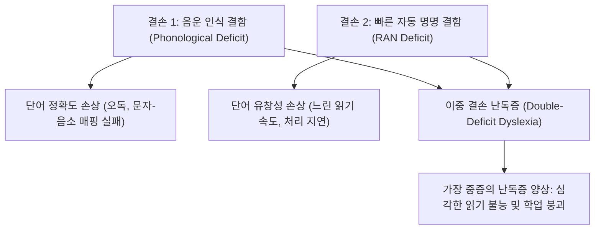
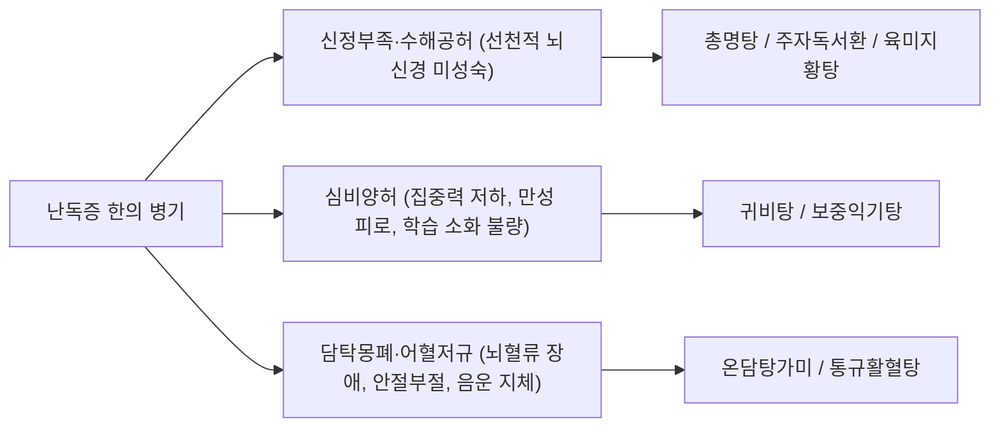

# 🩺 난독증 (Developmental Dyslexia / 특수학습장애-읽기 손상, F81.0)

> **핵심 3줄 요약 (Key Summary)**:
> - 📍 **병소 부위 & 해부·병태생리**: 정상 지능(IQ ≥ 85)과 적절한 교육 환경에도 불구하고 발생하는 신경발달학적 장애로, 좌측 대뇌 반구의 [[측두두정엽]](Temporo-parietal region) 음운 해독 회로 및 후두-측두엽 [[시각단어형태영역]](Visual Word Form Area, VWFA)의 기능적 저활성화와 [[궁상속]](Arcuate fasciculus)을 통한 백질 연결성 결손에 의해 발생한다.
> - 🚩 **전형적 임상 양상**: 단어 재인(Word recognition)의 부정확성과 느린 속도, 부호화 및 철자법(Spelling) 장애, [[음운 인식]](Phonological awareness) 저하, [[빠른 자동 명명]](Rapid Automatized Naming, RAN) 결함의 이중 결손(Double-deficit). 학령기 아동에서 읽기 회피, 잦은 오독, 받침 글자 탈락 및 2차적인 학업 성취 저하가 관찰된다.
> - 🛠️ **핵심 검사 & 치료 전략**: [[K-WISC-V]] 지능 검사를 통한 잠재 지능 확인; BASA-R, K-TELD, 종합학습능력검사를 통한 읽기 영역 정밀 평가; 구조화된 다감각 음운 인식 훈련(Orton-Gillingham 접근법) 및 학교 내 평가 시간 연장·음성 리더기 지원; 한의학적 [[심비양허]](心脾兩虛)·[[신정부족]](腎精不足)·[[담탁몽폐]](痰濁蒙蔽) 변증 기반 [[귀비탕]], [[총명탕]], [[주자독서환]] 처방과 두침(언어구, 인지구) 및 [[백회]], [[사신총]], [[신문]], [[내관]] 침구 치료.
> - <font color="#fa7e7e">⚠️ **응급 의뢰 레드플래그**: 정상 발달하던 아동에서 급작스럽게 나타나는 읽기·쓰기 기능의 급격한 상실(후천성 실독증), 지속적인 두통과 구토를 동반한 시야 결손(대뇌 종양 등 두개내 공간점유병변), 돌발적인 발작성 행동 또는 멍때림(소아 결신발작 등 뇌전증 감별), 심한 2차적 우울·불안으로 인한 자해 및 극단적 학교 거부증 시 즉각적인 소아신경과 및 소아청소년정신과 전문의 연계.</font>

---

## 📌 목차
1. [질환 개요 & 해부학적 병태생리](#1-질환-개요--해부학적-병태생리)
2. [병태생리 메커니즘 & 생체역학적 악순환 네트워크](#2-병태생리-메커니즘--생체역학적-악순환-네트워크)
3. [임상 증상 & 이학적 검사(Physical Exam) 알고리즘](#3-임상-증상--이학적-검사physical-exam-알고리즘)
4. [감별 진단 매트릭스 (Differential Diagnosis)](#4-감별-진단-매트릭스-differential-diagnosis)
5. [한의 통합 치료 프로토콜 (침·약침·추나·한약)](#5-한의-통합-치료-프로토콜-침약침추나한약)
6. [양방 치료 & 병용·의뢰 기준 (Conventional Treatment & Referral)](#6-양방-치료--병용의뢰-기준-conventional-treatment--referral)
7. [재활 운동 & 생활습관 티칭 가이드](#7-재활-운동--생활습관-티칭-가이드)
8. [💡 사용자 진료실 핵심 필기 & 임상 노하우 (Melt-In 잔여 심화 집약)](#8--사용자-진료실-핵심-필기--임상-노하우-melt-in-잔여-심화-집약)
9. [출처 및 학술 참고 문헌 (References)](#9-출처-및-학술-참고-문헌-references)

---

## 1. 질환 개요 & 해부학적 병태생리

### (1) 개념 및 진단학적 정의
**발달성 난독증(Developmental Dyslexia)** 은 미국정신의학회(APA)의 [[DSM-5-TR]]에서 **'특수학습장애(Specific Learning Disorder) — 읽기 손상 동반(With impairment in reading)'** 으로 공식 명명되며, 세계보건기구(WHO)의 [[ICD-10]]/KCD 분류상 **F81.0(특정 읽기 장애)** 로 등재되어 있는 대표적인 소아 신경발달장애이다. 

난독증은 아동의 일반적인 지적 잠재력(IQ ≥ 85)이 정상 범주에 속하고, 시각이나 청각의 기질적 결함이 없으며, 적절한 문화적·사회경제적 환경과 체계적인 공교육 기회를 제공받았음에도 불구하고, **문자의 단어 재인(Accurate and fluent word recognition), 음운 해독(Decoding), 철자법(Spelling) 구사에서 지속적이고 심각한 결함**을 나타내는 신경생물학적 질환으로 정의된다.

과거에는 난독증을 시지각적 착오나 지능 저하, 또는 아동의 학습 의지 박약이나 게으름으로 오해하였으나, 현대 인지신경과학의 발전은 난독증이 문자를 소리로 변환하고 저장하는 **대뇌 음운 처리 신경망의 구조적·기능적 연결성 결함**에 기인함을 명백히 규명하였다.

### (2) 역학 및 인구학적 특성
- **유병률**: 전 세계 학령기 아동 인구의 약 **5%~15%** 에서 관찰되며, 학습장애 전체 환아의 약 80%를 차지하는 가장 흔한 유형이다.
- **성별 분포**: 과거 임상 표본에서는 남아가 여아보다 3~4배 흔하게 보고되었으나, 학교 기반 전수 역학 조사에 따르면 남녀 비율은 약 **1.2~1.5 : 1** 수준으로 여아에서도 흔히 발생함이 확인되었다. 여아의 경우 외현화된 품행 문제보다 내면화된 위축·불안으로 발현되어 진단이 지연되는 경향이 있다.
- **유전적 소인**: 난독증은 매우 강력한 가족 집적성을 나타낸다. 난독증 부모를 둔 자녀의 유병률은 30~50%에 달하며, 일란성 쌍둥이에서의 일치율은 68~75%에 이른다. *DYX1C1*, *DCDC2*, *KIAA0319*, *ROBO1* 등 신경세포 이동(Neuronal migration)과 대뇌 피질 발달에 관여하는 유전자 다형성이 질환의 유전적 위험 인자로 확인되어 있다.

### (3) 읽기 처리의 3대 대뇌 신경회로망과 해부학적 병목
인간의 뇌는 진화론적으로 음성 언어를 처리하도록 배선되어 있으나, 문자 언어를 읽는 전용 생득적 뇌 영역은 존재하지 않는다. 읽기 능력은 시각 처리계, 청각-음운 처리계, 운동-조음 처리계를 연결하는 정교한 신경망의 후천적 재배선(Neuronal recycling)을 통해 획득된다. 난독증 아동은 이 중 특히 **좌측 대뇌 반구 후방 읽기 신경망**의 이상을 보인다.

```
[ 정상 읽기 뇌의 좌반구 3대 신경망 체계 ]

      [전방 조음·출력 경로]
    (좌측 하전두회 / 브로카 영역)
            ▲        │
            │        │ 궁상속 (Arcuate Fasciculus)
            │        ▼
[배측 음운 해독 경로] ◀──────▶ [복측 시각 단어 형태 경로]
(측두두정엽: 각회·상측두회)      (후두측두엽: 시각단어형태영역 VWFA)
 (초보자: 음소-문자 순차 분석)       (숙련자: 150ms 내 즉각적 형태 재인)
```

1. **배측 음운 경로(Dorsal Phonological Stream, Temporo-parietal system)**:
   - **해부학적 구성**: 좌측 [[상측두회]](Superior temporal gyrus, STG), [[각회]](Angular gyrus, BA 39), [[연상회]](Supramarginal gyrus, BA 40), [[베르니케 영역]](Wernicke's area).
   - **기능**: 문자의 시각적 형상을 음소(Phoneme) 단위로 쪼개고 소리와 연결하는 **음운 해독(Phonological decoding) 및 철자-음소 대응(Grapheme-to-phoneme mapping)** 의 핵심 회로이다. 읽기를 처음 배우는 초보 독자에서 강력하게 작동한다.
   - **난독증에서의 이상**: 난독증 환아의 fMRI 연구에서 가장 일관되게 관찰되는 이상 소견은 바로 이 **좌측 측두두정엽 영역의 현저한 활성화 저하(Hypoactivation)** 이다.

2. **복측 시각 단어 형태 경로(Ventral Orthographic Stream, Occipito-temporal system)**:
   - **해부학적 구성**: 좌측 방추회([[방추회]], Fusiform gyrus) 외측부 및 하측두회에 위치한 **[[시각단어형태영역]](Visual Word Form Area, VWFA)**.
   - **기능**: 단어의 철자 배열을 개별 글자 단위가 아닌 하나의 '시각적 이미지 덩어리'로 즉각 파악하는 **자동적·직관적 단어 재인(Sight word recognition)** 회로이다. 숙련된 독자는 이 영역을 통해 단어를 150~200ms 내에 무의식적으로 자동 인식하여 읽기 유창성을 확보한다.
   - **난독증에서의 이상**: 난독증 환아는 VWFA의 발달적 성숙과 기능적 반응성이 극도로 저하되어 있어, 이미 수없이 접한 단어조차 매번 낱글자 단위로 더듬거리며 읽어야 하는 유창성 결함을 겪는다.

3. **전방 조음 및 의미 처리 경로(Anterior Stream, Inferior frontal system)**:
   - **해부학적 구성**: 좌측 [[하전두회]](Inferior frontal gyrus, IFG), [[브로카 영역]](Broca's area, BA 44/45), 운동전피질.
   - **기능**: 읽는 동안 내면의 음성으로 소리 내어 보는 내적 조음(Silent articulation), 음운 시연(Phonological rehearsal), 작업기억 보조.
   - **난독증에서의 이상**: 후방 경로(측두두정엽 및 후두측두엽)의 결함을 보상하기 위해, 난독증 아동은 **좌측 하전두회 및 우측 대뇌 반구 상동 영역을 과도하게 활성화(Hyperactivation)** 시키는 비정상적 보상 회로를 형성한다.

4. **백질 연결망 결손(White Matter Connectivity Impairment)**:
   - 확산텐서영상(DTI) 연구에 따르면, 전방과 후방 언어 영역을 고속으로 연결하는 대형 백질 신경 섬유 다발인 **[[궁상속]](Arcuate fasciculus)** 과 **상종속(Superior longitudinal fasciculus)** 의 이방성 분율(Fractional anisotropy)이 난독증 환아에서 유의하게 감소되어 있어, 뇌 영역 간 신호 전달 속도와 타이밍의 불일치를 초래한다.

---

## 2. 병태생리 메커니즘 & 생체역학적 악순환 네트워크

### (1) 난독증 뇌 회로의 신경병리학적 구조

```
[ 정상 독서 뇌 vs 난독증 독서 뇌의 기능적 활성화 대비 ]

┌────────────────────────────────────────────────────────┐
│ [정상 독서 뇌] : 좌반구 우세성 및 전·후방 완벽한 조화  │
│                                                        │
│           [전두엽: 브로카] (적절한 보조)                │
│                 ▲                                      │
│                 │ (궁상속을 통한 원활한 고속 통신)       │
│                 ▼                                      │
│    ★[측두두정엽: 음운해독] ───▶ ★[후두측두엽: VWFA]    │
│       (강력한 음소 분석)           (초고속 자동 재인)   │
└────────────────────────────────────────────────────────┘

┌────────────────────────────────────────────────────────┐
│ [난독증 독서 뇌] : 후방 회로 결손 및 전두엽/우반구 보상│
│                                                        │
│        ▲▲▲ [전두엽 과활성화] ◀──┐ (비효율적 과부하)     │
│                 ▲                │                     │
│                 │ (궁상속 결손)   │                     │
│                 ▼                │                     │
│       [측두두정엽 활성 부전]     │                     │
│       [후두측두엽 VWFA 침묵] ────┘                     │
│                                                        │
│     * 우반구 상동 영역의 비대칭적 보상 동원 (처리 지연) │
└────────────────────────────────────────────────────────┘
```

### (2) 핵심 인지 신경학적 가설: 이중 결손 가설(Double-Deficit Hypothesis)
Wolf와 Bowers에 의해 제안된 이중 결손 가설은 난독증의 이질적인 증상 발현을 가장 명쾌하게 설명하는 현대 표준 모델이다.



1. **음운 인식 결손(Phonological Deficit)**:
   - 말소리가 더 작은 단위인 음절과 음소(자음, 모음)로 구성되어 있음을 무의식적으로 지각하고 조작하는 능력의 결함이다.
   - 단어 '강'에서 /ㄱ/, /ㅏ/, /ㅇ/을 쪼개어 내거나, 반대로 이를 합성하여 하나의 소리로 묶는 과정이 뇌 내에서 자동화되지 않는다.
   - 이로 인해 낯선 단어나 무의미 단어(Non-word)를 마주쳤을 때 소리 내어 해독할 수 없게 된다.

2. **빠른 자동 명명 결함(Naming-Speed / RAN Deficit)**:
   - 시각적으로 친숙한 숫자, 문자, 색상, 사물의 이름을 최대한 빠르고 정확하게 소리 내어 명명하는 처리 속도의 결함이다.
   - 시각 자극의 입력, 장기 기억 내 음운 표상의 인출, 조음 기관 운동 계획이 연속적이고 유기적으로 맞물려 회전하는 타이밍 회로가 지연된다.
   - 음운 인식이 비교적 양호하더라도 RAN이 결손되면 글을 더듬거리며 매우 느리게 읽게 된다.

3. **이중 결손 하위 유형의 임상적 의의**:
   - 단일 음운 결손군: 정확도는 떨어지나 속도는 보상될 수 있음.
   - 단일 RAN 결손군: 정확하게 읽으나 읽기 속도가 극단적으로 느림.
   - **이중 결손군(Double deficit)**: 정확도와 속도가 모두 무너져 가장 심각한 예후를 보이며 집중적인 다감각 중재가 요구된다.

### (3) 미세 뇌신경 세포의 이동 이상(Cortical Microdysgenesis)
사후 뇌 조직 검사 및 고해상도 MRI 연구에 따르면, 난독증 환자의 뇌에서는 태아기 16~24주경 대뇌 피질 판으로 이동하던 신경세포들이 제자리를 찾지 못하고 피질 1층(Molecular layer)에 비정상적으로 뭉쳐 있는 **피질 이소증(Ectopias)** 과 미세 뇌회(Microgyria)가 좌측 측두두정엽 주변에서 다수 관찰된다.
또한 정상적인 뇌에서 좌측이 우측보다 확연히 크게 발달하는 **측두평면(Planum temporale)의 좌우 비대칭성이 소실**되어 있거나 오히려 대칭적인 형태를 띠고 있음이 확인된다.

### (4) 심리·학업적 악순환 네트워크: 마태 효과(The Matthew Effect)

```
[ 난독증의 생체·심리·사회적 악순환 고리 ]

   대뇌 후방 읽기 신경망 기능 부전 (VWFA 저활성화)
                     │
                     ▼
        문자 해독 부전 및 더듬거리는 읽기
                     │
                     ▼
          읽기 피로도 급증 및 독서 회피
                     │
                     ▼
    인쇄물 노출 급감 (정상 아동 대비 1/10 수준)
                     │
                     ▼
 어휘력 습득 정체, 배경지식 결손, 전반적 학업 부진
                     │
                     ▼
 "난 바보야" 인지 왜곡, 자존감 붕괴, 학교 공포증, 2차성 소아 우울/불안
```

난독증 환아는 초등학교 입학 후 학년이 올라갈수록 읽기 실패로 인해 책을 멀리하게 되고, 이는 새로운 어휘와 문장 구조의 입력을 차단하여 결국 인지적 잠재력 전체가 동반 하락하는 '부익부 빈익빈(Matthew Effect)' 현상에 직면한다.

---

## 3. 임상 증상 & 이학적 검사(Physical Exam) 알고리즘

### (1) 연령 및 발달 단계별 임상 징후

| 발달 단계 | 주요 임상 발현 양상 |
| :--- | :--- |
| **취학 전 영유아기 (만 3~6세)** | - 또래보다 첫 낱말 발화 및 문장 사용이 늦음(언어 발달 지연 과거력).<br>- '원숭이 엉덩이는 빨개' 같은 말놀이, 라임(Rhyme), 동요의 운율을 맞추지 못함.<br>- 자신의 이름에 들어간 글자를 구별하지 못하거나 글자 자체에 흥미가 전혀 없음.<br>- 단어 속 자음 순서를 뒤바꿔 말함 (예: '시계' → '시기', '스파게티' → '파스게티'). |
| **초등 저학년 (초1~초3)** | - 자모음의 결합 원리를 이해하지 못해 통글자로 억지 암기하려 함.<br>- 글자를 소리 내어 읽을 때 심하게 더듬거리며, 한 문장을 읽는 데 극심한 피로 호소.<br>- 모양이 비슷한 글자를 혼동 (예: '가' vs '나', '바' vs '다', '곰' vs '문').<br>- **받침 글자 탈락 및 왜곡**: 받침이 있는 단어('학교' → '하교', '닭' → '닥') 읽기/쓰기 실패.<br>- 철자 쓰기(받아쓰기) 점수가 현저히 낮고 거울 문자(자우 반전 쓰기)가 지속됨. |
| **초등 고학년 및 청소년 (초4 이상)** | - 간단한 단어는 읽으나 복잡한 복합어, 전문 용어, 음운 변동 단어에서 잦은 오독.<br>- 글을 소리 내어 읽는 것을 극도로 두려워하고 회피함(수업 중 낭독 거부).<br>- 글을 다 읽고 난 뒤 방금 읽은 내용의 줄거리나 핵심 주제를 전혀 파악하지 못함(독해력 저하).<br>- 시험 문제를 다 풀지 못하고 시간이 만성적으로 부족함.<br>- 지필 시험 점수는 바닥이나 구두 질문에 대한 답변은 매우 유창하고 지적임. |

### (2) 한국어(한글) 난독증의 언어학적 특수성
한국어는 표음문자이면서 자음과 모음을 음절 단위로 네모 틀 안에 모아쓰는 **음절 결합형 음소 문자(Syllabic Alphabetic Script)** 체계를 갖추고 있다. 또한 복합 받침(겹받침)과 다양한 음운 변동 규칙이 존재하여 난독증 환아에게 독특한 오류 패턴을 유발한다.

1. **초성-중성-종성의 공간적 통합 부담**: 알파벳과 같이 선형적으로 나열되는 문자에 비해 상하좌우 2차원 공간 배치를 인지해야 하므로 시공간적 시각 구성 스트레스가 크다.
2. **복합 받침의 형태음소론적 혼란**: '흙', '넓다', '값' 등 겹받침의 표기와 실제 발음 사이의 불일치를 극복하지 못하고 임의로 자음을 누락시킨다.
3. **음운 변동 규칙의 해독 실패**:
   - 연음 법칙: '꽃이' [꼬치] → '꽃'과 '이'의 분절 실패
   - 비음화: '국물' [궁물] → 철자 표기 '국물'을 보고 [궁물]로 변환하는 자동화 실패
   - 격음화, 자음동화 등에서 표기와 음성의 괴리로 인해 극심한 혼란을 보인다.

### (3) 진단 평가 도구 및 신경심리검사 알고리즘

```
[ 의심 환아 내원 시 단계별 신경심리 평가 알고리즘 ]

         [1단계: 의뢰 및 조기 선별]
  - 교사/보호자 보고형 체크리스트 (K-CLST, K-RIPA 선별)
  - 감각기관 스크리닝 (시력, 청력 검사 필수)
                     │
                     ▼
         [2단계: 지적 잠재력 평가]
  - K-WISC-V (한국 웩슬러 아동 지능 검사 5판)
  - VCI(언어이해), FRI(유동추론) 정상 범위(≥ 85) 확인
  - WMI(작업기억), PSI(처리속도)의 상대적 저하 패턴 확인
                     │
                     ▼
         [3단계: 읽기 영역 표준화 성취도 평가]
  - BASA-R (기초학습기능 수행평가체제-읽기): 단어재인, 읽기유창성
  - KOLRA (한국 약식 난독증 선별검사)
  - K-TELD (한국어 언어발달검사 - 어휘력 및 구문론 평가)
                     │
                     ▼
         [4단계: 음운 처리 세부 기능 정밀 분석]
  - 음소 인식(Phoneme Awareness): 음소 합성, 분절, 대치 과제
  - 빠른 자동 명명(RAN): 숫자, 글자, 색상 연속 명명 시간 측정
  - 무의미 단어 해독 검사 (Non-word Decoding Test)
                     │
                     ▼
    [최종 진단: DSM-5 기준 특수학습장애-읽기 손상 판정]
```

---

## 4. 감별 진단 매트릭스 (Differential Diagnosis)

| 감별 질환 | 지능 수준 | 핵심 결함 영역 | 읽기 양상 | 감별 핵심 포인트 (검사 및 임상 특징) |
| :--- | :--- | :--- | :--- | :--- |
| **[[난독증]]**<br>*(본 질환)* | **정상 (IQ ≥ 85)** | **음운 처리(Phonological processing), RAN 결손** | 단어 재인 부정확, 음운 해독 실패, 철자 왜곡 | - 구어 표현 및 청각적 이해력은 정상.<br>- 적절한 교육에도 지속되는 읽기 결함.<br>- K-WISC-V 언어이해는 우수하나 작업기억 저하. |
| **단순 학습부진**<br>*(Underachievement)* | 정상 또는 경계선 (IQ 70~84) | 교육 기회 결핍, 정서적 방임, 학습 동기 저하 | 전반적인 과목 성적 저하 | - 음운 인식 결함이 없음.<br>- 기초 학습 기회를 집중 제공하면 단기간에 급격한 학업 향상을 보임. |
| **[[주의력결핍 과잉행동장애]]**<br>*(ADHD)* | 정상 | 지속적 주의집중력 결핍, 충동성, 과잉행동 | 부주의한 실수로 인한 오독, 문장 건너뛰기 | - 글자 해독 자체의 신경망은 정상.<br>- 집중할 때는 정확하게 읽음.<br>- 단, 난독증 환아의 **25~40%에서 ADHD가 공존**하므로 주의 깊은 병발 진단 필요. |
| **[[발달성 언어장애]]**<br>*(DLD / 특정언어장애 SLI)* | 비언어성 지능 정상 | 전반적인 언어 체계(어휘, 문법, 구문론, 화용론) 결손 | 말하기, 듣기, 읽기, 쓰기 전반의 총체적 저하 | - 취학 전부터 구어(Spoken language) 발달이 심각하게 지연됨.<br>- 글자뿐만 아니라 말귀를 알아듣는 수용성 언어 장애가 기저에 깔려 있음. |
| **시각 및 청각 감각 결함**<br>*(Sensory Impairment)* | 정상 | 굴절 이상(난시, 원시), 사시, 삼출성 중이염, 감각신경성 난청 | 글자 흐림, 소리 청취 곤란으로 인한 2차적 오류 | - 안과적 시력 교정 및 이비인후과적 청력 보정 시 읽기 오류가 즉각 호전됨.<br>- 진단 전 반드시 감각 검사 선행. |
| **소아 우울증 및 불안장애**<br>*(Pediatric Depression/Anxiety)* | 정상 | 정서 조절 실패, 무기력, 수행 불안 | 시험 상황에서의 백지화, 읽기 집중 곤란 | - 정서 장애 발병 이전에는 정상적인 읽기 능력을 보였던 병력.<br>- 기분 증상 호전 시 인지 기능 회복. |

> 🚩 **레드플래그 감별 (즉각적 신경학적 정밀 검사 필요)**:
> 1. **후천성 실독증(Acquired Alexia)**: 초등학교 3~4학년까지 책을 잘 읽던 아동이 수주~수개월 사이에 갑자기 글자를 전혀 읽지 못하고 시야의 일부가 보이지 않는다고 호소하는 경우(좌측 후두엽 뇌경색, 동정맥 기형, 대뇌 종양 의심).
> 2. **란다우-클레프너 증후군(Landau-Kleffner Syndrome)**: 정상 발달하던 아동에서 언어 실어증과 함께 뇌파상 측두엽의 극서파 방전 및 경련 소견이 동반되는 희귀 소아 신경 질환.

---

## 5. 한의 통합 치료 프로토콜 (침·약침·추나·한약)

한의학에서 난독증은 고전 문헌의 **[[건망]](健忘)**, **어지(語遲)**, **문맹(文盲 - 후천적 습득 곤란)**, **신허(腎虛)**, 그리고 소아의 신체·정신 발달 지연을 포괄하는 **오지(五遲)·오연(五軟)** 의 범주에서 고찰한다. 뇌는 '수해(髓海)'이며, 신(腎)은 정을 주관하여 수(髓)를 생성하고 뇌를 채운다. 또한 심(心)은 신명(神明)을 주관하고 기억을 통솔하며, 비(脾)는 사려(思慮)를 주관하여 지식을 흡수·소화한다. 따라서 난독증의 핵심 병기는 **[[신정부족]](腎精不足)으로 인한 뇌수 결핍, [[심비양허]](心脾兩虛)로 인한 인지 기능 저하, 그리고 [[담탁몽폐]](痰濁蒙蔽)로 인한 뇌규(腦竅)의 폐색**으로 규정된다.

### (1) 변증 분류 및 맞춤 한약 치료 (Herbal Medicine)



1. **신정부족형(腎精不足型 / 髓海空虛)**:
   - **임상 양상**: 발달 전반이 또래보다 느리며, 뼈대가 약하고 모발이 가늘며, 암기력이 극도로 떨어지고 배운 것을 돌아서면 잊어버림. 혀는 담홍(淡紅), 설태는 박백(薄白), 맥은 침세무력(沈細無力).
   - **치료 원칙**: 보신익정(補腎益精), 충충수해(充充髓海), 개규익지(開竅益智).
   - **대표 처방**: **[[총명탕]](聰明湯)** 가미방, **[[주자독서환]](朱子讀書丸)**, [[육미지황탕]](六味地黃湯).
   - **약물 구성**: [[원지]](遠志) 8g, [[석창포]](石菖蒲) 8g, [[백복신]](白茯神) 8g, [[숙지황]](熟地黃) 12g, [[구기자]](枸杞子) 8g, [[산수유]](山茱萸) 6g, [[녹용]](鹿茸) 3g.
   - **현대 약리 기전**: 원지의 Polygalasaponin 성분과 석창포의 alpha-Asarone 성분은 혈뇌장벽(BBB)을 통과하여 해마 및 대뇌 피질의 **뇌유래신경영양인자([[BDNF]]) 발현을 유의하게 증가**시키고, 콜린아세틸전달효소(ChAT) 활성을 높여 시냅스 가소성을 촉진한다.

2. **심비양허형(心脾兩虛型)**:
   - **임상 양상**: 안색이 창백하고 쉽게 지치며, 책을 조금만 읽어도 눈이 아프고 머리가 무겁다고 호소함. 식욕이 없고 대변이 무르며, 불안감이 높고 밤에 자주 깸. 설담태백(舌淡苔白), 맥세약(脈細弱).
   - **치료 원칙**: 보익심비(補益心脾), 양심안신(養心安神).
   - **대표 처방**: **[[귀비탕]](歸脾湯)** 또는 [[가미귀비탕]].
   - **약물 구성**: [[당귀]](當歸) 8g, [[용안육]](龍眼肉) 8g, [[산조인]](酸棗仁)(초) 8g, [[원지]] 6g, [[인삼]](人蔘) 6g, [[백출]](白朮) 8g, [[백복신]] 8g, [[황기]](黃耆) 8g, [[목향]](木香) 4g, [[감초]](甘草) 4g.
   - **임상 의의**: 뇌로 가는 혈류와 영양 공급을 강화하여 읽기 시 발생하는 중추신경계 피로도를 감소시키고 아동의 과도한 수행 불안을 진정시킨다.

3. **담탁몽폐형(痰濁蒙蔽型)**:
   - **임상 양상**: 머리가 맑지 않고 항상 안개가 낀 것 같다고 호소함(Brain fog). 주의가 산만하여 가만히 있지 못하고, 가래가 많으며 비만 경향. 설태는 백니(白膩)하거나 황니(黃膩), 맥은 활(滑).
   - **치료 원칙**: 화담성뇌(化痰醒腦), 활혈통규(活血通竅).
   - **대표 처방**: **[[온담탕]](溫膽湯加味)**.
   - **약물 구성**: [[반하]](半夏) 8g, [[진피]](陳皮) 8g, [[적복령]](赤茯苓) 8g, [[지실]](枳實) 6g, [[죽여]](竹茹) 6g, [[석창포]] 8g, [[원지]] 6g, [[천마]](天麻) 6g.

### (2) 침구 치료 (Acupuncture & Scalp Acupuncture)
난독증 아동에 대한 침 치료는 대뇌 피질의 언어 영역 투영 부위를 자극하는 **두침 요법(Scalp Acupuncture)** 과 전신 기혈 순환 및 자율신경을 안정시키는 체침을 결합한다.

```
[ 난독증 두침 및 주요 혈위 배치도 ]

                (백회 GV20)
                     │
        ┌────────────┴────────────┐
   (사신총 EX-HN1)          (사신총 EX-HN1)
        └────────────┬────────────┘
                     │
       [측두두정부: 언어2구·각회 투영]
                     │
       [후두하부: 풍지 GB20] ─── 뇌저혈류 개선
```

1. **두침 혈위 및 자극 방법**:
   - **언어2구(Speech Area II)**: 두정골 결절 후하방 2cm 지점에서 수평으로 전방 3cm 부위. 좌측 측두두정엽의 베르니케 영역 및 각회(Angular gyrus) 투영 부위로, 음운 해독 및 문자 이해력 촉진을 위해 필수적으로 배혈한다.
   - **언어1구(Speech Area I)**: 운동구 하부 2/5 부위로 브로카 영역 투영 부위. 조음 실행과 단어 출력 유창성을 개선한다.
   - **[[백회]](GV20) 및 [[사신총]](EX-HN1)**: 독맥(督脈)을 자극하여 양기를 끌어올리고 대뇌 피질 전반의 각성도 및 주의력을 증진한다.
   - 침 규격: 0.20 × 15mm 또는 0.20 × 30mm 멸균 일회용 호침을 사용하여 두피와 15~30도 각도로 사자(평자) 진침 후 15~20분간 유침한다. 아동의 공포심을 줄이기 위해 무통 피내침이나 레이저 침 치료로 대체 가능하다.

2. **체침 배혈 원칙**:
   - **[[신문]](HT7) & [[내관]](PC6)**: 심포와 심경의 원혈 및 낙혈로, 시험 불안과 읽기 스트레스를 완화하고 신경계를 안정(안신 개규).
   - **[[풍지]](GB20) & [[대추]](GV14)**: 추골뇌저동맥(Vertebrobasilar artery)을 통한 뇌 후방 혈류 순환을 촉진.
   - **[[합곡]](LI4) & [[태충]](LR3)**: 사관혈(四關穴) 배혈로 전신 기혈을 소통시키고 뇌기능 활성화.

### (3) 약침 치료 (Pharmacopuncture)
- **자하거(Hominis Placenta) 약침**: 선천적 신정 부족을 보하고 신경세포 재생 및 신경가소성을 돕기 위해 양측 [[풍지]](GB20), [[신수]](BL23) 혈에 각 0.1~0.2cc씩 주입 (주 1~2회).
- **황련해독탕 약침**: 간화(肝火)가 치밀어 충동적이고 산만한 아동의 경우 상초의 열을 내리기 위해 대추(GV14) 및 풍지(GB20)에 적용.

### (4) 소아 추나 및 두개천골요법(CST)
- **후두하근막 이완술(Suboccipital Release)**: 후두골과 상경추(C1-C2) 사이의 긴장된 근육군을 이완시켜 대후두신경 포착을 해소하고 뇌척수액(CSF)의 원활한 순환을 유도한다.
- **경추 교정 및 두개골 봉합선 가동술**: 접형후두기저관절(SBS)과 측두골의 비틀림을 부드럽게 조정하여 측두엽과 두정엽 피질의 내재적 율동성을 정상화한다.

---

## 6. 양방 치료 & 병용·의뢰 기준 (Conventional Treatment & Referral)

### (1) 근거 중심 교육적 치료: 다감각 구조화 언어 접근법(Structured Literacy)
현대 의학 및 특수교육학에서 난독증의 1차 표준 치료(Gold standard)는 약물이 아닌 **체계적이고 명시적인 다감각 음운 인식 훈련**이다.

```
[ 오튼-길링엄(Orton-Gillingham, OG) 다감각 부호화 원리 ]

      ┌───────────────┐
      │  시각 (Visual) │  글자의 모양 보기 ('ㄱ', 'ㅏ')
      └───────┬───────┘
              │
    ┌─────────┴─────────┐
    ▼                   ▼
┌───────────────┐   ┌───────────────────┐
│ 청각 (Auditory)│   │ 운동감각 (Kinesthetic)│
│ 글자의 소리 듣기 │   │ 허공에 쓰기, 모래판 쓰기,
│  (/g/, /a/)   │   │ 조음 시 입술 모양 느끼기
└───────────────┘   └───────────────────┘
```

1. **오튼-길링엄(Orton-Gillingham, OG) 접근법**:
   - **시각-청각-운동감각-촉각(VAKT)** 경로를 동시에 자극하여 대뇌의 손상된 배측 음운 경로를 우회하고 새로운 신경 연합망을 구축한다.
   - 모래판에 손가락으로 글자를 쓰면서 입으로는 그 글자의 음가를 길게 소리 내고, 눈으로는 글자의 형태를 응시하게 함으로써 감각 피질 간의 공시적 활성화를 유도한다.
2. **명시적 음소 인식(Explicit Phonemic Awareness) 훈련**:
   - 음소 합성: "/ㄱ/, /ㅏ/, /ㅇ/을 합치면 무슨 소리가 될까? → 강"
   - 음소 분절: "'물'이라는 단어를 쪼개면 어떤 소리들이 들어있을까? → /ㅁ/, /ㅜ/, /ㄹ/"
   - 음소 탈락/대치: "'산'에서 /ㅅ/을 빼고 /ㅍ/을 넣으면? → 판"
3. **빈도 높은 단어의 시각적 형태 재인(Sight Words Training)**:
   - 음운 규칙에서 벗어나는 고빈도 불규칙 단어를 플래시 카드 등을 통해 반복 노출시켜 VWFA의 자동 재인 회로 성숙을 도모한다.

### (2) 학교 및 환경적 수정 지원(Educational Accommodations)
난독증은 공교육 현장에서 정당한 편의 제공(Accommodations)을 받아야 하는 법적 장애 범주에 속한다.
- **시험 시간 연장**: 읽기 속도 지연을 보상하기 위해 정규 시험 시간을 1.5배~2배 연장.
- **음성 지원 리더기(Text-to-Speech, TTS) 활용**: 지문이나 시험 문제를 음성으로 읽어주는 소프트웨어 제공.
- **구두 시험(Oral testing) 대체**: 서술형 지필 평가 대신 구술로 지식을 표현하도록 허용.
- **철자 감점 면제**: 독해나 내용 이해 평가 시 단순 철자법 오류에 대한 불이익 감면.

### (3) 약물 요법의 현주소와 공존 질환 관리
- **난독증 단독 치료 약물의 부재**: 현재 미국 FDA나 한국 식약처에서 난독증의 근본 원인을 치료하도록 공인된 약물은 존재하지 않는다. 
- **ADHD 공존 시의 약물 치료**: 난독증 환아의 상당수에서 ADHD가 동반되므로, 작업기억 유지와 주의력 결핍을 개선하기 위해 중추신경흥분제인 [[메틸페니데이트]](Methylphenidate) 또는 비흥분제인 [[아토목세틴]](Atomoxetine)을 처방한다. 주의력이 개선되면 아동이 다감각 음운 훈련에 훨씬 잘 집중하게 되어 간접적인 치료 효과를 거둘 수 있다.
- **양·한방 병용 요법의 임상 지침**:
  - 메틸페니데이트 복용 중인 환아에게 총명탕이나 귀비탕을 병용 투여할 경우, 중추신경 과흥분(불면, 틱 증상 악화, 식욕 저하) 여부를 면밀히 모니터링해야 한다.
  - 임상적으로 총명탕 가미방은 메틸페니데이트로 인한 식욕 부진과 성장 지연 부작용을 완화하면서 인지 개선 효과를 상승시키는 우수한 상호보완성을 나타낸다.

### (4) 첨단 신경공학적 치료: 뇌-컴퓨터 인터페이스(BCI)
최근 연구(PMID 42850796 등)에서는 난독증 아동의 음운 처리 결함을 개선하기 위해 실시간 뇌파(EEG) 피드백 기반의 뇌-컴퓨터 인터페이스(Brain-Computer Interface, BCI) 훈련 시스템이 시도되고 있다. 좌측 측두두정엽의 감마/세타 밴드 신경 동조화를 유도하여 음운 변환 처리 속도를 극대화하는 혁신적 보조 치료로 각광받고 있다.

---

## 7. 재활 운동 & 생활습관 티칭 가이드

### (1) 안구 운동성(Oculomotor) 및 시지각 재활 훈련
난독증의 근본 원인은 안과적 질환이 아니지만, 많은 난독증 아동이 줄을 건너뛰어 읽거나 단어를 거꾸로 훑는 등 비정상적인 안구 추적(Saccadic eye movement) 결함을 동반한다.

```
[ 시지각 협응 및 단속 안구 운동 훈련표 ]

  ● (시작점) ───────────────▶ ★ (1차 도약점) ───────────────▶ ■ (목표점)
     (머리를 고정하고 눈동자만 빠르게 이동하여 글자 정확히 포착하기)
```

1. **단속 안구 운동(Saccade Training)**: 아동의 머리를 정면으로 고정한 채, 좌우 30cm 거리에 놓인 두 개의 펜 끝을 신호에 맞춰 눈동자만 빠르게 번갈아 응시하게 한다 (하루 3분, 3세트).
2. **시각적 추적(Smooth Pursuit) 훈련**: 움직이는 레이저 포인트나 손가락 끝을 눈으로 부드럽게 쫓아가는 연습을 통해 책을 읽을 때 줄을 놓치는 현상을 방지한다.
3. **손-눈 협응 운동**: 미로 찾기, 점 잇기, 블록 쌓기 등을 통해 시지각 처리와 운동 출력 회로를 조율한다.

### (2) 양측성 신체 협응 및 감각통합 운동
좌우 대뇌 반구 간의 뇌량(Corpus callosum)을 통한 신호 교환을 촉진하기 위한 신체 재활을 병행한다.
- **교차 기기 운동(Cross-Crawl Exercise)**: 오른손으로 왼편 무릎을 치고, 왼손으로 오른편 무릎을 번갈아 치며 행진하는 교차 패턴 운동 (매일 5분).
- **트램펄린 및 균형판 운동**: 전정감각(Vestibular system)과 소뇌를 자극하여 뇌간-대뇌 피질 간의 감각 통합 속도를 높인다.

### (3) 가정 내 올바른 독서 지도 및 생활 티칭
1. **함께 소리 내어 읽기(Choral Reading / Paired Reading)**:
   - 부모가 아동과 나란히 앉아 책을 한목소리로 동시에 소리 내어 읽는다.
   - 아동이 자신감을 얻으면 목소리를 점차 낮추고, 아동이 막히는 단어가 나오면 부모가 자연스럽게 발음을 얹어주어 좌절감을 방지한다.
2. **손가락 또는 독서 책갈피(Reading Tracker) 사용**:
   - 읽고 있는 단어 아래에 자나 손가락을 대고 읽게 하여 시선 분산을 막아준다.
3. **오디오북 병행 독서(Immersion Reading)**:
   - 눈으로는 활자를 보면서 귀로는 오디오북 성우의 음성을 동시에 듣게 한다. 어휘력과 독해력을 유지하면서 글자 형태와 소리의 일치를 촉진한다.

### (4) 뇌 발달을 위한 영양학적 지원
- **오메가-3 불포화지방산(DHA/EPA)**: 대뇌 백질의 수초화(Myelination)를 촉진하고 세포막 유동성을 증진 (DHA 500mg 이상 권장).
- **레시틴 및 콜린**: 아세틸콜린 신경전달물질의 원료로 기억력과 학습 집중력 보조.
- **마그네슘 및 아연**: 신경계 과흥분 방지 및 신경전달물질 수용체 기능 조율.

---

## 8. 💡 사용자 진료실 핵심 필기 & 임상 노하우 (Melt-In 잔여 심화 집약)

### (1) "게으르거나 바보가 아닙니다" — 부모와 아동의 한 맺힌 응어리 풀기
진료실 문을 열고 들어오는 난독증 아동과 부모는 십중팔구 깊은 죄책감과 분노에 휩싸여 있다. 
- 부모는 "집에서 공부를 안 시켜서 그렇다", "스마트폰만 봐서 머리가 굳었다"며 아이를 윽박지르고, 학교 담임선생님에게 "학습 태도가 불량하다"는 지적을 받아 자괴감에 빠져 있다.
- 아동은 매일 학교에서 수치심을 느끼며 "나는 태어날 때부터 멍청한 바보"라는 치명적인 낙인(Self-stigma)을 찍고 마음의 문을 닫아버린다.
- 한의사는 진료실에서 진찰에 앞서 아동의 눈을 맞추며 명확히 선언해주어야 한다:
  ```
  "너는 절대로 바보가 아니야. 머리가 나쁜 것도 아니고 게으른 것도 아니란다. 
  네 뇌 속에서 글자를 읽는 전선 하나가 다른 친구들보다 조금 천천히 연결되고 있을 뿐이야. 
  에디슨이나 아인슈타인도 너처럼 어릴 때 글을 잘 못 읽었단다. 
  선생님과 함께 뇌를 튼튼하게 만드는 훈련을 하면 반드시 편하게 읽을 수 있게 된단다."
  ```
  이 한마디로 아동이 눈물을 흘리며 라포가 형성될 때 비로소 진정한 신경계 치료가 시작된다.

### (2) 거울 쓰기(Mirror Writing)와 글자 반전(b vs d)에 대한 임상적 혜안
- 많은 부모들이 아이가 글자를 거꾸로 쓰거나 'b'와 'd', '6'과 '9', '가'와 '나'를 헷갈려하는 것을 보고 "눈에 사시가 있거나 시각에 뇌 이상이 온 것 아니냐"며 사색이 되어 찾아온다.
- 그러나 인간의 시지각 뇌는 본래 **'거울 대칭 불변성(Mirror Invariance)'** 을 지니고 있다. 자연계에서 호랑이가 왼쪽을 보든 오른쪽을 보든 똑같이 호랑이로 인식해야 생존에 유리하기 때문이다.
- 읽기를 배우는 과정은 이 거울 대칭을 억제하고 좌우 방향성을 엄격히 구별하도록 뇌를 훈련하는 과정이다.
- 난독증 아동의 글자 반전은 시력의 이상이 아니라, **문자-음운 연합 회로가 아직 자동화되지 않아 뇌의 원시적 거울 대칭성이 억제되지 못한 자연스러운 미성숙 소견**임을 설명하여 부모를 안심시켜야 한다.

### (3) 진료실 3분 스크리닝 요령: "무의미 단어(Non-word) 읽기"의 마법
- 난독증 환아 중 영리한 아이들은 그림이나 문맥, 단어의 외곽 형태를 통째로 암기하여 마치 글을 잘 읽는 것처럼 속이는 뛰어난 보상 기전을 발휘한다.
- 이때 진료실에서 즉석으로 감별할 수 있는 가장 확실한 무기는 **'무의미 단어(Non-word) 읽기'** 이다.
  - 예시: `깝`, `믕`, `튈`, `솏`, `달파구`, `모리감`
- 맥락이나 사전적 의미가 전혀 없는 단어를 제시하면 통글자 암기 보상 기전이 원천 차단되고 순수한 **'문자-음소 해독 회로'** 만 작동해야 한다.
- 일반 아동은 1초 만에 소리 내어 읽지만, 난독증 아동은 이 무의미 글자 앞에서 얼어붙거나 전혀 엉뚱한 소리로 읽게 된다.

### (4) 총명탕 복용 시 복통·설사 예방 노하우
- 총명탕의 핵심 약재인 [[원지]](遠志)는 거담개규(祛痰開竅)의 명약이나, 사포닌 함량이 높아 위장이 약하고 예민한 소아에게 투여 시 메스꺼움, 구토, 복통을 유발하기 쉽다.
- 반드시 **생강즙에 담가 볶는 생강자(生薑炙) 법제나 감초수(甘草水)에 달여 심(芯)을 완전히 제거한 거심(去心) 원지**를 사용해야 한다.
- 비위가 허약한 소아에게는 원지, 석창포의 용량을 4~6g으로 낮추고 [[백출]], [[사인]], [[맥아]]를 가미하여 소화기를 먼저 보강해야 장기 복용이 가능하다.

---

## 9. 출처 및 학술 참고 문헌 (References)

- Yang Z, Li H, Chen X, et al. (2026). Machine learning-driven risk screening for Chinese developmental dyslexia in children: Theoretical framework, feature selection, and simulation-based methodological illustration. *Appl Neuropsychol Child*. 15(4):320-331. PMID: 42872582.

- Zheng X, Wu H, Liu Y, et al. (2026). Towards a Brain-Computer Interface (BCI) for Improving Phonological Processing in Developmental Dyslexia: An Exploratory Study. *Eur J Neurosci*. 64(7):e70709. PMID: 42850796.

- Shaywitz SE, Shaywitz BA. (2005). Dyslexia (specific reading disability). *Biol Psychiatry*. 57(11):1301-1309. PMID: 15950002.

- Peterson RL, Pennington BF. (2012). Developmental dyslexia. *Lancet*. 379(9830):1997-2007. PMID: 22512841.

---

## 관련 노트

- [[주의력결핍 과잉행동장애]]
- [[발달성 협응장애]]
- [[특정언어장애]]
- [[귀비탕]]
- [[총명탕]]
- [[주자독서환]]
- [[원지]]
- [[석창포]]
- [[복신]]
- [[백회]]
- [[사신총]]
- [[신문]]
- [[내관]]
