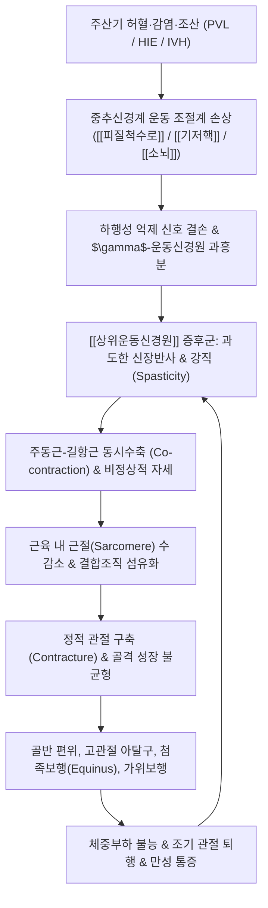

# 🩺 [[뇌성마비]] (Cerebral Palsy / 腦性痲痺, ICD-10: G80 / KCD: G80)

> **핵심 3줄 요약 (Key Summary)**:
> - 📍 **병소 부위 & 해부·병태생리**: 발달 중인 태아 또는 영아의 미성숙 뇌 손상([[피질척수로]], [[대뇌피질]] 운동영역, [[기저핵]], [[시상]], [[소뇌]])으로 인해 발생하는 비진행성(Non-progressive) 영구적 운동 및 자세 발달 장애 증후군. [[미숙아]]의 [[뇌실주위 백질연화증]](PVL)과 만삭아의 [[저산소성 허혈성 뇌병증]](HIE)이 핵심 병리 기전.
> - 🚩 **전형적 임상 양상 & 3대 징후**: 생후 1년 이내 운동 이정표 지연(목가누기·뒤집기·앉기 지연), 비정상적 근긴장도(영아기 저긴장증 후 경직 전환, 가위보행, 첨족보행, 관절 구축), 원시 반사의 비정상적 지속([[비대칭성 긴장성 목반사]] ATNR, [[모로반사]]) 및 보호 반응([[낙하산 반사]]) 출현 결여.
> - 🛠️ **핵심 감별 검사 & 한·양방 다각적 치료 전략**: 뇌 MRI(PVL, 기저핵 병변 감별) 및 [[GMFCS]](대운동기능분류시스템 I~V단계) 평가. 양방의 [[보툴리눔 독소]] 주사, 경구 [[바클로펜]], 척수강내 바클로펜 펌프([[ITB]]), 선택적 후근절제술([[SDR]]), 발목관절보조기([[AFO]])와 한의학적 오지(五遲)·오연(五軟) 변증에 기반한 [[육미지황탕가미]], [[보양환오탕]], 두침요법([[운동구]], [[감각구]]) 및 관절 가동 추나요법을 결합한 조기 다학제 중재.
> - <font color="#fa7e7e">⚠️ **응급 의뢰 레드플래그 & 악화 요인**: 진행성 신경 퇴행 징후(지능·운동 기능의 급격한 역행은 대사성 질환 의심), 경련 중첩증(Status Epilepticus), 급성 고관절 탈구 및 신경혈관 포착성 심인성 통증, 연하장애로 인한 흡인성 폐렴 및 급성 호흡부전 발생 시 즉시 상급병원 소아신경과·정형외과 응급 전원.</font>

---

## 📌 목차
1. [질환 개요 & 해부학적 병태생리](#1-질환-개요--해부학적-병태생리)
2. [병태생리 메커니즘 & 생체역학적 악순환 네트워크](#2-병태생리-메커니즘--생체역학적-악순환-네트워크)
3. [임상 증상 & 이학적 검사(Physical Exam) 알고리즘](#3-임상-증상--이학적-검사physical-exam-알고리즘)
4. [감별 진단 매트릭스 (Differential Diagnosis)](#4-감별-진단-매트릭스-differential-diagnosis)
5. [한의 통합 치료 프로토콜 (침·약침·추나·한약)](#5-한의-통합-치료-프로토콜-침약침추나한약)
6. [양방 치료 & 병용·의뢰 기준 (Conventional Treatment & Referral)](#6-양방-치료--병용의뢰-기준-conventional-treatment--referral)
7. [재활 운동 & 생활습관 티칭 가이드](#7-재활-운동--생활습관-티칭-가이드)
8. [💡 사용자 진료실 핵심 필기 & 임상 노하우 (Melt-In 잔여 심화 집약)](#8--사용자-진료실-핵심-필기--임상-노하우-melt-in-잔여-심화-집약)
9. [출처 및 학술 참고 문헌 (References)](#9-출처-및-학술-참고-문헌-references)

---

## 1. 질환 개요 & 해부학적 병태생리

* **질환 정의 및 역학적 특성**:
  * **[[뇌성마비]](Cerebral Palsy, CP)**는 수태(Conception) 시부터 태아기, 주산기, 또는 출생 후 뇌 발달이 완성되기 전(통상 생후 2~3세 미만)의 미성숙한 뇌에 가해진 **비진행성(Non-progressive) 병변이나 결손**으로 인하여 영구적이지만 변화 가능한 운동 및 자세 발달의 장애를 초래하는 임상 증후군입니다.
  * 뇌의 병소 자체는 비진행성이지만, 환아의 성장 및 골격 발육에 따라 근골격계 2차 변형(관절 구축, 척추 변형, 골반 탈구) 및 기능적 장애 양상은 지속적으로 변화합니다.
  * **역학**: 전 세계적으로 생아 1,000명당 약 1.5~2.5명의 유병률을 보이며, 신생아 중환자 치료 기술의 발전으로 극소 저체중 출생아의 생존율이 증가함에 따라 조산과 관련된 뇌성마비의 발생 위험은 유지되고 있습니다.
  * **동반 장애**: 단독 운동 장애에 그치지 않고, [[지적 장애]](약 30~50%), [[뇌전증]](약 30~45%), 감각 장애(시각·청각 손상), 구음장애 및 언어 지연(약 50%), 연하장애(Dysphagia) 및 침흘림(Drooling), 행동 및 정서 문제 등이 높은 비율로 동반됩니다.

* **주요 발병 원인 및 위험 인자**:
  * **출생 전 원인 (Prenatal, 약 70~80%)**:
    * 자궁 내 저산소증, [[태반 조기 박리]], 태반 기능 부전.
    * 모체 및 태아의 감염(TORCH 감염: 톡소포자충증, 풍진, 거대세포바이러스, 단순포진바이러스; 자궁내 감염 및 융모양막염 Chorioamnionitis).
    * 다태 임신(쌍태아 간 수혈 증후군 TTTS), 선천성 뇌 형성 이상, 유전적 소인.
  * **주산기 원인 (Perinatal, 약 10~15%)**:
    * 극단적 조산([[미숙아]], 임신 32주 미만) 및 극소 저체중아(1,500g 미만).
    * 분만 중 질식(Birth Asphyxia) 및 [[저산소성 허혈성 뇌병증]](HIE).
    * 중증 신생아 황달에 의한 [[핵황달]](Kernicterus - 기저핵 손상 유발).
    * 신생아 뇌경색(대뇌동맥 혈전증).
  * **출생 후 원인 (Postnatal, 약 5~10%)**:
    * 영아기 [[세균성 수막염]], 바이러스성 뇌염.
    * 비우발적 또는 우발적 두부 외상(흔들린 아이 증후군 Shaken baby syndrome, 익수 사고).
    * 중증 탈수 또는 패혈증에 동반된 뇌허혈.

* **관련 신경 해부학적 구조물 및 병변 부위**:
  * **[[피질척수로]](Corticospinal Tract / Pyramidal Tract)**:
    * 운동피질(대뇌 전두엽 중심전회)의 벳츠 세포(Betz cell)에서 기원하여 속섬유막(Internal capsule), 뇌줄기 피라미드를 거쳐 척수 전각으로 하행하는 주 운동 전도로.
    * 피질척수로 손상 시 억제성 하행 조절 기능이 소실되어 전형적인 **[[상위운동신경원]](Upper Motor Neuron, UMN) 증후군**인 강직(Spasticity), 건반사 항진, 바빈스키 반사 양성을 초래합니다.
  * **뇌실주위 백질 (Periventricular White Matter)**:
    * 임신 24~34주의 미숙아는 뇌실 주위 백질의 혈관 말단 문합부(Watershed zone)가 허혈에 극도로 취약하며, 성숙 전 희소돌기아세포(Pre-oligodendrocytes)가 활성산소 및 흥분독성에 취약합니다.
    * 이 부위의 괴사는 **[[뇌실주위 백질연화증]](Periventricular Leukomalacia, PVL)**을 형성하며, 뇌실에 가장 인접하여 주행하는 하지 운동 신경 섬유를 선택적으로 침범하여 하지 우세형 [[경직성 양지마비]](Spastic Diplegia)의 결정적 원인이 됩니다.
  * **[[기저핵]](Basal Ganglia) 및 [[시상]](Thalamus)**:
    * 조가비핵(Putamen), 담창구(Globus pallidus), 시상밑핵(Subthalamic nucleus)의 손상.
    * 만삭아의 심각한 급성 질식, 저산소증, 또는 비결합 빌리루빈의 담창구 침착([[핵황달]])에 의해 발생하며, **이상운동형(Dyskinetic CP)**을 유발합니다.
  * **[[소뇌]](Cerebellum)**:
    * 소뇌 반구 및 충부(Vermis)의 형성 부전이나 허혈성 손상으로 고유수용성 감각 통합 및 운동 조화 기능이 상실되어 **실조형(Ataxic CP)**이 발생합니다.
  * **말초 근골격계 표적 조직**:
    * 과긴장성 단축 근육: [[비복근]](Gastrocnemius), [[가자미근]](Soleus), [[슬괵근]](Hamstrings), [[장요근]](Iliopsoas), [[대퇴내전근]](Hip Adductors), [[상완이두근]](Biceps brachii), [[원회내근]](Pronator teres).
    * 2차 이환 골격 관절: 고관절(아탈구 및 탈구 호발), 족관절(첨족 기형 Equinus deformity), 척수 및 척추(마비성 척추측만증).

---

## 2. 병태생리 메커니즘 & 생체역학적 악순환 네트워크



### 1) 신경생리학적 병태생리 (신장반사 항진 및 억제 기전 소실)
* **상위운동신경원(UMN) 병변의 본질**:
  * 정상 상태에서 대뇌피질 및 뇌간(적핵, 망상체)에서 기원하는 하행 운동로는 척수 반사궁의 개재신경세포(Interneurons)를 자극하여 렌쇼 세포(Renshaw cell)에 의한 되먹임 억제(Recurrent inhibition), 1a 억제성 개재뉴런을 통한 상반 억제(Reciprocal inhibition), 시냅스전 억제(Presynaptic inhibition)를 수행합니다.
  * 뇌성마비에서는 하행성 억제 신경로의 영구적 차단으로 인해 척수 반사궁이 과흥분 상태에 놓이게 됩니다. 근방추(Muscle spindle)에서 감지된 신장 신호가 1a 구심성 섬유를 통해 들어오면, 제동 장치 없이 $\alpha$-운동신경원을 폭발적으로 흥분시켜 속도 의존적 저항(Velocity-dependent hypertonia)인 **강직(Spasticity)**을 유발합니다.
* **주동근과 길항근의 동시 수축(Co-contraction)**:
  * 동작을 수행할 때 길항근이 이완되어야 매끄러운 관절 운동이 일어나지만, 상반 억제 기전이 붕괴되어 주동근 수축 시 길항근이 동시에 강하게 수축합니다. 이로 인해 관절이 뻣뻣하게 굳고 막대한 대사성 에너지가 소모되며 조기 피로와 보행 장애가 초래됩니다.

### 2) 분자·근육 수준의 2차 병태 (근절 소실과 세포외 기질 섬유화)
* **근절(Sarcomere) 신장 부전**:
  * 뇌성마비 환아의 경직된 근육을 조직학적으로 분석하면, 근섬유의 세로 길이 성장이 심각하게 지연되어 정상 아동에 비해 직렬 근절(Sarcomeres in series)의 수가 20~30% 적습니다.
  * 골격은 정상적인 나이에 맞추어 길이가 자라지만, 근육은 골격의 성장 속도를 따라가지 못하고 고무줄처럼 팽팽하게 뼈를 잡아당기게 됩니다.
* **세포외 기질(ECM) 콜라겐 증식**:
  * 근내막(Endomysium)과 근외막(Perimysium)에 콜라겐(Type I, III) 침착이 증가하고 세포외 기질의 섬유화가 진행되어, 근육 자체의 수동적 탄성도(Passive stiffness)가 극도로 증가합니다. 이는 신경학적 경직(Dynamic spasticity)을 넘어 구조적인 **고정 관절 구축(Fixed contracture)**으로 전환되는 분기점이 됩니다.

### 3) 생체역학적 악순환 네트워크 (Biomechanical Cascade)

```
[원인 병변] 뇌실주위 백질연화증(PVL) 또는 저산소성 뇌손상
    │
    ▼
[신경학적 결손] 피질척수로 하행 억제 소실 → α/γ 운동신경세포 과활성
    │
    ▼
[동적 강직 단계] 비복근·장요근·내전근의 과긴장 → 첨족위(Equinus) 및 하지 가위꼴 정렬
    │
    ▼
[생체역학적 변형] 보행 시 지면반발력 전방 이동 → 비정상적 전단력 가중
    │
    ▼
[구조적 변형 단계] 근절 증식 저하 + 관절 낭 단축 → 고정 구축(Contracture)
    │
    ▼
[골격계 합병증] 대퇴골 전경각 잔존, 고관절 아탈구/탈구, 마비성 척추측만증
    │
    ▼
[기능적 상실] 독립 기립 및 보행 상실, 심각한 고관절 통증, 침상 격리
```

---

## 3. 임상 증상 & 이학적 검사(Physical Exam) 알고리즘

### 1) 4대 신경학적 / 생체역학적 아형 분류

| 아형 (Subtype) | 호발 병변 부위 | 주요 임상 양상 | 생체역학적 특징 및 자세 |
| :--- | :--- | :--- | :--- |
| **경직형 (Spastic, 70~80%)** | [[피질척수로]], 뇌실주위 백질 | 속도 의존성 근긴장 증가, 건반사 항진, 간대(Clonus), 바빈스키 양성 | **1) 양지마비(Diplegia)**: 양하지 > 양상지, PVL 호발, 첨족 및 가위보행<br>**2) 편마비(Hemiplegia)**: 일측 상하지(상지 > 하지), 주관절 굴곡, 회내<br>**3) 사지마비(Quadriplegia)**: 전신 사지, 중증 HIE, 구음·연하장애 동반 |
| **이상운동형 (Dyskinetic, 10~15%)** | [[기저핵]](조가비핵, 담창구), [[시상]] | 불수의적·비정형적 움직임, 정서적 흥분 시 악화, 수면 중 소실 | **1) 무도무위운동형(Choreoathetotic)**: 사지 원위부의 느릿한 뒤틀림 및 몸부림<br>**2) 근긴장이상형(Dystonic)**: 지속적 비틀림 자세 및 전신 뒤틀림 |
| **실조형 (Ataxic, 5% 내외)** | [[소뇌]] (소뇌반구 및 충부) | 저긴장증(Hypotonia), 협응 부전, 의도진전(Intention tremor), 조음장애 | 기저면이 넓은 불안정 보행(Wide-based gait), 균형 반응 심각 결손 |
| **혼합형 (Mixed, 5~10%)** | 광범위 뇌피질 + 기저핵 복합 손상 | 경직형과 이상운동형의 병존이 가장 흔함 | 강직과 근긴장이상이 혼재되어 치료적 접근이 가장 난해함 |

### 2) 대운동기능분류시스템 (GMFCS, Gross Motor Function Classification System)
* **GMFCS Level I**: 제한 없이 보행 가능; 계단 오르내리기 가능; 달리기 및 점프가 가능하나 속도·균형·협응력에서 경미한 제한.
* **GMFCS Level II**: 제한을 동반한 보행; 난간을 잡고 계단 오르기 가능; 고르지 않은 지면이나 경사로, 군중 속에서 보행 제한; 최소한의 달리기와 점프.
* **GMFCS Level III**: 이동 보조기기를 이용한 보행; 손잡이가 달린 이동 보조기(워커, 목발)를 잡고 평지 보행; 계단 이용 시 난간 필요; 장거리 이동 시 휠체어 사용.
* **GMFCS Level IV**: 자가 이동에 상당한 제한; 전동 휠체어 사용 또는 성인의 도움으로 이동; 짧은 거리를 지지 워커로 겨우 보행하거나 치료실 내 연습 수준.
* **GMFCS Level V**: 수동 휠체어에 전적으로 의존하는 자가 이동 제한; 머리와 체간의 항중력 조절 불능; 모든 일상생활 동작에서 전적인 타인의 도움 필요.

### 3) 영아기 조기 진단 핵심 징후 및 원시 반사 평가
* **원시 반사의 비정상적 지연 (Retention of Primitive Reflexes)**:
  * **[[비대칭성 긴장성 목반사]](ATNR, Asymmetric Tonic Neck Reflex)**: 두부를 한쪽으로 회전시켰을 때 얼굴 쪽 사지는 신전되고 후두 쪽 사지는 굴곡되는 펜싱 자세. **생후 6개월 이후에도 잔존하면 뇌성마비의 강력한 징후**.
  * **대칭성 긴장성 목반사(STNR)**: 경부 굴곡 시 상지 굴곡·하지 신전, 경부 신전 시 상지 신전·하지 굴곡. 지속 시 기어가기 및 네발기기 불능.
  * **[[모로반사]](Moro Reflex)**: 생후 4~6개월 이후에도 소실되지 않고 강하게 유발됨.
  * **손바닥 및 발바닥 쥐기 반사(Palmar/Plantar Grasp Reflex)**: 생후 6~9개월 이후에도 지속되어 수의적 손사용 방해.
* **자세 및 보호 반응(Postural Reactions)의 획득 결여**:
  * **란다우 반사(Landau Reaction)**: 엎드려 공중에 띄웠을 때 머리와 척추를 신전하지 못하고 축 처짐(생후 3~10개월 출현 실패).
  * **[[낙하산 반사]](Parachute Reaction)**: 환아를 급격히 머리 쪽으로 기울였을 때 양팔을 뻗어 방어하지 못함(생후 8~9개월 출현 실패).
* **근긴장도 및 관절 가동성 이학적 검사**:
  * **수정 Ashworth 척도 (Modified Ashworth Scale, MAS)**:
    * 0: 근긴장도 증가 없음.
    * 1: 관절 가동 범위 끝부분에서 경미한 걸림(Catch)과 이완.
    * 1+: ROM 전반 1/2 미만에서 걸림 후 경미한 저항 지속.
    * 2: ROM 대부분에서 뚜렷한 저항이 있으나 관절은 쉽게 움직임.
    * 3: 상당한 근긴장 증가로 수동 운동이 곤란함.
    * 4: 관절이 굴곡 또는 신전 상태로 단단히 고정됨(강직/구축).
  * **Tardieu 척도**: 느린 수동 신장 각도($R_2$)와 빠른 신장 각도($R_1$)의 차이($R_2 - R_1$)를 측정하여 동적 경직(Dynamic spasticity)과 고정 구축(Fixed contracture)을 정량적으로 분리 감별.
  * **고관절 이학적 검사**:
    * 토마스 검사(Thomas test): 장요근 단축 및 고관절 굴곡 구축 평가.
    * 엘리스 검사(Galeazzi/Allis sign): 앙와위 무릎 굴곡 상태에서 양측 무릎 높이 차이로 고관절 탈구 감별.
    * 팝리테알 각도(Popliteal angle): 슬괵근(Hamstring)의 긴장도 및 단축 측정.

---

## 4. 감별 진단 매트릭스 (Differential Diagnosis)

| 감별 질환 | 호발 연령 및 양상 | 임상적 감별 포인트 | 핵심 진단 검사 및 소견 |
| :--- | :--- | :--- | :--- |
| **[[뇌성마비]] (본 질환)** | 태아기~영아기 발생, **비진행성(Non-progressive)** | 주산기 손상 병력(조산, PVL), 운동 이정표 지연, 경직·구축 | 뇌 MRI: PVL, 기저핵 신호 이상; 대사 이상 없음 |
| <font color="#fa7e7e">**진행성 신경퇴행성 질환**<br>(MLD, ALD, Krabbe병)</font> | 1~3세 이후 정상 발달 후 **급격한 기능 퇴행(Regression)** | 조기 획득한 운동 및 언어 기능의 상실, 시신경 위축, 급격한 지능 저하 | 효소 활성도 검사, 유전자 변이 분석, 백질이영양증 MRI 소견 |
| <font color="#fa7e7e">**도파 반응성 근긴장이상**<br>(Dopa-Responsive Dystonia)</font> | 소아기(4~8세) 호발, 보행 장애, 첨족 | **일중 변동(Diurnal fluctuation)**: 아침에 호전, 저녁에 극심한 악화 | **저용량 레보도파([[Levodopa]]) 투여 시 극적인 증상 소실**; GCH1 유전자 변이 |
| **유전성 강직성 하지마비<br>(Hereditary Spastic Paraplegia)** | 소아기~청소년기, 서서히 진행 | 하지의 점진적 경직 및 쇠약, 가족력(상염색체 우성 등), 상지 보존 | 유전자 패널 검사(SPG 유전자군), 척수 MRI |
| **척수근위축증 (SMA)** | 영아기 호발, 심한 저긴장증 | **하위운동신경원 손상**: 건반사 소실, 혀 섬유속연축, 대칭성 근위부 위축 | SMN1 유전자 결손 검사, 근전도(EMG) 상 신경원성 변화 |
| **소아 척수종양 및 계류수수** | 소아기 서서히 발현 | 진행성 족부 기형, 요통, 대소변 장애(신경인성 방광), 비대칭 하지 약화 | 전척추 MRI(Spine MRI): 척수 종양, 원추 저위, 척수공동증 |
| **듀센형 근이영양증 (DMD)** | 3~5세 남아 호발 | **진행성 근위부 근력 약화**, 동요 보행(Waddling), 가성 비대, Gowers 징후 | 혈청 [[크레아틴 키나아제]](CK) 수만 단위 상승, Dystrophin 유전자 결손 |

> 🚩 **레드플래그 감별 (Red Flags)**:
> 1. **퇴행성 경과(Loss of Milestones)**: 기존에 할 수 있었던 옹알이, 목가누기, 눈맞춤, 뒤집기 기능이 점진적으로 상실된다면 뇌성마비가 아니라 대사 이상, 미토콘드리아 질환, 또는 백질이영양증 등 진행성 질환을 강력히 의심해야 합니다.
> 2. **레보도파 반응성 확인**: 경직이나 근긴장이상 양상을 보이는 소아는 반드시 저용량 Levodopa 시험적 투여를 고려하여 완치 가능한 유전성 질환(세가와병 Segawa disease)을 배제하지 않는 과오를 범해서는 안 됩니다.

---

## 5. 한의 통합 치료 프로토콜 (침·약침·추나·한약)

* **한의학적 질병 범주 및 병인병기**:
  * 뇌성마비는 전통 한의학의 **오지(五遲: 立遲, 行遲, 髮遲, 齒遲, 語遲)** 및 **오연(五軟: 頭軟, 項軟, 手軟, 足軟, 肉軟)**, **소아마목(小兒痲木)**, **위증(痿證)**의 범주에 속합니다.
  * **선천기수(先天旣受) 부족**: 부모의 정혈 부족, 임신 중 모체의 질병이나 외상, 기혈 허약으로 인해 태아의 신정(腎精)이 충실치 못하여 뇌수(腦髓)와 골수가 결손됨(간신휴손 肝腎虧損).
  * **후천실조(後天失調) 및 어혈조락(瘀血阻絡)**: 난산으로 인한 질식, 외상, 풍담(風痰) 또는 어혈(瘀血)이 뇌규(腦竅)를 폐색하여 맑은 양기가 사지로 뻗치지 못하고 경락이 영양을 잃어 근육이 굳어지고 위축됨.

### 1) 변증 분류 및 대표 한약 치료

```
[간신휴손 (선천부족)] ──> 골약근위, 보행불능 ──> 육미지황탕가미 / 보신지황환
[기혈양허·어혈조락]   ──> 사지마목, 근육경직 ──> 보양환오탕 / 팔진탕가감
[비위허약 (후천실조)] ──> 육연, 섭식장애, 구토 ──> 보중익기탕 / 삼령백출산
[풍담어체 (간풍내동)] ──> 근긴장이상, 침흘림 ──> 도담탕 / 억간산가조구등
```

* **1. 간신휴손형 (肝腎虧損型)**:
  * **주요 증상**: 골격 발육이 늦어 서거나 걷지 못함(立遲, 行遲), 치아가 늦게 나고(齒遲), 머리카락이 가늘고 드물며(髮遲), 대천문이 늦게 닫히고 지능 발달이 지연됨.
  * **치법**: 보기보신(補氣補腎), 자양간신(滋養肝腎), 익수건골(益髓健骨).
  * **처방**: **[[육미지황탕가미]](六味地黃湯加味)** 또는 **보신지황환(補腎地黃丸)**.
    * 기본 구성: 숙지황 8g, 산약 6g, 산수유 6g, 택사 4g, 복령 4g, 목단피 4g.
    * 가미약: [[녹용]](鹿茸) 2~4g(보신익정, 골수 충만), [[우슬]](牛膝) 4g(인경하여 하지 근골 강화), [[두충]](杜仲) 4g, [[구판]](龜板) 4g, [[원지]](遠志) 3g, [[석창포]](石菖蒲) 3g.
* **2. 기혈양허 및 어혈조락형 (氣血兩虛 兼 瘀血阻絡型)**:
  * **주요 증상**: 주산기 허혈·출혈 병력, 사지 근육이 굳고 뻣뻣하여 굴신이 곤란함, 지체 마목, 안색이 창백하고 입술 색이 어두움, 혀에 어반(瘀斑) 관찰.
  * **치법**: 익기활혈(益氣活血), 통락유근(通絡柔筋).
  * **처방**: **[[보양환오탕]](補陽還五湯)**.
    * 구성: 황기 20~30g(보기하여 혈행을 추동), 당귀미 4g, 적작약 4g, 천궁 3g, 도인 3g, 홍화 3g, 지룡 4g(통락제경).
    * 만성 경직 완화를 위해 모과(木瓜) 4g, 백작약(白芍藥) 8g, 감초(甘草) 4g(작약감초탕 합방 의미) 가미.
* **3. 비위허약형 (脾胃虛弱型)**:
  * **주요 증상**: 온몸의 살이 물렁하고 힘이 없음(肉軟), 목을 가누지 못함(項軟), 식욕이 없고 음식을 잘 삼키지 못하며 잦은 구토와 설사, 대변이 묽음.
  * **치법**: 건비익기(健脾益氣), 화위생혈(和胃生血).
  * **처방**: **[[보중익기탕]](補中益氣湯)** 또는 **삼령백출산(參苓白朮散)**.
    * 구성: 황기 8g, 인삼(또는 당삼) 6g, 백출 6g, 감초 4g, 당귀 4g, 진피 4g, 승마 2g, 시호 2g.
    * 연하 곤란 및 침흘림 동반 시 익지인(益智仁) 4g, 석창포(石菖蒲) 4g 가미.
* **4. 풍담조락 및 간풍내동형 (風痰阻絡 兼 肝風內動型)**:
  * **주요 증상**: 이상운동형 뇌성마비 환아에서 불수의적 손발 뒤틀림, 정서적 불안정, 수면 시 놀람, 후두부 경직, 가래 끓는 소리.
  * **치법**: 평간식풍(平肝熄風), 화담성뇌(化痰醒腦).
  * **처방**: **[[억간산]](抑肝散) 가 진주모·조구등** 또는 **가미도담탕(加味導痰湯)**.

### 2) 침구 치료 (두침요법 및 체침 프로토콜)
* **두침요법 (Scalp Acupuncture)**:
  * 대뇌피질 손상 후 신경 가소성(Neuroplasticity)을 유도하는 한의 신경재활 핵심 술기.
  * **운동구 (Motor Area)**: 상 1/5(하지 및 체간 마비 치료), 중 2/5(상지 마비 치료), 하 2/5(안면 마비, 구음장애 치료).
  * **감각구 (Sensory Area)**: 감각 이상 및 고유수용성 감각 결손 완화.
  * **족운감구 (Foot Motor Sensory Area)**: 첨족보행 및 하지 경직 개선을 위한 두정부 선상 자침.
  * **진전마비제어구 (Chorea Tremor Control Area)**: 이상운동형 환아의 불수의적 뒤틀림 억제.
  * 자침 기법: 30호(0.20mm) 30mm 침을 사용하여 모상건막하층으로 15~30도 각도로 신속 진침, 분당 200회 이상의 염전 제삽 또는 2Hz 저주파 전침 통전.
* **체침 및 사지 경혈 배혈**:
  * **상지 강직 완화**: [[곡지]](LI11), [[수삼리]](LI10), [[외관]](TE5), [[합곡]](LI4), [[노궁]](PC8).
  * **하지 강직 및 첨족 완화**: [[양릉천]](GB34, 근회), [[족삼리]](ST36), [[현종]](GB39, 골수회), [[삼음교]](SP6), [[태충]](LR3), [[승산]](BL57), [[곤륜]](BL60).
  * **체간 및 두경부 안정**: [[백회]](GV20), [[사신총]](EX-HN1), [[풍지]](GB20), [[대추]](GV14), [[명문]](GV4), 신수(BL23).
* **전침 자극 원칙**:
  * 경직된 주동근(예: 비복근)을 직접 강하게 자극하면 오히려 반사성 경직이 악화될 수 있으므로, **길항근(예: 전경골근 Tibialis anterior)에 2~4Hz 저주파 전침**을 걸어 상반 억제를 유도하여 경직된 비복근의 이완을 촉진합니다.

### 3) 약침 치료 (Pharmacopuncture)
* **자하거(Hominis Placenta) 약침**:
  * 적응증: 선천 부족, 뇌 발달 지연, 근육 위축 및 대운동 기능 저하.
  * 시술 혈위: 척추 협척혈(EX-B2), 신수(BL23), 비수(BL20), 족삼리(ST36), 곡지(LI11).
  * 용량 및 방법: 혈위당 0.1~0.2mL씩 총 1.0~2.0mL를 주 2~3회 주입(인슐린 시린지 사용, 피하 또는 얕은 근막층).
* **황련해독탕 약침**:
  * 이상운동형 또는 중증 강직형 환아에서 풍열(風熱) 및 근육의 급성 경직과 흥분 완화 목적. 아시혈 및 압통 경결점에 0.05~0.1mL 시술.

### 4) 소아 관절가동 추나요법 (Pediatric Chuna Manipulation)
* **관절가동기법 및 근막 이완 (Myofascial Release)**:
  * 무리한 고속저진폭(HVLA) 교정은 소아의 미성숙한 골격과 관절순을 손상시킬 수 있으므로 절대 금기.
  * **단축된 하지 근막 이완**: 장요근 스트레칭(앙와위 하지 신전 고정), 대퇴내전근 및 슬괵근 유근법(柔筋法), 비복근-아킬레스건 신장 수기.
  * **고관절 중심화 기법**: 외전 및 내회전 유도 수기를 통해 대퇴골두를 비구(Acetabulum) 내로 안착시키는 정형 관절 가동술 적용.

---

## 6. 양방 치료 & 병용·의뢰 기준 (Conventional Treatment & Referral)

### 1) 경직 조절 약물 요법
* **경구 항경직제**:
  * **[[바클로펜]](Baclofen)**: $GABA_B$ 수용체 작용제로 시냅스전 억제를 증가시켜 단일 및 다신경 반사를 억제. 초기 5mg/day로 시작하여 체중에 맞추어 증량(최대 40~60mg/day 분복). 급격한 중단 시 금단 발작 위험 주의.
  * **단트롤렌(Dantrolene Sodium)**: 골격근 근소포체에서 칼슘 이온 유출을 직접 차단하여 수축력 감소. 간독성 위험이 있어 정기적 LFT 추적 필수.
  * **[[티자니딘]](Tizanidine)**: 중추성 $\alpha_2$-아드레날린 수용체 효능제로 억제성 개재뉴런을 자극. 진정 작용 및 저혈압 주의.
  * **[[디아제팜]](Diazepam)**: $GABA_A$ 수용체 복합체 작용. 야간 통증성 연축 환아에게 단기 보조 요법으로 사용.
* **국소 신경근 차단술 및 화학적 신경용해술**:
  * **[[보툴리눔 독소]] 주사 (Botulinum Toxin Type A)**:
    * 국소적 동적 경직(Dynamic spasticity) 환아의 1차 표준 치료.
    * 작용 기전: 신경근접합부 시냅스전 막의 SNAP-25 단백을 절단하여 아세틸콜린 방출을 가역적으로 차단.
    * 적응증: 첨족을 유발하는 비복근, 가위보행의 고관절 내전근, 주관절 굴곡근.
    * 용량: 통상 체중당 2~6 U/kg(단일 근육), 총 최대 용량 12~15 U/kg(또는 400U 이하). 효과는 2~4주에 정점을 이루며 3~6개월 지속.
  * **냉각신경용해술(Cryoneurolysis)**:
    * 최근 보툴리눔 독소에 내성이 생겼거나 특정 국소 신경(폐쇄신경, 경골신경 지)의 장기 경직 완화가 필요한 환아에서 최소침습 표적 치료로 연구되고 있음.

### 2) 첨단 신경외과적 수술 중재
* **선택적 후근절제술 (Selective Dorsal Rhizotomy, SDR)**:
  * **적응증**: 만 3~8세의 경직성 양지마비 환아 중 양호한 인지 기능과 기저 근력(항중력 신전근)을 보유하고, 고정 구축이 없으며, GMFCS II~III 단계의 보행 잠재력을 가진 환아.
  * **수술 방법**: L1-S1 척수 신경 후근(Dorsal rootlets)을 노출한 후, 수술 중 근전도 자극을 통해 비정상적인 반사성 과흥분파를 유발하는 감각 섬유를 약 30~50% 선택적으로 절제.
  * **효과 및 주의점**: 하지 강직을 영구적으로 영구 감소시키지만, 수술 후 숨겨져 있던 기저 근력 약화가 드러나므로 1년 이상의 집중적인 근력 강화 재활이 필수적임.
* **척수강내 바클로펜 펌프 (Intrathecal Baclofen Pump, ITB)**:
  * **적응증**: 경구 약물에 반응하지 않는 중증 사지마비(GMFCS IV~V) 환아 또는 광범위 근긴장이상 환아.
  * 복벽 피하에 약물 저장 펌프를 삽입하고 척수강 내 지주막하강으로 카테터를 연결하여 미량의 바클로펜을 지속 주입. 전신 부작용을 최소화하면서 강력한 경직 완화 및 간호 편의성 제공. 카테터 폐색 및 감염 모니터링 필수.

### 3) 정형외과적 재건 수술 및 보조기 요법
* **연부조직 수술 (Soft Tissue Surgery)**:
  * 6~8세 이후 골격 성장에 따른 비가역적 구축 형성 시 시행.
  * 아킬레스건 연장술(Percutaneous Achilles Tendon Lengthening, TAL), 슬괵근 연장술, 고관절 내전근 절제술.
* **골 수술 (Bony Surgery)**:
  * 대퇴골 근위부 회전 절골술(Derotation Osteotomy): 심한 대퇴골 내염전 교정.
  * 골반 비구 절골술(Pemberton/Dega Osteotomy): 고관절 아탈구 및 비구 이형성 교정.
* **보조기 처방 원칙**:
  * **[[발목관절보조기]](AFO, Ankle-Foot Orthosis)**:
    * 족관절 고정형(Solid AFO): 심한 첨족 및 족관절 불안정성 제어.
    * 관절형(Hinged AFO): 족배굴곡은 허용하고 족저굴곡을 차단하여 기능적 보행 증진.
    * 지면반발력 AFO(Floor Reaction AFO): 웅크림 보행(Crouch gait) 환아에서 슬관절 신전 모멘트 제공.

### 4) 한의 병용 판단 및 상호작용
* **보툴리눔 독소 주사 후 한의 치료 결합 (골든타임)**:
  * 보툴리눔 독소 주사 후 2~4주는 화학적 탈신경으로 인해 근육의 동적 경직이 일시적으로 최저점에 달하는 시기입니다. 이때 침구 치료, 온열 요법, 관절가동 추나, 신장 운동을 집중적으로 병행하면 근절 증식을 촉진하고 고정 구축으로의 이행을 방지하는 최대의 시너지 효과를 얻을 수 있습니다.
* **항경직제 복용 환아의 한약 병용 안전성**:
  * 바클로펜, 티자니딘 복용 환아에게 육미지황탕, 보양환오탕 등 보익 활혈제를 병용 투여할 때 간독성이나 상호작용 부작용은 극히 드물며, 오히려 중추 억제제로 인한 전신 무력감과 피로를 개선하는 데 기여합니다. 단, 간기능(AST/ALT) 검사를 정기적으로 확인합니다.

### 5) 상급병원 전문과 의뢰 기준 (Referral Criteria)
* <font color="#fa7e7e">**정형외과 긴급 의뢰**</font>:
  * 고관절 X-ray 상 Reimers 이동 지수(Migration Index)가 33%를 초과하여 진행성 아탈구가 관찰되거나, 기저귀 갈기 시 통증으로 인한 심한 보챔이 발생할 때(비구 파괴 및 대퇴골두 무혈성 괴사 예방).
  * 급격한 척추측만증 진행으로 Cobb각이 30~40도를 초과할 때.
* <font color="#fa7e7e">**소아신경과 응급 의뢰**</font>:
  * 뇌전증 발작이 5분 이상 지속되는 경련 중첩증 발생 시.
  * ITB 펌프 삽입 환아에서 갑작스러운 경직 악화, 고열, 자율신경계 불안정이 나타날 때(바클로펜 금단 증후군 의심 응급).
* <font color="#fa7e7e">**재활의학과 / 소아청소년과 의뢰**</font>:
  * 구강 섭취 시 반복적인 기침, 청색증, 잦은 폐렴 발생 시(연하검사 VFSS 시행 및 위루관 PEG 튜브 삽입 평가).

---

## 7. 재활 운동 & 생활습관 티칭 가이드

* **체계적 물리치료 및 작업치료 접근법**:
  * **보이타 요법 (Vojta Method)**: 반사성 뒤집기(Reflex turning)와 반사성 기기(Reflex creeping) 유발대를 자극하여 선천적으로 내재된 정상 뇌간 및 척수 운동 패턴을 활성화.
  * **보바스 요법 (Bobath Concept / NDT)**: 비정상적 긴장성 반사 패턴을 억제하고 자세 조절 및 정상적인 자동 균형 반응(자세 교정 반응, 평형 반응)을 촉진.
  * **강제유도 운동치료 (CIMT, Constraint-Induced Movement Therapy)**: 경직성 편마비 환아에서 정상 상지를 하루 수 시간 동안 깁스나 미트로 억제하고 환측 상지만을 강제 사용하여 대뇌 반구 피질의 신경 가소성 재구성을 유도.

* **가정 내 항구축 스트레칭 및 자세 유지 티칭**:
  * **아킬레스건 신장 운동**: 무릎을 완전히 신전시킨 상태에서 족관절을 중립위 이상으로 족배굴곡시키는 스트레칭을 1회당 30초 이상, 매일 20회 반복.
  * **복와위(배 깔고 엎드리기) 유지**: 장요근 굴곡 구축 및 고관절 굴곡 변형을 예방하기 위해 하루 최소 1~2시간 이상 엎드린 자세를 취하게 함.
  * **기립기(Standing Frame) 활용**: GMFCS IV~V 단계 환아라도 매일 45~60분 이상 기립기에 체중 부하를 가해야 대퇴골두 비구 안착 촉진, 골밀도 유지, 변비 개선 효과를 얻을 수 있음.

* **보호자 심리 지지 및 상담 스크립트**:
  * "어머님, 뇌성마비는 뇌의 상처가 계속 커지는 진행성 질환이 아닙니다. 뇌의 병변은 멈추어 있으며, 우리 아이의 뇌는 지금도 계속해서 새로운 신경망을 만들어가는 가소성을 지니고 있습니다. 비록 정상 아이들보다 발달 속도는 느리지만, 한의 치료를 통해 굳은 근육의 긴장을 풀고 기혈을 북돋아 주며 매일 꾸준히 올바른 자세를 자극해 준다면 아이는 어제보다 오늘 더 안정된 움직임을 스스로 배워나갈 수 있습니다. 지치지 마시고 저희와 함께 긴 호흡으로 아이의 성장을 지켜봐 주십시오."

---

## 8. 💡 사용자 진료실 핵심 필기 & 임상 노하우 (Melt-In 잔여 심화 집약)

* **영아기 조기 선별 문진 핵심 팁**:
  * 진료실에 들어서는 영아를 관찰할 때 부모가 안고 있는 자세를 먼저 봅니다. 안았을 때 아이의 몸이 널빤지처럼 뒤로 젖혀지며 뻣뻣한지(Extensor hypertonia), 반대로 문어처럼 축 늘어지며 머리가 뒤로 꺾이는지(Floppy infant)를 확인하십시오.
  * 생후 4개월이 지나도 주먹을 꽉 쥐고 엄지손가락이 손바닥 안으로 들어간 피질모지(Thumb-in-palm) 징후가 양측 또는 편측에서 지속된다면 지체 없이 상위운동신경원 손상을 의심해야 합니다.
* **고관절 이탈 침묵의 위기 (Silent Hip Subluxation)**:
  * 뇌성마비 환아의 고관절 탈구는 외상이 아닌 지속적인 내전근 및 장요근의 경직 견인력으로 인해 서서히 발생합니다.
  * 초기에는 통증이 전혀 없으므로 외관상 아무런 문제가 없어 보이지만, 비구에서 대퇴골두가 완전히 빠져나가는 순간부터 극심한 관절성 통증과 척추 변형이 영구화됩니다. 따라서 **GMFCS III~V단계 환아는 만 2세부터 매년 정기 골반 X-ray(AP view)를 촬영하여 Reimers Migration Index를 반드시 추적**하도록 티칭해야 합니다.
* **한의 치료 시 자극량 조절의 묘미**:
  * 경직성 환아에게 강한 통증 자극(예: 굵은 침, 강한 제삽염전, 통증성 추나)을 주면 교감신경 흥분과 척수 반사로 인해 오히려 온몸이 돌처럼 굳어버립니다.
  * 따라서 소아 자침 시에는 반드시 **무통성 극미세호침(0.16~0.20mm)을 사용한 신속 자침**을 원칙으로 하며, 부드러운 안마도인(按摩導引)과 모과, 백작약 등의 유근(柔筋) 약물로 환아의 긴장을 이완시킨 상태에서 치료를 진행하는 것이 치료 성패를 가릅니다.

---

## 9. 출처 및 학술 참고 문헌 (References)

1. Beraldo RF, da Silva GS, Rahal Cardoso Cenatti L, et al. (2026). Pediatric spasticity in Brazil: insights from a neurosurgical referral center. *Childs Nerv Syst*. 42(1):15-24. [PMID: 42827136](https://pubmed.ncbi.nlm.nih.gov/42827136/)
   - **[연구 요약]**: 소아 신경외과 전문 의뢰 센터에 내원한 뇌성마비 및 소아 경직 환자 코호트를 분석하여, 조기 신경외과적 수술 중재(선택적 후근절제술 SDR, 바클로펜 펌프 ITB) 및 다학제 경직 관리 프로토콜이 환아의 대운동 기능 보존과 2차 관절 구축 예방에 미치는 임상적 효과와 장기적 예후를 입증함.

2. Winston P, Finlayson H, Vincent D, et al. (2026). Cryoneurolysis for Spasticity in a Pediatric Patient With Cold Urticaria Managed With Targeted Skin Warming: A Case Report. *Arch Rehabil Res Clin Transl*. 8(3):100667. [PMID: 42769349](https://pubmed.ncbi.nlm.nih.gov/42769349/)
   - **[연구 요약]**: 기존 약물 및 보툴리눔 독소 주사 치료의 대안으로 표적 냉각신경용해술(Cryoneurolysis)을 적용하여 소아 신경학적 환자의 중증 경직을 안전하게 제어한 최신 증례로, 국소 신경 경로 차단을 통한 가역적 근긴장도 완화 및 재활 치료 효과의 극대화 기전을 제시함.

3. Novak I, Morgan C, Adde L, et al. (2017). Early, Accurate Diagnosis and Early Intervention in Cerebral Palsy: Advances in Diagnosis and Treatment. *JAMA Pediatr*. 171(9):897-907. [PMID: 28715518](https://pubmed.ncbi.nlm.nih.gov/28715518/)
   - **[연구 요약]**: 생후 6개월 이전 조기 진단을 위한 신경학적 검진, 영아 뇌 MRI, 일반운동평가(GMA)의 진단적 민감도를 규명하고, 조기 신경 가소성 촉진 중재가 운동 및 인지 기능 개선에 필수적임을 밝힌 국제 임상 가이드라인.

---

## 관련 노트

- [[_의학/03_이론/질환/소아 질환/소아 신경·발달/열성 발작|열성 발작]]
- [[_의학/03_이론/질환/소아 질환/소아 신경·발달/지적 장애|지적 장애]]
- [[_의학/03_이론/질환/소아 질환/신생아/저체중출생아|저체중출생아]]
- [[_의학/03_이론/질환/소아 질환/신생아/신생아 황달|신생아 황달]]
- [[_의학/02_약리/의약품/바클로펜|바클로펜]]
- [[_의학/02_약리/처방/보양환오탕|보양환오탕]]
- [[_의학/02_약리/처방/육미지황탕|육미지황탕]]
