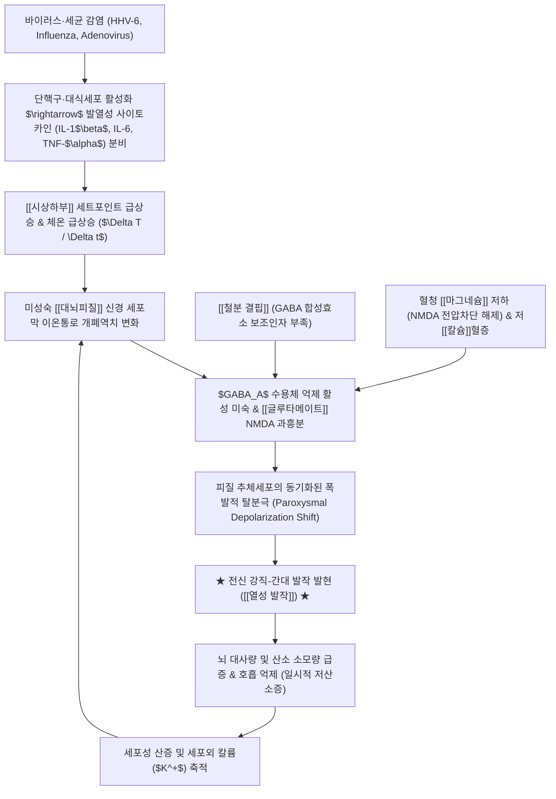

# 🩺 [[열성 발작]] (Febrile Seizures / 熱性發作, ICD-10: R56.0 / KCD: R56.0)

> **핵심 3줄 요약 (Key Summary)**:
> - 📍 **병소 부위 & 해부·병태생리**: 생후 6개월~60개월(5세) 영유아의 미성숙한 [[대뇌피질]] 및 [[시상하부]] 열조절 중추에서 발생하는 신경계 일시적 과흥분 질환. 중추신경계 감염이나 전신 대사 이상 없이 38.0℃ 이상의 급격한 체온 상승과 동반되어 나타나며, 미성숙 뇌의 [[GABA]]성 억제 회로 미달, 발열 매개 염증성 사이토카인(IL-1β, TNF-α) 폭증, [[철분 결핍]] 및 혈청 [[칼슘]]·[[마그네슘]] 불균형에 의한 신경 세포막 탈분극 역치 저하가 핵심 기전.
> - 🚩 **전형적 임상 양상 & 3대 징후**: 급격한 체온 상승 초기에 돌발적으로 발생하는 의식 소실, 안구 편위(상방 주시), 치아 악물기, 사지의 대칭적 강직 및 율동적 간대 경련([[전신 긴장간대 발작]] GTC). 15분 미만 지속되는 **단순 열성 발작(Simple FS)**과 15분 이상 지속, 국소성 징후, 24시간 내 재발, 발작 후 [[토드 마비]](Todd's paresis)를 동반하는 **복합 열성 발작(Complex FS)**으로 양분.
> - 🛠️ **핵심 감별 검사 & 한·양방 다각적 치료 전략**: 뇌수막염 배제를 위한 이학적 검진(경부강직, 대천문 팽륭, Kernig/Brudzinski 징후 확인). 급성기 기도 확보 및 흡인 방지(측와위), 5분 이상 지속 시 직장용 [[디아제팜]] 겔 또는 비강 분무 [[미다졸람]] 응급 투여. 한의학에서는 급경풍(急驚風)·풍열동풍(風熱動風)으로 변증하여 [[은교산]], [[황련해독탕]], [[포룡환]] 및 소아 십선혈·인중 점자출혈을 시행하고, 해열제가 발작 재발을 막지 못한다는 점을 부모에게 명확히 교육.
> - <font color="#fa7e7e">⚠️ **응급 의뢰 레드플래그 & 악화 요인**: 발작이 15~30분 이상 지속되는 열성 발작 지속상태(Febrile Status Epilepticus), 경부 강직·기면·의식 회복 불능(세균성 뇌수막염·뇌염 강력 의심), 생후 6개월 미만 또는 5세 이후 첫 발병, 편측 국소 마비 지속 시 즉시 상급병원 소아청소년과·응급의학과 119 구급 이송 및 뇌척수액 검사(LP) 의뢰.</font>

---

## 📌 목차
1. [질환 개요 & 해부학적 병태생리](#1-질환-개요--해부학적-병태생리)
2. [병태생리 메커니즘 & 생체역학적 악순환 네트워크](#2-병태생리-메커니즘--생체역학적-악순환-네트워크)
3. [임상 증상 & 이학적 검사(Physical Exam) 알고리즘](#3-임상-증상--이학적-검사physical-exam-알고리즘)
4. [감별 진단 매트릭스 (Differential Diagnosis)](#4-감별-진단-매트릭스-differential-diagnosis)
5. [한의 통합 치료 프로토콜 (침·약침·추나·한약)](#5-한의-통합-치료-프로토콜-침약침추나한약)
6. [양방 치료 & 병용·의뢰 기준 (Conventional Treatment & Referral)](#6-양방-치료--병용의뢰-기준-conventional-treatment--referral)
7. [재활 운동 & 생활습관 티칭 가이드](#7-재활-운동--생활습관-티칭-가이드)
8. [💡 사용자 진료실 핵심 필기 & 임상 노하우 (Melt-In 잔여 심화 집약)](#8--사용자-진료실-핵심-필기--임상-노하우-melt-in-잔여-심화-집약)
9. [출처 및 학술 참고 문헌 (References)](#9-출처-및-학술-참고-문헌-references)

---

## 1. 질환 개요 & 해부학적 병태생리

* **질환 정의 및 역학적 특성**:
  * **[[열성 발작]](Febrile Seizures, FS)**은 생후 6개월에서 60개월(만 5세) 사이의 소아에서 중추신경계 감염(뇌수막염, 뇌염)이나 급성 전신 전해질·대사 이상이 없으며, 과거 비열성 발작(Afebrile seizure)의 병력이 없는 상태에서 **38.0℃(직장 체온 기준) 이상의 발열과 동반되어 발생하는 발작성 신경계 기능 이상**을 의미합니다.
  * 소아기에서 가장 흔하게 조우하는 신경학적 응급 질환으로, 서구권 소아의 약 2~5%, 한국 및 일본 등 동아시아 소아에서는 약 7~10%의 높은 유병률을 보입니다.
  * **호발 연령**: 생후 12개월~18개월 사이에 발병 정점(Peak incidence)을 이루며, 전체 환아의 90% 이상이 만 3세 이전에 첫 발작을 경험합니다. 남아에서 여아보다 약 1.2~1.4배 호발합니다.
  * **가족력 및 유전적 감수성**: 상염색체 우성 다인자 유전 양상을 띠며, 1차 직계가족(부모 또는 형제자매)에 열성 발작 병력이 있는 경우 발병 위험이 약 2~3배 증가합니다.
  * **예후**: 대부분의 열성 발작은 뇌 손상, 지능 저하, 또는 심각한 신경학적 후유증을 남기지 않는 양호한 경과를 취하지만, 약 30~35%의 환아에서 발열성 질환 시 재발을 경험합니다.

* **관련 신경 해부학적 구조물 및 표적 조직**:
  * **[[대뇌피질]](Cerebral Cortex) 및 [[해마]](Hippocampus)**:
    * 영유아기 뇌 피질은 신경세포의 가지돌기(Dendrite) 형성, 시냅스 생성(Synaptogenesis), 수초화(Myelination)가 급격히 진행되는 미성숙 단계에 있습니다.
    * 해마의 CA1, CA3 추체세포(Pyramidal cells)는 온도 변화에 극도로 민감하여, 고열 노출 시 시냅스 동기화(Synchronization)가 폭발적으로 유도됩니다.
  * **[[시상하부]](Hypothalamus) 열조절 중추 (Thermoregulatory Center)**:
    * 시상하부 시각교차앞구역(Preoptic area)의 발열 감지 뉴런은 말초에서 생성된 발열성 파이로젠(Pyrogen) 신호를 수용하여 프로스타글란딘 $PGE_2$를 분비하고 체온 세트포인트(Set-point)를 급격히 상승시킵니다. 이 체온의 가파른 상승 기울기($\Delta T / \Delta t$) 자체가 피질 뉴런의 전기적 안정성을 교란합니다.
  * **혈뇌장벽 ([[혈뇌장벽]], Blood-Brain Barrier, BBB)**:
    * 영유아의 미성숙한 혈뇌장벽 내피세포는 전신성 고열과 순환 사이토카인(IL-1$\beta$, TNF-$\alpha$)에 의해 일시적으로 투과성이 항진되며, 중추신경계 미세환경 내 알부민 누출 및 염증 반응을 유발하여 경련 역치를 저하시킵니다.
  * **연관 이온 통로 및 신경전달물질계**:
    * 전압개폐 나트륨 통로: $SCN1A$, $SCN1B$, $SCN2A$ 유전자 변이는 열 민감성 채널 이상(Channelopathy)을 초래합니다.
    * 억제성 전달계: [[GABA]] 수용체($GABA_A$ 수용체 서브유닛 $GABRG2$ 변이).
    * 흥분성 전달계: [[글루타메이트]](Glutamate) NMDA 및 AMPA 수용체.
    * 혈청 미량원소: [[칼슘]](Calcium), [[마그네슘]](Magnesium), [[아연]](Zinc), 저장철([[페리틴]], Ferritin).

---

## 2. 병태생리 메커니즘 & 생체역학적 악순환 네트워크



### 1) 미성숙 뇌의 신경생리학적 취약성 (E/I 불균형)
* **흥분성(E)과 억제성(I) 신경망의 성숙도 해리**:
  * 성인의 뇌에서는 GABA가 주된 억제성 신경전달물질로 작용하지만, 생후 초기 및 영유아 뇌에서는 신경세포 내 염소 이온 농도($[Cl^-]_i$)를 조절하는 KCC2(K-Cl 공수송체)의 발현이 성인 수준에 도달하지 못하여 GABA가 역설적으로 탈분극 또는 약한 과분극만을 유도합니다.
  * 반면, 흥분성 글루타메이트 수용체인 NMDA 및 AMPA 수용체는 영유아기에 시냅스 가소성과 뇌 발달을 위해 고밀도로 과발현되어 있습니다. 고열 상태에서는 글루타메이트 방출량이 급증하고 시냅스 틈새에서의 재흡수가 지연되어 신경망의 전반적인 흥분성 폭주가 쉽게 일어납니다.
* **열 민감성 이온 통로의 개폐 역학**:
  * 온도가 상승함에 따라 전압개폐 나트륨 통로(Voltage-gated $Na^+$ channels)의 불활성화(Inactivation) 속도가 늦어지고 탈분극 전류 유입이 연장됩니다. 이는 신경세포의 발화 빈도를 급증시키며, 시냅스 다발을 타고 전 피질로 과흥분파가 급속히 전파되는 기전으로 작용합니다.

### 2) 발열 매개 염증성 사이토카인 네트워크
* **내인성 파이로젠(Pyrogen)의 중추 신경원 흥분 작용**:
  * 감염에 반응하여 말초 면역세포에서 분비된 인터루킨-1베타([[인터루킨]]-1$\beta$, IL-1$\beta$) 및 종양괴사인자-알파([[TNF]]-$\alpha$)는 뇌혈관 내피세포의 수용체에 결합하여 시클로옥시게나아제-2([[COX-2]])를 활성화하고 $PGE_2$ 합성을 촉진합니다.
  * 특히 IL-1$\beta$는 해마와 피질 신경세포에 직접 작용하여 NMDA 수용체의 인산화를 유도하고 마그네슘 차단 효과를 약화시킴으로써 칼슘 유입을 증가시켜 경련 발생 역치(Seizure threshold)를 직접적으로 낮춥니다.

### 3) 철분 결핍 및 전해질(칼슘·마그네슘) 불균형 네트워크

```
[미량원소 결핍 병태]
    ┌─────────────────────────┐
    │   혈청 철분 결핍        │ ──> 중추신경계 미엘린 형성 지연
    │   (Serum Iron /         │ ──> GABA 합성효소(GAD) 활성 저하
    │    Ferritin 감소)       │ ──> 도파민 $D_2$ 수용체 결합능 이상
    └───────────┬─────────────┘
                │
                ▼
    ┌─────────────────────────┐
    │   열성 발작 역치 급감   │ <── 체온 상승 시 경련 감수성 극대화
    └───────────┬─────────────┘
                ▲
                │
    ┌───────────┴─────────────┐
    │   혈청 마그네슘 저하    │ ──> NMDA 수용체의 전압의존적 차단 해제
    │   혈청 칼슘 농도 저하   │ ──> 신경 세포막 안정화 기능 약화
    └─────────────────────────┘
```

* **철분 결핍(Iron Deficiency)과 열성 발작의 상관성**:
  * 철분은 뇌신경세포의 에너지 대사뿐만 아니라 신경전달물질 합성의 핵심 보조인자입니다. 특히 글루탐산 탈탄산효소(Glutamic Acid Decarboxylase, GAD)는 글루타메이트를 GABA로 전환하는 데 철분을 필요로 합니다.
  * 철분 결핍 빈혈 또는 잠재성 철결핍(체내 페리틴 고갈) 환아는 억제성 GABA 합성이 저하되어 급격한 체온 상승 시 신경 흥분을 억제하지 못하고 쉽게 발작을 일으키게 됩니다(Banik BK et al., 2026).
* **혈청 칼슘 및 마그네슘 결핍의 병태 기전**:
  * **[[마그네슘]]($Mg^{2+}$)**: 휴지기 신경세포막에서 NMDA 수용체의 통로 내부에 물리적으로 위치하여 칼슘의 무분별한 유입을 막는 '생체 천연 차단제' 역할을 합니다. 저마그네슘혈증 상태에서는 NMDA 수용체 차단이 풀려 미약한 열 자극에도 대량의 칼슘이 유입되며 세포막이 탈분극됩니다.
  * **[[칼슘]]($Ca^{2+}$)**: 세포외 이온화 칼슘은 나트륨 통로의 개폐 역치를 높여 세포막을 안정화합니다. 저칼슘혈증은 신경 세포막의 투과성을 높여 흥분도를 폭발적으로 상승시킵니다(Chowdhury MSH et al., 2026).

---

## 3. 임상 증상 & 이학적 검사(Physical Exam) 알고리즘

### 1) 단순 열성 발작 vs 복합 열성 발작 감별 분류

| 분류 기준 | **단순 열성 발작 (Simple FS, 70~75%)** | **복합 열성 발작 (Complex FS, 20~25%)** |
| :--- | :--- | :--- |
| **발작 지속 시간** | **15분 미만** (대부분 2~5분 이내 자연 소퇴) | **15분 이상** 지속 (또는 30분 이상 상태 지속) |
| **발작 임상 양상** | **전신성 발작** (전신 강직-간대 발작 GTC) | **국소성 발작** (Focal onset, 편측 사지 경련, 안구 편위) |
| **24시간 내 빈도** | 동일 발열 질환 기간 또는 24시간 내 **단 1회** | 24시간 내 또는 동일 질환 중 **2회 이상 재발** |
| **발작 후 신경학적 소견** | 발작 후 수면 후 **완전 정상 회복** | **[[토드 마비]](Todd's Paresis, 일측 마비)** 등 후유증 잔존 |
| **뇌전증 이행 위험** | 일반 인구와 유사한 수준 (약 1~2%) | 위험 인자 수에 따라 **최대 6~10% 이상 증가** |
| **초기 정밀 검사 필요성** | 뇌파(EEG) 및 뇌 영상(MRI/CT) 통상 불필요 | **뇌파 검사, 소아신경과 정밀 검진 및 영상 권장** |

### 2) 발작의 전형적 단계별 임상 양상
* **1단계: 전구기 (Aura / Prodrome)**:
  * 발작 직전 수시간~수일 전부터 상기도 감염(인두염, 편도염, 중이염)이나 위장관염(돌발진 HHV-6, 로타바이러스, 인플루엔자) 증상 발현.
  * 체온이 38.5~40.0℃로 급격히 치솟는 순간, 환아가 보채거나 멍하니 허공을 응시.
* **2단계: 강직기 (Tonic Phase, 수초~1분)**:
  * 갑작스러운 의식 상실과 함께 온몸이 뻣뻣하게 굳어짐.
  * 안구가 위로 치켜 올라가거나(Upward gaze deviation) 고정됨.
  * 턱관절을 강하게 악물며(Trismus), 호흡근 강직으로 일시적 무호흡 및 입술 주위 청색증(Cyanosis) 발생.
* **3단계: 간대기 (Clonic Phase, 1~3분)**:
  * 사지가 규칙적이고 대칭적으로 떨리고 털리는 율동적 굴곡-신전 수축 반복.
  * 입에서 거품 섞인 침을 흘리거나 혀를 깨물 수 있음.
  * 방광 괄약근 이완으로 요실금(Incontinence)이 동반될 수 있음.
* **4단계: 발작 후기 (Postictal Phase, 10~30분)**:
  * 경련이 멈추고 깊은 혼미 상태나 수면에 빠짐.
  * 서서히 의식이 명료하게 돌아오며, 깨어난 후 부모를 알아보고 울음을 터뜨림. 이 단계에서 편측 사지의 위약([[토드 마비]])이 없음을 반드시 확인해야 함.

### 3) 진료실 이학적 검진 및 중추신경계 감염 배제 알고리즘
* **대천문 검진 (Palpation of Anterior Fontanelle)**:
  * 생후 18개월 미만 영아에서 대천문이 불룩하게 솟아오르고 박동이 소실되어 있는지 확인(뇌압 상승 및 수막염 시사 징후).
* **뇌막자극징후 (Meningeal Irritation Signs)**:
  * **경부 강직(Nuchal Rigidity)**: 앙와위에서 환아의 턱을 흉골로 수동 굴곡시킬 때 강한 저항과 통증 보챔.
  * **커니그 징후([[커니그 징후]], Kernig's sign)**: 고관절과 슬관절을 90도로 굴곡시킨 상태에서 무릎을 펼 때 슬괵근의 통증성 연축 발생.
  * **브루진스키 징후([[브루진스키 징후]], Brudzinski's sign)**: 목을 굽힐 때 무의식적으로 양측 고관절과 슬관절이 함께 굴곡됨.
  * *주의*: 생후 12~18개월 미만 영아는 뇌막자극징후가 뚜렷하지 않을 수 있으므로, 보챔(Irritability), 기면(Lethargy), 구토, 섭식 거부 여부를 면밀히 관찰해야 함.
* **발열 원인 감염소 탐색**:
  * 고막 진찰(급성 중이염 배제), 인두 발적 및 삼출물 확인(화농성 편도염, 헤르판지나), 피부 발진(돌발진 Roseola, 수족구병, 점상출혈 Petechiae 배제).

---

## 4. 감별 진단 매트릭스 (Differential Diagnosis)

| 감별 질환 | 호발 연령 및 발열 여부 | 임상적 감별 포인트 | 핵심 진단 검사 및 소견 |
| :--- | :--- | :--- | :--- |
| **[[열성 발작]] (본 질환)** | 생후 6개월~5세, **발열 동반(≥38℃)** | 발작 후 완전한 의식 회복, 뇌막자극징후 음성 | 정상 뇌척수액(LP), 혈액 검사 상 전해질 정상 |
| <font color="#fa7e7e">**세균성 수막염 / 뇌염**<br>(Meningitis / Encephalitis)</font> | 전 연령, **고열 동반** | **발작 후 지속되는 혼미·기면, 경부강직, 대천문 팽륭, 구토** | **뇌척수액 검사 필수**: 백혈구 증가, 당 저하, 단백 상승 |
| <font color="#fa7e7e">**Dravet 증후군**<br>(중증 영아기 근간대성 뇌전증)</font> | **생후 1세 미만** 호발, 발열 시 첫 발작 | **15분 이상의 장시간 열성 발작 지속상태**, 발달 퇴행, 비열성 근간대 발작 출현 | **$SCN1A$ 유전자 변이 양성**, 항뇌전증제(나트륨채널차단제 투여 시 악화) |
| **저혈당증 / 전해질 이상** | 전 연령, 발열 유무 무관 | 심한 설사·탈수, 장기간 절식 후 발작, 진전, 식은땀 | 혈당 검사(<50mg/dL), 전해질 검사(저나트륨·저칼슘혈증) |
| **호흡 정지 발작 (호흡정지발작)** | 생후 6개월~2세, **발열 없음** | **심하게 울다가 호흡을 멈추며** 청색증 후 전신 경직 유발 | 발열 부재, 울음 유발 선행 사건 확인, 정상 뇌파 |
| **오한 (Rigor / Chills)** | 전 연령, 발열 상승기 동반 | **의식이 완전히 명료함**, 사지를 잡거나 안아주면 떨림 멈춤 | 신경학적 이상 없음, 단순 체온 상승기 생리적 반응 |
| **양성 영아 근간대경련** | 생후 3~8개월, **발열 없음** | 수면 시 또는 수유 중 사지의 가벼운 수축, 의식 소실 없음 | 정상 뇌파, 성장하면서 자연 소퇴 |

> 🚩 **레드플래그 감별 (Red Flags)**:
> 1. **뇌수막염 배제 우선주의**: 생후 12개월 미만 영아에서 첫 발작이 나타났거나, 헤모필루스 인플루엔자(Hib) 또는 폐렴구균 백신 접종력이 불완전한 경우, 또는 진찰 당시 항생제를 이미 복용 중이어서 뇌막자극징후가 가려진 환아는 반드시 요추천자(Lumbar Puncture)를 통해 패혈증 및 세균성 뇌수막염을 감별해야 합니다.
> 2. **Dravet 증후군 의심 신호**: 생후 1세 미만 영아에서 미열에도 불구하고 15~20분 이상 지속되는 국소성 또는 편측성 발작이 반복된다면 단순 열성 발작이 아닌 $SCN1A$ 유전자 이상에 의한 난치성 뇌전증(Dravet syndrome)을 강력히 의심해야 합니다.

---

## 5. 한의 통합 치료 프로토콜 (침·약침·추나·한약)

* **한의학적 질병 범주 및 병인병기**:
  * 열성 발작은 한의학에서 **소아 경풍(小兒 驚風)** 중 **급경풍(急驚風)**, **풍열동풍(風熱動風)**, **경간(驚癎)**의 범주에 속합니다.
  * 소아의 생리적 특성은 **"순양지체(純陽之體), 치음치양(稚陰稚陽)"**이며, 장부 발달상 **"간상유여(肝常有餘), 비상부족(脾常不足), 심신겁약(心神怯弱)"**합니다.
  * 즉, 간기(肝氣)는 왕성하여 열을 받으면 풍(風)을 일으키기 쉽고, 비위와 심신은 연약하여 외감 풍열사(風熱邪)가 침범하면 정기(正氣)가 사기(邪氣)를 제어하지 못하여 화(火)로 화하고, **"열극생풍(熱極生風), 풍화상박(風火相搏)"**하여 담열(痰熱)이 심규(心竅)를 막아 갑작스러운 경련과 혼미가 유발됩니다.

### 1) 변증 분류 및 대표 한약 치료

```
[급성기 풍열동풍] ──> 외감 고열, 두통, 경련 ──> 은교산 / 상국음 가미
[기분실열·사열내옹] ──> 극심한 번조, 갈증, 경축 ──> 황련해독탕 / 백호탕
[담열생풍·몽폐심규] ──> 가래소리, 혼미, 안구편위 ──> 포룡환 / 안궁우황환 미량
[회복기 비허간왕] ──> 발열 후 허약, 잘 놀람 ──> 이공산 / 억간산가조구등
```

* **1. 풍열동풍형 (風熱動風型 - 급성기 초기)**:
  * **주요 증상**: 외감 발열 초기에 체온이 급상승하며 얼굴이 붉어지고, 인두통, 기침과 함께 갑작스러운 사지 연축과 안구 상방 편위 발생.
  * **치법**: 소풍청열(疏風淸熱), 식풍지경(熄風止痙).
  * **처방**: **[[은교산]](銀翹散) 가미** 또는 **청인자위탕(淸咽滋胃湯)**.
    * 구성: 금은화 8g, 연교 8g, 박하 4g, 형개 4g, 담죽엽 4g, 우방자 4g, 길경 4g, 갈근 6g.
    * 경련 억제 가미: [[조구등]](釣鉤藤) 6g(후하, 청열평간식풍), [[천마]](天麻) 4g, [[백강잠]](白殭蠶) 4g, [[감초]](甘草) 2g.
* **2. 기분실열 및 사열내옹형 (氣分實熱 兼 邪熱內壅型 - 고열 지속기)**:
  * **주요 증상**: 장열(壯熱, 39℃ 이상 고열), 대갈인음(大渴引飮), 번조불안, 입술이 타고 건조함, 변비, 혀는 붉고 태는 누러며 맥은 홍삭(洪數).
  * **치법**: 청열사화(淸熱瀉火), 진경성신(鎭驚醒神).
  * **처방**: **[[황련해독탕]](黃連解毒湯)** 합 **백호탕(白虎湯)**.
    * 구성: 황련 3g, 황금 4g, 황백 3g, 치자 4g, 석고 15~20g(선전), 지모 6g, 감초 2g.
    * 고열로 인한 신경 흥분을 급속히 끄고 뇌혈류 과충혈을 완화.
* **3. 담열생풍형 (痰熱生風型 - 담음 정체기)**:
  * **주요 증상**: 경련 중 목구멍에서 가래 끓는 소리가 심하게 나고(喉中痰鳴), 입가에 거품을 물며, 의식이 흐리고 배가 부르며 설태가 누렇고 미끈거림(黃膩苔).
  * **치법**: 척담개규(滌痰開竅), 평간진경(平肝鎭驚).
  * **처방**: **우황[[포룡환]](抱龍丸)** 또는 **척담탕(滌痰湯) 가감**.
    * 포룡환 구성: 담남성, 천축황, 주사(현대에는 감초·석창포로 대체), 웅황 배제, 우황, 박하.
    * 담남성과 천축황은 소아의 열담(熱痰)을 삭이고 중추성 경련을 진정시키는 성약(聖藥)입니다.
* **4. 비허간왕 및 회복기 관리 (脾虛肝旺型 - 발작 관해 후)**:
  * **주요 증상**: 열이 내린 후 안색이 창백하고, 식욕이 없으며, 자다가 자주 소스라치게 놀라 깨고(夜驚), 땀을 많이 흘림.
  * **치법**: 건비익기(健脾益氣), 평간안신(平肝安神).
  * **처방**: **이공산(異功散)** 합 **[[억간산]](抑肝散)**.
    * 구성: 인삼 4g, 백출 6g, 복령 6g, 감초 2g, 진피 3g, 조구등 6g, 시호 3g, 당귀 4g, 백작약 6g.

### 2) 침구 치료 (급성 응급 배혈 및 안정화 술기)
* **급성기 응급 구급 혈위 (자침 및 점자사혈)**:
  * **[[소아 십선혈]](EX-UE11)**: 양손 열 손가락 끝 중심부. 삼릉침 또는 란셋으로 점자출혈하여 미량의 피를 짜냄(청열개규, 뇌압 및 열기 급속 감압).
  * **[[인중]](수구, GV26)**: 코 아래 인중도랑 상 1/3 지점. 손톱으로 강하게 누르거나(지압) 사침 0.2촌 상방으로 자침하여 의식 회복 유도.
  * **[[용천]](KI1)**: 족저 전방 1/3 함요처. 점자출혈 또는 강자극(음기를 북돋아 상충하는 허화를 아래로 끌어내림).
* **경련 진정 및 해열 지속 혈위**:
  * **사관혈 ([[합곡]], [[태충]])**: 기혈을 순환시키고 간풍(肝風)을 가라앉히는 소아 진경의 기본 요혈.
  * **대추(GV14)**: 삼릉침 점자사혈 후 부항 흡착(사열 발산) 또는 유침.
  * **풍지(GB20), 백회(GV20)**: 두부 혈류 안정화 및 뇌전도 흥분성 억제.

### 3) 소아 추나 요법 (Pediatric Tuina Manipulation)
* 소아는 약물 복용이나 자침이 어려울 수 있으므로 부드러운 소아 추나가 탁월한 보조 효과를 냅니다.
  * **청천하수 (淸天河水)**: 전완 장측 정중선(손목 횡문 중심에서 주관절 횡문 중심)을 시술자의 검지와 중지로 아래에서 위로 200~300회 밀어 올림(해열, 심화 사화).
  * **퇴육부 (退六腑)**: 전완 척측(척골 하연 손목에서 주관절)을 위에서 아래로 200~300회 밀어 내림(장열 고열 및 변비 해소, 양명실열 청포).
  * **평간목 (平肝木)**: 시지 장면 말절을 지문 방향으로 밀어냄(간풍 안정).
  * **청심화 (淸心火)**: 중지 장면 말절을 지문 방향으로 밀어냄(심열 제거).

---

## 6. 양방 치료 & 병용·의뢰 기준 (Conventional Treatment & Referral)

### 1) 급성기 발작 현장 처치 (ABC 원칙)
* **1단계: 기도 확보 및 흡인 예방 (가장 중요)**:
  * 환아를 바닥에 편평하게 눕히고, **좌측 측와위(Left lateral recovery position)**를 취하게 하여 구토물이나 분비물이 기도로 흡인되지 않도록 합니다.
  * 목 주변의 옷단추를 풀고 호흡을 편안하게 해줍니다.
  * <font color="#fa7e7e">**절대 금기**</font>: **경련 중인 환아의 입안에 손가락, 숟가락, 막대기 등을 억지로 쑤셔 넣지 마십시오**. 치아 손상, 잇몸 열상, 구강 내 출혈 및 이물질에 의한 완전 기도 폐색을 유발합니다. 또한 물이나 약을 억지로 먹이지 마십시오.
* **2단계: 시간 측정 및 상태 관찰**:
  * 스마트폰 타이머로 발작 시작 시각과 지속 시간을 정확히 측정하고, 발작 양상(전신성인지, 한쪽 팔다리만 떠는지)을 동영상으로 촬영하여 의사에게 보여주는 것이 감별에 결정적입니다.

### 2) 약물 요법 (경련 중단제 및 해열제)
* **급성기 항경련제 투여 기준 (5분 이상 지속 시)**:
  * 대부분의 열성 발작은 2~3분 이내에 자연 소퇴하지만, **5분 이상 지속되는 발작은 자발적으로 멈출 가능성이 급감하며 열성 발작 지속상태로 이행할 위험**이 큽니다.
  * **직장용 [[디아제팜]] 겔 (Rectal Diazepam Gel)**:
    * 용량: 2~5세 0.5 mg/kg, 직장 내 주입.
  * **구강 점막 또는 비강 분무 [[미다졸람]] (Buccal / Intranasal Midazolam)**:
    * 비침습적이며 신속한 흡수. 비강 내 분무 0.2~0.3 mg/kg. 병원 밖 현장 응급 처치로 널리 권장됨.
  * **병원 응급실 정맥 확보 시**:
    * 정맥 로라제팜(IV Lorazepam 0.05~0.1 mg/kg) 또는 미다졸람(IV Midazolam 0.1~0.2 mg/kg) 서서히 주입.
* **해열제의 적응증과 명확한 한계 (Critical Teaching)**:
  * **사용 약물**: 아세트아미노펜(Acetaminophen, 10~15 mg/kg q4~6h, 최대 75 mg/kg/day) 또는 이부프로펜(Ibuprofen, 5~10 mg/kg q6~8h, 최대 40 mg/kg/day).
  * ⚠️ **부모 교육 핵심**: **해열제는 환아의 전신 불쾌감과 보챔을 줄여주는 대증 요법일 뿐, 열성 발작의 재발 자체를 예방하지 못합니다.** 열성 발작은 체온이 급상승하는 초기에 주로 발생하므로 해열제를 투여한다고 해서 발작 역치를 올릴 수는 없다는 사실을 명확히 전달하여 부모의 과도한 약물 오남용을 방지해야 합니다.

### 3) 뇌전증으로의 이행 위험 인자 평가
* 단순 열성 발작 환아의 성인기 [[뇌전증]](Epilepsy) 이행률은 약 1~2%로 일반 인구의 뇌전증 유병률(0.5~1%)과 큰 차이가 없습니다.
* 그러나 다음의 **3대 위험 인자**가 존재할 경우 뇌전증 이행률이 6~10% 이상으로 유의하게 증가합니다:
  1. **기저 신경학적 발달 지연** 또는 출생 전후 뇌 손상 병력.
  2. **복합 열성 발작(Complex FS)**: 국소성 발작, 15분 이상 지속, 또는 24시간 내 반복.
  3. **직계가족(부모 또는 형제)의 뇌전증 가족력**.

### 4) 응급 전원 및 전문과 의뢰 기준 (Referral Criteria)
* <font color="#fa7e7e">**즉시 119 구급 이송 및 상급병원 응급실 전원**</font>:
  * 발작 지속 시간이 5분을 초과할 때.
  * 24시간 이내에 2회 이상 연달아 발작이 재발할 때.
  * 발작 후 30분이 지나도 의식이 명료하게 돌아오지 않거나 호흡 곤란, 청색증이 지속될 때.
  * 발작 후 한쪽 팔이나 다리에 힘이 빠져 움직이지 못하는 편마비([[토드 마비]])가 관찰될 때.
  * 목이 뻣뻣하고(경부강직), 불빛을 극도로 두려워하거나, 대천문이 팽륭되어 수막염이 의심될 때.
* **소아청소년과 외래 의뢰**:
  * 복합 열성 발작 환아의 뇌파(EEG) 및 신경학적 추적 평가.
  * 철분 결핍 및 빈혈 의심 환아의 혈액 검사(Serum Iron, TIBC, Ferritin) 및 보충 요법 의뢰.

---

## 7. 재활 운동 & 생활습관 티칭 가이드

* **체온 상승기 조기 대처 요령**:
  * 미온수 마사지(Tepid sponge rub) 주의점: 찬물이나 알코올로 마사지하면 혈관이 급격히 수축하여 열 발산이 차단되고 오한을 유발하여 오히려 떨림과 발열을 악화시키므로 절대 금기. 반드시 30~33℃의 미지근한 물로 수건을 적셔 환아의 목, 겨드랑이, 서혜부 등 큰 혈관이 지나가는 부위를 부드럽게 닦아줍니다.
  * 얇은 옷을 입히고 방안의 환기를 유지하여 자연스러운 대류 열 발산을 유도합니다.

* **발작 발생 시 부모 행동 수칙 (Do's & Don'ts)**:
  * **DO (반드시 할 것)**:
    1. 아이를 바닥의 안전한 장소에 눕히고 주변의 단단하거나 날카로운 물건을 치웁니다.
    2. 몸을 옆으로 돌려 눕혀 침이나 구토물이 기도로 넘어가지 않도록 합니다.
    3. 옷의 단추와 벨트를 풀어 호흡을 원활하게 합니다.
    4. 시계를 보고 발작 시간을 재며, 침착하게 경련 양상을 관찰합니다.
  * **DON'T (절대 하지 말 것)**:
    1. 덜덜 떠는 아이의 팔다리를 억지로 붙잡거나 꺾지 마십시오(골절 및 근육 손상 위험).
    2. 입을 벌려 억지로 손가락이나 숟가락을 넣지 마십시오.
    3. 의식이 없는 아이에게 기침을 시키거나 해열제 물약을 먹이지 마십시오(흡인성 폐렴 유발).
    4. 아이를 흔들거나 뺨을 때리지 마십시오.

* **보호자 '열성 경련 공포증(Febrile Seizure Phobia)' 극복 상담**:
  * "어머님, 아버님, 눈앞에서 아이가 눈을 뒤집고 온몸을 덜덜 떨며 숨을 쉬지 않는 모습을 보시면 마치 아이가 숨이 넘어가거나 뇌가 망가지는 것은 아닐까 세상이 무너지는 공포를 느끼셨을 것입니다. 하지만 의학적으로 단순 열성 발작은 아이의 뇌가 미성숙하여 높은 열에 일시적으로 놀라 퓨즈가 내려간 것과 같습니다. 이 발작 자체로 뇌세포가 파괴되거나 머리가 나빠지지 않으며, 아이의 목숨을 앗아가지 않는 양호한 경과를 보입니다. 아이가 자라면서 뇌신경이 성숙해지면 만 5세 이후에는 자연스럽게 사라집니다. 부모님이 침착하게 옆에서 기도를 지켜주시면 아이는 안전하게 회복됩니다."

---

## 8. 💡 사용자 진료실 핵심 필기 & 임상 노하우 (Melt-In 잔여 심화 집약)

* **1차 의료기관 발작 내원 시 즉각 조치 프로토콜**:
  * 보호자가 아이를 안고 황급히 한의원에 뛰어 들어왔을 때, 의사가 당황하지 않고 3초 안에 판단해야 합니다:
    1. **현재 진행 중인가 소퇴했는가?**: 경련이 멈춘 상태라면 호흡과 의식 회복을 확인하고 측와위를 유지합니다. 아직 떨고 있다면 즉시 바닥에 눕히고 십선혈 점자출혈과 인중 지압을 시행하며 5분이 넘어가면 즉시 119를 호출합니다.
    2. **체온 측정 및 기도 개방**: 입안의 이물질을 흡인(Suction)하거나 손수건으로 닦아내고 체온을 잽니다.
* **철분 결핍 및 미량원소 스크리닝의 임상적 가치**:
  * 반복적으로 열성 발작을 겪는 환아들을 추적 관찰해보면 상당수에서 편식, 우유 과다 섭취, 안색 창백, 결막 창백 등 잠재적 철분 결핍 양상이 발견됩니다(Banik BK et al., 2026).
  * 최근 학술 연구에서도 혈청 칼슘 및 마그네슘 수치가 열성 발작 환아에서 대조군에 비해 유의미하게 낮음이 확인되었습니다(Chowdhury MSH et al., 2026).
  * 따라서 발작 후 관해기에 한의원에 내원했을 때 단순히 해열 한약만 투여할 것이 아니라, [[당귀]], [[백작약]], [[숙지황]], [[녹용]] 등 보혈(補血) 약재를 적극 활용하고 필요 시 철분제 복용을 병행 지도하는 것이 발작 재발 방지의 숨은 열쇠가 됩니다.
* **한약 복용 타이밍 노하우**:
  * 발작 당일 급성기에는 소화기 연하 기능이 떨어져 있으므로 억지로 탕약을 먹이지 않습니다.
  * 열이 완전히 떨어지고 의식이 완전히 맑아진 다음 날부터 풍열을 흩고 신경을 안정시키는 은교산이나 황련해독탕, 또는 비위를 보익하고 놀란 가슴을 진정시키는 포룡환을 2~3일간 처방하여 잔여 열기를 정리하고 재발성 열 발작을 차단합니다.

---

## 9. 출처 및 학술 참고 문헌 (References)

1. Chowdhury MSH, Miah MAS, Hoque MM, et al. (2026). Status of Serum Calcium and Magnesium Levels among Children with Febrile Seizures. *Mymensingh Med J*. 35(4):1283-1289. [PMID: 42811864](https://pubmed.ncbi.nlm.nih.gov/42811864/)
   - **[연구 요약]**: 열성 발작 환아군과 비발열성 대조군 소아 간의 혈청 칼슘 및 마그네슘 농도를 비교 분석하여, 세포막 전위 안정화 및 NMDA 수용체 억제에 관여하는 마그네슘과 칼슘의 결핍이 소아 신경계의 발열성 경련 유발 역치를 낮추는 유의미한 생화학적 위험 인자임을 규명함.

2. Banik BK, Sultana S, Saha AK, et al. (2026). Relation of Iron Deficiency with Simple Febrile Seizures. *Mymensingh Med J*. 35(4):1014-1020. [PMID: 42811828](https://pubmed.ncbi.nlm.nih.gov/42811828/)
   - **[연구 요약]**: 단순 열성 발작을 경험한 영유아에서 혈청 페리틴 및 철분 지표를 평가하여, 철분 결핍이 신경전달물질(GABA) 합성 효소의 활성 저하 및 중추신경계 대사 교란을 통해 열성 발작의 발생 감수성을 유의하게 증가시킴을 입증함.

3. Graves RC, Oehler K, Tingle LE. (2012). Febrile seizures: risks, evaluation, and prognosis. *Am Fam Physician*. 85(7):666-670. [PMID: 22335215](https://pubmed.ncbi.nlm.nih.gov/22335215/)
   - **[연구 요약]**: 미국가정의학회(AAFP)의 열성 발작 임상 가이드라인으로, 단순 및 복합 열성 발작의 진단적 접근, 요추천자 적응증, 항경련제 남용 방지 원칙 및 뇌전증 이행 위험 인자를 체계적으로 제시함.

4. Subcommittee on Febrile Seizures; American Academy of Pediatrics. (2011). Neurodiagnostic evaluation of the child with a simple febrile seizure. *Pediatrics*. 127(2):389-394. [PMID: 21285335](https://pubmed.ncbi.nlm.nih.gov/21285335/)
   - **[연구 요약]**: 단순 열성 발작을 경험한 소아에서 신경학적 검진 및 뇌파(EEG), 뇌 영상의 루틴 시행 권고를 지양하고 뇌수막염 감별을 위한 요추천자 적응증을 엄격히 규정한 미국소아과학회 공식 임상 실무 지침.

---

## 관련 노트

- [[_의학/03_이론/질환/소아 질환/소아 신경·발달/뇌성마비|뇌성마비]]
- [[_의학/03_이론/질환/신경계 질환/뇌전증|뇌전증]]
- [[_의학/03_이론/질환/감염 질환/뇌수막염|뇌수막염]]
- [[_의학/03_이론/질환/소아 질환/소아 감염/소아에서의 수막염|소아에서의 수막염]]
- [[_의학/02_약리/의약품/디아제팜|디아제팜]]
- [[_의학/02_약리/처방/은교산|은교산]]
- [[_의학/02_약리/처방/황련해독탕|황련해독탕]]
