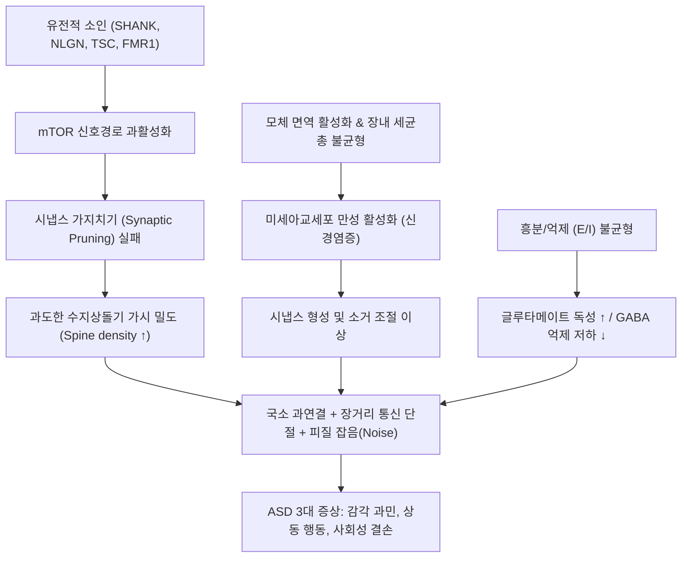
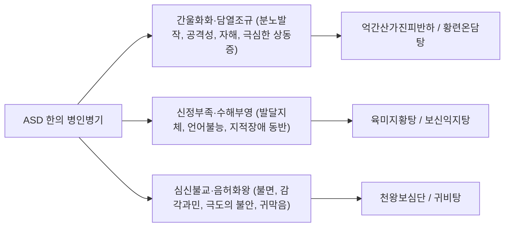

# 🩺 자폐 범주성 장애 (Autism Spectrum Disorder, ASD / F84.0)

> **핵심 3줄 요약 (Key Summary)**:
> - 📍 **병소 부위 & 해부·병태생리**: 생애 초기 신경발달 과정에서 [[시냅스 가지치기]](Synaptic pruning)의 결손과 대뇌 피질 미세 신경망의 [[국소 과연결성]](Local hyper-connectivity) 및 전두-두정엽 간 [[장거리 연결성 저하]](Long-range under-connectivity), 흥분성/억제성(E/I) 신경전달 불균형([[글루타메이트]] 과활성 vs [[GABA]] 저하), 그리고 [[방추상안면영역]](FFA)·[[편도체]]·[[뇌섬엽]]으로 구성된 사회적 뇌 회로망(Social brain network)의 기능 장애에 기인한다.
> - 🚩 **전형적 임상 양상**: [[DSM-5-TR]] 진단 기준에 따른 사회적 의사소통 및 상호작용의 지속적 결손(사회정서적 상호성, 비언어적 의사소통, 관계 형성의 결함 등 3대 항목 모두 충족)과 제한적이고 반복적인 행동·관심·활동 패턴(상동증적 상동행동, 동일성 고집, 고정된 특이 관심, 감각 과민/과소 반응 중 2개 이상 충족). 중증도는 지원 필요도에 따라 레벨 1~3단계로 구분된다.
> - 🛠️ **핵심 검사 & 치료 전략**: 조기 스크리닝(M-CHAT-R/F) 및 진단 표준 도구(ADOS-2, ADI-R) 시행; 응용행동분석([[응용행동분석]], ABA), 덴버 모델([[ESDM]]), 언어치료, 감각통합치료 조기 집중 개입; 심한 과민성·공격성에 대한 [[리스페리돈]](Risperidone) 및 [[아리피프라졸]](Aripiprazole) 약물 병용; 한의학적 [[어탁조규]](瘀濁阻竅)·[[신정휴손]](腎精虧損)·[[심신불교]](心腎不交) 변증 기반 [[억간산]], [[온담탕]], [[천왕보심단]], [[육미지황탕]] 처방과 두침(정두구, 언어구, 감각구) 및 [[백회]], [[사신총]], [[신문]], [[내관]], [[태충]] 침구 치료.
> - <font color="#fa7e7e">⚠️ **응급 의뢰 레드플래그**: 머리 찧기(Head banging), 피부 물어뜯기 등 신체 손상을 초래하는 급성 자해 행동; 타인을 향한 극심한 폭력적 분노 발작(Meltdown); 발달 퇴행(12~24개월경 기득 언어 및 사회적 기술의 급격한 상실); 돌발적인 무반응, 청색증, 근간대성 경련 등 [[소아 뇌전증]](Epilepsy) 동반 징후; 급성 위장관 폐색 및 심인성 탈수 소견 관찰 시 즉시 소아신경과, 소아응급센터 및 소아청소년정신과 전문의 연계.</font>

---

## 📌 목차
1. [질환 개요 & 해부학적 병태생리](#1-질환-개요--해부학적-병태생리)
2. [병태생리 메커니즘 & 생체역학적 악순환 네트워크](#2-병태생리-메커니즘--생체역학적-악순환-네트워크)
3. [임상 증상 & 이학적 검사(Physical Exam) 알고리즘](#3-임상-증상--이학적-검사physical-exam-알고리즘)
4. [감별 진단 매트릭스 (Differential Diagnosis)](#4-감별-진단-매트릭스-differential-diagnosis)
5. [한의 통합 치료 프로토콜 (침·약침·추나·한약)](#5-한의-통합-치료-프로토콜-침약침추나한약)
6. [양방 치료 & 병용·의뢰 기준 (Conventional Treatment & Referral)](#6-양방-치료--병용의뢰-기준-conventional-treatment--referral)
7. [재활 운동 & 생활습관 티칭 가이드](#7-재활-운동--생활습관-티칭-가이드)
8. [💡 사용자 진료실 핵심 필기 & 임상 노하우 (Melt-In 잔여 심화 집약)](#8--사용자-진료실-핵심-필기--임상-노하우-melt-in-잔여-심화-집약)
9. [출처 및 학술 참고 문헌 (References)](#9-출처-및-학술-참고-문헌-references)

---

## 1. 질환 개요 & 해부학적 병태생리

### (1) 개념 및 진단학적 정의
**자폐 범주성 장애(Autism Spectrum Disorder, ASD)**, 통칭 **자폐 스펙트럼 장애**는 생애 초기부터 시작되는 복합적인 중추신경계 신경발달장애(Neurodevelopmental disorder)이다. 

과거 [[DSM-IV]] 체계에서 자폐성 장애(Autistic disorder), 아스퍼거 증후군(Asperger's disorder), 소아기 붕괴성 장애(Childhood disintegrative disorder), 특정불능의 전반적 발달장애(PDD-NOS)로 분리되어 있던 진단군이 [[DSM-5]] 및 [[DSM-5-TR]]에 이르러 단일한 연속선상의 개념인 **'자폐 범주성 장애(ASD)'** 로 통합되었다. 세계보건기구의 [[ICD-10]] 및 한국표준질병사인분류에서는 **F84.0(소아기 자폐증)** 및 F84 하위 코드로 분류된다.

ASD의 핵심 병리는 크게 두 가지 핵심 영역으로 집약된다:
1. **사회적 의사소통 및 상호작용의 지속적인 결함(Persistent deficits in social communication and social interaction)**
2. **제한적이고 반복적인 형태의 행동, 관심, 활동(Restricted, repetitive patterns of behavior, interests, or activities)**

'스펙트럼(Spectrum)'이라는 명칭이 의미하듯, 환아 개개인의 지적 능력(고기능 자폐부터 중증 지적장애 동반까지), 언어 구사력(유창한 어휘부터 완전 무발화까지), 감각 과민도의 중증도는 대단히 넓은 연속적 스펙트럼 상에 분포한다.

### (2) 역학 및 호발 특성
- **유병률**: 전 세계적으로 급격한 증가 추세를 보이고 있으며, 미국 질병통제예방센터(CDC)의 2023년 보고에 따르면 8세 아동 기준 **약 36명당 1명(2.8%)** 에 달한다. 국내 역학 조사에서도 약 2.64%의 높은 유병률이 보고된 바 있다. 이는 진단 기준의 확대, 조기 선별 시스템의 정착, 사회적 인식 향상 및 유전-환경적 복합 요인이 반영된 결과이다.
- **성별 분포**: 전통적으로 남아가 여아보다 약 **3.8~4 : 1** 정도로 높게 보고된다. 그러나 지능이 정상 범위에 속하는 여아의 경우 사회적 모방 및 위장(Camouflaging / Masking) 능력이 뛰어나 진단이 성인기까지 누락되는 경향이 있음이 최근 신경과학계에서 밝혀지고 있다.
- **유전체학적 병인(Genetics)**: ASD는 유전율(Heritability)이 **70~90%** 에 달하는 가장 유전성이 높은 신경정신과적 질환 중 하나이다. *SHANK3*, *NLGN3/4*, *NRXN1*, *TSC1/2*, *PTEN*, *FMR1* 등 시냅스 구조 단백질 및 신호 전달 복합체를 암호화하는 유전자의 드 노보(De novo) 희귀 변이, 복제수 변이(CNV), 다유전자 위험 점수(Polygenic risk score)가 질환 발현에 복합적으로 기여한다(PMID 42888365).

### (3) 신경해부학적 병소 및 '사회적 뇌(Social Brain)' 네트워크
자폐 스펙트럼 장애는 뇌의 특정 단일 병소의 손상이 아니라, 다발적 대뇌 피질 및 피질하 핵군 간의 **신경 연결망(Connectome) 이상**으로 규정된다.

```
[ ASD 환아의 신경해부학적 핵심 병소 및 사회적 뇌 네트워크 ]

               ┌───────────────────────────────┐
               │    내측 전전두엽 (mPFC)       │ ── 타인의 마음 읽기 (ToM) 결손
               └──────────────┬────────────────┘
                              │
        ┌─────────────────────┼─────────────────────┐
        ▼                     ▼                     ▼
┌──────────────┐      ┌──────────────┐      ┌──────────────┐
│  편도체 결손 │      │ 방추상안면영역│      │ 상측두구 결손│
│ (Amygdala)   │      │ (FFA / FG)   │      │ (STS / pSTS) │
│ 정서적 공감  │      │ 얼굴 재인 및 │      │ 시선 추적 및 │
│ 및 위협 반응 │      │ 눈맞춤 회피 │      │ 생물학적 모션│
└──────────────┘      └──────────────┘      └──────────────┘
        │                     │                     │
        └─────────────────────┼─────────────────────┘
                              ▼
               ┌───────────────────────────────┐
               │     뇌섬엽 (Insula) 결손      │ ── 내수용 감각 및 공감 불능
               └───────────────────────────────┘
```

1. **사회적 인지 신경망(Social Brain Network)의 부전**:
   - **[[방추상안면영역]](Fusiform Face Area, FFA)**: 타인의 얼굴을 인식하고 표정을 읽는 시각 피질의 핵심 영역으로, ASD 아동에서는 얼굴 자극에 대한 FFA 활성화가 현저히 둔마되어 눈맞춤(Eye contact) 회피로 이어진다.
   - **[[편도체]](Amygdala)**: 타인의 시선과 사회적 단서의 정서적 중요성을 평가하는 핵군이다. 생애 초기 편도체의 비정상적인 과도한 증식 후 청소년기 위축이 관찰되며, 사회적 불안 및 공포 반응 조절 실패의 기전이 된다.
   - **내측 전전두엽(mPFC) & 상측두구(STS)**: 타인의 의도, 감정, 신념을 추론하는 **'마음 이론(Theory of Mind, ToM)'** 과 시선의 방향(Biological motion)을 파악하는 회로로, 기능적 비활성화가 확인된다.
   - **[[거울신경세포계]](Mirror Neuron System, MNS)**: 하두정소엽 및 전운동피질에 분포하여 타인의 행동과 감정을 내면에서 시뮬레이션하는 거울신경계의 기능 저하(Broken mirror theory)로 인해 직관적 공감과 모방 학습이 차단된다.

2. **소뇌(Cerebellum) 및 소뇌-대뇌 기능 연결성 결함**:
   - 소뇌의 **푸르키니에 세포(Purkinje cells)** 수의 현저한 감소가 사후 뇌 부검에서 가장 일관되게 확인된다.
   - 소뇌는 운동 협응뿐만 아니라 언어, 주의 전환, 사회적 상호작용의 타이밍을 미세 조율하므로, 소뇌-시상-피질 회로의 이상은 서투른 운동성과 예측 불가능한 환경에 대한 극심한 불안을 유발한다.

---

## 2. 병태생리 메커니즘 & 생체역학적 악순환 네트워크

### (1) 신경병리학적 구조: 국소 과연결성 vs 장거리 연결성 저하

```
[ 정상 대뇌 연결망 vs ASD 대뇌 연결망 비교 ]

┌────────────────────────────────────────────────────────┐
│ [정상 뇌 연결성] : 국소 모듈과 원거리 네트워크의 최적 균형  │
│                                                        │
│   (전두엽 모듈) ════════════════════════ (두정엽 모듈)  │
│        ║           [장거리 연결성 원활]         ║       │
│   (피질하 핵군) ════════════════════════ (후두엽 모듈)  │
└────────────────────────────────────────────────────────┘

┌────────────────────────────────────────────────────────┐
│ [ASD 뇌 연결성] : '나무만 보고 숲을 보지 못하는' 연결 결손 │
│                                                        │
│   ┌──────┐                                ┌──────┐     │
│   │▒▒▒▒▒▒│ ── ── ── (장거리 단절) ── ── ──│▒▒▒▒▒▒│     │
│   └──────┘                                └──────┘     │
│   [국소 과연결성: 미세회로 과부하]        [국소 과연결성]│
│   - 특정 디테일에 병적 집착               - 감각 과민  │
│   - 전두-후두, 좌우 반구 간 고차원적 정보 통합 실패    │
└────────────────────────────────────────────────────────┘
```

ASD 뇌의 핵심 신경병리는 **"근거리 미세 신경망의 비정상적 과밀화(Local Hyper-connectivity)"** 와 **"뇌 영역 간 장거리 대규모 신경망의 기능적 단절(Long-range Under-connectivity)"** 로 요약된다. 
- 대뇌 피질의 미세 원주(Minicolumn)들이 지나치게 조밀하고 작게 배열되어 있어, 미세한 시각·청각적 디테일(예: 바퀴 회전, 특정 글꼴, 냄새)에는 폭발적으로 과민 반응하지만, 전두엽과 두정엽, 후두엽을 아우르는 전체적 맥락 파악(Central coherence)과 통합적 사회 인지에는 실패하게 된다.

### (2) 분자 생물학적 기전



1. **시냅스 가지치기(Synaptic Pruning)의 실패**:
   - 정상 아동의 대뇌 피질은 유아기 폭발적인 시냅스 생성 후 미세아교세포(Microglia)의 탐식 작용과 자가포식(Autophagy)을 통해 불필요한 시냅스를 정리하는 '가지치기'를 거친다.
   - ASD 뇌에서는 **mTOR 신호 전달 경로의 과활성화**로 인해 자가포식이 억제되고, 결과적으로 피질 피라미드 신경세포의 **수지상돌기 가시(Dendritic spine) 밀도가 비정상적으로 높게 유지**된다. 이는 뇌 피질 내의 '신경학적 잡음(Neural noise)'을 증폭시키고 감각 과부하를 초래한다.
2. **흥분성/억제성(Excitation/Inhibition, E/I) 불균형**:
   - 대뇌 피질의 주된 흥분성 신경전달물질인 **[[글루타메이트]](Glutamate)** 수용체(NMDA/AMPA)의 과도한 활성과, 억제성 신경전달물질인 **[[GABA]](Gamma-aminobutyric acid)** 개재신경세포(Parvalbumin-positive interneurons)의 기능 저하가 공존한다.
   - 피질의 억제 회로가 붕괴되면서 뇌가 외부 감각 자극을 필터링하지 못해 극심한 감각 과민과 불안이 유발되며, 이는 ASD 아동의 20~30%에서 **뇌전증(Epilepsy)이 병발**하는 직접적인 생물학적 기전이 된다.
3. **신경염증(Neuroinflammation)과 장-뇌 축(Gut-Brain Axis)**:
   - 전신 염증성 사이토카인(IL-6, TNF-alpha)의 상승과 뇌내 미세아교세포의 만성 염증 상태가 확인된다.
   - 장내 미생물총(Microbiome)의 유익균 감소 및 Clostridium 계열 증식으로 인해 단쇄지방산(SCFA) 및 장벽 투과성이 변화하고, 혈뇌장벽(BBB)을 통과한 대사 산물이 신경발달을 왜곡한다.

---

## 3. 임상 증상 & 이학적 검사(Physical Exam) 알고리즘

### (1) DSM-5-TR 진단 기준의 정밀 분석

ASD로 확진되기 위해서는 **A군 항목 3가지를 모두 충족**해야 하며, **B군 항목 4가지 중 최소 2가지 이상을 충족**해야 한다.

```
[ DSM-5-TR 진단 기준 다이어그램 ]

┌────────────────────────────────────────────────────────┐
│ [A군: 사회적 의사소통 및 상호작용 결손] (3개 모두 필수 충족)│
│                                                        │
│ 1. 사회정서적 상호성 결손 (대화 불가, 감정 공유 부재)  │
│ 2. 비언어적 의사소통 결손 (눈맞춤 회피, 제스처 결여)   │
│ 3. 관계 발전·유지·이해 결손 (또래 놀이 불가, 친구 무관심)│
└────────────────────────────────────────────────────────┘
                           AND
┌────────────────────────────────────────────────────────┐
│ [B군: 제한적이고 반복적인 행동·관심] (4개 중 2개 이상 충족) │
│                                                        │
│ 1. 상동증적/반복적 운동 동작, 사물 사용, 반향어 구사    │
│ 2. 동일성에의 고집, 일상의 융통성 없는 고수, 의례화 행동│
│ 3. 강도나 초점에 있어 비정상적인 극도로 고정된 관심     │
│ 4. 감각 자극에 대한 과다 또는 과소 반응성, 특이 반응   │
└────────────────────────────────────────────────────────┘
```

#### 1) A군: 사회적 의사소통 및 상호작용의 결손 (3가지 모두 충족)
- **A1. 사회정서적 상호성의 결손(Social-emotional reciprocity)**:
  - 비정상적인 사회적 접근, 정상적인 오고 가는 대화의 실패.
  - 흥미, 감정, 정서의 공유 감소 (예: 자기가 좋아하는 것을 부모에게 보여주거나 가리키지 않음).
  - 사회적 상호작용을 먼저 시작하거나 적절히 반응하지 못함.
- **A2. 비언어적 의사소통 행동의 결손(Nonverbal communicative behaviors)**:
  - 언어적·비언어적 의사소통의 통합 부족.
  - 눈맞춤(Eye contact)의 이상, 신체 언어 및 제스처의 사용 결여.
  - 표정의 다양성 부재 및 부적절한 얼굴 표정.
- **A3. 관계 발전, 유지 및 이해의 결손(Developing, maintaining, and understanding relationships)**:
  - 다양한 사회적 맥락에 맞춰 행동을 조절하지 못함.
  - 상상 놀이(Pretend play)나 친구 사귀기의 어려움.
  - 또래에 대한 전반적인 흥미 부재.

#### 2) B군: 제한적이고 반복적인 행동, 관심, 활동 패턴 (4가지 중 2가지 이상 충족)
- **B1. 상동증적이거나 반복적인 운동 동작, 사물 사용, 또는 언어 구사**:
  - 손털기(Hand flapping), 까치발 걷기(Toe walking), 몸 앞뒤로 흔들기(Rocking).
  - 장난감을 기능대로 가지고 놀지 않고 줄 세우기(Lining up toys), 자동차 바퀴만 계속 돌리기.
  - 들은 말을 앵무새처럼 그대로 따라 하는 즉각적/지연성 **반향어(Echolalia)**, 특이한 은어 사용.
- **B2. 동일성에 대한 고집, 일상에 대한 융통성 없는 고수, 의례화된 언어적/비언어적 패턴**:
  - 아주 작은 변화에도 극심한 고통과 분노(Meltdown) 반응 (예: 등교 경로 변경, 가구 위치 이동).
  - 매일 정해진 순서와 규칙대로만 행동해야 하는 완고한 의례.
- **B3. 강도나 초점에 있어 비정상적인 극도로 제한되고 고정된 관심**:
  - 지하철 노선도, 진공청소기 모델 번호, 엘리베이터 버튼, 공룡 이름 등 특정 비기능적 주제에 대한 병적인 몰입.
- **B4. 감각 자극에 대한 과다 또는 과소 반응성, 환경의 감각적 측면에 대한 특이한 관심**:
  - 청각 과민: 드라이기, 청소기, 핸드드라이어 소리에 귀를 틀어막고 비명 지름.
  - 촉각 과민: 특정 옷감의 상표(Tag)나 양말 솔기를 견디지 못함, 머리 감기나 이발 거부.
  - 통증 둔감: 넘어져 피가 철철 흘러도 울지 않고 통증에 무반응.
  - 시각적 과몰입: 불빛이나 돌아가는 선풍기 날개를 넋을 잃고 응시함.

### (2) 중증도 평가: 3단계 지원 수준(Severity Levels)

| 중증도 단계 | 사회적 의사소통 (Social Communication) | 제한적·반복적 행동 (Restricted, Repetitive Behaviors) | 임상적 조치 수준 |
| :--- | :--- | :--- | :--- |
| **Level 1**<br>*(지원 필요)* | 도움 없이는 소통 결손이 눈에 띔. 대화 시작이 어렵고 실패함. 또래 사귀기 어려우나 시도는 함. | 융통성 부족으로 일상 기능 방해. 계획 변경 시 좌절. 정리 및 전환의 어려움. | 학교 및 사회적 기술 훈련(Social skills training) 지원. |
| **Level 2**<br>*(실질적 지원 필요)* | 구어/비구어 기술의 현저한 결손. 단순한 문장으로만 소통. 특이한 비언어적 소통. | 환경 변화에 명백한 고통. 관심사 전환 시 심한 저항. 잦은 상동 행동. | 전담 특수교사 배정, 집중적 언어 및 행동 치료 필요. |
| **Level 3**<br>*(매우 실질적 지원 필요)* | 언어 기능 극도로 제한(무발화 또는 몇 개의 단어만). 타인의 사회적 접근에 거의 무반응. | 모든 영역을 지배하는 극단적 상동 행동. 일상 변경 시 극심한 공격/자해 분노 발작. | 24시간 밀착 보호 및 상시적 행동 중재 개입. |

### (3) 진단 평가 알고리즘 및 표준 도구
1. **영유아기 조기 선별 검사(Screening)**:
   - **M-CHAT-R/F(Modified Checklist for Autism in Toddlers)**: 16~30개월 영유아를 대상으로 한 부모 보고형 선별 도구로, 고위험군 조기 발견의 필수 척도.
2. **진단 골드 스탠다드(Gold Standard Diagnostics)**:
   - **ADOS-2(Autism Diagnostic Observation Schedule, 2판)**: 구조화된 놀이 및 면담 상황에서 아동의 사회적 상호작용과 의사소통을 직접 관찰·채점하는 표준 검사.
   - **ADI-R(Autism Diagnostic Interview-Revised)**: 보호자를 대상으로 생애 전반의 발달 궤적과 자폐 증상을 심층 인터뷰하는 표준 면담 도구.
3. **인지 및 적응 행동 평가**:
   - 지능 검사: [[K-WISC-V]], PEP-R (발달수준 측정)
   - 사회성숙도 검사(SMS), 바인랜드 적응행동척도(Vineland-3).

---

## 4. 감별 진단 매트릭스 (Differential Diagnosis)

| 감별 질환 | 사회적 상호작용 | 언어 및 의사소통 | 제한적·반복적 행동 (B군) | 감별 핵심 포인트 |
| :--- | :--- | :--- | :--- | :--- |
| **[[자폐 범주성 장애]]**<br>*(본 질환)* | **결손 (눈맞춤, 상호성 부재)** | **결손 (비언어적 소통 실패)** | **필수 존재 (상동행동, 집착, 감각과민)** | 사회적 결손 + 반복 행동의 2대 축 충족. |
| **사회적(실용적) 의사소통 장애**<br>*(SCD)* | 상황 맥락 파악 부족 | 구어 문법은 정상이나 **화용론(Pragmatics) 결손** | **존재하지 않음 (B군 부재)** | B군(상동 행동, 감각 과민)이 전혀 없어 ASD 배제. |
| **[[지적장애]]**<br>*(Intellectual Disability)* | 정신 연령에 비례하여 유지됨 | 전반적 인지 지연에 따른 지체 | 자해나 상동행동 일부 가능하나 사회성 유지 | 정신 연령에 맞는 눈맞춤, 미소, 사회적 애착 형성 가능. |
| **반응성 애착장애**<br>*(RAD)* | 극도의 양육 방임으로 인한 회피 | 언어 지연 동반 가능 | 특이한 상동증은 드뭄 | 지지적이고 따뜻한 양육 환경 제공 시 사회성이 극적으로 회복됨. |
| **[[발달성 언어장애]]**<br>*(DLD)* | 정상 (몸짓으로 소통 갈망) | 표현성/수용성 언어 발달 지체 | 없음 | 몸짓(포인팅, 끄덕임), 눈맞춤을 총동원해 소통하려 함. |
| **소아기 불안장애 / [[선택적 함구증]]** | 특정 낯선 상황에서만 위축 | 익숙한 가정에서는 완벽한 발화 | 없음 | 집에서는 부모와 완벽한 눈맞춤과 유창한 대화를 구사함. |

> 🚩 **레드플래그 감별 (즉각적 의학적 정밀 진단 필요)**:
> 1. **발달 퇴행(Developmental Regression)**: 15~24개월까지 엄마, 아빠를 부르고 눈을 잘 맞추던 아동이 수주 사이에 눈맞춤을 끊고 언어를 완전히 잃어버리는 경우, [[레트 증후군]](Rett Syndrome), 백질이영양증, 소아기 뇌전증성 뇌병증에 대한 유전자 검사 및 뇌파(EEG) 검사 필수.
> 2. **지속적인 두부 강타 및 안구 압박 자해**: 망막 박리, 두개내 출혈의 위험이 있으므로 즉각적인 물리적 보호 장구 및 약물적 개입 요망.

---

## 5. 한의 통합 치료 프로토콜 (침·약침·추나·한약)

한의학에서 자폐 범주성 장애는 고전 문헌의 **[[오지]](五遲, 어지·입지·행지·치지·발지)**, **[[오연]](五軟, 두연·항연·수연·족연·구연)**, **태겁(胎怯)**, **치매(癡呆)**, 그리고 정서와 신명(神明)의 실조인 **전증(癲證)** 의 범주로 이해한다. 
선천적인 뇌수의 성숙 결함인 **[[신정휴손]](腎精虧損)** 을 기저로 하여, 담음과 어혈이 뇌의 감각 구멍을 가로막는 **[[어탁조규]](瘀濁阻竅)**, 심장의 화기와 신장의 음액이 소통하지 못하는 **[[심신불교]](心腎不交)**, 그리고 간기(肝氣)가 억울되어 폭발하는 **[[간화상염]](肝火上炎)** 이 복합되어 발현한다.

### (1) 변증 분류 및 한약 치료 (Herbal Medicine)



1. **간울화화 및 담열조규형(肝鬱化火·痰熱阻竅型)**:
   - **임상 양상**: 사소한 자극이나 일상 변화에 격렬한 분노 발작(Meltdown)을 일으키고, 물건을 던지거나 자신을 때리는 공격·자해 행동, 꽥꽥 소리를 지름, 까치발과 극단적인 상동 행동, 대변 비결(便秘), 설홍태황니(舌紅苔黃膩), 맥현삭(脈弦數).
   - **치료 원칙**: 평간식풍(平肝熄風), 청열청심(淸熱淸心), 화담통규(化痰通竅).
   - **대표 처방**: **[[억간산]](抑肝散加陳皮半夏)**, **[[황련온담탕]](黃連溫膽湯加味)**.
   - **약물 구성**: [[조구등]](釣鉤藤) 10g, [[시호]](柴胡) 4g, [[백출]](白朮) 8g, [[백복령]](白茯苓) 8g, [[당귀]](當歸) 6g, [[천궁]](川芎) 6g, [[감초]](甘草) 2g, [[진피]](陳皮) 6g, [[반하]](半夏) 6g, [[석창포]](石菖蒲) 6g, [[황련]](黃連) 3g.
   - **현대 약리 기전**: 억간산의 핵심 본초인 **조구등(Uncaria rhynchophylla)의 Geissoschizine methyl ether 성분**은 대뇌 피질의 세로토닌 5-HT1A 수용체 작용제 및 도파민/글루타메이트 수용체 조절제로 작용하여, **GABA성 억제 회로를 강화하고 글루타메이트 과흥분성을 억제**함으로써 과민성, 공격성 및 상동 행동을 현저히 진정시킨다.

2. **신정휴손 및 수해부영형(腎精虧損·髓海不榮型)**:
   - **임상 양상**: 불러도 대답이 없고(호명 반응 결여), 사람과의 눈맞춤이 전무하며, 언어 발달이 극도로 지연(무발화), 대소변을 가리지 못하고 하지에 힘이 없음. 설담(舌淡), 맥침세(脈沈細).
   - **치료 원칙**: 자신익정(滋腎益精), 보신충수(補腎充髓), 개규성신(開竅醒神).
   - **대표 처방**: **[[육미지황탕]](六味地黃탕)** 가미방, **[[가미귀비탕]](加味歸脾湯)**.
   - **약물 구성**: [[숙지황]](熟地黃) 12g, [[산약]](山藥) 8g, [[산수유]](山茱萸) 6g, [[택사]](澤瀉) 6g, [[목단피]](牡丹皮) 6g, [[복령]](茯苓) 6g, [[녹용]](鹿茸) 3g, [[원지]](遠志) 6g, [[석창포]] 6g.

3. **심신불교 및 음허화왕형(心腎不交·陰虛火旺型)**:
   - **임상 양상**: 밤에 잠을 자지 않고 깨어서 울거나 소리를 지름(극심한 소아 불면), 소리에 극도로 예민하여 귀를 막음, 손발에 미열, 도한(盜汗), 안절부절못함.
   - **치료 원칙**: 자음강화(滋陰降火), 양심안신(養心安神).
   - **대표 처방**: **[[천왕보심단]](天王補心丹)**.
   - **약물 구성**: [[생지황]](生地黃) 12g, [[산조인]](酸棗仁)(초) 8g, [[백자인]](柏子仁) 8g, [[맥문동]](麥門冬) 8g, [[천문동]](天門冬) 6g, [[당귀]] 6g, [[오미자]](五味子) 4g, [[원지]] 6g.

### (2) 두침 치료 (Scalp Acupuncture) 및 체침 프로토콜
ASD 환아의 두침 치료는 세계신경외과 및 중의학계에서 대뇌 피질의 기능적 재배선(Neuroplasticity)을 자극하는 주요 치료법으로 다수의 무작위 대조군 연구(RCT)가 보고되어 있다.

```
[ ASD 두침 핵심 구역 및 체침 배혈 ]

              (백회 GV20 - 정신 총괄)
                        │
         ┌──────────────┴──────────────┐
  (사신총 EX-HN1)                 (사신총 EX-HN1)
         └──────────────┬──────────────┘
                        │
           [전두부: 정두구·전두엽 인지 영역]
           [측두부: 언어1구·언어2구·감각구]
                        │
             [인중 GV26 - 개규성신]
```

1. **두침 주요 치료구**:
   - **정두구(Forehead-Head Area)**: 이마 헤어라인 부위 전두엽 피질 투영 부위로, 사회적 판단력, 충동 조절, 주의집중력 개선.
   - **언어구(Speech Areas I, II, III)**: 브로카 및 베르니케 투영 부위로, 발화 촉진 및 수용성 언어 이해 증진.
   - **감각구(Sensory Area)**: 정수리 중심구 뒤쪽 감각 피질 투영 부위로, 청각 및 촉각 과민증 완화.
   - 자침 기법: 소아 전용 0.18 × 15mm 무통침을 사용하여 두피 하건막층으로 15~30도 횡자(평자) 진침. 통상 15~20분간 유침하며, 아동이 심하게 거부할 경우 단자(진침 후 염전하여 즉시 발침) 기법을 활용한다.

2. **체침 및 특효 혈위**:
   - **[[인중]](GV26, 수구)**: 독맥의 요혈로 개규성신(開竅醒神), 뇌혈류 급속 촉진.
   - **[[백회]](GV20) & [[사신총]](EX-HN1)**: 대뇌 피질 전반의 흥분성/억제성 조율.
   - **[[신문]](HT7), [[내관]](PC6)**: 심포 및 심경 조절을 통한 불안 진정 및 수면 개선.
   - **[[태충]](LR3) & [[합곡]](LI4)**: 사관혈로 간기 울결 해소 및 전신 긴장 완화.
   - **[[삼음교]](SP6)**: 간·비·신 3음경의 교회혈로 선천 정기 보강.

### (3) 약침 요법 (Pharmacopuncture)
- **자하거(Hominis Placenta) 약침**: 뇌신경 영양 인자 공급 및 면역계 정상화를 위해 [[신수]](BL23), [[풍지]](GB20)에 주 1~2회 0.1~0.2cc 분할 주입.
- **황련해독탕 약침**: 극심한 자해와 공격성을 보이는 열증(熱證) 환아의 경우 [[대추]](GV14) 및 [[곡지]](LI11)에 시술하여 뇌의 신경염증 반응을 경감.

---

## 6. 양방 치료 & 병용·의뢰 기준 (Conventional Treatment & Referral)

### (1) 근거 중심 조기 행동 개입(Early Behavioral Interventions)
약물 치료는 ASD의 핵심 증상(사회성 및 의사소통 결손)을 치료하지 못하며, **조기 집중 행동 치료가 발달 예후를 결정짓는 핵심 기둥**이다.

1. **응용행동분석(Applied Behavior Analysis, ABA)**:
   - 주 20~40시간에 걸친 1:1 고강도 행동 수정 프로그램.
   - 선행사건-행동-결과(A-B-C 모델) 원리를 적용하여 바람직한 사회적 행동을 세분화하여 강화하고, 부적응 행동(자해, 공격)의 기능을 분석하여 대체 행동을 훈련한다.
2. **덴버 조기 발달 모델(Early Start Denver Model, ESDM)**:
   - 12~48개월 영유아를 대상으로 한 발달적·관계 중심 놀이 기반 중재법.
   - 자연스러운 놀이 상황에서 아동 주도의 활동에 치료사가 개입하여 눈맞춤, 모방, 정서 공유를 이끌어낸다.
3. **감각통합치료(Sensory Integration Therapy, SIT)**:
   - 작업치료사에 의해 진행되며, 전정감각, 고유수용성감각, 촉각을 체계적으로 제공하여 감각 과민/과소 반응을 조절하고 신체 인식을 높인다.

### (2) 정신약물학적 치료 (Pharmacotherapy)

```
[ ASD 약물 치료의 임상 적용 원칙 ]

     ┌──────────────────────────────────────────────────┐
     │ 핵심 증상 (사회성 결손) : 효과적인 약물 없음     │
     └──────────────────────────────────────────────────┘
                              │
            ┌─────────────────┴─────────────────┐
            ▼                                   ▼
┌──────────────────────────────┐    ┌──────────────────────────────┐
│  FDA 승인 비정형 항정신병제  │    │      공존 질환 표적 치료     │
│ [리스페리돈] & [아리피프라졸]│    │ - ADHD: 메틸페니데이트/아토목│
│  - 적응증: 심한 과민성,     │    │ - 불안/강박: SSRI (신중 투여)│
│    공격성, 자해, 분노 발작   │    │ - 수면장애: 멜라토닌        │
└──────────────────────────────┘    └──────────────────────────────┘
```

1. **FDA 공인 1차 약물 (과민성 및 공격성 표적)**:
   - **[[리스페리돈]](Risperidone)**:
     - 만 5세 이상에서 FDA 승인.
     - 도파민 D2 및 세로토닌 5-HT2A 수용체 길항제.
     - 시작 용량 0.25mg/day(20kg 미만) ~ 0.5mg/day(20kg 이상), 목표 유지 용량 0.5~1.5mg/day (최대 3.0mg).
     - **주요 부작용**: 현저한 식욕 증가 및 체중 증가, 대사증후군, 진정, **고프로락틴혈증(여성형 유방, 유즙 분비)**, 추체외로 증상(EPS).
   - **[[아리피프라졸]](Aripiprazole)**:
     - 만 6세 이상에서 FDA 승인.
     - 도파민 D2 부분 작용제(Partial agonist) 및 5-HT1A 부분 작용제.
     - 시작 용량 2mg/day, 점진적 증량하여 목표 용량 5~10mg/day.
     - 리스페리돈 대비 체중 증가와 고프로락틴혈증 위험이 상대적으로 낮으나, 초조(Akathisia) 및 구역이 발생할 수 있음.
2. **공존 증상에 따른 보조 약물**:
   - **ADHD 공존 시**: 메틸페니데이트, 아토목세틴, 알파-2 아고니스트(구안파신, 클로니딘 - 충동성 및 틱 완화).
   - **수면장애 동반 시**: [[멜라토닌]](Melatonin) 1~3mg 취침 30분 전 투여 (ASD 아동의 내인성 멜라토닌 합성 저하 보충).

### (3) 양·한방 병용 투여 시의 임상적 판단
- **리스페리돈 + 억간산(抑肝散) 병용 요법**:
  - 임상 및 연구에서 억간산은 리스페리돈의 항정신병적 항공격성 효능을 증강시키는 동시에, 리스페리돈의 용량을 절감(Sparing effect)시켜 **추체외로 부작용과 고프로락틴혈증 발생률을 유의하게 낮추는 시너지 효과**를 발휘한다.
  - 양약 복용 중인 환아에게 억간산을 병용 투여할 경우, 체중과 간기능, 혈당 및 지질 수치를 3~6개월 단위로 추적 관찰한다.

---

## 7. 재활 운동 & 생활습관 티칭 가이드

### (1) 감각 다이어트(Sensory Diet) 환경 설계
ASD 아동은 주변 환경의 사소한 감각 자극에도 뇌 회로가 포화 상태에 이른다. 가정과 교실 환경을 신경학적으로 안전한 공간으로 재구성해야 한다.

```
[ 감각 과부하 완화를 위한 감각 다이어트 체크리스트 ]

  [시각] 형광등 깜빡임 제거 ──▶ 간접 조명 및 암막 커튼 설치
  [청각] 소음 차단 ────────▶ 소음 제거(Noise-cancelling) 헤드폰 착용
  [촉각] 피부 자극 최소화 ──▶ 옷의 라벨/상표 가위로 완전 제거, 순면 의류
  [고유수용성감각] 압박 제공 ─▶ 무게 조끼(Weighted vest), 무거운 이불 활용
```

1. **감각 안식처(Safe Quiet Zone) 마련**:
   - 분노 발작이나 과부하 조짐이 보일 때 아동이 스스로 들어가 쉴 수 있는 텐트나 쿠션이 깔린 어두운 방을 조성한다.
2. **심부 압박(Deep Pressure Therapy)**:
   - 체중의 약 5~10% 무게를 가진 무게 담요(Weighted blanket)나 짐볼을 이용한 신체 압박 마사지는 고유수용성감각을 자극하여 교감신경 흥분을 가라앉히고 미주신경(Vagus nerve) 긴장도를 높여 심리적 안정을 유도한다.

### (2) 시각적 일과표(Visual Schedule)와 TEACCH 프로그램
ASD 아동은 청각적 지시("이제 장난감 치우고 밥 먹자")를 즉각적으로 처리하지 못하지만, 시각적 정보 처리 능력은 상대적으로 우수하다.
- **사진 및 그림 카드(PECS)를 활용한 시각적 일과표**: 아침 기상부터 취침까지의 순서를 그림 카드로 순서대로 나열하여 예측 가능성을 부여한다.
- **예고제(Advance Notice) 시행**: 활동을 전환하기 5분 전, 3분 전, 1분 전에 타이머나 모래시계를 보여주며 변화를 미리 인지시켜 전환에 따른 불안 발작을 예방한다.

### (3) 장내 미생물총 개선 및 식이 가이드
- **글루텐 & 카제인 제한 식이(GFCF Diet)**: 밀가루의 글루텐과 유제품의 카제인이 불완전 분해되어 형성되는 외인성 오피오이드 펩티드(Gliadomorphin, Casomorphin)가 뇌내 수용체를 자극하여 상동 행동을 악화시킬 수 있으므로, 소화기 증상이 심한 환아에서 2~3개월간 시험적 배제 후 반응을 평가한다.
- **프로바이오틱스 및 프리바이오틱스 섭취**: Bifidobacterium, Lactobacillus 균주 보충으로 장내 투과성을 낮추고 신경염증 완화.

---

## 8. 💡 사용자 진료실 핵심 필기 & 임상 노하우 (Melt-In 잔여 심화 집약)

### (1) 영유아 12~18개월 조기 진찰의 3대 황금 열쇠: "호명, 포인팅, 눈맞춤"
영유아 발달 진료 시 다른 복잡한 검사 이전에 한의사가 진료실에서 1분 만에 확인해야 하는 3대 핵심 징후(Red Flags)가 있다:
1. **호명 반응(Response to Name)**: 진료실 바닥에서 장난감을 가지고 놀고 있을 때 아동의 등 뒤나 측면 1~2미터 거리에서 다정한 목소리로 아동의 이름을 3회 불렀을 때 고개를 돌려 부모나 한의사를 쳐다보는가? (청력이 정상임에도 3회 모두 전혀 반응 없이 장난감에만 몰두하면 강력한 위험 신호).
2. **공동 주의(Joint Attention)와 포인팅(Pointing)**: 천장의 조명이나 벽에 걸린 흥미로운 그림을 손가락으로 가리키며 "저것 봐!" 했을 때, 아동의 시선이 한의사의 손끝을 따라 목표물을 쳐다보고 다시 한의사의 얼굴을 번갈아 쳐다보는가? (자폐 아동은 손가락 끝만 멍하니 보거나 아예 시선을 돌리지 않는다).
3. **요구형 손끌기(Hand-as-a-Tool)**: 자신이 원하는 과자나 장난감이 높은 곳에 있을 때 부모의 눈을 마주치며 손가락으로 가리키는 것이 아니라, **부모의 손목을 도구처럼 낚아채어 물건 쪽으로 밀어붙이는 행동**은 전형적인 초기 ASD 언어 전단계 징후이다.

### (2) 멜트다운(Meltdown)과 탠트럼(Tantrum)의 명확한 감별과 대처법
- **탠트럼(Tantrum, 목적형 떼쓰기)**: 아동이 원하는 장난감을 사달라거나 스마트폰을 더 보겠다고 떼를 쓰는 행동이다. 주변에 관객(부모)이 있는지 살피며, 자신이 원하는 것을 들어주면 울음을 뚝 그친다.
  - *대처법*: 단호한 무시(Extinction)와 일관된 훈육.
- **멜트다운(Meltdown, 신경학적 셧다운)**: 감각 과부하(시끄러운 소음, 낯선 환경, 계획 변경)로 인해 편도체가 폭주하여 발생하는 비자발적 신경계 붕괴 상태이다. 관객의 유무와 상관없이 자신을 통제하지 못하고 괴성을 지르며 몸을 벽에 찧는다. 원하는 것을 쥐여주어도 진정되지 않는다.
  - *대처법*: **절대 훈육하거나 소리치지 말 것.** 즉시 자극원(조명, 소음, 사람들)을 차단하고, 안전한 공간으로 이동시킨 후 아동이 다치지 않도록 신체를 부드럽게 감싸 안고 뇌 신경계가 식을 때까지 침묵 속에서 기다려주어야 한다.

### (3) "완치가 아닌 자립" — 부모 상담 시의 진심 어린 라포 형성 스크립트
자폐 스펙트럼 진단을 받은 부모는 자식의 병을 완치시키기 위해 전 재산을 탕진하며 온갖 극단적 민간요법에 매달리기 쉽다. 한의사는 비과학적인 완치 환상을 심어주어서는 안 되며, 현실적이면서도 희망적인 치료 목표를 세워주어야 한다:
```
"어머님, 자폐 스펙트럼은 감기처럼 약 몇 첩 먹고 한순간에 씻은 듯이 사라지는 질환이 아닙니다. 
우리의 목표는 아이의 고유한 뇌 특성을 지우는 것이 아니라, 
아이가 세상의 감각 자극에 덜 고통받고, 자신의 마음을 표현하며, 
훗날 성인이 되었을 때 사회 속에서 스스로 밥벌이를 하고 자립할 수 있도록 도와주는 것입니다. 
한약과 침 치료는 아이의 뇌신경 염증과 과민성을 가라앉혀 
ABA나 언어치료 같은 교육적 자극이 아이의 뇌 속에 쏙쏙 흡수되도록 토양을 비옥하게 일구어주는 역할을 합니다. 
치료는 마라톤입니다. 지치지 마시고 제가 아이의 평생 주치의가 되어 함께 걷겠습니다."
```

---

## 9. 출처 및 학술 참고 문헌 (References)

- Mendes M, Santos R, Oliveira G, et al. (2026). Translational Neuroscience of Autism Spectrum Disorder : Genetics: Contribution Not Correlation. *Curr Top Behav Neurosci*. 72:85-112. PMID: 42888365.

- Bekele MW, Tadesse B, Gizaw T, et al. (2026). Facial data for autism spectrum disorder detection using machine learning, deep learning, and emerging large language and vision-language models: A systematic review. *Artif Intell Med*. 183:103546. PMID: 42887144.

- Hyman SL, Levy SE, Myers SM, et al. (2020). Identification, Evaluation, and Management of Children With Autism Spectrum Disorder. *Pediatrics*. 145(1):e20193447. PMID: 31843864.

---

## 관련 노트

- [[주의력결핍 과잉행동장애]]
- [[지적장애]]
- [[발달성 언어장애]]
- [[선택적 함구증]]
- [[소아 뇌전증]]
- [[억간산]]
- [[온담탕]]
- [[천왕보심단]]
- [[육미지황탕]]
- [[조구등]]
- [[백회]]
- [[사신총]]
- [[신문]]
- [[내관]]
- [[태충]]
- [[리스페리돈]]
- [[아리피프라졸]]
