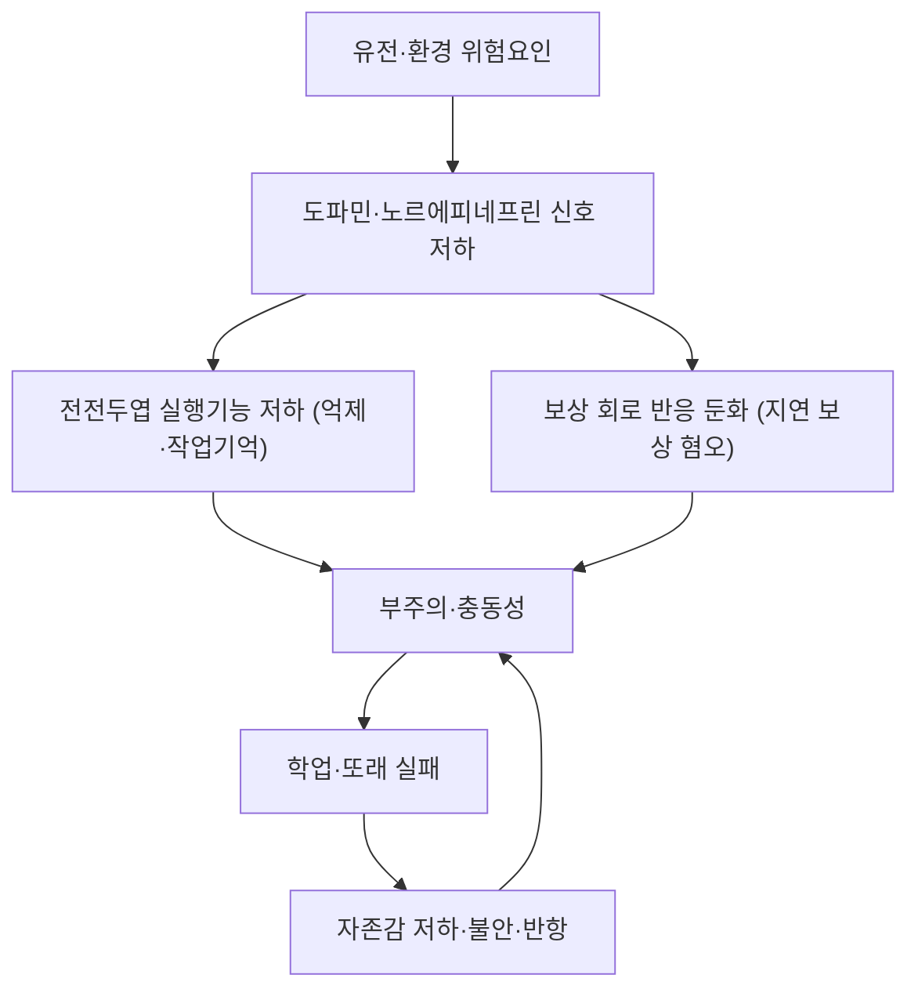

# 🩺 주의력결핍 과잉행동장애 (ADHD, Attention-Deficit/Hyperactivity Disorder)

> **핵심 3줄 요약 (Key Summary)**:
> - 📍 병소 부위 & 병태생리: 단일 병소가 아니라 [[전전두엽]] 실행기능 회로·보상 회로([[기저핵]]–[[중뇌]] 도파민 축)·[[기본망(default mode network)]]의 조절 이상이 겹친 신경발달 질환이다. [[도파민]]·[[노르에피네프린]] 신호 저하와 [[BDNF]] 매개 신경가소성 저하가 핵심 축으로 제시된다.
> - 🚩 전형적 임상 양상: 12세 이전 발병, 6개월 이상 지속, 두 가지 이상 상황(가정·학교)에서 기능 저하를 일으키는 부주의·과잉행동·충동성. 학령기 아동 유병률은 5% 내외, 남아 우세.
> - 🛠️ 핵심 감별 & 한·양방 치료 전략: 수면·청력·시력·[[철결핍빈혈]]·갑상선·불안·학습장애를 먼저 배제. 양방은 [[메틸페니데이트]]·[[아토목세틴]] 중심, 한의는 변증(心脾兩虛·痰熱內擾·肝腎陰虛)에 따른 한약·침·[[이혈 압박]]·[[소아추나]]를 행동·부모훈련과 병용한다.
> - ⚠️ 응급 의뢰 레드플래그: 자해·타해, 학교 거부로 인한 심각한 기능 붕괴, 갑작스러운 증상 악화(종양·뇌전증·수면무호흡 감별), 틱·정신증 동반 시 소아정신과 의뢰가 우선이다.

> 🖼️ 이미지 미확보 — 이 노트는 텍스트로 먼저 작성했다. 볼트 규칙(§0-B, 2026-10-06)에 따라 이미지 슬롯은 아린 담당이며, 신경회로 도해·DSM-5 증상 도해·치료 시술 실사는 다음 보강 회차에서 채운다.

---

## 📌 목차
1. [질환 개요 & 병태생리](#1-질환-개요--병태생리)
2. [병태생리 메커니즘 & 신경회로 악순환](#2-병태생리-메커니즘--신경회로-악순환)
3. [임상 증상 & 평가](#3-임상-증상--평가)
4. [감별 진단 매트릭스](#4-감별-진단-매트릭스)
5. [한의 통합 치료 프로토콜](#5-한의-통합-치료-프로토콜)
6. [양방 치료 & 병용·의뢰 기준](#6-양방-치료--병용의뢰-기준)
7. [식이·생활습관 & 자가관리 티칭 가이드](#7-식이생활습관--자가관리-티칭-가이드)
8. [💡 진료실 핵심 필기 & 임상 노하우](#8--진료실-핵심-필기--임상-노하우)
9. [출처 및 학술 참고 문헌](#9-출처-및-학술-참고-문헌)

---

## 1. 질환 개요 & 병태생리

* **정의**: 부주의·과잉행동·충동성이 발달 수준에 비해 지나치게 나타나 기능을 떨어뜨리는 신경발달 질환. DSM-5는 ① 12세 이전 발병 ② 6개월 이상 지속 ③ 두 가지 이상 상황에서 확인 ④ 기능 저하 ⑤ 다른 정신질환으로 더 잘 설명되지 않음의 5조건을 요구한다.
* **아형(발현형)**: 부주의 우세형 / 과잉행동·충동 우세형 / 복합형. 아형은 고정된 것이 아니라 발달 과정에서 바뀐다 — 성인기로 갈수록 과잉행동은 줄고 부주의·실행기능 문제가 남는다.
* **역학**: 학령기 아동 5% 내외(본 회차 리뷰는 5.3%로 인용). 소아기 남녀비는 대략 2:1이며, 여아는 부주의 우세형으로 진단이 늦어지는 경향이 있다. 성인까지 증상이 지속되는 비율은 상당하며, [[Faraone 2021 국제 합의문]]은 진단·치료에 관한 208개 근거 결론을 정리했다.
* **관련 신경 구조**: [[전전두엽]](실행기능·억제), [[기저핵]]·[[중뇌]](보상·운동 선택), [[전대상피질]](오류 감시), [[편도체]](정서 조절), [[소뇌]](타이밍).
* **동반 질환**: [[반항성 장애]], [[품행장애]], [[학습 장애]], [[틱 장애]], [[불안장애]], 수면 문제. 동반 질환이 있으면 예후가 나빠지므로 진단 시 반드시 함께 평가한다.

---

## 2. 병태생리 메커니즘 & 신경회로 악순환

### 1) 분자·세포 수준 기전
* **카테콜아민 가설**: [[전전두엽]]의 [[도파민]] D1 수용체·[[노르에피네프린]] α2A 수용체 신호가 작업기억·주의를 유지한다. 이 신호가 너무 낮거나 너무 높으면 모두 수행이 떨어진다(역U자 용량-반응) — 이 역U자 곡선이 치료 용량을 조심스럽게 올려야 하는 이유다.
* **신경가소성**: [[BDNF]]는 시냅스 형성·가지치기를 매개하며, 운동 중 BDNF 상승이 실행기능 개선과 연결된다는 가설이 제시된다. 다만 인체에서 인과가 확정된 것은 아니다.
* **지연 보상(delayed reinforcement)**: ADHD 아동은 즉각 보상에서 정상 반응을 보이지만 지연 보상에서는 반응이 급격히 떨어진다. 보상 회로의 시간 할인율이 가파른 것이 핵심 표현형이다.

### 2) 회로·계통 수준
* **실행기능 네트워크**: 억제·작업기억·전환의 3요소가 모두 취약하며, 과제가 길어질수록 수행 저하 폭이 커진다.
* **기본망(DMN) 전환 실패**: 과제 중 DMN이 충분히 꺼지지 않아 주의가 새는 패턴이 관찰된다.
* **수면·자율신경**: 수면 지연·불규칙이 주의 저하를 증폭시키고, 이는 다시 야간 각성과 주간 졸림을 만든다 — 악순환 고리.

### 3) 위험인자와 경과
* **유전**: 유전율이 높은 것으로 보고된다(쌍둥이 연구 기준 대략 0.7 전후).
* **환경**: 조산·저출생체중, 임신 중 흡연·음주, 납 노출, 극심한 초기 박탈.
* **경과**: 학령기 증상 → 청소년기 학업·또래 문제 → 성인기 직업·관계·사고 위험. 조기 개입이 예후를 바꾼다.

---

## 3. 임상 증상 & 평가

### 1) 주소증 및 핵심 증상
* **부주의 9증상(DSM-5)**: 세부 주의 결여, 과제 지속 곤란, 경청 실패, 지시 미완수, 조직화 곤란, 지속 사고를 요하는 과제 회피, 물건 분실, 외부 자극에 쉽게 산만, 일상 망각.
* **과잉행동·충동 9증상**: 착석 불능, 자리 이탈, 부적절한 뛰어다님, 조용한 놀이 불가, '엔진이 달린 듯' 행동, 과다 발언, 질문 끝나기 전 대답, 차례 기다리기 곤란, 타인 방해.
* **진단 역치**: 17세 미만은 각 영역 6개 이상, 17세 이상은 5개 이상.
* **놓치기 쉬운 발현**: 여아·부주의 우세형은 조용히 '멍때리는 아이'로 지나간다. 성인은 '만성적인 시간 관리 실패·약속 망각'으로 나타난다.

### 2) 객관적 소견·평가 도구
* **진단은 검사로 확정되지 않는다** — 병력·기능 평가·설문이 본체이고, 검사는 감별·보조용이다.
* **평정척도**: [[SNAP-IV]](부모·교사판), [[CBCL]], [[Conners 척도]]. 부모–교사 점수 불일치가 흔하므로 두 출처를 모두 받는다(본 회차 리뷰도 SNAP-IV를 주 결과로 사용).
* **지능·주의 검사**: [[K-WISC]], 연속수행과제(CPT). 저지능·학습장애·청력 문제를 배제한다.
* **신체 검사**: 시력·청력, 수면무호흡(코골이·입호흡), [[철결핍빈혈]]([[페리틴]] 저하 시 주의 저하), 갑상선 기능.

### 3) 중증도 판정
* **경계역**: 증상은 있으나 기능 저하가 제한적 → 행동·환경 개입 우선.
* **중등도**: 두 상황 이상에서 뚜렷한 기능 저하 → 약물 + 행동 중재 병용.
* **중증**: 학업·안전에 위협, 동반 질환 동반 → 소아정신과 협진.

---

## 4. 감별 진단 매트릭스

| 감별 질환 | 특징적 양상 | 감별 포인트 |
| :--- | :--- | :--- |
| [[주의력결핍 과잉행동장애]] (본 질환) | 12세 이전 발병, 두 상황 이상, 만성 경과 | 발달력·기능 평가·[[SNAP-IV]] |
| [[불안장애]] | 걱정이 주된 축, 증상이 상황 특이적 | 불안 척도, 증상의 시간적 선후 |
| [[우울증]] | 흥미 저하·무기력이 중심 | 우울 척도, 병력 |
| [[학습 장애]] | 특정 학업 영역만 선택적 저하 | [[K-WISC]] 프로필, 교육 평가 |
| [[소아 수면무호흡]] | 코골이·입호흡·주간 졸림 | 수면다원검사, 편도 비대 |
| [[갑상선기능항진증]] | 체중 감소·빈맥·발한 | 갑상선 기능 검사 |
| [[틱 장애]] | 불수의 운동·음성 틱 | 증상 관찰, 동반 여부 |

> 🚩 레드플래그 감별: 갑작스러운 성격 변화·두통·시야 증상은 뇌병변, 야간 발작은 [[뇌전증]]을 먼저 배제한다.

---

## 5. 한의 통합 치료 프로토콜

* **변증 분류**
  * 心脾兩虛 — 산만·기억력 저하·식욕 부진·얼굴 창백. 補益心脾.
  * 痰熱內擾 — 과잉행동·충동·수면 불량·설태 황. 淸熱化痰.
  * 肝腎陰虛 — 초조·야간 각성·손발 발열. 滋陰潛陽.
  * 脾虛肝旺 — 짜증·복통·식욕 변동. 健脾平肝.
* **침구**: 백회(GV20)·사신총(EX-HN1)으로 각성 조절, 신문(HT7)·내관(PC6)으로 안정, 태충(LR3)·삼음교(SP6)로 平肝·滋陰, 중완(CV12)·족삼리(ST36)로 健脾. 소아는 자극량을 낮추고 5분 내외 유침 또는 접촉 자극으로 운용한다.
* **이혈**: 신문(神門)·심(心)·간(肝)·비(脾)·신(腎). [[이혈 압박]]은 왕불류행 종자를 2일 부착 후 교체하며 하루 3회 2분씩 자가 압박 — 본 회차 리뷰의 프로토콜과 정합적이다.
* **소아추나**: 백회·신정(GV24)·사신총, 반문·내팔괘·사횡문·소천심, 배부 방광경·독맥 염법. [[소아추나]] 항목의 조작 횟수·순서를 그대로 따른다.
* **한약**: 변증에 따라 歸脾湯(心脾兩虛), 黃連溫膽湯(痰熱), 六味地黃丸 계열(陰虛), 抑肝散(肝旺)을 검토한다. 소아 용량은 연령·체중 기준으로 감량하고, [[메틸페니데이트]] 복용 중이면 식욕·수면·심박 변화를 함께 추적한다.
* **부모·교사 개입이 절반이다**: 한의 치료만으로 실행기능 훈련을 대체할 수 없다. 과제 분할·타이머·즉각 보상 체계를 진료실에서 함께 설계한다.

---

## 6. 양방 치료 & 병용·의뢰 기준

* **약물**
  * [[메틸페니데이트]](MPH) — 도파민·노르에피네프린 재흡수 차단. 즉각형·서방형이 있고, 용량은 체중 기준으로 적정한다. 식욕 저하·수면 지연·두통·심박 상승이 흔하다.
  * [[아토목세틴]] — 선택적 노르에피네프린 재흡수 차단. 효과 발현에 2~4주 걸리지만 남용 위험이 낮고 하루 종일 작용한다.
  * [[구안파신]] 서방형·[[클로니딘]] 서방형 — α2 작용제. 과잉행동·수면·틱 동반 시 보조.
* **비약물**: 부모 행동훈련, 교실 환경 조정(자리·과제 분량·이동 허용), 사회기술 훈련, 인지행동치료(성인).
* **한의 병용 판단**
  * 병용 가능: 행동 중재 + 침·이혈·추나. 약물 중에도 수면·식욕·소화 관리 목적의 한약은 병용 가능하다.
  * 주의: 한약 시작·중단 시점을 기록해 약물 부작용(식욕·수면·두통)과 혼동하지 않게 한다.
  * 금기·회피: 자극이 강한 침법, 장시간 유침, 과도한 瀉法은 소아에서 피한다.
* **의뢰 기준**: 진단 확정·약물 시작이 필요하면 소아정신과. 학교 거부·자해·타해·정신증 의심은 즉시 의뢰.

---

## 7. 식이·생활습관 & 자가관리 티칭 가이드

* **수면이 1순위다**: 취침·기상 시각을 고정하고, 취침 1시간 전 화면을 끈다. 수면이 무너지면 어떤 치료도 효과가 반감된다.
* **운동**: 주 5일, 회당 40분 중등도 유산소(줄넘기·조깅·농구·배드민턴). 본 회차 리뷰의 공통 중재가 바로 이 용량이다.
* **식이**: 철·아연·오메가-3 결핍을 교정하고, 카페인(탄산·에너지음료)은 오후 이후 금한다. 인공색소 제거가 일부에서 도움이 된다는 보고는 있으나 근거는 제한적이다.
* **환경**: 과제를 10~15분 단위로 쪼개고, 책상 위 자극을 최소화하며, 완료 즉시 보상을 준다(지연 보상이 약점이므로 '즉시성'이 핵심).
* **환자·보호자 스크립트**: "아이가 산만한 것은 뇌의 주의 조절 회로가 아직 미숙해서입니다. 규칙적인 운동과 함께 혈자리 자극·추나를 병행하고, 집에서 과제를 잘게 나눠 주세요. 효과 판정은 최소 3개월을 두고 봅니다."
* **추적**: 4주(부작용·수면), 3개월([[SNAP-IV]] 재측정), 6개월(학업·또래 기능).

---

## 8. 💡 진료실 핵심 필기 & 임상 노하우

* **진단을 먼저 의심하는 문진 3문**: ① "숙제를 시작하는 데 몇 분 걸리나요?" ② "선생님이 '집중 못 한다'고 하시나요, '자리를 못 지킨다'고 하시나요?" ③ "잠들기까지 몇 분 걸리나요?" — ②의 답이 아형을, ③의 답이 감별(수면 문제)을 알려준다.
* **부모의 죄책감을 먼저 다뤄라**: "훈육 부족이 아니라 신경발달 차이"라는 설명 한 줄이 치료 순응도를 바꾼다.
* **효과 판정 시점을 처음에 못 박아라**: 본 회차 리뷰에서도 1개월에는 군간 차이가 없고 3개월에 분리됐다. "3개월은 유지해야 판단할 수 있다"를 초진에 고지한다.
* **약물 복용 아동의 한약 설계**: 식욕 저하 → 健脾和胃(산사·맥아·진피 계열 배오), 수면 지연 → 養心安神, 두통 → 平肝潜陽. 약물 감량은 처방의와 상의 없이 하지 않는다.
* **이혈 접착제 피부염**: 아토피·습진 병력 아동은 저자극 테이프를 쓰거나 이혈을 생략한다. 2일마다 교체 시 피부를 반드시 확인한다.

---

## 9. 출처 및 학술 참고 문헌

1. Xiong M, et al. Exercise combined with pediatric Tuina and auricular acupressure for children with ADHD: a randomized controlled trial. Front Med (Lausanne). 2026;13:1880554. [PMID 42539539](https://pubmed.ncbi.nlm.nih.gov/42539539/) · [DOI 10.3389/fmed.2026.1880554](https://doi.org/10.3389/fmed.2026.1880554)
   - **[연구 요약]** 5~12세 ADHD 아동 120명 3군 RCT — 운동 단독 대비 운동+추나+이혈군의 6개월 SNAP-IV 주변평균이 36.8→9.1로 가장 크게 감소했고 임상 관해율 60.0% 대 17.5%였다.
2. Faraone SV, et al. The World Federation of ADHD International Consensus Statement: 208 evidence-based conclusions about the disorder. Neurosci Biobehav Rev. 2021;128:789-818. [PMID 33549739](https://pubmed.ncbi.nlm.nih.gov/33549739/) · [DOI 10.1016/j.neubiorev.2021.01.022](https://doi.org/10.1016/j.neubiorev.2021.01.022)
   - **[연구 요약]** 27개국 80여 명 저자의 국제 합의문 — ADHD의 신경생물학·경과·치료 근거를 208개 결론으로 정리했고, 진단·치료 접근의 표준 참조점이다.
3. Simioni A, et al. Psychometric properties and local normative references of PSC-17, RCADS-25, CATS-2, SNAP-IV, MCHAT-R/F, and CAST. J Patient Rep Outcomes. 2026;10(1). [PMID 41811632](https://pubmed.ncbi.nlm.nih.gov/41811632/) · [DOI 10.1186/s41687-026-01032-1](https://doi.org/10.1186/s41687-026-01032-1)
   - **[연구 요약]** 소아 정신건강 선별도구 6종의 심리측정 특성과 지역 규준을 함께 제시 — [[SNAP-IV]]의 규준 기반 해석 근거로 쓴다.
4. Polanczyk GV, et al. Annual research review: A meta-analysis of the worldwide prevalence of mental disorders in children and adolescents. J Child Psychol Psychiatry. 2015;56(3):345-65. [PMID 25649325](https://pubmed.ncbi.nlm.nih.gov/25649325/) · [DOI 10.1111/jcpp.12381](https://doi.org/10.1111/jcpp.12381)
   - **[연구 요약]** 전 세계 소아·청소년 정신질환 유병률 메타분석 — ADHD가 가장 흔한 축에 속함을 보여준다. 본 문서의 5.3%는 2026-11-08 리뷰 인용 수치다.

## 함께 보기
- [[SNAP-IV]] · [[소아추나]] · [[이혈 압박]] · [[도파민]] · [[노르에피네프린]] · [[BDNF]] · [[메틸페니데이트]] · [[아토목세틴]]
- [[반항성 장애]] · [[학습 장애]] · [[틱 장애]] · [[소아 수면무호흡]] · [[2026-11-08_부인과소아과_심층리뷰]]
