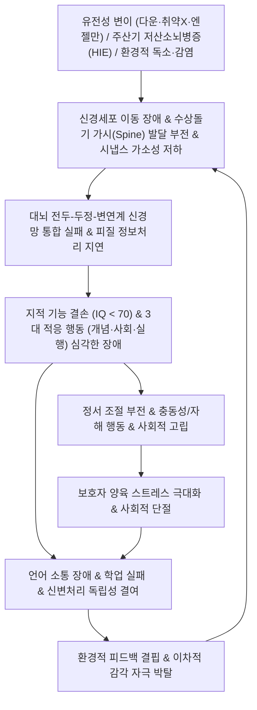

# 🩺 [[지적 장애]] (Intellectual Disability / 遲鈍·癡呆, ICD-10: F70-F79 / KCD: F70-F79)

> **핵심 3줄 요약 (Key Summary)**:
> - 📍 **병소 부위 & 해부·병태생리**: 발달기(18세 이전)에 시작되는 전두엽-두정엽-측두엽 연합피질, [[해마]], [[기저핵]] 및 신경망 시냅스 가소성(Synaptic Plasticity)의 중대한 발달 결손으로 인해 지적 기능(IQ < 70, -2SD 이하)과 개념적·사회적·실행적 영역의 적응 기능이 동반 저하되는 신경발달장애.
> - 🚩 **전형적 임상 양상 & 3대 징후**: 언어 및 운동 발달 지연(보행·발어 지연), 추상적 사고·판단력·문제해결능력 저하, 연령 대비 일상생활 기술(신변처리·위생·자기관리) 및 사회적 상호작용의 심각한 제한.
> - 🛠️ **핵심 감별 & 한·양방 다각적 치료 전략**: [[한국 웩슬러 아동 지능검사]](K-WISC-V) 및 바인랜드 적응행동척도(Vineland-3)를 통한 진단, 다학제 특수교육·작업치료·행동중재(ABA)와 한의학적 [[신정부족]](腎精不足)·[[심신불교]](心腎不交) 변증에 따른 [[육미지황탕]], [[총명탕]], [[귀비탕]] 투여 및 두침(정두구, 지능구)·체침(백회, 사신총, 신문, 용천) 자극.
> - <font color="#fa7e7e">⚠️ **응급 의뢰 레드플래그 & 악화 요인**: 기득 발달 기술의 급격한 상실(발달 퇴행 - Rett 증후군, 선천성 대사이상 의심), 조절되지 않는 뇌전증 지속상태(Status Epilepticus), 심각한 자해·타해성 급성 폭력 행동 발현 시 즉각 상급병원 소아신경과 및 소아청소년정신과 전원.</font>

---

## 📌 목차
1. [질환 개요 & 병태생리 (Disease Overview)](#1-질환-개요--병태생리-disease-overview)
2. [병태생리 메커니즘 & 대사·장기부전 악순환 네트워크](#2-병태생리-메커니즘--대사장기부전-악순환-네트워크)
3. [임상 증상 & 환자 소견 (Clinical Presentation)](#3-임상-증상--환자-소견-clinical-presentation)
4. [감별 진단 매트릭스 (Differential Diagnosis)](#4-감별-진단-매트릭스-differential-diagnosis)
5. [한의 통합 치료 프로토콜 (침·약침·한약)](#5-한의-통합-치료-프로토콜-침약침한약)
6. [양방 치료 & 병용·의뢰 기준 (Conventional Treatment & Referral)](#6-양방-치료--병용의뢰-기준-conventional-treatment--referral)
7. [식이·생활습관 & 자가관리 티칭 가이드](#7-식이생활습관--자가관리-티칭-가이드)
8. [💡 진료실 핵심 필기 & 임상 노하우](#8--진료실-핵심-필기--임상-노하우)
9. [출처 및 학술 참고 문헌 (References)](#9-출처-및-학술-참고-문헌-references)

---

## 1. 질환 개요 & 병태생리 (Disease Overview)

* **질환 정의 및 기본 개념**:
  * [[지적 장애]](Intellectual Disability, ID) 또는 지적발달장애(Intellectual Developmental Disorder)는 발달기(통상 만 18세 이전)에 발병하여 지적 기능(추론, 문제 해결, 계획, 추상적 사고, 판단, 학업 학습 및 경험을 통한 학습)과 적응 기능(개념적, 사회적, 실행적 영역에서의 독립성과 사회적 책임 기준을 충족하는 능력) 모두에서 유의미한 제한을 보이는 신경발달장애이다.
  * 과거 '정신지체(Mental Retardation)'로 명명되었으나, 낙인 방지 및 적응 행동 지원 중심의 패러다임 전환에 따라 DSM-5 및 ICD-11에서 공식 명칭이 개정되었다.
  * DSM-5 진단 기준상 단순 IQ 점수(평균 100 기준 70 미만, 평균으로부터 -2 표준편차 이하)뿐만 아니라, 일상생활을 영위하는 **적응 기능(Adaptive Functioning)**의 결손 정도가 중증도(경도, 중등도, 중증, 최중증)를 결정하는 핵심 지표이다.

* **역학 및 발병률**:
  * 전 세계 일반 인구에서의 유병률은 약 1~3% 수준으로 추정되며, 저소득·개발도상국에서 주산기 관리 부재 및 감염·영양 결핍으로 인해 상대적으로 높게 보고된다.
  * 성별 분포는 남아가 여아에 비해 약 1.3~1.6배 높은 유병률을 보이는데, 이는 [[취약 X 증후군]]을 비롯한 X-연관 유전 질환의 취약성에 기인하는 바가 크다.
  * 중증도별 분포는 경도(Mild)가 전체 지적 장애의 약 80~85%를 차지하며, 중등도(Moderate) 약 10%, 중증(Severe) 약 3~4%, 최중증(Profound) 약 1~2%로 구성된다.

* **관련 장기 및 신경 구조**:
  * **주 이환 장기 및 피질 영역**: [[대뇌피질]](전두엽 전전두피질, 두정엽-측두엽 다감각 연합피질), [[해마]](장기 기억 및 공간 학습), [[기저핵]](선조체, 담창구 - 운동 계획 및 습관 형성), [[편도체]](정서 조절), [[소뇌]](운동 협응 및 인지 타이밍 제어).
  * **연관 신경회로 및 전달계**: [[글루타메이트]](NMDA/AMPA 수용체 매개 장기강화 LTP 결손), [[가바]](GABAergic 개재신경망 억제 회로 불균형), [[도파민]](중뇌-변연계 및 중뇌-피질 경로의 동기·보상 회로 저하), [[아세틸콜린]](기저핵-피질 투사계의 기억·집중 유지 장애).
  * **미세구조 손상**: 대뇌 피질 뉴런의 수상돌기 가시(Dendritic Spine) 밀도 감소 및 형태 이상(길고 얇은 미성숙 스파인 잔존), 축삭 수초화(Myelination) 지연, 시냅스 가지치기(Synaptic Pruning) 실패.

---

## 2. 병태생리 메커니즘 & 대사·장기부전 악순환 네트워크



### 1) ASCII 병태생리 다이어그램: 지적 장애의 신경생물학적 발달 케스케이드

```text
========================================================================================
                       지적 장애의 발달기 신경병태 케스케이드
========================================================================================

 [선천적·유전적 원인]               [주산기 뇌손상]                 [후천적 환경 결함]
 - 염색체 이상: 21번 삼염색체        - 조산, 초극소 저체중          - 중추신경계 감염 (뇌수막염)
   ([[다운 증후군]])                - [[저산소성 허혈성 뇌병증]]     - 심각한 영양실조 (요오드 결핍)
 - 유전자 변이: FMR1, UBE3A, MECP2   - 핵황달, 주산기 TORCH 감염     - 중금속 독소 (납, 수은 노출)
          │                                  │                                │
          └──────────────────────────────────┼────────────────────────────────┘
                                             ▼
                      ┌──────────────────────────────────────────────┐
                      │    신경세포 분화·이동 및 시냅스 형성 장애     │
                      │  - 수상돌기 가시(Dendritic Spine) 기형       │
                      │  - 수초화(Myelination) 지연 및 축삭 결손    │
                      │  - NMDA/AMPA 수용체 매개 LTP(장기강화) 차단  │
                      └──────────────────────┬───────────────────────┘
                                             ▼
                      ┌──────────────────────────────────────────────┐
                      │       대뇌 고위 연합 피질 네트워크 결손      │
                      │  - 전전두엽(DLPFC) 실행 기능 및 작업기억 부전│
                      │  - 해마-피질 기억 인출 및 추상화 기능 장애   │
                      │  - 변연계 감정 조절 및 충동 억제 회로 와해   │
                      └──────────────────────┬───────────────────────┘
                                             ▼
         ┌───────────────────────────────────┴───────────────────────────────────┐
         ▼                                                                       ▼
┌─────────────────────────────────┐                     ┌─────────────────────────────────┐
│     지적 기능 저하 (IQ < 70)    │                     │     적응 행동 결손 (3대 영역)   │
│ - 추상적 추론 및 문제 해결 불가 │                     │ - 개념: 언어, 읽기, 셈하기 제한 │
│ - 학업 습득 속도 현저한 지체    │                     │ - 사회: 또래 관계, 규칙 이해 불가│
│ - 일반화 및 전이 능력의 결핍    │                     │ - 실행: 신변처리, 금전, 안전 결여│
└────────────────┬────────────────┘                     └────────────────┬────────────────┘
                 │                                                       │
                 └───────────────────────────┬───────────────────────────┘
                                             ▼
                      ┌──────────────────────────────────────────────┐
                      │    이차적 악순환 네트워크 (Vicious Cycle)    │
                      │  - 학습된 무기력, 학교 부적응, 정서 장애 발현│
                      │  - 환경적 피드백 박탈 → 대뇌 가소성 추가 감퇴│
                      │  - 보호자 소진, 돌봄 공백, 가족 기능 위기     │
                      └──────────────────────────────────────────────┘
========================================================================================
```

### 2) 분자·세포 수준 기전
* **유전적 결함에 따른 시냅스 구조 이상**:
  * **[[다운 증후군]](Down Syndrome, Trisomy 21)**: 21번 염색체의 과발현으로 인해 DYRK1A, RCAN1, APP(Amyloid Precursor Protein) 유전자가 과도하게 전사됨. 이로 인해 신경발생(Neurogenesis) 저하, 수상돌기 분지 축소, 미토콘드리아 산화 스트레스 증가 및 조기 신경퇴행([[알츠하이머병]] 병리)이 촉진됨.
  * **[[취약 X 증후군]](Fragile X Syndrome)**: Xq27.3에 위치한 FMR1 유전자의 5' 비번역 부위에서 CGG 삼핵산 반복 서열이 200회 이상 비정상 증폭(Full mutation)되어 프로모터 과메틸화 및 FMRP(Fragile X Mental Retardation Protein) 단백질 결핍 유발. FMRP는 시냅스 번역 억제 단백질로서, 결핍 시 mGluR5 신호전달이 과항진되어 미성숙하고 가늘고 긴 수상돌기 가시가 과도하게 잔존하여 시냅스 가소성 손상 초래.
  * **[[엔젤만 증후군]](Angelman Syndrome)**: 모계 유래 15q11-q13 염색체의 UBE3A 유전자 소실 또는 돌연변이로 인해 유비퀴틴-프로테아좀 분해 경로가 파탄되어 시냅스 단백질 항상성이 붕괴됨.
  * **[[레트 증후군]](Rett Syndrome)**: Xq28에 위치한 MECP2 유전자 돌연변이로 인해 메틸화된 DNA에 결합하여 유전자 발현을 조절하는 기능이 상실되어 신경세포 성숙과 시냅스 유지가 차단됨.
* **주산기 및 후천적 손상 기전**:
  * **[[저산소성 허혈성 뇌병증]](Hypoxic-Ischemic Encephalopathy, HIE)**: 분만 전후 뇌혈류 중단으로 세포막 탈분극, [[글루타메이트]] 흥분독성, 칼슘 유입 폭증, 활성산소종(ROS) 생성 및 희소돌기아교세포(Oligodendrocyte) 전구세포 파괴로 뇌실주위 백질연화증(PVL)과 미만성 피질 괴사가 야기됨.
  * **선천성 감염(TORCH 증후군)**: 톡소포자충, 풍진, 거대세포바이러스(CMV), 단순포진바이러스(HSV)의 태내 감염으로 신경세포 이동 결손, 뇌실염, 두개내 석회화, 소두증(Microcephaly) 발생.
  * **환경 독소 노출**: 소아기 납(Lead) 중독은 칼슘 신호전달을 방해하고 혈뇌장벽(BBB)을 손상시키며 수초 형성을 억제함.

### 3) 장기·계통 수준 결과 및 대사 악순환
* **적응 행동 영역의 붕괴**:
  * **개념적 영역(Conceptual domain)**: 언어 발달 지연, 상징적 표상 결핍, 단기 작업기억 및 장기 서술기억 인출 제한으로 학업 기술 습득이 극도로 지체됨.
  * **사회적 영역(Social domain)**: 타인의 감정·의도 파악(마음 이론, Theory of Mind) 부전, 대인관계 단서 인지 미숙, 위험 인지 저하로 사회적 착취 및 학대에 취약.
  * **실행적 영역(Practical domain)**: 식사, 배변, 옷 입기 등 개인 위생 관리의 독립성 결여, 대중교통 이용 및 금전 관리 불가, 지속적 타인 의존.
* **동반 이환 질환의 악순환**:
  * 뇌전증(환자의 20~30% 동반): 반복적 경련 발작은 추가적인 신경세포 흥분독성 손상을 일으켜 인지 저하를 가속함.
  * 수면 장애 및 감각통합 장애: 대뇌 감각 여과 기능 부전으로 주변 소음과 자극에 과민 반응하여 수면 부족과 주간 불안·공격성이 심화됨.

### 4) 중증도 분류 (DSM-5 적응 기능 기준)
* **경도 (Mild, IQ 50~69)**:
  * 취학 전에는 눈에 띄지 않다가 초등학교 입학 후 학업 지연으로 발견됨. 성인기 초등학교 6학년 수준의 학업 달성 가능. 독립적 거주 및 단순 직업 활동 가능하나 복잡한 재정·법적 문제에서 조력 필요.
* **중등도 (Moderate, IQ 35~49)**:
  * 유아기 초기부터 발달 지체 현저. 성인기 초등학교 2~3학년 수준 학업 도달. 신변처리는 훈련을 통해 자립 가능하며, 보호작업장 등 감독하 단순 노무 수행 가능.
* **중증 (Severe, IQ 20~34)**:
  * 조음 및 언어 사용이 극히 제한적(단어 수준). 일상생활 전반에 걸쳐 지속적이고 밀착된 보살핌 필요. 간단한 명령 수행 및 단순 반복 행동만 가능.
* **최중증 (Profound, IQ < 20)**:
  * 전신 감각 및 운동 기능 장애 동반(대부분 침상 생활). 비언어적 원시 소통에 의존하며, 모든 생명 유지 활동에 전적인 타인의 개입이 필요.

---

## 3. 임상 증상 & 환자 소견 (Clinical Presentation)

### 1) 주소증 및 발달 단계별 핵심 증상
* **영아기 (0~1세)**:
  * **운동 발달 지연**: 3~4개월 목 가누기 불량, 6~8개월 혼자 앉기 지연, 12개월 기기 또는 기립 곤란.
  * **반사 및 감각 이상**: 원시 반사(모로 반사, 파악 반사)의 소실 지연, 시각적 주시 및 눈맞춤 결여, 달래지지 않는 지속적 보챔 또는 지나치게 순한 반응(Hypoactivity).
* **유아기 (1~3세)**:
  * **언어 발달 지연**: 12개월 첫 단어 부재, 24개월 두 단어 결합 문장 불가.
  * **사회적 상호작용 결핍**: 이름을 불러도 반응 없음, 모방 행동(짝짜꿍, 곤지곤지) 부재, 상호주의집중(Joint attention) 형성 곤란.
  * **대소변 가리기 훈련 지연**: 3세 이후에도 배변 신호 인지 불가.
* **학령전기 및 학령기 (4~12세)**:
  * **인지 및 학업 부진**: 색상·도형 구분 지연, 자기 이름 쓰기 및 한글 해득 실패, 10 이하의 수량 개념 형성 불가.
  * **주의산만 및 충동성**: 단순 지시 사항을 기억하지 못하고 한 가지 놀이에 몰입하지 못함.
  * **문제 행동**: 의사소통 불가로 인한 떼쓰기, 머리 찧기(Head banging), 손 물어뜯기 등 자해 행동.
* **청소년기 및 성인기 (13세 이상)**:
  * 또래 집단과의 어울림 실패, 추상적 도덕 규범 및 사회적 신호 이해 불가, 성적 충동 조절의 미숙, 사기 및 착취에 노출.

### 2) 객관적 평가 도구 및 진단 기준 (Signs & Scales)
* **인지 지능 검사**:
  * **[[한국 웩슬러 아동 지능검사]](K-WISC-V)**: 만 6세 0개월~16세 11개월 대상. 언어이해지수(VCI), 시공간지수(VSI), 유동추론지수(FRI), 작업기억지수(WMI), 처리속도지수(PSI) 산출. 전체 IQ 70 미만(-2SD) 확인.
  * **[[한국 웩슬러 유아 지능검사]](K-WPPSI-IV)**: 만 2세 6개월~7세 7개월 영유아 대상.
* **적응 행동 검사**:
  * **바인랜드 적응행동척도 3판 (Vineland-3)**: 의사소통(수용, 표현, 서자), 일상생활기술(개인, 가정, 공동체), 사회화(대인관계, 놀이/여가, 대처기술), 운동기술 영역 평가. 표준점수 70 미만 확인.
  * **사회성숙도검사 (SMS)**: 자조, 이동, 작업, 의사소통, 자기관리, 사회화 영역 평가를 통해 사회연령(SA) 및 사회지수(SQ) 도출.
* **신체 진찰 및 유전학적 평가**:
  * 두위 측정(소두증 또는 대두증 감별), 이형성 징후(특이 안모, 안구 격리증, 하악 후퇴, 저위 이개, 원숭이 손금 Simian crease).
  * 염색체 마이크로어레이(CMA) 및 차세대 염기서열 분석(NGS): 미세결실, 미세중복, 단일유전자 변이 확인.

---

## 4. 감별 진단 매트릭스 (Differential Diagnosis)

| 감별 질환 | 주요 특징 및 임상 양상 | 지능 검사 (IQ) 소견 | 적응 행동 결손 양상 | 핵심 감별 포인트 |
| :--- | :--- | :--- | :--- | :--- |
| **[[지적 장애]] (본 질환)** | 전반적인 지적 기능 및 적응 기능의 조화로운 결손 | **전 영역 균일하게 저하 (IQ < 70)** | 개념·사회·실행 영역 전반에 걸친 결손 | 18세 이전 발병, 특정 인지 영역에 국한되지 않는 전반적 저하 |
| **[[자폐스펙트럼장애]](ASD)** | 사회적 의사소통 결함, 제한된 관심사 및 상동 행동 | 정상, 우수, 또는 저하 (다양함) | 사회적 상호작용에 불균형적으로 극심한 결손 | 상동증(Hand flapping 등), 동일성 유지 고집, 감각 과민/과소 반응 |
| **[[주의력결핍 과잉행동장애]](ADHD)** | 주의산만, 과잉행동, 충동성으로 인한 학습 수행 저하 | **정상 범위 (IQ ≥ 85)** | 실행 기능 저하 있으나 기본 신변처리는 정상 | 1:1 상황에서는 정상 지적 과제 수행 가능, 개념적 이해력 유지 |
| **[[특정 학습 장애]](SLD)** | 읽기, 쓰기, 수학 등 특정 학업 기술의 습득 곤란 | **정상 범위 (IQ ≥ 85)** | 학업 외 일상생활 및 사회화 기술 정상 | 지능과 학업 성취도 간의 현저한 불일치(Discrepancy) 존재 |
| **전반적 발달지연 (GDD)** | 5세 미만 소아에서 2개 이상의 발달 영역 현저한 지체 | 표준화된 지능 검사 실시 불가 | 대근육, 소근육, 언어, 인지, 사회성 전반 지연 | 5세 이후 정식 지능 검사를 통해 지적 장애로 재평가 필요 |
| **감각 결손 (선천성 난청)** | 언어 표현 및 이해 결손, 발음 이상, 반응 둔마 | 비언어성 검사 시 정상 | 언어 매개 영역 외 조작·운동 영역 정상 | 뇌간유발반응검사(ABR) 등 청력 선별검사상 이상 확인 |
| **반응성 애착장애 (RAD)** | 심각한 정서적 박탈, 방임으로 인한 사회적 관계 결핍 | 검사 협조 거부로 위저하 가능 | 양육 환경 개선 시 급격한 적응 기능 향상 | 병력상 학대·방임 기왕력, 애착 형성 훈련 시 회복 가능성 |

> 🚩 **레드플래그 감별 (발달 퇴행 - Degenerative Red Flags)**:
> - 생후 1~2년간 정상 발달을 보이다가 언어, 보행, 손 기능 등을 급격히 상실하는 경우: [[레트 증후군]](여아, 손 비틀기 상동행동), 소아기 붕괴성 장애, 이염성 백질이영양증(MLD), 테이-삭스병(Tay-Sachs disease) 등 신경퇴행성 질환을 강력히 의심하고 즉시 소아신경과로 정밀 대사·유전 검사를 의뢰해야 한다.

---

## 5. 한의 통합 치료 프로토콜 (침·약침·한약)

* **한의학적 병증 인식 및 변증 체계**:
  * 지적 장애는 한의학 고전문헌에서 **치매(癡呆)**, **오지(五遲: 立遲·行遲·髮遲·齒遲·語遲)**, **오연(五軟: 頭軟·項軟·手足軟·肉軟·口軟)**의 범주로 다루어진다.
  * 소아의 뇌는 **'수해(髓海)'**에 속하며, 선천의 근본인 **[[신]](腎)**이 저장하는 **신정(腎精)**이 충만해야 골수가 차고 뇌수가 발달한다.
  * 따라서 주된 병기는 **선천품부부족(先天稟賦不足)**으로 인한 **[[신정부족]](腎精不足)**과, 후천의 근본인 **[[비]](脾)**가 운화하지 못하여 발생하는 **심비양허(心脾兩虛)**, 그리고 담음(痰飮)이 심규(心竅)를 막아 인지 활동을 방해하는 **담몽심규(痰蒙心竅)**로 분류된다.

* **침구 치료 (Acupuncture)**:
  * **두침 요법 (Scalp Acupuncture)**:
    * **주요 자극 영역**: 지능구(額中線, 額旁1線), 정두구(頂中線), 언어1·2·3구, 운동구 상부 1/5.
    * **임상 의의**: 두피 경혈 자극은 대뇌 피질의 혈류량을 증가시키고, 신경영양인자([[BDNF]]) 발현을 유도하여 시냅스 가소성 회복 및 언어·인지 기능 통합을 촉진함.
  * **체침 및 배혈 원칙**:
    * **각성개규(醒腦開竅) & 정지안신(定志安神)**: [[백회]](GV20), [[사신총]](EX-HN1), [[인당]](EX-HN3), [[신문]](HT7), [[내관]](PC6).
    * **보신익수(補腎益髓) & 건비익기(健脾益氣)**: [[태계]](KI3), [[용천]](KI1), [[족삼리]](ST36), [[삼음교]](SP6), [[풍지]](GB20).
    * **배수혈(兪穴) 조절**: [[심수]](BL15), [[비수]](BL20), [[신수]](BL23) 지압 및 자침.
  * **소아 맞춤 자침 기법**:
    * 유아 및 자침 공포가 심한 소아의 경우 0.16mm 초박침을 사용한 무통 순시 자침(유침하지 않고 즉시 발침하는 속자속발법) 또는 피내침(스티커침), 무통 레이저 침치료를 적용하여 순응도를 확보함.
    * 협조가 가능한 학령기 아동은 백회-사신총에 2Hz 저주파 전침을 15분간 유침하여 뇌파 활성화를 유도.

* **약침 치료 (Pharmacopuncture)**:
  * **[[자하거약침]](Hominis Placenta)**:
    * **적응증**: 신정부족, 발육부전, 뇌수 발달 결손이 뚜렷한 소아.
    * **시술 부위 및 용량**: 백회, 풍지, 신수, 대추(GV14)에 혈위당 0.05~0.1cc씩 총 0.5cc 이내로 주 1~2회 시술.
    * **약리 작용**: 풍부한 펩타이드, 성장인자(EGF, FGF)가 뇌신경 세포 분화 및 수초화를 보조.
  * **황련해독탕 약침**:
    * **적응증**: 심화상염(心火上炎)으로 인해 자해, 타해, 분노발작, 극심한 수면 장애를 보이는 아동.
    * **시술 부위**: 심수, 간수, 전중(CV17)에 극소량 점적.

* **한약 치료 (Herbal Medicine)**:
  * **신정부족(腎精不足) / 오지오연(五遲五軟)**:
    * **주증**: 보행 지연, 치아 발생 지체, 모발 희소, 체구 왜소, 뇌 발달 현저한 지체.
    * **대표 처방**: [[육미지황탕]](六味地黃湯) 가미방 ([[숙지황]], [[산약]], [[산수유]], [[복령]], [[목단피]], [[택사]] + [[녹용]], [[원지]], [[석창포]], [[구판]]).
    * **치법**: 보신익수(補腎益髓), 충만골수(充滿骨髓).
  * **담몽심규(痰蒙心竅) / 언어소통장애**:
    * **주증**: 말문이 트이지 않음, 눈맞춤 불량, 입에 침을 흘림, 멍한 표정, 설태 백니(白膩).
    * **대표 처방**: [[총명탕]](聰明湯) 합 가미통규탕(加味通竅湯) ([[백복신]], [[원지]], [[석창포]] + [[반하]], [[천남성]], [[조각자]], [[울금]]).
    * **치법**: 척담개규(滌痰開竅), 성뇌안신(醒腦安神).
  * **심비양허(心脾兩虛) / 전신 무력 및 인지 피로**:
    * **주증**: 안색 창백, 식욕 부진, 연변, 매사에 기운이 없고 쉽게 지치며 집중하지 못함.
    * **대표 처방**: [[귀비탕]](歸脾湯) 또는 보아진씨환(保兒賑氏丸) ([[당귀]], [[용안육]], [[산조인]], [[백출]], [[황기]], [[인삼]]).
    * **치법**: 건비익기(健脾益氣), 보혈양심(補血養心).

* **추나 및 감각통합 한의요법**:
  * **소아 척추 배수혈 유마법(捏脊法)**: 척추 양측 방광경 1선(배수혈 라인)을 미골에서 대추혈까지 피부를 집어 올리며 마사지하여 독맥과 양기를 진작하고 자율신경계 균형을 촉진.
  * **두개천골요법 (CST)**: 후두골-천골 간 1차 호흡 메커니즘을 부드럽게 이완하여 뇌척수액(CSF) 순환 장애 및 두개내 긴장을 해소.

---

## 6. 양방 치료 & 병용·의뢰 기준 (Conventional Treatment & Referral)

* **비약물적 다학제 재활 개입 (핵심 치료)**:
  * **특수 교육 및 조기 중재**: 개인별 교육계획안(IEP) 수립, 과제 분석을 통한 반복적 기능 훈련.
  * **행동 중재 (ABA: Applied Behavior Analysis)**: 응용행동분석을 통해 바람직한 적응 행동(눈맞춤, 지시 따르기)을 강화하고, 자해·공격성 등 부적응 행동을 소거(Extinction) 및 대체 행동 차별강화(DRA).
  * **작업치료 (Occupational Therapy)**: 감각통합치료(Sensory Integration)를 통한 전정·고유수용성 감각 조절, 소근육 협응 및 일상생활동작(ADL: 옷 입기, 식사하기, 칫솔질) 훈련.
  * **언어치료 (Speech-Language Therapy)**: 조음 훈련, 수용 및 표현 언어 촉진, 비언어 아동을 위한 보완대체의사소통(AAC: 그림교환의사소통체계 PECS 등) 도입.

* **약물 치료 (Medication - 동반 증상 표적 대증요법)**:
  * 지적 장애 자체의 인지 기능을 회복시키는 공인된 완치 약물은 존재하지 않으며, 동반된 행동 문제 및 신경계 이상에 대해 약물을 처방함.
  * **심각한 공격성·자해 행동·파괴적 행동**:
    * **비정형 항정신병제**: 리스페리돈([[Risperidone]]) 0.25~1.5mg/day 또는 아리피프라졸([[Aripiprazole]]) 2~10mg/day (도파민 $D_2$ 및 세로토닌 $5\text{-HT}_{2A}$ 수용체 길항을 통한 충동성 억제).
  * **동반된 주의력결핍·과잉행동 (ADHD)**:
    * 메틸페니데이트([[Methylphenidate]]) 또는 아토목세틴([[Atomoxetine]]) (단, 지적 장애 아동은 일반 ADHD 아동에 비해 약물 반응률이 낮고 신경과민, 틱 등 부작용 발생률이 높으므로 초저용량부터 시작).
  * **동반된 뇌전증 발작**:
    * 레베티라세탐([[Levetiracetam]]), 발프로산([[Valproic acid]]), 라모트리진([[Lamotrigine]]) 등 항경련제 투여.

* **한의 병용 치료 가이드 및 상호작용 (Combination Therapy)**:
  * **시너지 효과**: 항정신병제(리스페리돈 등)를 복용 중인 소아에서 흔히 나타나는 체중 증가, 대사증후군, 진정(과도한 졸림), 침 흘림, 소화장애 등의 부작용에 대해 [[육미지황탕]] 또는 [[온담탕]]을 병용하면 대사 부담을 완화하고 일상 활동성을 유지하는 데 기여함.
  * **절대적 금기 및 주의**: 항경련제 및 항정신병약을 복용 중인 환아의 보호자가 한약 복용 후 호전되었다고 하여 **양약을 임의로 중단하거나 감량하지 않도록 엄격히 지도**. 급작스러운 항경련제 중단은 발작지속상태(Status epilepticus)를 유발할 수 있음.

* **전문과 의뢰 기준 (Referral Criteria)**:
  * 🚨 **응급 의뢰**: 5분 이상 지속되는 전신 경련, 의식 불명, 심각한 두부 손상을 동반한 자해 행동 발생 시 즉각 119 구급대를 통한 응급실 후송.
  * 🏥 **소아신경과 의뢰**: 발달 지연과 함께 운동 실조, 불수의 운동, 시력·청력 급격한 저하, 기득 발달 기술의 퇴행(Regression)이 관찰될 때.
  * 🏥 **소아정신과 의뢰**: 극도의 자해(망막 박리를 유발하는 안구 타격, 피부 궤양을 만드는 물어뜯기) 및 타인에 대한 폭력으로 가정 내 양육이 불가능한 급성 악화기.

---

## 7. 식이·생활습관 & 자가관리 티칭 가이드

* **식이 영양 관리 (Dietary Management)**:
  * **뇌 발달 필수 지방산 공급**: 대뇌 수초화와 시냅스 막 유동성을 개선하기 위해 오메가-3 지방산([[DHA]], [[EPA]])이 풍부한 등푸른생선(고등어, 삼치), 호두, 아마씨유 섭취 권장.
  * **장-뇌 축(Gut-Brain Axis) 안정화**: 지적 장애 아동에서 빈발하는 만성 변비와 위장관 장애를 해결하기 위해 복합 식이섬유, 발효 유산균 제제 공급.
  * **대사 증후군 예방 식이**: 다운 증후군 등 기초대사량이 낮고 비만이 호발하는 소아는 단순당(사탕, 탄산음료), 고칼로리 가공식품을 엄격히 제한하고 단백질과 채소 위주 식단 구성.
  * **항산화 및 미네랄**: 신경 염증을 줄이기 위한 비타민 B군, 비타민 D, 아연(Zinc), 셀레늄의 충분한 공급.

* **생활습관 및 환경 구성 (Lifestyle & Environment)**:
  * **시각적 구조화(Visual Structuring)**: 추상적 언어 지시 대신 사진, 그림 카드(PECS), 시각적 시간표(Visual Schedule)를 벽면에 부착하여 아동이 하루 일과를 예측하고 불안을 줄이도록 환경 조성.
  * **과제 분석(Task Analysis) 기반 신변 훈련**: 양치질하기를 "칫솔 쥐기 $\rightarrow$ 치약 짜기 $\rightarrow$ 입에 넣기 $\rightarrow$ 앞니 닦기 $\rightarrow$ 헹구기" 등 미세한 5~10단계로 나누어 한 번에 한 단계씩 숙달시키는 연쇄화(Chaining) 훈련 적용.
  * **일관된 긍정적 강화(Positive Reinforcement)**: 작은 성공(스스로 신발 신기 등)에도 즉각적인 칭찬, 스티커 보상, 좋아하는 활동 기회 제공.

* **보호자 심리적 지지 및 소진(Burnout) 예방**:
  * 지적 장애 아동의 양육은 평생에 걸친 장기 레이스이므로 부모의 우울증과 만성 피로 관리가 필수적임.
  * 지역사회 장애인가족지원센터, 발달재활서비스 바우처, 단기 거주시설(돌봄 휴식 서비스)을 적극 연계하여 보호자의 쉼 시간을 확보하도록 지도.

---

## 8. 💡 진료실 핵심 필기 & 임상 노하우

### 1) 소아 발달장애 초진 문진 10대 핵심 체크리스트
* ① **출생력**: 제태기간(주수), 출생체중, 난산 여부, 출생 직후 신생아중환자실(NICU) 입원 및 산소호흡기 치료력.
* ② **운동 발달 마일스톤**: 목 가누기(개월수), 혼자 앉기, 배밀이 및 기기, 첫 걸음마 시기.
* ③ **언어 발달 마일스톤**: 옹알이 형성, "엄마·아빠" 유의미 단어 발화 시기, 두 단어 결합 문장 발화 시기.
* ④ **사회적 상호작용**: 눈맞춤 지속 시간, 미소 반응, 까꿍놀이 반응, 상호주의집중(손가락으로 가리키는 곳 쳐다보기).
* ⑤ **퇴행(Regression) 여부**: 과거 할 수 있었던 말이나 손동작, 보행이 소실된 적이 있는가?
* ⑥ **경련 기왕력**: 멍하게 허공을 응시하거나(소발작), 팔다리를 깜짝 놀라듯 뻗는 발작(영아연축) 유무.
* ⑦ **신변처리 수준**: 숟가락질, 컵으로 물 마시기, 대소변 의사 표현 및 가리기 완성도.
* ⑧ **문제 행동 양상**: 자해, 타해, 머리 찧기, 물기, 소리 지르기 등 돌발 행동의 빈도와 유발 자극.
* ⑨ **수면 및 식이**: 야제증(수면 중 깨서 울기), 심한 편식, 씹지 않고 삼키는 행동.
* ⑩ **가족력**: 가계 내 지적 장애, 자폐증, 뇌전증, 조기 치매, 학습 곤란 병력.

### 2) 소아 두침 및 체침 자침 순응도 제고 임상 팁
* 아이들은 흰 가운과 주사기 바늘 형태의 침에 극심한 공포를 느낀다.
* 초기 1~2주간은 강제로 침을 놓지 않고 진료실 탐색, 청진기 놀이, 롤러침(피부 접촉 자극용)으로 이마와 머리를 가볍게 마사지하며 라포를 형성한다.
* 두침 시술 시 아이가 부모 무릎에 안긴 상태에서 스마트폰 영상이나 좋아하는 장난감에 집중하도록 유도한 뒤, 0.16×15mm 호침으로 신속하게 자침한다.
* 자침 후에는 스티커 피내침(원리침)을 백회, 사신총에 부착하여 4~6시간 유지시키는 방식이 효과적이다.

### 3) 부모 상담 스크립트: 진단 수용과 치료 목표 설정
* *"어머님, 아버님. 아이가 또래보다 발달이 늦다는 말씀을 들으셨을 때 하늘이 무너지는 심정이셨을 것입니다. 하지만 지적 장애라는 진단은 아이의 한계를 규정짓는 마침표가 아닙니다. 뇌의 발달 시계가 조금 느리게 갈 뿐이며, 뇌신경계는 지금 이 순간에도 적절한 자극과 영양이 주어지면 새로운 신경망을 만들어내는 '신경 가소성'을 지니고 있습니다. 우리의 치료 목표는 아이를 전교 1등으로 만드는 것이 아니라, 아이가 밥을 스스로 먹고, 자신의 기분을 표현하며, 훗날 사회의 일원으로 당당하게 자립할 수 있도록 돕는 것입니다. 한의학의 두침과 보신익수 한약은 뇌신경 세포에 영양을 공급하고 혈류를 열어주는 든든한 지원군이 되어줄 것입니다."*

---

## 9. 출처 및 학술 참고 문헌 (References)

1. **American Psychiatric Association**. (2022). *Diagnostic and Statistical Manual of Mental Disorders, Fifth Edition, Text Revision (DSM-5-TR)*. Washington, DC: American Psychiatric Publishing. [doi:10.1176/appi.books.9780890425787](https://doi.org/10.1176/appi.books.9780890425787)
   - **[가이드라인 요약]**: 지적 장애의 진단 기준으로서 지적 기능(IQ < 70)과 함께 개념적, 사회적, 실행적 3대 적응 행동 영역의 결손을 표준화하고 중증도 판정 체계를 정립함.

2. **MSD 매뉴얼 전문가용** — [지적 장애 (Intellectual Disability)](https://www.msdmanuals.com/professional/pediatrics/learning-and-developmental-disorders/intellectual-disability)
   - **[전문가 지침]**: 지적 장애의 유전적, 주산기, 후천적 병인론 및 발달 선별검사, 다학제적 재활 접근법의 표준 개요 제공.

3. **질병관리청 국가건강정보포털** — [지적장애 (Intellectual Disability)](https://health.kdca.go.kr)
   - **[국내 역학 및 지원]**: 국내 장애인복지법상 지적장애 판정 기준, 발달재활서비스 연계 및 조기 선별 시스템 안내.

4. **Sandberg M, Kristensson J, Midlöv P, et al.** (2026). COVID-19 Among People with Intellectual Disability in Comparison to General Population Diagnoses Hospitalizations Deaths and Vaccinations (IDcare). *BMC Public Health*. 26(1):1542. [PMID: 42881375](https://pubmed.ncbi.nlm.nih.gov/42881375/)

   - **[연구 요약]**: 대규모 코호트 연구를 통해 지적 장애 인구 집단이 일반 인구에 비해 감염성 질환 및 전신 합병증 발생 시 입원율과 사망률이 현저히 높음을 규명하고, 전인적 의료 관리와 예방 접종의 중요성을 역설함.

5. **Korkmaz S, Yilmaz B, Ozturk M, et al.** (2026). The Genetic Orchestra of Autism Intersections Epilepsy Intellectual Disability and ADHD. *Biol Psychiatry*. 99(8):710-721. [PMID: 42854861](https://pubmed.ncbi.nlm.nih.gov/42854861/)

   - **[연구 요약]**: 자폐스펙트럼장애, 뇌전증, ADHD, 지적 장애 간의 공통된 신경유전학적 교차 경로(시냅스 가소성, 염색질 리모델링, mTOR 경로)를 통합 규명하여 복합 신경발달장애의 병태생리를 체계화함.

6. **대한한방소아과학회**. (2020). *한방소아청소년의학*. 서울: 의성당.

   - **[교과서 요약]**: 소아 오지(五遲)·오연(五軟)의 변증시치 체계, 육미지황탕가미방 및 총명탕의 임상 운용과 소아 두침요법의 임상 원칙 제시.
