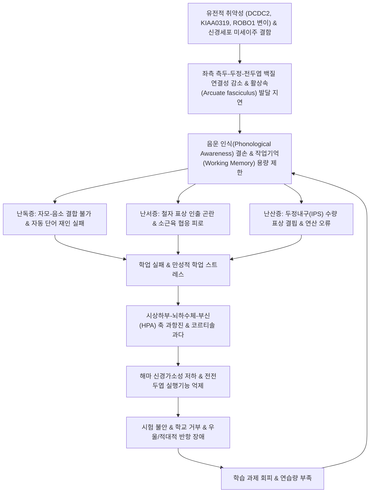

# 🩺 [[특정 학습 장애]] (Specific Learning Disorder, SLD / 學習障碍, ICD-10: F81 / KCD: F81)

> **핵심 3줄 요약 (Key Summary)**:
> - 📍 **병소 부위 & 해부·병태생리**: 정상 지능(IQ ≥ 85)과 적절한 교육 환경에도 불구하고 좌측 측두-두정엽 음운 회로, [[활상속]](Arcuate fasciculus), 양측 [[두정내구]](Intraparietal sulcus, IPS) 및 배외측 전전두피질([[DLPFC]]) 작업기억망의 신경생물학적 연결성 결손으로 인해 특정 학업 기술(읽기·쓰기·수학) 습득에 최소 6개월 이상 지속적인 장애가 초래되는 신경발달장애.
> - 🚩 **전형적 임상 양상 & 3대 세부 아형**: 음소 인식 및 단어 재인 지연에 따른 **읽기 장애([[난독증]], Dyslexia)**, 맞춤법·철자 오류 및 소근육 협응 미숙에 따른 **서자표현 장애([[난서증]], Dysgraphia)**, 수 감각·자릿수·연산 개념 부전에 따른 **수학 장애([[난산증]], Dyscalculia)**.
> - 🛠️ **핵심 감별 & 한·양방 다각적 치료 전략**: [[한국 웩슬러 아동 지능검사]](K-WISC-V) 및 기초학습기능 수행평가체제(BASA)를 통한 지능-성취도 불일치 감별, 다단계 중재 반응 모델(RTI Tier 1~3)·다감각 특수교육과 한의학적 [[건망]](健忘)·[[심비양허]](心脾兩虛)·[[비허간왕]](脾虛肝旺) 변증에 따른 [[총명탕]], [[주자독서환]], [[귀비탕]] 투여 및 사관혈([[합곡]]·[[태충]])·두침(백회·사신총) 자극.
> - <font color="#fa7e7e">⚠️ **응급 의뢰 레드플래그 & 악화 요인**: 지속적 학업 실패와 주변의 질책으로 촉발된 심각한 소아 우울증, 자해 충동, 급성 등교 거부증(School Refusal), 또는 비정형 결신 발작(Absence Seizure)이나 뇌종양 등 기질적 중추신경계 병변 의심 시 즉각 소아청소년정신과 및 소아신경과 정밀 의뢰.</font>

---

## 📌 목차
1. [질환 개요 & 병태생리 (Disease Overview)](#1-질환-개요--병태생리-disease-overview)
2. [병태생리 메커니즘 & 대사·장기부전 악순환 네트워크](#2-병태생리-메커니즘--대사장기부전-악순환-네트워크)
3. [임상 증상 & 환자 소견 (Clinical Presentation)](#3-임상-증상--환자-소견-clinical-presentation)
4. [감별 진단 매트릭스 (Differential Diagnosis)](#4-감별-진단-매트릭스-differential-diagnosis)
5. [한의 통합 치료 프로토콜 (침·약침·한약)](#5-한의-통합-치료-프로토콜-침약침한약)
6. [양방 치료 & 병용·의뢰 기준 (Conventional Treatment & Referral)](#6-양방-치료--병용의뢰-기준-conventional-treatment--referral)
7. [식이·생활습관 & 자가관리 티칭 가이드](#7-식이생활습관--자가관리-티칭-가이드)
8. [💡 진료실 핵심 필기 & 임상 노하우](#8--진료실-핵심-필기--임상-노하우)
9. [출처 및 학술 참고 문헌 (References)](#9-출처-및-학술-참고-문헌-references)

---

## 1. 질환 개요 & 병태생리 (Disease Overview)

* **질환 정의 및 기본 개념**:
  * [[특정 학습 장애]](Specific Learning Disorder, SLD)는 지적 능력이 정상 범주(IQ ≥ 85)에 속하고, 시각이나 청각의 감각적 결함이 없으며, 적절한 전통적 교수 및 사회문화적 학습 기회가 주어졌음에도 불구하고, 학업적 기술(문자 읽기, 글씨 쓰기 및 작문, 수리 연산 및 수학적 추론)의 습득과 활용에 심각하고 지속적인(최소 6개월 이상 중재 후에도 잔존하는) 곤란을 겪는 신경발달장애이다.
  * DSM-5에서는 과거 독립된 질환으로 분류되던 난독증, 난서증, 난산증을 '특정 학습 장애'라는 단일 상위 범주로 통합하고, 각각 **읽기 장해(With impairment in reading)**, **서자표현 장해(With impairment in written expression)**, **수학 장해(With impairment in mathematics)**의 3대 세부 영역별 명시자(Specifiers)로 규정하였다.

* **역학 및 유병률**:
  * 전 세계 학령기 아동 인구의 약 5~15%가 특정 학습 장애를 겪는 것으로 추산되며, 성인 인구에서도 약 4% 내외로 지속된다.
  * 3대 세부 아형 중 **읽기 장애([[난독증]])**가 전체 학습 장애 아동의 약 70~80%를 차지하여 가장 흔하며, 수학 장애([[난산증]])가 약 3~6%, 서자표현 장애([[난서증]])가 단독 또는 읽기 장애와 병합되어 빈발한다.
  * 성별 비율은 임상 표본에서 남아가 여아에 비해 약 2:1에서 3:1로 높게 의뢰되나, 역학적 전수 조사에서는 남아 1.2~1.5 : 여아 1 정도로 차이가 줄어든다(남아의 동반된 외현화 행동 문제로 인한 조기 발견 경향).
  * 높은 가족력 집적도를 보여 부모나 형제 중 난독증이 있는 경우 발병 위험도가 4~8배 증가하며, 쌍태아 연구상 일란성 쌍둥이의 일치율은 60~70%에 달한다.

* **관련 장기 및 대뇌 신경망 구조**:
  * **읽기 신경망**:
    * **배측 음운 회로(Dorsal Phonological Stream)**: 좌측 상측두회([[베르니케 영역]]), 하두정소엽(각회 Angular gyrus, 연상회 Supramarginal gyrus) 및 좌측 하전두회([[브로카 영역]])를 연결하는 [[활상속]](Arcuate fasciculus). 글자를 낱소리(음소)로 분해하고 소리와 매핑하는 음운 해독 담당.
    * **복측 시각 단어 형태 영역(Ventral Orthographic Stream)**: 좌측 방추회(Fusiform gyrus)의 **시각 단어 형태 영역(Visual Word Form Area, VWFA)**. 단어 전체를 한눈에 즉각 인식하는 빠른 자동 읽기 경로.
  * **수학 신경망**:
    * 양측 두정엽의 **[[두정내구]](Intraparietal sulcus, IPS)**: 비언어적 수량 표상 및 대략적 수 감각(Approximate Number System, ANS)의 중추.
    * 좌측 각회(Angular gyrus): 구구단 암기 및 덧셈 사실의 언어적 인출.
  * **서자 및 실행기능망**:
    * 엑스너 서자 영역(Exner's area, 좌측 중전두회 후방), 일차 운동피질, 기저핵-소뇌 루프(소근육 궤적 제어), 배외측 전전두피질([[DLPFC]]: 작업기억 및 오류 점검).

---

## 2. 병태생리 메커니즘 & 대사·장기부전 악순환 네트워크



### 1) ASCII 병태생리 다이어그램: 특정 학습 장애의 신경인지 악순환 모델

```text
========================================================================================
                     특정 학습 장애(SLD)의 신경인지 병태 악순환 모델
========================================================================================

 [신경생물학적 소인]
  - 대뇌 피질 미세 발달 이상 (Ectopias, 미세 다발성 회선 이상)
  - 좌측 반구 언어 신경망 백질(활상속, 하후두전두속) 분획이방성(FA) 저하
  - 양측 두정내구(IPS) 회백질 용적 감소 및 기능적 연결성 결손
                                    │
                                    ▼
┌──────────────────────────────────────────────────────────────────────────────────────┐
│                    핵심 인지 처리 기능의 신경학적 결함 (Core Deficits)                │
│                                                                                      │
│  [읽기 회로 결함 - 난독증]        [서자 회로 결함 - 난서증]     [수리 회로 결함 - 난산증] │
│  · 좌측 측두-두정엽 활성화 부전   · Exner 영역 & 소뇌 협응 미숙  · 양측 두정내구(IPS) 결함│
│  · 음운 인식 및 빠른 명명(RAN) 결여· 정서법적 철자 인출 부전    · 수량 표상 및 자릿값 오류│
└───────────────────────────────────┬──────────────────────────────────────────────────┘
                                    │
                                    ▼
┌──────────────────────────────────────────────────────────────────────────────────────┐
│                      학습 과제 수행 실패 및 인지적 과부하                            │
│  - 해독(Decoding)에 과도한 주의력 소모 → 문맥 이해 및 고위 사고 불능               │
│  - 작업기억(Working Memory) 버퍼 조기 고갈 → 지시 사항 망각 및 연산 오류 폭증      │
└───────────────────────────────────┬──────────────────────────────────────────────────┘
                                    │
                                    ▼
┌──────────────────────────────────────────────────────────────────────────────────────┐
│                 이차적 신경내분비 및 정서·행동 악순환 (Vicious Cycle)                │
│                                                                                      │
│   [학업 스트레스 폭증] ──▶ [HPA 축 과항진] ──▶ [코르티솔 지속 분비]                 │
│            ▲                                          │                             │
│            │                                          ▼                             │
│   [학습 회피 & 반항] ◀── [학습된 무기력·불안] ◀── [해마 가소성 억제 & 전두엽 기능 저하]│
└──────────────────────────────────────────────────────────────────────────────────────┘
========================================================================================
```

### 2) 3대 세부 아형의 분자·신경생물학적 기전
* **읽기 장애 ([[난독증]], Developmental Dyslexia)**:
  * **음운 결손 가설(Phonological Deficit Hypothesis)**: 음성 언어의 가장 작은 단위인 음소(Phoneme)를 인식하고 조작하는 능력이 선천적으로 결여됨. 한글의 경우 초성-중성-종성의 자모 결합 원리를 직관적으로 체득하지 못함.
  * **이중 경로 모델(Dual-Route Model)의 파탄**:
    * 비단어(Non-word)나 낯선 단어를 읽어내는 '간접 음운 경로(측두-두정엽 회로)'의 연결성 저하.
    * 친숙한 단어를 형태소 통째로 즉각 시각 재인하는 '직접 철자 경로(좌측 방추회 VWFA)'로의 이행 실패. fMRI 연구상 난독증 환아는 읽기 과제 시 좌측 후방 회로가 비활성화되고, 이를 보상하기 위해 우측 반구 및 양측 하전두회가 비정상적으로 과활성화됨.
* **서자표현 장애 ([[난서증]], Dysgraphia / Specific Learning Disorder in Written Expression)**:
  * **운동성 난서증(Motor Dysgraphia)**: 일차 운동피질, 기저핵, 소뇌의 운동 협응 미성숙으로 인해 연필 쥐기 악력 조절 실패, 손의 진전 및 극심한 근피로 호소.
  * **공간성 난서증(Spatial Dysgraphia)**: 우측 두정엽의 시공간 처리 장애로 줄 간격 맞추기 불가, 글자 크기 왜곡, 자모의 위치 역전.
  * **철자성/음운성 난서증(Dysorthographia)**: 문자 표상 인출 실패로 소리 나는 대로 쓰거나 철자 누락, 문법 오류 빈발.
* **수학 장애 ([[난산증]], Dyscalculia / Specific Learning Disorder in Mathematics)**:
  * **수 감각(Number Sense) 결손**: 점들의 개수 비교(예: 5개 vs 8개) 등 비언어적 크기 표상을 담당하는 양측 두정내구([[두정내구]], IPS)의 기능적 저하.
  * **수학적 사실 인출 결함**: 구구단, 기본 덧셈·뺄셈 사실이 장기 서술기억(해마-각회 회로)에 자동화 저장되지 못하여 고학년이 되어서도 손가락으로 일일이 세는 원시적 전략에 고착됨.
  * **작업기억 및 공간 처리 결손**: 다자리수 곱셈, 나눗셈 등 세로셈 과정에서 자리 올림수 보관 및 자릿값(Place value) 정렬 실패.

### 3) 신경인지 및 심리사회적 악순환 네트워크
* 지능이 정상임에도 불구하고 학업 성취도가 현저히 떨어지면서 부모와 교사로부터 "게으르다", "노력을 안 한다"는 비난을 반복적으로 경험.
* 만성적인 좌절감은 교감신경계 과활성화와 [[HPA 축]](Hypothalamic-Pituitary-Adrenal Axis)의 만성 항진을 초래하여 코르티솔 분비 과다 유발 $\rightarrow$ [[해마]] 신경발생 억제 및 전두엽 실행기능 손상 가속.
* 이는 2차적인 **소아 불안장애**, **소아 우울증**, **등교 거부증**, 또는 자존감 결핍을 감추기 위한 **적대적 반항장애(ODD)**로 발전하여 학습 기회를 더욱 박탈당하는 악순환 고리가 고착됨.

---

## 3. 임상 증상 & 환자 소견 (Clinical Presentation)

### 1) 아형별 핵심 임상 증상 및 징후
* **읽기 장애 ([[난독증]])의 양상**:
  * 글자를 읽을 때 생략(예: '비행기' $\rightarrow$ '행기'), 대치(예: '사과' $\rightarrow$ '배'), 왜곡, 단어의 추가 현상 발생.
  * 소리 내어 읽는 속도가 또래 아동에 비해 현저히 느리고 끊어지며, 억양이 부자연스러움.
  * 읽은 문장의 전체적인 맥락 파악 및 줄거리 요약, 행간의 의미 추론이 거의 불가능함(단어 해독에 모든 인지 에너지를 소모하기 때문).
  * 거울 글자 읽기(좌우 반전된 글자를 읽거나 혼동: b-d, p-q, ㅅ-ㅈ).
* **서자표현 장애 ([[난서증]])의 양상**:
  * 필기 시 연필을 너무 꽉 쥐어 손가락과 손목 관절 통증을 호소하고 종이가 찢어지기도 함.
  * 글씨 크기가 일정하지 않고 줄을 벗어나며, 띄어쓰기가 전혀 되지 않음.
  * 맞춤법 오류가 지속적임(받침 글자 혼동, 연음 법칙 미적용, 소리 나는 대로 쓰기).
  * 자신의 생각을 말로는 유창하게 설명하지만, 글(문장)로 적으라고 하면 한두 줄 이상 작성하지 못함.
* **수학 장애 ([[난산증]])의 양상**:
  * 1부터 10까지 거꾸로 세기 곤란, 숫자의 크기 대소 비교(예: 7이 큰가 9가 큰가)에 긴 시간이 소요됨.
  * 초등학교 3~4학년 이후에도 간단한 한 자리 수 덧셈·뺄셈을 손가락을 사용하지 않고는 계산하지 못함.
  * 연산 기호의 혼동 (+, -, ×, ÷ 의미 착오).
  * 아날로그 시계 바늘 읽기, 거스름돈 셈하기, 게임 점수 계산 등 일상생활 속 수리 개념 활용의 심각한 제한.

### 2) 객관적 평가 척도 및 신경심리 검사 (Signs & Diagnostics)
* **지능 평가**:
  * **[[한국 웩슬러 아동 지능검사]](K-WISC-V)**: 전체 지능(FSIQ)이 정상(85 이상)임을 확인. 전형적으로 언어이해지수(VCI)나 유동추론지수(FRI)에 비해 **작업기억지수(WMI)** 및 **처리속도지수(PSI)**의 유의미한 저하(지표 간 불균형 프로파일)를 나타냄.
* **학업 성취도 표준화 평가**:
  * **기초학습기능 수행평가체제 (BASA: Reading, Writing, Math)**: 학년별 표준 규준과 비교하여 아동의 현재 학업 성취도가 -2 표준편차(또는 백분위 5%ile 이하) 수준으로 지체되어 있는지 판정.
  * **한국 아동 청소년 난독증 선별검사 (K-DST)**: 음운인식, 빠른 자동 명명(RAN), 자모 지식, 해독 능력의 영역별 백분위 프로파일 산출.
  * **시각-운동 통합발달검사 (K-VMI)**: 눈-손 협응 및 시지각 통합 능력 평가를 통해 난서증의 운동학적 소인 감별.

---

## 4. 감별 진단 매트릭스 (Differential Diagnosis)

| 감별 질환 | 지능 (IQ) 수준 | 주요 학업 결손 영역 | 신경생물학적 기전 차이 | 핵심 감별 포인트 |
| :--- | :--- | :--- | :--- | :--- |
| **[[특정 학습 장애]](SLD, 본 질환)** | **정상 범위 (IQ ≥ 85)** | 읽기, 쓰기, 수학 중 특정 영역 국한 결손 | 측두-두정 음운망, 두정내구(IPS) 국소 연결성 장애 | **지능과 학업 성취도 간 현저한 불일치**, 일상 적응 기능 정상 |
| **[[지적 장애]](ID)** | **전반적 저하 (IQ < 70)** | 모든 학업 과목 및 개념 습득 전반 지체 | 전반적인 대뇌 피질 시냅스 가소성 및 신경망 발달 결손 | 개념·사회·실행 영역 등 **일상 적응 행동 전반의 동반 결손** |
| **[[주의력결핍 과잉행동장애]](ADHD)** | 정상 범위 (다양함) | 부주의·충동성으로 인한 시험 실수, 과제 미완 | 전두엽-기저핵 도파민/노르에피네프린 조절 장애 | **1:1 밀착 상황에서는 정상적인 읽기/계산 수행 가능** |
| **[[경계선 지능]](BIF)** | **경계선 (IQ 71~84)** | 모든 과목의 완만한 학습 속도 저하 | 대뇌 전반의 평균 하회 인지 용량 | 학업 기술 외에도 복잡한 사회적 판단 등 전반적 미숙함 |
| **소아 우울증 / 불안장애** | 정상 범위 | 학습 의욕 저하, 시험 불안, 성적 급락 | 세로토닌/노르에피네프린계 정서 조절 파탄 | 학업 부진의 발병 시점이 명확(과거엔 정상), 기분 장애 호전 시 회복 |
| **감각 결손 (약시, 난청)** | 정상 범위 | 칠판 글씨 오독, 발음 부정확 및 듣기 오류 | 안구 굴절 이상 또는 청각 전도/감각신경 결함 | 시력검사 및 청력검사(순음청력검사, ABR)로 즉각 기질적 이상 확인 |
| **학습 부진 (Underachievement)** | 정상 범위 | 불충분한 학습량으로 인한 성적 저하 | 신경학적 결함 없음 (환경적 결손, 방임) | **체계적 보충 교육 및 지도 시 단기간에 정상 성취도 도달** |

> 🚩 **레드플래그 감별 (기질적 신경계 병변 및 뇌전증)**:
> - 수업 중 교사의 말을 전혀 듣지 못하고 5~15초간 멍하게 허공을 응시하거나 눈을 깜빡이는 증상이 하루 수십 회 반복되는 아동: 단순 주의산만이나 난독증이 아니라 **소아 소발작 뇌전증(Childhood Absence Epilepsy)**일 가능성이 높으므로 즉시 비디오 뇌파 검사(EEG: 3Hz 뇌파 복합파 확인)를 의뢰해야 한다.

---

## 5. 한의 통합 치료 프로토콜 (침·약침·한약)

* **한의학적 병증 인식 및 변증 체계**:
  * 특정 학습 장애는 한의학 고전문헌의 **건망(健忘)**, **실총(失聰)**, **치둔(癡鈍)**, **심비양허(心脾兩虛)**, **비허간왕(脾虛肝旺)**, **담탁조규(痰濁阻竅)**의 범주에 속한다.
  * 소아의 기억과 인지 기능은 **심(心, 神明을 주관)**과 **비(脾, 思와 記憶을 주관)**, 그리고 **신(腎, 髓海와 志를 주관)**의 조화에 달려 있다.
  * 학습 스트레스와 뇌기능 불균형으로 인해 비기(脾氣)가 허해지면 담음(痰飮)이 발생하여 뇌규(腦竅)를 가로막고([[담탁조규]]), 간기(肝氣)가 울결되어 화(火)로 변해 전두엽의 안정된 집중을 방해한다([[비허간왕]]).

* **침구 치료 (Acupuncture)**:
  * **사관혈(四關穴) 개규통락(開竅通絡)**:
    * **[[합곡]](LI4)** (수양명대장경 원혈) + **[[태충]](LR3)** (족궐음간경 원혈).
    * 전신의 기혈 순환을 촉진하고 자율신경계 긴장을 완화하며, 뇌혈관 연축을 해소하여 전두엽 및 두정엽 미세순환을 개선함.
  * **두침 요법 (Scalp Acupuncture) 및 뇌신경 활성화 배혈**:
    * **[[백회]](GV20)** & **[[사신총]](EX-HN1)**: 뇌의 정중선과 전두-두정엽 연결망을 자극하여 주의집중력 및 작업기억 유지 능력을 강화.
    * **[[인당]](EX-HN3)** & **태양(EX-HN5)**: 전두엽 집행기능 및 시지각 피로 해소.
    * **통천(BL7) & 뇌호(GV17)**: 좌측 측두-두정 언어 피질 영역 자극으로 음운 처리 속도 향상.
    * **[[신문]](HT7)** & **[[내관]](PC6)**: 심신안정(心神安定)을 통한 시험 불안 및 긴장 완화.
    * **[[족삼리]](ST36)** & **[[풍지]](GB20)**: 비위 기력 진작 및 추골기저동맥 뇌혈류 촉진.
  * **자침 기법**:
    * 0.20×30mm 일회용 멸균 침을 사용하여 두피 경혈은 15~30도 사자(斜刺)로 건막하에 자입.
    * 백회-사신총에 2Hz 저주파 연속파 전침을 15분간 적용하여 대뇌 피질의 도파민 및 아세틸콜린 분비를 촉진하고 알파파(Alpha wave)를 유도.

* **약침 치료 (Pharmacopuncture)**:
  * **[[자하거약침]](Hominis Placenta)**:
    * **적응증**: 만성 피로, 기혈 부족, 뇌수(腦髓) 영양 결핍으로 집중력이 급격히 떨어지는 아동.
    * **시술 부위**: 풍지, 신수, 대추에 각 0.05~0.1cc씩 주입하여 뇌혈류 개선 및 신경영양인자 활성화 도모.
  * **황련해독탕 약침**:
    * **적응증**: 학업 스트레스로 인해 상열감, 안면 홍조, 안구 충혈, 잦은 짜증과 분노 발작을 보이는 비허간왕 아동.
    * **시술 부위**: 간수, 심수, 전중혈 점적.

* **한약 치료 (Herbal Medicine)**:
  * **담탁조규(痰濁阻竅) / 난독증 및 인지 둔마**:
    * **주증**: 머리가 무겁고 맑지 않음(두중감), 멍한 표정, 집중 곤란, 식후 졸림, 설태 백니(白膩).
    * **대표 처방**: [[총명탕]](聰明湯) 가감방 ([[백복신]], [[원지]], [[석창포]] 각 8~12g).
    * **약리 기전**: 원지와 석창포의 활성 성분(Senegenin, $\alpha$-Asarone)은 해마의 콜린성 신경전달을 촉진하고, NMDA 수용체를 조절하며, 뇌내 항산화 작용을 통해 작업기억을 향상시킴.
  * **심비양허(心脾兩虛) / 학업 피로 및 시험 불안**:
    * **주증**: 안색 창백, 심계항진(가슴 두근거림), 불면, 건망증, 소화 불량, 잦은 복통.
    * **대표 처방**: [[귀비탕]](歸脾湯) 또는 장원환(壯元丸) ([[황기]], [[인삼]], [[백출]], [[당귀]], [[용안육]], [[산조인]], [[원지]], [[복신]]).
    * **치법**: 건비양심(健脾養心), 익기보혈(益氣補血).
  * **신음부족(腎陰不足)·수승화강 부전 / 집중력 결핍 및 건망**:
    * **주증**: 손발에 열감, 야간 도한(식은땀), 안구 건조, 허리·다리 무력감, 글자 암기 곤란.
    * **대표 처방**: [[주자독서환]](朱子讀書丸) ([[숙지황]], [[당귀]], [[구기자]], [[토사자]], [[원지]], [[석창포]] 등).
    * **치법**: 보신익정(補腎益精), 수승화강(水昇火降).
  * **비위기허(脾胃氣虛) / 지구력 부족 및 피로**:
    * **주증**: 조금만 공부해도 눕고 싶어 함, 목소리에 힘이 없음, 식욕 부진.
    * **대표 처방**: [[보중익기탕]](補中益氣湯).

* **추나 및 두개천골요법 (Chuna & CST)**:
  * **상부 경추 교정 추나**: 후두하근(Suboccipital muscles)의 과긴장을 해소하고 환추-축추(C1-C2) 관절 기능을 정상화하여 추골동맥(Vertebral artery)을 통한 뇌간 및 소뇌, 후두엽 혈류 공급을 극대화.
  * **두개천골기법 (CST)**: 접형후두저연접(Sphenobasilar Junction, SBJ) 감압 및 시상정맥동(Sagittal sinus) 배액 수기를 통해 뇌척수액 순환 장애 및 두개내 울혈을 해소.

---

## 6. 양방 치료 & 병용·의뢰 기준 (Conventional Treatment & Referral)

* **다단계 중재 반응 모델 (RTI Model: Response to Intervention)**:
  * 미국 및 국내 특수교육 현장에서 표준적으로 적용하는 3단계 조기 중재 시스템:
    * **Tier 1 (보편적 개입)**: 일반 학급 내 모든 학생을 대상으로 증거 기반의 다감각 교수법 제공.
    * **Tier 2 (소그룹 맞춤 중재)**: Tier 1에 반응하지 않는 하위 10~15% 아동을 대상으로 주 2~3회, 회당 30분씩 소그룹(3~5명) 집중 음운·연산 훈련 실시.
    * **Tier 3 (집중 개입 및 특수교육)**: Tier 2에도 진전이 없는 아동(전체의 3~5%)을 특정 학습 장애로 정식 진단하고 1:1 맞춤형 개별화 교육계획(IEP) 적용.

* **증거 기반 다감각 특수교육 중재 기법**:
  * **오튼-길링엄 접근법 (Orton-Gillingham Approach)**:
    * 난독증 아동을 위한 시각(Visual), 청각(Auditory), 운동감각(Kinesthetic), 촉각(Tactile)을 동시에 통합하는 VAKT 다감각 교수법.
    * 자모 카드를 손가락으로 모래판에 쓰면서(촉각/운동), 글자 형태를 눈으로 보고(시각), 소리를 크게 내어 발음하고(청각) 확인하는 다채널 피드백 훈련.
  * **페널드 기법 (Fernald Multi-Sensory Method)**:
    * 단어 전체를 손가락으로 따라 쓰며 소리 내어 읽고 문장 속에 활용하는 총체적 언어 접근법.
  * **인지 전략 교수법 (Cognitive Strategy Instruction)**:
    * 수학 문장제 문제 해결을 위한 단계별 시각화(그림 그리기, 표 만들기, 핵심어 밑줄 긋기).

* **보조공학 기술 (Assistive Technology)**:
  * **음성 변환 텍스트 (TTS: Text-to-Speech)**: 교과서 및 시험 지문을 소리로 읽어주어 해독 부담을 덜고 청각적 이해력으로 내용 파악.
  * **음성 인식 서자 변환 (STT: Speech-to-Text)**: 구술 녹음을 텍스트로 자동 변환하여 난서증 아동의 글쓰기 과제 수행 보조.
  * 말하는 계산기(Talking Calculator), 디지털 그래픽 오거나이저(Mind-mapping tool) 도입.

* **약물 치료 (Medication) 및 한의 병용 판단**:
  * **약물 적응증**: 특정 학습 장애 자체를 치료하는 약물은 존재하지 않으나, 환아의 약 30~50%에서 [[주의력결핍 과잉행동장애]](ADHD)가 동반되므로, 주의력 결핍이 학습을 심각하게 방해하는 경우 양방 약물을 병용함.
    * 중추신경흥분제: 메틸페니데이트([[Methylphenidate]], 콘서타, 메디키넷).
    * 비흥분제: 아토목세틴([[Atomoxetine]], 스트라테라).
  * **한의 병용 시너지 및 부작용 완화**:
    * 메틸페니데이트 복용 아동이 흔히 겪는 식욕 부진, 체중 감소, 수면 장애, 틱 증상 악화, 약효 소진 시의 반동성 분노(Rebound effect)에 대해 한의학적 [[귀비탕]]이나 [[억간산]]을 병용하면 위장관 기능을 보전하고 교감신경 흥분을 안정시켜 약물 치료 지속성을 획기적으로 개선함.
    * 한약 복용 중이라도 기존 신경정신과 약물을 임의로 중단하지 않도록 지도.

* **전문과 의뢰 기준 (Referral Criteria)**:
  * 🚨 **소아청소년정신과 즉각 의뢰**: 극심한 시험 불안으로 인한 공황 발작, 자해 시도, "죽고 싶다"는 우울 증상 호소, 급성 등교 거부.
  * 🏥 **소아신경과 의뢰**: 수업 중 잦은 멍때림(소발작 의심), 갑작스러운 보행 이상이나 손 떨림, 두통 및 구토 동반 시 뇌 자기공명영상(MRI) 및 뇌파(EEG) 검사 필요.

---

## 7. 식이·생활습관 & 자가관리 티칭 가이드

* **식이 영양 관리 (Dietary Management)**:
  * **뇌세포막 지질 항상성 유지**: 대뇌 피질 시냅스 막의 핵심 구성 요소인 [[DHA]] 및 [[EPA]] 오메가-3 지방산 공급(등푸른 생선, 들기름, 호두).
  * **콜린 및 인지 영양소**: 아세틸콜린 합성을 촉진하는 레시틴, 콜린 성분이 풍부한 달걀노른자, 콩류 섭취 권장.
  * **정제 탄수화물 및 인공첨가물 제한**: 급격한 혈당 롤러코스터(Reactive Hypoglycemia)는 전두엽의 집중력을 급격히 저하시키므로 단순당(과자, 탄산음료, 가당 주스), 타르 색소, 안식향산나트륨 섭취를 최소화.

* **가정 내 학습 환경 및 생활습관 (Environment & Habits)**:
  * **시각적·청각적 방해 요인 차단**: 책상 위에는 현재 공부하는 교재 1권만 올려놓고 스마트폰, 장난감 등 시각적 유혹물을 격리. 청각 과민 아동은 백색 소음기나 노이즈 캔슬링 헤드폰 활용.
  * **뽀모도로 분할 학습법**: 집중 유지 시간이 짧은 아동 특성을 고려하여 "20분 집중 학습 $\rightarrow$ 5분 스트레칭 휴식"의 단기 사이클을 확립.
  * **보상 기반 마이크로 루틴**: 한 페이지 읽기, 수학 세 문제 풀기 등 달성 가능한 작은 목표를 설정하고 완료 즉시 스티커 보상 제공.

* **부모 및 보호자 티칭 가이드**:
  * **낙인 찍지 않기**: "아이가 글을 안 읽으려고 떼를 쓰는 것은 공부가 싫어서가 아니라, 뇌에서 글자가 왜곡되어 극심한 피로와 고통을 느끼기 때문"임을 부모가 명확히 인지해야 함.
  * **읽어주기(Read-aloud)의 일상화**: 독서의 즐거움을 잃지 않도록 부모가 매일 밤 책을 풍부한 억양으로 소리 내어 읽어주는 시간을 확보.
  * **장점 중심 자존감 지지**: 예술, 체육, 기계 조립, 프로그래밍 등 아동이 잘하고 좋아하는 비학업적 영역을 적극 발굴하여 자존감을 보호.

---

## 8. 💡 진료실 핵심 필기 & 임상 노하우

### 1) 진료실 3분 원터치 선별 문진법: 학습부진 vs 학습장애
* 학부모가 "아이가 공부를 너무 못해요"라며 내원했을 때 반드시 던져야 할 3대 감별 질문:
  * ① **"아이가 책을 읽을 때 소리 내어 읽히면 한 글자씩 더듬거리거나, 받침 글자를 마음대로 바꾸어 읽나요?"**
    * $\rightarrow$ YES라면 단순 학습부진이 아닌 **음운 처리 결함([[난독증]])** 가능성 90% 이상.
  * ② **"글씨를 쓸 때 손에 땀을 쥐거나 너무 힘을 주어 손가락이 아프다고 울거나, 글자 간격이 엉망인가요?"**
    * $\rightarrow$ YES라면 소근육 협응 및 철자 인출 부전([[난서증]]) 의심.
  * ③ **"10 이상의 덧셈을 할 때 여전히 손가락이나 바둑알을 써야만 계산이 가능한가요?"**
    * $\rightarrow$ YES라면 수 감각 결손([[난산증]]) 의심.

### 2) 메틸페니데이트 복용 아동 한의학적 진찰 및 처방 포인트
* 양방 소아정신과에서 콘서타(Methylphenidate)를 처방받아 복용 중인 학습장애/ADHD 아동이 한의원에 내원하는 주된 이유는 '부작용' 때문이다.
* **설진(舌診)**: 혀가 붉고 설태가 벗겨져 있거나(설홍무태, 陰虛), 혀끝에 붉은 점이 돋아 있음(설첨홍, 心火).
* **맥진(脈診)**: 맥이 가늘고 빠른 세삭맥(細數脈) 또는 현삭맥(弦數脈).
* **임상 대처**:
  * 식욕 부진과 복통을 호소하면 [[소건중탕]] 또는 [[향사육군자탕]]으로 비위(脾胃)를 보강.
  * 밤에 잠을 못 이루고 신경질이 늘어나면 [[귀비탕]]에 조구등, 백자인을 가미하여 심담(心膽)을 안정시킴.
  * 틱(Tic) 증상이 나타나면 콘서타 감량을 소아정신과와 상의하도록 권고하고 [[억간산가반하진피]]를 선방.

### 3) 학부모 상담 스크립트: 마음을 여는 공감 대화법
* *"어머님, 그동안 아이 붙잡고 한글 가르치시느라, 구구단 외우게 하시느라 얼마나 속이 타고 눈물을 쏟으셨습니까. '내가 뱃속에서 뭘 잘못 먹었나', '내 양육 방식이 잘못되었나' 자책도 많이 하셨을 겁니다. 하지만 절대 어머님의 탓도, 아이의 게으름 탓도 아닙니다. 아이의 뇌는 일반 아이들과 다른 독특한 방식으로 세상을 인식하고 정보를 처리할 뿐입니다. 에디슨, 아인슈타인, 레오나르도 다빈치도 모두 어린 시절 지독한 난독증을 앓았습니다. 우리 아이는 글자를 소리로 바꾸는 회로가 조금 좁을 뿐이지, 누구보다 풍부한 상상력과 통찰력을 지니고 있습니다. 한의학 치료로 머리의 기혈 순환을 열어주고 다감각 특수교육을 병행하면 아이는 반드시 자신의 잠재력을 활짝 꽃피울 수 있습니다."*

---

## 9. 출처 및 학술 참고 문헌 (References)

1. **American Psychiatric Association**. (2022). *Diagnostic and Statistical Manual of Mental Disorders, Fifth Edition, Text Revision (DSM-5-TR)*. Washington, DC: American Psychiatric Publishing. [doi:10.1176/appi.books.9780890425787](https://doi.org/10.1176/appi.books.9780890425787)
   - **[가이드라인 요약]**: 특정 학습 장애(SLD)의 진단 기준 확립, 읽기·서자표현·수학의 3대 명시자 분류 체계 및 중증도 판정 규준 제시.

2. **MSD 매뉴얼 전문가용** — [학습 장애 (Learning Disorders)](https://www.msdmanuals.com/professional/pediatrics/learning-and-developmental-disorders/learning-disorders)
   - **[전문가 개요]**: 학습 장애의 신경생물학적 병인, 인지 평가 체계, 다감각 특수교육 개입 및 보조공학적 지원 방안 총괄.

3. **Ayaz M, Khan A, Tariq S, et al.** (2026). Existing Interventions Management Different Types Dysgraphia Specific Learning Disorder Written Expression Scoping Review. *BMJ Open*. 16(7):e113327. [PMID: 42457428](https://pubmed.ncbi.nlm.nih.gov/42457428/)

   - **[연구 요약]**: 서자표현 장애(난서증) 아동을 위한 운동 감각 훈련, 다감각 철자 지도 및 보조공학적 중재 기법의 임상적 효과와 적용 가능성을 체계적으로 검토한 스코핑 리뷰.

4. **Minsih, Handayani S, Pratiwi R, et al.** (2026). Transformative Inclusive Education Case Study Deep Learning Model Literacy Elementary School Students Specific Learning Disorder. *F1000Res*. 15:391. [PMID: 42158580](https://pubmed.ncbi.nlm.nih.gov/42158580/)

   - **[연구 요약]**: 특정 학습 장애 초등학생의 기초 문해력 향상을 위해 인공지능 게임 기반 딥러닝 다감각 교육 모델을 적용한 포용적 특수교육 사례 연구.

5. **Shaywitz SE, Shaywitz BA**. (2005). Dyslexia (specific reading disability). *Biol Psychiatry*. 57(11):1301-1309. [PMID: 15950002](https://pubmed.ncbi.nlm.nih.gov/15950002/)
   - **[연구 요약]**: 기능적 뇌자기공명영상(fMRI)을 통해 난독증 아동의 좌측 후방 읽기 신경망(측두-두정 영역 및 방추회) 활성화 부전과 우측 반구의 보상적 회로를 규명한 기념비적 연구.

6. **대한한방신경정신과학회**. (2021). *한방신경정신과의학*. 서울: 집문당.
   - **[교과서 요약]**: 소아 인지 및 학습 장애의 한의학적 병리(건망, 심비양허, 담음), 총명탕 및 주자독서환의 방제학적 기전과 두침 치료 임상 가이드.
