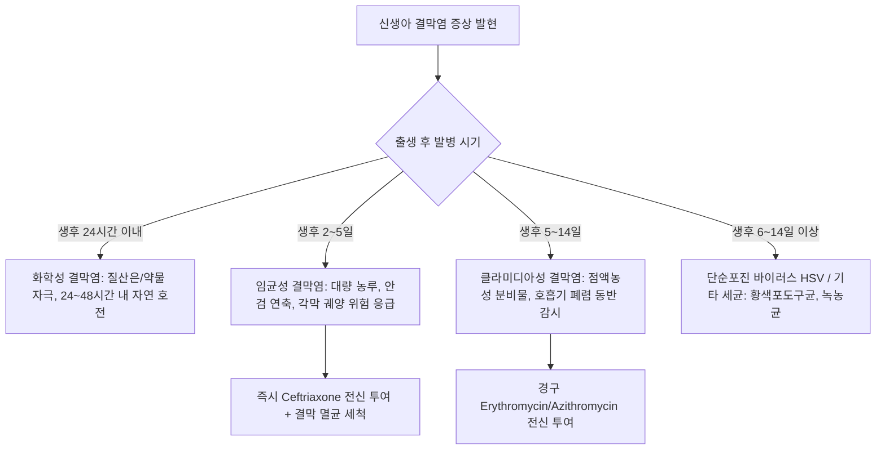

# 🩺 신생아의 결막염 (Ophthalmia Neonatorum / 新生兒結膜炎)

> **핵심 3줄 요약 (Key Summary)**:
> - 📍 **정의 & 병태생리**: 생후 28일 이내의 신생아에서 발생하는 결막의 급성 감염성·비감염성 염증. 분만 중 모체의 감염된 산도 통과 시 전파되는 [[클라미디아 트라코마티스]](Chlamydia trachomatis, 2~40%), [[임균]](Neisseria gonorrhoeae, <1%), 단순포진바이러스(HSV), 포도구균 및 출생 직후 예방 점안제에 의한 화학성 자극이 주원인이다. 특히 임균성은 24~48시간 이내에 각막 궤양 및 각막 천공으로 진행하여 영구적 실명을 유발할 수 있다.
> - 🚩 **임상 양상**: 발병 시기에 따른 감별이 핵심이다. 화학성(생후 24시간 이내, 경미한 충혈), 임균성(생후 2~5일, 폭발적인 대량 화농성 분비물 및 극심한 안검 부종), 클라미디아성(생후 5~14일, 장액성에서 점액농성 분비물 및 위막 형성).
> - 🛠️ **치료 원칙**: 출생 직후 0.5% 에리스로마이신(Erythromycin) 안연고 1회 도포(Credé 예방접종 현대화). 임균성 의심 시 즉시 세프트리아손(Ceftriaxone) 단회 정맥/근주 및 멸균 생리식염수 빈번 세척. 클라미디아 의심 시 경구 에리스로마이신 또는 아지스로마이신 전신 투여(폐렴 동반 예방). 한의학적으로는 태열(胎熱)·간화(肝火) 상염으로 변증하여 [[청열해독음]], [[용담사간탕]], [[은교산]] 가감 운용.
> - ⚠️ **응급 의뢰 레드플래그**: 각막 혼탁(Corneal haziness), 각막 궤양 및 천공 징후, 대량의 농이 뿜어져 나오는 농루안(Blennorrhea), 호흡기 기침 및 수유 곤란 동반(클라미디아 폐렴 합병 의심) 시 즉시 상급병원 소아안과·소아청소년과 응급 전원 필수.

---

## 📌 목차
1. [질환 개요 & 해부학적 병태생리](#1-질환-개요--해부학적-병태생리)
2. [병태생리 메커니즘 & 발병 시기별 병원체 네트워크](#2-병태생리-메커니즘--발병-시기별-병원체-네트워크)
3. [임상 증상 & 원인별 감별 진단 알고리즘](#3-임상-증상--원인별-감별-진단-알고리즘)
4. [감별 진단 매트릭스 (Differential Diagnosis)](#4-감별-진단-매트릭스-differential-diagnosis)
5. [한의 통합 치료 프로토콜 (내복한약·외치 세안법)](#5-한의-통합-치료-프로토콜-내복한약외치-세안법)
6. [양방 치료 & 전신 항생제·응급 세척 가이드라인 (Conventional Treatment & Referral)](#6-양방-치료--전신-항생제응급-세척-가이드라인-conventional-treatment--referral)
7. [신생아 안구 위생 & 교차 감염 예방 수칙](#7-신생아-안구-위생--교차-감염-예방-수칙)
8. [💡 사용자 진료실 핵심 필기 & 임상 노하우 (Melt-In 잔여 심화 집약)](#8-💡-사용자-진료실-핵심-필기--임상-노하우-melt-in-잔여-심화-집약)
9. [출처 및 학술 참고 문헌 (References)](#9-출처-및-학술-참고-문헌-references)

---

## 1. 질환 개요 & 해부학적 병태생리

### 1) 질환 정의 및 임상적 중요성
- **신생아 결막염(Ophthalmia Neonatorum)**: 출생 후 생후 첫 4주(28일) 이내에 나타나는 결막의 염증 반응으로 정의된다.
- **역학**: 전 세계적으로 출생아의 1~12%에서 발생하며, 의료 환경 및 산전 산모 선별 검사 유무에 따라 편차가 크다.
- **신생아 안구의 취약성**:
  - 신생아는 눈물 분비선(Lacrimal gland) 발달이 미숙하여 라이소자임(Lysozyme) 및 면역글로불린(Secretory IgA)이 결핍되어 있다.
  - 결막 상피의 두께가 얇고 기저막이 미성숙하여 병원균이 상피를 쉽게 뚫고 실질층으로 침투할 수 있다.

### 2) 주요 원인별 분류
1. **화학성 결막염(Chemical conjunctivitis)**: 과거 질산은(Silver nitrate) 용액 도포 후 발생하던 결막 자극 반응(현재는 에리스로마이신 연고 사용으로 급감).
2. **세균성 결막염**:
   - [[임균]](Neisseria gonorrhoeae): 가장 치명적. 각막 상피를 직접 용해하는 단백분해효소를 분비하여 각막 천공 유발.
   - 포도구균([[황색포도상구균]]), 연쇄상구균, 녹농균(Pseudomonas aeruginosa).
3. **클라미디아성 결막염**:
   - [[클라미디아 트라코마티스]](Chlamydia trachomatis, D~K 혈청형): 산도를 통한 수직 감염 중 가장 흔한 원인.
4. **바이러스성 결막염**:
   - 단순포진바이러스([[단순포진]](HSV-2 > HSV-1)): 산도의 생식기 포진 수포 접촉으로 발생, 각막 수지상 궤양 및 전신 감염 위험.

---

## 2. 병태생리 메커니즘 & 발병 시기별 병원체 네트워크

### 1) 감염 경로 및 병리 기전
- **수직 감염**: 양막 파열 후 상행성 감염 또는 질식 분만 중 감염된 질 분비물이 태아의 결막낭(Conjunctival sac) 내로 접종됨.
- **병원체 증식 및 염증 반응**:
  - 임균의 Pili와 Opa 단백질이 결막 비섬모 원주상피에 부착 후 세포 내이입(Endocytosis)으로 침투.
  - 호중구 대량 침윤으로 인한 폭발적인 화농성 삼출액 형성.
  - 클라미디아는 망상체(Reticulate body)로 분열하며 결막 상피세포 파괴 및 만성 림프포 형성.

### 2) 발병 시기별 병원체 추정 흐름도

---

## 3. 임상 증상 & 원인별 감별 진단 알고리즘

### 1) 발병 시기별 임상 특징
- **임균성 (생후 2~5일)**:
  - 양안에서 대량의 진한 황록색 고름이 뿜어져 나오듯 흘러내림(Blennorrhea).
  - 눈꺼풀이 심하게 부어올라(안검 부종) 자발적으로 눈을 뜨지 못함.
  - 결막의 극심한 충혈 및 구결막 부종(Chemosis).
  - 치료 지연 시 각막 궤양, 각막 천공, 안구염(Endophthalmitis), 영구 실명으로 급속 진행.
- **클라미디아성 (생후 5~14일)**:
  - 초기 수양성 분비물에서 점액농성 분비물로 변화.
  - 안검 결막의 비후, 거짓위막(Pseudomembrane) 형성.
  - 신생아는 림프조직이 미성숙하여 전형적인 여포(Follicle)가 형성되지 않고 유두 비대(Papillary hypertrophy)가 관찰됨.
  - 비치료 시 3~6주 차에 20%에서 간질성 폐렴(발작성 스타카토 기침, 무호흡) 합병.
- **화학성 (생후 24시간 이내)**:
  - 경미한 결막 충혈 및 수양성 분비물. 별다른 치료 없이 24~48시간 내 자연 소실.
- **단순포진 (생후 1~2주)**:
  - 수포성 안검 피부 병변, 수양성 또는 장액성 분비물, 수지상 각막염, 전신 HSV 감염 징후.

### 2) 이학적 검사 및 미생물학적 진단 SOP
1. **눈꺼풀 개폐 주의**: 안검 부종이 심할 때 억지로 벌리면 압력에 의해 농이 튀거나 각막 천공이 유발될 수 있으므로 안검 견인기(Desmarres retractor)를 조심스럽게 사용.
2. **그람 염색(Gram stain)**:
   - 다형핵 백혈구 내 그람 음성 쌍구균(Gram-negative intracellular diplococci) 확인 시 [[임균]] 즉시 진단.
3. **핵산증폭검사(PCR / NAAT)**: 클라미디아 및 임균, HSV 유전자 신속 확진.
4. **결막 찰과 도말**: 결막 상피세포를 부드럽게 긁어 기엠사(Giemsa) 염색 시 세포질 내 봉입체(Intracytoplasmic inclusion bodies) 확인(클라미디아).

---

## 4. 감별 진단 매트릭스 (Differential Diagnosis)

| 감별 질환 | 호발 시기 및 병소 | 분비물 양상 및 임상 특징 | 감별 포인트 |
| :--- | :--- | :--- | :--- |
| **[[임균성 결막염]]** | 생후 2~5일, 양안 | 폭발적인 대량 황색 농성 삼출액, 극심한 안검 부종 | 그람 음성 쌍구균, 각막 천공 급속 진행 |
| **[[클라미디아 결막염]]** | 생후 5~14일, 편측/양안 | 점액농성 분비물, 결막 부종, 위막 형성 | NAAT 양성, 봉입체 확인, 영아 폐렴 합병 |
| **[[화학성 결막염]]** | 출생 24시간 이내, 양안 | 경미한 충혈, 장액성 분비물 | 질산은/약물 도포력, 48시간 내 자연 완해 |
| **[[선천성 비루관 폐쇄]]** | 생후 2~4주 이후, 주로 편측 | 지속적인 눈물고임, 내안각 마사지 시 점액 역류 | 결막 충혈 없음, 안구 마사지 시 분비물 배출 |
| **단순포진([[단순포진 결막염]])** | 생후 1~2주, 편측 | 장액성 분비물, 안검 피부 수포 | 플루오레신 염색상 각막 수지상 병변, 전신 징후 |
| **[[선천성 녹내장]]** | 출생 시~수개월 | 각막 확장(소안구증 반대), 눈부심, 눈물흘림 | 각막 직경 > 12 mm, 안압 상승, 안구 통증 |

---

## 5. 한의 통합 치료 프로토콜 (내복한약·외치 세안법)

### 1) 한의학적 병인병기
- 신생아 결막염은 한의학에서 **태열안질(胎熱眼疾)**, **농루안(膿漏眼)**, **적안(赤眼)**, **목예(目翳)** 범주에 속한다.
- 임신 중 모체의 음주, 매운 음식 섭취, 칠정울화 등으로 인한 체내 습열(濕熱)과 화독(火毒)이 태아에게 전해지거나, 분만 시 오예(汚穢)한 산도 혈독(血毒)이 신생아의 안구로 침범하여 발생한다.

### 2) 변증별 처방 프로토콜
- **열독치성(熱毒熾盛) / 풍열상공(風熱上攻) (급성 화농기)**:
  - 주증: 눈꺼풀이 붉게 붓고 눈을 뜨지 못하며 대량의 누런 고름이 쏟아짐, 신생아 번조, 발열, 설홍태황.
  - 대표 처방: [[은교산]] 합 [[청열해독음]] 가감, [[황련해독탕]] 가감([[황련]], [[황금]], [[연교]], [[금은화]], [[치자]], [[국화]], [[적작약]], [[감초]]).
  - 수유모 동치: 신생아의 직접 복용이 조심스러울 경우, 수유모에게 [[용담사간탕]] 또는 [[황련해독탕]]을 복용시켜 모유를 통해 청열해독 약효를 전달.
- **간경열치(肝經熱熾) / 음허풍열(陰虛風熱) (아급성기·회복기)**:
  - 주증: 농은 줄었으나 충혈이 지속되고 눈부심 호소.
  - 대표 처방: [[지황원]] 가감, [[사물탕]] 가감([[숙지황]], [[백작약]], [[천궁]], [[목적]], [[밀몽화]]).

### 3) 외치(外治) 훈세(薰洗) 프로토콜
- **황련·금은화 생리식염수 세안**: [[황련]] 5g, [[금은화]] 10g을 멸균 증류수에 달여 미세 필터로 여과한 뒤 멸균 생리식염수와 1:1 희석하여 눈꺼풀 외측에서 내측으로 닦아냄 (신생아 각막 손상 방지를 위해 극도로 온화하게 적용).

---

## 6. 양방 치료 & 전신 항생제·응급 세척 가이드라인 (Conventional Treatment & Referral)

### 1) 병원체별 표준 양방 치료 (CDC / AAP 가이드라인)
- **임균성 결막염**:
  - **전신 항생제 필수**: 세프트리아손(Ceftriaxone) 25~50 mg/kg (최대 125 mg) IV 또는 IM 1회 단회 투여.
  - **국소 점안제 단독 치료는 절대 금기**: 임균은 전신 파종(패혈증, 관절염, 뇌수막염)을 유발할 수 있으므로 반드시 전신 요법 병행.
  - **안구 세척**: 멸균 생리식염수로 고름이 고이지 않도록 매 15~30분 간격으로 세안.
- **클라미디아 결막염**:
  - **경구 전신 투여**: 에리스로마이신(Erythromycin base/succinate) 50 mg/kg/day 4회 분복 14일간 투여 (또는 아지스로마이신 20 mg/kg/day 1일 1회 3일간).
  - *주의*: 신생아 에리스로마이신 복용 시 비대성 유문협착증(Infantile hypertrophic pyloric stenosis, IHPS) 발생 위험 감시.
- **단순포진(HSV) 결막염**:
  - 정맥용 아시클로버(Acyclovir) 60 mg/kg/day 3회 분복 14~21일간 투여 + 1% 트리플루리딘(Trifluridine) 또는 0.15% 간시클로버(Ganciclovir) 안연고 병용.

### 2) 모체 및 성 파트너 동시 치료
- 신생아 결막염 진단 시 모체와 배우자 모두 성매개감염(STI: 임균, 클라미디아) 검사 및 동시 항생제 치료 필수.

---

## 7. 신생아 안구 위생 & 교차 감염 예방 수칙

### 1) 신생아 안구 관리
- 분비물을 닦을 때는 반드시 멸균 거즈를 사용하고, 한쪽 눈을 닦은 거즈로 반대쪽 눈을 닦지 않는다(반대쪽 안구로의 교차 전파 방지).
- 처치자는 비닐장갑을 착용하고 전후 철저한 손 위생을 시행한다.

### 2) 산전 선별 검사 및 예방 도포
- 임신 3기 모든 산모 대상 임균 및 클라미디아 선별 검사 시행.
- 분만 직후 모든 신생아에게 0.5% 에리스로마이신 안연고 1cm를 하결막낭에 즉시 도포.

---

## 8. 💡 사용자 진료실 핵심 필기 & 임상 노하우 (Melt-In 잔여 심화 집약)

### 1) 진료실 농루안(Blennorrhea) 대면 시 행동 요령
- 생후 1주일도 안 된 신생아가 눈에서 노란 고름이 멈추지 않고 흘러넘쳐 내원했다면, 일체의 망설임 없이 **임균성 안염(Gonococcal ophthalmia)**으로 간주하고 행동해야 한다.
- 한의원 내에서 침이나 한약으로 해결하려 시간을 지체하면 24~48시간 만에 각막 기질이 녹아내려 평생 시력을 잃게 된다.
- 장갑을 끼고 멸균 생리식염수로 눈꺼풀 주변 농을 부드럽게 씻어낸 후, 즉시 상급병원 소아안과로 앰뷸런스 전원 의뢰서를 작성해야 한다.

### 2) 비루관 폐쇄와의 결정적 감별
- 생후 2~3주경 "눈곱이 자주 낀다"며 내원하는 환아의 대다수는 결막염이 아니라 [[선천성 비루관 폐쇄]](Nasolacrimal duct obstruction)이다.
- 감별점은 **결막 충혈의 유무**이다. 비루관 폐쇄는 눈물이 넘쳐 눈곱이 끼지만 흰자위(결막)는 깨끗하고 맑다. 반면 결막염은 눈을 뒤집어보면 결막이 새빨갛게 충혈되어 있고 부어 있다.
- 비루관 폐쇄는 내안각 하방 비루관낭 부위를 하루 3~4회 아래쪽으로 마사지(Crigler massage)해 주는 것만으로 돌 전 90% 이상 자연 개통된다.

---

## 9. 출처 및 학술 참고 문헌 (References)

Farmer ML. (2026). Ophthalmia Neonatorum: To Treat or Not to Treat? *Neonatal Netw*. PMID: 42791016.

Auriti C. (2026). Ophthalmic Antibiotic Prophylaxis as a Target for Antibiotic Stewardship: A Point Prevalence Multicentre Survey on Practices, Guideline Adherence, and Incidence of Ophthalmia Neonatorum within the European Society for Paediatric Research Network. *Neonatology*. PMID: 42545922.

Atar MB. (2026). Birth and neonatal risk factors associated with neonatal conjunctivitis: a retrospective case-control study. *BMC Pediatr*. PMID: 42323553.
