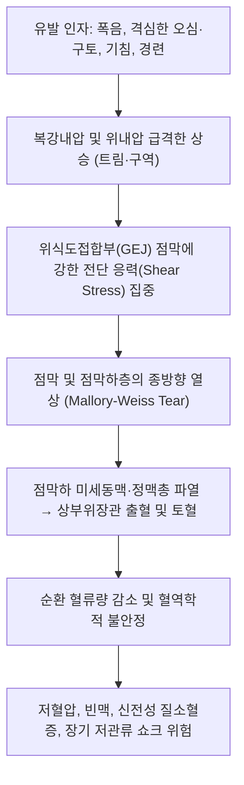

# 🩺 Mallory-Weiss 증후군 (Mallory-Weiss Syndrome / 嘔吐性食道粘膜裂傷, K22.6)

> **핵심 3줄 요약 (Key Summary)**:
> - 📍 **병소 부위 & 병태생리**: [[위식도접합부]](GE junction) 및 분문부(cardia) 점막·점막하층의 급성 종방향 열상(longitudinal mucosal tear). 격렬한 구토·오심 시 위내압의 급격한 상승과 흉복부 압력차로 인해 점막하 [[혈관]]총이 파열되어 상부 위장관 출혈 유발.
> - 🚩 **전형적 임상 양상 & 3대 징후**: 과음이나 심한 헛구역질 직후 뒤따르는 선홍색 [[토혈]](hematemesis), 심와부(epigastrium) 둔통 또는 작열감, 대량 출혈 시 흑색변(melena) 및 기립성 어지럼증.
> - 🛠️ **핵심 감별 & 한·양방 치료 전략**: [[소화성 궤양 질환]], [[보어하베 증후군]], [[식도 정맥류]]와 감별. 양방 응급 상부위장관 [[내시경 검사]](EGD)를 통한 지혈술(헤모클립, 에피네프린 국소주입, 밴드결찰술) 및 고용량 PPI 투여. 한의 진료에서는 급성 출혈 지혈 후 점막 회복기 위기허·비위습열 변증 관리([[반하사심탕]], [[황련해독탕]]).
> - ⚠️ **응급 의뢰 레드플래그**: 혈역학적 불안정(수축기 혈압 < 90 mmHg, 심박수 > 110회/분), 지속적인 대량 선홍색 토혈, 실신(syncope), 쇼크 징후 발현 시 즉시 119 구급대를 통한 응급실 후송 필수.

---

## 📌 목차
1. [질환 개요 & 병태생리 (Disease Overview)](#1-질환-개요--병태생리-disease-overview)
2. [병태생리 메커니즘 & 대사·장기부전 악순환 네트워크](#2-병태생리-메커니즘--대사장기부전-악순환-네트워크)
3. [임상 증상 & 환자 소견 (Clinical Presentation)](#3-임상-증상--환자-소견-clinical-presentation)
4. [감별 진단 매트릭스 (Differential Diagnosis)](#4-감별-진단-매트릭스-differential-diagnosis)
5. [한의 통합 치료 프로토콜 (침·약침·한약)](#5-한의-통합-치료-프로토콜-침약침한약)
6. [양방 치료 & 병용·의뢰 기준 (Conventional Treatment & Referral)](#6-양방-치료--병용의뢰-기준-conventional-treatment--referral)
7. [식이·생활습관 & 자가관리 티칭 가이드](#7-식이생활습관--자가관리-티칭-가이드)
8. [💡 진료실 핵심 필기 & 임상 노하우](#8--진료실-핵심-필기--임상-노하우)
9. [출처 및 학술 참고 문헌 (References)](#9-출처-및-학술-참고-문헌-references)

---

## 1. 질환 개요 & 병태생리 (Disease Overview)

* **질환 정의 및 분류**:
  * **Mallory-Weiss 증후군**(Mallory-Weiss Syndrome, MWS)은 격렬한 [[오심]]·구토, 기침, 발작적 복압 상승 등으로 인해 [[위식도접합부]](Gastroesophageal Junction, GE junction) 또는 위 분문부 점막에 발생하는 **비관통성 종방향 열상**(non-transmural longitudinal mucosal laceration)을 특징으로 하는 급성 상부위장관 출혈 질환이다.
  * 전체 급성 상부위장관 출혈 원인의 약 5~10%를 차지하며, 급성 알코올 중독 및 폭음 병력이 있는 30~50대 남성에서 호발한다.
  * 열상은 주로 점막(mucosa)과 점막하층(submucosa)에 국한되며, 고유근층(muscularis propria)까지 전층 파열되는 [[보어하베 증후군]](Boerhaave syndrome)과 엄격히 구별된다.
* **관련 장기 및 조직**:
  * **주 이환 장기**: [[위식도접합부]](Z-line 직하부 2~3cm 지점의 위 분문부 소만측이 약 75~90% 차지, 원위부 [[식도]] 점막이 10~20% 차지).
  * **연관 맥관 계통**: 점막하 정맥총 및 소동맥지 파열로 인한 동맥성 분출 출혈 또는 삼출성 정맥 출혈.
  * **합병증 표적 장기**: 다량 출혈에 따른 순환 혈액량 감소성 [[쇼크]], 이차성 신전성 [[급성 신손상]](AKI), 심근 허혈.

---

## 2. 병태생리 메커니즘 & 대사·장기부전 악순환 네트워크

### 1) 분자·세포 수준 및 생체역학 기전
* 정상적인 구토 반사 시에는 위 분문부와 하부식도괄약근([[LES]])이 이완되면서 위 내용물이 식도로 원활히 배출된다.
* 그러나 위장관 내용물이 급격히 분출될 때 상부 위식도 이완이 조화를 이루지 못하거나, 상부 식도 괄약근이 폐쇄된 상태에서 강력한 복벽근 및 횡격막 수축이 일어나면 **경벽압(Transmural Pressure)**이 150~200 mmHg 이상으로 급상승한다.
* 해부학적으로 점막 지지 구조가 상대적으로 취약한 [[위식도접합부]] 소만(lesser curvature) 측 점막에 장축 방향의 전단 응력(Shear Stress)이 집중되며, 1~4cm 길이의 종방향 파열(Tear)이 발생한다.
* 이때 점막하층에 풍부하게 분포하는 모세동맥망과 세정맥이 단열되어 급성 출혈이 유발된다.

### 2) 장기·계통 수준 결과 및 악순환 고리
* 점막 열상 부위의 노출된 혈관은 위산([[위산 과다]]) 및 펩신에 직접 노출되어 혈소판 응집과 섬유소 응괴(fibrin clot) 형성이 저해된다.
* 구토가 지속되면 반사적인 교감신경 흥분으로 혈압이 상승하여 초기 출혈량이 급증하고, 이후 혈액량 결핍으로 이어져 보상성 빈맥과 저혈압이 진행된다.
* 약 80~90%의 환자는 구토가 멈추고 혈관 경련이 유도되면서 자연 지혈(spontaneous hemostasis)되지만, 열상이 깊거나 동맥류성 혈관이 노출된 경우 재출혈(rebleeding) 및 저혈량성 쇼크로 악화된다.

### 3) 위험인자와 진행 단계
* **선행 위험인자**: 만성 알코올 의존증, 폭음, [[열공 탈장]](Hiatal hernia, 위 분문부 압력 집중을 촉진), 심한 장염·식중독으로 인한 다회 구토, 항응고제/항혈소판제 복용.
* **진행 단계**:
  1. *유발 단계*: 수차례 비혈성 음식물 또는 위액 구토.
  2. *파열 단계*: 구역질 지속 중 돌연 선홍색 혈액이 섞인 토혈 발생.
  3. *지혈 및 회복 단계*: 지혈 후 48~72시간 내 점막 재상피화 진행.

---

## 3. 임상 증상 & 환자 소견 (Clinical Presentation)

### 1) 주소증 및 핵심 증상
* **선행 구토 후 토혈(Hematemesis)**: 전형적으로 초기 1~3회의 구토는 음식물이나 위액만 나오다가, 이어서 선홍색 피나 커피색 찌꺼기(coffee-ground material)가 배출됨.
* **심와부 및 흉골하 둔통**: 가슴 아래쪽이나 명치 부위의 뻐근한 통증 또는 작열감(단, 전층 파열인 보어하베 증후군에 비해 통증 강도가 훨씬 경미함).
* **흑색변([[혈변]]/Melena)**: 출혈량이 적거나 장관을 따라 혈액이 하행할 경우 12~24시간 후 자장가루 같은 검은 변 관찰.
* **전신 징후**: 출혈량이 많은 경우 어지럼증, 식은땀, 호흡곤란, 쇠약감 동반.

### 2) 객관적 소견 (Signs & Labs)
* **신체 진찰**:
  * 활력징후: 초기 정상일 수 있으나 출혈 지속 시 저혈압(BP < 90/60 mmHg), 빈맥(HR > 100회/분).
  * 복부 진찰: 심와부 가벼운 압통 외에 명확한 복막자극징후(반발통, 복부 판상강직)는 없음. 만약 복막자극징후가 있다면 즉시 [[식도 파열]]이나 천공성 복막염 의심.
* **검사 지표**:
  * **일반혈액검사(CBC)**: 초기 혈색소(Hemoglobin)는 정상일 수 있으나, 혈장 보충 후 12~24시간 내 빈혈(Hb 저하) 소견 현저.
  * **응고검사(PT/INR, aPTT)**: 간경변증 환자 또는 항응고제 복용자에서 연장 여부 확인.
  * **상부위장관 내시경(EGD)**: 확진 검사. [[위식도접합부]]를 가로지르는 단일 또는 다발성의 붉은 선상 열상, 활동성 분출(spurting) 또는 삼출(oozing), 노출 혈관 관찰.

### 3) 병기·중증도 판정 (Bleeding Risk Stratification)
* **Glasgow-Blatchford Score(GBS)** 및 **Rockall Score**를 적용하여 외래 치료 가능 저위험군(GBS 0~1점)과 중재술 및 입원이 필요한 고위험군을 분류.
* 내시경적 Forrest 분류 변형 적용:
  * 활동성 출혈(Ia, Ib): 즉각적 내시경 지혈술 적응증.
  * 노출 혈관 또는 응고괴 부착(IIa, IIb): 내시경 지혈술 고려.
  * 청결 기저부(clean base, III): 약물 치료 및 단기 관찰 가능.

---

## 4. 감별 진단 매트릭스 (Differential Diagnosis)

| 감별 질환 | 특징적 양상 | 감별 포인트 (검사·수치) |
| :--- | :--- | :--- |
| **[[Mallory-Weiss 증후군]]** (본 질환) | 반복 구토 후 선홍색 토혈, 경미한 심와부통 | 내시경상 GEJ 비관통성 선상 점막 열상, 흉부 X-ray 정상 |
| **[[보어하베 증후군]]** (Boerhaave) | 격심한 흉통, 흉막성 흉통, 경부 피하기종 | 흉부 CT/조영술상 식도 전층 파열, 종격동 기종, 기흉 |
| **[[식도 정맥류]] 파열** | 무통성 대량 분출성 토혈, 간경화 병력 | 내시경상 청자색 결절성 정맥류 돌출 및 분출성 출혈 |
| **[[소화성 궤양 질환]] 출혈** | 식전/야간 심와부 속쓰림 병력 후 흑색변/토혈 | 내시경상 위·십이지장 궤양 분화구 및 혈관 노출 |
| **급성 출혈성 위염** | NSAIDs, 알코올 복용 후 미만성 삼출 출혈 | 내시경상 위점막 전반의 다발성 점상 출혈 및 미란 |

> 🚩 **레드플래그 감별**: 전층 파열인 [[보어하베 증후군]]은 흉막성 흉통과 피하기종(subcutaneous emphysema)이 동반되며 24시간 내 패혈증 사망률이 50%에 달하므로 절대 놓쳐서는 안 된다.

---

## 5. 한의 통합 치료 프로토콜 (침·약침·한약)

*한의 치료는 급성기 혈역학적 안정이 확인되고 활동성 출혈이 멈춘 안정화 단계 및 점막 재생·재발 방지 치료에 적응증을 갖는다.*

### 1) 변증 분류
* **위열치성증(胃熱熾盛證)**: 음주 직후 번조(煩燥), 갈증, 구취, 설홍태황, 맥활삭.
* **간화범위증(肝火犯胃證)**: 극심한 스트레스 후 오심·토혈, 협통, 구고(口苦), 설홍태황, 맥현삭.
* **비위허약증(脾胃虛弱證)**: 지혈 후 지속되는 만성 소화불량, 식욕부진, 안색창백, 피로, 설담태백, 맥세약.

### 2) 침구 치료 (Acupuncture)
* **주혈**: [[중완(CV12)]], [[족삼리(ST36)]], [[내관(PC6)]], [[공손(SP4)]].
* **배혈**:
  * 위열 및 간화: [[태충(LR3)]], [[행간(LR2)]], [[곡지(LI11)]], [[내정(ST44)]].
  * 보기건비(회복기): [[비수(BL20)]], [[위수(BL21)]], [[기해(CV6)]].
* **자침 기법**:
  * 내관-공손 배혈은 충맥(衝脈)과 음유맥(陰維脈)을 소통시켜 위기역상(胃氣逆上)을 억제하고 오심·구토를 강력하게 진정시킴.
  * 유침 20분, 평보평사법 또는 사법 적용.

### 3) 약침 치료 (Pharmacopuncture)
* **적용 혈위**: [[중완(CV12)]], [[족삼리(ST36)]], [[격수(BL17)]].
* **제제 선택**:
  * 황련해독탕 약침: 상부 위장관 염증 완화 및 미세 순환 개선 목적으로 각 혈위당 0.1~0.2cc 주입.
  * 중성어혈 약침: 점막 손상 부위의 혈종 흡수 촉진 및 미세혈관 재생 촉진.

### 4) 한약 치료 (Herbal Medicine)
* **급성기 지혈 보조 및 열독 청포 (병원 의뢰 후 안정기)**:
  * **[[황련해독탕]] 가미방**: 황련, 황금, 황백, 치자에 삼칠근(三七根), 백급(白芨)을 가미하여 위점막 삼출 억제 및 보호.
* **위기역상 진정 및 소화관 기능 회복**:
  * **[[반하사심탕]]**: 오심, 명치 답답함, 트림 증상이 지속될 때 위장관 운동성 정상화 및 염증 완화.
* **점막 수렴 및 궤양 회복**:
  * 백급(Bletilla striata) 분말: 점막 피복 작용 및 국소 지혈 수렴 작용이 탁월하여 온수에 타서 소량씩 복용.
* **만성 회복기 보기보혈**:
  * **[[보중익기탕]]** 또는 **향사육군자탕**: 비위 기운을 북돋워 점막 재생을 촉진하고 소화 흡수력 재건.

---

## 6. 양방 치료 & 병용·의뢰 기준 (Conventional Treatment & Referral)

> 🎯 **이 섹션의 목적**: 환자가 선행 질환이나 약물로 인해 내과 진료를 병행하는 경우가 많으므로, 한의 1차 진료에서 양방의 침습적 지혈술 및 약물 병용 기준을 명확히 숙지한다.

* **약물 치료 (Medication)**:
  * **프로톤펌프억제제([[PPI]])**:
    * 판토프라졸(Pantoprazole) 또는 에소메프라졸(Esomeprazole) 정맥주사(초기 80mg bolus 투여 후 8mg/hr 지속 정주 또는 고용량 경구제 전환).
    * 위내 pH를 6.0 이상으로 유지하여 섬유소 응괴 용해를 방지하고 혈소판 응집 촉진.
  * **진토제(Antiemetics)**:
    * 메토클로프라미드(Metoclopramide) 또는 온단세트론(Ondansetron)을 투여하여 반복되는 구토와 복압 상승을 차단.
* **비약물 시술 (Endoscopic Procedures)**:
  * **내시경 지혈술**:
    1. *헤모클립 결찰술(Hemoclip)*: 파열된 혈관 및 점막을 직접 물리적으로 봉합하는 가장 선호되는 방식.
    2. *국소 주입 요법*: 에피네프린(1:10,000 희석액)을 열상 주변에 국소 주입하여 혈관 수축 유도.
    3. *열응고술(Argon Plasma Coagulation, APC)*: 삼출성 출혈에 적용.
* **수술·혈관중재술 적응증 (Interventional Indication)**:
  * 내시경적 지혈술 2회 이상 실패하거나 조절되지 않는 대량 출혈 시 경도관 동맥 색전술(Transcatheter Arterial Embolization, TAE) 시행.
  * 개복하 점막 봉합술(Surgical oversewing)은 최근 색전술 발달로 극히 드물게 시행됨.
* **한의 병용 판단 (Combination Therapy)**:
  * **병용 가능**: 양방 내시경 지혈술 및 PPI 치료 후 활동성 출혈이 멈춘 상태에서 한약(백급, 삼칠근) 및 침구 치료 병용은 점막 치유 기간을 유의하게 단축함.
  * **금기**: 활동성 출혈이 진행 중인 급성기에는 경구 한약 복용을 전면 금지하며, 즉시 금식(NPO) 및 응급 처치를 유지해야 함.
* **양방·전문과 의뢰 기준 (Referral Criteria)**:
  * **즉시 응급 의뢰 (119 신고)**:
    * 선홍색 혈액 토혈량이 100cc 이상이거나 지속적인 경우.
    * 수축기 혈압 90 mmHg 이하, 맥박수 110회/분 이상의 쇼크 징후.
    * 흉통이 급격히 악화되며 호흡곤란 및 목 부위 염발음(crepitus)이 촉지되는 경우(보어하베 증후군 전환 의심).

---

## 7. 식이·생활습관 & 자가관리 티칭 가이드

* **식이 지도 (Diet)**:
  * **발병 후 24~48시간**: 원칙적으로 금식하며, 출혈 징후가 완전히 사라진 후 맑은 유동식(미음, 숭늉)부터 시작.
  * **점막 회복기(1~2주)**: 뜨겁거나 매운 음식, 산도가 높은 과일(감귤류, 토마토), 탄산음료, 커피, 초콜릿을 엄격히 제한.
  * **식사 방식**: 1회 섭취량을 줄이고 하루 4~5회로 나누어 섭취하여 위장 팽창과 위식도 역류 방지.
* **생활습관 (Lifestyle)**:
  * **금주(Alcohol Cessation)**: 알코올은 위점막 혈류 장벽을 직접 파괴하고 구토를 유발하는 제1원인이므로 최소 4주 이상 완전 금주.
  * **기침 및 복압 관리**: 만성 기침 환자는 진해 치료 병행, 무거운 물건 들기, 배변 시 과도한 힘주기 금지.
  * **수면 자세**: 식후 최소 2시간 이내 눕지 않기, 수면 시 상체를 15~20도 높인 상태 유지.
* **환자 교육 스크립트**:
  * *"술을 많이 드시고 심하게 토한 뒤 피가 섞여 나온 것은 식도와 위가 만나는 부위의 껍질이 압력을 견디지 못하고 찢어졌기 때문입니다. 대부분 상처는 자연 치유되지만, 다시 구토를 하거나 술을 마시면 찢어진 부위가 더 벌어져 대량 출혈로 위험해질 수 있습니다. 최소 한 달간은 완전 금주하시고, 부드러운 식사로 위를 쉬게 해주셔야 합니다."*

---

## 8. 💡 진료실 핵심 필기 & 임상 노하우

* **실전 문진 체크리스트**:
  * 1. 구토 순서 확인: "처음부터 피가 나왔습니까, 아니면 몇 번 토한 뒤에 마지막에 피가 섞여 나왔습니까?" (전자는 소화성 궤양/정맥류 의심, 후자는 Mallory-Weiss 전형적 패턴).
  * 2. 토혈 색상 및 양: 선홍색 핏덩어리인지 커피색 찌꺼기인지, 종이컵 몇 컵 분량인지 확인.
  * 3. 복용 약물 확인: 아스피린, 소염진통제(NSAIDs), 와파린, NOAC 복용 여부.
* **임상 감별 팁**:
  * Mallory-Weiss 환자는 대개 명치 부위의 불편감이나 뻐근함을 호소하지만, 쥐어짜는 듯한 극심한 흉통이나 등 쪽으로 방사되는 흉막통을 호소하지 않는다. 만약 구토 직후 가슴이 찢어질 듯 아프다면 지체 없이 [[보어하베 증후군]]을 염두에 두고 흉부 청진(Hamman 징후)과 경부 촉진(피하기종)을 해야 한다.
* **상부에 담지 못한 고유 필기**:
  * 한의원 외래에 내원하는 환자 중 "어제 술 마시고 피를 약간 토했는데 지금은 괜찮다"며 내원하는 경우가 종종 있다. 겉보기에 활력징후가 안정적이라도 24~48시간 이내에는 지연성 재출혈이 일어날 수 있으므로, 원내에서 침 치료나 한약 처방을 섣불리 단독으로 진행하지 말고 반드시 당일 상부위장관 내시경 검사를 받도록 로컬 내과로 안전하게 연계하는 것이 환자 안전과 의료분쟁 예방의 핵심이다.

---

## 9. 출처 및 학술 참고 문헌 (References)

1. **MSD 매뉴얼 전문가용** — [Mallory-Weiss Syndrome](https://www.msdmanuals.com/professional/gastrointestinal-disorders/gastrointestinal-bleeding/mallory-weiss-syndrome)

2. **Homma S (2026)**. *Mallory-Weiss Syndrome Without Vomiting Following Cardiopulmonary Resuscitation With a Laryngeal Tube*. **Cureus**, 18(6):e110809. [PMID 42453852](https://pubmed.ncbi.nlm.nih.gov/42453852/)
   - **[연구 요약]**: 심폐소생술 후 구토 없이 발생한 비전형적 Mallory-Weiss 점막 파열 증례 및 흉복부 압력 변화에 따른 손상 기전 분석.

3. **Ashraf S et al. (2025)**. *Superselective Esophageal Arterial Embolization for the Treatment of a Mallory-Weiss Tear*. **J Vasc Interv Radiol**, 36(12):2057. [PMID 41276378](https://pubmed.ncbi.nlm.nih.gov/41276378/)
   - **[연구 요약]**: 내시경 지혈술에 반응하지 않는 난치성 점막 열상 출혈 환자에서 초선택적 식도동맥 색전술의 지혈 성공률 및 안전성 입증.

4. **Kitamura R et al. (2026)**. *Salvage Transileocolic Embolization for Paraesophageal Collateral Bleeding Associated with a Mallory-Weiss Tear*. **Cardiovasc Intervent Radiol**, 49(2):120-125. [PMID 42778642](https://pubmed.ncbi.nlm.nih.gov/42778642/)
   - **[연구 요약]**: 식도 측부혈관 및 문맥압 항진이 동반된 복합 Mallory-Weiss 열상에서 경회맹정맥 색전술을 통한 구제적 지혈 중재술 효과 보고.

---

## 관련 노트

- [[_의학/03_이론/질환/소화기 질환/01_구강·식도/보어하베 증후군|보어하베 증후군]]
- [[_의학/03_이론/질환/소화기 질환/01_구강·식도/식도 파열|식도 파열]]
- [[_의학/03_이론/질환/소화기 질환/02_위·십이지장/소화성 궤양 질환|소화성 궤양 질환]]
- [[_의학/03_이론/질환/소화기 질환/99_기타/오심·구토 증후군|오심·구토 증후군]]
