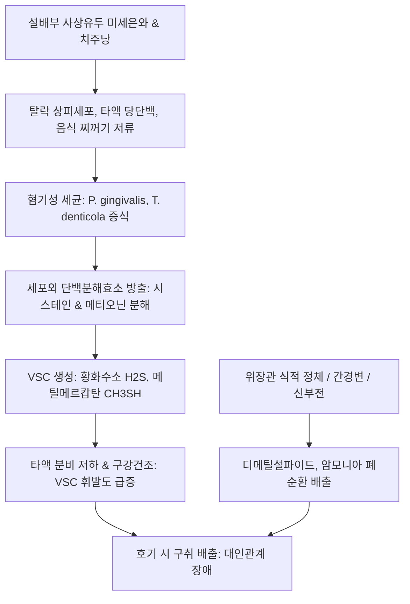

# 🩺 구취 (Halitosis, 口臭 / Oral Malodor)

> **핵심 3줄 요약 (Key Summary)**:
> - 📍 **정의 & 병태생리**: 구강 및 비강을 통해 호기(呼氣) 시 배출되는 불쾌한 악취. 구강 내 혐기성 세균총(*P. gingivalis*, *T. denticola*, *F. nucleatum*)이 설배부(혀 후방 1/3) 미세은와에서 함황 아미노산(시스테인, 메티오닌)을 분해하여 생성하는 휘발성 황화합물(VSC: 황화수소, 메틸메르캅탄, 디메틸설파이드)이 85~90%의 원인이다. 소화기 식적(食積) 및 간담습열(간성구취), 신부전(요독증 암모니아취) 등 전신 대사와도 직결된다.
> - 🚩 **임상 양상**: 자각적/타각적 구취, 구강 건조감, 끈적하고 두터운 설태(황니태), 상복부 팽만 및 트림, 신트림(신물 역류), 간기능 저하 시 달콤하고 퀴퀴한 간성 악취(Fetor hepaticus).
> - 🛠️ **치료 원칙**: 치주 스케일링 및 설태 세정기(Tongue scraper) 기계적 제거. 타액 분비 촉진(타액선 자극). 한의학적으로 위열치성(胃熱熾盛, [[청위산]], [[사위탕]]), 식적정체(食積停滯, [[보화환]], [[소달건비탕]]), 간담습열(肝膽濕熱, [[용담사간탕]], [[간담습열방]]) 변증 투여 및 [[대릉]](PC7), [[노궁]](PC8), [[족삼리]](ST36) 자침.
> - ⚠️ **응급 및 전신 감별 레드플래그**: 간경변·황달 동반 시 간성 뇌증 전조 간성구취(Fetor hepaticus) 감시; 과일향 아세톤 냄새 호기 시 당뇨병성 케톤산증(DKA) 즉시 응급 전원; 비린 암모니아 악취 시 말기 신부전 요독증 의심.

---

## 📌 목차
1. [질환 개요 & 해부학적 병태생리](#1-질환-개요--해부학적-병태생리)
2. [병태생리 메커니즘 & 구강 혐기성 세균 네트워크](#2-병태생리-메커니즘--구강-혐기성-세균-네트워크)
3. [임상 증상 & VSC 측정·이학적 검사 알고리즘](#3-임상-증상--vsc-측정이학적-검사-알고리즘)
4. [감별 진단 매트릭스 (Differential Diagnosis)](#4-감별-진단-매트릭스-differential-diagnosis)
5. [한의 통합 치료 프로토콜 (침·약침·한약)](#5-한의-통합-치료-프로토콜-침약침한약)
6. [양방 치료 & 치과 협진·원인 치료 기준 (Conventional Treatment & Referral)](#6-양방-치료--치과-협진원인-치료-기준-conventional-treatment--referral)
7. [구강 위생 관리 & 설태 관리 티칭 가이드](#7-구강-위생-관리--설태-관리-티칭-가이드)
8. [💡 사용자 진료실 핵심 필기 & 임상 노하우 (Melt-In 잔여 심화 집약)](#8-💡-사용자-진료실-핵심-필기--임상-노하우-melt-in-잔여-심화-집약)
9. [출처 및 학술 참고 문헌 (References)](#9-출처-및-학술-참고-문헌-references)

---

## 1. 질환 개요 & 해부학적 병태생리

### 1) 질환 정의 및 임상적 역학
- **구취(口臭, Halitosis)**: 생리적 또는 병리적 원인에 의해 구강, 비강 및 호흡기를 통해 타인에게 불쾌감을 주는 악취가 배출되는 상태를 말한다.
- 한의학에서는 《제병원후론(諸病源候論)》에서 구취(口臭), 구기(口氣), 구중예취(口中穢臭) 등의 병증으로 상세히 다루었으며, 주로 위장의 화열(胃熱), 음식물이 정체되어 부패한 식적(食積), 간담의 습열(肝膽濕熱), 그리고 허화(虛火)의 상충으로 파악하였다.
- 성인 인구의 약 25~30%가 일상생활에 지장을 초래할 정도의 만성 구취를 경험한다.
- **원인 분포**: 구강 내부(Oral causes) 85~90%, 이비인후과 질환(만성 부비동염, 편도결석) 8~10%, 소화기계 및 대사성 전신 질환(간경변, 신부전, 당뇨병성 케톤산증) 2~5%.

### 2) 해부학적 발생 부위: 설배부(Tongue Dorsum)와 치주낭
- **설배부 사상유두(Filiform papillae)**: 혀 후방 1/3 부위는 미세한 함몰 구릉(Crypts)을 형성하여 표면적이 넓고 산소 분압이 낮아 혐기성 세균이 서식하기에 최적의 환경이다.
- **치주낭(Periodontal pocket)**: 3mm 이상 깊어진 치주낭은 혐기성 세균의 온상이 되며 치은열구액 내 단백질을 지속 공급받는다.

---

## 2. 병태생리 메커니즘 & 구강 혐기성 세균 네트워크

### 1) 휘발성 황화합물(VSCs) 생성 생화학 기전
- 구강 내 혐기성 세균총(*Porphyromonas gingivalis*, *Treponema denticola*, *Tannerella forsythia*, *Fusobacterium nucleatum*)이 단백질 분해효소를 분비하여 아미노산을 분해한다:
  1. **황화수소 (H₂S, Hydrogen sulfide)**: 시스테인(Cysteine) 분해로 생성. 달걀 썩는 냄새. 설태 유래 구취의 주성분.
  2. **메틸메르캅탄 (CH₃SH, Methyl mercaptan)**: 메티오닌(Methionine) 분해로 생성. 썩은 양배추 악취. [[치주염]] 및 치주낭 유래 구취의 주성분.
  3. **디메틸설파이드 ((CH₃)₂S, Dimethyl sulfide)**: 전신성 혈액 순환 유래. 간부전(간경변) 시 호기로 배출.

### 2) VSC 생성 및 전신 연계 네트워크

---

## 3. 임상 증상 & VSC 측정·이학적 검사 알고리즘

### 1) 임상 증상
- 타각적 구취 및 자각적 구취, 구강 건조감, 혀 표면의 끈적거림 및 두꺼운 설태.
- 미각 이상(구고, 구산, 구담), 잦은 트림, 속쓰림, 소화불량.
- 가성 구취(Pseudohalitosis) 및 구취 공포증(Halitophobia) 동반 가능.

### 2) 객관적 평가 기준 SOP
1. **관능검사 (Organoleptic Measurement - Gold Standard)**:
   - 검사자 코 앞 10cm 거리에서 호기 배출 후 0~5점 척도 판정 (2점 이상 시 구취 유의).
2. **할리미터 (Halimeter)**: 총 VSC(ppb) 측정 (80~100 ppb 이상 시 유의).
3. **오랄크로마 (OralChroma)**: 가스 크로마토그래피 3대 가스 분리 정량:
   - H₂S > 112 ppb: 설태 유래
   - CH₃SH > 26 ppb: 치주염 유래
   - (CH₃)₂S > 8 ppb: 간담·소화기 전신 유래
4. **설진(舌診)**: Winkal Tongue Coating Index(WTCI) 설태 두께 및 색조(백태, 황니태) 평가.

---

## 4. 감별 진단 매트릭스 (Differential Diagnosis)

| 감별 질환 | 악취의 특징적 양상 | 원인 부위 및 주소증 | 감별 포인트 |
| :--- | :--- | :--- | :--- |
| **생리적/설태성 구취** | 달걀 썩는 냄새 (H₂S 주도) | 혀 후방 1/3 설태, 아침 기상 시 호발 | 혀 스크레이퍼 세정 후 즉각 수치 격감 |
| **[[치주염]] 유래 구취** | 썩은 양배추 냄새 (CH₃SH 주도) | 치은 출혈, 치주낭 형성, 치조골 흡수 | 치주낭 탐침 출혈(BOP), 방사선 치조골 소실 |
| **편도결석 (Tonsillolith)** | 극심한 하수구 부패취 | 인후부 이물감(매핵기), 기침 시 노란 알갱이 | 구두경 시진상 편도음와 내 백색/황색 결석 |
| **[[위식도 역류질환]] (GERD)** | 신물 냄새, 산성 산취(Acidic) | 가슴 쓰림, 앙와위 악화, 트림 | 위내시경상 미란성 식도염, PPI 반응 |
| **간성 구취 (Fetor hepaticus)** | 쥐 냄새 같은 달콤·퀴퀴한 냄새 | 황달, 복수, 만성 피로, 간경변 | 혈중 암모니아 상승, 오랄크로마 디메틸설파이드 |
| **요독성 구취 (Uremic fetor)** | 찌린내 같은 비린 암모니아 악취 | 신부전, 빈혈, 핍뇨, 전신 부종 | 혈청 BUN/Cr 상승, 사구체여과율(eGFR) 저하 |
| **가성 구취 / 구취 공포증** | 호기 가스 정상 (VSC < 50 ppb) | 강박적 양치질, 대인기피, 망상 | 객관적 가스 측정 정상, 심인성 인자 |

---

## 5. 한의 통합 치료 프로토콜 (침·약침·한약)

### 1) 변증별 한약 처방 프로토콜
1. **위열치성(胃熱熾盛)형**:
   - 주증: 입냄새가 매우 심하고 구갈, 치은 종통, 변비, 설홍태황조, 맥활삭.
   - 치법: 청위사화(淸胃瀉火).
   - 처방: [[청위산]](생지황, 당귀, 모란피, 황련, 승마) 또는 [[사위탕]].
2. **식적정체(食積停滯)형**:
   - 주증: 트림 시 썩은 음식 냄새(애부), 상복부 비만, 대변 부패취, 설태후니.
   - 치법: 소식도체(消食導滯), 건비화위.
   - 처방: [[보화환]](산사, 신곡, 반하, 복령, 진피, 연교, 라이복자) 또는 [[소달건비탕]].
3. **간담습열(肝膽濕熱)형**:
   - 주증: 구취와 함께 구고(입이 씀), 흉협창만, 황달 경향, 음주력, 맥현삭.
   - 치법: 청간이담(淸肝利膽), 청열이습.
   - 처방: [[용담사간탕]] 또는 [[간담습열방]](인진호, 치자, 대황, 시호, 황금, 울금 가미).
4. **허화상염 / 위음부족(胃陰不足)형**:
   - 주증: 만성 구취, 타액 분비 저하, 구강 건조, 설홍소태, 맥세삭.
   - 치법: 자음양위(滋陰養胃).
   - 처방: [[익위탕]](사삼, 맥문동, 생지황, 옥죽) 또는 [[생맥산]] 가미.

### 2) 침구 및 약침 치료
- **주치 혈위**:
  - [[대릉]](PC7): 손목 주름 위. 심포와 위의 화열을 사(瀉)하는 구취 요혈.
  - [[노궁]](PC8): 손바닥 제2-3 중수골 사이. 심포열 및 구강 염증 악취 진화.
  - [[족삼리]](ST36): 위기를 하강시키고 위장관 연동운동을 촉진하여 음식 정체 발효 억제.
  - 배합혈: [[내관]](PC6), [[염천]](CV23, 타액 분비 유도), [[합곡]](LI4), [[위수]](BL21).
- **황련해독탕 약침**:
  - [[염천]](CV23), [[풍지]](GB20), [[대릉]](PC7)에 혈위당 0.1~0.2 cc 주입.

---

## 6. 양방 치료 & 치과 협진·원인 치료 기준 (Conventional Treatment & Referral)

### 1) 치과적 1차 치료
- 치석 제거(Scaling) 및 치근활택술(Root planing): 치주낭 내 혐기성 바이오필름 박멸.
- 불량 보철물 교체 및 치아 우식 치료.

### 2) 구강 함수제 (Mouthwash)
- 클로르헥시딘(Chlorhexidine 0.12%): 단기간 강력한 살균(치아 착색 및 미각 변화로 2주 이내 사용).
- 염화아연(Zinc chloride) 및 이산화염소(Chlorine dioxide): VSC 가스와 결합하여 불활성화.

---

## 7. 구강 위생 관리 & 설태 관리 티칭 가이드

### 1) 올바른 설태 세정법 (Tongue Cleaning)
- 칫솔모로 혀를 세게 문지르면 사상유두에 미세 상처가 생겨 오히려 세균 증식이 촉진됨.
- 반드시 플라스틱 또는 금속제 **설태 스크레이퍼(Tongue cleaner)**를 사용하여 혀 후방 1/3에서 전방으로 가볍게 3~4회 긁어냄.

### 2) 타액 분비 촉진법
- 하루 1.5~2L 미온수 충분한 수분 섭취.
- 저작 운동(자일리톨 껌) 및 구강 체조, 금연 및 알코올 제한.

---

## 8. 💡 사용자 진료실 핵심 필기 & 임상 노하우 (Melt-In 잔여 심화 집약)

### 1) 소달건비탕과 간담습열방의 배오 묘미
- 단순 구강 위생 문제가 아니라, "곡달(穀疸)로 음식이 소화되지 않고 불능음식(不能飮食)하여 번심(煩心)하고 흉복창만(胸腹脹滿)하는 경우"에는 단순 구강 세척이 아닌 위장 내 식적과 습열을 근본적으로 쳐내는 **[[소달건비탕]]**의 배오가 탁월한 임상 효과를 발휘한다.
- 알코올 섭취력이 잦거나 알코올성 간염, 간경화, 간기능 수치(AST/ALT/GGT)가 상승되어 체내 메티오닌 및 황화합물 해독 대사가 저하된 환자에서 발생하는 전신성 악취(디메틸설파이드 호기 배출)에는 간담의 습열을 배출시키는 **[[간담습열방]]**을 최우선으로 투여하여 간장 미세담도 울체를 해소해야 한다.

### 2) 가성 구취 환자의 상담 접근법
- 오랄크로마나 할리미터 측정 결과 VSC 수치가 정상 이하인데도 "사람들이 나를 피한다"며 마스크를 벗지 못하는 환자는 가성 구취 또는 구취 공포증이다.
- "냄새가 전혀 안 난다"고 환자의 감각을 일방적으로 부정하면 라포가 깨지고 다른 병원을 전전하게 되므로, "현재 수치상 독성 가스는 정상으로 잘 억제되어 있으나, 스트레스로 인해 침이 마르고 입안이 텁텁한 신경성 감각 과민이 동반되어 있다"고 설명하며 [[가미소요산]]이나 [[귀비탕]]으로 심신을 안정시키는 치료를 병행해야 성공적으로 치료된다.

---

## 9. 출처 및 학술 참고 문헌 (References)

Xia Y. (2026). Halitosis and Helicobacter pylori Infection: A Systematic Review and Meta-Analysis. *JGH Open*. PMID: 42865798.

Eser S. (2026). Association between perceived stress and self-reported halitosis among university students: the mediating role of xerostomia, a cross-sectional study. *BMC Oral Health*. PMID: 42823683.

Boloș A. (2026). Halitosis: A Prospective Cohort Study Comparing Periodontal Debridement with Tongue Cleaning, Denture Biofilm Management, and Restorative Maintenance. *Dent J (Basel)*. PMID: 42782982.
