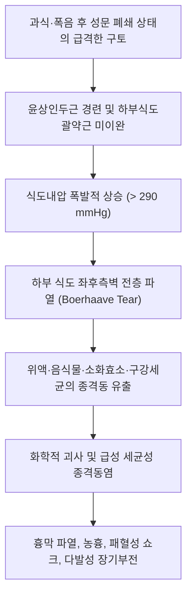

# 🩺 보어하베 증후군 (Boerhaave Syndrome / 特發性食道破裂, K22.3)

> **핵심 3줄 요약 (Key Summary)**:
> - 📍 **병소 부위 & 병태생리**: 원위부 하부 [[식도]]의 좌측 후외측벽(left posterolateral wall) 전층 파열(transmural rupture). 격렬한 구토 시 식도내압의 폭발적 상승으로 인해 식도 전층이 파열되어 위액, 소화효소, 구강 세균이 종격동([[종격]])으로 유출됨.
> - 🚩 **전형적 임상 양상 & 3대 징후**: **Mackler 삼징후**(Mackler's triad: 격렬한 구토 후 찢어지는 듯한 하부 흉통, 경부/흉부 피하기종), 호흡곤란, 종격동 염발음(Hamman 징후).
> - 🛠️ **핵심 감별 & 한·양방 치료 전략**: [[급성 심근경색증]], [[대동맥 박리]], [[급성 췌장염]], [[Mallory-Weiss 증후군]]과 응급 감별. 진단 즉시 절대 금식(NPO), 광범위 정맥 항생제 투여, 24시간 이내 외과적 개흉 일차 봉합술 또는 내시경적 스텐트 삽입술. 한의원 내원 즉시 119 응급 후송 대상(절대 진료 금기).
> - ⚠️ **응급 의뢰 레드플래그**: 구토 직후 발생하는 흉막성 흉통, 경부 피하기종(눈 밟는 소리), 청색증, 저혈압 및 패혈성 쇼크 징후 발현 시 1분 1초를 다투는 최응급 질환으로 즉시 상급종합병원 응급의료센터로 전원.

---

## 📌 목차
1. [질환 개요 & 병태생리 (Disease Overview)](#1-질환-개요--병태생리-disease-overview)
2. [병태생리 메커니즘 & 대사·장기부전 악순환 네트워크](#2-병태생리-메커니즘--대사장기부전-악순환-네트워크)
3. [임상 증상 & 환자 소견 (Clinical Presentation)](#3-임상-증상--환자-소견-clinical-presentation)
4. [감별 진단 매트릭스 (Differential Diagnosis)](#4-감별-진단-매트릭스-differential-diagnosis)
5. [한의 통합 치료 프로토콜 (침·약침·한약)](#5-한의-통합-치료-프로토콜-침약침한약)
6. [양방 치료 & 병용·의뢰 기준 (Conventional Treatment & Referral)](#6-양방-치료--병용의뢰-기준-conventional-treatment--referral)
7. [식이·생활습관 & 자가관리 티칭 가이드](#7-식이생활습관--자가관리-티칭-가이드)
8. [💡 진료실 핵심 필기 & 임상 노하우](#8--진료실-핵심-필기--임상-노하우)
9. [출처 및 학술 참고 문헌 (References)](#9-출처-및-학술-참고-문헌-references)

---

## 1. 질환 개요 & 병태생리 (Disease Overview)

* **질환 정의 및 분류**:
  * **보어하베 증후군**(Boerhaave Syndrome)은 주로 폭음이나 과식 후 유발된 격렬한 구토 및 헛구역질로 인해 하부 [[식도]] 벽이 **전층(transmural) 파열**되는 응급 질환이다. 1724년 네덜란드 의사 Hermann Boerhaave가 해군 제독의 부검 증례를 통해 처음 기술하였다.
  * 전체 [[식도 파열]] 및 천공의 약 15%를 차지하는 자발성 파열(spontaneous perforation) 형태이며, 내시경 시술 등으로 인한 의인성 천공과 구별된다.
  * 조기 진단 및 외과적 개입이 24시간 이내에 이루어지지 않으면 치명적인 종격동염(mediastinitis), 농흉(empyema), [[패혈증]] 및 다발성 장기부전으로 진행하여 사망률이 50%를 상회하는 대표적 흉부 응급 질환이다.
* **관련 장기 및 조직**:
  * **주 이환 부위**: [[위식도접합부]] 상방 2~3cm 지점의 원위부 하부 식도 좌측 후외측벽(left posterolateral wall).
  * **해부학적 취약점**: 하부 식도는 외막(adventitia)이 장막(serosa)으로 둘러싸여 있지 않고 결합조직으로만 이루어져 있어 장력에 취약하며, 좌측 후외측은 근육층 지지가 가장 얇고 주변 신경혈관 다발의 진입로로 인해 물리적 파열 저항력이 가장 낮다.
  * **이차 파급 장기**: [[종격]](종격동), 좌측 흉막강(흉막 유출액 및 기흉), 심낭(심낭기종).

---

## 2. 병태생리 메커니즘 & 대사·장기부전 악순환 네트워크

### 1) 분자·세포 수준 및 생체역학 기전
* 정상적인 구토 기전에서는 복강내압 상승과 함께 상부식도괄약근([[윤상인두근]])과 하부식도괄약근([[LES]])이 열려 구토물이 체외로 배출된다.
* 그러나 환자가 구토를 억제하려고 입이나 성문을 닫거나, 급격한 역류로 인해 윤상인두근의 반사적 수축이 동반된 상태에서 횡격막과 복벽근이 강력하게 수축하면 식도 내강이 '밀폐된 챔버(closed chamber)' 상태가 된다.
* 이때 식도 내압은 순간적으로 200~300 mmHg 이상까지 급상승하며, 이는 식도벽 탄성 한계(정상 파열 역치 약 150~200 mmHg)를 초과하게 된다.
* 식도 하부 1/3 지점 좌후측벽의 종주근 및 윤상근 다발이 찢어지면서 전층 파열(보통 2~10cm 길이의 세로 찢김)이 발생한다.

### 2) 종격동 감염 및 전신 패혈증 악순환
* 전층 파열 직후 강산성의 위액(pH 1~2), 펩신, 담즙산, 섭취된 음식물 찌꺼기가 음압(negative pressure) 상태인 종격동으로 급속히 흡입된다.
* 1단계: **화학성 종격동염(Chemical Mediastinitis)** — 산과 효소에 의한 종격동 결합조직, 림프관, 미세혈관의 광범위한 응고 괴사 및 심한 부종 발생.
* 2단계: **세균성 종격동염 및 농흉(Bacterial Mediastinitis & Empyema)** — 구강 및 상부 소화관 상재균(연쇄상구균, 포도상구균, 혐기성균인 *Bacteroides*, *Fusobacterium*, *Candida* 등)의 혼합 감염 발생.
* 3단계: **패혈성 쇼크(Septic Shock)** — 종격 흉막(mediastinal pleura)이 파열되면서 삼출액과 공기가 흉강으로 넘어가 기흉(pneumothorax) 및 농흉 유발, 전신 염증 반응 증후군(SIRS) 및 심근 저하, 다발성 장기부전 초래.

---

## 3. 임상 증상 & 환자 소견 (Clinical Presentation)

### 1) 주소증 및 핵심 증상
* **Mackler 삼징후(Mackler's Triad)**:
  1. *격렬한 구토(Vomiting)*: 발병 직전의 심한 헛구역질 또는 구토 병력(단, 20~30%는 구토 병력 없이 중량 들기, 기침, 배변 중 발생 가능).
  2. *극심한 흉통(Chest Pain)*: 명치 상부 또는 흉골 하부에서 시작하여 등(견갑골간 부위)이나 좌측 어깨로 방사되는 칼로 찢는 듯한 통증.
  3. *피하기종(Subcutaneous Emphysema)*: 파열된 식도에서 누출된 공기가 경부 근막을 따라 올라와 쇄골 상와 및 목 부위 피부 아래에 공기가 차는 현상.
* **호흡곤란 및 빠른 호흡(Tachypnea)**: 흉막 파열 및 흉막 삼출로 인한 폐 허탈.
* **연하곤란 및 삼킴통(Odynophagia)**: 침을 삼키기조차 불가능할 정도의 격통.

### 2) 객관적 소견 (Signs & Labs)
* **신체 진찰**:
  * **염발음(Crepitus)**: 목이나 앞가슴을 손가락으로 누르면 눈을 밟는 듯한 사각거리는 느낌 촉지.
  * **Hamman 징후(Hamman's Sign)**: 심장 청진 시 심박동 주기에 맞추어 종격동 내 공기와 액체가 마찰하면서 들리는 바스락거리는 기포 소리(crunching sound).
  * 활력징후: 빈맥(HR > 120회/분), 빈호흡, 저혈압(BP < 80/50 mmHg), 초기 정상 체온 또는 고열(발병 수시간 후).
* **영상 의학 검사**:
  * **단순 흉부 X-ray**: 종격동 기종(pneumomediastinum), 심낭 주변 공기 음영, 좌측 흉막 삼출, 좌측 기흉, 피하기종.
  * **흉부 전산화단층촬영([[흉부 CT]])**: 조영제를 사용한 흉부 CT는 식도 파열 부위, 종격동 농양, 흉막 삼출 범위를 확인하는 가장 정확한 표준 검사.
  * **수용성 조영 식도 조영술**: 가스트로그라핀(Gastrografin)을 복용시켜 식도 외강으로의 조영제 누출 확인(바륨은 종격동염을 악화시키므로 절대 금기).

---

## 4. 감별 진단 매트릭스 (Differential Diagnosis)

| 감별 질환 | 특징적 양상 | 감별 포인트 (검사·수치) |
| :--- | :--- | :--- |
| **[[보어하베 증후군]]** (본 질환) | 구토 직후 찢어지는 흉통, 경부 피하기종 | 흉부 CT상 종격동 기종, 식도 전층 파열, 수용성 조영제 누출 |
| **[[Mallory-Weiss 증후군]]** | 반복 구토 후 토혈, 경미한 심와부통 | 내시경상 점막 열상 국한, 흉부 X-ray/CT상 공기 누출 없음 |
| **[[급성 심근경색증]]** | 흉골 하부 쥐어짜는 압박통, 좌측 팔 방사 | 심전도(ST 분절 상승), 트로포닌(Troponin) 심근효소 상승 |
| **[[대동맥 박리]]** (Aortic Dissection) | 찢어지는 듯한 등 통증, 혈압 좌우 비대칭 | 조영 흉부 CT상 대동맥 내막판(intimal flap), 종격동 기종 없음 |
| **[[급성 췌장염]]** | 상복부 격통의 등 방사, 앞으로 굽히면 완화 | 혈청 아밀라아제/리파아제 3배 이상 상승, 복부 CT상 췌장 부종 |
| **자발성 긴장성 기흉** | 일측성 흉통 및 호흡곤란, 호흡음 소실 | 흉부 X-ray상 폐 허탈 관찰되나 종격동 기종 및 식도 파열 없음 |

> 🚩 **레드플래그 감별**: 보어하베 증후군은 초기 오진율이 50%에 달하며, 심근경색이나 췌장염으로 오진하여 시간을 지체할 경우 사망률이 기하급수적으로 증가한다.

---

## 5. 한의 통합 치료 프로토콜 (침·약침·한약)

*⚠️ **절대 주의 (Absolute Contraindication)**: 보어하베 증후군은 의심되는 순간 즉각적인 개흉 수술 또는 중재적 배액이 요구되는 초응급 외과 질환이므로, 급성기 일체의 한의원 단독 침·뜸·약침·한약 치료는 절대 금기이다.*

* **수술 후 안정화 및 회복기 (수술 수주~수개월 후) 한의 보조 관리**:
  * **비위허약 및 기혈양허 (외과 수술 후 소모성 상태)**:
    * 장기간 금식 및 중심정맥영양(TPN) 이후 경구 식이가 가능해진 시점에서 비위 소화기능을 북돋우기 위해 [[사군자탕]], [[보중익기탕]] 가미방 투여.
    * 흉곽 절개 부위 만성 신경통 및 늑간신경통 완화를 위한 침 치료: [[내관(PC6)]], [[외관(TE5)]], [[양릉천(GB34)]], 협척혈.
  * **식도 협착 및 연하곤란 후유증**:
    * 수술 부위 반흔으로 인한 연하 불편감 완화: [[중완(CV12)]], [[천돌(CV22)]], [[전중(CV17)]] 자침 및 온열 치료.

---

## 6. 양방 치료 & 병용·의뢰 기준 (Conventional Treatment & Referral)

> 🎯 **이 섹션의 목적**: 보어하베 증후군 환자의 골든타임(24시간) 확보와 패혈증 차단을 위한 표준 외과적 처치 과정을 이해하고, 한의원 1차 진료에서 즉각적인 119 응급 의뢰를 수행한다.

* **초기 응급 소생 처치**:
  * 절대 금식(NPO) 및 비위관(L-tube) 삽입 시도 자제(천공 부위 자극 위험).
  * 대용량 정맥 수액 투여 및 광범위 항생제 정주(3세대 세팔로스포린 + 메트로니다졸 또는 카바페넴 + 항진균제).
* **외과적 및 중재적 치료 원칙**:
  * **24시간 이내 조기 발견 시 (골든타임)**:
    * 개흉술 또는 흉강경하 일차 봉합술(Primary repair) 및 늑막강/종격동 세척·광범위 배액관 삽입.
    * 근육 피판(intercostal muscle flap)을 이용한 봉합선 보강.
  * **24시간 경과 후 지연 발견 시 (심한 종격동 괴사 및 오염)**:
    * 조직 부종과 괴사로 인해 일차 봉합이 불가능한 경우 식도 배제술(Esophageal exclusion), 경부 식도루 조성술, 위루술(Gastrostomy) 후 이차적 재건술 시행.
  * **내시경적 중재술 (선별된 환자)**:
    * 전신 상태가 불량한 환자에서 자가팽창형 피복 금속 스텐트(Covered SEMS) 삽입 및 흉강 배액술(Chest tube) 병용.
* **한의 병용 판단**:
  * 급성기: **전면 금기 (Absolute Contraindication)**.
  * 만성 후유증기: 수술 상처가 완치되고 식도 조영술상 완전 누출 폐쇄가 확인된 후 한의 기능 회복 치료 병용 가능.
* **양방·전문과 의뢰 기준 (Referral Criteria)**:
  * **즉시 119 응급 후송**:
    * 구토 후 흉골 뒤편이나 등 부위의 격렬한 흉통 호소 시.
    * 경부나 흉부 촉진 시 눈 밟는 소리(피하기종)가 느껴지는 경우.
    * 호흡곤란, 저혈압, 빈맥, 의식 혼미 등 패혈증 쇼크 징후.

---

## 7. 식이·생활습관 & 자가관리 티칭 가이드

* **급성기 식이**:
  * 완전 금식(물 한 모금도 마셔서는 안 됨). 물을 마실 경우 찢어진 식도를 통해 종격동으로 흘러들어가 즉각적인 심장 및 폐 감염 악화 초래.
* **수술 후 회복기 식이 단계**:
  * 조영 검사상 누출이 없음을 확인한 후: 맑은 물 → 맑은 미음 → 연식(죽) 단계로 수주에 걸쳐 서서히 진행.
  * 자극성 음식(맵고 짠 것), 산성 음료, 탄산, 건조하고 딱딱한 음식 절대 엄금.
* **생활습관 및 예방 티칭**:
  * **폭음 및 폭식 근절**: 위장관 내압 급상승을 막기 위해 과식과 과음을 피함.
  * **구토 억제 금지**: 구토가 올라올 때 입이나 코를 막고 억지로 참는 행위는 식도 내압을 치명적으로 높이므로 절대 금기.
  * **역류성 식도염의 적극적 치료**: 만성 식도 염증 환자는 식도벽 구조가 취약해질 수 있으므로 기저 질환 조기 치료.

---

## 8. 💡 진료실 핵심 필기 & 임상 노하우

* **문진 시 놓치지 말아야 할 결정적 단서**:
  * "어제 회식 후 술을 심하게 토했는데, 토하는 순간 가슴 한가운데나 왼쪽 가슴이 찢어지는 듯이 아프더니 숨쉬기가 힘들다."
  * 이 호소는 100명 중 99명이 급성 식도 파열 또는 대동맥 박리 같은 최악의 흉부 응급이다.
* **간이 신체 검진의 핵심 2가지**:
  1. *쇄골 상와(supraclavicular fossa) 촉진*: 양측 목덜미와 쇄골 위를 가볍게 눌렀을 때 뽁뽁이 비닐을 터뜨리는 듯한 피하기종 감각 확인.
  2. *흉부 청진*: 심장 소리를 들을 때 심장 박동에 맞추어 지직거리는 소리(Hamman crunch) 확인.
* **진료실 대처 원칙**:
  * 한의원 원내에서 혈압계로 저혈압을 확인하는 즉시 침대에 눕혀 산소 공급을 준비하고 119에 전화하여 "식도 파열 의심 환자로 종격동염 및 패혈증 위험이 있어 응급실 직행이 필요하다"고 명확히 인계한다.

---

## 9. 출처 및 학술 참고 문헌 (References)

1. **MSD 매뉴얼 전문가용** — [Boerhaave Syndrome](https://www.msdmanuals.com/professional/gastrointestinal-disorders/esophageal-and-swallowing-disorders/esophageal-rupture)

2. **Mela E et al. (2026)**. *Diagnostic Approach and Therapeutic Management of Spontaneous Esophageal Perforation (Boerhaave's Syndrome): A Systematic Review and Individual Patient-Level Pooled Analysis*. **J Clin Med**, 15(18):6021. [PMID 42795805](https://pubmed.ncbi.nlm.nih.gov/42795805/)
   - **[연구 요약]**: 자발성 식도 천공 환자의 조기 진단 접근법과 내시경적 스텐트 및 외과적 수술의 다기관 메타분석.

3. **Hauge T et al. (2026)**. *The current management of Boerhaave syndrome-a European multicenter case-vignette study*. **Dis Esophagus**, 39(5):doae045. [PMID 42732548](https://pubmed.ncbi.nlm.nih.gov/42732548/)
   - **[연구 요약]**: 유럽 다기관 임상 증례 연구를 통한 식도 전층 파열의 외과적 배액술 및 내시경 중재술 치료 표준 지침 분석.

4. **Predescu D et al. (2025)**. *Boerhaave Syndrome-Narrative Review*. **Diagnostics (Basel)**, 15(19):2410. [PMID 41095682](https://pubmed.ncbi.nlm.nih.gov/41095682/)
   - **[연구 요약]**: 보어하베 증후군의 임상 삼징후와 패혈증 쇼크 예방을 위한 진단 및 수술적 감압 최신 지견 리뷰.

---

## 관련 노트

- [[_의학/03_이론/질환/소화기 질환/01_구강·식도/식도 파열|식도 파열]]
- [[_의학/03_이론/질환/소화기 질환/01_구강·식도/Mallory-Weiss 증후군|Mallory-Weiss 증후군]]
- [[_의학/03_이론/질환/순환기 질환/관상동맥·허혈/급성 관상동맥 증후군|급성 관상동맥 증후군]]
- [[_의학/03_이론/질환/소화기 질환/99_기타/오심·구토 증후군|오심·구토 증후군]]
