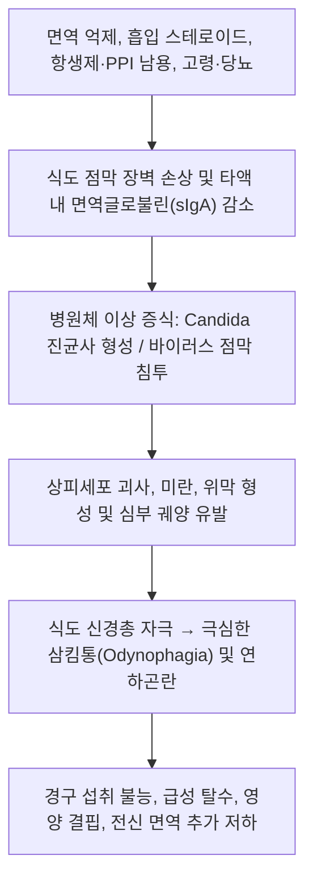

# 🩺 식도 감염 (Infectious Esophagitis / 感染性食道炎, K20)

> **핵심 3줄 요약 (Key Summary)**:
> - 📍 **병소 부위 & 병태생리**: [[식도]] 점막 상피층에 침범한 진균(주로 *Candida*), 바이러스(HSV, CMV), 세균 등에 의한 급·만성 감염성 염증. 면역 저하 또는 국소 방어벽 파괴로 인해 식도 점막에 위막 형성, 미란, 다발성 궤양 발생.
> - 🚩 **전형적 임상 양상 & 3대 징후**: 물이나 음식물을 삼킬 때 목구멍과 가슴 안쪽이 찢어지듯 아픈 **삼킴통**(연하통, odynophagia), **삼킴곤란**(연하곤란, dysphagia), 흉골 뒤쪽의 작열감 및 둔통.
> - 🛠️ **핵심 감별 & 한·양방 치료 전략**: [[역류성 식도염]], 약제 유발성 식도염, [[호산구성 식도염]], 식도암과 감별. 양방 내시경 생검 및 세포진 검사로 병원체 확진 후 표적 항진균제(플루코나졸) 또는 항바이러스제(아시클로버, 간시클로버) 투여. 한의 진료에서는 점막 염증 완화 및 면역 회복을 목표로 비위습열·음허화왕 변증 한약([[청위산]], [[황련해독탕]]) 및 침구 치료 병용.
> - ⚠️ **응급 의뢰 레드플래그**: 지속적인 통증으로 인한 완전한 연하 불능 및 심각한 탈수, 대량 토혈(궤양이 식도 혈관을 침범한 경우), 식도 천공 징후(갑작스러운 흉막통, 발열, 호흡곤란) 발생 시 즉시 상급병원 전원.

---

## 📌 목차
1. [질환 개요 & 병태생리 (Disease Overview)](#1-질환-개요--병태생리-disease-overview)
2. [병태생리 메커니즘 & 대사·장기부전 악순환 네트워크](#2-병태생리-메커니즘--대사장기부전-악순환-네트워크)
3. [임상 증상 & 환자 소견 (Clinical Presentation)](#3-임상-증상--환자-소견-clinical-presentation)
4. [감별 진단 매트릭스 (Differential Diagnosis)](#4-감별-진단-매트릭스-differential-diagnosis)
5. [한의 통합 치료 프로토콜 (침·약침·한약)](#5-한의-통합-치료-프로토콜-침약침한약)
6. [양방 치료 & 병용·의뢰 기준 (Conventional Treatment & Referral)](#6-양방-치료--병용의뢰-기준-conventional-treatment--referral)
7. [식이·생활습관 & 자가관리 티칭 가이드](#7-식이생활습관--자가관리-티칭-가이드)
8. [💡 진료실 핵심 필기 & 임상 노하우](#8--진료실-핵심-필기--임상-노하우)
9. [출처 및 학술 참고 문헌 (References)](#9-출처-및-학술-참고-문헌-references)

---

## 1. 질환 개요 & 병태생리 (Disease Overview)

* **질환 정의 및 분류**:
  * **식도 감염**(Infectious Esophagitis)은 다양한 병원체(진균, 바이러스, 세균 등)가 식도 점막을 침범하여 급성 또는 만성 염증, 궤양, 괴사를 일으키는 질환군이다.
  * 과거에는 주로 후천성면역결핍증(HIV/AIDS), 장기 이식 환자, 혈액암 환자 등 중증 면역저하자에서 주로 발생하였으나, 최근에는 천식·COPD 환자의 흡입용 스테로이드(ICS) 사용 증가, 광범위 항생제 남용, 만성 질환자 및 고령층 증가로 인해 **면역 정상 성인(immunocompetent hosts)**에서의 발병률도 꾸준히 보고되고 있다.
  * **주요 원인 병원체 분류**:
    1. *진균 감염*: **칸디다 식도염**(Candida esophagitis, *Candida albicans*가 약 80~90% 차지) — 가장 흔한 형태.
    2. *바이러스 감염*: **단순포진바이러스 식도염**(Herpes simplex virus, HSV-1), **거대세포바이러스 식도염**(Cytomegalovirus, CMV), 수두대상포진바이러스(VZV).
    3. *세균 및 기타*: 마이코박테리아(결핵성 식도염), 방선균(Actinomyces) 등(매우 드묾).
* **관련 장기 및 조직**:
  * **주 이환 부위**: [[식도]] 중하부 점막 상피(중층편평상피). 칸디다는 식도 전장에 걸쳐 미만성 백색 위막을 형성하며, HSV는 주로 중상부 식도의 다발성 소수포 및 화산 분화구양 얕은 궤양, CMV는 원위부 식도의 거대 선상 궤양을 특징으로 함.
  * **파급 합병증**: 심부 궤양에 의한 점막하 출혈, 식도 천공, 만성 염증 치유 후 반흔성 식도 협착.

![[식도감염_1_바륨조영술칸디다.png|450]]
> [그림 1: 이중조영 바륨 식도 조영술 — 식도 점막 전반에 불규칙한 플라크 모양 결손과 표면 거칠어짐이 다수 보이는 식도 칸디다증 소견 — 출처: Wikimedia Commons — File:Candida-Oesophagitis - Breischluck.jpg (CC BY-SA 4.0)]

![[식도감염_1_내시경백색삼출물.png|450]]
> [그림 2: 상부위장관 내시경 — 식도 점막에 백색 가성막(삼출물)이 광범위하게 부착되어 있고 주변 점막은 발적·부종을 보임(식도 칸디다증의 전형적 내시경 소견) — 출처: Wikimedia Commons — File:Esophageal Candidiasis2010.JPG (CC BY-SA 3.0)]

---

## 2. 병태생리 메커니즘 & 대사·장기부전 악순환 네트워크

### 1) 분자·세포 수준 기전
* **칸디다 식도염(Candida Esophagitis)**:
  * 정상적으로 *Candida albicans*는 구강 및 소화관의 정상 상재균(commensal)이나, 숙주의 세포 매개성 면역(T세포 기능) 저하나 국소 환경 변화 시 효모형(yeast)에서 병원성 균사형(hyphal form)으로 형태 전환을 일으킨다.
  * 균사는 식도 편평상피세포의 세포간극을 직접 뚫고 침습(thigmotropism)하며, 분비성 아스파르틸 단백분해효소(Saps)를 분비하여 각질 및 세포외 기질을 분해한다.
  * 이로 인해 탈락된 상피세포, 괴사 조직, 염증 세포, 진균 덩어리가 엉겨 붙어 특징적인 **백색 치즈양 위막(plaque)**을 형성한다.
* **바이러스성 식도염(Viral Esophagitis)**:
  * **HSV-1**: 식도 편평상피세포에 직접 침범하여 세포 팽창(ballooning degeneration), 핵내 봉입체(Cowdry A inclusions), 다핵 거대세포 형성을 유도하며, 표재성 수포가 터지면서 융기된 테두리를 가진 화산 분화구 형태의 궤양(punched-out ulcer)을 남긴다.
  * **CMV**: 상피세포가 아닌 점막하층의 **혈관 내피세포(endothelial cells) 및 간질 섬유아세포**에 주로 감염된다. 내피세포 부종과 혈관염을 유발하여 국소 허혈성 괴사를 일으키며, 이로 인해 깊고 넓은 선상 궤양(longitudinal ulcer)을 형성한다.

### 2) 장기·계통 수준 결과 및 악순환 고리
* 식도 점막 감각신경말단(A-delta 및 C 섬유)이 염증성 사이토카인과 위산에 직접 노출되어 침 한 모금을 삼킬 때도 극심한 흉골하 방사통을 유발한다.
* 삼킴통으로 인해 환자가 음식과 물 섭취를 완전히 거부하게 되면서 급격한 체중 감소, 탈수, 전해질 불균형이 초래된다.
* 영양 결핍은 숙주의 T세포 면역을 더욱 억제하여 기회감염의 전신 파급(칸디다혈증, 바이러스성 폐렴 등)을 촉진하는 악순환을 형성한다.

![[식도감염_2_칸디다PAS조직.png|450]]
> [그림 3: PAS 염색 조직 슬라이드 — 탈락한 편평상피세포 사이로 자주색으로 염색된 칸디다 가성균사와 효모형이 다수 관찰됨(진균 침습의 확진 소견) — 출처: Wikimedia Commons — File:Esophageal candidiasis (1) PAS stain.jpg (CC BY-SA 3.0)]

![[식도감염_2_헤르페스조직.png|450]]
> [그림 4: H&E 염색 조직 슬라이드(고배율) — 편평상피 내 호중구 침윤과 함께 핵이 뭉쳐 다핵화된 세포·봉입체가 보이는 헤르페스 식도염의 세포병변 — 출처: Wikimedia Commons — File:Herpes esophagitis - very high mag.jpg (CC BY-SA 3.0)]

---

## 3. 임상 증상 & 환자 소견 (Clinical Presentation)

### 1) 주소증 및 핵심 증상
* **연하통(삼킴통, Odynophagia)**: 식도 감염의 가장 특징적인 증상. 고형식뿐 아니라 물이나 침을 삼킬 때도 흉골 뒤쪽이 찌르듯 아픔(단순 역류성 식도염에 비해 통증이 훨씬 격렬함).
* **연하곤란(삼킴곤란, Dysphagia)**: 점막 부종, 위막에 의한 식도 내강 협소, 통증성 연하 반사 장애로 인해 음식물이 가슴에 걸리는 느낌.
* **흉골하 통증(Retrosternal Chest Pain)**: 삼킴과 무관하게 지속되는 흉골 뒤쪽의 타는 듯한 작열감 또는 둔통.
* **기타 동반 증상**: 아구창(구강 칸디다증, 단 구강 병변이 없어도 식도 칸디다증 단독 발생 가능 약 20~30%), 입술 헤르페스(HSV), 미열, 오심, 식욕부진.

### 2) 객관적 소견 (Signs & Labs)
* **내시경 소견 (Endoscopic Findings)**:
  * **칸디다**: 식도 점막에 단단히 부착된 다발성 백색 또는 황백색의 융기된 반점(plaque). 물로 세척해도 쉽게 떨어지지 않으며, 억지로 생검 겸자로 떼어내면 점막 출혈이 관찰됨.
  * **HSV**: 식도 중상부 점막의 직경 수 밀리미터 크기의 얕고 둥근 화산 분화구양 궤양(punched-out ulcer)과 충혈된 궤양 변연부.
  * **CMV**: 식도 하부 점막의 크고 깊은 지도상(geographic) 또는 장축 방향의 선상 궤양(linear ulcer).
* **조직병리 및 미생물학적 검사**:
  * **칸디다**: 내시경 솔세포진(brush cytology) 또는 생검 조직의 PAS(Periodic acid-Schiff) 및 GMS(Grocott's methenamine silver) 염색상 가성균사(pseudohyphae)와 효모 포자 관찰.
  * **HSV**: Tzanck 도말 검사 또는 생검상 핵내 Cowdry A 봉입체, 다핵 거대세포 관찰. 면역조직화학염색(IHC) 양성.
  * **CMV**: 거대 세포 내 전형적인 '올빼미 눈(Owl's eye)' 형태의 호염기성 핵내 봉입체 관찰.

### 3) 중증도 분류 (Kodsi's Candida Esophagitis Grade)
* **Grade I**: 2mm 미만의 소수 백색 반점, 부종이나 궤양 없음.
* **Grade II**: 2mm 이상의 다발성 백색 반점이 있으나 융합되지 않음.
* **Grade III**: 백색 반점이 서로 융합하여 선상 위막을 형성하고, 점막 충혈 및 궤양 동반.
* **Grade IV**: Grade III 소견에 더하여 식도 내강 전체를 덮는 두꺼운 위막과 내강 협착 동반.

---

## 4. 감별 진단 매트릭스 (Differential Diagnosis)

| 감별 질환 | 특징적 양상 | 감별 포인트 (검사·수치) |
| :--- | :--- | :--- |
| [[식도 감염]] (본 질환) | 극심한 삼킴통(Odynophagia), 백색 위막 또는 다발성 궤양 | 내시경 생검/세포진상 진균사, 바이러스 봉입체 확인 |
| [[역류성 식도염]] (GERD) | 가슴쓰림(Heartburn), 위산 역류, 앙와위 시 악화 | 내시경상 하부 식도 Z-line 점막 파괴, 감염균 음성 |
| **약제 유발성 식도염** | 특정 알약(독시사이클린, NSAIDs, 철분) 복용 후 급성 통증 | 중부 식도 압박 부위의 국소적 급성 단일 궤양, 투약력 |
| [[호산구성 식도염]] (EoE) | 젊은 아토피 환자의 음식물 걸림(food impaction) | 내시경상 윤상 주름(trachealization), 조직상 호산구 ≥15/HPF |
| **식도암 (Esophageal Cancer)** | 고령, 흡연자의 진행성 삼킴곤란, 체중 감소 | 내시경상 외장성 종괴 및 궤양, 악성 편평상피세포 확인 |

> 🚩 **레드플래그 감별**: CMV 식도염이나 심부 궤양성 감염은 식도벽 전층 괴사를 일으켜 [[식도 파열]] 및 대량 출혈을 초래할 수 있으므로 조기 감별이 필수적이다.

---

## 5. 한의 통합 치료 프로토콜 (침·약침·한약)

*한의 치료는 양방 표적 항진균·항바이러스 치료와 병용하여 식도 점막 염증을 신속히 완화하고, 전신 면역기능을 북돋워 재발을 방지하는 통합 치료로 접근한다.*

### 1) 변증 분류
* **비위습열증(脾胃濕熱證)**: 구강 및 식도 백태 위막, 심한 작열감, 구취, 갈증, 소변단적, 설홍태황니, 맥활삭.
* **열독옹성증(熱毒壅盛證)**: 궤양성 통증 격심, 음식물 삼킴 불능, 발열, 인후 종통, 설홍강, 맥규삭.
* **음허화왕증(陰虛火旺證)**: 만성 경과, 구갈인건(구강 건조), 도한, 미열, 설홍소태, 맥세삭.
* **비기허약증(脾氣虛弱證)**: 잦은 감염 재발, 식욕 부진, 만성 피로, 소화불량, 설담태백, 맥세약.

### 2) 침구 치료 (Acupuncture)
* **주혈**: [[천돌(CV22)]], [[전중(CV17)]], [[내관(PC6)]], [[족삼리(ST36)]], [[합곡(LI4)]].
* **배혈**:
  * 습열 및 열독: [[곡지(LI11)]], [[척택(LU5)]], [[내정(ST44)]], [[어제(LU10)]].
  * 음허 및 진액 부족: [[태계(KI3)]], [[삼음교(SP6)]], [[조해(KI6)]].
* **자침 기법**:
  * 천돌혈: 흉골 후면을 향해 0.5~0.8촌 사자하여 식도 주변 신경총의 과민반응을 안정시키고 삼킴통 완화.
  * 내관-합곡 배혈로 상초 열독을 청포(淸泄)하고 통증 완화.

### 3) 약침 치료 (Pharmacopuncture)
* **적용 혈위**: [[천돌(CV22)]], [[전중(CV17)]], [[풍지(GB20)]].
* **제제 선택**:
  * 황련해독탕 약침: 강력한 소염, 항균 및 항바이러스 보조 작용을 위해 천돌 및 전중에 각 0.1~0.2cc 주입.
  * 신문혈 또는 대릉혈 약침: 자율신경 조절을 통한 식도 평활근 경련 완화.

### 4) 한약 치료 (Herbal Medicine)
* **습열 및 열독성 급성기 (염증 완화 및 위막 제거)**:
  * [[청위산]] 또는 [[황련해독탕]] 가감방: 황련, 황금, 치자, 승마, 목단피, 현삼을 배합하여 식도 점막의 열독을 제거.
  * **감길탕(甘桔湯) 함수 복용**: 감초, 길경 전탕액을 천천히 머금고 있다가 삼키게 하여 식도 국소 점막 항염증 및 진통 효과 극대화.
* **점막 수렴 및 궤양 치유**:
  * 백급(白芨), 삼칠근(三七根), 연교(連翹)를 가미하여 궤양면의 육아조직 증식과 상피 재생 촉진.
* **만성 면역 저하 및 재발 방지 (회복기)**:
  * [[보중익기탕]] 또는 **생맥산**: T세포 면역을 증강시키고 타액 및 점액 분비를 회복시켜 기회감염 재발 차단.

---

## 6. 양방 치료 & 병용·의뢰 기준 (Conventional Treatment & Referral)

> 🎯 **이 섹션의 목적**: 원인 병원체에 따른 정확한 양방 1차 항미생물 약물 요법을 파악하고, 한의 치료와의 병용 안전성 및 상호작용을 평가한다.

* **원인 병원체별 표준 약물 치료 (Medication)**:
  * **칸디다 식도염(Candida)**:
    * 1차 선택: 경구 **플루코나졸(Fluconazole)** 200~400mg 초기 투여 후 100~200mg/일, 총 14~21일간 투여(삼킴통이 심해 경구 복용 불가 시 정맥 투여).
    * 플루코나졸 내성 시: 보리코나졸(Voriconazole) 또는 에키노칸딘계(Echinocandins: 카스포펀진, 아니둘라펀진) 정맥 투여.
  * **HSV 식도염**:
    * 면역 정상군: 대개 1~2주 내 자연 호전되나 증상 단축을 위해 경구 **아시클로버(Acyclovir)** 400mg 1일 5회 또는 발라시클로버(Valacyclovir) 1g 1일 3회 7~14일 투여.
    * 면역 저하군: 아시클로버 정맥 투여(5mg/kg 8시간마다).
  * **CMV 식도염**:
    * 정맥 **간시클로버(Ganciclovir)** 5mg/kg 12시간마다 2~3주간 투여, 이후 경구 발간시클로버(Valganciclovir) 900mg/일로 전환.
* **한의 병용 판단 (Combination Therapy)**:
  * **병용 권장**: 양방 항진균제(플루코나졸) 복용 중 한약(감길탕, 황련해독탕) 병용은 식도 점막의 부종과 통증을 훨씬 빠르게 진정시키며, 플루코나졸의 간기능 부담을 상쇄하기 위한 보간건비 한약 병용이 안전하게 가능함.
  * **주의**: 아졸계 항진균제는 간 대사효소(CYP3A4) 억제제이므로 다른 양약과의 약물 상호작용 주의 깊게 모니터링.
* **양방·전문과 의뢰 기준 (Referral Criteria)**:
  * **상급병원 내과/소화기내과 의뢰**:
    * 심한 삼킴통으로 인해 물조차 삼키지 못하여 급성 탈수가 발생한 경우(수액 및 정맥 항진균제 투여 필요).
    * 경구 플루코나졸 치료 72시간 후에도 증상 호전이 전혀 없거나 악화되는 경우(내성균주 또는 바이러스 중복 감염 확인을 위한 내시경 재검 필요).
    * 면역 저하자(HIV 감염인, 항암치료 중)에서 발생한 경우.
    * 흉통이 급격히 심해지고 발열 및 호흡곤란이 동반되는 경우(식도 천공 배제 필요).

---

## 7. 식이·생활습관 & 자가관리 티칭 가이드

* **식이 지도 (Diet)**:
  * **급성기 식이**: 거칠거나 딱딱한 음식(견과류, 튀김, 마른오징어 등)은 상처 난 식도 점막을 직접 긁어 궤양을 악화시키므로 전면 금지.
  * **유동식 위주 섭취**: 식도 자극을 최소화하기 위해 차갑거나 미지근한 미음, 스프, 연두부, 바나나 스무디 등 부드러운 유동식 섭취.
  * **온도 조절**: 뜨거운 국물이나 차는 식도 통증을 유발하므로 실온으로 식혀서 섭취.
  * **자극원 차단**: 고춧가루, 후추, 마늘 등 매운 양념, 레몬/식초 등 산성 음식, 탄산음료, 알코올 엄격 제한.
* **생활습관 (Lifestyle)**:
  * **흡입용 스테로이드(ICS) 사용 후 관리**: 천식 환자는 스테로이드 흡입기 사용 직후 **반드시 물로 입안과 목구멍을 3회 이상 헹구고 뱉어내도록** 철저히 교육(칸디다 식도염 발생의 1위 원인 차단).
  * **구강 위생 강화**: 식후 부드러운 칫솔질 및 무알코올 구강청결제 사용, 틀니 사용자는 매일 밤 틀니 세척 및 항진균 소독 시행.
  * **충분한 수분 섭취**: 탈수를 예방하기 위해 미지근한 물을 빨대를 사용하여 소량씩 자주 마시기.
* **환자 교육 스크립트**:
  * *"목구멍과 가슴 안쪽이 찢어지듯 아파 침도 삼키기 힘드신 이유는 식도 표면에 곰팡이균이나 바이러스가 번식해 상처와 궤양을 만들었기 때문입니다. 병원에서 처방해드린 약을 거르지 않고 복용하시는 것이 가장 중요하며, 식사는 뜨겁거나 맵지 않은 부드러운 죽이나 미음으로 드셔야 합니다. 천식 흡입기를 쓰시는 분이라면 흡입 후 반드시 물로 입과 목을 깨끗이 헹궈내셔야 재발을 막을 수 있습니다."*

---

## 8. 💡 진료실 핵심 필기 & 임상 노하우

* **문진 시 핵심 감별 포인트**:
  * "가슴이 쓰린가요, 아니면 삼킬 때 아픈가요?"
  * 단순 [[역류성 식도염]] 환자는 주로 '가슴쓰림(Heartburn)'이나 '신물 올라옴'을 호소하지만, 식도 감염 환자는 열에 아홉이 **'삼킬 때 아프다(Odynophagia)'**고 명확히 표현한다.
  * 삼킴통(Odynophagia)이 주소증이라면 GERD보다 감염성 식도염이나 약제성 식도염을 1순위로 의심해야 한다.
* **비전형적 환자군 주의**:
  * 최근 젊은 성인에서 다이어트, 과로, 헬스 보충제 남용, 잦은 항생제 복용 후 발생한 칸디다 식도염이 증가하고 있다. HIV 환자가 아니라고 해서 진균성 식도염을 배제해서는 안 된다.
* **감길탕(甘桔湯) 함수법의 임상 묘미**:
  * 양방 플루코나졸을 투여해도 점막의 심한 삼킴통은 수일간 지속된다. 이때 길경 12g, 감초 8g을 진하게 달여 냉장 보관한 뒤, 한 모금씩 입에 머금어 식도를 적시며 천천히 삼키게 하면 국소 소염 및 국소 마취 유사 진통 효과로 환자의 식사 순응도가 극적으로 개선된다.

---

## 9. 출처 및 학술 참고 문헌 (References)

1. **MSD 매뉴얼 전문가용** — [Infectious Esophagitis](https://www.msdmanuals.com/professional/gastrointestinal-disorders/esophageal-and-swallowing-disorders/infectious-esophagitis)

2. **Papantoniou K et al. (2026)**. *Fungal Esophagitis: Molecular Insights Into Pathogenesis and Emerging Antifungal Strategies*. **Front Biosci (Landmark Ed)**, 31(8):50241. [PMID 42689972](https://pubmed.ncbi.nlm.nih.gov/42689972/)
   - **[연구 요약]**: 진균성 식도염의 분자생물학적 병태생리, 진균 피막 형성 및 최신 항진균 치료 전략 리뷰.

3. **Yu HH et al. (2026)**. *Herpes simplex virus esophagitis in immunocompetent patients: a case report and updated literature review*. **Int J Surg Case Rep**, 138(7):2566-2573. [PMID 42416414](https://pubmed.ncbi.nlm.nih.gov/42416414/)
   - **[연구 요약]**: 면역 정상 성인에서 발생한 단순포진바이러스 식도염의 내시경 소견과 항바이러스제 치료 반응 분석.

4. **Telbany A et al. (2026)**. *Candida Esophagitis in Patients with Solid Organ Cancers*. **J Clin Med**, 15(4):1120. [PMID 41753163](https://pubmed.ncbi.nlm.nih.gov/41753163/)
   - **[연구 요약]**: 고형암 환자군에서 발생하는 칸디다 식도염의 임상적 위험인자, 중증도 평가 및 경구 플루코나졸 치료 반응 분석.

---

## 관련 노트

- [[_의학/03_이론/질환/소화기 질환/01_구강·식도/호산구성 식도염|호산구성 식도염]]
- [[_의학/03_이론/질환/소화기 질환/01_구강·식도/Mallory-Weiss 증후군|Mallory-Weiss 증후군]]
- [[_의학/03_이론/질환/소화기 질환/01_구강·식도/보어하베 증후군|보어하베 증후군]]
- [[_의학/03_이론/질환/소화기 질환/01_구강·식도/식도 파열|식도 파열]]
