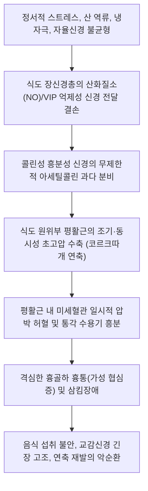

# 🩺 식도 연축 (Esophageal Spasm / 食道痙攣, K22.4)

> **핵심 3줄 요약 (Key Summary)**:
> - 📍 **병소 부위 & 병태생리**: [[식도]] 원위부 평활근층의 장신경계(Myenteric plexus) 기능부전. 산화질소(NO) 분비 결손으로 인한 억제성 신경 신호 결여로 비협조적이고 자발적이며 고압성의 동시 다발적 평활근 연축(비추진성 조기 수축) 발생.
> - 🚩 **전형적 임상 양상 & 3대 징후**: [[협심증]]과 유사한 흉골하 쥐어짜는 듯한 비심장성 흉통(Non-cardiac chest pain), 고형식과 액체 모두에서 발생하는 간헐적 [[삼킴곤란]](연하곤란), 찬물 섭취나 정서적 스트레스 시 유발되는 급성 연축 발작.
> - 🛠️ **핵심 감별 & 한·양방 치료 전략**: [[급성 관상동맥 증후군]], [[식도 이완불능증]], [[위식도 역류 질환]]과 감별. 양방 고해상도 식도 내압검사([[HRM]])를 통한 조기 수축(DL < 4.5초) 확인, 칼슘채널차단제([[CCB]]) 및 질산염 투여. 한의 진료에서는 간기울결·기체혈어 변증 한약([[작약감초탕]], [[반하후박탕]], [[시호소간산]]) 및 침구 치료를 통한 평활근 진경(spasmolysis)과 내장 과민성 안정.
> - ⚠️ **응급 의뢰 레드플래그**: 심근경색을 시사하는 방사통(턱, 좌측 팔), 식은땀, 호흡곤란 동반 시 심장 응급(ECG, Troponin) 우선 배제 필수; 지속적인 연하 불능으로 인한 체중 감소 및 탈수 시 상급병원 의뢰.

---

## 📌 목차
1. [질환 개요 & 병태생리 (Disease Overview)](#1-질환-개요--병태생리-disease-overview)
2. [병태생리 메커니즘 & 대사·장기부전 악순환 네트워크](#2-병태생리-메커니즘--대사장기부전-악순환-네트워크)
3. [임상 증상 & 환자 소견 (Clinical Presentation)](#3-임상-증상--환자-소견-clinical-presentation)
4. [감별 진단 매트릭스 (Differential Diagnosis)](#4-감별-진단-매트릭스-differential-diagnosis)
5. [한의 통합 치료 프로토콜 (침·약침·한약)](#5-한의-통합-치료-프로토콜-침약침한약)
6. [양방 치료 & 병용·의뢰 기준 (Conventional Treatment & Referral)](#6-양방-치료--병용의뢰-기준-conventional-treatment--referral)
7. [식이·생활습관 & 자가관리 티칭 가이드](#7-식이생활습관--자가관리-티칭-가이드)
8. [💡 진료실 핵심 필기 & 임상 노하우](#8--진료실-핵심-필기--임상-노하우)
9. [출처 및 학술 참고 문헌 (References)](#9-출처-및-학술-참고-문헌-references)

---

## 1. 질환 개요 & 병태생리 (Disease Overview)

* **질환 정의 및 분류**:
  * **식도 연축**(Esophageal Spasm)은 정상적인 식도의 순차적 연동운동(peristalsis)이 소실되고, 불규칙하고 동시다발적이며 비정상적으로 강한 평활근 수축이 유발되는 식도 운동성 질환군이다.
  * 시카고 분류 v4.0(Chicago Classification v4.0) 기준에 따른 주요 아형:
    1. **원위부 식도 연축**(Distal Esophageal Spasm, DES / 과거 미만성 식도 연축 Diffuse Esophageal Spasm): 정상 원위부 연동 수축 지연 시간(Distal Latency, DL)이 4.5초 미만인 조기 수축(premature contractions)이 물 삼킴의 20% 이상 관찰되는 질환.
    2. **과수축성 식도**(Hypercontractile Esophagus / 잭해머 식도 Jackhammer Esophagus, 호두까기 식도 Nutcracker Esophagus): 원위부 수축 적분치(DCI)가 8,000 mmHg·s·cm를 초과하는 극단적인 초고압 연동 수축이 물 삼킴의 20% 이상 관찰되는 질환.
* **관련 장기 및 조직**:
  * **주 이환 부위**: [[식도]] 원위부 2/3 평활근층(smooth muscle segment) 및 [[위식도접합부]](하부식도괄약근).
  * **신경 조절계**: 미주신경 배측핵(DMN) 및 식도 근층간신경총([[아우에르바흐 신경총]], Auerbach's plexus) 내 억제성 개재신경원.

---

## 2. 병태생리 메커니즘 & 대사·장기부전 악순환 네트워크

### 1) 분자·세포 수준 기전
* 정상적인 식도 연동운동은 수축파 앞서 식도 평활근이 먼저 이완되는 '탈분극 억제(deglutitive inhibition)' 과정이 필수적이며, 이는 근층간신경총에서 분비되는 **산화질소(Nitric Oxide, NO)**와 혈관활성장펩타이드([[VIP]])에 의해 매개된다.
* 식도 연축 환자에서는 억제성 질소산화물(nitrergic) 경로의 변성 또는 국소 효소(nNOS) 발현 저하로 인해 억제 신호가 차단된다.
* 그 결과, 무스카린성 콜린 수용체(M2, M3)를 통한 아세틸콜린([[ACh]])의 흥분성 자극이 길항되지 않고 과도하게 작용하여 칼슘 이온(Ca2+)이 평활근 세포 내로 대량 유입된다.
* 정상적인 하행성 전파 지연 시간(Latency)이 단축되어 식도 상하부가 동시에 수축하거나, 수축압이 정상의 수배(DCI > 8,000 mmHg·s·cm)에 이르는 과수축이 일어난다.

### 2) 생체역학적 결과 및 내장 과민성
* 식도 내강이 여러 분절에서 동시에 꽉 조여지면서 식도 조영술상 '코르크따개(corkscrew)' 또는 구슬 목걸이 형태의 폐쇄 분절이 형성된다.
* 음식물이 위장으로 내려가지 못하고 내강에 갇히게 되며, 내강 압력 상승과 국소 평활근 허혈로 인해 C-신경섬유가 격렬히 자극받아 흉골하 통증이 뇌로 전달된다.
* 중추신경계 수준에서 척수 후각 뉴런의 중추 감작(central sensitization)이 유발되어 경미한 식도 팽창이나 정상적인 위산 역류에도 극심한 통증을 느끼는 **식도 내장 과민성(esophageal visceral hypersensitivity)**이 고착화된다.

---

## 3. 임상 증상 & 환자 소견 (Clinical Presentation)

### 1) 주소증 및 핵심 증상
* **비심장성 흉통(Non-Cardiac Chest Pain, NCCP)**:
  * 흉골 후면의 쥐어짜는 듯하거나 타는 듯한 압박통으로, 등(견갑골간), 목, 턱, 좌측 팔로 방사되어 [[협심증]]과 임상적으로 구별이 매우 어려움.
  * 식사와 무관하게 안정 시나 야간 수면 중에도 돌발적으로 발생할 수 있음.
* **간헐적 삼킴곤란([[삼킴곤란]]/Dysphagia)**:
  * 기계적 협착과 달리 **고형식과 액체(물) 모두에서 동시에** 발생하며, 증상이 매일 지속되기보다는 컨디션, 스트레스, 음식 온도에 따라 간헐적으로 나타남.
* **온도 민감성**: 차가운 물이나 얼음 음료를 마실 때 급격한 연축과 흉통이 유발되는 특징.
* **음식물 역류 및 질식감**: 연축 부위 상방에 정체된 음식물이 위산 냄새 없이 그대로 구강으로 역류.

### 2) 객관적 소견 (Signs & Labs)
* **신체 진찰**:
  * 연축 발작이 없는 안정 시 신체 진찰 및 복부 진찰 소견은 완전히 정상.
  * 발작 시 극심한 통증으로 인한 창백, 발한, 빈맥 관찰 가능.
* **핵심 기능 검사**:
  * **고해상도 식도 내압검사([[HRM]])**: 확진 표준 검사.
    * 원위부 연축: 정상 LES 이완압(IRP 정상) 하에서 조기 수축(DL < 4.5초)이 20% 이상.
    * 잭해머 식도: DCI > 8,000 mmHg·s·cm 이상인 고압 수축이 20% 이상.
  * **바륨 식도 조영술**: 식도 내강이 불규칙하게 조여진 **코르크따개 식도(Corkscrew esophagus)** 또는 톱니바퀴양 음영 관찰.
  * **상부위장관 [[내시경 검사]]**: 기계적 협착, 종양, [[역류성 식도염]], [[호산구성 식도염]] 배제 목적.

---

## 4. 감별 진단 매트릭스 (Differential Diagnosis)

| 감별 질환 | 특징적 양상 | 감별 포인트 (검사·수치) |
| :--- | :--- | :--- |
| **[[식도 연축]]** (본 질환) | 찬물/스트레스 시 흉골하 쥐어짜는 통증, 간헐적 연하곤란 | HRM상 DL < 4.5초 또는 DCI > 8000, 조영술상 코르크따개 모양 |
| **[[급성 관상동맥 증후군]]** | 운동 시 악화, 휴식/니트로글리세린 완화 | 심전도(ST-T 변화), Troponin 상승, 관상동맥 조영술 협착 |
| **[[식도 이완불능증]]** | 진행성 연하곤란, 체중 감소, 무조건적 역류 | HRM상 IRP 상승(이완 부전), 연동운동 소실, 새부리 징후(Bird's beak) |
| **[[위식도 역류 질환]]** | 식후 속쓰림, 산 역류, 앙와위 시 악화 | 24시간 식도 산도 검사상 산 노출 시간(AET) 증가, PPI 반응 양호 |
| **[[호산구성 식도염]]** | 젊은 아토피 병력자의 음식물 걸림 | 내시경상 윤상 주름(트라케아화), 생검상 호산구 ≥15/HPF |

> 🚩 **레드플래그 감별**: 니트로글리세린(NTG) 복용 시 식도 평활근 이완으로 인해 식도 연축 환자의 흉통도 완화될 수 있으므로, 약물 반응만으로 협심증을 배제해서는 절대 안 된다. 반드시 심장 효소 및 심전도 검사가 선행되어야 한다.

---

## 5. 한의 통합 치료 프로토콜 (침·약침·한약)

*한의 치료는 자율신경계 긴장을 완화하여 식도 평활근의 이상 경련을 진정시키고, 내장 과민성을 낮추며, 스트레스 매개 악순환을 차단하는 데 매우 우수한 효과를 보인다.*

### 1) 변증 분류
* **간기울결증(肝氣鬱結證)**: 정서적 억울, 스트레스 후 발작하는 흉통 및 목에 무언가 걸린 느낌([[매핵기]]), 한숨, 설박태, 맥현.
* **기체혈어증(氣滯血瘀證)**: 흉골 뒤쪽이 칼로 찌르거나 쥐어짜듯 고정된 부위의 격통, 야간 악화, 설자암 혹은 어점, 맥현삽.
* **비허습담증(脾虛濕痰證)**: 흉완비민, 헛구역질, 소화불량, 묽은 가래 역류, 설담태백니, 맥활.

### 2) 침구 치료 (Acupuncture)
* **주혈**: [[내관(PC6)]], [[공손(SP4)]], [[전중(CV17)]], [[중완(CV12)]], [[태충(LR3)]].
* **배혈**:
  * 흉통 및 흉민 심할 때: [[극문(PC4)]](수궐음심포경의 극혈로 급성 흉통 요혈), [[격수(BL17)]], [[심수(BL15)]].
  * 연하곤란 및 인후 이물감: [[천돌(CV22)]], [[염천(CV23)]], [[조해(KI6)]].
  * 자율신경 과민 완화: [[백회(GV20)]], [[신문(HT7)]].
* **자침 기법**:
  * 극문혈 강자극 사법: 급성 연축성 흉통 발작 시 평활근 이완 유도.
  * 내관-태충 배혈로 간기(肝氣)를 소통시키고 평활근 연축 차단.

### 3) 약침 치료 (Pharmacopuncture)
* **적용 혈위**: [[전중(CV17)]], [[중완(CV12)]], [[격수(BL17)]].
* **제제 선택**:
  * 중성어혈 약침: 흉부 근막 긴장 및 국소 미세혈류 정체 해소 목적으로 혈위당 0.1~0.2cc 주입.
  * 황련해독탕 약침: 상초 화열(火熱) 완화 및 교감신경 흥분 억제.

### 4) 한약 치료 (Herbal Medicine)
* **평활근 진경 및 근긴장 완화 (1순위 처방)**:
  * **[[작약감초탕]]**: 백작약 20~30g, 감초 10~15g. 백작약의 파에오니플로린(Paeoniflorin)과 감초의 글리시리진(Glycyrrhizin) 성분이 칼슘 유입을 억제하고 평활근을 직접 이완시켜 급성 식도 연축 발작을 진정시킴.
* **스트레스성 연하곤란 및 매핵기 동반**:
  * **[[반하후박탕]]**: 반하, 후박, 복령, 생강, 소엽. 식도 과민성을 억제하고 위기역상을 강기(降氣)시킴.
* **간기울결 및 흉협창통**:
  * **[[시호소간산]]** 또는 **사역산**: 소간해울(疏肝解鬱), 평활근 운동 조화.

---

## 6. 양방 치료 & 병용·의뢰 기준 (Conventional Treatment & Referral)

> 🎯 **이 섹션의 목적**: 관상동맥 질환 배제 후 적용되는 양방 약물 요법(평활근 이완제, 내장 진통제)의 기전과 부작용을 이해하고 한의 치료와의 최적 병용 시점을 결정한다.

* **약물 치료 (Medication)**:
  * **칼슘채널차단제([[CCB]])**:
    * 딜티아젬(Diltiazem) 30~60mg 식전 30분 복용 또는 니페디핀(Nifedipine).
    * 식도 평활근 세포 내 칼슘 유입을 차단하여 수축 진폭 감소.
  * **질산염 제제(Nitrates)**:
    * 이소소르비드(Isosorbide dinitrate) 5~10mg 설하 투여.
    * 산화질소(NO)를 직접 공여하여 세포 내 cGMP를 증가시켜 급성 연축 이완(두통, 저혈압 부작용 주의).
  * **항우울제 (통증 조절 및 내장 감작 억제)**:
    * 저용량 삼환계 항우울제(TCA, 이미프라민 10~25mg) 또는 SSRI/SNRI.
    * 항우울 목적이 아닌 식도 감각신경의 내장 과민성(Visceral hypersensitivity) 차단 목적.
  * **포스포디에스테라제-5 억제제(PDE-5 inhibitors)**:
    * 실데나필(Sildenafil) 25~50mg: cGMP 분해 억제를 통해 평활근 이완 유도.
* **내시경 및 수술적 치료 (난치성 환자)**:
  * **보툴리눔 독소 국소 주사(Botox injection)**: 식도 체부 연축 부위에 내시경하 보톡스를 주입하여 아세틸콜린 분비 차단(효과는 6~12개월 지속).
  * **구강내시경 식도근층절개술([[POEM]])**: 내과적 약물에 불응하는 중증 잭해머 식도 또는 원위부 연축 환자에서 선택적 장축 근층 절개 시행.
* **한의 병용 판단 (Combination Therapy)**:
  * **병용 권장**: CCB나 질산염제제는 두통, 하지부종, 저혈압 반동으로 장기 순응도가 낮으므로, 저용량 양약 복용 상태에서 [[작약감초탕]] 및 침구 치료를 병용하여 양약 감량을 유도하는 것이 매우 효과적임.
* **양방·전문과 의뢰 기준 (Referral Criteria)**:
  * **심장내과 즉시 의뢰**: 흉통의 양상이 평소와 다르고 계단 보행 시 악화되거나, 발한 및 실신이 동반되는 경우(관상동맥 연축 또는 심근경색 재감별).
  * **소화기내과 의뢰**: 음식물 통과 장애로 수주 내 5kg 이상의 유의미한 체중 감소가 있거나 식도 협착, 악성 종양 감별이 필요한 경우.

---

## 7. 식이·생활습관 & 자가관리 티칭 가이드

* **식이 지도 (Diet)**:
  * **극단적 온도 음식 엄금**: 차가운 빙과류, 냉수, 지나치게 뜨거운 국물은 미주신경 반사를 자극해 즉각적인 연축을 유발하므로 실온의 미온수 섭취.
  * **자극원 차단**: 카페인(커피, 에너지음료), 알코올, 탄산음료, 매운 향신료 제한.
  * **식사 습관**: 한 번에 많은 양을 급하게 삼키지 말고, 한 입당 30회 이상 꼭꼭 씹어 침과 충분히 섞은 후 소량씩 삼키기.
* **생활습관 (Lifestyle)**:
  * **이완 요법**: 스트레스는 식도 평활근 긴장도를 직접 높이므로 복식호흡, 마음챙김 명상, 요가 권장.
  * **식후 활동**: 식후 최소 2시간 동안 눕지 않기(위식도 역류가 식도 연축을 2차적으로 유발하는 것을 방지).
* **환자 교육 스크립트**:
  * *"가슴이 쥐어짜듯 아프셔서 심장마비인 줄 알고 놀라셨겠지만, 심장 검사에서 이상이 없다면 식도가 경련을 일으켜 굳어버린 상태입니다. 특히 찬물을 급하게 마시거나 긴장했을 때 식도가 얼어붙듯 쥐가 나는 것입니다. 식사하실 때 미지근한 물을 곁들여 천천히 드시고, 평소 긴장을 풀어주는 호흡법과 한의 진경 치료를 받으시면 편안해집니다."*

---

## 8. 💡 진료실 핵심 필기 & 임상 노하우

* **협심증 오인 환자 진료 시 첫 질문**:
  * "가슴 통증이 올 때 찬물을 마시면 더 심해지나요, 아니면 미지근한 물을 마시면 가라앉나요?"
  * 차가운 물에 통증이 급격히 악화되거나 물을 삼킬 때 걸리는 느낌이 있다면 식도 연축의 강력한 단서이다.
* **작약감초탕 임상 응용 팁**:
  * 식도 연축 환자에게 작약감초탕을 처방할 때는 백작약 용량을 일반적인 8~12g이 아니라 최소 24~30g 이상으로 대용량 투여해야 평활근 진경 효과(Spasmolytic effect)가 신속히 발현된다. 탕약을 따뜻하게 복용하도록 지도한다.
* **흉골하 압통점(전중혈) 소견**:
  * 식도 연축 환자는 100% [[전중(CV17)]] 및 흉골 체부에 극심한 압통을 호소한다. 전중혈 자침 및 온구(뜸) 치료 시 흉부 답답함과 연축 발작 빈도가 현저히 감소한다.

---

## 9. 출처 및 학술 참고 문헌 (References)

1. **MSD 매뉴얼 전문가용** — [Esophageal Spasm](https://www.msdmanuals.com/professional/gastrointestinal-disorders/esophageal-and-swallowing-disorders/diffuse-esophageal-spasm)

2. **Fass OZ et al. (2026)**. *Machine Learning Clustering Identifies Achalasia-Spectrum Phenotypes in Distal Esophageal Spasm*. **J Neurogastroenterol Motil**, 32(3):387-395. [PMID 42504655](https://pubmed.ncbi.nlm.nih.gov/42504655/)
   - **[연구 요약]**: 원위부 식도 연축 환자군에서 기계학습 군집화를 통한 이완불능증 스펙트럼 표현형 분류 및 임상 예후 분석.

3. **Donkor DKA et al. (2026)**. *Hypercontractile Esophagus: An Underrecognized Cause of Dysphagia with a "Nutcracker" Appearance on Barium Esophagram*. **J Brown Hosp Med**, 5(3):163429. [PMID 42405375](https://pubmed.ncbi.nlm.nih.gov/42405375/)
   - **[연구 요약]**: 바륨 식도 조영술상 호두까기 소견을 보이는 과수축성 식도 연축 환자의 고해상도 식도 내압검사 진단 및 임상 경과.

4. **Li LD et al. (2026)**. *Segment-targeted peroral endoscopic myotomy for recurrent diffuse esophageal spasm with giant diverticula*. **Endoscopy**, 58(S 01):E386-E387. [PMID 41813000](https://pubmed.ncbi.nlm.nih.gov/41813000/)
   - **[연구 요약]**: 거대 게실이 동반된 재발성 미만성 식도 연축 환자에서 구강내시경 식도근층절개술의 맞춤형 절개 효과 보고.

---

## 관련 노트

- [[_의학/03_이론/질환/소화기 질환/01_구강·식도/식도 운동성 장애|식도 운동성 장애]]
- [[_의학/03_이론/질환/소화기 질환/01_구강·식도/식도 이완불능증|식도 이완불능증]]
- [[_의학/03_이론/질환/순환기 질환/관상동맥·허혈/변이형 협심증|변이형 협심증]]
- [[_의학/03_이론/질환/소화기 질환/01_구강·식도/역류성 식도염|역류성 식도염]]
