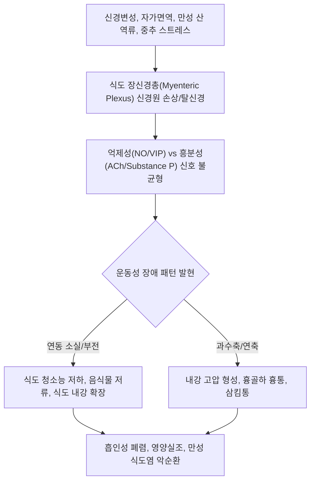

# 🩺 식도 운동성 장애 (Esophageal Motility Disorders / 食道運動障碍, K22.4)

> **핵심 3줄 요약 (Key Summary)**:
> - 📍 **병소 부위 & 병태생리**: [[식도]] 체부(Esophageal body) 및 [[위식도접합부]](EGJ/하부식도괄약근)를 지배하는 신경근육계 조절 부전. 장신경계 억제성/흥분성 신경 불균형으로 인해 하부식도괄약근 이완 장애, 연동운동 소실, 과수축 또는 연축 발생(시카고 분류 v4.0).
> - 🚩 **전형적 임상 양상 & 3대 징후**: 고형식 및 액체 모두에 대한 간헐적/진행성 [[삼킴곤란]](연하곤란), 비심장성 흉골하 흉통, 소화되지 않은 음식물의 역류(regurgitation) 및 야간 기침.
> - 🛠️ **핵심 감별 & 한·양방 치료 전략**: 식도 기계적 폐쇄(암, 양성 협착), [[위식도 역류 질환]], [[호산구성 식도염]]과 감별. 양방 고해상도 식도 내압검사([[HRM]]) 및 FLIP 판독을 통한 아형 분류(이완불능증, EGJOO, 과수축, DES, 비효과적 식도 운동 IEM) 후 표적 중재술(POEM, 풍선확장술, 약물). 한의 진료에서는 비위허약·간기울결·담음 변증 한약([[선복대자석탕]], [[반하후박탕]], [[육군자탕]]) 및 침구 치료를 통한 식도-위장관 운동성 정상화.
> - ⚠️ **응급 의뢰 레드플래그**: 급격한 체중 감소(식도암 동반 의심), 흡인성 폐렴을 시사하는 고열 및 화농성 가래, 음식물 완전 감돈(Food impaction) 시 응급 내시경 및 상급병원 의뢰.

---

## 📌 목차
1. [질환 개요 & 병태생리 (Disease Overview)](#1-질환-개요--병태생리-disease-overview)
2. [병태생리 메커니즘 & 대사·장기부전 악순환 네트워크](#2-병태생리-메커니즘--대사장기부전-악순환-네트워크)
3. [임상 증상 & 환자 소견 (Clinical Presentation)](#3-임상-증상--환자-소견-clinical-presentation)
4. [감별 진단 매트릭스 (Differential Diagnosis)](#4-감별-진단-매트릭스-differential-diagnosis)
5. [한의 통합 치료 프로토콜 (침·약침·한약)](#5-한의-통합-치료-프로토콜-침약침한약)
6. [양방 치료 & 병용·의뢰 기준 (Conventional Treatment & Referral)](#6-양방-치료--병용의뢰-기준-conventional-treatment--referral)
7. [식이·생활습관 & 자가관리 티칭 가이드](#7-식이생활습관--자가관리-티칭-가이드)
8. [💡 진료실 핵심 필기 & 임상 노하우](#8--진료실-핵심-필기--임상-노하우)
9. [출처 및 학술 참고 문헌 (References)](#9-출처-및-학술-참고-문헌-references)

---

## 1. 질환 개요 & 병태생리 (Disease Overview)

* **질환 정의 및 분류**:
  * **식도 운동성 장애**(Esophageal Motility Disorders)는 식도 내강의 구조적·해부학적 폐쇄 없이, 식도 체부의 연동운동(peristalsis) 또는 [[위식도접합부]](Esophagogastric Junction, EGJ) 괄약근의 조화로운 이완·수축 메커니즘에 이상이 생겨 발생하는 기능적 질환군을 총칭한다.
  * **시카고 분류 제4판 (Chicago Classification v4.0, CCv4.0)** 기준 체계:
    1. **위식도접합부 유출로 장애 (Disorders of EGJ Outflow)**:
       - **[[식도 이완불능증]]**(Achalasia): Type I(고전형), Type II(범식도 가압형), Type III(경련형).
       - **위식도접합부 유출로 폐쇄**(EGJ Outflow Obstruction, EGJOO): IRP 상승이 있으나 이완불능증 진단 기준을 충족하지 못하는 경우.
    2. **주요 연동운동 장애 (Major Disorders of Peristalsis)**:
       - **원위부 [[식도 연축]]**(Distal Esophageal Spasm, DES): 조기 수축(DL < 4.5초) ≥ 20%.
       - **과수축성 식도**(Hypercontractile / Jackhammer Esophagus): DCI > 8,000 mmHg·s·cm ≥ 20%.
       - **연동운동 소실**(Absent Contractility): 정상 IRP 하에서 모든 삼킴에서 수축 결여([[전신경화증]] 등과 연관).
    3. **경미한 연동운동 장애 (Minor Disorders of Peristalsis)**:
       - **비효과적 식도 운동성**(Ineffective Esophageal Motility, IEM): 약한 수축(DCI 100~450) 또는 불발 수축이 삼킴의 70% 이상.
       - **분절성 연동운동**(Fragmented Peristalsis): 정상 연동파 사이에 5cm 이상의 수축 단절.
* **관련 장기 및 조직**:
  * **주 이환 부위**: [[식도]] 상부 횡문근부와 하부 2/3 평활근부, 하부식도괄약근([[LES]]).
  * **신경 조절계**: 뇌간 연수 연하중추, 미주신경 운동신경핵, 아우에르바흐 신경총([[장신경계]]).

---

## 2. 병태생리 메커니즘 & 대사·장기부전 악순환 네트워크

### 1) 분자·세포 수준 신경 기전
* 정상적인 연하 과정은 인두에서 시작되어 식도 상부에서 하부로 이어지는 정교한 신경 조화 운동이다.
* **이완불능증 및 폐쇄성 장애**: 근층간신경총 내 산화질소(NO) 및 [[VIP]] 합성 억제성 뉴런의 면역 매개성 파괴로 인해 하부식도괄약근이 열리지 않고 연동운동이 소실됨.
* **과수축 및 연축성 장애**: 콜린성 흥분성 신경의 과도한 아세틸콜린 분비 또는 억제성 신경의 시간적 전파 지연 실패로 인한 비동시적 초고압 수축.
* **운동 저하성 장애(IEM, 연동 소실)**: 평활근 위축, 콜라겐 섬유 침착([[전신경화증]]) 또는 신경 전달 피로로 인해 식도 평활근 수축력이 소실되어 음식물을 밀어내지 못함.

### 2) 장기·계통 수준 악순환 고리
* 식도 청소능(Esophageal Clearance)이 저하되면 섭취된 음식물과 타액, 역류된 위산이 식도 내강에 장시간 정체된다.
* 정체된 물질은 식도 점막을 화학적으로 자극하여 만성 식도염을 유발하고, 야간 수면 시 인두로 역류하여 기도 흡인(aspiration) 및 만성 기침, 흡인성 폐렴을 초래한다.
* 환자는 삼킴 공포로 인해 음식 섭취량을 급격히 줄여 만성 영양실조, 근감소증, 전신 쇠약 상태로 진행된다.

---

## 3. 임상 증상 & 환자 소견 (Clinical Presentation)

### 1) 주소증 및 핵심 증상
* **삼킴곤란([[삼킴곤란]]/Dysphagia)**: 고형식과 액체 모두에 대해 간헐적 또는 진행성으로 나타나며, 찬 음식이나 급하게 먹을 때 악화됨.
* **비심장성 흉통(Chest Pain)**: 주로 흉골 뒤쪽의 압박통, 조이는 통증으로 과수축성 장애(Jackhammer, DES)에서 두드러짐.
* **음식물 역류(Regurgitation)**: 소화되지 않은 음식물, 점액질이 트림이나 앙와위 시 입으로 역류(신맛이 없는 것이 위산 역류와의 감별점).
* **가슴쓰림 및 소화불량**: 식도 내 정체 물질의 발효 또는 이차성 산 정체로 인한 속쓰림.
* **체중 감소 및 호흡기 증상**: 만성 영양 부족에 따른 체중 감소, 야간 역류로 인한 발작적 기침, 쉰 목소리.

### 2) 객관적 소견 (Signs & Labs)
* **신체 진찰**:
  * 전신 수척 소견(체중 감소 환자), 복부 진찰상 특이 소견 없음.
* **진단 표준 검사**:
  * **고해상도 식도 내압검사([[HRM]])**:
    * 36개 이상의 센서 카테터를 통해 식도 전체의 압력 지도를 실시간 컬러 지형도(clouse plot)로 생성.
    * 핵심 지표: **IRP**(통합 이완압, 정상 < 15 mmHg), **DCI**(원위부 수축 적분치, 정상 450~5,000), **DL**(원위부 잠복기, 정상 > 4.5초).
  * **기능성 내강 영상화 탐침(FLIP Panometry)**:
    * 풍선 카테터를 내강에 팽창시켜 부피 변화에 따른 단면적과 압력을 측정, 식도 신전성(distensibility index, DI) 및 식도-위접합부 개방도 평가.
  * **바륨 식도 조영술**:
    * 식도 내강 확장, 체부 무연동, 하부 새부리 모양(Bird's beak), 코르크따개 모양 확인.
  * **상부위장관 [[내시경 검사]]**:
    * 악성 종양, 소화성 협착, 칸디다 감염, 호산구성 식도염 배제를 위해 필수 시행.

---

## 4. 감별 진단 매트릭스 (Differential Diagnosis)

| 감별 질환 | 특징적 양상 | 감별 포인트 (검사·수치) |
| :--- | :--- | :--- |
| **[[식도 운동성 장애]]** (본 질환) | 고형식·액체 동시 연하곤란, 흉통, 비산성 역류 | 내시경상 기계적 폐쇄 없음, HRM상 IRP/DCI/DL 이상 확인 |
| **식도암 (Esophageal Cancer)** | 고령, 흡연자의 고형식에서 액체로 진행하는 연하곤란 | 내시경상 외장성 종괴 및 궤양, 악성 조직 생검 확진 |
| **[[역류성 식도염]] (GERD)** | 전형적 가슴쓰림, 산 역류, 앙와위 악화 | 내시경상 점막 파괴, 24시간 산도 검사상 산 노출 시간(AET) 증가 |
| **양성 식도 협착** | 오랜 GERD 병력 후 고형식 통과 장애 | 내시경상 섬유성 협착륜, 풍선 확장 시 통과 가능 |
| **[[호산구성 식도염]]** | 젊은 남성, 아토피 동반, 음식물 걸림 병력 | 내시경상 윤상 주름(trachealization), 생검상 호산구 ≥15/HPF |

> 🚩 **레드플래그 감별**: 60세 이상에서 수개월 내에 급격히 진행하는 삼킴곤란과 5kg 이상의 체중 감소가 있는 경우 '가성 이완불능증(Pseudoachalasia, 위분문부암의 식도 신경 침범)'을 반드시 감별해야 한다.

---

## 5. 한의 통합 치료 프로토콜 (침·약침·한약)

*한의 치료는 중추신경-미주신경-장신경계 축(Brain-Gut-Esophagus Axis)을 조절하여 자율신경 실조를 바로잡고, 위장관 운동성을 촉진하며 식도 평활근 경련을 완화한다.*

### 1) 변증 분류
* **간기범위증(肝氣犯胃證)**: 정서적 긴장 시 연하곤란 및 흉골하 통증 악화, 트림, 협통, 설박태, 맥현.
* **비위허약증(脾胃虛弱證)**: 식후 완만창만, 무력감, 식욕부진, 맑은 물 역류, 안색창백, 설담태백, 맥세약.
* **담기울결증(痰氣鬱結證)**: 인후부 매핵기, 목에 솜뭉치가 걸린 듯함, 뱉어도 나오지 않고 삼켜도 내려가지 않음, 흉민, 설태백니, 맥활.
* **기체어혈증(氣滯瘀血證)**: 흉골 뒤쪽의 찌르는 듯한 고정된 통증, 야간 연하통, 설자암 혹은 어반, 맥삽.

### 2) 침구 치료 (Acupuncture)
* **주혈**: [[내관(PC6)]], [[공손(SP4)]], [[족삼리(ST36)]], [[중완(CV12)]], [[전중(CV17)]].
* **배혈**:
  * 연하곤란 및 인후 이물감: [[천돌(CV22)]], [[염천(CV23)]], [[조해(KI6)]].
  * 운동 저하 및 소화불량: [[비수(BL20)]], [[위수(BL21)]], [[하완(CV10)]].
  * 흉통 및 경련: [[극문(PC4)]], [[태충(LR3)]], [[행간(LR2)]].
* **자침 기법**:
  * 족삼리-중완-내관 전침(2Hz/100Hz 혼합파): 미주신경 활성화를 유도하여 식도 및 위장관 운동 리듬을 조율.

### 3) 약침 치료 (Pharmacopuncture)
* **적용 혈위**: [[중완(CV12)]], [[전중(CV17)]], [[격수(BL17)]].
* **제제 선택**:
  * 중성어혈 약침: 흉곽 주변 근막 이완 및 식도 신경총 주변 순환 촉진.
  * 황련해독탕 약침: 상초 화열과 자율신경 과흥분성 완화.

### 4) 한약 치료 (Herbal Medicine)
* **위기역상(胃氣逆上) 및 구토·역류 개선**:
  * **[[선복대자석탕]]**: 선복화, 대자석, 반하, 생강, 인삼, 감초, 대추. 역상하는 위기를 강력하게 강기(降氣)시키고 트림, 딸꾹질, 음식물 역류를 진정시킴.
* **담기울결 및 식도 과민성 완화**:
  * **[[반하후박탕]]**: 인후 이물감, 스트레스성 식도 연축 및 가슴 답답함 완화.
* **비위 허약 및 위장관 운동 저하(IEM) 개선**:
  * **[[육군자탕]]** 또는 **이중탕**: 식도 평활근 무력증 및 소화관 정체 개선, 점막 방어 인자 강화.
* **평활근 연축성 통증 완화**:
  * **[[작약감초탕]]**: 급성 연축 및 흉통 발작 시 평활근 직접 진경 작용.

---

## 6. 양방 치료 & 병용·의뢰 기준 (Conventional Treatment & Referral)

> 🎯 **이 섹션의 목적**: 질환 아형에 따른 양방 표준 치료(내시경적 절개술, 풍선확장술, 약물)를 파악하고 상호보완적 한의 치료 영역을 명확히 설정한다.

* **아형별 양방 표준 치료 (Conventional Management)**:
  * **이완불능증 및 EGJOO**:
    * 내시경 풍선확장술(Pneumatic Dilation): 30~40mm 풍선으로 하부식도괄약근 근섬유 파열 유도.
    * 구강내시경 식도근층절개술([[POEM]]): 식도 점막하 터널을 통해 하부식도 환상근을 정밀 절개.
    * 복강경 헬러 근층절개술(Heller Myotomy): 외과적 근층 절개 + 위저부주름성형술(Dor/Toupet fundoplication).
  * **과수축성 장애 (Jackhammer / DES)**:
    * 약물 요법: 칼슘채널차단제([[CCB]]), 질산염제제, 저용량 TCA(내장 진통 목적).
    * 불응 시: 긴 분절 POEM 시행.
  * **비효과적 식도 운동(IEM) 및 무수축**:
    * 위장관운동촉진제(Prokinetics: 모사프리드 Mosapride, 프루칼로프라이드 Prucalopride).
    * 역류 방지를 위한 강력한 산 분비 억제제([[PPI]]).
* **한의 병용 판단 (Combination Therapy)**:
  * **병용 권장**: POEM이나 풍선확장술 후에도 지속되는 식도 감각 과민증, 흉부 뻐근함, 비효과적 식도 운동으로 인한 정체감에 대해 한약([[선복대자석탕]], [[반하후박탕]])과 침구 치료 병용 시 환자 만족도와 식사 순응도가 크게 향상됨.
* **양방·전문과 의뢰 기준 (Referral Criteria)**:
  * **즉각적 전문과 의뢰**:
    * 음식물이 식도에 완전히 걸려 침도 삼키지 못하고 구토하는 음식물 감돈(Food impaction) 시 응급 내시경 제거 필요.
    * 60세 이상 신규 발생 연하곤란, 6개월 내 5kg 이상 체중 감소(악성 종양 배제).
    * 흡인성 폐렴을 시사하는 발열, 기침, 흉통 동반 시.

---

## 7. 식이·생활습관 & 자가관리 티칭 가이드

* **식이 지도 (Diet)**:
  * **식사 형태**: 증상 초기에는 부드러운 죽, 으깬 감자, 스튜 등 반유동식으로 시작하여 식도 통과를 원활하게 함.
  * **식사 방식**: 음식을 입에 넣고 최소 30회 이상 씹어 침과 충분히 혼합한 후 천천히 삼키기. 식사 중 미온수를 한 모금씩 마셔 식도 내 정체 물질을 씻어내림(단, 찬물은 연축을 유발하므로 금기).
  * **소량 다식**: 위장 내압 상승을 막기 위해 식사량을 줄이고 하루 4~5회로 나누어 섭취.
* **생활습관 (Lifestyle)**:
  * **식후 기립 유지**: 식사 후 최소 2~3시간 동안 눕거나 기대지 않고 꼿꼿한 자세 유지.
  * **수면 자세 티칭**: 취침 시 침대 머리를 15~20cm 높여 수면 중 식도 내 정체물의 인두 역류 및 기도 흡인 방지.
  * **스트레스 완화**: 자율신경계 긴장은 식도 운동을 교란하므로 식사 전 심호흡 5회 시행.
* **환자 교육 스크립트**:
  * *"식도는 밥을 입에서 위장으로 짜내려 보내는 파도 같은 연동운동을 해야 하는데, 신경 조절에 이상이 생겨 파도가 멈추거나 엉뚱한 곳에서 꽉 조여 음식물이 걸리는 질환입니다. 서둘러 드시면 식도에 쌓여 기도로 넘어갈 수 있으니, 항상 미지근한 물을 곁들여 천천히 꼭꼭 씹어 드셔야 합니다."*

---

## 8. 💡 진료실 핵심 필기 & 임상 노하우

* **문진 시 기능성 vs 기계적 폐쇄 감별법**:
  * "처음에는 고기나 밥만 걸리더니 점점 죽이나 물도 안 넘어가나요, 아니면 처음부터 밥도 물도 걸렸다가 안 걸렸다가 하나요?"
  * 전자는 식도암, 협착 같은 기계적 폐쇄(Mechanical obstruction)의 전형적 경과이며, 후자는 식도 운동성 장애(Motility disorder)의 특징이다.
* **침 치료 시 즉각적 연하 개선 반응**:
  * 진료실에서 물을 삼킬 때 걸림을 호소하는 환자에게 [[천돌(CV22)]], [[전중(CV17)]], [[내관(PC6)]]에 자침하고 득기(得氣)를 유도한 상태에서 미온수를 한 모금 삼키게 하면 환자가 "가슴에서 쑥 내려가는 느낌이 든다"고 즉각적인 반응을 보이는 경우가 많다. 이는 미주신경-식도 반사 조절 효과를 입증한다.
* **선복대자석탕 처방 팁**:
  * 대자석(Hematite)은 철 성분이 함유된 광물약재로 무겁고 가라앉히는 진강(鎭降) 작용이 탁월하다. 식도 이완 장애 환자가 트림과 함께 음식물이 위로 솟구쳐 오르는 증상을 호소할 때 전탕 시 먼저 30분 이상 선전(先煎)하여 투여하면 뛰어난 강기(降氣) 효과를 나타낸다.

---

## 9. 출처 및 학술 참고 문헌 (References)

1. **MSD 매뉴얼 전문가용** — [Esophageal Motility Disorders](https://www.msdmanuals.com/professional/gastrointestinal-disorders/esophageal-and-swallowing-disorders/overview-of-esophageal-motility-disorders)

2. **Anikhindi S et al. (2026)**. *Esophageal motility disorders associated with epiphrenic diverticula: a systematic review using high-resolution manometry*. **Dis Esophagus**, 39(4):doae030. [PMID 42647770](https://pubmed.ncbi.nlm.nih.gov/42647770/)
   - **[연구 요약]**: 횡격막상부 게실과 동반된 식도 운동성 장애 환자에서 고해상도 식도 내압검사 표현형 및 임상적 예후 체계적 문헌고찰.

3. **Robalino Gonzaga E et al. (2026)**. *Artificial Intelligence for Diagnosis of Esophageal Manometry: A Narrative Review*. **Curr Gastroenterol Rep**, 28(1):15-24. [PMID 42573859](https://pubmed.ncbi.nlm.nih.gov/42573859/)
   - **[연구 요약]**: 고해상도 식도 내압검사 파형 판독 및 식도 운동 질환 시카고 분류 진단 정확도 향상을 위한 인공지능 알고리즘 리뷰.

4. **Bales CE et al. (2026)**. *Accuracy of Novice Raters for Esophageal Motility Classifications Using Functional Lumen Imaging Probe Panometry*. **Neurogastroenterol Motil**, 38(7):e70386. [PMID 42402951](https://pubmed.ncbi.nlm.nih.gov/42402951/)
   - **[연구 요약]**: 기능성 내강 영상화 탐침 측정을 통한 식도 운동성 장애 분류의 진단 신뢰도 및 판독 정확도 분석.

---

## 관련 노트

- [[_의학/03_이론/질환/소화기 질환/01_구강·식도/식도 이완불능증|식도 이완불능증]]
- [[_의학/03_이론/질환/소화기 질환/01_구강·식도/식도 연축|식도 연축]]
- [[_의학/03_이론/질환/소화기 질환/01_구강·식도/역류성 식도염|역류성 식도염]]
- [[_의학/03_이론/질환/소화기 질환/06_비위·전신/기능성 소화불량|기능성 소화불량]]
