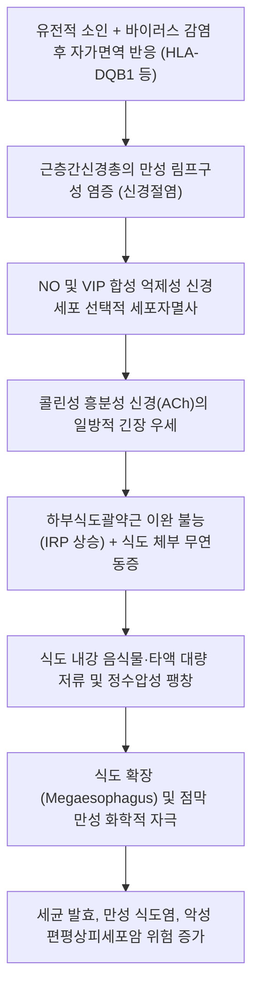

# 🩺 식도 이완불능증 (Esophageal Achalasia / 食道弛緩不能症, K22.0)

> **핵심 3줄 요약 (Key Summary)**:
> - 📍 **병소 부위 & 병태생리**: 하부 [[식도]] 및 [[위식도접합부]](하부식도괄약근, LES)의 장신경계([[아우에르바흐 신경총]]) 억제성 신경원(NO/VIP 분비 세포)의 선택적 변성·소실. 연하 시 하부식도괄약근의 불완전한 이완과 식도 체부 연동운동의 완전 소실로 인해 음식물 통과 장애 및 식도 확장(메가에소파구스) 유발.
> - 🚩 **전형적 임상 양상 & 3대 징후**: 수개월~수년에 걸친 고형식과 액체 모두에 대한 진행성 [[삼킴곤란]](연하곤란), 섭취된 비산성 음식물의 야간 역류(regurgitation), 식사 곤란에 따른 현저한 체중 감소.
> - 🛠️ **핵심 감별 & 한·양방 치료 전략**: 위분문부암에 의한 가성 이완불능증(Pseudoachalasia), [[식도 연축]], 소화성 협착과 감별. 양방 고해상도 식도 내압검사([[HRM]])로 시카고 아형(Type I, II, III) 확진 후 구강내시경 식도근층절개술([[POEM]]) 또는 공기풍선확장술 시행. 한의 진료에서는 비위허약·담어기체 변증 한약([[선복대자석탕]], [[반하후박탕]], [[육군자탕]]) 및 침구 치료를 통한 위장관 운동 촉진과 수술 후 잔여 증상 관리.
> - ⚠️ **응급 의뢰 레드플래그**: 60세 이상 급격한 발병(가성 이완불능증 악성 종양 의심), 음식물 야간 흡인으로 인한 급성 흡인성 폐렴, 내시경 통과 불능의 완전 감돈 시 즉시 상급병원 전원.

---

## 📌 목차
1. [질환 개요 & 병태생리 (Disease Overview)](#1-질환-개요--병태생리-disease-overview)
2. [병태생리 메커니즘 & 대사·장기부전 악순환 네트워크](#2-병태생리-메커니즘--대사장기부전-악순환-네트워크)
3. [임상 증상 & 환자 소견 (Clinical Presentation)](#3-임상-증상--환자-소견-clinical-presentation)
4. [감별 진단 매트릭스 (Differential Diagnosis)](#4-감별-진단-매트릭스-differential-diagnosis)
5. [한의 통합 치료 프로토콜 (침·약침·한약)](#5-한의-통합-치료-프로토콜-침약침한약)
6. [양방 치료 & 병용·의뢰 기준 (Conventional Treatment & Referral)](#6-양방-치료--병용의뢰-기준-conventional-treatment--referral)
7. [식이·생활습관 & 자가관리 티칭 가이드](#7-식이생활습관--자가관리-티칭-가이드)
8. [💡 진료실 핵심 필기 & 임상 노하우](#8--진료실-핵심-필기--임상-노하우)
9. [출처 및 학술 참고 문헌 (References)](#9-출처-및-학술-참고-문헌-references)

---

## 1. 질환 개요 & 병태생리 (Disease Overview)

* **질환 정의 및 분류**:
  * **식도 이완불능증**(Achalasia)은 연하(음식물 삼킴) 시 하부식도괄약근([[LES]])이 적절히 이완되지 못하고(Incomplete LES relaxation), 식도 체부의 정상적인 연동운동이 완전히 소실(Aperistalsis)되는 원발성 신경근육계 식도 운동 질환이다.
  * 연간 인구 10만 명당 약 1~2명꼴로 발생하는 비교적 드문 질환이나, 만성적으로 삶의 질을 현저히 저하시키며 치료하지 않을 경우 거대식도증(Megaesophagus) 및 식도암으로 이환될 수 있다.
  * **시카고 분류 v4.0 (Chicago Classification v4.0) 아형**:
    1. **Type I (고전적 이완불능증, Classic Achalasia)**: IRP(통합이완압) 상승 및 100% 연동운동 소실, 식도 체부 내 유의미한 압력 증가 없음(DCI < 100).
    2. **Type II (범식도 가압형, Panesophageal Pressurization)**: IRP 상승 및 연동운동 소실과 함께, 삼킴의 20% 이상에서 식도 전체에 걸쳐 균일한 압력 상승(Panesophageal pressurization)이 관찰됨. 가장 흔하며 치료 반응이 가장 우수함.
    3. **Type III (경련형, Spastic Achalasia)**: IRP 상승과 함께, 삼킴의 20% 이상에서 식도 원위부의 조기 수축 또는 비정상적 경련파(spasm)가 동반됨. 병변 분절이 길고 치료 난이도가 가장 높음.
* **관련 장기 및 조직**:
  * **주 이환 부위**: [[위식도접합부]](하부식도괄약근) 및 원위부 하부 2/3 평활근 식도 체부.
  * **신경계 병소**: 식도 평활근층 사이의 근층간신경총([[아우에르바흐 신경총]], Auerbach's plexus) 내 억제성 신경세포.
  * **합병증 표적 장기**: 기관지 및 폐(음식물 흡인에 의한 흡인성 폐렴, 폐농양, 기관지확장증), 장기 정체에 의한 식도 편평상피세포암.

---

## 2. 병태생리 메커니즘 & 대사·장기부전 악순환 네트워크

### 1) 분자·세포 수준 신경면역 기전
* 유전적 소인(특정 HLA 대립유전자)을 가진 개체에서 바이러스 감염(HSV-1, 홍역 등) 후 촉발된 자가면역 반응으로 인해 T 림프구(CD3+, CD8+)가 아우에르바흐 신경총을 침윤하여 만성 신경절염(ganglionitis)을 유발한다.
* 이 과정에서 산화질소([[NO]]) 및 혈관활성장펩타이드([[VIP]])를 생성하는 **억제성 신경원(inhibitory nitrergic neurons)**이 선택적으로 파괴된다.
* 반면 아세틸콜린([[ACh]])과 P물질(Substance P)을 분비하는 흥분성 콜린성 신경원은 상대적으로 보존되어, 하부식도괄약근은 지속적인 기저 긴장도 상승과 삼킴 시 이완 장애를 겪게 된다.
* 억제 신호의 소실로 식도 체부의 하행성 연동파 전파 메커니즘도 완전히 붕괴되어 연동운동이 소실된다.

### 2) 장기·계통 수준 생체역학적 악순환
* 하부식도괄약근의 기능적 폐쇄로 인해 섭취된 음식물이 위로 내려가지 못하고 식도 내강에 고인다.
* 음식물의 정수압(hydrostatic pressure)으로 인해 식도 체부는 점진적으로 비가역적 확장을 일으키며, 심한 경우 직경이 6~8cm 이상으로 늘어나고 S자 형태로 꼬이는 **구불식도(Sigmoid esophagus)**로 진행한다.
* 정체된 음식물은 혐기성 세균에 의해 발효되어 젖산과 독성 대사산물을 방출하며, 이는 식도 점막의 만성 증식과 이형성증을 유발하여 편평상피암(Squamous cell carcinoma) 발생률을 일반인의 16~30배로 높인다.

---

## 3. 임상 증상 & 환자 소견 (Clinical Presentation)

### 1) 주소증 및 핵심 증상
* **진행성 삼킴곤란([[삼킴곤란]]/Dysphagia)**:
  * 거의 100%의 환자에서 나타나는 핵심 증상.
  * 기계적 암 협착과 달리 **고형식과 액체 모두에서 처음부터 동시에** 나타나며, 수개월에서 수년에 걸쳐 서서히 진행됨.
  * 환자들은 물을 많이 마시거나, 가슴을 펴고 어깨를 젖히며, 발살바 호흡을 하여 정수압으로 음식을 억지로 밀어 넣으려는 보상 행동을 보임.
* **비산성 음식물 역류(Regurgitation)**:
  * 식후 수시간 뒤 또는 야간 수면 중 섭취했던 음식물이 소화되지 않은 상태로 입안에 고임(위산과 섞이지 않아 시큼하지 않고 악취가 남).
* **흉골하 흉통(Chest Pain)**:
  * 질환 초기나 Type III(경련형) 환자에서 흔하며, 흉골 뒤쪽의 조이는 듯한 통증.
* **체중 감소(Weight Loss)**:
  * 섭취 불능으로 인해 평균 5~10kg 이상의 체중 감소 발생.
* **만성 야간 기침 및 폐 합병증**:
  * 자는 도중 역류된 음식물이 기도로 흡인되어 야간 질식감, 천명음, 재발성 흡인성 폐렴 유발.

### 2) 객관적 소견 (Signs & Labs)
* **고해상도 식도 내압검사([[HRM]])**: 확진을 위한 골드 스탠다드.
  * **IRP(통합이완압)**: 비정상적 상승(센서 유형에 따라 > 15 mmHg).
  * **연동운동**: 정상 연동파의 완전 소실(100% failed peristalsis).
  * 시카고 아형(Type I, II, III) 감별.
* **바륨 식도 조영술**:
  * 식도 체부의 미만성 확장 및 조영제 저류.
  * 하부식도괄약근 부위가 부드럽고 매끄러운 대칭형 원추형으로 좁아지는 **새부리 징후(Bird's beak sign)** 관찰.
* **상부위장관 [[내시경 검사]]**:
  * 내강 확장, 액체 및 음식물 찌꺼기 저류, 식도염 소견.
  * 분문부 진입 시 괄약근이 단단히 닫혀 있으나, 내시경 선단을 부드럽게 밀면 '딸깍'하는 저항감과 함께 위내로 진입 가능(기계적 암 협착은 진입 불능).

### 3) 임상 중증도 평가 (Eckardt Score)
* 4개 항목(체중 감소, 연하곤란, 흉통, 역류)을 0~3점으로 점수화하여 0~12점으로 평가.
* 3점 이하: 임상적 관해(치료 성공).
* 4점 이상: 활동성 질환(치료 적응증).

---

## 4. 감별 진단 매트릭스 (Differential Diagnosis)

| 감별 질환 | 특징적 양상 | 감별 포인트 (검사·수치) |
| :--- | :--- | :--- |
| **[[식도 이완불능증]]** (본 질환) | 수년에 걸친 고형식/액체 연하곤란, 비산성 역류 | HRM상 IRP 상승 및 무연동, 조영술상 새부리 징후, 내시경 통과 가능 |
| **가성 이완불능증 (위암 침범)** | 60세 이상, 급격한 체중 감소(수개월 내), 고령 | 내시경 생검상 악성 세포, 복부 CT상 위분문부 점막하 종괴 |
| **원위부 [[식도 연축]] (DES)** | 간헐적 삼킴곤란, 찬물/스트레스 시 격심한 흉통 | HRM상 IRP는 정상, 원위부 잠복기 단축(DL < 4.5초) 관찰 |
| **[[위식도 역류 질환]] (GERD)** | 가슴쓰림, 신물 역류, 식후 앙와위 악화 | 24시간 산도 검사 양성, HRM상 LES 이완 정상, 새부리 징후 없음 |
| **샤가스병 (Chagas disease)** | 중남미 거주력, 거대결장/심근병증 동반 | *Trypanosoma cruzi* 혈청 항체 양성, 전신 장기 확장 |

> 🚩 **레드플래그 감별**: 고령 환자에서 최근 6개월 이내 급격히 발생한 이완불능증 증상은 위분문부 선암이 식도 신경총을 침범한 '가성 이완불능증(Pseudoachalasia)'일 가능성이 높으므로 반드시 심부 조직 생검 및 내시경 초음파(EUS), 복부 CT를 시행해야 한다.

---

## 5. 한의 통합 치료 프로토콜 (침·약침·한약)

*식도 이완불능증은 하부식도괄약근의 물리적 폐쇄가 핵심 병태이므로, 근본적인 괄약근 감압은 양방 POEM이나 풍선확장술이 필수적이다. 한의 치료는 수술 전후 위장관 운동 촉진, 잔여 흉민 완화, 점막 염증 치료, 체력 회복을 담당한다.*

### 1) 변증 분류
* **담어조체증(痰瘀阻滯證)**: 음식물 통과 극난, 흉완비민, 맑은 가래와 점액 역류, 흉골하 둔통, 설자암태백니, 맥활삽.
* **비위기허증(脾胃氣虛證)**: 만성 영양 불량, 수척, 식욕부진, 권태무력, 대변당박, 설담태백, 맥세약.
* **간울기체증(肝氣鬱滯證)**: 정서적 충격 후 연하곤란 급격 악화, 잦은 트림, 흉협팽만, 설박태, 맥현.

### 2) 침구 치료 (Acupuncture)
* **주혈**: [[중완(CV12)]], [[족삼리(ST36)]], [[내관(PC6)]], [[공손(SP4)]], [[전중(CV17)]].
* **배혈**:
  * 연하 장애 및 역류: [[천돌(CV22)]], [[염천(CV23)]], [[상완(CV13)]].
  * 비위 기능 회복: [[비수(BL20)]], [[위수(BL21)]], [[기해(CV6)]].
  * 흉통 및 자율신경 조절: [[극문(PC4)]], [[태충(LR3)]].
* **자침 기법**:
  * 내관-공손 충맥 배혈: 위기역상을 강기시키고 평활근 긴장 완화.
  * 중완-족삼리 온구(뜸) 병용: 만성 소화관 정체와 냉증 해소.

### 3) 약침 치료 (Pharmacopuncture)
* **적용 혈위**: [[중완(CV12)]], [[전중(CV17)]], [[비수(BL20)]].
* **제제 선택**:
  * 중성어혈 약침: 식도 주변 결합조직 긴장 해소 및 미세 순환 개선.
  * 산삼 약침: 장기간 영양 섭취 불능으로 인한 극심한 기력 저하 환자의 원기 회복.

### 4) 한약 치료 (Herbal Medicine)
* **위기역상 진강 및 역류 억제 (1순위 처방)**:
  * **[[선복대자석탕]]**: 선복화, 대자석, 반하, 생강, 인삼, 감초, 대추. 역상하는 위기를 가라앉히고 식도 하부 정체감을 신속히 개선.
* **음식물 정체 및 담음 해소**:
  * **[[반하후박탕]] 가감방**: 지실, 죽여, 백작약을 가미하여 인후 이물감과 식도 평활근 경련 완화.
* **수술·시술 후 체력 보강 및 소화 흡수력 재건**:
  * **[[육군자탕]]** 또는 **향사육군자탕**: POEM 시술 후 잔여 연하불편감 및 소화력 저하 회복.

---

## 6. 양방 치료 & 병용·의뢰 기준 (Conventional Treatment & Referral)

> 🎯 **이 섹션의 목적**: 비가역적 식도 확장을 방지하기 위한 양방 근층절개술의 타이밍과 최신 내시경 시술(POEM)을 숙지하고 적절한 시점에 전원한다.

* **양방 중재적 치료 (Standard Interventions)**:
  * **구강내시경 식도근층절개술([[POEM]], Peroral Endoscopic Myotomy)**:
    * 현재 가장 각광받는 1차 치료. 식도 점막에 작은 절개를 넣고 점막하 터널을 뚫어 하부식도와 위분문부 내환상근을 내시경 칼로 직접 절개.
    * 피부 흉터가 없으며, 특히 Type III(경련형) 이완불능증에서 외과 수술보다 우수한 효과(성공률 > 90%).
  * **공기 풍선확장술(Pneumatic Dilation, PD)**:
    * 30, 35, 40mm 강성 풍선을 투시하에 팽창시켜 LES 근육 섬유를 강제로 파열시킴. Type II에서 효과가 우수하나 천공 위험(1~3%) 존재.
  * **복강경 헬러 근층절개술(Laparoscopic Heller Myotomy, LHM)**:
    * 복강경으로 식도 하부 평활근을 외과적으로 절개하고, 역류 방지를 위해 위저부주름성형술(Dor fundoplication)을 병행.
  * **약물 및 보툴리눔 독소 (임시적/고위험군 치료)**:
    * 전신 상태가 불량한 고령 환자에서 내시경하 보톡스 주입 또는 질산염/CCB 투여(효과가 일시적임).
* **한의 병용 판단 (Combination Therapy)**:
  * **시술 전**: 환자가 수술을 대기하는 동안 영양 상태를 유지하고 역류를 완화하기 위해 한약 및 침 치료 적용.
  * **시술 후**: POEM이나 헬러 수술 후 발생할 수 있는 위식도 역류, 잔여 연하 불편감, 위장관 운동 저하에 대해 [[육군자탕]] 및 침구 치료를 병용하면 삶의 질 지표가 탁월하게 개선됨.
* **양방·전문과 의뢰 기준 (Referral Criteria)**:
  * **즉각적 상급병원 소화기내과 전원**:
    * Eckardt 점수 3점 이상으로 일상적인 식사가 불가능한 모든 이완불능증 의심 환자.
    * 음식물 야간 흡인으로 인한 폐렴 의심 소견(발열, 호흡곤란).
    * 식도 내강이 6cm 이상 확장되어 S자 형태로 뒤틀린 말기 거대식도증 환자.

---

## 7. 식이·생활습관 & 자가관리 티칭 가이드

* **식이 지도 (Diet)**:
  * **충분한 수분 섭취와 함께 식사**: 음식물을 넘길 때 중력과 정수압을 이용하기 위해 식사 중 미온수를 자주 마시도록 지도.
  * **저잔류, 고단백 식이**: 질긴 고기, 섬유질이 많은 채소, 떡, 빵 등 덩어리지기 쉬운 음식 피하기.
  * **식사 속도 조절**: 음식을 소량씩 천천히 꼭꼭 씹어 먹고, 식사 중 대화를 자제하여 공기 연하를 방지.
* **생활습관 (Lifestyle)**:
  * **야간 역류 방지 (가장 중요)**:
    * **취침 전 최소 3~4시간 동안 절대 금식**.
    * 침대 머리를 20~30도 이상 높이고 수면(웨지 베개 활용).
  * **식후 즉각적 눕기 금지**: 식사 후 최소 2시간 동안 꼿꼿이 서 있거나 걷는 자세 유지.
* **환자 교육 스크립트**:
  * *"식도 아래쪽 밸브가 열리지 않아 음식물이 위장으로 내려가지 못하고 식도에 주머니처럼 고여 있는 질환입니다. 약물만으로는 굳어버린 밸브를 열기 어렵기 때문에, 내시경으로 근육을 살짝 터주는 시술(POEM)을 받으셔야 근본적으로 음식이 내려갑니다. 시술 전후로 체력을 보강하고 남아있는 위장 운동을 돕는 한의 치료를 함께 받으시면 훨씬 편안해지실 수 있습니다."*

---

## 8. 💡 진료실 핵심 필기 & 임상 노하우

* **환자의 기이한 식사 행동 포착**:
  * 이완불능증 환자들은 문진 시 독특한 행동을 고백한다. "물을 벌컥벌컥 마신 뒤 가슴을 툭툭 치거나, 기지개를 켜듯 가슴을 활짝 펴야 쑥 내려간다."
  * 이는 식도 내 정수압이 일정 수준(보통 15~20cmH2O) 이상 차야 괄약근이 물리적으로 벌어지기 때문에 환자가 본능적으로 터득한 보상 동작이다. 이 호소가 있다면 99% 이완불능증이다.
* **구강 칸디다증과의 병발 주의**:
  * 식도 내강에 음식물이 수일씩 정체되어 발효되면 식도 점막에 칸디다 감염이 2차적으로 매우 흔하게 합병된다. 내시경 소견상 백색 위막이 동반된 경우 항진균제 치료가 병행되어야 한다.
* **침구 치료의 진경 혈위**:
  * 환자가 가슴이 조이고 답답함을 호소할 때 [[극문(PC4)]]과 [[전중(CV17)]]에 사법으로 자침하고 10분간 유침하면 식도 평활근의 긴장도가 완화되어 정체된 공기와 음식물이 아래로 내려가면서 즉각적인 트림과 편안함을 얻는다.

---

## 9. 출처 및 학술 참고 문헌 (References)

1. **MSD 매뉴얼 전문가용** — [Achalasia](https://www.msdmanuals.com/professional/gastrointestinal-disorders/esophageal-and-swallowing-disorders/achalasia)

2. **Barros Sosa J et al. (2026)**. *Redo Heller myotomy vs. POEM after failed Heller myotomy: a systematic review and meta-analysis*. **Surg Endosc**, 40(10):8342-8352. [PMID 42728432](https://pubmed.ncbi.nlm.nih.gov/42728432/)
   - **[연구 요약]**: 헬러 근층절개술 실패 후 재수술과 구강내시경 식도근층절개술의 치료 성공률 및 역류 합병증 비교 메타분석.

3. **Morrison JP et al. (2026)**. *Evaluating surgical management of primary achalasia-a systematic review and network meta-analysis of randomized clinical trials*. **J Gastrointest Surg**, 30(10):102558. [PMID 42617727](https://pubmed.ncbi.nlm.nih.gov/42617727/)
   - **[연구 요약]**: 원발성 식도 이완불능증 환자에서 무작위 대조 시험의 네트워크 메타분석을 통한 외과적 수술과 내시경 치료 효과 평가.

4. **Vittori A et al. (2026)**. *Heller myotomy for esophageal achalasia: risk factors for reintervention - a narrative review*. **Expert Rev Gastroenterol Hepatol**, 20(8):733-746. [PMID 42484866](https://pubmed.ncbi.nlm.nih.gov/42484866/)
   - **[연구 요약]**: 식도 이완불능증 환자의 복강경 헬러 근층절개술 후 재치료 필요성에 영향을 미치는 위험인자 및 장기 추적 분석.

---

## 관련 노트

- [[_의학/03_이론/질환/소화기 질환/01_구강·식도/식도 운동성 장애|식도 운동성 장애]]
- [[_의학/03_이론/질환/소화기 질환/01_구강·식도/식도 연축|식도 연축]]
- [[_의학/03_이론/질환/소화기 질환/01_구강·식도/역류성 식도염|역류성 식도염]]
- [[_의학/03_이론/질환/소화기 질환/06_비위·전신/기능성 소화불량|기능성 소화불량]]
