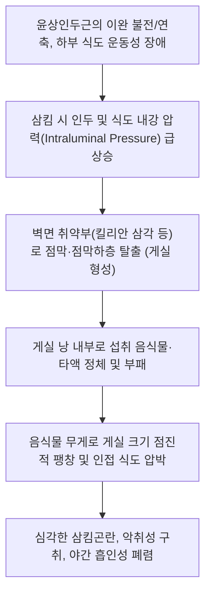

# 🩺 식도 주머니 게실 (Esophageal Diverticulum / 食道憩室, K22.5)

> **핵심 3줄 요약 (Key Summary)**:
> - 📍 **병소 부위 & 병태생리**: [[식도]] 벽의 국소적 주머니 모양 외향 돌출(Pouch). 해부학적 취약 부위(경부 킬리안 삼각의 젠커 게실, 원위부 횡격막상 게실)에서 인두내압/식도내압 상승에 의해 점막과 점막하층이 근육층 결손부를 뚫고 밀려 나오는 압출성 가성 게실(Pulsion pseudodiverticulum)이 대표적.
> - 🚩 **전형적 임상 양상 & 3대 징후**: 수일 전 섭취한 부패된 음식물의 비산성 역류, 심한 악취성 구취(Halitosis), 연하 시 목이나 가슴에서 꼬르륵거리는 소리(Gurgling / Boyce 징후) 및 야간 발작적 흡인성 기침.
> - 🛠️ **핵심 감별 & 한·양방 치료 전략**: [[식도 이완불능증]], [[식도막]], 인두암 및 식도암과 감별. 양방 바륨 식도 조영술로 게실 낭(Sac) 확진 후, 경구강 내시경적 게실중격절개술(Z-POEM) 또는 외과적 윤상인두근 절개술. 한의 진료에서는 담음저류·비위허약 변증 한약([[이진탕]], [[반하후박탕]], [[육군자탕]]) 및 인후부 침구 치료를 통한 식도 운동 조율과 잔여 연하불편감 완화.
> - ⚠️ **응급 의뢰 레드플래그**: 게실 내 음식물 정체에 의한 급성 기도 폐쇄 및 질식, 다량 흡인으로 인한 흡인성 폐렴(고열, 호흡곤란), 내시경 진입 시 게실 맹관 천공 발생 시 즉각 응급실 의뢰.

---

## 📌 목차
1. [질환 개요 & 병태생리 (Disease Overview)](#1-질환-개요--병태생리-disease-overview)
2. [병태생리 메커니즘 & 대사·장기부전 악순환 네트워크](#2-병태생리-메커니즘--대사장기부전-악순환-네트워크)
3. [임상 증상 & 환자 소견 (Clinical Presentation)](#3-임상-증상--환자-소견-clinical-presentation)
4. [감별 진단 매트릭스 (Differential Diagnosis)](#4-감별-진단-매트릭스-differential-diagnosis)
5. [한의 통합 치료 프로토콜 (침·약침·한약)](#5-한의-통합-치료-프로토콜-침약침한약)
6. [양방 치료 & 병용·의뢰 기준 (Conventional Treatment & Referral)](#6-양방-치료--병용의뢰-기준-conventional-treatment--referral)
7. [식이·생활습관 & 자가관리 티칭 가이드](#7-식이생활습관--자가관리-티칭-가이드)
8. [💡 진료실 핵심 필기 & 임상 노하우](#8--진료실-핵심-필기--임상-노하우)
9. [출처 및 학술 참고 문헌 (References)](#9-출처-및-학술-참고-문헌-references)

---

## 1. 질환 개요 & 병태생리 (Disease Overview)

* **질환 정의 및 분류**:
  * **식도 주머니 게실**(Esophageal Diverticulum)은 식도 벽의 일부가 국소적으로 낭포(Pouch) 형태로 영구히 돌출되어 형성된 주머니를 말한다.
  * **해부학적 발생 부위 및 형성 기전별 분류**:
    1. **인두식도 게실 / [[젠커 게실]](Zenker's Diverticulum)**:
       - 가장 흔함(전체 식도 게실의 약 70%).
       - 하인두수축근(Thyropharyngeus)과 [[윤상인두근]](Cricopharyngeus) 사이의 후벽 취약 부위인 **킬리안 삼각(Killian's triangle)**을 통해 점막과 점막하층이 돌출되는 **압출성 가성 게실**(Pulsion pseudodiverticulum).
    2. **중부 식도 게실 (Mid-esophageal Diverticulum)**:
       - 종격동 림프절염(결핵 등)의 만성 염증으로 식도 외벽이 외부로 당겨져 생기는 **견인성 진성 게실**(Traction true diverticulum, 전층 돌출) 또는 식도 운동 장애에 의한 압출성 게실.
    3. **횡격막상부 게실 (Epiphrenic Diverticulum)**:
       - 원위부 하부 식도 10cm 이내에 발생하는 압출성 가성 게실.
       - [[식도 이완불능증]], 원위부 [[식도 연축]] 등 하부 식도 운동 질환과 약 70~80%에서 동반됨.
* **관련 장기 및 조직**:
  * **주 이환 부위**: 경부 하인두-식도 접합부(킬리안 삼각), 흉부 중부 식도벽, 하부 횡격막 직상부 식도벽.
  * **합병증 표적 장기**: 기도 및 폐(흡인성 폐렴, 폐농양), 후두(만성 후두염, 성대 부종), 게실 점막 내 악성 종양(만성 염증으로 인한 편평상피암 발생률 약 0.5~1%).

---

## 2. 병태생리 메커니즘 & 대사·장기부전 악순환 네트워크

### 1) 분자·세포 및 생체역학 기전
* **킬리안 삼각(Killian's Triangle)의 압출 기전**:
  * 정상적으로 연하 시 인두 수축파가 도달하기 직전 윤상인두근이 반사적으로 이완되어 음식물이 원활히 식도로 넘어간다.
  * 고령, 신경 퇴행성 변화, 위식도 역류에 대한 반사성 근경련 등으로 인해 윤상인두근의 **순응도 저하(Compliance loss)** 또는 이완 타이밍 불일치가 발생하면, 연하 볼루스(bolus) 통과 시 하인두 내강 압력이 100 mmHg 이상으로 급상승한다.
  * 후벽의 근육 섬유 결손 부위인 킬리안 삼각에 장축 및 횡축 전단력이 반복 가해지면서 점막이 탈장(herniation)되어 낭(Sac)이 형성된다.

### 2) 장기·계통 수준 악순환 고리
* 초기 작은 주머니는 무증상이지만, 음식물과 타액이 주머니 안으로 흘러 들어가 쌓이기 시작하면 낭의 부피와 무게가 지속적으로 증가한다.
* 거대해진 게실은 식도 본관의 후벽을 전방으로 밀어내어 정상 식도 내강을 외인성으로 압박(Extrinsic compression)한다.
* 이로 인해 삼킨 음식이 정상 식도로 내려가지 못하고 게실 안으로만 우선 유입되는 기계적 악순환이 고착화된다.
* 주머니 안에서 혐기성 세균에 의해 발효된 음식물 찌꺼기가 야간 수면 시 구강과 인두로 역류하여 기도 흡인(Microaspiration) 및 중증 화학성·세균성 폐렴을 유발한다.

---

## 3. 임상 증상 & 환자 소견 (Clinical Presentation)

### 1) 주소증 및 핵심 증상
* **연하곤란([[삼킴곤란]]/Dysphagia)**:
  * 목에 음식이 걸리는 느낌, 특히 고형식을 삼킬 때 인두 부위의 저항감.
* **소화되지 않은 음식물의 역류(Regurgitation)**:
  * 섭취한 지 수시간에서 수일 지난 음식물 찌꺼기가 위산 냄새(신맛) 없이 썩은 냄새를 풍기며 입안으로 불쑥 역류함.
* **악취성 구취(Fetid Halitosis)**:
  * 게실 내 음식물의 만성 부패와 세균 증식으로 인해 칫솔질로 해결되지 않는 역한 입냄새.
* **목의 꼬르륵 소리 (Boyce 징후)**:
  * 물을 삼키거나 목 옆을 누를 때 공기와 액체가 마찰하면서 거품 소리(gurgling sound) 발생.
* **만성 야간 기침 및 쉰 목소리**:
  * 취침 중 역류 물질의 성대 및 기도 흡인으로 인한 발작적 기침, 만성 쉰 목소리.

### 2) 객관적 소견 (Signs & Labs)
* **신체 진찰**:
  * 경부 종괴: 좌측 경부 흉쇄유돌근 앞쪽에 부드러운 종괴가 촉지될 수 있으며, 압박 시 음식물 역류나 소리가 날 수 있음.
* **진단 영상 검사**:
  * **바륨 식도 조영술(Barium Esophagogram)**: 확진 표준 검사.
    * 측면 및 정면 투시상 하인두 후벽에서 후방 및 하방으로 돌출하는 둥근 게실 낭의 형태, 크기, 목(Neck) 부위 확인.
  * **고해상도 식도 내압검사([[HRM]])**:
    * 윤상인두근의 기저 압력 상승, 불완전 이완 여부 및 동반된 하부 식도 운동성 장애(이완불능증 등) 평가.
  * **상부위장관 [[내시경 검사]] 주의점**:
    * 내시경 튜브 선단이 정상 식도 내강이 아닌 게실 낭 바닥으로 진입하기 쉬우며, 맹낭 바닥은 벽이 얇아 블라인드 삽입 시 **의인성 식도 천공(Perforation)** 위험이 극도로 높으므로 매우 주의 깊은 직시하 진입 필수.

---

## 4. 감별 진단 매트릭스 (Differential Diagnosis)

| 감별 질환 | 특징적 양상 | 감별 포인트 (검사·수치) |
| :--- | :--- | :--- |
| **[[식도 주머니 게실]]** (본 질환) | 수일 전 음식물의 비산성 역류, 악취성 구취, 목의 꼬르륵 소리 | 바륨 식도 조영술상 명확한 외향 낭포 음영 확인 |
| **[[식도 이완불능증]]** | 고형식/액체 동시 연하곤란, 흉골하 통증, 새부리 징후 | HRM상 IRP 상승, 식도 체부 무연동, 하부식도 확장 |
| **[[식도막]] (Esophageal Web)** | 상부 식도의 간헐적 고형식 삼킴 장애, 철결핍 빈혈 | 조영술상 얇은 선상 결손(Web), 주머니 낭 형성 없음 |
| **하인두암 / 식도암** | 고령, 흡연자의 단기간 급격한 연하곤란, 체중 감소, 혈담 | 내시경 생검상 악성 세포, 조영술상 내강 불규칙 협착 |
| **[[역류성 식도염]]** | 가슴쓰림, 신물 역류, 앙와위 악화 | 내시경상 점막 미란/궤양, 24시간 산도 검사 양성 |

> 🚩 **레드플래그 감별**: 게실 낭 내벽에 만성 궤양이나 출혈이 생기거나, 림프절 비대를 동반한 급격한 연하 장애 악화 시 게실 내부의 편평상피암 발생(Carcinoma in diverticulum)을 반드시 배제해야 한다.

---

## 5. 한의 통합 치료 프로토콜 (침·약침·한약)

*게실 낭 자체는 기계적 해부학적 변형이므로 중등도 이상의 게실은 양방 내시경적 절개술이 근본 치료이다. 한의 치료는 경미한 초기 게실의 연하 운동 조율, 만성 가래 및 역류 증상 완화, 수술 후 잔여 인두 이물감 치료에 집중한다.*

### 1) 변증 분류
* **담음저류증(痰飮阻滯證)**: 목구멍에 가래와 음식물이 걸려 떨어지지 않음, 구토 담연, 흉민, 설태백니, 맥활.
* **비위기허증(脾胃氣虛證)**: 만성 영양 부족, 소화불량, 식욕부진, 기운 없음, 설담태백, 맥세약.
* **기체어혈증(氣滯瘀血證)**: 인후부 국소 뻐근함, 찌르는 듯한 이물감, 정서적 스트레스 시 악화, 설어점, 맥현삽.

### 2) 침구 치료 (Acupuncture)
* **주혈**: [[천돌(CV22)]], [[염천(CV23)]], [[인영(ST9)]], [[내관(PC6)]], [[족삼리(ST36)]].
* **배혈**:
  * 인후 근육 긴장 완화: 풍지(GB20), 완골(GB12), 예풍(TE17).
  * 담음 청화: [[풍륭(ST40)]], [[중완(CV12)]].
  * 보기건비: [[비수(BL20)]], [[위수(BL21)]].
* **자침 기법**:
  * 천돌혈: 하방으로 침첨을 기울여 사자하되 인후부 미주신경 반사 안정 유도.
  * 염천혈: 설골 상방으로 심자하여 설골상근 및 인두수축근의 조화로운 연하 반사 촉진.

### 3) 약침 치료 (Pharmacopuncture)
* **적용 혈위**: [[천돌(CV22)]], [[인영(ST9)]], [[견정(GB21)]].
* **제제 선택**:
  * 중성어혈 약침: 경부 심부 근막의 만성 긴장과 미세 순환 장애 개선.
  * 황련해독탕 약침: 인후부 국소 점막의 만성 염증 완화.

### 4) 한약 치료 (Herbal Medicine)
* **담음 및 인후 이물감 해소 (1순위 처방)**:
  * **[[이진탕]] 합 [[반하후박탕]]**: 반하, 진피, 복령, 후박, 생강, 소엽. 게실 내 정체되는 끈적한 담연을 삭이고, 목에 걸린 이물감을 신속히 완화.
* **비위 허약 및 위장관 운동 저하 동반**:
  * **[[육군자탕]]** 또는 **향사육군자탕**: 소화관 추진력을 높이고 담음 생성을 근원적으로 억제.
* **만성 인후 건조 및 음허 화동**:
  * **맥문동탕**: 진액을 보충하여 인후 점막 윤택화 및 건성 기침 완화.

---

## 6. 양방 치료 & 병용·의뢰 기준 (Conventional Treatment & Referral)

> 🎯 **이 섹션의 목적**: 게실 크기와 임상 증상에 따른 표준 양방 절개술(Z-POEM, 경구강 내시경 스테이플링)의 적응증을 숙지하고, 합병증을 방지하기 위한 협진 시점을 결정한다.

* **양방 표준 치료 (Surgical & Endoscopic Interventions)**:
  * **경구강 내시경적 게실중격절개술 (Z-POEM / Endoscopic Septotomy)**:
    * 최근 가장 선호되는 최소 침습 치료법. 연성 내시경을 이용하여 게실 낭과 식도 본관 사이의 격벽(윤상인두근 섬유 포함)을 전기소작도로 절개.
    * 게실 주머니와 식도 내강을 하나로 합쳐 음식물이 고이지 않고 식도로 곧바로 흘러내려가게 만듦.
  * **경구강 경성 내시경 스테이플링 (Weerda Diverticulostomy)**:
    * 이비인후과에서 시행하며 전신마취하에 자동 봉합기를 이용해 격벽 절개 및 봉합을 동시 수행.
  * **외과적 개경 수술 (Open Diverticulectomy & Cricopharyngeal Myotomy)**:
    * 크기가 매우 크거나(> 5cm), 경부 해부학적 구조상 내시경 접근이 불가능한 경우 외부 경부 절개를 통해 게실 절제 및 근층 절개술 시행.
* **한의 병용 판단 (Combination Therapy)**:
  * 크기 2cm 미만의 초기 무증상/경미한 게실은 한의 보존적 치료(식이 지도, 이진탕, 침구)로 추적 관찰 가능.
  * 내시경 절개술 후 잔여 인두 이물감이나 경부 뻐근함에 대해 한의 치료 병용 시 회복 속도 촉진.
* **양방·전문과 의뢰 기준 (Referral Criteria)**:
  * **즉각적 이비인후과/소화기내과 의뢰**:
    * 게실 크기가 2~3cm 이상으로 커져 지속적인 역류와 삼킴 장애를 유발하는 경우.
    * 음식물 흡인으로 인한 잦은 기침 및 흡인성 폐렴 병력이 있는 경우.
    * 체중 감소가 지속되거나 악성 종양 감별이 필요한 경우.

---

## 7. 식이·생활습관 & 자가관리 티칭 가이드

* **식이 지도 (Diet)**:
  * **유동식 및 부드러운 음식 위주**: 거칠거나 덩어리진 음식은 주머니에 끼기 쉬우므로 피함.
  * **물로 씻어내리기 티칭 (Washout Technique)**:
    * 식사 중 및 식사 직후 미온수를 1~2모금씩 마시며 고개를 살짝 좌우로 돌려 게실 내강에 남아있는 음식물 찌꺼기를 식도 본관으로 씻어내리도록 지도.
  * **완전 저작**: 음식을 액체 상태가 될 때까지 충분히 씹어서 삼키기.
* **생활습관 (Lifestyle)**:
  * **취침 전 금식**: 취침 전 최소 3시간 동안 음식과 수분 섭취를 중단하여 수면 중 역류 방지.
  * **수면 자세**: 상체를 15~20도 높이고 수면하여 기도 흡인 차단.
  * **식후 가벼운 헛기침 자제**: 억지로 기침을 심하게 하면 인두 압력이 상승하므로 편안한 호흡 유지.
* **환자 교육 스크립트**:
  * *"목구멍 뒤쪽에 작은 주머니가 생겨 드신 음식이 그 주머니에 고여 있다가 썩으면서 냄새가 나고 위로 올라오는 질환입니다. 주머니가 깊어지면 폐렴으로 이어질 수 있으므로, 식사 후에는 반드시 미지근한 물을 한 컵 드셔서 주머니 안을 헹궈내시고, 주머니를 터주는 간단한 내시경 시술을 전문 병원에서 상담받으셔야 합니다."*

---

## 8. 💡 진료실 핵심 필기 & 임상 노하우

* **문진 시 결정적 감별 포인트**:
  * "역류되어 나오는 음식물이 시큼합니까, 아니면 그냥 썩은 냄새만 나고 신맛이 전혀 없습니까?"
  * 위식도 역류(GERD) 환자의 역류물은 위산과 섞여 강한 신맛과 속쓰림을 동반하지만, 젠커 게실 환자의 역류물은 위장에 도달한 적이 없으므로 **신맛이 전혀 없고 오직 부패한 악취만** 난다.
* **경부 촉진 소견 (Boyce 징후 확인)**:
  * 환자의 좌측 경부 갑상연골 후외측 부위를 부드럽게 마사지하듯 눌렀을 때, 꼬르륵하는 기포 소리(Gurgling)가 들리거나 환자가 목 안에서 가포가 터지는 느낌을 받는다면 젠커 게실을 강력히 시사한다.
* **내시경 검사 전 경고 필수**:
  * 게실이 의심되는 환자를 로컬 내과로 내시경 의뢰할 때는 반드시 진료 의뢰서에 "젠커 게실 의심, 맹낭 천공 주의 요망"을 명기해야 내시경 진입 시 천공 사고를 미연에 방지할 수 있다.

---

## 9. 출처 및 학술 참고 문헌 (References)

1. **MSD 매뉴얼 전문가용** — [Zenker Diverticulum](https://www.msdmanuals.com/professional/gastrointestinal-disorders/esophageal-and-swallowing-disorders/esophageal-diverticula)

2. **Cohen DL et al. (2026)**. *Recent advances in managing esophageal epiphrenic diverticula: a review of the impact of endoscopy, high-resolution manometry, and POEM*. **Clin J Gastroenterol**, 19(2):145-155. [PMID 42782460](https://pubmed.ncbi.nlm.nih.gov/42782460/)
   - **[연구 요약]**: 횡격막상부 식도 게실의 진단 및 치료에서 내시경과 고해상도 내압검사 및 구강내시경 절개술의 최신 지견 리뷰.

3. **Schauer C et al. (2026)**. *Evolution of endoluminal treatment of Zenker's diverticulum and complete pharyngo-oesophageal obstruction*. **Curr Opin Otolaryngol Head Neck Surg**, 34(3):210-218. [PMID 42762179](https://pubmed.ncbi.nlm.nih.gov/42762179/)
   - **[연구 요약]**: 젠커 게실 및 인두식도 폐쇄 환자에서 경구강 내시경적 근층절개술의 발전과 임상적 성적 분석.

4. **Schuman AD et al. (2026)**. *Differentiating Persistent and Recurrent Dysphagia in Zenker Diverticulum: A POuCH Study*. **Laryngoscope**, 136(5):1120-1128. [PMID 42698128](https://pubmed.ncbi.nlm.nih.gov/42698128/)
   - **[연구 요약]**: 젠커 게실 치료 후 지속성 및 재발성 연하곤란의 다기관 전향적 감별 및 재치료 전략 연구.

---

## 관련 노트

- [[_의학/03_이론/질환/소화기 질환/01_구강·식도/식도 운동성 장애|식도 운동성 장애]]
- [[_의학/03_이론/질환/소화기 질환/01_구강·식도/식도 이완불능증|식도 이완불능증]]
- [[_의학/03_이론/질환/소화기 질환/01_구강·식도/식도 파열|식도 파열]]
- [[_의학/03_이론/질환/소화기 질환/01_구강·식도/식도막|식도막]]
