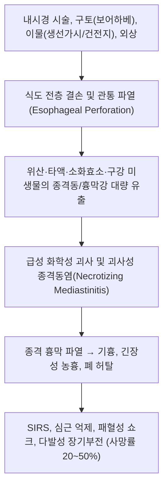

# 🩺 식도 파열 (Esophageal Perforation / 食道破裂·穿孔, K22.3)

> **핵심 3줄 요약 (Key Summary)**:
> - 📍 **병소 부위 & 병태생리**: [[식도]] 전층(경부, 흉부, 복부) 결손 및 파열. 의인성 시술(내시경 절제술, 풍선확장술 등 50~70%), 자발성 구토 파열([[보어하베 증후군]] 15%), 이물질 손상(생선가시, 단추형 건전지)으로 인해 위액·타액·세균이 종격동([[종격]]) 및 흉막강으로 유출됨.
> - 🚩 **전형적 임상 양상 & 3대 징후**: 급격히 발생하는 찢어지는 듯한 흉골하 흉통 또는 경부통, 호흡곤란, 경부·흉부 [[피하기종]](subcutaneous emphysema) 및 종격동 염발음(Hamman 징후).
> - 🛠️ **핵심 감별 & 한·양방 치료 전략**: [[급성 대동맥 박리]], [[급성 심근경색증]], [[소화관 천공]]과 응급 감별. 조기 수용성 조영 식도 조영술 및 조영 [[흉부 CT]]로 결손 부위 확인 후, 피복형 금속 스텐트(SEMS) 삽입, 내시경 음압 치료(EVT), 또는 24시간 이내 외과적 일차 봉합 및 흉강 배액술. 한의원 내원 즉시 119 응급 후송 대상(급성기 진료 절대 금기).
> - ⚠️ **응급 의뢰 레드플래그**: 내시경 시술 직후 또는 이물 섭취 후 발생하는 흉막성 흉통, 경부 염발음, 고열 및 저혈압 등 패혈성 쇼크 징후 발현 시 1분 1초를 다투는 최응급 질환으로 즉각 상급종합병원 응급의료센터로 후송.

---

## 📌 목차
1. [질환 개요 & 병태생리 (Disease Overview)](#1-질환-개요--병태생리-disease-overview)
2. [병태생리 메커니즘 & 대사·장기부전 악순환 네트워크](#2-병태생리-메커니즘--대사장기부전-악순환-네트워크)
3. [임상 증상 & 환자 소견 (Clinical Presentation)](#3-임상-증상--환자-소견-clinical-presentation)
4. [감별 진단 매트릭스 (Differential Diagnosis)](#4-감별-진단-매트릭스-differential-diagnosis)
5. [한의 통합 치료 프로토콜 (침·약침·한약)](#5-한의-통합-치료-프로토콜-침약침한약)
6. [양방 치료 & 병용·의뢰 기준 (Conventional Treatment & Referral)](#6-양방-치료--병용의뢰-기준-conventional-treatment--referral)
7. [식이·생활습관 & 자가관리 티칭 가이드](#7-식이생활습관--자가관리-티칭-가이드)
8. [💡 진료실 핵심 필기 & 임상 노하우](#8--진료실-핵심-필기--임상-노하우)
9. [출처 및 학술 참고 문헌 (References)](#9-출처-및-학술-참고-문헌-references)

---

## 1. 질환 개요 & 병태생리 (Disease Overview)

* **질환 정의 및 분류**:
  * **식도 파열 및 천공**(Esophageal Perforation / Rupture)은 식도 벽의 전층(점막, 점막하층, 근육층, 외막)이 물리적·화학적·기계적 원인으로 관통 파열되는 생명 위협성 흉부 응급 질환이다.
  * 소화관 전체에서 가장 치명적인 천공으로, 위나 대장 천공과 달리 식도는 장막(serosa)이 결여되어 있어 파열 시 종격동으로 감염이 여과 없이 급속 파급된다.
  * **원인별 분류**:
    1. **의인성 천공 (Iatrogenic Perforation, 약 50~70%)**: 가장 흔한 원인. 상부위장관 내시경 시술, 내시경 풍선확장술(이완불능증 치료 시 1~3%), 내시경 점막하 박리술(ESD), 스텐트 삽입, 식도 정맥류 결찰술, 기관내 삽관 중 발생.
    2. **자발성 파열 (Spontaneous / [[보어하베 증후군]], 약 15%)**: 심한 구토나 복압 급상승으로 인한 원위부 식도 좌후측벽 파열.
    3. **이물질 섭취 (Foreign Body, 약 10~15%)**: 닭뼈, 생선가시, 의치, 영유아의 단추형 건전지(수시간 내 액화 괴사 유발).
    4. **외상 (Trauma)**: 흉부 관통상, 자동차 핸들에 부딪히는 흉부 둔상.
    5. **부식제 손상 및 악성 종양 (Caustic Ingestion & Malignancy)**: 강산/강알칼리 음독, 식도암의 궤양성 괴사 천공.
* **관련 장기 및 조직**:
  * **경부 식도(Cervical)**: 전체의 약 15~20%. 경부 심부 근막강 및 후인두강 감염 유발(상대적으로 종격동 격리가 쉬워 예후 양호).
  * **흉부 식도(Thoracic)**: 전체의 약 55~65%. 급성 종격동염, 흉막강 파열, 농흉, 심낭기종 유발(사망률 가장 높음).
  * **복부 식도(Abdominal)**: 전체의 약 10~15%. 급성 복막염 및 횡격막하 농양 유발.

![[식도파열_1_흉부X선종격동기종.png|450]]
> [그림 1: 기립 전후면 흉부 X선 — 종격동 양측 연을 따라 유리공기 음영(화살표)이 보이고 양측 폐야 기저부에 흉수(별표)가 동반된 식도 파열의 소견 — 출처: Europe PMC — Cureus 2026 (Esophageal perforation during dilation). PMID 42669017, PMC13525844]

![[식도파열_1_경부공기계측X선.png|450]]
> [그림 2: 경부·상흉부 X선 — 경부 연부조직과 상종격동에 퍼진 유리공기를 계측 도구로 폭을 재어 기록한 영상(15.14 mm·4.95 mm). 피하기종의 범위를 객관적으로 평가한 예 — 출처: Europe PMC — Cureus 2026 (Esophageal perforation during dilation). PMID 42669017, PMC13525844]

---

## 2. 병태생리 메커니즘 & 대사·장기부전 악순환 네트워크

### 1) 분자·세포 및 해부학적 기전
* 식도는 외막(Adventitia)이 엉성한 소포성 결합조직으로만 둘러싸여 있어, 내강 파열 시 장벽 역할을 해줄 장막층(Serosa)이 존재하지 않는다.
* 파열 부위를 통해 1일 약 1~1.5L씩 분비되는 타액(침)과 역류된 위산(pH 1~2), 펩신이 음압(-5 ~ -10 cmH2O) 상태인 흉강 및 종격동으로 빨려 들어간다.
* 이로 인해 종격동 지방 조직과 림프관의 급속한 효소성 응고 괴사가 발생하며, 구강 내 호기성 및 혐기성 상재균(*Streptococcus*, *Staphylococcus*, *Bacteroides*, *Fusobacterium*, *Candida*)의 복합 균혈증이 촉발된다.

### 2) 전신 패혈증 악순환과 시간 의존성(Time-Dependent Lethality)
* **초기 골든타임(발병 24시간 이내)**:
  * 염증이 종격동에 국한되어 조기 봉합 및 배액술을 시행하면 생존율이 80~90%에 이름.
* **지연 단계(발병 24시간 경과 후)**:
  * 종격 흉막이 녹아내리며 흉막강으로 감염이 번져 농흉(Empyema)과 기흉이 동반됨.
  * 종격동 조직이 심하게 부종화되고 괴사되어 외과적 단순 봉합이 불가능해짐(봉합사가 치즈처럼 찢어짐).
  * 전신 염증 반응 증후군([[SIRS]])과 모세혈관 누출 증후군으로 혈액량이 급감하고, 내독소 쇼크에 의한 다발성 장기부전으로 사망률이 50% 이상으로 치솟음.

![[식도파열_2_피하기종CT.png|450]]
> [그림 3: 흉부 CT 축상면 — 흉벽과 액와 연부조직 사이로 공기가 박혀 검게 보이는 광범위 피하기종. 식도에서 새어 나온 공기가 종격동을 지나 피하까지 도달한 상태 — 출처: Wikimedia Commons — File:Subcutaneous emphysema chest cropped.jpg (CC BY-SA 3.0)]

---

## 3. 임상 증상 & 환자 소견 (Clinical Presentation)

### 1) 주소증 및 핵심 증상
* **격심한 급성 흉통 및 경부통**:
  * 흉부 천공: 흉골 뒤편이나 등(견갑골 사이)으로 방사되는 쥐어짜고 찢어지는 듯한 극통.
  * 경부 천공: 목 뒤쪽과 앞쪽의 뻐근하고 누르면 심해지는 연하통 및 목 운동 제한.
* **연하통(삼킴통) 및 연하곤란**: 침조차 삼킬 수 없을 정도의 극심한 통증.
* **호흡곤란(Dyspnea) 및 빈호흡**: 흉막 파열, 기흉, 늑막 삼출로 인한 폐 허탈.
* **피하기종(Subcutaneous Emphysema)**: 파열된 가스가 경부 및 흉벽 연부조직으로 올라와 만져질 때 눈 밟는 소리 촉지.

### 2) 객관적 소견 (Signs & Labs)
* **신체 진찰**:
  * **염발음(Crepitus)**: 쇄골 상와 및 목 부위 피부를 누르면 바스락거리는 느낌.
  * **Hamman 징후(Hamman's sign)**: 청진 시 심박동과 일치하여 들리는 종격동 마찰음.
  * 활력징후: 초기 빈맥(HR > 110회/분), 호흡수 증가(RR > 24회/분), 고열 또는 저체온, 패혈성 저혈압(SBP < 90 mmHg).
* **영상 의학 검사 (Diagnostic Imaging)**:
  * **조영 흉부 CT (Chest CT with oral contrast)**: 진단의 골드 스탠다드.
    * 식도벽 전층 결손 부위 확인, 종격동 기종(Pneumomediastinum), 심낭기종, 흉막 삼출, 농양 형성 범위 평가.
  * **수용성 조영 식도 조영술 (Gastrografin swallow)**:
    * 천공 부위에서 흉강/종격동으로 조영제가 새어나가는 누출 부위 시각화.
    * ⚠️ 바륨 조영제는 영구적 종격동 섬유화와 육아종을 유발하므로 절대 금기.
  * **단순 흉부 X-ray**: 종격동 확장, 경부 피하기종, 좌측 기흉 또는 흉수 관찰.

### 3) 중증도 평가 지표 (Pittsburgh Perforation Severity Score)
* 환자의 연령, 체온, 백혈구 수, 흉막 삼출, 쇼크 여부, 암 동반 등 12개 항목을 점수화:
  * 저위험군(Score ≤ 2): 비수술적/내시경적 중재 고려 가능.
  * 중등도군(Score 3~5): 내시경 스텐트 또는 적극적 배액술.
  * 고위험군(Score > 5): 즉각적 개흉 응급 수술 필수.

---

## 4. 감별 진단 매트릭스 (Differential Diagnosis)

| 감별 질환 | 특징적 양상 | 감별 포인트 (검사·수치) |
| :--- | :--- | :--- |
| [[식도 파열]] (본 질환) | 내시경 시술/구토/이물 후 찢어지는 흉통, 경부 피하기종 | 흉부 CT상 종격동 기종, 식도벽 결손, 수용성 조영제 누출 |
| [[급성 대동맥 박리]] | 찢어지는 듯한 등 통증, 혈압 좌우 비대칭, 뇌허혈 | 조영 CT상 대동맥 내막판(intimal flap), 종격동 기종 없음 |
| [[급성 심근경색증]] | 흉골 하부 압박감, 좌측 팔/턱 방사, 식은땀 | ECG상 ST 분절 상승, 트로포닌(Troponin) 심근 효소 상승 |
| [[Mallory-Weiss 증후군]] | 선행 구토 후 선홍색 토혈, 경미한 심와부 둔통 | 내시경상 점막 열상 국한, 흉부 X-ray/CT상 공기 누출 없음 |
| **소화관 천공 (위·십이지장)** | 상복부 급격한 판상강직, 반발통 | 복부 단순 촬영상 횡격막 하부 유리 가스(Free air) 관찰 |

> 🚩 **레드플래그 감별**: 내시경 검사나 시술 후 환자가 흉통, 호흡곤란, 미열을 호소한다면 단순 가스 팽만감으로 치부하지 말고 반드시 의인성 식도 천공을 최우선으로 의심하고 즉시 흉부 CT를 촬영해야 한다.

---

## 5. 한의 통합 치료 프로토콜 (침·약침·한약)

*⚠️ **절대 진료 금기 (Absolute Contraindication)**: 급성 식도 파열 및 천공은 의심되는 즉시 1분 1초를 다투는 초응급 외과 질환이므로, 원내 침·약침·한약 투여는 일체 금기이며 지체 없이 119를 호출해야 한다.*

* **수술적 치료 및 완전 폐쇄 확인 후 회복기 한의 보조 관리 (수술 수개월 후)**:
  * **수술 후 흉곽 신경통 및 근막 유착증**:
    * 개흉술 또는 흉관 삽입 부위의 만성 늑간신경통 완화: 늑간 신경 경로 자침, 협척혈, [[내관(PC6)]], [[외관(TE5)]], [[양릉천(GB34)]].
  * **만성 소모성 상태 및 비위 기능 부전**:
    * 장기간 금식과 중환자실 입원으로 인한 근감소증, 만성 피로 회복을 위해 [[보중익기탕]], [[십전대보탕]] 가미방 투여.
  * **식도 연하 반사 재활**:
    * 천돌(CV22), 염천(CV23) 자침을 통한 연하 근육 기능 재훈련.

---

## 6. 양방 치료 & 병용·의뢰 기준 (Conventional Treatment & Referral)

> 🎯 **이 섹션의 목적**: 조기 24시간 이내의 적극적 수술 및 최신 내시경 스텐트·음압 요법의 표준 프로토콜을 이해하고, 한의원 1차 진료에서 환자 이송을 신속히 수행한다.

* **초기 집중 소생 처치**:
  * **절대 금식(NPO)** 및 비위관 블라인드 삽입 금지.
  * 대용량 결정질 수액 소생 및 즉각적인 광범위 정맥 항생제 투여(카바페넴 또는 세페핌 + 반코마이신 + 메트로니다졸 + 플루코나졸).
* **치료 접근법의 결정**:
  1. **내시경적 최소 침습 치료 (선별된 환자)**:
     - **완전피복형 자가팽창 금속스텐트(FC-SEMS)**: 천공 부위를 물리적으로 덮어 타액 누출을 차단(4~8주 후 제거).
     - **내시경 음압 치료(Endoscopic Vacuum Therapy, EVT)**: 특수 스펀지를 천공 부위나 종격동 농양강에 넣고 지속 음압(-100~-125 mmHg)을 걸어 삼출액을 흡입하고 육아조직 증식 촉진.
     - **내시경 오베스코 클립(OTSC)**: 직경 1~2cm 미만의 조기 의인성 천공의 즉각적 물리적 봉합.
  2. **외과적 응급 수술 (Primary Surgery)**:
     - **24시간 이내**: 개흉술하 결손부 일차 봉합술(Primary repair) + 근육 피판(늑간근, 광배근) 보강술 + 광범위 흉강 세척 및 흉관 삽입.
     - **24시간 경과 후/조직 괴사 심할 때**: 식도 절제술(Esophagectomy) 또는 경부 식도루 및 위루술 조성 후 지연 재건술.
* **한의 병용 판단**:
  * 급성기: **전면 금기**.
  * 회복기: 조영술상 완전 누출 폐쇄 및 감염 지표(CRP, WBC) 정상화 확인 후 기능 회복 목적의 침구 및 한약 치료 가능.
* **양방·전문과 의뢰 기준 (Referral Criteria)**:
  * **즉시 119 응급 후송**:
    * 내시경 시술 직후 또는 이물질 섭취 후 흉통, 경부통, 호흡곤란, 발열 발생 시.
    * 목이나 앞가슴에서 사각거리는 피하기종(눈 밟는 느낌)이 확인되는 경우.
    * 혈압 저하(SBP < 90 mmHg), 청색증, 의식 저하 등 패혈성 쇼크 징후.

---

## 7. 식이·생활습관 & 자가관리 티칭 가이드

* **급성기**: 물을 포함한 완전 금식(경구 섭취 시 종격동 오염으로 즉사 위험).
* **수술 후 안정기 식이 단계**:
  * 조영 검사상 누출이 완전히 차단되었음을 확인한 후:
  * 1단계: 멸균 생수 소량 섭취.
  * 2단계: 맑은 유동식(미음, 숭늉).
  * 3단계: 연식(부드러운 죽).
  * 자극적인 음식, 뜨겁거나 차가운 음식, 질긴 음식은 수개월간 엄격히 제한.
* **생활습관 및 예방 티칭**:
  * **생선 및 육류 섭취 주의**: 생선 가시, 닭뼈 등을 섭취할 때 급하게 삼키지 말고 뼈를 철저히 발라내고 먹기.
  * **영유아 안전**: 리모컨, 장난감의 단추형 건전지(Button battery)는 식도에 걸릴 경우 2시간 이내에 식도 전층 천공을 일으키므로 유아 손이 닿지 않는 곳에 보관.
  * **과음 및 폭음 근절**: 자발성 파열([[보어하베 증후군]]) 예방을 위해 과음 후 구토 참지 않기.

---

## 8. 💡 진료실 핵심 필기 & 임상 노하우

* **의인성 천공 의심의 골든룰**:
  * "환자가 1~2일 전 건강검진이나 치료 목적으로 위내시경 검사를 받았는가?"
  * 내시경 시술 후 발생한 흉통과 미열은 100% 식도 천공 가능성을 염두에 두어야 한다.
* **생선 가시 걸림 환자 대처법**:
  * 로컬 한의원에 "목에 생선 가시가 걸린 뒤 가슴이 아프다"며 내원하여 침 치료나 밥 한 숟가락 꿀꺽 삼키기를 시도하려는 환자가 있다.
  * 밥을 억지로 삼키면 가시가 식도벽을 더 깊이 뚫고 들어가 대동맥이나 종격동 천공을 유발할 수 있으므로 절대 금기이며, 즉시 이비인후과나 응급실로 보내 내시경하 제거를 받도록 해야 한다.
* **피하기종(염발음) 촉진법**:
  * 환자의 양측 쇄골 상와(결분혈 부위)를 엄지와 검지로 지그시 누르면 비닐 포장용 뽁뽁이 터지는 사각거리는 감각이 손끝에 전해진다. 이 소견이 있다면 1초도 지체하지 말고 119를 불러야 한다.

---

## 9. 출처 및 학술 참고 문헌 (References)

1. **MSD 매뉴얼 전문가용** — [Esophageal Rupture and Perforation](https://www.msdmanuals.com/professional/gastrointestinal-disorders/esophageal-and-swallowing-disorders/esophageal-rupture)

2. **Papaconstantinou D et al. (2026)**. *Management of iatrogenic esophageal perforations: a systematic review of non-surgical causes*. **Surg Endosc**, 40(5):3709-3720. [PMID 42377532](https://pubmed.ncbi.nlm.nih.gov/42377532/)
   - **[연구 요약]**: 의인성 식도 천공 환자의 보존적 치료와 내시경 클립 및 스텐트 삽입술의 체계적 문헌고찰.

3. **Saqib M et al. (2025)**. *Esophageal stenting and endoscopic vacuum therapy for esophageal defects: a systematic review and meta-analysis of observational studies*. **Ann Med Surg (Lond)**, 87(9):5963-5972. [PMID 40901101](https://pubmed.ncbi.nlm.nih.gov/40901101/)
   - **[연구 요약]**: 식도 결손 및 파열 환자에서 자가팽창형 스텐트와 내시경 음압 치료의 폐쇄 성공률 비교 메타분석.

4. **Mela E et al. (2026)**. *Diagnostic Approach and Therapeutic Management of Spontaneous Esophageal Perforation (Boerhaave's Syndrome): A Systematic Review and Individual Patient-Level Pooled Analysis*. **J Clin Med**, 15(18):6021. [PMID 42795805](https://pubmed.ncbi.nlm.nih.gov/42795805/)
   - **[연구 요약]**: 자발성 식도 천공 환자의 조기 진단 접근법과 내시경적 스텐트 및 외과적 수술의 다기관 메타분석.

---

## 관련 노트

- [[_의학/03_이론/질환/소화기 질환/01_구강·식도/보어하베 증후군|보어하베 증후군]]
- [[_의학/03_이론/질환/소화기 질환/01_구강·식도/Mallory-Weiss 증후군|Mallory-Weiss 증후군]]
- [[_의학/03_이론/질환/소화기 질환/01_구강·식도/식도 주머니 게실|식도 주머니 게실]]
- [[_의학/03_이론/질환/소화기 질환/02_위·십이지장/소화관 천공|소화관 천공]]
