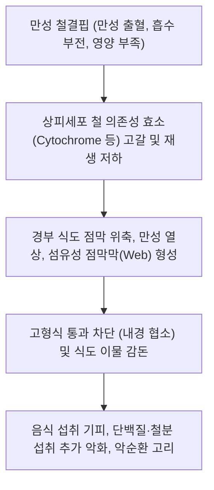

# 🩺 식도막 (Esophageal Web / 食道膜·食道輪, K22.2)

> **핵심 3줄 요약 (Key Summary)**:
> - 📍 **병소 부위 & 병태생리**: [[식도]] 내강으로 돌출된 얇은(1~2mm) 점막 주름. 상부 경부 식도에 발생하는 편평상피 점막막(Web, [[플러머-빈슨 증후군]] 동반)과 하부 [[위식도접합부]]에 발생하는 점막성 고리(Schatzki ring, 샤츠키 링)로 대별됨.
> - 🚩 **전형적 임상 양상 & 3대 징후**: 덩어리진 고형식(육류, 떡, 빵) 섭취 시 발생하는 간헐적 [[삼킴곤란]](연하곤란), 급성 음식물 목걸림(스테이크하우스 증후군), 플러머-빈슨 동반 시 만성 피로·설염·숟가락형 손톱(스푼네일).
> - 🛠️ **핵심 감별 & 한·양방 치료 전략**: 식도암, 소화성 식도 협착, [[호산구성 식도염]], [[식도 연축]]과 감별. 양방 바륨 식도 조영술 및 내시경 확인 후 풍선확장술 또는 내시경 점막절개술, 철결핍성 빈혈 교정. 한의 진료에서는 기혈양허·담기울결 변증 한약([[당귀보혈탕]], [[귀비탕]], [[반하후박탕]]) 및 침구 치료를 통한 조혈 기능 촉진과 인후부 연하 반사 정상화.
> - ⚠️ **응급 의뢰 레드플래그**: 음식물 덩어리가 완전히 감돈(Food impaction)되어 침도 못 삼키고 질식 위험이 있는 경우 즉각 응급 내시경 제거 의뢰; 플러머-빈슨 환자에서 이형성증 또는 식도암 전암 병변 감시 필수.

---

## 📌 목차
1. [질환 개요 & 병태생리 (Disease Overview)](#1-질환-개요--병태생리-disease-overview)
2. [병태생리 메커니즘 & 대사·장기부전 악순환 네트워크](#2-병태생리-메커니즘--대사장기부전-악순환-네트워크)
3. [임상 증상 & 환자 소견 (Clinical Presentation)](#3-임상-증상--환자-소견-clinical-presentation)
4. [감별 진단 매트릭스 (Differential Diagnosis)](#4-감별-진단-매트릭스-differential-diagnosis)
5. [한의 통합 치료 프로토콜 (침·약침·한약)](#5-한의-통합-치료-프로토콜-침약침한약)
6. [양방 치료 & 병용·의뢰 기준 (Conventional Treatment & Referral)](#6-양방-치료--병용의뢰-기준-conventional-treatment--referral)
7. [식이·생활습관 & 자가관리 티칭 가이드](#7-식이생활습관--자가관리-티칭-가이드)
8. [💡 진료실 핵심 필기 & 임상 노하우](#8--진료실-핵심-필기--임상-노하우)
9. [출처 및 학술 참고 문헌 (References)](#9-출처-및-학술-참고-문헌-references)

---

## 1. 질환 개요 & 병태생리 (Disease Overview)

* **질환 정의 및 분류**:
  * **식도막 및 식도고리**(Esophageal Web and Ring)는 식도 내강을 가로질러 부분적으로 좁히는 얇은 선천성 또는 후천성 점막 주름(띠) 구조물을 총칭한다.
  * **해부학적 위치 및 병리학적 분류**:
    1. **식도막 (Esophageal Web)**:
       - 주로 **상부 경부 식도**(윤상연골 직하부 전벽)에 호발하는 1~2mm 두께의 얇은 격막.
       - 조직학적으로 중층편평상피와 혈관성 점막하층 결합조직으로만 구성됨(근육층 없음).
       - 만성 철결핍성 빈혈, 위축성 설염과 동반되는 경우 [[플러머-빈슨 증후군]](Plummer-Vinson Syndrome / Paterson-Kelly syndrome)으로 명명되며, 중년 여성에서 호발하고 식도 편평상피암의 중요한 전암성 병변임.
    2. **하부 식도고리 / 샤츠키 고리 (Schatzki Ring / B-ring)**:
       - **하부 [[위식도접합부]]**(Z-line)에 발생하는 점막성 원형 고리.
       - 상면은 식도 편평상피, 하면은 위 원주상피로 덮여 있으며, [[열공 탈장]](Hiatal hernia) 및 만성 위식도 역류증과 밀접하게 연관됨.
       - 내경이 13mm 미만일 때 전형적인 연하 장애를 유발함.
* **관련 장기 및 조직**:
  * **주 이환 부위**: 경부 상부 식도(Web), 원위부 위식도접합부(Schatzki ring).
  * **연관 전신 대사**: 철(Iron) 대사계, 조혈계, 두경부 및 상부 소화관 편평상피.

![[식도막_1_내시경식도막.png|450]]
> [그림 1: 상부위장관 내시경 — 식도 내강을 가로질러 얇은 막이 둥글게 남아 있고 가운데 작은 구멍으로만 통과되는 식도막(esophageal web)의 전형적 내시경 소견 — 출처: Wikimedia Commons — File:Esophageal web.jpg (CC BY-SA 3.0)]

![[식도막_1_측면조영술막.png|450]]
> [그림 2: 측면 식도 조영술 — 경부 식도 전벽에서 안쪽으로 얇은 선상 결손(막 선반)이 돌출하고 그 위쪽 식도가 약간 확장된 소견. 식도막은 내시경으로도 놓치기 쉬워 조영술이 함께 필요하다 — 출처: Wikimedia Commons — File:Radiology 0025 Nevit.jpg (CC BY-SA 3.0)]

---

## 2. 병태생리 메커니즘 & 대사·장기부전 악순환 네트워크

### 1) 분자·세포 수준 기전
* **식도막과 철결핍(Plummer-Vinson 기전)**:
  * 철분([[철분 결핍]])은 헤모글로빈 합성뿐 아니라 상피세포의 미토콘드리아 호흡 사슬 효소(시토크롬 C, 미오글로빈, 카탈라아제)의 필수 보조인자이다.
  * 장기간의 심각한 철결핍 상태가 지속되면 상피 턴오버 속도가 빠른 구강 및 상부 식도 점막에서 세포 분열 및 산화 스트레스 방어능이 급격히 저하된다.
  * 연하 시 음식물 마찰이 가장 심한 경부 식도 전벽 점막에서 미세 열상과 만성 염증이 반복되고, 치유 과정에서 비정상적인 섬유성 점막 주름(Web)이 형성된다.
* **샤츠키 고리(Schatzki Ring 기전)**:
  * 열공 탈장으로 인해 하부식도괄약근 지지 구조가 약화되고, 반복적인 위산 역류([[위산 과다]])에 노출된 편평상피-원주상피 경계부가 만성 염증과 반흔성 수축을 겪으면서 원형의 점막 주름으로 섬유화된다.

### 2) 기계적 폐쇄 및 임상적 악순환
* 식도 내강 직경이 20mm 이상이면 무증상이지만, 막이나 고리로 인해 내경이 13mm 이하로 좁아지면 씹지 않고 삼킨 고기 덩어리나 떡 등이 통과하지 못하고 걸린다.
* 이를 '스테이크하우스 증후군(Steakhouse syndrome)'이라 하며, 급성 식도 감돈(Food impaction) 시 환자는 심한 흉통과 공포감으로 음식 섭취를 기피하게 되어 영양실조가 심화된다.
* 플러머-빈슨 증후군의 위축된 상피는 DNA 손상 복구능이 떨어져 하인두암 및 식도 편평상피세포암으로의 악성 전환 위험률이 약 3~15%에 달한다.

---

## 3. 임상 증상 & 환자 소견 (Clinical Presentation)

### 1) 주소증 및 핵심 증상
* **간헐적 고형식 삼킴곤란([[삼킴곤란]]/Dysphagia)**:
  * 고형식(육류, 딱딱한 빵, 찰떡 등)을 급하게 삼킬 때 목구멍이나 명치 뒤에서 턱 걸리는 느낌.
  * 물이나 맑은 국물 등 액체류는 전혀 걸림 없이 원활히 통과함(운동성 장애와의 명확한 감별점).
* **음식물 감돈 발작 (Food Impaction)**:
  * 식사 중 갑자기 고기 조각이 걸려 침도 삼키지 못하고 구토하거나 물을 마셔도 솟구쳐 오르는 응급 상황.
* **플러머-빈슨 증후군 동반 징후**:
  * 만성 피로, 안색 창백, 어지럼증(빈혈 소견).
  * 혀가 빨갛고 표면이 반들반들해지며 쓰라린 위축성 설염(Glossitis).
  * 입꼬리가 찢어지고 헐어 있는 구각염(Angular cheilitis).
  * 손톱이 얇아지고 가운데가 오목하게 파이는 숟가락형 손톱(Koilonychia / Spoon nails).

### 2) 객관적 소견 (Signs & Labs)
* **혈액학적 검사**:
  * **일반혈액검사(CBC)**: 소구성 저색소성 빈혈(Microcytic hypochromic anemia, Hb < 10 g/dL, MCV < 80 fL).
  * **철 대사 검사**: 혈청 페리틴(Ferritin) 현저한 저하(< 15 ng/mL), 혈청 철(Fe) 감소, 총철결합능(TIBC) 증가.
* **진단 영상 검사**:
  * **바륨 식도 조영술 (Barium Esophagogram)**:
    * **진단의 최적 검사**.
    * 측면 투시상 경부 상부 식도 전벽에서 얇은 선상 결손으로 돌출하는 막(Web) 확인.
    * 하부식도 Z-line에서 대칭적으로 조여진 샤츠키 고리(Schatzki ring) 확인(바륨 정제 Barium pill 삼킴 검사 병용 시 폐쇄성 내경 정확히 측정).
  * **상부위장관 [[내시경 검사]]**:
    * 내시경 진입 시 얇은 점막막이 찢어지며 우발적으로 치료되기도 함.
    * 플러머-빈슨 증후군 환자에서는 식도암 동반 여부 확인을 위한 정밀 관찰 필수.

---

## 4. 감별 진단 매트릭스 (Differential Diagnosis)

| 감별 질환 | 특징적 양상 | 감별 포인트 (검사·수치) |
| :--- | :--- | :--- |
| [[식도막]] / 샤츠키 고리 (본 질환) | 고형식만 간헐적으로 걸림, 물은 통과 양호, 빈혈 동반 | 바륨 조영술상 1~2mm 얇은 선상 결손/원형 고리, 생검상 악성 없음 |
| **식도암 (Esophageal Cancer)** | 고령, 흡연자의 고형식에서 액체로 진행하는 연하곤란 | 내시경상 외장성 종괴 및 궤양, 악성 편평상피세포 확인 |
| **소화성 식도 협착 (Peptic Stricture)** | 오랜 역류성 식도염 병력 후 점진적 고형식 협착 | 조영술상 테이퍼형(Tapered) 긴 협착 분절, 섬유성 협착 |
| [[호산구성 식도염]] (EoE) | 젊은 아토피 환자의 잦은 음식물 걸림 | 내시경상 다발성 윤상 주름(trachealization), 생검상 호산구 ≥15/HPF |
| [[식도 이완불능증]] | 고형식과 액체 모두에 대한 연하곤란, 비산성 역류 | HRM상 IRP 상승 및 무연동, 조영술상 새부리 징후 |

> 🚩 **레드플래그 감별**: 플러머-빈슨 증후군 환자에서 연하곤란의 양상이 고형식뿐 아니라 액체로까지 빠르게 진행하거나 체중 감소가 동반된다면 식도막 부위에서 속발한 식도암(Squamous cell carcinoma)을 즉시 의심해야 한다.

---

## 5. 한의 통합 치료 프로토콜 (침·약침·한약)

*식도막 환자 중 플러머-빈슨 증후군은 철분 보충과 함께 한의학적 보혈보기(補血補氣) 치료를 병용할 때 골수 조혈 기능 회복과 상피 재생이 극대화된다. 샤츠키 고리는 위식도 역류 억제와 연하 반사 촉진을 목표로 한다.*

### 1) 변증 분류
* **기혈양허증(氣血兩虛證)**: 만성 빈혈, 창백, 어지럼증, 권태무력, 손톱 취약, 고형식 삼킴 곤란, 설담소태, 맥세약.
* **담기울결증(痰氣鬱結證)**: 인후부 매핵기, 목에 무언가 걸린 듯 답답함, 정서 불안, 설태백니, 맥현활.
* **비위허약증(脾胃虛弱證)**: 소화불량, 식욕부진, 잦은 체함, 연식만 섭취 가능, 설담태백, 맥완약.

### 2) 침구 치료 (Acupuncture)
* **주혈**: [[족삼리(ST36)]], [[삼음교(SP6)]], [[혈해(SP10)]], [[내관(PC6)]], [[천돌(CV22)]].
* **배혈**:
  * 조혈 촉진 및 보기: [[비수(BL20)]], [[위수(BL21)]], [[격수(BL17)]](혈회), [[기해(CV6)]].
  * 연하 반사 활성화: [[염천(CV23)]], [[인영(ST9)]], [[합곡(LI4)]].
* **자침 기법**:
  * 격수-혈해-삼음교 배혈: 보법(補法)을 적용하여 기혈 생성을 촉진하고 조혈 기능을 활성화.
  * 천돌혈: 연하 시 경부 식도 주변 근육 긴장 완화.

### 3) 약침 치료 (Pharmacopuncture)
* **적용 혈위**: [[족삼리(ST36)]], [[비수(BL20)]], [[격수(BL17)]].
* **제제 선택**:
  * 자하거(태반) 약침: 대보원기(大補元氣), 보혈익정(補血益精) 작용으로 만성 소모성 빈혈 환자의 상피 세포 재생 및 골수 조혈 자극.
  * 황련해독탕 약침: 샤츠키 고리 환자의 위식도 점막 만성 역류 염증 완화.

### 4) 한약 치료 (Herbal Medicine)
* **기혈 쌍보 및 조혈 상피 재생 (플러머-빈슨 증후군 1순위)**:
  * [[당귀보혈탕]] 합 [[사물탕]]: 황기 30~40g, 당귀 12g, 숙지황, 백작약, 천궁. 양방 철분제와 병용 시 소화기 부작용(위장장애, 변비)을 경감시키고 헤모글로빈 회복 속도를 현저히 단축시킴.
* **심비양허 및 만성 영양 부족**:
  * [[귀비탕]]: 빈혈로 인한 건망, 불면, 심계항진과 함께 식욕부진이 동반된 환자의 비위 기능과 혈액 생성 회복.
* **담음 정체 및 식도 통과 장애 완화**:
  * [[반하후박탕]] 가감방: 지실, 죽여, 백작약을 배합하여 식도 점막 긴장 완화 및 연하 통과감 개선.

---

## 6. 양방 치료 & 병용·의뢰 기준 (Conventional Treatment & Referral)

> 🎯 **이 섹션의 목적**: 양방의 기계적 내시경 확장술 및 철분 요법의 적응증을 명확히 이해하고, 시술 후 재협착 방지를 위한 통합 관리 방안을 수립한다.

* **양방 표준 치료 (Standard Medical & Endoscopic Therapy)**:
  * **철분 보충 요법 (Iron Replacement)**:
    * 플러머-빈슨 증후군의 경우 경구 철분제(황산제일철 Ferrous sulfate 등) 또는 정맥 철분 주사 투여만으로도 상부 식도막이 자연 퇴행하거나 소실되는 경우가 많음.
  * **내시경적 풍선 확장술 (Endoscopic Balloon Dilation)**:
    * 유증상 식도막 및 샤츠키 고리의 1차 표준 치료.
    * Through-The-Scope(TTS) 풍선 카테터를 협착부에 위치시킨 후 16~20mm로 팽창시켜 얇은 점막막이나 고리를 물리적으로 파열(Rupture)시킴.
  * **내시경 점막절개술 (Endoscopic Incision / Electrosurgical Myotomy)**:
    * 확장술 후 재발하는 난치성 샤츠키 링이나 두꺼운 식도막 환자에서 절개도(Hook knife 등)를 이용해 방사상 절개(Radial incision) 시행.
  * **위산 분비 억제제([[PPI]]) 투여**:
    * 샤츠키 고리 환자에서 풍선 확장술 후 PPI를 지속 투여하면 재협착률이 현저히 감소함.
* **한의 병용 판단 (Combination Therapy)**:
  * **병용 권장**: 양방 철분 복용 시 흔히 발생하는 오심, 속쓰림, 소화불량에 대해 건비익기 한약([[육군자탕]], [[보중익기탕]])을 병용하면 철분제 복용 순응도를 극대화할 수 있음. 내시경 확장술 후 잔여 연하불편감 완화를 위한 침 치료 병용 유효.
* **양방·전문과 의뢰 기준 (Referral Criteria)**:
  * **즉각적 응급실 의뢰**:
    * 식사 중 고기나 떡이 식도에 완전히 걸려 호흡곤란이나 지속적 구토를 유발하는 음식물 감돈(Food impaction).
  * **소화기내과 외래 의뢰**:
    * 바륨 조영술상 식도막이나 샤츠키 링이 확인되어 내시경적 풍선 확장술이 필요한 경우.
    * 플러머-빈슨 증후군 환자의 식도암 조기 발견을 위한 정기적 내시경 감시.

---

## 7. 식이·생활습관 & 자가관리 티칭 가이드

* **식이 지도 (Diet)**:
  * **완전 저작 습관 (가장 중요)**:
    * '스테이크하우스 증후군'을 예방하기 위해 고기나 빵 등 고형식을 먹을 때는 반드시 잘게 썰어 한 입당 30회 이상 꼭꼭 씹어 죽 상태로 삼키기.
  * **철분 풍부 식이 섭취 (플러머-빈슨 환자)**:
    * 붉은 살코기, 소간, 굴, 시금치, 깻잎 등 철분과 비타민 C가 풍부한 음식을 적극 섭취.
  * **식사 중 수분 섭취**: 음식이 걸리는 느낌이 들 때 무리하게 억지로 삼키지 말고 물 한 모금으로 부드럽게 넘기기.
* **생활습관 (Lifestyle)**:
  * **역류 방지 습관 (샤츠키 링 환자)**:
    * 식후 2시간 동안 눕지 않기, 야식 금지, 과식 피하기.
  * **구강 위생 관리**: 구각염과 설염 예방을 위해 부드러운 칫솔질 및 입술 보습 유지.
* **환자 교육 스크립트**:
  * *"목이나 명치 쪽에 얇은 그물막 같은 주머니 주름이 생겨 덩어리 음식이 걸리는 질환입니다. 특히 피가 부족한 빈혈이 오래되면 식도 껍질이 거칠어지며 막이 생기기 쉽습니다. 양방 철분제와 한방 조혈 치료로 피를 맑게 채워주면서, 내시경으로 막을 살짝 넓혀주는 시술을 받으시면 안전하게 식사하실 수 있습니다."*

---

## 8. 💡 진료실 핵심 필기 & 임상 노하우

* **문진 시 핵심 감별 질문**:
  * "음식이 걸릴 때 밥이나 고기만 걸리나요, 아니면 물이나 국물도 안 넘어가나요?"
  * 식도막/샤츠키 링 환자는 100% "물은 전혀 안 걸리는데 고기나 마른 빵을 급하게 먹을 때만 꽉 막힌다"고 대답한다. 액체까지 걸린다면 식도 운동 질환이나 진행된 악성 종양을 의심해야 한다.
* **중년 여성 환자의 손톱과 입술 확인**:
  * 중년 여성이 삼킴곤란을 호소하며 내원하면 반드시 손톱을 보아야 한다. 손톱이 스푼처럼 오목하게 파여 있거나 혀가 반들반들하게 붉어져 있다면 99% 플러머-빈슨 증후군이다. 이 경우 단순 위장약만 처방해서는 호전되지 않으며 반드시 철분 대사를 교정해야 한다.
* **철분제 위장장애 극복 노하우**:
  * 양방 철분제를 먹고 속이 쓰리고 대변이 까맣게 굳어 중단했다는 환자가 많다. 이때 백출, 복령, 당귀, 황기가 배합된 한약 처방을 함께 투여하면 비위 점막이 보호되어 철분 흡수율이 높아지고 위장장애 없이 완치로 이끌 수 있다.

---

## 9. 출처 및 학술 참고 문헌 (References)

1. **MSD 매뉴얼 전문가용** — [Esophageal Web and Schatzki Ring](https://www.msdmanuals.com/professional/gastrointestinal-disorders/esophageal-and-swallowing-disorders/esophageal-web)

2. **Akueme NT et al. (2026)**. *When Dysphagia Is Not Psychogenic: An Atypical Presentation of Schatzki Ring in a Patient With Schizophrenia*. **Cureus**, 18(7):e112272. [PMID 42569743](https://pubmed.ncbi.nlm.nih.gov/42569743/)
   - **[연구 요약]**: 정신과적 연하곤란으로 오인된 하부 식도 샤츠키 고리 환자의 내시경적 풍선 확장술 치유 증례 보고.

3. **Yamamoto K et al. (2025)**. *Endoscopic mucoplasty as a novel approach for cervical esophageal web*. **Endoscopy**, 57(S 01):E1045-E1047. [PMID 40925549](https://pubmed.ncbi.nlm.nih.gov/40925549/)
   - **[연구 요약]**: 경부 식도막 환자에서 내시경 점막성형술을 통한 안전하고 효과적인 내강 확장 치료 기법 보고.

4. **Jamieson SI et al. (2026)**. *Plummer-Vinson Syndrome Presenting With Aspiration Pneumonia: A Case Report*. **Cureus**, 18(5):e108736. [PMID 42291929](https://pubmed.ncbi.nlm.nih.gov/42291929/)
   - **[연구 요약]**: 철결핍성 빈혈과 상부 식도막으로 인한 흡인성 폐렴을 주소로 내원한 플러머-빈슨 증후군 환자의 임상 경과 및 철분 치료 반응.

---

## 관련 노트

- [[_의학/03_이론/질환/소화기 질환/01_구강·식도/식도 주머니 게실|식도 주머니 게실]]
- [[_의학/03_이론/질환/소화기 질환/01_구강·식도/식도 운동성 장애|식도 운동성 장애]]
- [[_의학/03_이론/질환/소화기 질환/01_구강·식도/호산구성 식도염|호산구성 식도염]]
- [[_의학/03_이론/질환/소화기 질환/01_구강·식도/역류성 식도염|역류성 식도염]]
