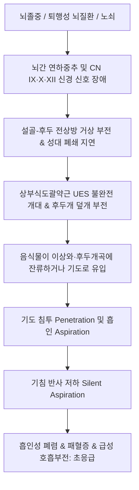

# 🩺 연하장애 (삼킴장애, Dysphagia / 嚥下障碍)

> **핵심 3줄 요약 (Key Summary)**:
> - 📍 **정의 & 병태생리**: 음식물 덩어리(식괴, Bolus)가 구강에서 인두 및 식도를 거쳐 위장으로 이동하는 연하 기전(구강기·인두기·식도기)에 장애가 발생한 병태. [[뇌졸중]](CVA), 파킨슨병, 근위축성 측삭경화증(ALS) 등 중추·말초 신경근 질환(신경인성 연하장애)과 식도 협착·식도암 등 기계적 폐쇄가 양대 축을 이룬다.
> - 🚩 **임상 양상**: 식사 중 사레들림(Choking), 기침, 쉰 목소리(Wet voice), 음식물 잔류감, 식후 발열 및 원인 불명의 체중 감소. 특히 감각 저하로 사레 반응 없이 기도로 넘어가는 **무증상 흡인(Silent Aspiration)**은 흡인성 폐렴의 최대 위험 인자이다.
> - 🛠️ **치료 원칙**: 비디오 투시 연하검사(VFSS) 및 연하내시경(FEES)을 통한 정확한 흡인 단계 평가. 턱 당기기(Chin-tuck), 멘델슨 수기, 점도증진제를 통한 식이 수정. 한의학적으로 풍담저락(風痰阻絡), 기허혈어(氣虛血瘀), 비신양허(脾腎兩虛) 변증 하에 [[도담탕]], [[보양환오탕]], [[육미지황탕]] 투여 및 설골상근군 신경근 자극([[염천]], [[예풍]], [[풍지]]) 침치료.
> - ⚠️ **응급 의뢰 레드플래그**: 지속되는 발열, 화농성 가래, 빈호흡 동반 시 급성 흡인성 폐렴(Aspiration pneumonia) 의심 즉시 내과 전원; 고형식에 국한되어 급격히 악화되는 진행성 연하장애는 식도암 배제 내시경 필수.

---

## 📌 목차
1. [질환 개요 & 해부학적 병태생리](#1-질환-개요--해부학적-병태생리)
2. [병태생리 메커니즘 & 정상 연하 3단계 신경망](#2-병태생리-메커니즘--정상-연하-3단계-신경망)
3. [임상 증상 & 이학적 선별·VFSS 평가 알고리즘](#3-임상-증상--이학적-선별vfss-평가-알고리즘)
4. [감별 진단 매트릭스 (구인두성 vs 식도성)](#4-감별-진단-매트릭스-구인두성-vs-식도성)
5. [한의 통합 치료 프로토콜 (침·전침·약침·한약)](#5-한의-통합-치료-프로토콜-침전침약침한약)
6. [양방 치료 & 재활 기법·식이 점도 조절 (Conventional Treatment & Referral)](#6-양방-치료--재활-기법식이-점도-조절-conventional-treatment--referral)
7. [연하 재활 운동 & 기도 흡인 예방 티칭 가이드](#7-연하-재활-운동--기도-흡인-예방-티칭-가이드)
8. [💡 사용자 진료실 핵심 필기 & 임상 노하우 (Melt-In 잔여 심화 집약)](#8-💡-사용자-진료실-핵심-필기--임상-노하우-melt-in-잔여-심화-집약)
9. [출처 및 학술 참고 문헌 (References)](#9-출처-및-학술-참고-문헌-references)

---

## 1. 질환 개요 & 해부학적 병태생리

### 1) 질환 정의 및 역학
- **연하장애(Dysphagia)**: 음식물이나 수분이 구강에서 인두, 식도를 거쳐 위장으로 넘어가는 일련의 삼킴 과정에서 지연, 정체, 오도(誤導: 기도로의 유입)가 발생하는 상태이다.
- **역학**: 급성기 [[뇌졸중]] 환자의 50~70%에서 발생하며, 회복 후에도 약 20%에서 만성 연하장애가 잔존한다. 요양병원 입원 고령 환자의 30~40%, 파킨슨병 환자의 80% 이상에서 호발한다.
- **주요 합병증**: 흡인성 폐렴(뇌졸중 사망의 주요 원인), 탈수, 영양실조, 기도 질식(Asphyxia).

### 2) 연하 관련 핵심 신경해부학 구조
- **뇌간 연하중추(Swallowing Center)**: 연수(Medulla)의 고속핵(Nucleus tractus solitarius, NTS — 감각 수용) 및 의핵(Nucleus ambiguus, NA — 운동 출력).
- **뇌신경 지배 네트워크**:
  - 삼차신경(CN V): 저작근, 구강 점막 감각.
  - 안면신경(CN VII): 구순 폐쇄, 구륜근.
  - 설인신경(CN IX): 인두 감각, 경돌인두근.
  - 미주신경(CN X): 구개수 거근, 인두수축근, 후두개 하강, 성대 내전.
  - 설하신경(CN XII): 설근 전후상하 운동.

---

## 2. 병태생리 메커니즘 & 정상 연하 3단계 신경망

### 1) 정상 연하 3단계 생리
1. **구강기 (Oral Phase - 수의적)**:
   - 구강 준비기: 치아 저작과 타액 혼합으로 음식물 덩어리(Bolus) 형성.
   - 구강 추진기: 혀가 경구개와 연구개에 차례로 밀착되며 식괴를 인두 전벽으로 이동시킴 (약 1초 소요).
2. **인두기 (Pharyngeal Phase - 불수의적 반사, 0.7~1초)**:
   - 연구개가 거상되어 비인강 폐쇄(비강 역류 방지).
   - 설골 및 후두가 전상방으로 거상(Hyolaryngeal excursion).
   - 후두개(Epiglottis)가 하강하고 진성대·가성대가 굳게 닫혀 기도 폐쇄.
   - 상부식도괄약근(UES / Cricopharyngeus)이 이완되어 식괴가 식도로 진입.
3. **식도기 (Esophageal Phase - 불수의적, 8~20초)**:
   - 연동운동(Peristalsis)에 의해 식괴가 하부식도괄약근(LES)을 거쳐 위장으로 이동.

### 2) 병태생리 악순환 도식

---

## 3. 임상 증상 & 이학적 선별·VFSS 평가 알고리즘

### 1) 임상 증상
- 식사 중 또는 식후 잦은 기침 및 사레들림, 식사 시간의 과도한 연장(> 45분).
- 삼킨 후 목소리가 젖은 소리(Wet/Gurgly voice)로 변함.
- 식괴를 삼키지 못하고 입안에 물고 있음, 구강 외 음식물 누출.
- 설명되지 않는 미열, 반복되는 기관지염 및 폐렴 병력.

### 2) 침상 선별 검사 및 정밀 진단 SOP
1. **30mL 물 삼킴 검사(Kubota Water Swallow Test)**:
   - 미온수 30mL를 컵으로 마시게 한 후 삼킴 횟수, 기침 여부, 젖은 목소리 평가 (1~5단계 판정).
2. **반복 타액 삼킴 검사(RSST, Repetitive Saliva Swallowing Test)**:
   - 30초 동안 침을 연속으로 삼킨 횟수 측정 (3회 미만 시 구인두 연하장애 고위험군).
3. **비디오 투시 연하검사(VFSS - Gold Standard)**:
   - 바륨을 섞은 다양한 점도(유동식, 연식, 고형식)의 조영제를 섭취하며 X선 투시로 구강·인두 통과 시간, 후두 거상 정도, 이상와 잔류, 기도 침투 및 흡인을 실시간 동영상 판독.
4. **연하내시경 검사(FEES)**:
   - 후두경을 비강으로 삽입하여 삼킴 직전과 직후의 분비물 저류 및 성대 폐쇄 확인.

---

## 4. 감별 진단 매트릭스 (구인두성 vs 식도성)

| 감별 항목 | 구인두성 연하장애 (Oropharyngeal) | 식도성 연하장애 (Esophageal) |
| :--- | :--- | :--- |
| **병소 위치** | 구강, 인두, 상부식도괄약근(UES) | 식도 체부, 하부식도괄약근(LES) |
| **원인 질환** | [[뇌졸중]], 파킨슨병, ALS, 중증 근무력증, 젠커 게실 | [[식도암]], [[식도 협착증]], [[식도 이완불능증]](Achalasia), GERD |
| **발생 시점** | 삼키기 시작하는 **즉시 (1초 이내)** | 삼킨 후 **수 초 뒤 (가슴 부위 턱 걸림)** |
| **호발 음식** | **액체류(물, 국물)**에서 사레 호발 | 기계적 협착은 **고형식**, 운동질환은 **액체+고형식 모두** |
| **동반 증상** | 비강 역류, 기침, 사레, 구음장애(構音障碍) | 흉골 후방 통증, 역류, 신물, 체중 감소 |

---

## 5. 한의 통합 치료 프로토콜 (침·전침·약침·한약)

### 1) 변증별 한약 처방 프로토콜
1. **풍담저락(風痰阻絡)형 (중풍 후기 급성 마비)**:
   - 주증: 뇌졸중 후 혀가 굳어 말이 어눌하고(설강불어), 가래가 끓으며 삼키지 못함.
   - 처방: [[도담탕]] 합 [[견정산]] 가감, [[성향정기산]](반하, 천남성, 진피, 복령, 지실, 백강잠, 전갈).
2. **기허혈어(氣虛血瘀)형 (뇌혈관 후유증 및 만성기)**:
   - 주증: 반신마비, 무기력, 안색 창백, 연하근 무력, 설자암 어점.
   - 처방: [[보양환오탕]](황기 60g, 당귀미, 적작약, 천궁, 도인, 홍화, 지룡).
3. **간신음허(肝腎陰虛) / 신양부족(腎陽不足)형 (퇴행성 질환 및 노쇠)**:
   - 주증: 인후 건조, 음성 쇠약, 요슬산연, 수전증, 설홍건.
   - 처방: [[지황음자]] 또는 [[육미지황탕]] 가감.

### 2) 특수 침구 및 신경근 전기자극 결합 프로토콜
- **설골상근군 활성화 자침**:
  - [[염천]](CV23): 설골체 상연 정중선. 혀 뿌리 방향으로 20~25mm 사자(斜刺). 설하신경 자극 및 후두 거상 촉진.
  - 상염천(上廉泉): 염천 상방 0.5촌. 양측 설근 기저부 자극.
  - [[풍지]](GB20), [[예풍]](TE17): 뇌간 연수 연하중추 혈류 개선 및 미주신경 자극.
  - [[합곡]](LI4), [[족삼리]](ST36), [[내관]](PC6): 전신 기혈 순환 및 위장관 연동운동 촉진.
- **전침 요법 (Electroacupuncture)**:
  - 양측 염천-상염천 또는 설골 상하근군에 2~10Hz 혼합파를 15~20분간 적용하여 후두 거상근의 수축력 재건.

---

## 6. 양방 치료 & 재활 기법·식이 점도 조절 (Conventional Treatment & Referral)

### 1) 식이 수정 (Diet Modification)
- 국제 연하장애 식이 표준(IDDSI) 레벨 적용:
  - 액체류 사레 환자에게 상업용 점도증진제(토로미 등)를 첨가하여 꿀/요구르트 점도(Level 2~3)로 조절하여 기도 유입 속도를 늦춤.
  - 고형식은 죽, 연식, 퓨레 형태로 단계적 제공.

### 2) 보상적 자세 요법 (Postural Techniques)
- **턱 당기기(Chin-tuck maneuver)**: 삼킬 때 고개를 숙여 턱을 가슴 쪽으로 당기면 기도 입구가 좁아지고 후두개가 기도를 덮어 흡인을 강력히 예방.
- **고개 돌리기(Head rotation)**: 편마비 환자에서 마비된 쪽으로 고개를 돌려 삼키면 마비된 인두강이 폐쇄되어 건측으로 식괴가 유도됨.

---

## 7. 연하 재활 운동 & 기도 흡인 예방 티칭 가이드

### 1) 연하 근력 강화 수기 운동
- **멘델슨 수기(Mendelsohn maneuver)**: 침을 삼키면서 울대(후두)가 가장 높이 올라갔을 때 그 위치에서 2~3초간 힘을 주고 멈춘 후 내려놓는 운동(UES 개대 시간 연장).
- **마사코 수기(Masako / Tongue-hold exercise)**: 혀를 치아 사이로 살짝 내민 상태로 잡고 침을 삼켜 인두 후벽 근육 강화.
- **샤커 운동(Shaker exercise)**: 바닥에 누워 발가락이 보이도록 고개만 들어 올리는 운동(설골상근군 강화).

### 2) 식사 시 환경 관리
- 식사 중 대화 절대 금지, 90도 직립 자세 유지, 식후 30분간 눕지 않고 앉아 있기.

---

## 8. 💡 사용자 진료실 핵심 필기 & 임상 노하우 (Melt-In 잔여 심화 집약)

### 1) 무증상 흡인(Silent Aspiration)의 조기 포착 노하우
- 뇌졸중 환자가 식사 중 사레를 들리지 않는다고 해서 연하장애가 없다고 단정하면 치명적이다. 감각 신경(CN X 내후두신경)이 마비되면 기도로 음식물이 넘어가도 기침을 하지 못하는 '무증상 흡인'이 발생한다.
- 진료실에서 환자에게 물 한 모금을 마시게 한 뒤 반드시 "아-" 소리를 내게 하여 목소리에 가래 끓는 물소리(Wet voice)가 섞여 있는지 확인해야 한다. 목소리가 탁해진다면 성대 상부에 액체가 고여 있는 것이므로 즉시 경구 섭취를 중단시키고 비위관(L-tube) 또는 점도 조절식을 처방해야 한다.

### 2) 침치료와 턱 당기기 수기의 임상 결합
- 뇌졸중 후 연하장애 환자 치료 시 [[염천]] 자침 직후 바로 물을 먹이지 말고, 먼저 환자에게 턱을 당기는 'Chin-tuck' 자세를 철저히 훈련시킨 상태에서 침자극 후 연하 반사를 유도해야 안전하게 뇌신경 가소성을 이끌어낼 수 있다.

---

## 9. 출처 및 학술 참고 문헌 (References)

Kim JY. (2026). Ultrasound Parameters for Assessment and Rehabilitation Monitoring of Post-Stroke Dysphagia: A Narrative Review. *Life (Basel)*. PMID: 42942313.

Da Silva-Ramos T. (2026). Effects of Chin-Down Maneuver on Preventing Penetration/Aspiration in Adults with Mechanical or Neurogenic Dysphagia: A Systematic Review. *Dysphagia*. PMID: 42925333.

Bu Y. (2026). Brainstem and vagal dysfunction in pharyngoesophageal and esophageal dysphagia. *Auton Neurosci*. PMID: 42914839.
