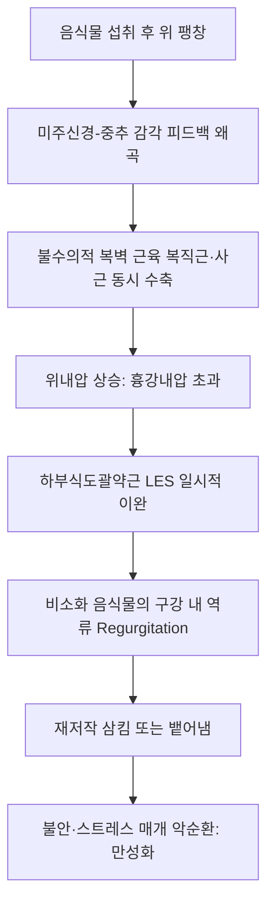

# 🩺 위식도역류 및 반추장애 (Rumination Syndrome & GERD / 反芻障碍)

> **핵심 3줄 요약 (Key Summary)**:
> - 📍 **정의 & 병태생리**: 음식물 섭취 후 수분 내에 오심(Nausea)이나 구역질(Retching) 없이 비소화된 음식물이 무통성으로 식도를 통해 구강으로 역류하는 뇌-장관 상호작용 장애(DGBI, Rome IV/V 기준). 복벽 근육의 불수의적 수축으로 인한 복강 내압 상승과 횡격막 각부 및 하부식도괄약근(LES)의 일시적 이완이 결합되어 발생한다.
> - 🚩 **임상 양상**: 식사 중 또는 식후 10~15분 이내에 부분 소화되지 않은 음식물이 입안으로 역류. 위산이 섞이지 않아 산취나 쓴맛이 없으며, 환자는 역류된 음식을 다시 씹어 삼키거나(되새김질) 뱉어냄. 체중 감소, 치아 법랑질 부식, 사회적 대인기피 동반.
> - 🛠️ **치료 원칙**: 식도 고해상도 내압-임피던스 검사(HRIM)를 통한 식후 복압 상승 파동 확진. 1차 치료 표준은 **횡격막 복식 호흡(Diaphragmatic breathing)** 바이오피드백(횡격막을 하강시켜 흉곽내압 상승 억제). 한의학적으로 위기상역(胃氣上逆), 간위불화(肝胃不和), 비위허약(脾胃虛弱)으로 변증하여 [[보중익기탕]], [[반하후박탕]], [[사역산]], [[선복대자탕]] 가감 및 중완, 족삼리, 내관 자침.
> - ⚠️ **감별 및 응급 레드플래그**: 지속적인 산 역류와 흉통이 주도하는 GERD, 식괴 정체가 심한 식도 이완불능증(Achalasia), 신경성 대식증(Bulimia nervosa)과의 감별 필수; 극심한 전해질 불균형 및 체중 급감 시 3차 소화기내과 전원.

---

## 📌 목차
1. [질환 개요 & 해부학적 병태생리](#1-질환-개요--해부학적-병태생리)
2. [병태생리 메커니즘 & 뇌-장관 신경반사 네트워크](#2-병태생리-메커니즘--뇌-장관-신경반사-네트워크)
3. [임상 증상 & Rome IV/V 진단 알고리즘](#3-임상-증상--rome-ivv-진단-알고리즘)
4. [감별 진단 매트릭스 (반추장애 vs GERD vs 구토 vs 폭식증)](#4-감별-진단-매트릭스-반추장애-vs-gerd-vs-구토-vs-폭식증)
5. [한의 통합 치료 프로토콜 (침·약침·추나·한약)](#5-한의-통합-치료-프로토콜-침약침추나한약)
6. [양방 치료 & 횡격막 바이오피드백·약물 기준 (Conventional Treatment & Referral)](#6-양방-치료--횡격막-바이오피드백약물-기준-conventional-treatment--referral)
7. [횡격막 복식 호흡 & 식생활 티칭 가이드](#7-횡격막-복식-호흡--식생활-티칭-가이드)
8. [💡 사용자 진료실 핵심 필기 & 임상 노하우 (Melt-In 잔여 심화 집약)](#8-💡-사용자-진료실-핵심-필기--임상-노하우-melt-in-잔여-심화-집약)
9. [출처 및 학술 참고 문헌 (References)](#9-출처-및-학술-참고-문헌-references)

---

## 1. 질환 개요 & 해부학적 병태생리

### 1) 질환 정의 및 임상적 개념
- **반추 증후군(Rumination Syndrome)**: 위 내에 섭취된 음식물이 위의 소화 작용을 거치기 전, 오심이나 레칭 없이 식도를 역류하여 구강 내로 재유입되는 기능성 소화관 질환(Rome IV DGBI)이다.
- 과거 소아 및 발달 장애 환자에게 국한된 희귀 질환으로 여겨졌으나, 최근 정상 지능을 가진 청소년 및 성인에서도 상당한 빈도로 진단되고 있다.
- **위식도역류질환(GERD)과의 복합**: 많은 반추장애 환자가 초기에 난치성 GERD로 오진되어 고용량 PPI를 투여받으나 증상 호전이 없어 의료기관을 전전하는 경향이 있다.

### 2) 해부학적 병소 부위
- **하부식도괄약근(LES)과 횡격막 각부(Crural diaphragm)**: 식도-위 접합부(EGJ)의 항역류 장벽(Anti-reflux barrier) 역할을 수행한다.
- 반추장애에서는 식사 후 불수의적인 복벽 근육(외복사근, 내복사근, 복직근)의 동시 수축으로 위내압이 급상승하며, 이때 일시적으로 LES가 개방되고 횡격막 각부가 이완되어 음식물이 저항 없이 식도로 역출된다.

---

## 2. 병태생리 메커니즘 & 뇌-장관 신경반사 네트워크

### 1) 병리 생체역학 기전
1. **식후 복벽 긴장도 상승**: 음식물이 위장에 도달하면 위 기저부의 팽창 감각이 미주신경 구심로를 통해 중추로 전달되나, 중추 신경계의 학습된 부적응 반응으로 인해 복벽 근육의 협동 수축이 격발됨.
2. **위강-식도 압력 역전**: 정상적인 식도-위 압력 구배가 역전되어 위내압이 30~50 mmHg 이상으로 급증.
3. **무통성 역출**: LES 이완과 함께 산성화되지 않은 음식물 식괴가 식도를 타고 역류.

### 2) 반추 증후군 반사 도식

---

## 3. 임상 증상 & Rome IV/V 진단 알고리즘

### 1) 주요 임상 양상
- 식사 중 또는 식후 수분(통상 10~15분) 이내 시작되어 1~2시간 동안 반복되는 역류.
- 구토와 달리 오심, 식은땀, 복부 뒤틀림 같은 전조 증상이 전혀 없음.
- 역류된 음식물의 맛이 방금 먹은 음식의 본래 맛과 동일함(위산이나 담즙이 섞이지 않음).
- 수면 중에는 역류가 발생하지 않음.

### 2) Rome IV 진단 기준 (최근 3개월 이상 지속)
1. 식사 직후 반복되는 비소화 음식물의 무통성 구강 역류.
2. 역류 전에 오심(Nausea)이나 헛구역질(Retching)이 선행하지 않음.
3. 역류물이 산성이지 않거나 쓰지 않음.
4. 역류 사건 직후 증상이 완화됨.
5. 식도 내압-임피던스 검사(HRIM) 상 식후 역류와 일치하는 복압 상승(Gastric strain waves > 30 mmHg) 확인.

---

## 4. 감별 진단 매트릭스 (반추장애 vs GERD vs 구토 vs 폭식증)

| 감별 항목 | 반추 장애 (Rumination) | 위식도 역류질환 (GERD) | 일반 구토 (Vomiting) | 신경성 대식증 (Bulimia) |
| :--- | :--- | :--- | :--- | :--- |
| **선행 증상** | 없음 (무통성) | 가슴 쓰림(Heartburn), 흉통 | 심한 오심, 레칭, 식은땀 | 체중 증가 공포, 폭식 |
| **역류 시점** | 식사 중 ~ 식후 즉시 | 식후 30분~수시간 뒤, 야간 | 원인에 따라 다양 | 식사 후 의도적 유도 |
| **역류물 성상** | 비소화 음식 본래 맛 | 강한 신물(산성), 쓴물 | 소화된 음식물, 위액, 담즙 | 섭취 음식물 혼합물 |
| **의도성** | 불수의적 습관성 반사 | 불수의적 역류 | 자율신경 반사 | **자의적 (손가락 구토 유도)** |
| **PPI 치료 반응** | **반응 없음 (무효)** | **호전 (유효)** | 무효 | 무효 |

---

## 5. 한의 통합 치료 프로토콜 (침·약침·추나·한약)

### 1) 한의학적 병증 연계
- 한의학에서 반추장애는 **반위(反胃)**, **열격(噎膈)**, **구토(嘔吐)**, **위기상역(胃氣上逆)** 범주에 속한다.
- 비위가 허약하여 음식을 운화(運化)하지 못하거나, 칠정울결(七情鬱結)로 간기(肝氣)가 횡역(橫逆)하여 위기(胃氣)가 아래로 내려가지 못하고 거꾸로 치밀어 오르는 것이 주 기전이다.

### 2) 변증별 한약 처방 프로토콜
1. **간위불화(肝胃不和) / 기기울체(氣機鬱滯)형 (정서적 스트레스 호발)**:
   - 주증: 식후 트림과 함께 음식물이 치밀어 오름, 흉협고만, 정서 불안, 맥현.
   - 치법: 소간이간(疏肝理氣), 강역화위(降逆和胃).
   - 대표 처방: [[사역산]] 합 [[반하후박탕]] 가감, [[선복대자탕]](선복화, 대자석, 반하, 생강, 인삼, 대추, 감초).
2. **비위허약(脾胃虛弱) / 중기하함(中氣下陷)형 (만성 쇠약성 반위)**:
   - 주증: 섭취 후 곧바로 음식이 올라옴, 소화력 극심 저하, 식후 권태, 안색 황백, 맥세약.
   - 치법: 보중익기(補中益氣), 건비강역.
   - 대표 처방: [[보중익기탕]] 가감(승마·시호를 거하고 지실·사인을 가미) 또는 [[향사육군자탕]].
3. **위열협담(胃熱挾痰)형**:
   - 주증: 구갈, 흉격 비만, 설태황니.
   - 대표 처방: [[온담탕]] 합 [[황련사심탕]] 가감.

### 3) 침구 치료
- **주치 혈위**:
  - [[중완]](CV12): 위의 모혈. 위기 하강의 핵심 요혈. 직자 15~25mm.
  - [[족삼리]](ST36): 위장관 하행 운동 유도.
  - [[내관]](PC6): 심포경 락혈. 횡격막 긴장 완화 및 상역된 기운 하강.
  - [[단중]](CV17): 흉중 기의 회혈. 식도 평활근 긴장 완화.
  - [[태충]](LR3): 간기 울결 해소.

---

## 6. 양방 치료 & 횡격막 바이오피드백·약물 기준 (Conventional Treatment & Referral)

### 1) 1차 표준 치료: 행동 치료 (Behavioral Therapy)
- **횡격막 호흡(Diaphragmatic Breathing)**:
  - 식사 시작 직후부터 식후 15~30분간 흉곽을 쓰지 않고 복부만을 팽창시키는 복식 호흡 시행.
  - 횡격막을 하강된 상태로 유지함으로써 식도-위 접합부의 외인성 괄약근 기능을 강화하여 역류 기전 자체를 물리적으로 차단.
- 인지행동치료(CBT): 역류를 유발하는 신체 감각에 대한 불안 감소.

### 2) 약물 요법 (보조적 수단)
- 바클로펜(Baclofen): GABA-B 작용제로 일과성 하부식도괄약근 이완(TLESR) 횟수를 감소시킴.

---

## 7. 횡격막 복식 호흡 & 식생활 티칭 가이드

### 1) 진료실 횡격막 호흡 교육 SOP
1. 등을 편안히 기대고 한 손은 가슴에, 한 손은 배꼽 위에 올린다.
2. 코로 4초간 숨을 천천히 들이마시며 가슴은 움직이지 않고 **배만 불룩하게** 부풀린다.
3. 입을 오므리고 6초간 숨을 천천히 내쉬며 배를 천천히 당긴다.
4. 식사 중 음식물이 치밀어 오르는 느낌이 들 때 즉시 5분간 연속 시행.

### 2) 식생활 관리
- 식사 속도를 늦추고 꼭꼭 씹어 먹기(최소 20회 이상 저작).
- 탄산음료, 빨대 사용 금지(위내 가스 팽창 억제).

---

## 8. 💡 사용자 진료실 핵심 필기 & 임상 노하우 (Melt-In 잔여 심화 집약)

### 1) 난치성 역류 환자에서 반추 증후군을 가려내는 문진 팁
- "위산 억제제(PPI)를 3달 넘게 최고 용량으로 먹어도 신물이 계속 올라온다"며 내원하는 환자에게는 반드시 한 가지를 물어야 한다:
  - **"올라오는 음식이 시큼하거나 쓴가요, 아니면 방금 삼킨 음식 맛 그대로인가요?"**
- 만약 "음식물이 하나도 안 삭고 원래 맛 그대로 부드럽게 올라와서 다시 삼키기도 한다"고 답한다면, 이는 GERD가 아니라 100% **반추 증후군(Rumination syndrome)**이다.
- 이때는 PPI를 증량할 것이 아니라, 즉시 위기하강 한약([[선복대자탕]], [[반하후박탕]])을 투여하고 횡격막 호흡 티칭을 해야 단기간에 완치된다.

### 2) 선복대자탕의 배오 원리와 침치료 병용
- 반추장애의 위기상역증에는 선복화의 강역이기 작용과 대자석의 무거운 진강(鎭降) 작용이 결합된 선복대자탕이 제1선택 방제이다. 침치료 시 [[내관]]과 [[족삼리]]를 동시에 강자극하면 횡격막 경련성 긴장이 즉각 완화된다.

---

## 9. 출처 및 학술 참고 문헌 (References)

Potential value of using pH-impedance monitoring to evaluate for rumination syndrome in children. *JPGN Rep*. PMID: 42110148.

Rome V Pediatric Upper Gastrointestinal Disorders of Gut-Brain Interaction. *Gastroenterology*. PMID: 41713704.

Role of Gastric Motor Abnormalities in Pathophysiology of Rumination Syndrome in Children. *Neurogastroenterol Motil*. PMID: 41553265.
