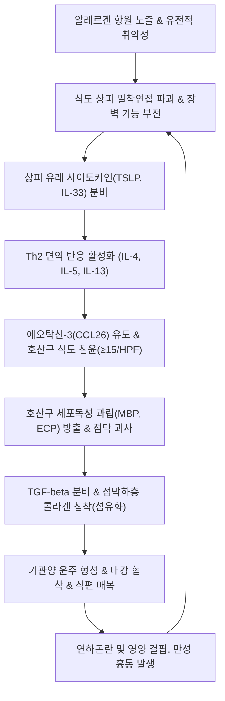
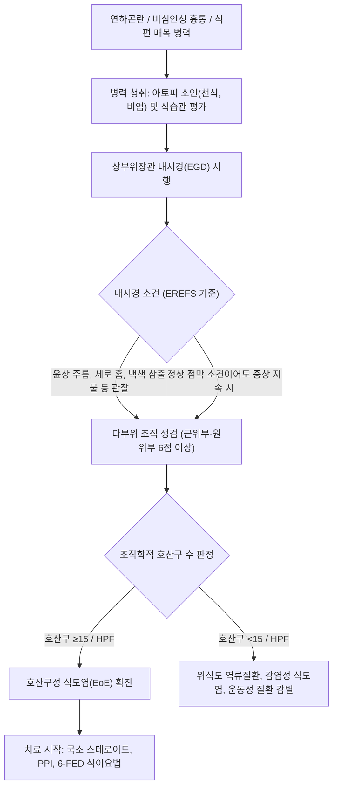

# 🩺 호산구성 식도염 (Eosinophilic Esophagitis, EoE)

> **핵심 3줄 요약 (Key Summary)**:
> - 📍 병소 부위 & 해부·병태생리: 알레르기 항원 자극에 의한 Th2 편향 면역 반응으로 식도 전층에 호산구 침윤(고배율 시야당 ≥15개) 및 염증 매개인자 분비가 발생하여 점막 부종, 윤상 윤주, 섬유화 협착이 초래되는 만성 면역 매개성 질환.
> - 🚩 전형적 임상 양상: 소아에서는 구토·복통·수유 곤란 및 성장 지연, 성인에서는 고형식에 대한 연하곤란, 흉골 후방 동통, 식편 매복(Food impaction)이 주증상으로 나타남.
> - 🛠️ 핵심 검사 & 치료 전략: 상부위장관 내시경 생검(근위부 및 원위부 6점 이상 채취), 국소 삼킴 코르티코스테로이드(플루티카손/부데소니드), 양성자펌프억제제(PPI), 6종 식품 제거 식이요법(6-FED) 및 생물학적 제제(듀필루맙) 적용.
> - ⚠️ 응급 의뢰 레드플래그: 타액조차 삼키지 못하는 완전 식편 매복, 기도 압박 및 천명음, 급성 흉통 및 보어하베 증후군 유사 식도 천공 의심 징후.

---

## 📌 목차
1. [질환 개요 & 해부학적 병태생리](#1-질환-개요--해부학적-병태생리)
2. [병태생리 메커니즘 & 생체역학적 악순환 네트워크](#2-병태생리-메커니즘--생체역학적-악순환-네트워크)
3. [임상 증상 & 이학적 검사(Physical Exam) 알고리즘](#3-임상-증상--이학적-검사physical-exam-알고리즘)
4. [감별 진단 매트릭스 (Differential Diagnosis)](#4-감별-진단-매트릭스-differential-diagnosis)
5. [한의 통합 치료 프로토콜 (침·약침·추나·한약)](#5-한의-통합-치료-프로토콜-침약침추나한약)
6. [양방 치료 & 병용·의뢰 기준 (Conventional Treatment & Referral)](#6-양방-치료--병용의뢰-기준-conventional-treatment--referral)
7. [재활 운동 & 생활습관 티칭 가이드](#7-재활-운동--생활습관-티칭-가이드)
8. [💡 사용자 진료실 핵심 필기 & 임상 노하우 (Melt-In 잔여 심화 집약)](#8--사용자-진료실-핵심-필기--임상-노하우-melt-in-잔여-심화-집약)
9. [출처 및 학술 참고 문헌 (References)](#9-출처-및-학술-참고-문헌-references)

---

## 1. 질환 개요 & 해부학적 병태생리

### 1) 정의 및 해부학적 특성
[[호산구성 식도염]](Eosinophilic Esophagitis, EoE)은 음식물이나 흡입성 알레르겐에 의해 유발되는 식도의 만성 만성 제2형 보조 T세포(Th2) 매개 면역 질환이다. 정상적인 식도 점막은 편평상피로 덮여 있으며 상피 내에 [[호산구]]가 전혀 존재하지 않는 무균·무호산구 조직이다. 그러나 알레르기 항원에 지속 노출되면 상피 장벽이 붕괴되고 점막 고유층과 점막하층까지 호산구가 침윤하여 조직 손상과 개형(Remodeling)을 촉진한다.

- **해부학적 병소**: 경부, 흉부, 복부 식도 전장에 걸쳐 점막하층과 고유근층까지 만성 염증이 파급된다.
- **조직학적 특징**: 상피 세포 간극 확장(Spongiosis), 기저층 증식(Basal zone hyperplasia), 고유판 유두 연장, 호산구 탈과립 및 호산구 미세농양(Eosinophilic microabscesses) 형성.
- **내시경적 해부학적 변형**: 점막 부종에 의한 혈관상 소실(Loss of vascularity), 세로 홈(Furrows), 백색 삼출물(Exudates), 기관양 윤주 형성(Trachealization/Concentric rings), 그리고 최종적인 섬유성 [[식도 협착]](Stricture)과 좁은 구경의 식도(Small caliber esophagus).

### 2) 역학 및 임상적 중요성
과거 희귀 질환으로 간주되었으나 최근 유병률이 급격히 증가하여 인구 10만 명당 50~100명 수준에 이르며, 소아 및 20~40대 남성에서 호발한다. 특히 아토피 피부염, 알레르기 비염, 기관지 천식 등 아토피 3대 질환을 동반하는 비율이 70%를 상회한다. 만성 경과 시 비가역적 섬유화로 진행되어 응급 식편 매복(Food impaction)과 천공을 유발할 수 있으므로 조기 진단과 유도·유지 치료가 필수적이다.

![[호산구성식도염_1_조직호산구침윤.png|450]]
> [그림 1: H&E 염색 조직 슬라이드(고배율) — 편평상피세포 사이에 붉게 염색된 호산구가 다수 침윤해 있고 세포간 부종이 동반됨. 고배율 시야당 호산구 15개 이상이면 호산구성 식도염으로 진단한다 — 출처: Wikimedia Commons — File:Histopathology of eosinophilic esophagitis.jpg (CC0)]

---

## 2. 병태생리 메커니즘 & 생체역학적 악순환 네트워크

### 1) 면역학적 염증 반응과 사이토카인 연쇄
1. **상피 장벽 손상**: 유전적 소인(Filaggrin, CAPN14 유전자 변이)과 알레르겐 노출로 [[식도 점막]] 밀착연접(Tight junction) 단백질(Claudin-1 등)이 파괴된다.
2. **상피 유래 사이토카인 분비**: 손상된 상피에서 [[TSLP]](Thymic stromal lymphopoietin), [[IL-33]]이 분비되어 수지상세포와 제2군 선천림프구(ILC2)를 자극한다.
3. **Th2 림프구 활성화**: [[IL-4]], [[IL-5]], [[IL-13]] 분비가 폭발적으로 증가한다.
   - [[IL-5]]: 골수에서 호산구의 분화, 증식, 순환 혈액으로의 방출 및 생존 기간 연장을 담당한다.
   - [[IL-13]]: 상피세포를 자극하여 강력한 호산구 유주 인자인 [[에오탁신-3]](Eotaxin-3 / CCL26) 분비를 유도한다.
4. **호산구 침윤 및 탈과립**: 식도로 유입된 호산구가 주요염기성단백질([[MBP]], Major Basic Protein), 호산구 양이온단백질([[ECP]]), 호산구 신경독소([[EDN]]), 과산화효소(EPO)를 분비하여 상피세포 괴사와 조직 궤양을 일으킨다.

### 2) 조직 개형(Tissue Remodeling) 및 생체역학적 악순환
- **섬유아세포 활성화**: 호산구와 대식세포에서 분비되는 형질전환증식인자-베타([[TGF-beta]])가 점막하 섬유아세포를 근섬유아세포로 분화시키고, 제1형 및 제3형 콜라겐 침착을 유발한다.
- **고유근층 비대**: 만성 염증으로 인해 고유근층 세포 비대와 섬유화가 동반되어 식도 유순도(Compliance)가 급격히 저하된다.
- **생체역학적 악순환 네트워크**:
  $$\text{상피 장벽 파괴} \longrightarrow \text{Th2/호산구 침윤} \longrightarrow \text{TGF-}\beta \text{ 매개 섬유화} \longrightarrow \text{식도 유순도 저하} \longrightarrow \text{음식물 정체 및 기계적 마찰} \longrightarrow \text{상피 손상 가속}$$

![[호산구성식도염_2_조직호산구고배율.png|450]]
> [그림 2: H&E 조직 슬라이드(최고배율) — 호산구의 이중핵·적색 과립이 뚜렷하고 세포 사이로 퍼져 있는 모습. 호산구 탈과립에서 나온 단백질(MBP·eotaxin)이 상피 손상과 연동운동 장애를 일으킨다 — 출처: Wikimedia Commons — File:Eosinophilic esophagitis - very high mag.jpg (CC BY-SA 3.0)]

![[호산구성식도염_2_신전성비교도해.png|450]]
> [그림 3: 식도 신전성(EndoFLIP) 지표 비교 도해 — 정상·호산구성 식도염·부식성 손상·혈관 압박에서 식도 벽의 늘어남(compensatory·vascular compressibility)이 어떻게 달라지는지 보여줌. 호산구성 식도염은 염증과 섬유화로 신전성이 떨어진다(영문 라벨) — 출처: Pediatric Esophageal Biomechanics and Remodeling: Integrating Distensibility and Compliance Beyond Luminal Diameter. J Gastroenterol Hepatol 2026. PMID 42442730, PMC13534284 — Europe PMC (영문 라벨)]

---

## 3. 임상 증상 & 이학적 검사(Physical Exam) 알고리즘

### 1) 임상 증상 분석
- **성인 및 청소년**:
  - **고형식 연하곤란**: 육류, 떡, 빵 등 단단하거나 찰기가 있는 음식을 삼킬 때 목이나 흉골 뒤에 걸리는 느낌.
  - **식편 매복(Food Impaction)**: 음식물이 식도에 완전히 걸려 물조차 넘어가지 않고 역류하는 응급 상황.
  - **흉골 후방 통증**: 위산 역류와 유사하나 제산제에 반응하지 않는 비심인성 흉통.
  - **음식 섭취 회피 행동**: 천천히 씹어 먹기, 음식 섭취 시 과도하게 물을 많이 마시기, 단단한 음식 기피.
- **영유아 및 소아**:
  - 구토, 역류, 수유 거부, 복통, 성장 장애(Failure to thrive).

### 2) 이학적 검사 및 진단 평가 알고리즘
1. **아토피 동반 소견 확인**: 알레르기 비염(비점막 창백 및 비경 검사), 아토피 피부염(굴곡부 습진), 천식 천명음 청진.
2. **흉부 및 경부 진찰**: 경부 림프절 비대 확인, 식편 매복 의심 시 경부 촉진 및 연하 시 동통 유무 평가.
3. **상부위장관 내시경 검사(EGD)**:
   - **EREFS 분류 체계**: Edema(부종), Rings(윤상 고리/기관양 윤주), Exudates(백색 반점/삼출물), Furrows(세로 홈), Stricture(협착).
   - **조직 생검(Biopsy)**: 병변 부위뿐만 아니라 근위부와 원위부 식도에서 최소 6개 이상의 점막 조직을 채취.
   - **조직학적 확진 기준**: 광학현미경 고배율 시야(High-power field, HPF, 약 $0.3\,\text{mm}^2$)당 호산구가 **15개 이상** 관찰.

---

## 4. 감별 진단 매트릭스 (Differential Diagnosis)

| 감별 질환 | 호발 연령 및 병력 | 내시경 소견 | 조직 검사 소견 | 주요 감별 요점 |
| :--- | :--- | :--- | :--- | :--- |
| [[호산구성 식도염]] | 20~40대 남성, 아토피 질환 동반 빈번 | 윤상 고리(기관양), 세로 홈, 백색 삼출물, 미만성 협착 | **식도 전층 호산구 ≥15/HPF**, 표층 미세농양 | PPI 단독에 불응하거나 불완전 반응, 국소 스테로이드/식이요법에 반응 |
| [[역류성 식도염]](GERD) | 중장년층, 비만, 열공 탈장, 야간 역류 | Z-line 상부 점막 미란, 궤양 (LA 분류) | 호산구 경도 증가(<15/HPF), 편평상피 기저세포 증식 | 하부 식도에 국한, 전형적인 작열감(Heartburn), 고용량 PPI에 신속 반응 |
| [[칸디다 식도염]] | 면역저하, 스테로이드 흡입기 사용, 당뇨 | 쉽게 벗겨지는 백색 판(Plaque), 홍반성 기저부 | 가성균사(Pseudohyphae) 및 효모균 포자 관찰 (PAS 염색) | 백색 삼출물은 유사하나 문지르면 박리되어 출혈, 항진균제(플루코나졸) 반응 |
| [[식도 이완불능증]] | 30~50대, 액체와 고체 모두의 연하곤란 | 식도 내강 확장, 음식물 저류, 하부식도괄약근 저항 | 만성 염증 세포 침윤, 신경총 소실 (생검상 호산구 현저하지 않음) | 고해상도 식도내압검사상 연동운동 소실 및 LES 이완 부전 확진 |
| [[호산구성 위장염]] | 전 연령, 복통, 설사, 복수 | 위 및 십이지장 점막 부종, 결절, 미란 | 위점막 및 십이지장 점막에 호산구 다수 침윤 | 식도 외에 위, 소장, 대장 등 타 소화관 침범 및 말초 혈액 호산구증가증 현저 |

---

## 5. 한의 통합 치료 프로토콜 (침·약침·추나·한약)

### 1) 한의 변증 진단 체계
한의학에서 호산구성 식도염은 음식물 섭취 장애와 식도 부종 양상에 따라 [[열격]](噎膈), [[비증]](痞證), [[식체]](食滯), [[매핵기]](梅核氣)의 범주에 속한다. 알레르기 체질에 따른 내재적 비폐기허(脾肺氣虛)를 바탕으로, 비생리적 담탁(痰濁)과 간기울결(肝氣鬱結)이 결합하여 기체어혈(氣滯瘀血)로 발전하는 병기를 갖는다.

- **비폐기허·담습조체(脾肺氣虛·痰濕阻滯)**: 만성적인 소화기 무력, 아토피 체질, 식후 더부룩함, 백태.
- **간울기체·담어상박(肝鬱氣滯·痰瘀相搏)**: 스트레스 시 연하곤란 악화, 흉협고만, 흉통, 설자암.
- **위음부족·음허열독(胃陰不足·陰虛熱毒)**: 구갈, 흉골 후방 작열통, 점막 건조, 설홍소태.

### 2) 침구 치료 프로토콜
식도의 신경 지배를 조절하고 부교감신경계를 활성화하여 식도 연동운동을 정상화하고 점막 알레르기 염증을 완화한다.
- **주요 혈위**: [[중완]](CV12), [[전중]](CV17), [[내관]](PC6), [[족삼리]](ST36), [[공손]](SP4), [[태충]](LR3), [[폐수]](BL13), [[격수]](BL17), [[비수]](BL20).
- **자침 기법**:
  - [[전중]](CV17): 횡자 0.5~1촌으로 단중 혈위를 따라 하향 자침하여 강기화담(降氣化痰) 및 흉격 개통.
  - [[내관]](PC6) - [[공손]](SP4): 팔맥교회혈 배합으로 충맥과 음유맥을 소통시켜 식도 연축 완화 및 역류 억제.
  - [[중완]](CV12) - [[족삼리]](ST36): 평보평사법으로 건비화위(健脾和胃) 및 점막 혈류 개선.
- **시술 주기**: 주 2~3회, 20분 유침, 전침 병용 시 2Hz 저주파 통전.

### 3) 약침 치료 프로토콜
- **약침 제제**:
  - **황련해독탕 약침** 또는 **생검 약침**: 식도 점막의 급성기 열독 및 Th2 알레르기 염증을 억제하기 위해 [[전중]](CV17), [[거궐]](CV14)에 점적 주입 (혈위당 0.2~0.5cc, 총 1.0cc).
  - **신경약침 (자하거 / 중성어혈)**: 만성 섬유화 병변 개선 및 조직 재생 촉진을 위해 [[격수]](BL17), [[비수]](BL20)에 심부 주입 (각 0.5cc).

### 4) 추나 치료 프로토콜
- **경추 및 상부 흉추 가동·신전 기법**: 미주신경(CN X)과 교감신경간(T1~T6)의 자율신경 불균형을 교정하기 위해 후두하근 이완 및 상부 흉추(T3~T5) 분절 교정.
- **횡격막 이완 기법(Diaphragmatic Release)**: 늑골 하연을 따라 양손을 거치하고 호흡에 맞추어 횡격막을 부드럽게 이완하여 식도열공(Esophageal hiatus) 주변의 역학적 긴장을 해소.

### 5) 맞춤 한약 처방
- **반하후박탕(半夏厚朴湯) 합 이진탕(二陳湯)**: [[반하]], [[후박]], [[복령]], [[생강]], [[소엽]], [[진피]], [[감초]]. 매핵기 및 식도 상피 부종과 담음 정체를 신속히 해소.
- **선복대자석탕(旋覆代赭石湯)**: [[선복화]], [[대자석]], [[반하]], [[인삼]], [[대추]], [[생강]], [[감초]]. 식도 기운의 상역(역류, 연하곤란, 딸꾹질)을 강력히 하강.
- **보중익기탕(補中益氣湯) 가미방**: 아토피 알레르기 소인이 뚜렷한 만성 비폐기허 환자에게 [[황기]], [[백출]], [[당귀]] 등으로 면역 조절 기능을 정상화.

---

## 6. 양방 치료 & 병용·의뢰 기준 (Conventional Treatment & Referral)

### 1) 현대의학적 표준 치료 지침
1. **양성자펌프억제제(PPI) 요법**:
   - 오메프라졸(Omeprazole) 20~40mg 1일 2회, 또는 에소메프라졸(Esomeprazole) 40mg 1일 2회로 8~12주간 투여.
   - 산 분비 억제 효과뿐만 아니라 에오탁신-3(Eotaxin-3) 발현을 직접 차단하는 항염증 기전을 발휘함.
2. **국소 삼킴 코르티코스테로이드(Swallowed Topical Steroids, STC)**:
   - **플루티카손(Fluticasone)**: MDI 흡입기를 스페이서 없이 구강 내로 분사한 후 삼키도록 지도 (성인 기준 440~880mcg 1일 2회).
   - **경구 점성 부데소니드(Viscous Budesonide)**: 부데소니드 흡입용 현탁액(1~2mg)을 수크랄로스 등 점성 증진제와 혼합하여 슬러리(Slurry) 형태로 삼킴.
   - 복용 후 최소 30~60분간 물이나 음식 섭취 금지(점막 접촉 시간 유지). 구강 칸디다증 예방을 위해 구강 헹굼 및 뱉어내기 시행.
3. **식이 요법(Dietary Therapy)**:
   - **6종 식품 제거 식이(6-Food Elimination Diet, 6-FED)**: 유제품, 밀(글루텐), 달걀, 콩, 견과류, 어패류를 식단에서 완전 배제 후 단계적 재도입.
   - 필요에 따라 2-FED(유제품, 밀) 또는 4-FED로 시작 가능.
4. **생물학적 제제(Biologics)**:
   - [[듀필루맙]](Dupilumab): IL-4 및 IL-13 수용체 알파(IL-4Rα) 단클론항체. 기존 스테로이드 불응성 성인 및 1세 이상 소아 호산구성 식도염에 승인된 피하주사제(주 1회 300mg).
5. **내시경적 풍선 확장술(Endoscopic Dilation)**:
   - 약물 치료에도 반응하지 않는 심한 섬유성 식도 협착(내강 직경 <13mm) 환자에서 점진적 풍선 확장술 시행 (천공 위험 주의).

### 2) 한양방 협진 가이드라인
- 급성 염증기 및 식도 내강 협착기에는 양방의 PPI 및 국소 부데소니드 치료로 조직학적 관해(호산구 <15/HPF)를 유도한다.
- 관해 유지기 또는 약물 감량기에는 한약(반하후박탕, 선복대자석탕)과 침구 치료를 병용하여 소화관 면역 항상성을 유지하고 스테로이드 의존도를 낮춘다.

### 3) 응급 전원의뢰 기준 (Red Flags)
- **식편 매복(Food Impaction)**: 음식물이 걸린 후 타액을 삼키지 못하고 구토가 지속될 때 (24시간 이내 내시경적 제거술 필수).
- **식도 천공(Esophageal Perforation) 의심**: 심한 구토나 내시경 확장술 후 발생하는 흉골 후방 급성 격통, 피하기종(Crepitus), 호흡 곤란, 고열.
- **체중 감소 및 빈혈**: 악성 종양(식도암) 동반 배제를 위한 즉각적인 전산화단층촬영(CT) 및 정밀 내시경 의뢰.

---

## 7. 재활 운동 & 생활습관 티칭 가이드

### 1) 식습관 및 식이 관리 프로토콜
- **음식 세분화 및 저작 습관**: 음식물을 아주 작게 썰고, 한 입당 최소 30회 이상 꼭꼭 씹어 침과 충분히 섞인 후 삼키도록 교육.
- **식사 중 수분 섭취 요령**: 식사 중간에 미온수를 한 모금씩 마셔 음식물이 식도 내강을 원활히 통과하도록 유도.
- **원인 알레르겐 철저 제한**: 식이요법으로 확인된 유발 식품(우유, 밀가루, 계란 등) 라벨을 꼼꼼히 확인하고 교차 오염 방지.

### 2) 자세 및 생활 환경 관리
- **식후 직립 자세 유지**: 식사 후 최소 2시간 동안 눕지 않으며, 가벼운 산책을 권장.
- **수면 환경 조성**: 상체를 15~20cm 높이는 쐐기 베개 사용. 침실의 집먼지진드기, 곰팡이 등 흡입성 알레르겐 노출 최소화.

---

## 8. 💡 사용자 진료실 핵심 필기 & 임상 노하우 (Melt-In 잔여 심화 집약)

### 1) 진료실 감별 팁
- 젊은 성인 남성이 "고기나 떡을 먹다가 목에 걸려서 응급실에 간 적이 있다"고 호소하면 단순 역류성 식도염이나 신경성 인두종괴감(매핵기)으로 치부하지 말고 반드시 호산구성 식도염을 최우선으로 의심해야 한다.
- 천식이나 비염 환자가 이유 없는 비심인성 흉통을 호소할 때, 심장 및 폐 검사 정상이면 식도 내시경 생검을 적극 권유한다.

### 2) 치료 순응도 관리
- 흡입용 스테로이드(플루티카손)를 처방받은 환자 중 상당수가 이를 폐로 들이마시는 실수를 범한다. **"숨을 멈추고 입안에 분사한 뒤 침을 꿀꺽 삼키십시오"**라는 복약 지도를 반복 강조해야 한다.
- 한약 투약 시에도 전탕액의 온도를 너무 뜨겁거나 차지 않게 미지근하게 복용하도록 지도한다.

---

## 9. 출처 및 학술 참고 문헌 (References)

- Roussel JM, Pandit S. (2023). Eosinophilic Esophagitis. *StatPearls*. PMID: 29083829.
   - **[연구 요약]**: 호산구성 식도염의 최신 역학, 병태생리적 기전, 임상 증상 및 조직학적 진단 기준(고배율 시야당 15개 이상의 호산구 침윤)과 포괄적 치료 원칙을 체계적으로 기술함.
- Dellon ES, Muir AB, Katzka DA. (2025). ACG Clinical Guideline: Diagnosis and Management of Eosinophilic Esophagitis. *Am J Gastroenterol*. 120(1):1-25. PMID: 39745304.
   - **[연구 요약]**: 미국소화기학회 임상 진료 지침으로 양성자펌프억제제 반응성과 무관한 진단 접근법, 국소 스테로이드 제형, 생물학적 제제(듀필루맙) 적용 기준 및 내시경 확장술 가이드라인을 제시함.
- Lucendo AJ, Arias Á, Álvarez-Bueno C. (2025). Comparative Efficacy and Safety of Swallowed Topical Corticosteroids in Eosinophilic Esophagitis: A Network Meta-Analysis. *J Clin Med*. 14(21):7642. PMID: 41227222.
   - **[연구 요약]**: 호산구성 식도염 치료에서 경구 점성 부데소니드와 플루티카손의 조직학적 및 임상적 관해율을 비교 분석하여 국소 점막 접촉 증진의 중요성과 안전성을 입증함.
