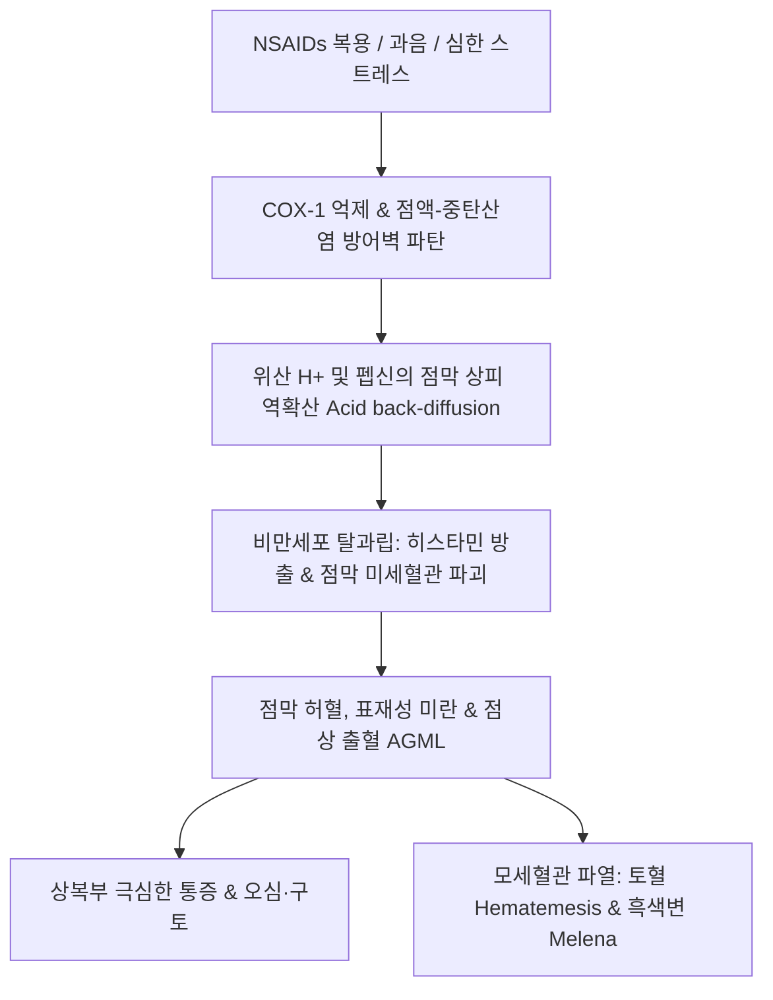

# 🩺 급성 위염 (Acute Gastritis / 急性胃炎)

> **핵심 3줄 요약 (Key Summary)**:
> - 📍 **정의 & 병태생리**: 위점막에 급성으로 발생하는 미란, 발적, 출혈성 병변을 특징으로 하는 염증성 질환. 진통소염제(NSAIDs), 아스피린 복용, 고농도 알코올, 극심한 스트레스(Curling 궤양, Cushing 궤양), 헬리코박터 파일로리 급성 감염에 의해 프로스타글란딘 합성이 억제되고 점막 방어벽(Mucosal barrier)이 급격히 붕괴되며 발생한다.
> - 🚩 **임상 양상**: 상복부(명치)의 급작스러운 작열감, 산통(Colic), 오심, 구토, 식욕 부진. 심한 경우 토혈(Hematemesis) 또는 흑색변(Melena) 같은 상부위장관 출혈 동반.
> - 🛠️ **치료 원칙**: 원인 물질(NSAIDs, 음주) 즉각 중단, 단기 금식 및 수액 공급. 위산 억제제(PPI, H2RA) 및 점막보호제 투여. 한의학적으로 위열치성(胃熱熾盛), 식체위완(食滯胃脘), 간기범위(肝氣犯胃), 습열온결(濕熱蘊結)로 변증하여 [[황련해독탕]], [[평위산]], [[반하사심탕]], [[백호탕]] 가감 투여 및 [[중완]](CV12), [[족삼리]](ST36), [[내관]](PC6) 자침.
> - ⚠️ **응급 의뢰 레드플래그**: 대량의 커피색 구토(Coffee-ground emesis), 흑색변, 저혈압 및 빈맥 등 쇼크 징후 동반 시 급성 상부위장관 출혈로 즉시 응급 내시경 지혈술 의뢰; 복부 판상 강직 시 위천공 의심 즉시 외과 응급 수술 의뢰.

---

## 📌 목차
1. [질환 개요 & 해부학적 병태생리](#1-질환-개요--해부학적-병태생리)
2. [병태생리 메커니즘 & 위점막 방어벽 파탄 네트워크](#2-병태생리-메커니즘--위점막-방어벽-파탄-네트워크)
3. [임상 증상 & 내시경·이학적 검사 알고리즘](#3-임상-증상--내시경이학적-검사-알고리즘)
4. [감별 진단 매트릭스 (Differential Diagnosis)](#4-감별-진단-매트릭스-differential-diagnosis)
5. [한의 통합 치료 프로토콜 (침·약침·한약)](#5-한의-통합-치료-프로토콜-침약침한약)
6. [양방 치료 & PPI/제산제·원인 제거 기준 (Conventional Treatment & Referral)](#6-양방-치료--ppi제산제원인-제거-기준-conventional-treatment--referral)
7. [식습관 티칭 & 점막 보호 생활 가이드](#7-식습관-티칭--점막-보호-생활-가이드)
8. [💡 사용자 진료실 핵심 필기 & 임상 노하우 (Melt-In 잔여 심화 집약)](#8-💡-사용자-진료실-핵심-필기--임상-노하우-melt-in-잔여-심화-집약)
9. [출처 및 학술 참고 문헌 (References)](#9-출처-및-학술-참고-문헌-references)

---

## 1. 질환 개요 & 해부학적 병태생리

### 1) 질환 정의 및 임상적 역학
- **급성 위염(Acute Gastritis)**: 위 점막에 갑작스럽게 발생한 표재성 미란(Erosion), 홍반(Erythema), 점상 출혈(Petechiae)을 특징으로 하는 급성 염증 상태이다.
- 서구화된 식습관, 진통소염제(NSAIDs)의 다빈도 복용, 과도한 음주 및 스트레스로 인해 1차 진료에서 매우 빈번하게 조우하는 급성 질환이다.
- 미란이 점막근판(Muscularis mucosae)을 넘어 점막하층까지 깊어지면 [[소화성 궤양]](위궤양)으로 이행한다.

### 2) 위점막의 미세 해부 및 점막 장벽
- **점막 상피층과 점액-중탄산염 장벽(Mucus-Bicarbonate Barrier)**: 표면 점액세포에서 분비되는 알칼리성 중탄산염(HCO₃⁻) 층이 위산(pH 1~2)의 역확산을 막아 상피세포 표면을 pH 7 전후로 보호한다.
- **점막 미세순환**: 풍부한 모세혈관망이 상피세포에 영양과 산소를 공급하고 침투된 산을 신속히 씻어낸다.
- **프로스타글란딘(PGE₂, PGI₂)**: 점액 및 중탄산염 분비 촉진, 점막 혈류 유지, 상피 재생을 조절하는 핵심 보호 인자이다.

---

## 2. 병태생리 메커니즘 & 위점막 방어벽 파탄 네트워크

### 1) 주요 공격 인자와 점막 손상 기전
1. **NSAIDs 및 아스피린 유발성**:
   - 사이클로옥시게나아제-1(COX-1) 억제로 점막 보호 프로스타글란딘 합성이 고갈됨.
   - 약물의 국소적 지용성 트랩 현상(Ion trapping)으로 점막 상피세포에 직접적인 세포독성 유발.
2. **알코올 유발성**:
   - 고농도 에탄올은 점액 보호층을 직접 용해하고 점막 미세혈관 내피세포를 파괴하여 출혈성 미란 유발.
3. **스트레스성 급성 위점막 병변(AGML)**:
   - 중증 패혈증, 대수술, 두부 외상(Cushing ulcer), 중증 화상(Curling ulcer) 시 교감신경 과흥분으로 인한 점막 허혈 및 허혈-재관류 손상.

### 2) 급성 점막 손상 악순환 도식

---

## 3. 임상 증상 & 내시경·이학적 검사 알고리즘

### 1) 주요 임상 증상
- 명치(심와부)의 급격한 통증, 쓰림, 쥐어짜는 듯한 복통.
- 식후 복부 팽만감, 조기 포만감, 오심, 구역, 트림, 식욕 부진.
- 출혈 동반 시 커피색 구토, 짜장면 색깔의 끈적한 흑색변, 어지럼증.

### 2) 검사 및 진단 SOP
1. **복부 촉진(Palpation)**:
   - 심와부(중완혈 부위)의 뚜렷한 압통(Tenderness) 확인.
   - 복벽 반발통(Rebound tenderness)이나 판상 경직(Rigidity) 유무를 확인하여 위천공 및 급성 복막염 배제.
2. **상부위장관 내시경(EGD - 확진 검사)**:
   - 점막 발적, 부종, 다발성 표재성 미란, 출혈반 관찰.
   - 출혈 병변에 대한 즉각적인 내시경 지혈술(클립 결찰, 고주파 응고) 가능.

---

## 4. 감별 진단 매트릭스 (Differential Diagnosis)

| 감별 질환 | 호발 특징 및 통증 양상 | 검사 소견 | 감별 포인트 |
| :--- | :--- | :--- | :--- |
| **급성 위염** | 약물/음주 후 급작스런 심와부 작열통 | 내시경상 표재성 홍반·미란 | 궤양 분화 없음, 원인 제거 시 급속 완해 |
| **[[위궤양]] / [[십이지장 궤양]]** | 주기적 공복통/식후통, 만성 경과 | 내시경상 점막근판 침범 궤양 | 활동성 궤양 크레이터, 백태 침착 |
| **[[급성 담낭염]]** | 우상복부 산통, 방사통(우측 어깨) | 복부 초음파상 담낭벽 비후 | 머피 징후(Murphy's sign) 양성, 발열 |
| **[[급성 췌장염]]** | 상복부 뚫는 듯한 통증, 등 방사 | 혈청 아밀라아제/리파아제 > 3배 | 앙와위 악화, 전굴위(새우등 자세) 완화 |
| **급성 심근경색(AMI)** | 흉골하 압박감, 호흡곤란, 식은땀 | 심전도 ST 분절 변화, 트로포닌 | 심장 효소 상승, 심와부 통증 오인 주의 |

---

## 5. 한의 통합 치료 프로토콜 (침·약침·한약)

### 1) 변증별 한약 처방 프로토콜
1. **위열치성(胃熱熾盛) / 사열범위(邪熱犯胃)형 (과음, 매운 음식 유발)**:
   - 주증: 명치 부위 불타는 듯한 작열통, 구갈, 찬물 선호, 구취, 변비, 설홍태황조, 맥활삭.
   - 치법: 청위사화(淸胃瀉火), 양혈지통.
   - 처방: [[황련해독탕]] 합 [[청위산]] 가감, [[백호탕]](석고, 지모, 감초, 멥쌀) 가감.
2. **식체위완(食滯胃脘) / 식적(食積)형 (폭식, 소화불량 후 급성 발병)**:
   - 주증: 명치 비만 및 창통, 썩은 음식 냄새 트림(애부), 신트림, 설태후니, 맥활.
   - 치법: 소식도체(消食導滯), 건비화위.
   - 처방: [[평위산]] 합 [[보화환]](창출, 후박, 진피, 산사, 신곡, 연교, 복령, 반하).
3. **간기범위(肝氣犯胃)형 (급격한 분노, 스트레스 후 발병)**:
   - 주증: 명치 통증이 옆구리로 뻗침, 잦은 트림 후 통증 일시 경감, 맥현.
   - 치법: 소간이간(疏肝理氣), 화위지통.
   - 처방: [[사역산]] 합 [[금령자산]](시호, 백작약, 지실, 현호색, 천련자) 또는 [[시호소간산]].
4. **비위허한(脾胃虛寒)형 (찬 음식, 진통제 후 복통)**:
   - 주증: 명치가 은은히 아프고 따뜻하게 누르면 편안함(희온희안), 설담태백.
   - 처방: [[이중탕]] 또는 [[황기건중탕]].

### 2) 침구 치료
- **주치 혈위**:
  - [[중완]](CV12): 위의 모혈. 급성 위경련 및 위통 즉효혈. 직자 15~25mm.
  - [[족삼리]](ST36): 위경의 합혈. 위기 하강 및 위장관 경련 완화.
  - [[내관]](PC6): 오심, 구역 진정의 최고 요혈.
  - [[양구]](ST34): 위경의 극혈(郄穴). 급성 통증과 경련의 긴급 진통점. 강자극 자침.
  - [[공손]](SP4): 비경 락혈이자 충맥의 팔맥교회혈. 내관과 배합하여 심흉위 질환 주치.

---

## 6. 양방 치료 & PPI/제산제·원인 제거 기준 (Conventional Treatment & Referral)

### 1) 약물 요법
- **위산 분비 억제제**:
  - 프로톤 펌프 억제제(PPI: Pantoprazole, Esomeprazole) 또는 칼륨 경쟁적 위산분비억제제(P-CAB: Tegoprazan, Fexuprazan).
  - H2 수용체 길항제(H2RA: Famotidine).
- **점막 보호제**:
  - 수크랄페이트(Sucralfate): 궤양/미란 표면에 물리적 방어막 형성.
  - 레바미피드(Rebamipide): 내인성 프로스타글란딘 합성 촉진.

### 2) 응급 내시경 지혈 및 입원 기준
- 활력징후 불안정(혈압 < 90/60 mmHg, 맥박 > 100회/분), 활동성 토혈 확인 시 즉시 3차 응급의료센터 전원.

---

## 7. 식습관 티칭 & 점막 보호 생활 가이드

### 1) 급성기 식이 관리
- 통증이 극심한 초기 12~24시간은 위장관 휴식을 위해 미음 또는 금식 권고.
- 통증 완화 후 미음, 쌀죽 등 유동식부터 소량씩 자주 섭취.
- 고농도 알코올, 카페인, 탄산음료, 자극적인 향신료 절대 금기.

### 2) 위장관 손상 약물 복용 지도
- 필수 복용 NSAIDs가 있는 경우 COX-2 선택적 억제제(Celecoxib)로 변경하거나 반드시 PPI를 병용하도록 지도.

---

## 8. 💡 사용자 진료실 핵심 필기 & 임상 노하우 (Melt-In 잔여 심화 집약)

### 1) 급성 위경련·위통 시 양구-중완 자침 요령
- 진통제 과다 복용이나 음주 후 명치를 부여잡고 내원하는 급성 위통 환자에게는 위경의 극혈인 [[양구]](ST34)와 모혈인 [[중완]](CV12), 그리고 [[내관]](PC6)을 배합하여 사법(瀉法)으로 강자극하면 5~10분 내에 위경련이 풀리며 통증이 가라앉는다.

### 2) 급성기 평위산과 황련해독탕의 감별 투여 노하우
- 체기가 동반되고 배를 누르면 답답해하는 식적형에는 [[평위산]]에 산사·신곡을 가미한 처방이 제1선택이며,
- 술이나 매운 음식을 먹고 속이 타는 듯이 쓰리며 입에서 열이 나는 열증 환자에게는 [[황련해독탕]]으로 위열(胃熱)을 즉각 꺼주어야 위점막 미란의 궤양 이행을 차단할 수 있다.

---

## 9. 출처 및 학술 참고 문헌 (References)

Fei S. (2026). Coptisine attenuates gastric mucosal injury by activating the PPARα signaling pathway to inhibit ferroptosis. *Toxicol Appl Pharmacol*. PMID: 42927867.

Luo J. (2026). Yeast Protein-Derived Peptides Protect against Ethanol-Induced Acute Gastric Mucosal Injury: Isolation, Identification, and Potential Mechanisms. *J Agric Food Chem*. PMID: 42915138.

Ye K. (2026). Shisanwei Qinglan Powder attenuates ethanol-induced gastric mucosal injury in association with reduced NF-κB signalling and caspase activation. *J Ethnopharmacol*. PMID: 42869399.
