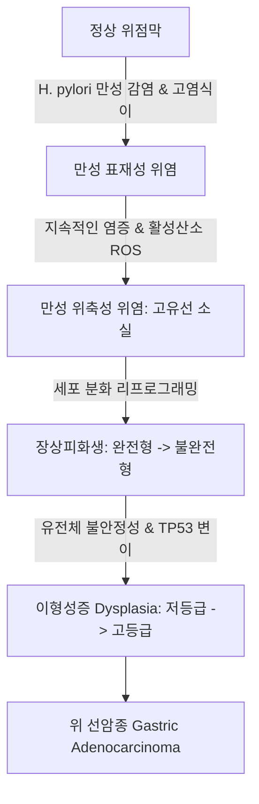

# 🩺 만성 위염 (Chronic Gastritis / 慢性胃炎)

> **핵심 3줄 요약 (Key Summary)**:
> - 📍 **정의 & 병태생리**: 위 점막에 림프구와 형질세포 등 단핵 염증세포의 침윤이 수개월 이상 지속되는 만성 염증 상태. [[헬리코박터 파일로리]](Helicobacter pylori) 만성 감염이 90% 이상을 차지하며, 표재성 위염 → 만성 위축성 위염(위 고유선 위축 및 소실) → [[장상피화생]](배상세포 출현) → 이형성증(Dysplasia) → [[위암]](선암종)으로 이어지는 코레아 연쇄(Correa cascade)의 출발점이다.
> - 🚩 **임상 양상**: 대다수 환자가 무증상이거나 비특이적인 상복부 팽만감, 조기 포만감, 식후 둔통, 트림, 소화불량을 호소. 자가면역성 위염(Type A)에서는 비타민 B12 흡수 장애로 인한 악성 빈혈(Pernicious anemia) 동반.
> - 🛠️ **치료 원칙**: H. pylori 양성 시 표준 3제 또는 4제 제균 치료. 위축성 위염 및 장상피화생 환자는 1~2년 간격의 정기적 상부위장관 내시경 추적 관찰 필수. 한의학적으로 비위허약(脾胃虛弱), 간위불화(肝胃不和), 위음부족(胃陰不足), 어혈조락(瘀血阻絡)으로 변증하여 [[향사육군자탕]], [[보중익기탕]], [[익위탕]], [[소요산]] 가감 투여 및 [[중완]](CV12), [[족삼리]](ST36), [[비수]](BL20) 자침.
> - ⚠️ **추적 감시 레드플래그**: 위축성 위염 및 장상피화생의 광범위한 위체부 확장(OLGA/OLGIM III~IV기), 고등급 이형성증 확인 시 조기 위암 발생 초고위험군으로 즉시 상급병원 소아기내과 내시경 점막하 박리술(ESD) 또는 정밀 추적 연계.

---

## 📌 목차
1. [질환 개요 & 해부학적 병태생리](#1-질환-개요--해부학적-병태생리)
2. [병태생리 메커니즘 & 코레아(Correa) 발암 연쇄망](#2-병태생리-메커니즘--코레아correa-발암-연쇄망)
3. [임상 증상 & 내시경(시드니 체계)·조직학적 평가 알고리즘](#3-임상-증상--내시경시드니-체계조직학적-평가-알고리즘)
4. [감별 진단 매트릭스 (표재성 vs 위축성 vs 비후성)](#4-감별-진단-매트릭스-표재성-vs-위축성-vs-비후성)
5. [한의 통합 치료 프로토콜 (침·약침·한약)](#5-한의-통합-치료-프로토콜-침약침한약)
6. [양방 치료 & H. pylori 제균·내시경 추적 기준 (Conventional Treatment & Referral)](#6-양방-치료--h-pylori-제균내시경-추적-기준-conventional-treatment--referral)
7. [위암 예방 식생활 & 항산화 영양 가이드](#7-위암-예방-식생활--항산화-영양-가이드)
8. [💡 사용자 진료실 핵심 필기 & 임상 노하우 (Melt-In 잔여 심화 집약)](#8-💡-사용자-진료실-핵심-필기--임상-노하우-melt-in-잔여-심화-집약)
9. [출처 및 학술 참고 문헌 (References)](#9-출처-및-학술-참고-문헌-references)

---

## 1. 질환 개요 & 해부학적 병태생리

### 1) 질환 정의 및 역학
- **만성 위염(Chronic Gastritis)**: 위 점막에 림프구, 형질세포 등 만성 염증세포의 침윤이 지속되는 질환이다.
- 한국 성인의 내시경 검진 시 80% 이상에서 다양한 형태의 만성 위염이 관찰될 정도로 극히 흔하다.
- **분류**:
  - 만성 표재성 위염(Chronic superficial gastritis): 염증이 점막 표층에 국한된 초기 단계.
  - 만성 위축성 위염(Chronic atrophic gastritis): 염증이 진행하여 고유선(Glands)이 파괴되고 점막이 얇아진 상태.
  - 장상피화생(Intestinal metaplasia): 위 점막 상피가 소장·대장 상피세포(배상세포) 형태로 변형된 전암성 병변.

### 2) 해부학적 발생 부위 및 유형
- **Type B (환경성 / 헬리코박터 관련 위염)**: 전정부(Antrum)에서 시작하여 위체부로 상행하는 가장 흔한 유형.
- **Type A (자가면역성 위염)**: 위체부(Corpus)와 위저부에 국한되며, 벽세포(Parietal cell) 및 내인자(Intrinsic factor)에 대한 자가항체로 위산 결핍 및 악성 빈혈 유발.

---

## 2. 병태생리 메커니즘 & 코레아(Correa) 발암 연쇄망

### 1) 헬리코박터 파일로리의 병인 기전
- 헬리코박터균의 유레아제(Urease)가 요소를 분해하여 암모니아를 생성(위산 중화 및 점막 독성).
- CagA, VacA 독소가 상피세포 신호전달을 왜곡하여 만성 염증성 사이토카인(IL-1β, IL-8, TNF-α) 분비 촉진.

### 2) 코레아 연쇄(Correa Cascade) 진행 도식

---

## 3. 임상 증상 & 내시경(시드니 체계)·조직학적 평가 알고리즘

### 1) 임상 증상
- 특이적 증상이 없는 경우가 다수.
- 둔한 상복부 불편감, 식후 팽만감, 조기 만복감, 트림, 소화불량.
- 위산 분비 저하(무산증)로 인한 단백질 소화 장애.

### 2) 갱신된 시드니 분류 체계(Updated Sydney System) 평가
1. **내시경 소견**:
   - 홍반성/삼출성 위염, 평편 미란, 융기형 미란.
   - 위축성 위염 소견: 점막이 얇아져 **점막하 혈관망이 투명하게 비쳐 보임**.
   - 장상피화생 소견: 회백색 또는 담황색의 과립상·결절상 융기(Plaque).
2. **조직학적 5개 요소 채점**:
   - 만성 염증(림프구 침윤), 활동성(호중구 침윤), 위축, 장상피화생, H. pylori 밀도.

---

## 4. 감별 진단 매트릭스 (표재성 vs 위축성 vs 비후성)

| 감별 항목 | 만성 표재성 위염 | 만성 위축성 위염 | 비후성 위염 (메네트리에병) |
| :--- | :--- | :--- | :--- |
| **내시경 소견** | 점막 충혈, 선상 홍반, 부종 | **점막 얇아짐, 점막하 혈관 투영** | **거대한 뇌회상 점막 주름(Folds)** |
| **조직학적 특징** | 점막 표층 림프구 침윤, 선 구조 정상 | **고유선 소실 및 섬유화, 장상피화생** | 위소와 상피의 현저한 과형성 |
| **위산 분비** | 정상 또는 경도 증가 | **현저한 저하 (저산증/무산증)** | 정상 또는 감소 |
| **위암 위험도** | 정상 인구와 유사 | **위암 위험 2~5배 증가 (고위험군)** | 위암 위험 증가 |

---

## 5. 한의 통합 치료 프로토콜 (침·약침·한약)

### 1) 변증별 한약 처방 프로토콜
1. **비위허약(脾胃虛弱) / 중기부족(中氣不足)형 (표재성·경도 위축성)**:
   - 주증: 식후 복부 팽만, 소식, 피로, 무기력, 대변 활설, 설담태백, 맥완약.
   - 치법: 건비익기(健脾益氣), 화위강역.
   - 처방: [[향사육군자탕]], [[보중익기탕]](황기, 백출, 인삼, 당귀, 진피, 승마, 시호, 감초).
2. **간위불화(肝胃不和)형 (신경성 위염, 스트레스성 소화장애)**:
   - 주증: 명치 및 늑골하부 팽만통, 정서 변화에 따른 증상 기복, 잦은 트림, 맥현.
   - 치법: 소간이간(疏肝理氣), 화위지통.
   - 처방: [[시호소간산]] 또는 [[가미소요산]].
3. **위음부족(胃陰不足)형 (만성 위축성 위염 및 장상피화생의 주증)**:
   - 주증: 입안과 목이 마르고(구건인조), 배는 고프나 음식이 당기지 않음(기불욕식), 혀가 붉고 태가 거의 없음(설홍소태 또는 경면설), 맥세삭.
   - 치법: 자음양위(滋陰養胃).
   - 처방: [[익위탕]](사삼, 맥문동, 생지황, 옥죽, 빙당) 합 [[사물탕]] 가감.
4. **어혈조락(瘀血阻絡)형 (위점막 순환 부전 및 장상피화생)**:
   - 주증: 명치에 바늘로 찌르는 듯한 고정성 통증(자통), 혀에 어반·어점, 맥삽.
   - 치법: 활혈화어(活血化瘀), 통락지통.
   - 처방: [[실소산]] 합 [[단삼음]](단삼, 단향, 사인).

### 2) 침구 치료
- **주치 혈위**:
  - [[중완]](CV12): 위의 모혈. 위장 점막 혈류 개선.
  - [[족삼리]](ST36): 위경 합혈. 위장관 면역 조절 및 소화기능 촉진.
  - [[비수]](BL20), [[위수]](BL21): 척추 후면 배수혈을 통한 소화기 자율신경 조절.
  - [[공손]](SP4), [[내관]](PC6): 충맥 조절을 통한 심흉위 증상 개선.

---

## 6. 양방 치료 & H. pylori 제균·내시경 추적 기준 (Conventional Treatment & Referral)

### 1) 헬리코박터 파일로리 제균 요법
- **표준 1차 요법**:
  - 클래리스로마이신 기반 3제 요법(PPI + Clarithromycin + Amoxicillin 14일) 또는 비스무스 기반 4제 요법(PPI + Bismuth + Metronidazole + Tetracycline 14일).
  - 제균 성공 시 위점막 염증 완화 및 위축성 위염 진행 정지.

### 2) 내시경 추적 관찰 가이드라인
- 단순 표재성 위염: 2년 간격 국가 위암 검진.
- **광범위 위축성 위염 및 장상피화생**: 1년 간격 정기 상부위장관 내시경 추적 권고.

---

## 7. 위암 예방 식생활 & 항산화 영양 가이드

### 1) 식생활 수칙
- 짠 음식(염장 생선, 젓갈), 탄 고기(발암물질 벤조피렌), 훈제 식품 섭취 제한.
- 신선한 채소와 과일(비타민 C, E, 베타카로틴 등 항산화 영양소) 풍부한 섭취.
- 금연(위점막 혈류 저하 및 발암물질 축적 방지).

---

## 8. 💡 사용자 진료실 핵심 필기 & 임상 노하우 (Melt-In 잔여 심화 집약)

### 1) 장상피화생의 한의학적 가역성에 대한 임상적 접근
- 양방에서는 장상피화생을 일단 발생하면 되돌릴 수 없는 비가역적 병변으로 간주하고 단순 정기 관찰만 진행하는 경우가 많다.
- 그러나 한의학적으로 장상피화생은 위 점막의 진액 고갈(위음부족)과 혈행 정체(어혈조락)가 복합된 상태로 본다.
- [[익위탕]]과 [[맥문동탕]] 계열로 위음을 자양하면서 [[단삼]], [[삼칠근]], [[강황]] 등 활혈거어 약재를 가미하여 3~6개월간 꾸준히 치료하면, 추적 내시경 상 장상피화생 부위의 충혈과 거친 과립상이 부드럽게 개선되고 조직학적 위축 점수가 유의미하게 호전되는 임상례를 다수 경험할 수 있다.

### 2) 설진(舌診)을 통한 위축성 위염의 판별
- 혀 중앙부(비위 영역)의 설태가 완전히 벗겨져 붉은 거울처럼 반질반질한 '경면설(鏡面舌)'이나 혓바닥에 가뭄 난 논처럼 미세한 균열(설열)이 관찰되는 환자는 거의 100% 위축성 위염과 무산증을 동반하고 있으므로, 소화제(평위산 등)를 과용하지 말고 반드시 자음약(사삼, 맥문동)을 주치로 처방해야 한다.

---

## 9. 출처 및 학술 참고 문헌 (References)

Wei W. (2026). Coupling Dysfunction of Mitochondria and Actin in Loss of Native Gastric Glands: A Mechanistic Hypothesis for Chronic Atrophic Gastritis Pathogenesis. *Cells*. PMID: 42782769.

Li S. (2026). Follow-Up Management in Patients with Chronic Atrophic Gastritis: An Evidence-Based Summary. *Patient Prefer Adherence*. PMID: 42605303.

Suleimenov Y. (2026). Molecular Mechanisms and Biomarkers Driving the Transition From Chronic Atrophic Gastritis to Gastric Cancer. *Clin Med Insights Oncol*. PMID: 42591669.
