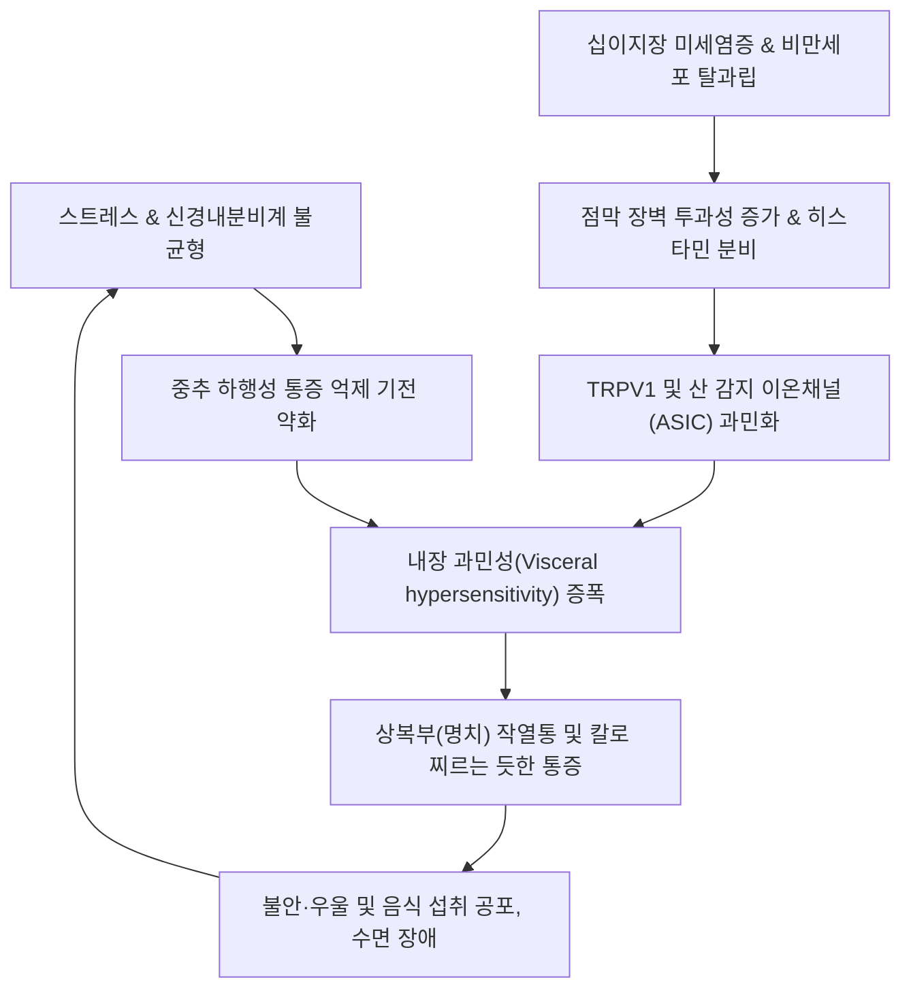
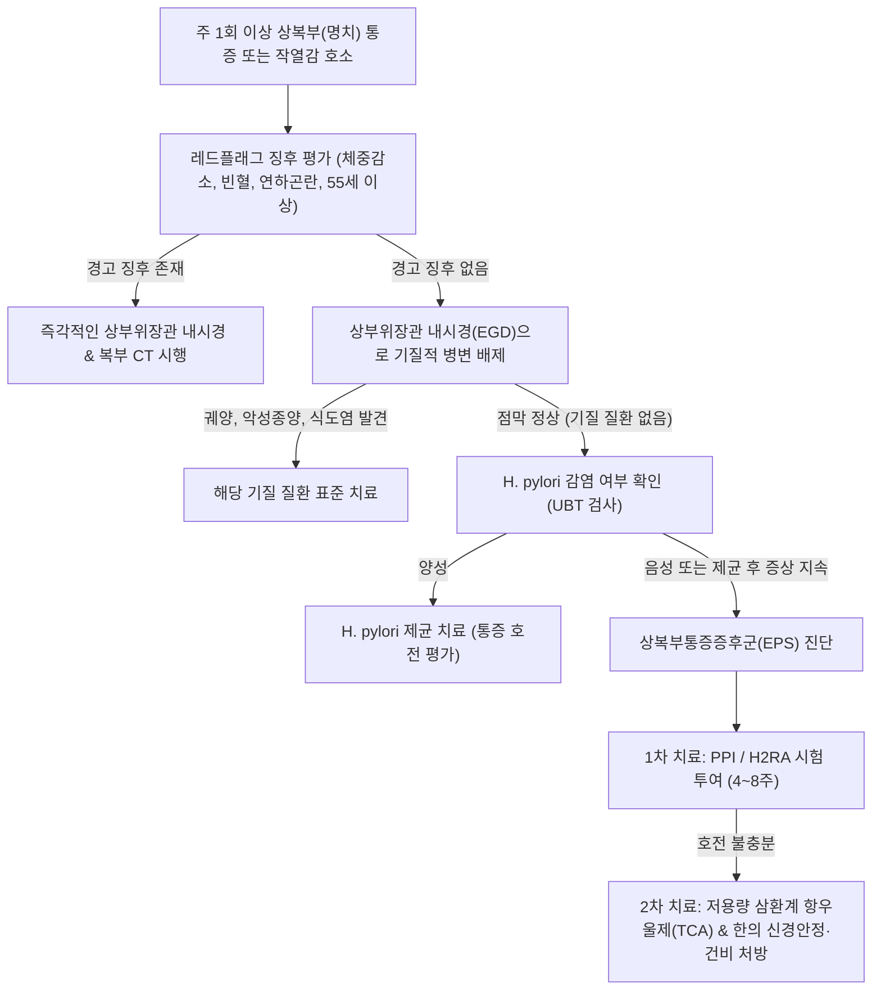

# 🩺 상복부통증증후군 (Epigastric Pain Syndrome, EPS)

> **핵심 3줄 요약 (Key Summary)**:
> - 📍 병소 부위 & 해부·병태생리: 로마 IV 기준 기능성 소화불량증의 주요 아형으로, 기질적 병변 없이 명치(상복부) 부위에 국한되는 간헐적 통증 또는 작열감이 내장 과민성 및 뇌-장 축 상호작용 장애로 인해 발생하는 감각신경성 질환.
> - 🚩 전형적 임상 양상: 주 1회 이상 발생하는 명치 부위의 타는 듯한 작열감 또는 동통으로, 식후 조기 포만감이나 팽만감에 좌우되지 않고 공복이나 식사 중·후 어느 때나 비규칙적으로 발현됨.
> - 🛠️ 핵심 검사 & 치료 전략: 상부위장관 내시경 및 복부 초음파로 소화성 궤양·악성 종양 배제, 헬리코박터 파일로리 검사 및 제균, 양성자펌프억제제(PPI) 또는 위점막보호제 1차 투여, 신경조절제(삼환계 항우울제) 및 한의 반하사심탕·안중산 투여.
> - ⚠️ 응급 의뢰 레드플래그: 체중 감소, 연하곤란, 지속적 구토, 위장관 출혈(토혈, 흑색변), 복부 종괴 촉지, 55세 이상 신규 발병, 황달 동반.

---

## 📌 목차
1. [질환 개요 & 해부학적 병태생리](#1-질환-개요--해부학적-병태생리)
2. [병태생리 메커니즘 & 생체역학적 악순환 네트워크](#2-병태생리-메커니즘--생체역학적-악순환-네트워크)
3. [임상 증상 & 이학적 검사(Physical Exam) 알고리즘](#3-임상-증상--이학적-검사physical-exam-알고리즘)
4. [감별 진단 매트릭스 (Differential Diagnosis)](#4-감별-진단-매트릭스-differential-diagnosis)
5. [한의 통합 치료 프로토콜 (침·약침·추나·한약)](#5-한의-통합-치료-프로토콜-침약침추나한약)
6. [양방 치료 & 병용·의뢰 기준 (Conventional Treatment & Referral)](#6-양방-치료--병용의뢰-기준-conventional-treatment--referral)
7. [재활 운동 & 생활습관 티칭 가이드](#7-재활-운동--생활습관-티칭-가이드)
8. [💡 사용자 진료실 핵심 필기 & 임상 노하우 (Melt-In 잔여 심화 집약)](#8--사용자-진료실-핵심-필기--임상-노하우-melt-in-잔여-심화-집약)
9. [출처 및 학술 참고 문헌 (References)](#9-출처-및-학술-참고-문헌-references)

---

## 1. 질환 개요 & 해부학적 병태생리

### 1) 정의 및 로마 IV(Rome IV) 기준
[[상복부통증증후군]](Epigastric Pain Syndrome, EPS)은 [[기능성 소화불량증]](Functional Dyspepsia, FD)의 양대 아형 중 하나로, 식후고통증후군(Postprandial Distress Syndrome, PDS)과 명확히 구분된다. 통상적인 일상생활을 방해할 정도의 상복부(명치) 통증 또는 타는 듯한 작열감이 주 1회 이상 발생하며, 최소 6개월 전 발병하여 최근 3개월간 기준을 충족해야 한다.

- **해부학적 부위**: 흉골 검상돌기 하부와 배꼽 상부 사이의 복벽 중앙부(Epigastrium)에 통증이 집중되며, 위 전정부(Antrum) 및 십이지장 구부(Bulb) 영역의 감각 수용체 과민화와 밀접하다.
- **PDS와의 차이점**: PDS는 식사 후 음식 섭취량과 직접 관련된 조기 포만감(Early satiety)과 식후 팽만감(Postprandial fullness)이 핵심인 반면, EPS는 식사와 무관하거나 공복 시에도 빈번히 발생하는 순수 통증/작열감(Burning) 양상을 띤다.

### 2) 역학 및 임상적 특징
기능성 소화불량증 환자의 약 25~35%가 순수 EPS로 분류되며, 약 30~40%는 PDS와 EPS가 중첩된 혼합형(Overlap syndrome)으로 나타난다. 스트레스, 만성 피로, 불안 장애 및 불면증과 높은 상관관계를 보이며, 여성 및 젊은 성인층에서 유병률이 높다. 생화학적·내시경적 검사에서 정상 소견을 보이므로 꾀병이나 단순 신경성으로 오인되기 쉬우나 삶의 질을 심각하게 저하시킨다.

![[상복부통증증후군_1_위해부도해.png|450]]
> [그림 1: 위 해부 도해 — 명치 부위(상복부)에 해당하는 위의 분문·체부·전정부와 십이지장 구부의 위치를 보여주는 기본 도해(영문 라벨). 상복부 통증 증후군은 이 부위의 통증이 내시경상 이상 없이 반복되는 질환이다 — 출처: Wikimedia Commons — File:Human Stomach schematic external anatomy.jpg (Public domain)]

![[상복부통증증후군_1_통증삽화.png|450]]
> [그림 2: 상복부 통증을 호소하는 환자 삽화 — 명치 부위를 움켜쥐는 자세로, 기능성 소화불량에서 흔히 보이는 통증 양상을 보여줌 — 출처: Wikimedia Commons — File:Symptoms-stomach-pain.jpg (Public domain)]

---

## 2. 병태생리 메커니즘 & 생체역학적 악순환 네트워크

### 1) 다인자성 병태생리 기전
1. **위산 과민성(Gastric Acid Hypersensitivity)**:
   - 생리적인 양의 [[위산]] 노출에도 감각 신경이 비정상적으로 흥분한다. 십이지장 상피로 유입된 미량의 산에 의해 [[TRPV1]](Transient Receptor Potential Vanilloid 1) 수용체 및 산 감지 이온 채널(ASIC)이 활성화되어 척수 후각 신경세포로 통증 신호를 과도하게 전달한다.
2. **미세 염증 및 점막 장벽 손상(Micro-inflammation & Mucosal Permeability)**:
   - [[헬리코박터 파일로리]](Helicobacter pylori) 감염 또는 과거 감염 후 변화, 비스테로이드소염진통제(NSAIDs) 노출 등으로 인해 십이지장 점막의 밀착연접 단백질(Claudin, Occludin)이 약화된다.
   - 점막 고유층에 [[비만세포]](Mast cell) 및 호산구 침윤이 증가하며, 비만세포 탈과립으로 분비된 히스타민, 트립타아제가 점막하 신경총을 흥분시킨다.
3. **뇌-장 축 상호작용 장애(Disorders of Gut-Brain Interaction, DGBI)**:
   - 중추신경계의 하행성 통증 억제 경로(Descending inhibitory pain pathway) 기능 저하로 인해 정상적인 내장 감각이 뇌 피질에서 통증으로 증폭 해석된다.
   - 변연계(Limbic system) 및 전대상피질(Anterior cingulate cortex)의 과활성화가 스트레스 호르몬 분비와 자율신경계 불균형(교감신경 항진, 미주신경 저하)을 초래한다.

### 2) 생체역학적 악순환 네트워크
- 복부 근막 및 복직근 상부의 만성 과긴장이 명치 부위의 압박감을 악화시킨다.
- 심리적 불안과 통증 공포가 교감신경을 자극하여 위 점막 혈류를 감소시키고, 이는 국소 허혈 및 프로스타글란딘 합성 저하로 이어져 통증을 더욱 증폭시킨다.

![[상복부통증증후군_2_십이지장호산구비교.png|450]]
> [그림 3: 기능성 소화불량 환자와 대조군의 십이지장 호산구 수 비교 상자그림 — 기능성 소화불량에서 십이지장 점막 호산구가 증가해 있다는 연구 결과로, 상부 위장관의 미세 염증이 증상 발생과 연관됨을 시사한다(영문 라벨) — 출처: Europe PMC — Association between increased duodenal eosinophil count and functional dyspepsia. PLoS One 2026. PMID 42302054 (CC BY)]

---

## 3. 임상 증상 & 이학적 검사(Physical Exam) 알고리즘

### 1) 임상 증상 특징
- **통증의 성상**:
  - 명치(Epigastrium) 부위가 쓰리다, 타는 듯하다, 쥐어짜듯 아프다, 칼로 베는 것 같다고 표현.
  - 전형적으로 흉골 뒤로 방사되거나 복부 전체로 확산되지 않고 명치 국소에 제한됨.
- **발현 양상**:
  - 식사와 상관없이 나타나며, 간혹 공복 시 악화되고 제산제 복용이나 음식 섭취로 일시 완화되기도 함(소화성 궤양과 유사 양상).
  - 야간 통증으로 잠을 깨는 경우도 존재(심한 내장 과민성을 시사).
- **수반 증상**:
  - 오심, 식욕 부진, 트림 등이 동반될 수 있으나 담도 산통 같은 산통(Colic) 양상이나 황달은 없음.

### 2) 이학적 검사 및 진단 평가 알고리즘
1. **복부 촉진(Palpation)**:
   - 명치(상복부) 부위에 가벼운 압통(Tenderness)이 관찰될 수 있으나, 반발압통(Rebound tenderness)이나 복벽 강직(Rigidity)은 절대 없어야 함.
   - **카넷 징후(Carnett's sign)**: 환자가 고개를 들거나 복근을 긴장시킨 상태에서 명치를 눌렀을 때 통증이 감소하면 내장성 통증(EPS 시사), 통증이 증가하면 복벽 신경 포착 증후군(ACNES) 등 복벽 기원 통증 감별.
2. **진단 검사**:
   - **상부위장관 내시경(EGD)**: 미란, 소화성 궤양, 위암, 식도염 등 기질적 질환 배제.
   - **복부 초음파/CT**: 담석증, 담낭염, 만성 췌장염, 대동맥류 배제.
   - **혈액 검사**: 혈색소(빈혈 확인), 간기능 검사, 아밀라아제/리파아제, 갑상선 기능 검사.
   - **H. pylori 검사**: 요소호흡검사(UBT) 또는 조직 검사.

---

## 4. 감별 진단 매트릭스 (Differential Diagnosis)

| 감별 질환 | 통증 특성 및 악화 요인 | 내시경 / 영상 소견 | 진단 핵심 감별점 |
| :--- | :--- | :--- | :--- |
| [[상복부통증증후군]] | 명치 작열통/동통, 공복/식후 불규칙, 내장 과민 | 내시경 및 영상학적 이상 없음 (정상 점막) | 통증 국소화, 기질적 원인 배제, 로마 IV 기준 충족 |
| [[소화성 궤양 질환]] | 공복통, 야간통, 음식 섭취 시 호전(십이지장) 또는 악화(위) | 위벽 또는 십이지장벽 결손, 백태 및 궤양저 관찰 | 내시경으로 육안적 궤양 확인, H. pylori 및 NSAIDs 연관 |
| [[위식도 역류질환]] | 흉골 후방 작열감(Heartburn), 위산 역류감 | 식도 하부 점막 미란(LA-A~D) 또는 정상(NERD) | 증상이 흉골 뒤로 상행, 제산제 반응 우수, 식후 악화 |
| [[담석증]] 및 담도산통 | 우상복부 및 명치의 극심한 산통(Colic), 견갑골 방사 | 복부 초음파상 담낭 내 담석, 음향 음영(Shadowing) | 수십 분~수 시간 지속 후 완전 소실되는 극심한 발작성 통증 |
| **만성 췌장염** | 명치에서 등으로 방사되는 심한 지속성 통증, 음주력 | 복부 CT상 췌장 석회화, 췌관 확장 | 지방변, 체중 감소 동반, 식사 시 통증 악화 |
| **복벽신경포착(ACNES)** | 복부 표재성 찌르는 통증, 체위 변경 시 악화 | 내시경 및 CT 완전 정상 | **카넷 징후(Carnett's sign) 양성**, 압통점 국소 마취 반응 |

---

## 5. 한의 통합 치료 프로토콜 (침·약침·추나·한약)

### 1) 한의 변증 진단 체계
한의학에서 상복부통증증후군은 [[위완통]](胃脘痛), [[심하통]](心下痛), [[조잡]](嘈雜)의 범주에 해당한다. 비위(脾胃) 기능의 실조와 간기(肝氣)의 울결이 상호 작용하여 위기(胃氣)가 울체되고 열(熱) 또는 한(寒)이 얽혀 발생한다.

- **간위불화·기체열울(肝胃不和·氣滯熱鬱)**: 스트레스로 인한 명치 팽만통, 신물 올라옴, 작열감, 구고(口苦), 설홍태박황, 맥현삭.
- **비위허한·기체어혈(脾胃虛寒·氣滯瘀血)**: 명치가 은은하게 아프고 따뜻하게 누르면 편안함, 공복통, 식욕 부진, 사지랭, 설담태백, 맥침세.
- **담음습열·위완비민(痰飲濕熱·胃脘痞悶)**: 명치가 답답하고 그득하며 타는 느낌, 메스꺼움, 구갈이 있으나 마시지 않음, 설태황니.

### 2) 침구 치료 프로토콜
위점막 혈류를 개선하고 자율신경계 긴장을 완화하여 내장 감각 과민성을 억제한다.
- **주요 혈위**: [[중완]](CV12), [[상완]](CV13), [[거궐]](CV14), [[내관]](PC6), [[족삼리]](ST36), [[양구]](ST34, 위경 극혈), [[태충]](LR3), [[합곡]](LI4), [[비수]](BL20), [[위수]](BL21).
- **배합 및 자침 수기**:
  - **급성 통증 진통 배합**: 위경의 극혈(郄穴)인 [[양구]](ST34)와 원혈인 [[족삼리]](ST36)에 강자극 사법(瀉法)을 적용하여 신속한 진통 유도.
  - **간위불화 소간리기(疏肝理氣)**: 사관혈인 [[합곡]](LI4) - [[태충]](LR3) 및 [[내관]](PC6) 배합으로 미주신경 조절 및 스트레스 반응 완화.
  - **위장관 조절 배합**: [[중완]](CV12) - [[족삼리]](ST36)에 평보평사, 복부 온침(溫鍼) 또는 간접구 적용(허한형에 특효).
- **치료 주기**: 주 2~3회, 회당 20분 유침.

### 3) 약침 치료 프로토콜
- **소염약침 / 황련해독탕 약침**: 명치 부위 작열통과 미세 염증(열증)이 뚜렷한 경우 [[중완]](CV12), [[거궐]](CV14)에 점적 주입 (각 0.3~0.5cc, 총 1.0cc).
- **중성어혈 약침**: 고정성 자통(刺痛) 및 어혈 양상의 만성 통증 환자에게 [[위수]](BL21), [[격수]](BL17)에 심부 주입.
- **자하거 약침**: 비위허약 및 만성 소모성 경과를 보이는 환자에게 [[족삼리]](ST36), [[비수]](BL20)에 보법(補法) 주입.

### 4) 추나 치료 프로토콜
- **흉추 분절 가동화 기법(T5~T9)**: 위장의 교감신경 지배 분절인 제5~9 흉추의 회전 및 신전 변위를 평가하고 관절가동술을 시행하여 내장-체세포 반사(Viscero-somatic reflex) 및 척추주위근 긴장을 정상화.
- **내장기 도수 기법(Visceral Manipulation)**: 명치 아래 위 분문부 및 전정부의 긴장을 부드러운 호흡 이완 기법으로 완화.

### 5) 맞춤 한약 처방
- **반하사심탕(半夏厚朴湯 및 半夏瀉心湯)**: [[반하]], [[황련]], [[황금]], [[건강]], [[인삼]], [[대추]], [[감초]]. 신개고항(辛開苦降)의 대표 방제로 명치 밑이 그득하고 타는 듯하며 통증이 있는 심하비통(心下痞痛)에 탁월한 효과.
- **안중산(安中散)**: [[백작약]], [[현호색]], [[모려]], [[소회향]], [[사인]], [[육계]], [[감초]]. 위산 과민 및 복냉(腹冷), 신경성 위통에 진통·점막 보호 효과 발휘.
- **시호소간탕(柴胡疏肝湯)**: [[시호]], [[작약]], [[지각]], [[천궁]], [[향부자]], [[감초]]. 스트레스와 분노로 인해 명치가 결리고 쥐어짜듯 아픈 간기범위(肝氣犯胃)형 통증 치료.

---

## 6. 양방 치료 & 병용·의뢰 기준 (Conventional Treatment & Referral)

### 1) 현대의학적 단계별 치료 전략
1. **1차 치료 (위산 분비 억제)**:
   - **양성자펌프억제제(PPI)**: 판토프라졸(Pantoprazole) 40mg 또는 라베프라졸(Rabeprazole) 20mg 1일 1회, 4~8주간 투여.
   - **칼륨경쟁적 위산분비차단제(P-CAB)**: 테고프라잔(Tegoprazan) 또는 보노프라잔(Vonoprazan) 고려.
   - **H2 수용체 길항제(H2RA)**: 파모티딘(Famotidine) 20mg 1일 2회.
2. **2차 치료 (신경조절제, Neuromodulators)**:
   - 위산 억제제에 불응하는 내장 과민성 환자에게 저용량 [[삼환계 항우울제]](TCA) 투여.
   - **아미트립틸린(Amitriptyline)** 10~25mg 또는 **노르트립틸린(Nortriptyline)** 10~25mg 취침 전 복용 (중추성 통증 차단 목적).
   - 필요 시 저용량 SSRI/SNRI 또는 미르타자핀(Mirtazapine) 병용.
3. **위점막 보호제(Mucoprotective agents)**:
   - 레바미피드(Rebamipide) 100mg 1일 3회, 알긴산나트륨, 수크랄페이트 병용.

### 2) 한양방 협진 가이드라인
- 양방의 PPI 치료로 급성 산 분비 자극을 줄이면서, 한약(반하사심탕)과 침치료로 위점막의 미세염증 개선 및 내장 수용체 감작(Desensitization)을 유도할 때 치료 효과가 극대화된다.
- 장기적인 TCA 복용 시 발생하는 구갈, 졸림, 변비 부작용을 한약(자음건비제) 병용으로 완화할 수 있다.

### 3) 응급 전원의뢰 기준 (Red Flags)
- 의도하지 않은 진행성 **체중 감소**(최근 6개월 내 10% 이상).
- **소화관 출혈 징후**: 흑색변(Melena), 토혈(Hematemesis), 또는 원인 불명의 철결핍성 빈혈.
- **연하곤란**(Dysphagia) 또는 지속적·분출성 구토.
- 만져지는 **복부 종괴** 또는 좌측 쇄골상부 림프절 비대(Virchow's node).
- 만성 NSAIDs 복용 환자에서 급격히 발생하는 복벽 강직(위 천공 의심).

---

## 7. 재활 운동 & 생활습관 티칭 가이드

### 1) 식이 및 식습관 조절
- **자극성 음식 배제**: 카페인(커피, 에너지음료), 고지방식, 매운 음식, 탄산음료, 음주를 엄격히 제한.
- **규칙적인 식사 시간**: 공복 시간이 과도하게 길어지지 않도록 소량씩 하루 4~5회 규칙적으로 식사.
- **야식 금지**: 취침 전 최소 3시간 이내 음식물 섭취 금지.

### 2) 심신 이완 및 자율신경 조절
- **복식 호흡 훈련**: 명치 부위의 긴장을 풀기 위해 4초 들이쉬고 6초 내쉬는 복식 호흡을 하루 3회, 10분간 실시 (미주신경 자극 및 심박변이도 개선).
- **규칙적인 유산소 운동**: 하루 30분 이상의 가벼운 걷기나 조깅은 뇌내 엔도르핀 분비를 촉진하여 통증 역치를 상승시킴.

---

## 8. 💡 사용자 진료실 핵심 필기 & 임상 노하우 (Melt-In 잔여 심화 집약)

### 1) 진료실 문진 핵심 팁
- 환자에게 "체한 것 같으세요, 아니면 쓰리고 아프세요?"를 먼저 물어야 한다.
- "더부룩하고 안 내려간다"면 PDS(식후고통증후군)에 해당하고, "그냥 명치가 콕콕 쑤시고 타는 것 같다"면 본 질환(EPS)이다. EPS 환자에게 위장운동촉진제만 쓰면 통증이 호전되지 않아 환자의 신뢰를 잃기 쉽다.

### 2) 반하사심탕 활용 포인트
- 반하사심탕은 황련과 황금의 쓴맛으로 상부의 열(화끈거림, 염증)을 끄고, 건강과 반하의 매운맛으로 비위의 습담과 냉증을 날린다.
- 복진 상 명치(심하)를 눌렀을 때 단단하게 저항감이 있으면서 아프다고 하는 '심하비경(心下痞硬)'이 확인되면 적응증으로 최우선 선택한다.

---

## 9. 출처 및 학술 참고 문헌 (References)

- Chamchoum E, Ghaleb J, Chamchoum N. (2026). Functional Dyspepsia: An Updated Review of Pathophysiology, Epidemiology, Clinical Manifestations, and International Management Guidelines. *Sage Open Pathol*. 14:1-18. PMID: 42491169.
   - **[연구 요약]**: 로마 IV 기준 기능성 소화불량증의 하위 분류인 상복부통증증후군과 식후고통증후군의 감별 진단, 내장 과민성 기전, 미세염증 및 최신 국제 진료 지침을 종합 정리함.
- Aono S, Tomita T, Tozawa K. (2022). Epidemiology and Clinical Characteristics Based on the Rome III and IV Criteria of Japanese Patients with Functional Dyspepsia. *J Clin Med*. 11(9):2347. PMID: 35566472.
   - **[연구 요약]**: 기능성 소화불량증 환자군에서 로마 IV 기준을 적용한 상복부통증증후군의 유병률, 임상적 특징 및 삶의 질 저하 요인을 정량적으로 규명함.
- Hanna-Jairala I, Tack J, Drossman DA. (2026). Central and Peripheral Neuromodulators in Functional Dyspepsia and Gastroparesis: A Symptom-Based Clinical Review. *Neurogastroenterol Motil*. 38(3):e14820. PMID: 41772689.
   - **[연구 요약]**: 기존 산 분비 억제제에 불응하는 상복부통증증후군 환자에서 삼환계 항우울제(TCA) 및 중추·말초 신경조절제의 내장 통증 억제 기전과 임상 적용법을 분석함.
