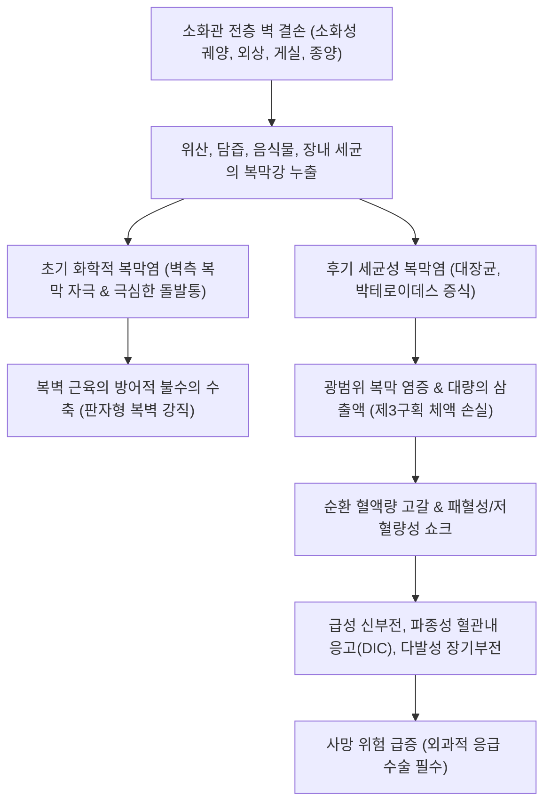
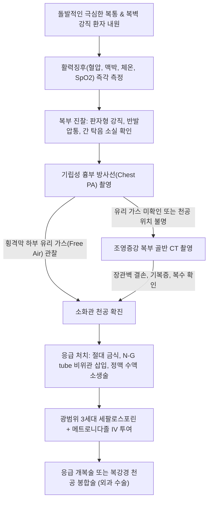

# 🩺 소화관 천공 (Gastrointestinal Perforation)

> **핵심 3줄 요약 (Key Summary)**:
> - 📍 병소 부위 & 해부·병태생리: 식도, 위, 십이지장, 소장, 대장 등 소화관 전층 벽이 관통 파열되어 위장관 내강의 소화액, 담즙, 섭취 음식물, 대변 및 세균총이 무균 상태인 복막강 또는 후복막강으로 누출되어 화학적·세균성 복막염과 패혈성 쇼크를 일으키는 외과적 급성 복증.
> - 🚩 전형적 임상 양상: 칼로 찌르는 듯한 급격하고 극심한 복통의 돌발, 복벽 전반의 판자 같은 강직(Board-like rigidity), 현저한 반발압통(Blumberg's sign), 빈맥 및 저혈압 등 쇼크 징후.
> - 🛠️ 핵심 검사 & 치료 전략: 기립성 흉부 단순 방사선(Chest X-ray)상 횡격막 하부 유리 가스(Free air) 확인, 복부 조영 CT로 천공 부위 확진, 즉각적인 금식·비위관 감압·광범위 정맥 항생제 투여 및 응급 개복/복강경 천공 봉합술(Graham patch 등) 시행.
> - ⚠️ 응급 의뢰 레드플래그: 복벽 판자형 강직, 활력징후 불안정(패혈성 쇼크, 저혈압), 의식 변화, 급속한 무뇨증 — 발견 즉시 119 구급대를 통한 응급실 후송 필수.

---

## 📌 목차
1. [질환 개요 & 해부학적 병태생리](#1-질환-개요--해부학적-병태생리)
2. [병태생리 메커니즘 & 생체역학적 악순환 네트워크](#2-병태생리-메커니즘--생체역학적-악순환-네트워크)
3. [임상 증상 & 이학적 검사(Physical Exam) 알고리즘](#3-임상-증상--이학적-검사physical-exam-알고리즘)
4. [감별 진단 매트릭스 (Differential Diagnosis)](#4-감별-진단-매트릭스-differential-diagnosis)
5. [한의 통합 치료 프로토콜 (침·약침·추나·한약)](#5-한의-통합-치료-프로토콜-침약침추나한약)
6. [양방 치료 & 병용·의뢰 기준 (Conventional Treatment & Referral)](#6-양방-치료--병용의뢰-기준-conventional-treatment--referral)
7. [재활 운동 & 생활습관 티칭 가이드](#7-재활-운동--생활습관-티칭-가이드)
8. [💡 사용자 진료실 핵심 필기 & 임상 노하우 (Melt-In 잔여 심화 집약)](#8--사용자-진료실-핵심-필기--임상-노하우-melt-in-잔여-심화-집약)
9. [출처 및 학술 참고 문헌 (References)](#9-출처-및-학술-참고-문헌-references)

---

## 1. 질환 개요 & 해부학적 병태생리

### 1) 정의 및 해부학적 분류
[[소화관 천공]](Gastrointestinal Perforation)은 소화관 벽의 전층(점막, 점막하층, 고유근층, 장막층)에 전층 결손이 발생하여 관강 내 내용물이 [[복막]]강(Peritoneal cavity) 또는 후복막강(Retroperitoneum)으로 누출되는 치명적인 외과적 응급 질환이다.

- **상부 소화관 천공**:
  - **[[식도 파열]]**: 구토 후 식도 하부 압력 급증에 의한 [[보어하베 증후군]], 이물질 손상, 내시경적 시술 합병증.
  - **위 및 십이지장 천공**: [[소화성 궤양 질환]]의 만성 미란 침윤(위 전정부 전벽 및 십이지장 구부 전벽 호발), 위암 괴사. 강산([[위산]])과 담즙, 췌장액 누출로 격렬한 조기 화학적 [[복막염]] 유발.
- **하부 소화관 천공**:
  - **소장 천공**: 외상, [[장폐색]]에 의한 허혈성 괴사, 장티푸스, [[크론병]].
  - **대장 및 충수 천공**: [[급성 충수염]] 파열, 게실염(Diverticulitis), 대장암 장폐색 후 맹장(Cecum) 팽창 파열, [[허혈성 대장염]], 대장 내시경 시술 후 천공. 대장균, 혐기성 균주(Bacteroides fragilis 등)에 의한 치명적 세균성 [[복막염]] 및 [[패혈증]] 직결.

### 2) 역학 및 예후
소화관 천공은 [[급성 복증]]으로 수술을 받는 환자 중 사망률이 10~30%에 달하는 고위험 질환이다. 고령, 지연된 수술(천공 후 24시간 초과), 기저 심혈관 질환, 술 전 패혈성 쇼크 존재 시 예후가 급격히 불량해진다. 특히 소화성 궤양 천공은 NSAIDs 및 아스피린 복용 증가와 함께 고령층에서 높은 빈도를 유지하고 있다.

---

## 2. 병태생리 메커니즘 & 생체역학적 악순환 네트워크

### 1) 이상(Two-phase) 복막염 진행 기전
1. **1단계: 초기 화학적 복막염 (Chemical Peritonitis, 0~6시간)**:
   - [[위산]]($\text{pH } 1.0\sim 2.0$), 펩신, 담즙산염, 췌장 소화효소가 복막강으로 유입된다.
   - 복막 중피세포(Peritoneal mesothelium)가 광범위하게 화학적으로 박리되고 심한 염증 반응이 유발된다.
   - 풍부한 체성 신경(Somatic sensory nerve)이 분포하는 벽측 복막(Parietal peritoneum)이 강력히 자극되어 칼로 베는 듯한 극심한 돌발성 복통과 복벽 반사성 강직이 발생한다.
2. **2단계: 중기 상대적 안정기 (6~12시간)**:
   - 복막 삼출액 분비가 증가하여 위산이 일시적으로 희석되면서 환자가 통증이 호전된 것으로 착각하는 '가짜 안도기(False improvement)'가 나타날 수 있다.
3. **3단계: 후기 세균성 복막염 및 패혈증 (Bacterial Peritonitis & Sepsis, 12시간 이후)**:
   - 위장관 세균총(장내 그람음성 간균, 연쇄상구균, 혐기성균)이 증식하여 화농성 삼출물을 형성한다.
   - 전신 염증 반응 증후군([[SIRS]]), 패혈증([[Sepsis]]), 모세혈관 누출 증후군이 초래되어 대량의 체액이 복강 내로 유출되는 제3구획 체액 손실(Third-spacing)이 발생한다.
   - 유효 순환 혈장량 급감으로 [[저혈량성 쇼크]] 및 [[패혈성 쇼크]], 다발성 장기 부전([[MODS]])으로 진행한다.

### 2) 생체역학적 악순환 네트워크
- 장벽 결손 $\to$ 소화액 및 균주 누출 $\to$ 화학적/세균성 복막염 $\to$ 제3구획 체액 소실 $\to$ 순환 저하 및 장간막 허혈 $\to$ 장관 괴사 가속화.

---

## 3. 임상 증상 & 이학적 검사(Physical Exam) 알고리즘

### 1) 임상 증상 전개
- **돌발성 격통**: 천공 순간 "번개를 맞은 것 같다" 또는 "칼로 배를 찌르는 것 같다"고 표현하는 급작스러운 상복부 통증으로 시작하여 점차 복부 전체로 퍼짐.
- **방사통**: 횡격막 하부의 유리 가스 및 복강액이 횡격막 신경(C3~C5)을 자극하여 동측 어깨(우측 견갑부)로 방사되는 횡격막 방사통(Danforth's sign).
- **호흡 양상 변화**: 복벽을 움직이면 극심한 통증이 발생하므로 복식 호흡이 완전히 중단되고 얕고 빠른 흉식 호흡(Tachypnea)을 보임.
- **전신 쇼크 증상**: 식은땀, 안면 창백, 오한, 고열, 빈맥, 핍뇨, 저혈압.

### 2) 이학적 검사 핵심 소견
1. **시진(Inspection)**: 복벽 운동이 완전히 소실되어 평탄하거나 굳어 있음. 환자는 무릎을 구부린 채 미동도 하지 않으려 함.
2. **촉진(Palpation)**:
   - **판자형 복벽 강직(Board-like Rigidity)**: 복직근이 의지와 상관없이 돌처럼 딱딱하게 굳어 있음.
   - **반발압통(Rebound Tenderness / Blumberg's sign)**: 복부를 눌렀다 뗄 때 비명을 지를 정도의 극심한 통증.
3. **타진(Percussion)**:
   - 정상적인 간 탁음(Liver dullness) 부위에서 장관 유리 가스로 인해 북소리 같은 공명음(Tympanitic sound)이 들리는 **간 탁음 소실(Loss of liver dullness)**.
4. **청진(Auscultation)**:
   - 마비성 장폐색(Paralytic ileus)으로 인해 장음이 완전히 소실된 침묵의 복부(Silent abdomen).

### 3) 영상 진단 검사
- **기립성 흉부 단순 방사선(Upright Chest X-ray)**: 우측 횡격막 바로 아래 초승달 모양의 공기 음영(Free air beneath the diaphragm) 관찰 (천공 환자의 70~80%에서 확인). 기립 불가능 시 좌측와위 복부 방사선(Left lateral decubitus) 시행.
- **복부 전산화단층촬영(Abdominal CT with IV contrast)**: 진단 민감도 95% 이상. 미세 기복증(Pneumoperitoneum), 천공의 정확한 해부학적 위치, 복수 및 농양 유무 확진.

---

## 4. 감별 진단 매트릭스 (Differential Diagnosis)

| 감별 질환 | 통증 발현 및 특징 | 복벽 신체 진찰 | 영상 및 검사실 소견 | 감별 핵심 포인트 |
| :--- | :--- | :--- | :--- | :--- |
| **[[소화관 천공]]** | 돌발성 칼로 베는 듯한 극심한 복통, 전복부 확산 | **판자형 강직**, 현저한 반발압통, 간 탁음 소실 | 흉부 X-ray상 **횡격막 하 유리 가스(Free air)**, CT상 기복증 | 복벽 강직과 기복증이 결정적, 즉각적인 외과 수술 필수 |
| **급성 췌장염** | 명치에서 등으로 방사되는 지속적 격통, 알코올/담석 | 상복부 압통, 강직은 천공보다 덜 현저함 | 혈청 리파아제/아밀라아제 3배 이상 상승, CT상 췌장 부종 | 기복증(Free air) 없음, 췌장 효소 상승 |
| **대동맥류 파열** | 등과 허리로 찢어지는 듯한 급성 통증, 실신 | 박동성 복부 종괴 촉지 가능, 저혈압 | 초음파 또는 CT상 복부 대동맥 확장 및 혈종 | 급속한 혈압 저하와 박동성 종괴, 유리 가스 없음 |
| **장간막 동맥 색전증** | 신체 진찰 소견에 비해 불균형하게 극심한 복통 | 초기에는 복벽 강직이나 반발압통이 미약함 | 조영 CT상 장간막 혈관 혈전 및 장벽 조영 증강 결손 | 통증 정도와 진찰 소견의 불일치, 심방세동 병력 |
| **심근경색증(하벽)** | 명치 부위 답답함, 오심, 식은땀, 방사통 | 복벽 부드러움, 압통이나 반발압통 없음 | 심전도(ECG) ST분절 상승(II, III, aVF), 심근효소 상승 | 복부 증상으로 위장관 질환 오인 가능, 심전도 필수 |

---

## 5. 한의 통합 치료 프로토콜 (침·약침·추나·한약)

### ⚠️ 응급 금기 및 한의 진료 원칙
소화관 천공은 **절대적 외과적 응급 수술 적응증**이다. 한의 의료기관에 내원한 경우, 진찰 즉시 119 구급대를 호출하여 응급수술이 가능한 상급종합병원으로 전원해야 한다. 어떠한 경우에도 한약 복용(경구 투여 금기), 침습적 시술로 이송을 지연시켜서는 안 된다. 아래 프로토콜은 **외과적 수술이 성공적으로 완료된 후, 회복기 및 재활 단계**에서 적용하는 협진 치료이다.

### 1) 수술 후 회복기 한의 변증 체계
- **기혈양허·어혈조체(氣血兩虛·瘀血阻滯)**: 개복 수술 후 체력 저하, 수술창 치유 지연, 국소 찌르는 듯한 통증.
- **비위허약·장위무력(脾胃虛弱·腸胃無力)**: 장운동 회복 지연(마비성 장폐색), 식욕 부진, 복부 팽만감, 무기력.

### 2) 수술 후 침구 치료 (장 연동운동 회복)
수술 후 장 마비(Postoperative ileus)를 예방하고 위장관 가스 배출을 촉진한다.
- **주요 혈위**: [[족삼리]](ST36), [[상거허]](ST37), [[내관]](PC6), [[합곡]](LI4). (복부 수술창 직접 자침 금지, 사지 말초혈 위주).
- **시술 기법**: [[족삼리]](ST36)와 [[상거허]](ST37)에 2~10Hz 전침 자극을 가하여 미주신경 활성화 및 장관 평활근 수축 유도.

### 3) 수술 후 맞춤 한약 처방 (장폐색 예방 및 조직 재생)
- **대건중탕(大建中湯)**: [[화초]], [[건강]], [[인삼]], [[교이]]. 수술 후 장 마비, 복부 냉증 및 팽만, 장 연동운동 부전을 예방하는 입증된 외과 협진 처방.
- **보중익기탕(補中益氣湯) 또는 십전대보탕(十全大補湯)**: 수술 후 전신 쇠약 회복, 창상 치유 촉진, 면역 기능 증강.

---

## 6. 양방 치료 & 병용·의뢰 기준 (Conventional Treatment & Referral)

### 1) 응급 소생술 및 초기 내과적 처치 (Resuscitation)
1. **절대 금식(NPO)** 및 비위관(Levin tube) 삽입을 통한 지속적 위액 감압 (추가적인 복강 누출 방지).
2. **대량 정맥 수액 소생술**: 결정질 용액(Crystalloid, 생리식염수 또는 하트만액)을 시간당 수백 ml 속도로 정맥 투여하여 중심정맥압 및 소변량(>0.5 mL/kg/h) 유지.
3. **광범위 정맥 항생제 조기 투여**:
   - 3세대 세팔로스포린(세프트리아손 또는 세포탁심) + 메트로니다졸(Metronidazole), 또는 피페라실린/타조바크탐(Piperacillin/tazobactam). 패혈증 쇼크 시 카바페넴(Carbapenem) 고려.
4. **통증 조절**: 마약성 진통제(Fentanyl 등) 정맥 투여 (진단 확정 후).

### 2) 외과적 수술 치료 원칙
1. **소화성 궤양 천공**:
   - **천공 봉합술(Graham patch omentopexy)**: 대망(Omentum) 편을 천공 부위에 덧대어 단순 봉합하는 표준 술식 (복강경 또는 개복).
   - 직경 >2cm 이상의 거대 천공 시 위 부분절제술(Subtotal gastrectomy) 또는 십이지장 게실화술 고려.
2. **대장 천공 (게실염, 종양)**:
   - 하트만 수술(Hartmann's procedure): 병변 절제 후 근위부 결장루 조성술 및 원위부 직장 봉합.
   - 복강 내 광범위 생리식염수 세척(Peritoneal lavage) 및 배액관 유치.

### 3) 응급 전원의뢰 기준 (Red Flags)
- 상복부 또는 전복부의 **갑작스러운 돌발성 극심 통증**.
- 신체 진찰상 **판자 같은 복벽 강직** 및 **반발압통**.
- 패혈증 징후: 빈맥(HR >100회/분), 저혈압(SBP <90 mmHg), 고열 또는 저체온.
- 단순 방사선상 **횡격막 하 유리 가스(Free air)** 발견.
- **조치 사항**: 발견 즉시 119 긴급 후송, 환자 구강 섭취 절대 금지, 편안한 앙와위 유지.

---

## 7. 재활 운동 & 생활습관 티칭 가이드

### 1) 수술 후 일상 복귀 및 식단 관리
- **유동식에서 연식으로 단계적 진행**: 방귀(가스) 배출 및 장음 확인 후 미음, 죽 순으로 소량씩 자주 섭취.
- **소화성 궤양 유발 인자 완전 차단**:
  - 금연(흡연은 십이지장 점막 혈류를 급감시켜 재천공 유발).
  - 금주 및 카페인 제한.
  - NSAIDs 및 아스피린 복용 중단 (필요 시 타이레놀 대체 및 주치의 상의).

### 2) 일상 활동 티칭
- **조기 보행(Early ambulation)**: 수술 후 가능한 한 조기에 침상에서 일어나 걷기 운동을 시행하여 장 유착 및 장폐색 예방.
- 복압 상승 행위(무거운 물건 들기, 심한 기침, 변비로 힘주기)를 수술 후 2~3개월간 피하여 절개창 탈장 예방.

---

## 8. 💡 사용자 진료실 핵심 필기 & 임상 노하우 (Melt-In 잔여 심화 집약)

### 1) 진료실 내원 시 응급 대처 노하우
- 한의원에 "명치가 찢어지게 아프다"며 허리를 펴지 못하고 들어오는 환자에서 배를 살짝만 만져도 돌처럼 단단하고 손을 못 대게 하면 1초도 지체하지 말고 119를 불러야 한다.
- 소화제나 온열 찜질, 사혈 요법, 복부 침치료를 시도하다가 골든타임(수술 적기)을 놓치면 복막염으로 사망할 수 있음을 명심해야 한다.

### 2) '가짜 안도기'를 경계하라
- 천공 직후 환자가 비명을 지르다가, 2~3시간 뒤 복수가 차면서 산이 희석되어 "선생님, 이제 조금 살 것 같습니다"라고 말할 때가 있다.
- 이때 환자가 호전된 것으로 오판하여 귀가시키면 밤사이에 패혈성 쇼크로 급격히 악화된다. 복벽 강직이 남아있다면 통증 호소 여부와 상관없이 즉각 전원해야 한다.

---

## 9. 출처 및 학술 참고 문헌 (References)

- Nehme F, Ge PS. (2026). Approach to the Patient with a Gastrointestinal Perforation. *Gastrointest Endosc Clin N Am*. 36(2):245-259. PMID: 41905794.
   - **[연구 요약]**: 소화관 천공 환자에 대한 체계적인 임상 평가, 조기 진단 알고리즘, 내시경적 및 외과적 중재술 결정 기준과 패혈증 예방 관리 원칙을 제시함.
- Tarasconi A, Coccolini F, Biffl WL. (2020). Perforated and bleeding peptic ulcer: WSES guidelines. *World J Emerg Surg*. 15:3. PMID: 31921329.
   - **[연구 요약]**: 세계응급외과학회(WSES)의 소화성 궤양 천공 및 출혈 치료 가이드라인으로 조기 소생술, 항생제 요법, 복강경 및 개복 봉합술 술식 선택 기준을 확립함.
- Rodriguez Abreu A, Evgenevich Klimov A, Vyacheslavovich Lebedev N. (2026). A Comparative Analysis of Generalized Peritonitis Secondary to Upper Gastrointestinal Perforation: Surgical Approaches, Antibiotic Management, and Patient Outcomes. *Cureus*. 18(1):e78921. PMID: 41769466.
   - **[연구 요약]**: 상부 소화관 천공으로 인한 범발성 복막염 환자에서 수술적 접근법(봉합술 vs 절제술), 광범위 항생제 프로토콜 및 예후 예측 인자를 비교 분석함.
