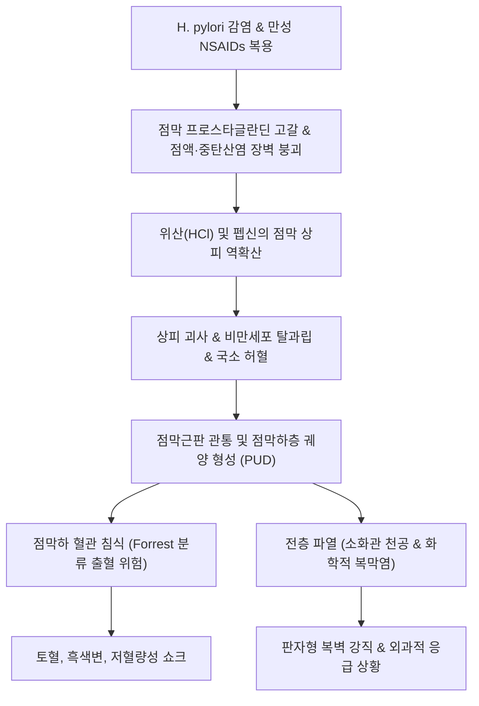
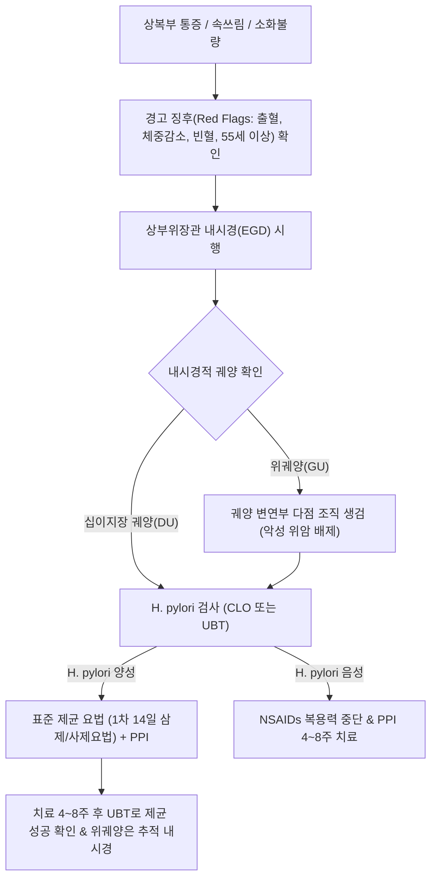

# 🩺 소화성 궤양 질환 (Peptic Ulcer Disease, PUD)

> **핵심 3줄 요약 (Key Summary)**:
> - 📍 병소 부위 & 해부·병태생리: 위장관 점막의 공격 인자(위산, 펩신, H. pylori, NSAIDs)와 방어 인자(점액, 중탄산염, 프로스타글란딘, 점막 혈류)의 불균형으로 인해 점막근판(Muscularis mucosae)을 넘어 점막하층 이상 결손이 발생하는 만성 궤양성 질환.
> - 🚩 전형적 임상 양상: 상복부(명치)의 타는 듯한 작열통 또는 둔통으로, 위궤양은 식후 조기 악화 경향을 보이고 십이지장궤양은 공복통 및 야간통(음식물이나 제산제 복용 시 일시 완화)을 특징으로 함.
> - 🛠️ 핵심 검사 & 치료 전략: 상부위장관 내시경(EGD)으로 궤양 위치·크기·Forrest 병기 판정 및 악성 감별 생검 시행, H. pylori 감염 확인 및 제균 요법, 양성자펌프억제제(PPI) 또는 P-CAB 투여, 한의 반하사심탕·안중산 투여.
> - ⚠️ 응급 의뢰 레드플래그: 대량 토혈(Hematemesis), 흑색변(Melena), 기립성 어지럼증 및 쇼크, 돌발성 극심한 복통과 판자형 복벽 강직(소화관 천공 의심), 분출성 구토(유문부 폐색).

---

## 📌 목차
1. [질환 개요 & 해부학적 병태생리](#1-질환-개요--해부학적-병태생리)
2. [병태생리 메커니즘 & 생체역학적 악순환 네트워크](#2-병태생리-메커니즘--생체역학적-악순환-네트워크)
3. [임상 증상 & 이학적 검사(Physical Exam) 알고리즘](#3-임상-증상--이학적-검사physical-exam-알고리즘)
4. [감별 진단 매트릭스 (Differential Diagnosis)](#4-감별-진단-매트릭스-differential-diagnosis)
5. [한의 통합 치료 프로토콜 (침·약침·추나·한약)](#5-한의-통합-치료-프로토콜-침약침추나한약)
6. [양방 치료 & 병용·의뢰 기준 (Conventional Treatment & Referral)](#6-양방-치료--병용의뢰-기준-conventional-treatment--referral)
7. [재활 운동 & 생활습관 티칭 가이드](#7-재활-운동--생활습관-티칭-가이드)
8. [💡 사용자 진료실 핵심 필기 & 임상 노하우 (Melt-In 잔여 심화 집약)](#8--사용자-진료실-핵심-필기--임상-노하우-melt-in-잔여-심화-집약)
9. [출처 및 학술 참고 문헌 (References)](#9-출처-및-학술-참고-문헌-references)

---

## 1. 질환 개요 & 해부학적 병태생리

### 1) 정의 및 해부학적 특성
[[소화성 궤양 질환]](Peptic Ulcer Disease, PUD)은 [[위산]]과 펩신에 노출되는 소화관 점막이 손상되어 점막하층(Submucosa) 또는 그보다 깊은 고유근층까지 조직 결손이 도달한 상태를 말한다. 표층 점막에 국한되는 미란(Erosion)과 달리, 점막근판을 침범하므로 치유 시 섬유성 반흔을 남긴다.

- **해부학적 호발 부위**:
  - **[[위궤양]](Gastric Ulcer, GU)**: 위 체부와 전정부의 경계부인 위각부(Incisura angularis) 및 소만(Lesser curvature)에 호발한다. 위산 분비능은 정상 이하인 경우가 많으나 점막 방어벽 손상이 주원인이다. 악성 종양(조기 위암)과의 감별이 필수적이다.
  - **[[십이지장 궤양]](Duodenal Ulcer, DU)**: 십이지장 제1부(구부, Duodenal bulb)의 전벽에 주로 발생한다. 벽세포 종괴(Parietal cell mass) 증가로 인한 위산 과다 분비가 주된 요인이며, 악성 가능성은 매우 낮다.
  - **기타 드문 부위**: 식도 하부, 위공장문합부(Gastrojejunostomy stoma), 멕켈 게실(Meckel's diverticulum).

### 2) 역학 및 원인 인자
전 세계적으로 평생 유병률이 약 5~10%에 달한다. 양대 핵심 원인은 **[[헬리코박터 파일로리]](Helicobacter pylori) 감염**(십이지장 궤양의 80~90%, 위궤양의 60~70%)과 **비스테로이드소염진통제(NSAIDs, 아스피린 포함)의 만성 복용**이다. 흡연, 음주, 고령, 중증 생리적 스트레스(Curling 궤양, Cushing 궤양), 졸링거-엘리슨 증후군(Gastrinoma)도 중요한 위험 인자이다.

---

## 2. 병태생리 메커니즘 & 생체역학적 악순환 네트워크

### 1) Shay의 균형설(Balance Theory)과 공격·방어 인자
소화성 궤양은 점막을 공격하는 인자와 이를 방어하는 점막 보호 기전의 역학적 불균형에 의해 촉발된다.
1. **공격 인자(Aggressive Factors)**:
   - [[위산]](Gastric acid, $\text{HCl}$) 및 [[펩신]](Pepsin).
   - [[헬리코박터 파일로리]]: 유레아제(Urease)를 통해 요소를 암모니아로 분해하여 점막을 직접 손상시키고, 세포독소(CagA, VacA)를 분비하여 호중구 침윤 및 만성 위염 유발.
   - NSAIDs: [[시클로옥시게나제-1]](COX-1) 억제를 통해 점막 보호 물질인 [[프로스타글란딘]]($\text{PGE}_2, \text{PGI}_2$) 생합성을 전신적으로 차단하고, 약제 자체의 산성 특성으로 세포막을 직접 자극.
2. **방어 인자(Defensive Factors)**:
   - 점액-중탄산염 장벽(Mucus-bicarbonate barrier).
   - 점막 상피세포의 신속한 재생(Restitution).
   - 풍부한 미세혈관 혈류 공급 및 프로스타글란딘, 표피성장인자(EGF).

### 2) 분자세포학적 파괴 연쇄 및 악순환
- H. pylori 감염 $\to$ D세포 파괴 및 소마토스타틴 감소 $\to$ 가스트린 분비 억제 소실 $\to$ 고가스트린혈증 및 위산 과다 $\to$ 십이지장 상피의 위화생(Gastric metaplasia) $\to$ 십이지장 내 H. pylori 증식 $\to$ 십이지장 점막 붕괴.
- 만성 궤양 형성은 국소 조직 허혈을 부르고, 노출된 혈관벽 미란으로 인한 대량 [[위장관 출혈]] 및 전층 괴사로 인한 [[소화관 천공]]의 악순환을 유발한다.

---

## 3. 임상 증상 & 이학적 검사(Physical Exam) 알고리즘

### 1) 임상 증상 분석
- **상복부 동통(Epigastric Pain)**:
  - 타는 듯하거나 쑤시는 듯한 통증(Burning, Gnawing pain).
  - **위궤양(GU)**: 식사 직후 또는 30분 이내에 통증이 악화되는 경향이 있어 음식 섭취를 두려워하고 체중 감소가 동반되기 쉬움.
  - **십이지장 궤양(DU)**: 식후 2~3시간 후 위가 비었을 때(공복 시) 또는 한밤중(새벽 1~3시)에 통증이 최고조에 달하며, 음식이나 제산제를 복용하면 일시적으로 통증이 완화됨(Food-relief pattern).
- **소화기 동반 증상**: 트림, 조기 포만감, 오심, 구토, 복부 팽만감.
- **무증상 궤양(Silent Ulcer)**: 고령자나 당뇨병 환자, 만성 NSAIDs 복용 환자에서는 전형적인 통증 없이 흑색변이나 빈혈, 천공으로 처음 발현되는 경우가 흔함.

### 2) 이학적 검사 및 진단 평가 알고리즘
1. **복부 촉진**: 명치 부위의 국소적 압통(Tenderness). 반발압통이나 복벽 강직이 동반되면 즉시 천공 합병증 의심.
2. **상부위장관 내시경(EGD)**:
   - 궤양의 위치, 개수, 크기, 기저부 형태 평가.
   - **위궤양의 필수 생검**: 양성 궤양과 궤양형 조기위암(Borrmann type 2/3) 감별을 위해 궤양 변연부 4분면에서 최소 4~6점 생검 필수.
   - **Forrest 분류 (출혈 궤양 병기)**:
     - Ia: 분출성 출혈(Spurting) / Ib: 삼출성 출혈(Oozing).
     - IIa: 노출 혈관(Non-bleeding visible vessel) / IIb: 부착 혈괴(Adherent clot) / IIc: 혈철소 침착(Flat pigmented spot).
     - III: 깨끗한 백태 궤양저(Clean base).
3. **H. pylori 진단 검사**: 신속 요소분해효소 검사(CLO/RUT), 요소호흡검사(UBT), 대변 항원 검사.

---

## 4. 감별 진단 매트릭스 (Differential Diagnosis)

| 감별 질환 | 통증 특성 및 발현 시기 | 내시경 / 영상 소견 | 감별 핵심 포인트 |
| :--- | :--- | :--- | :--- |
| **[[위궤양]]** | 명치 둔통, 식사 직후 악화, 체중 감소 동반 흔함 | 위각부·소만 점막 결손, 주변 점막 집중 | **생검 필수**(조기 위암 감별), 산 분비 정상/저하 |
| **[[십이지장 궤양]]** | 공복통, 야간통, 식사나 제산제 복용 시 완화 | 십이지장 구부 전벽 궤양, 변형(Deformity) | 악성 위험 거의 없음, H. pylori 감율 90% 육박 |
| **[[진행성 위암]]** | 지속적 둔통, 식욕 부진, 연하곤란, 빈혈 | 불규칙한 궤양 변연, 결절상 융기, 괴사 백태 | 병리 조직 검사상 선암종(Adenocarcinoma) 확진 |
| **[[위식도 역류질환]]** | 흉골 후방 작열감(Heartburn), 신물 역류 | 하부 식도 점막 미란(LA 분류) 또는 정상 | 흉골 뒤 상행성 통증, 앙와위 시 악화 |
| **[[상복부통증증후군]]** | 명치 작열통/동통, 식사와 무관 | 내시경 완전 정상 (기질적 결손 없음) | 로마 IV 기준 충족, 내장 과민성 질환 |
| **[[만성 췌장염]]** | 등(Back)으로 방사되는 극심한 지속통, 음주력 | 복부 CT상 췌장 석회화, 췌관 확장 | 지방변, 당뇨병 동반, 음식 섭취 시 악화 |

---

## 5. 한의 통합 치료 프로토콜 (침·약침·추나·한약)

### 1) 한의 변증 진단 체계
한의학에서 소화성 궤양은 [[위완통]](胃脘痛), [[심하통]](心下痛), [[비증]](痞證), [[토혈]](吐血), [[변혈]](便血)의 범주에 속한다. 간기범위(肝氣犯胃)와 비위허한(脾胃虛寒)이 기본 병태이며, 구병(久病)으로 어혈과 음허가 가스트린과 점막 손상을 조장한다.

- **간위불화·기체열울(肝胃不和·氣滯熱鬱)**: 감정 자극으로 통증 악화, 명치 창통, 잦은 트림, 탄산(속쓰림), 설홍태박황, 맥현.
- **비위허한·기혈양허(脾胃虛寒·氣血兩虛)**: 은은한 명치 공복통, 온안(溫按, 따뜻하게 누름) 시 완화, 식욕 부진, 대변 묽음, 설담태백, 맥침세무력.
- **위음부족·허열내생(胃陰不足·虛熱內生)**: 입과 목이 마름, 공복감은 있으나 먹지 못함, 작열감, 설홍소태 또는 경면설, 맥세삭.
- **어혈조락·위락손상(瘀血阻絡·胃絡損傷)**: 찌르는 듯한 고정성 통증, 야간 악화, 흑변 동반 가능, 설자암 유어반, 맥삽.

### 2) 침구 치료 프로토콜
위점막 미세혈류를 증가시키고 자율신경계 균형(미주신경 촉진, 교감신경 억제)을 유도하여 점액 분비 촉진과 통증 완화를 도모한다.
- **주요 혈위**: [[중완]](CV12), [[거궐]](CV14), [[족삼리]](ST36), [[내관]](PC6), [[공손]](SP4), [[양구]](ST34, 위경 극혈), [[태충]](LR3), [[위수]](BL21), [[비수]](BL20), [[격수]](BL17).
- **시술 기법**:
  - **급성 통증 발작기**: [[양구]](ST34)와 [[족삼리]](ST36)에 강자극 사법으로 자침하여 신속한 진통 효과 유도.
  - **허한형 만성기**: [[중완]](CV12) 및 [[비수]](BL20), [[위수]](BL21)에 뜸 치료(간접구) 또는 온침 요법 병용.
  - **간위불화형**: [[태충]](LR3) - [[합곡]](LI4) 사관혈 배합 및 [[내관]](PC6)으로 스트레스 완화.
- **치료 주기**: 주 2~3회, 20분 유침.

### 3) 약침 치료 프로토콜
- **황련해독탕 약침**: 염증 및 속쓰림이 극심한 열증(熱證) 환자에게 [[중완]](CV12), [[거궐]](CV14)에 점적 주입 (0.5~1.0cc).
- **중성어혈 약침**: 야간 자통 및 만성 궤양 반흔 환자의 [[격수]](BL17), [[위수]](BL21)에 심부 주입하여 미세 순환 촉진.
- **자하거 약침**: 만성 비위허약 환자의 궤양 점막 재생을 위해 [[족삼리]](ST36), [[비수]](BL20)에 보법 주입.

### 4) 추나 치료 프로토콜
- **흉추 분절 교정 및 가동술(T5~T9)**: 위장을 지배하는 교감신경 분절인 중부 흉추의 부정렬을 교정하여 과도한 혈관 수축을 해소하고 점막 혈류 개선.
- **상복부 근막 이완술**: 복직근초 상부 및 검상돌기 주변의 근막 긴장을 완화.

### 5) 맞춤 한약 처방
- **안중산(安中散)**: [[백작약]], [[현호색]], [[모려]], [[소회향]], [[사인]], [[육계]], [[감초]]. 허한형 속쓰림과 위통을 신속히 진통시키고 점막을 보호.
- **반하사심탕(半夏瀉心湯)**: [[반하]], [[황련]], [[황금]], [[건강]], [[인삼]], [[대추]], [[감초]]. H. pylori 연관 만성 위염 및 위각부 궤양의 심하비통 완화.
- **황기건중탕(黃芪建中湯)**: [[황기]], [[백작약]], [[계지]], [[교이]], [[생강]], [[대추]], [[감초]]. 만성 소모성 십이지장 궤양 환자의 점막 조직 재생 촉진.
- **단삼음(丹參飲) 가미방**: [[단삼]], [[사인의]], [[백단향]]에 [[백급]], [[삼칠근]]을 가미하여 궤양저의 삼출성 출혈을 지혈하고 상처 유합 가속.

---

## 6. 양방 치료 & 병용·의뢰 기준 (Conventional Treatment & Referral)

### 1) 현대의학적 표준 치료 전략
1. **위산 분비 억제 요법**:
   - **양성자펌프억제제(PPI)**: 에소메프라졸(Esomeprazole) 40mg, 판토프라졸(Pantoprazole) 40mg, 라베프라졸(Rabeprazole) 20mg 1일 1회 복용 (십이지장 궤양 4주, 위궤양 6~8주).
   - **칼륨경쟁적 위산분비차단제(P-CAB)**: 테고프라잔(Tegoprazan) 50mg, 보노프라잔(Vonoprazan) 20mg. 식사 시간과 무관하게 신속하고 지속적인 위산 억제 효과 발휘.
2. **H. pylori 제균 요법(Eradication Therapy)**:
   - **표준 1차 삼제요법(14일)**: PPI 표준용량 1일 2회 + 아목시실린 1000mg 1일 2회 + 클라리스로마이신 500mg 1일 2회 (클라리스로마이신 내성률 15% 미만 지역).
   - **비스무스 기반 사제요법(14일)**: PPI 1일 2회 + 비스무스 300mg 1일 4회 + 메트로니다졸 500mg 1일 3회 + 테트라사이클린 500mg 1일 4회 (내성 지역 1차 또는 2차 권고).
3. **내시경적 지혈술 (Endoscopic Hemostasis)**:
   - Forrest Ia, Ib, IIa 궤양에 대해 즉각적인 지혈술 시행: 국소 에피네프린 주입 + 열응고소작술(Heater probe) 또는 혈관 클립 결찰술(Hemoclip)의 병용 요법.
   - 고용량 PPI 정맥 투여(80mg IV 볼루스 후 8mg/hr 지속 주입 72시간).

### 2) 한양방 협진 가이드라인
- 급성기에는 양방의 강력한 산 억제제(PPI/P-CAB)와 H. pylori 제균제를 복용하여 궤양저의 즉각적인 유합과 원인균 박멸을 도모한다.
- 궤양 치유 후 재발 방지 및 소화기 점막 면역 회복을 위해 한약(황기건중탕, 안중산)과 침구 치료를 병용한다.
- 위궤양은 치유 확인 및 잠복 위암 배제를 위해 **치료 8~12주 후 반드시 추적 내시경 생검**을 시행해야 함을 환자에게 티칭한다.

### 3) 응급 전원의뢰 기준 (Red Flags)
- **급성 상부위장관 출혈**: 대량 토혈(커피색 구토), 흑색변, 빈맥, 혈압 강하, 실신.
- **[[소화관 천공]]**: 갑작스러운 칼로 베는 듯한 극심한 복통, 판자형 복벽 강직, 흉부 X-ray상 유리 가스(Free air).
- **위출구 폐색(Gastric Outlet Obstruction)**: 반복적인 분출성 구토(소화 안 된 수시간 전 음식물), 심한 식후 포만감, 체중 감소.

---

## 7. 재활 운동 & 생활습관 티칭 가이드

### 1) 식이 및 영양 관리
- **자극 인자 완전 배제**: 알코올, 카페인(커피, 차), 매운 고추, 탄산음료 섭취 금지.
- **우유에 대한 오해 교정**: 과거 우유 섭취를 권장했으나, 우유의 단백질과 칼슘은 일시적 중화 후 강력한 리바운드 위산 분비를 촉진하므로 과다 섭취 금지.
- **소량 빈식 및 야식 금지**: 취침 3시간 전 금식하여 야간 위산 분비 억제.

### 2) 생활 습관 개선
- **금연 필수**: 담배의 니코틴은 점막 혈류를 감소시키고 중탄산염 분비를 억제하여 궤양 치유를 지연시키고 재발률을 2배 이상 높임.
- **약물 복용 주의**: 아스피린, 이부프로펜 등 소염진통제 복용 시 반드시 주치의와 상의하고, 필요 시 타이레놀 대체 또는 점막보호제 병용.

---

## 8. 💡 사용자 진료실 핵심 필기 & 임상 노하우 (Melt-In 잔여 심화 집약)

### 1) 진료실 감별 팁
- 환자가 "밥을 먹으면 속이 더 쓰리고 아파요"라고 하면 위궤양을 먼저 의심하고, "배가 고프면 속이 쓰려서 새벽에 깬다"고 하면 십이지장 궤양을 의심해야 한다.
- 고령의 만성 관절염 환자가 "소화불량이 좀 있다"고 할 때 대변 색깔을 반드시 물어보아야 한다. 흑색변(자장면 색깔)을 본다면 통증이 없어도 출혈성 궤양이 진행 중인 응급 상황이다.

### 2) 한약 투약 시 주의사항
- 소화성 궤양 활성기에는 신열(辛熱)한 약재(부자, 건강 등)를 단독으로 과용하면 국소 점막 혈관을 확장시켜 출혈을 조장할 수 있으므로, 황련·작약·감초 등과 배합하여 신개고항(辛開苦降) 및 감완지통(甘緩止痛)의 배합을 엄격히 준수한다.

---

## 9. 출처 및 학술 참고 문헌 (References)

- Malik TF, Gnanapandithan K, Singh K. (2023). Peptic Ulcer Disease. *StatPearls*. PMID: 30521213.
   - **[연구 요약]**: 소화성 궤양 질환의 전반적인 병태생리, 위험 인자, 임상 양상, 헬리코박터 파일로리 진단 및 제균 치료와 합병증 관리 지침을 체계적으로 기술함.
- Lanas A, Chan FKL. (2017). Peptic ulcer disease. *Lancet*. 390(10094):613-624. PMID: 28242110.
   - **[연구 요약]**: 헬리코박터 파일로리와 비스테로이드소염진통제에 의한 점막 손상 기전, 역학적 변화, 최신 내시경적 지혈술 및 산 분비 억제 전략을 포괄적으로 분석함.
- Laine L, Barkun AN, Saltzman JR. (2021). ACG Clinical Guideline: Upper Gastrointestinal and Ulcer Bleeding. *Am J Gastroenterol*. 116(5):899-917. PMID: 33929377.
   - **[연구 요약]**: 미국소화기학회의 상부위장관 및 소화성 궤양 출혈 가이드라인으로 수혈 기준, 내시경 전후 약물 요법, 내시경 지혈술 및 재출혈 예방 지침을 확립함.
