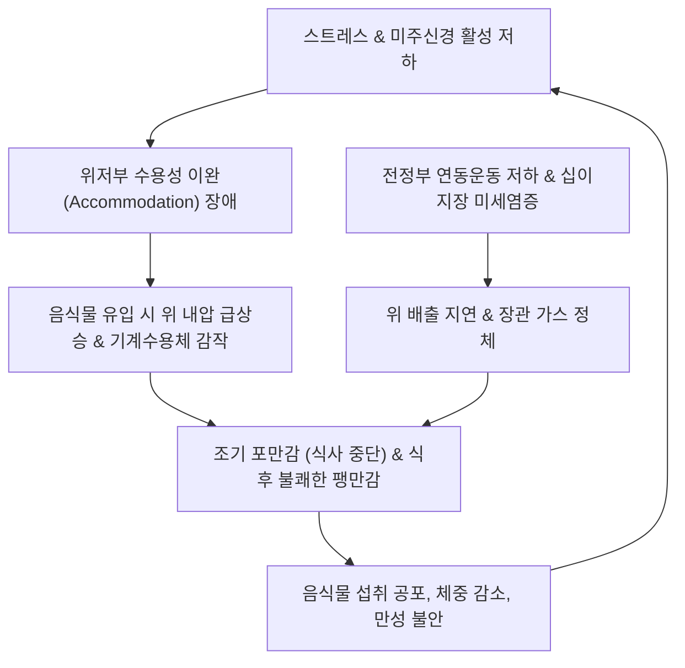
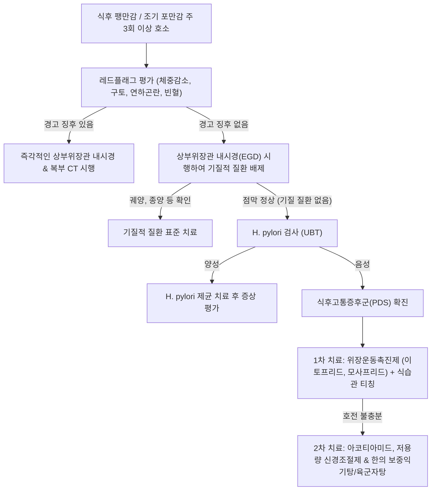

# 🩺 식후고통증후군 (Postprandial Distress Syndrome, PDS)

> **핵심 3줄 요약 (Key Summary)**:
> - 📍 병소 부위 & 해부·병태생리: 로마 IV 기준 기능성 소화불량증의 가장 흔한 아형으로, 위 저부(Fundus)의 수용성 이완(Gastric accommodation) 부전 및 전정부(Antrum) 연동운동 저하, 위 배출 지연, 십이지장 미세염증에 의해 발생하는 위장 운동 기능 이상 질환.
> - 🚩 전형적 임상 양상: 일반적인 양의 식사 후 발생하는 괴로운 조기 포만감(Early satiety, 식사를 다 마치지 못함)과 불쾌한 식후 팽만감(Postprandial fullness, 윗배가 터질 듯함)이 주 3회 이상 발생.
> - 🛠️ 핵심 검사 & 치료 전략: 상부위장관 내시경(EGD)으로 위암·궤양 배제, H. pylori 검사 및 제균, 위장운동촉진제(Prokinetics: 이토프리드, 모사프리드) 1차 투여, 아코티아미드(Acotiamide), 저용량 항우울제 및 한의 보중익기탕·육군자탕 투여.
> - ⚠️ 응급 의뢰 레드플래그: 체중 감소, 연하곤란, 지속적 구토, 위장관 출혈(토혈, 흑색변), 복부 종괴, 55세 이상 신규 발병, 황달.

---

## 📌 목차
1. [질환 개요 & 해부학적 병태생리](#1-질환-개요--해부학적-병태생리)
2. [병태생리 메커니즘 & 생체역학적 악순환 네트워크](#2-병태생리-메커니즘--생체역학적-악순환-네트워크)
3. [임상 증상 & 이학적 검사(Physical Exam) 알고리즘](#3-임상-증상--이학적-검사physical-exam-알고리즘)
4. [감별 진단 매트릭스 (Differential Diagnosis)](#4-감별-진단-매트릭스-differential-diagnosis)
5. [한의 통합 치료 프로토콜 (침·약침·추나·한약)](#5-한의-통합-치료-프로토콜-침약침추나한약)
6. [양방 치료 & 병용·의뢰 기준 (Conventional Treatment & Referral)](#6-양방-치료--병용의뢰-기준-conventional-treatment--referral)
7. [재활 운동 & 생활습관 티칭 가이드](#7-재활-운동--생활습관-티칭-가이드)
8. [💡 사용자 진료실 핵심 필기 & 임상 노하우 (Melt-In 잔여 심화 집약)](#8--사용자-진료실-핵심-필기--임상-노하우-melt-in-잔여-심화-집약)
9. [출처 및 학술 참고 문헌 (References)](#9-출처-및-학술-참고-문헌-references)

---

## 1. 질환 개요 & 해부학적 병태생리

### 1) 정의 및 로마 IV(Rome IV) 진단 기준
[[식후고통증후군]](Postprandial Distress Syndrome, PDS)은 [[기능성 소화불량증]](Functional Dyspepsia, FD) 환자의 약 60~70%를 차지하는 대표적 아형이다. 일상생활을 방해할 정도의 불쾌한 식후 팽만감(Postprandial fullness)이나 조기 포만감(Early satiation)이 **주 3회 이상** 발생하며, 증상은 최소 6개월 전에 시작되어 최근 3개월간 지속되어야 한다.

- **해부학적 병소 및 생리적 특성**:
  - **위 근위부(저부 및 체부 상부)**: 음식물 섭취 시 미주신경 반사에 의해 위벽이 이완되어 압력 증가 없이 음식물을 저장하는 **수용성 이완(Accommodation)** 장애가 주된 병리이다.
  - **위 원위부(전정부 및 유문부)**: 위 내용물을 유미즙(Chyme)으로 분쇄하고 십이지장으로 배출하는 연동운동 저하 및 **위 배출 지연(Delayed gastric emptying)**.
- **EPS(상복부통증증후군)와의 감별**: EPS는 식사와 무관하게 발생하는 명치의 통증과 작열감이 핵심인 반면, PDS는 식사(음식물 섭취)에 의해 직접 유발되는 운동성 장애 및 팽만감이 핵심이다.

### 2) 역학 및 임상적 중요성
식후고통증후군은 젊은 여성, 마른 체형, 만성 피로 및 스트레스가 많은 직장인에서 호발한다. 환자들은 식사를 조금만 해도 윗배가 가득 차고 얹힌 느낌 때문에 식사량을 줄이게 되며, 이는 영양 결핍과 만성 피로, 체중 저하의 원인이 된다. 위장관 내시경에서 기질적 이상이 발견되지 않아 '신경성 위염'으로 치부되기 쉬우나, 실제로는 신경-근육 연접부 및 장신경계의 명확한 운동 조절 장애이다.

![[식후고통증후군_1_위해부도해.png|450]]
> [그림 1: 위 해부 도해(Grant 1962) — 분문·위저부·체부·전정부·유문과 십이지장 구부의 위치(영문 라벨). 식후고통증후군은 식사 후 이 부위가 부풀어 오르는 듯한 불편감과 조기 포만감이 핵심 증상이다 — 출처: Wikimedia Commons — File:Grant 1962 127.png (Public domain)]

---

## 2. 병태생리 메커니즘 & 생체역학적 악순환 네트워크

### 1) 복합 운동성 및 감각 이상 기전
1. **위 수용성 이완(Gastric Accommodation) 장애 (약 40%)**:
   - 정상적인 경우 음식물이 유입되면 미주신경-미주신경 반사(Vagovagal reflex)에 의해 일산화질소([[NO]]) 및 혈관활성장펩타이드([[VIP]])가 분비되어 위저부가 늘어난다.
   - PDS 환자에서는 질산성(Nitrgic) 비아드레날린 비콜린성(NANC) 신경 기능 부전으로 저부가 이완되지 않고 내압이 급상승하여 기계수용체(Mechanoreceptor)를 자극함으로써 소량 섭취에도 조기 포만감을 느낀다.
2. **위 배출 지연(Delayed Gastric Emptying) (약 25~35%)**:
   - 전정부의 수축력 약화 및 유문부 기능 이상으로 고형 음식물의 배출이 지연되어 장시간 식후 팽만감과 트림을 유발한다.
3. **십이지장 미세염증 및 투과성 증가**:
   - [[십이지장]] 점막에 호산구 및 [[비만세포]](Mast cell) 침윤이 증가하여 탈과립을 일으킨다.
   - 분비된 히스타민과 트립타아제가 점막 장벽을 손상시키고 구심성 미주신경 섬유를 감작시켜 뇌-장 축(Gut-Brain axis) 신호 전달을 왜곡한다.
4. **중추성 뇌 기능 변화**:
   - 불안 및 신체화 경향이 편도체와 시상하부를 자극하여 자율신경계 교감신경 긴장도를 높이고 소화관 혈류 및 운동성을 억제한다.

### 2) 생체역학적 악순환 네트워크
$$\text{위 수용성 이완 부전} \longrightarrow \text{위 내압 조기 상승} \longrightarrow \text{조기 포만감 & 식사 거부} \longrightarrow \text{영양 불균형 & 비위기허} \longrightarrow \text{평활근 수축력 감퇴} \longrightarrow \text{위 배출 지연 악화}$$

![[식후고통증후군_2_위배출검사.png|450]]
> [그림 2: 위 배출 핵의학 검사 — 방사성 표지 식이를 먹고 시간대별로 위에 남은 방사능을 측정해 위 배출 속도를 그래프로 나타낸 영상(전면·후면 + 시간-방사능 곡선, 영문 라벨). 식후고통증후군에서 위 배출 지연이 동반되는지 감별할 때 쓴다 — 출처: Wikimedia Commons — File:GastricEmptying.jpg (Public domain)]

---

## 3. 임상 증상 & 이학적 검사(Physical Exam) 알고리즘

### 1) 임상 증상 분석
- **식후 팽만감(Postprandial Fullness)**: 정상적인 양의 식사 후 윗배(명치 아래)에 음식물이 꽉 차서 정체되어 있는 듯한 매우 불쾌한 포만감.
- **조기 포만감(Early Satiation)**: 식사를 시작한 직후 배가 불러서 일반적인 1인분의 식사를 끝마치지 못하는 상태.
- **동반 증상**:
  - 식후 상복부 팽만(Distension), 잦은 트림(Belching), 식후 오심(Nausea).
  - 간혹 상복부 둔통이 동반될 수 있으나 주 증상은 팽만감과 포만감임.

### 2) 이학적 검사 및 진단 평가 알고리즘
1. **복부 진찰**:
   - 상복부 팽만 및 가벼운 불쾌감 관찰.
   - 복벽 강직이나 반발압통은 전혀 없음.
   - 타진 시 상복부 공명음(Tympanitic sound), 청진 시 식후 위장관 수축음 지연.
2. **진단 검사 절차**:
   - **상부위장관 내시경(EGD)**: 미란, 궤양, 위암 등 기질적 질환 완전 배제.
   - **H. pylori 검사**: 요소호흡검사(UBT) 또는 생검 신속요소효소검사.
   - **위 배출능 검사(Gastric Emptying Scintigraphy, GES)**: 4시간 방사성 동위원소 고형식 배출 검사(위마비증 감별).
   - **혈액 검사**: CBC, 전해질, 혈당, 갑상선 기능 검사(갑상선 기능저하증 배제).

---

## 4. 감별 진단 매트릭스 (Differential Diagnosis)

| 감별 질환 | 주 증상 및 유발 요인 | 검사 소견 (내시경/영상) | 핵심 감별점 |
| :--- | :--- | :--- | :--- |
| [[식후고통증후군]] | 식후 불쾌한 팽만감, 조기 포만감 (주 3회 이상) | 내시경 정상, 4시간 위 배출 정상 또는 경도 지연 | 기질적 병변 없음, 식사량과 직결된 운동성 장애 |
| [[위마비증]](Gastroparesis) | 반복적 구토, 오심, 심한 식후 팽만, 체중 감소 | 내시경 정상, **4시간 위 배출 스캔상 저류율 >10%** | 당뇨병 병력 흔함, 팽만감보다 구토가 두드러짐 |
| [[상복부통증증후군]] | 명치 작열통, 찌르는 통증 (식사와 무관) | 내시경 정상 | 팽만감보다 순수 통증이 주 증상임 |
| [[만성 위염]] / 조기 위암 | 식후 더부룩함, 소화불량, 체중 감소 | 내시경 점막 결절, 미란, 궤양, 위벽 비후 | 조직 생검으로 선암종 또는 장상피화생 확인 |
| [[담낭염]] / 담석증 | 기름진 식사 후 우상복부 둔통 또는 산통 | 복부 초음파상 담석, 담낭벽 비후 | 통증 위치가 우상복부/견갑골 방사, 초음파 확진 |
| **소장 세균 과증식(SIBO)** | 식후 즉각적인 복부 팽만, 복명, 설사/변비 | 수소호흡검사(HBT) 양성 | 상복부뿐만 아니라 전복부 팽만과 배변 변화 동반 |

---

## 5. 한의 통합 치료 프로토콜 (침·약침·추나·한약)

### 1) 한의 변증 진단 체계
한의학에서 식후고통증후군은 [[비만]](痞滿), [[식후도원]](食後倒元), [[위완비]](胃脘痞), [[비위기허]](脾胃氣虛)의 범주에 속한다. 비기(脾氣)가 허약하여 운화(運化) 기능이 마비되고, 위기(胃氣)가 화강(和降)하지 못하여 음식물이 중초(中焦)에 정체되는 것이 핵심 병기이다.

- **비위기허·운화무력(脾胃氣虛·運化無力)**: 조금만 먹어도 배가 부름, 무기력, 안색 황백, 대변 묽음, 설담태백, 맥완약.
- **비허습담·중초기체(脾虛濕痰·中焦氣滯)**: 식후 명치가 꽉 차서 답답함, 트림, 메스꺼움, 두중(머리가 무거움), 설태백니, 맥활.
- **간위불화·기기울체(肝胃不和·氣機鬱滯)**: 스트레스 시 식후 팽만감 악화, 흉협고만, 트림을 하면 일시 편안함, 맥현.

### 2) 침구 치료 프로토콜
위장의 부교감신경 활성을 높이고 평활근 수축력을 강화하여 위 배출능과 수용성 이완능을 회복시킨다.
- **주요 혈위**: [[중완]](CV12), [[하완]](CV10), [[족삼리]](ST36), [[상거허]](ST37), [[공손]](SP4), [[내관]](PC6), [[비수]](BL20), [[위수]](BL21).
- **시술 기법**:
  - **건비화위(健脾和胃) 배합**: [[중완]](CV12) - [[족삼리]](ST36)에 평보평사 또는 보법 자침, 복부 전침(2~10Hz 교차파)을 적용하여 위전정부 수축 파동 촉진.
  - **위장 연동운동 촉진**: 족삼리(ST36)와 상거허(ST37)에 뜸 치료(간접구) 병용.
  - **기기소통(氣機疎通)**: 비만감이 심할 경우 [[기해]](CV6) 및 [[천추]](ST25)를 가미.
- **치료 주기**: 주 2~3회, 회당 20분 유침.

### 3) 약침 치료 프로토콜
- **자하거 약침 / 산삼약침**: 만성적인 비위기허 및 소화관 평활근 위축 환자에게 [[족삼리]](ST36), [[비수]](BL20)에 보법 주입 (각 0.5cc).
- **소염약침**: 십이지장 미세염증 및 트림, 상열감이 동반된 경우 [[중완]](CV12)에 주입.

### 4) 추나 치료 프로토콜
- **흉곽 및 횡격막 이완 기법**: 식후 위장 팽만에 의해 제한되는 횡격막 운동을 회복시키기 위해 늑골궁 하연을 따라 부드러운 호흡 연계 이완술 적용.
- **상부 요추 및 흉요추 연접부 교정(T11~L2)**: 복강 신경총(Celiac plexus)의 자율신경 균형을 유도하기 위한 관절 가동술.

### 5) 맞춤 한약 처방
- **육군자탕(六君子湯) 및 향사육군자탕(香砂六君子湯)**: [[인삼]], [[백출]], [[복령]], [[감초]], [[반하]], [[진피]], [[목향]], [[사인]]. 비위기허로 인한 식후 불쾌한 팽만감과 오심을 개선하는 최우선 처방(그렐린 분비 촉진 입증).
- **보중익기탕(補中益氣湯)**: [[황기]], [[인삼]], [[백출]], [[당귀]], [[시호]], [[승마]], [[진피]], [[감초]]. 위하수 경향이 있고 식후 극심한 무기력과 조기 포만감을 느끼는 중기하함(中氣下陷) 환자에게 탁월.
- **평위산(平胃散) 가미방**: 습담 정체로 인한 식후 더부룩함과 복명에 [[창출]], [[후박]], [[진피]], [[감초]]로 조습건비(燥濕健脾).

---

## 6. 양방 치료 & 병용·의뢰 기준 (Conventional Treatment & Referral)

### 1) 현대의학적 단계별 치료 전략
1. **1차 치료: 위장운동촉진제 (Prokinetics)**:
   - **이토프리드(Itopride)**: 도파민 D2 수용체 길항 및 아세틸콜린에스테라제 억제 (50mg 1일 3회 식전).
   - **모사프리드(Mosapride)**: 세로토닌 5-HT4 수용체 작용제 (5mg 1일 3회 식전). 위저부 수용성 이완 촉진 및 위 배출 가속.
2. **2차 치료: 위 수용성 이완 개선제**:
   - **아코티아미드(Acotiamide)**: 아세틸콜린 분해효소를 선택적으로 억제하여 위저부 순응도와 배출을 개선 (100mg 1일 3회 식전).
   - 부스피론(Buspirone): 세로토닌 5-HT1A 작용제로 위저부 이완 유도.
3. **3차 치료: 저용량 신경조절제**:
   - 위 수용성 이완 부전 환자에서 미르타자핀(Mirtazapine) 7.5~15mg 취침 전 투여 (조기 포만감 개선 및 식욕 촉진, 체중 증가 효과).

### 2) 한양방 협진 가이드라인
- 양방의 위장운동촉진제(모사프리드/이토프리드)로 급성 배출 지연을 해결하면서, 한약(향사육군자탕, 보중익기탕)으로 위장 평활근의 기초 대사 및 미주신경 반사를 강화할 때 양약 감량 후에도 재발이 억제된다.
- 향사육군자탕은 혈중 활성형 그렐린(Ghrelin) 농도를 증가시켜 식욕 부진과 조기 포만감을 임상적으로 유의하게 개선함이 다수의 RCT로 입증되어 있다.

### 3) 응급 전원의뢰 기준 (Red Flags)
- 진행성 **체중 감소**(6개월 내 10% 이상).
- 반복되는 분출성 **구토** 또는 탈수 소견 (위마비증 또는 위출구 폐색 의심).
- **연하곤란**(음식물이 식도에서 걸림).
- 대변 잠혈 양성, 흑색변, 빈혈 소견.

---

## 7. 재활 운동 & 생활습관 티칭 가이드

### 1) 식사 패턴 및 식이 조절
- **소량 빈식 원칙**: 1회 식사량을 평소의 50~70%로 줄이고, 하루 4~5회로 나누어 섭취하여 위저부의 급격한 내압 상승 방지.
- **고지방식 및 식이섬유 제한**: 지방은 십이지장에서 콜레시스토키닌(CCK)을 분비시켜 위 배출을 더욱 지연시키므로 저지방 식단 유지. 거친 불용성 식이섬유는 위내 정체 시간을 늘리므로 피하고 부드러운 익힌 음식 섭취.
- **천천히 씹어 먹기**: 한 입당 30회 이상 꼭꼭 씹어 음식물 입자를 작게 만든 후 섭취.

### 2) 일상 활동 티칭
- **식후 가벼운 보행**: 식사 직후 눕거나 앉아있지 말고, 15~20분간 가볍게 산책하면 중력과 복벽 운동으로 위 배출이 촉진됨.
- **복부 압박 금지**: 꽉 조이는 벨트나 코르셋 착용을 피하여 복압 상승 방지.

---

## 8. 💡 사용자 진료실 핵심 필기 & 임상 노하우 (Melt-In 잔여 심화 집약)

### 1) 진료실 상담 포인트
- PDS 환자들은 "내시경에서 아무 이상이 없다는데 저는 왜 밥만 먹으면 이렇게 괴롭고 배가 터질 것 같을까요?"라며 불안해한다.
- 이때 "위장에 염증이나 혹은 없지만, 밥이 들어올 때 풍선처럼 부드럽게 늘어나 주는 **'수용 능력'**과 아래로 밀어내는 **'운동 모터'**의 힘이 떨어져서 그렇습니다"라고 기전(Accommodation 부전)을 설명해주면 환자의 불안도가 급격히 감소한다.

### 2) 향사육군자탕과 보중익기탕의 감별 활용
- 환자가 살이 많이 빠지고 기운이 없으며 밥숟가락을 놓자마자 눕고 싶어 하면 **보중익기탕**을 쓰고,
- 식후에 명치가 그득하면서 메스껍고 가래가 끓으며 트림이 잦으면 **향사육군자탕**을 처방한다.

---

## 9. 출처 및 학술 참고 문헌 (References)

- Francis P, Zavala SR. (2024). Functional Dyspepsia. *StatPearls*. PMID: 32119450.
   - **[연구 요약]**: 기능성 소화불량증의 임상적 분류 체계, 로마 IV 기준에 따른 식후고통증후군의 진단, 병태생리학적 운동성 장애 및 단계별 치료 프로토콜을 체계적으로 기술함.
- Chamchoum E, Ghaleb J, Chamchoum N. (2026). Functional Dyspepsia: An Updated Review of Pathophysiology, Epidemiology, Clinical Manifestations, and International Management Guidelines. *Sage Open Pathol*. 14:1-18. PMID: 42491169.
   - **[연구 요약]**: 식후고통증후군에서 나타나는 위 수용성 이완 부전, 위 배출 지연, 십이지장 미세염증 기전과 위장운동촉진제 및 신경조절제 치료 지침을 종합 정리함.
- Ceulemans M, Wauters L, Broeders B. (2025). Symptoms but Not Physiology Differentiate Functional Dyspepsia With or Without Overlapping Gastrointestinal Disorders. *Clin Transl Gastroenterol*. 16(12):e00850. PMID: 41099753.
   - **[연구 요약]**: 기능성 소화불량증 및 식후고통증후군 환자에서 위저부 순응도, 위 배출 시간, 중첩 증후군 발현 양상을 정량적으로 분석하여 임상적 감별 기준을 제시함.
