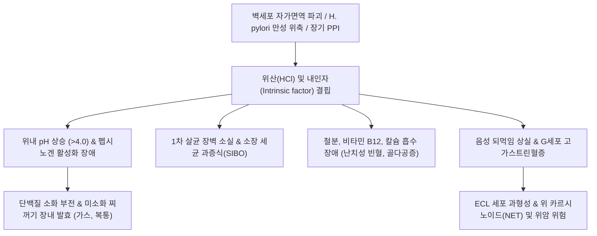
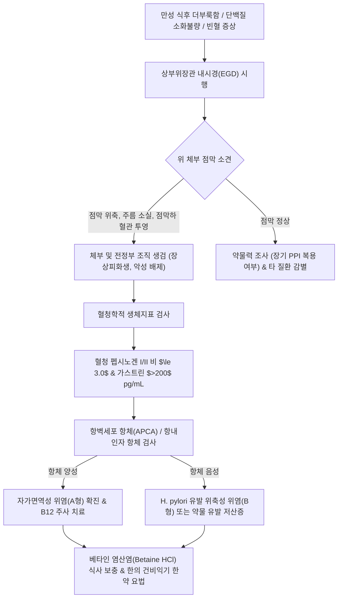

# 🩺 위산 부족증 (Hypochlorhydria & Achlorhydria)

> **핵심 3줄 요약 (Key Summary)**:
> - 📍 병소 부위 & 해부·병태생리: 위 체부(Body) 및 저부(Fundus) 점막의 벽세포(Parietal cell) 소실, 자가면역성 파괴(A형 만성 위염) 또는 H. pylori 유발 광범위 위축성 위염(B형), 장기 PPI 복용으로 인해 위산($\text{HCl}$) 분비가 결핍($\text{pH} > 4.0$)되는 만성 분비 부전 질환.
> - 🚩 전형적 임상 양상: 단백질 소화 장애에 의한 만성 상복부 더부룩함, 조기 포만감, 트림, 장내 이상 발효 및 복부 팽만, 만성 철결핍성 빈혈 및 비타민 B12 결핍성 거대적혈모구 빈혈(악성 빈혈), 장내 세균 과증식(SIBO).
> - 🛠️ 핵심 검사 & 치료 전략: 상부위장관 내시경(위체부 점막 위축 및 혈관 투영 관찰) 및 생검, 혈청 펩시노겐 비율($\text{PG I/II} \le 3.0$), 혈청 가스트린 상승($>200\,\text{pg/mL}$), 항벽세포/항내인자 항체 검사, 베타인 염산염(Betaine HCl) 보충 및 한의 건비화위(생간건비탕, 인삼양위탕) 치료.
> - ⚠️ 응급 의뢰 레드플래그: 위암(Adenocarcinoma) 또는 위 신경내분비종양(NET, 카르시노이드) 의심 징후(진행성 체중 감소, 토혈, 흑색변, 연하곤란).

---

## 📌 목차
1. [질환 개요 & 해부학적 병태생리](#1-질환-개요--해부학적-병태생리)
2. [병태생리 메커니즘 & 생체역학적 악순환 네트워크](#2-병태생리-메커니즘--생체역학적-악순환-네트워크)
3. [임상 증상 & 이학적 검사(Physical Exam) 알고리즘](#3-임상-증상--이학적-검사physical-exam-알고리즘)
4. [감별 진단 매트릭스 (Differential Diagnosis)](#4-감별-진단-매트릭스-differential-diagnosis)
5. [한의 통합 치료 프로토콜 (침·약침·추나·한약)](#5-한의-통합-치료-프로토콜-침약침추나한약)
6. [양방 치료 & 병용·의뢰 기준 (Conventional Treatment & Referral)](#6-양방-치료--병용의뢰-기준-conventional-treatment--referral)
7. [재활 운동 & 생활습관 티칭 가이드](#7-재활-운동--생활습관-티칭-가이드)
8. [💡 사용자 진료실 핵심 필기 & 임상 노하우 (Melt-In 잔여 심화 집약)](#8--사용자-진료실-핵심-필기--임상-노하우-melt-in-잔여-심화-집약)
9. [출처 및 학술 참고 문헌 (References)](#9-출처-및-학술-참고-문헌-references)

---

## 1. 질환 개요 & 해부학적 병태생리

### 1) 정의 및 해부학적 특성
[[위산 부족증]](Hypochlorhydria) 및 무위산증(Achlorhydria)은 위저선(Oxyntic gland) 내 [[벽세포]](Parietal cell)의 기능 장애 또는 세포 탈락으로 인해 염산($\text{HCl}$) 분비량이 현저히 감소하거나 완전히 소실된 병적 상태이다.
- **기준**: 정상 공복 위액 $\text{pH}$는 $1.5\sim 2.0$이나, 위산 부족증에서는 기저 $\text{pH}$가 $3.5\sim 5.0$으로 상승하며, 최대 위산 자극(펜타가스트린 검사) 후에도 $\text{pH}$가 $4.0$ 이하로 떨어지지 않는 경우를 무위산증으로 정의한다.
- **해부학적 병소**:
  - 위 체부(Body) 및 저부(Fundus)의 점막 고유층이 주된 병소이다. 이곳에 밀집된 벽세포는 양성자 펌프($\text{H}^+/\text{K}^+\text{-ATPase}$)를 통해 강산을 분비하고, 비타민 B12 흡수에 필수적인 [[내인자]](Intrinsic factor)를 합성한다.
  - 병변이 진행되면 위산 분비선이 소실되고 장형 상피로 대체되는 [[장상피화생]](Intestinal metaplasia) 및 점막 위축이 관찰된다.

### 2) 역학 및 주요 원인
노화에 따라 위점막 위축과 함께 발생 빈도가 증가하여 60세 이상의 약 20~30%에서 다양한 정도의 저산증이 나타난다. 주요 병인으로는:
1. **자가면역성 위염(Autoimmune Gastritis, A형 위염)**: $\text{H}^+/\text{K}^+\text{-ATPase}$에 대한 자가항체 형성으로 위 체부 벽세포 선택적 파괴.
2. **만성 헬리코박터 파일로리 감염(B형 위염)**: 전정부에서 체부로 상행하는 다초점성 위축성 위염(Multifocal atrophic gastritis).
3. **의원성 요인**: 양성자펌프억제제(PPI)의 수개월~수년간 장기 오남용, 위절제술(비만수술, 위아전절제술), 미주신경 절제술.

---

## 2. 병태생리 메커니즘 & 생체역학적 악순환 네트워크

### 1) 다계통적 소화·영양 장애 메커니즘
1. **단백질 소화 부전**:
   - 주세포(Chief cell)에서 분비되는 펩시노겐(Pepsinogen)은 위산($\text{pH } < 2.0$) 환경에서만 활성형인 펩신(Pepsin)으로 전환된다. 위산이 결핍되면 단백질 분해가 이루어지지 않아 미소화 단백질이 장관으로 유입되어 부패 발효를 일으킨다.
2. **미네랄 및 비타민 흡수 장애**:
   - **철분([[철분 결핍성 빈혈]])**: 불용성 3가철($\text{Fe}^{3+}$)이 흡수 가능한 2가철($\text{Fe}^{2+}$)로 환원되기 위해 위산이 필수적이다.
   - **비타민 B12([[악성 빈혈]])**: 음식물 단백질에 결합된 B12를 분리하고, 벽세포의 내인자와 결합시켜 회장 말단에서 흡수되도록 하는 과정이 완전히 차단된다.
   - **칼슘 및 마그네슘**: 불용성 칼슘염의 이온화 장애로 골밀도 감소 및 골다공증 위험 증가.
3. **위장관 감염 및 장내 세균 과증식(SIBO)**:
   - 위산은 외부에서 유입되는 구강 세균 및 음식물 매개 병원균을 살균하는 1차 생물학적 화학 장벽이다. 위산 결핍 시 세균이 소장 상부로 역류 증식하여 [[소장 세균 과증식]](SIBO)과 만성 장염을 초래한다.
4. **반사성 고가스트린혈증(Hypergastrinemia) 및 종양화**:
   - 위산에 의한 음성 되먹임(Negative feedback)이 소실되어 전정부 G세포에서 [[가스트린]](Gastrin)이 과다 분비된다. 고가스트린혈증은 장크롬친화유사세포(ECL cell)를 만성 자극하여 과형성을 유발하고, 최종적으로 1형 위 신경내분비종양(NET, 카르시노이드) 또는 위 선암종 발생을 촉진한다.

---

## 3. 임상 증상 & 이학적 검사(Physical Exam) 알고리즘

### 1) 임상 증상 분석
- **소화기 증상**:
  - 육류나 단백질 음식 섭취 후 명치가 벽돌처럼 얹히는 느낌(식후 불쾌감).
  - 식후 잦은 트림, 헛배부름(Abdominal distension), 방귀, 조기 포만감.
  - 무른 변, 만성 설사 또는 변비와 설사의 반복(세균 과증식 연관).
- **영양 결핍 및 전신 증상**:
  - 만성 피로, 쇠약감, 운동 시 호흡 곤란(빈혈 증상).
  - 혀의 작열감, 평활설(Hunter's glossitis, 설유두 위축), 구각염.
  - 말초 신경병증(사지 저림, 감각 이상), 위치감각 소실(비타민 B12 결핍에 의한 아급성 연합 변성증).
  - 손톱이 얇아지고 숟가락 모양으로 패임(Koilonychia, 철결핍 징후), 피부 건조 및 탈모.

### 2) 이학적 검사 및 진단 평가 알고리즘
1. **진찰 소견**:
   - 결막 창백(Pallor), 혀의 발적 및 위축(평활설), 진동 및 위치 감각 검사.
   - 복부 진찰 시 상복부 경도 팽만 외에 명확한 압통이나 강직 없음.
2. **진단 검사실 프로토콜**:
   - **혈청 가스트린(Serum Gastrin)**: 공복 시 $>200\sim 1000\,\text{pg/mL}$ 이상 현저한 상승.
   - **혈청 펩시노겐 검사**: 펩시노겐 I 감소($<70\,\text{ng/mL}$) 및 **$\text{PG I/II Ratio} \le 3.0$** (체부 위축성 위염의 표준 지표).
   - **자가항체 검사**: 항벽세포 항체(Anti-parietal cell antibody, APCA), 항내인자 항체(Anti-intrinsic factor antibody, AIFA) 양성(자가면역성 위염).
   - **일반혈액검사(CBC)**: 대구성 빈혈($\text{MCV} > 100\,\text{fL}$, 악성 빈혈) 또는 소구성 저색소성 빈혈(철결핍).
   - **상부위장관 내시경(EGD)**: 위 체부 점막 주름 소실, 창백하고 얇아진 점막 및 점막하 혈관망 투영(Vascular visualization), 장상피화생 확인을 위한 시드니 분류 다점 생검.

---

## 4. 감별 진단 매트릭스 (Differential Diagnosis)

| 감별 질환 | 병인 및 주 증상 | 혈청학적 검사 특성 | 내시경 소견 |
| :--- | :--- | :--- | :--- |
| **[[위산 부족증]] (A형 자가면역성)** | 위 체부 국한 벽세포 파괴, 악성 빈혈, 단백 소화불량 | **가스트린 극단적 상승**, APCA(+), PG I/II $\le 3.0$ | 체부 점막 위축 및 혈관 투영, 전정부는 정상 보존 |
| **[[위산 부족증]] (B형 H. pylori성)** | 전정부에서 체부로 파급, 환경성 위축성 위염 | 가스트린 정상/경도 상승, H. pylori 항체(+), PG 저하 | 전정부와 체부 모두에 다초점성 위축 및 결절 |
| **[[식후고통증후군]](PDS)** | 기능성 운동 장애, 위 수용능 저하, 식후 팽만 | 혈청 펩시노겐, 가스트린, B12 모두 정상 | 내시경 점막 완전 정상 |
| **졸링거-엘리슨 증후군** | 가스트린종(Gastrinoma)에 의한 **위산 극단적 과다** | 가스트린 극단적 상승 ($>1000\,\text{pg/mL}$), **위액 pH $<2.0$** | 다발성·난치성 소화성 궤양, 비후된 위점막 주름 |
| **[[위마비증]]** | 미주신경 손상/당뇨병에 의한 배출 장애, 구토 | 혈청 산 분비 지표 정상 | 내시경 정상, 4시간 위 배출 스캔상 저류율 현저 지연 |

---

## 5. 한의 통합 치료 프로토콜 (침·약침·추나·한약)

### 1) 한의 변증 진단 체계
한의학에서 위산 부족증은 [[비위허한]](脾胃虛寒), [[중초허랭]](中焦虛冷), [[비허불운]](脾虛不運), [[음허위열]](陰虛胃熱)의 범주에 속한다. 비위의 양기(陽氣)가 부족하여 부숙수곡(腐熟水穀, 음식물을 삭히고 익힘)하는 위장의 고유 기능이 실조된 것이 핵심 병리이다.

- **비위허한·부숙무력(脾胃虛寒·腐熟無力)**: 음식물이 삭지 않고 얹혀 있음, 찬 것을 먹으면 설사, 복냉, 설담태백윤, 맥침지약.
- **비신양허·완복창만(脾腎陽虛·脘腹脹滿)**: 만성적인 소화불량, 새벽 설사(오경설사), 사지냉증, 요슬산연, 맥침세미.
- **위음부족·음허열울(胃陰不足·陰虛熱鬱)**: 구갈, 혀에 백태가 전혀 없음(경면설), 입안이 바싹 마르고 식욕이 전무함, 맥세삭.

### 2) 침구 치료 프로토콜
위점막의 기혈 순환을 자극하고 복강 신경총을 자극하여 위선 세포의 활력과 위액 분비를 유도한다.
- **주요 혈위**: [[중완]](CV12), [[하완]](CV10), [[상완]](CV13), [[기해]](CV6), [[관원]](CV4), [[족삼리]](ST36), [[비수]](BL20), [[위수]](BL21).
- **시술 기법**:
  - **복부 간접구(뜸) 요법**: [[중완]](CV12)과 [[관원]](CV4)에 온구기 또는 간접구를 매회 15~20분간 시행하여 중초의 한기(寒氣)를 몰아내고 부숙 기능을 강화.
  - **자침 기법**: [[족삼리]](ST36)와 [[비수]](BL20)에 보법(補法)으로 자침하여 양기(陽氣)를 진작.
- **치료 주기**: 주 2~3회, 20분 유침.

### 3) 약침 치료 프로토콜
- **자하거 약침 / 산삼약침**: 만성 위점막 위축과 벽세포 탈락이 진행된 고령 환자에게 [[족삼리]](ST36), [[비수]](BL20), [[위수]](BL21)에 주입하여 점막 재생과 기혈 보충 도모 (각 0.5cc, 총 1.5cc).
- **중성어혈 약침**: 위점막하 미세순환 부전이 뚜렷한 경우 격수(BL17)에 주입.

### 4) 추나 치료 프로토콜
- **내장기 도수 요법(Visceral Manipulation)**: 명치 아래 위장 전정부 및 위체부 부위를 가볍게 지지하고, 복식 호흡과 연계하여 횡격막-위장 간 유동성(Mobility)을 회복시킴.
- **흉요추 연접부 가동 기법(T9~T12)**: 복강 신경총의 교감신경 억제 및 부교감신경 활성화를 유도.

### 5) 맞춤 한약 처방
- **인삼양위탕(人參養胃湯) 및 이중탕(理中湯)**: [[인삼]], [[백출]], [[건강]], [[감초]]. 중초를 따뜻하게 덥혀서 위장의 소화 흡수 기능을 근본적으로 되살리는 대표 온중건비(溫中健脾) 처방.
- **생간건비탕(生肝健脾湯) 가미방**: 비허습담과 소화효소 결핍으로 인한 만성 복부 팽만과 무기력 개선.
- **익위탕(益胃湯)**: [[사삼]], [[맥문동]], [[옥죽]], [[생지황]], [[빙당]]. 위음(胃陰)이 고갈되어 점막이 바싹 마르고 위축된 음허형 환자에게 진액을 보충하고 점막 재생 촉진.

---

## 6. 양방 치료 & 병용·의뢰 기준 (Conventional Treatment & Referral)

### 1) 현대의학적 보충 요법 및 관리 지침
1. **위산 및 소화효소 보충 (Acid Supplementation)**:
   - **베타인 염산염(Betaine HCl)**: 펩신과 복합된 제제를 단백질 위주의 식사 직전 또는 식사 도중에 350~1000mg 복용하여 위내 $\text{pH}$를 인위적으로 $2\sim 3$ 수준으로 낮춤. (위궤양 병력 환자에서는 점막 자극 주의).
   - 췌장 소화효소제(Pancreatin) 병용으로 소화 흡수율 증대.
2. **영양소 결핍 교정**:
   - **비타민 B12 주사 요법**: 악성 빈혈(자가면역성) 환자의 경우 경구 흡수가 불가능하므로 시아노코발라민(Cyanocobalamin) 1000mcg 근육주사를 초기 주 1회, 이후 월 1회 평생 유지.
   - **철분 보충**: 경구 철분제 복용 시 비타민 C(아스코르브산 500mg)를 반드시 병용하여 산성화 환원을 유도하거나, 불응 시 정맥 주사(Iron sucrose/ferric carboxymaltose) 투여.
   - 비타민 D 및 칼슘 구연산염(Calcium citrate, 위산과 무관하게 흡수됨) 보충.
3. **유발 요인 교정**:
   - 불필요하게 장기 복용 중인 PPI나 H2RA 약제를 서서히 감량하여 중단(Deprescribing).
   - H. pylori 감염 동반 시 표준 제균 요법 시행.

### 2) 한양방 협진 가이드라인
- 비타민 B12와 철분 등 생명 유지에 직결되는 영양소는 양방의 주사 요법으로 즉각 정상화시킨다.
- 만성적인 위장 무력, 식욕 부진, 장내 환경 악화는 한약(이중탕, 인삼양위탕)과 뜸 치료를 병용하여 소화관 자생력을 북돋운다.
- **정기적인 위암 선별 내시경**: A형 자가면역성 위염 및 광범위 위축성 위염 환자는 일반인에 비해 위암 발생 위험이 3~5배 높으므로 **1~2년마다 정기 내시경 추적 검사**를 필히 받도록 지도한다.

### 3) 응급 전원의뢰 기준 (Red Flags)
- 진행성 **체중 감소** 및 **연하곤란**.
- **위장관 출혈**(토혈, 흑색변, 원인 불명의 급격한 빈혈 악화).
- 내시경 추적 검사상 **위 신경내분비종양(NET, 카르시노이드)** 의심 용종 또는 불규칙한 융기 병변 발견.
- 심한 신경학적 결손 증상(비타민 B12 결핍성 척수 아급성 연합 변성증 의심).

---

## 7. 재활 운동 & 생활습관 티칭 가이드

### 1) 식단 및 섭취 요령
- **식전 유기산 음료 섭취**: 식사 10~15분 전 레몬즙 한 스푼이나 사과식초(Apple Cider Vinegar)를 미온수 반 컵에 희석하여 마시면 생리적 위산 분비를 자극하는 데 도움을 줌.
- **단백질 조리법 개선**: 질긴 붉은 육류는 소화에 부담을 주므로 장시간 푹 삶거나 부드럽게 다진 고기, 생선, 달걀 위주로 섭취.
- **식사 중 과도한 수분 섭취 금지**: 식사 중간에 물을 벌컥벌컥 마시면 미량의 위산이 더욱 희석되므로 국물이나 물 섭취를 최소화.

### 2) 장내 미생물 관리
- 소장 세균 과증식(SIBO) 예방을 위해 정제 탄수화물과 설탕 섭취를 줄이고 발효 식품을 적절히 섭취.
- 식사 후 30분간 똑바로 앉거나 가벼운 보행을 하여 소화관 배출 유도.

---

## 8. 💡 사용자 진료실 핵심 필기 & 임상 노하우 (Melt-In 잔여 심화 집약)

### 1) 진료실 문진 핵심 팁
- 환자가 "속이 쓰려서 위산 과다인 줄 알고 제산제를 1년 넘게 먹고 있는데, 소화는 점점 더 안 되고 고기만 먹으면 얹힌다"고 호소하면 십중팔구 **'위산 부족증'**이다.
- 노인성 소화불량 환자에게 습관적으로 PPI를 처방하거나 투약하면 저산증을 더욱 악화시켜 SIBO와 골다공증, 악성 빈혈을 부르는 재앙이 된다.

### 2) 이중탕과 온중건비 요법의 임상 지혜
- 저산증 환자의 복진을 해보면 명치부터 아랫배까지 전반적으로 힘이 없고 차가우며 물소리(진수음)가 나는 경우가 태반이다.
- 건강(乾薑)과 인삼(人參)을 주축으로 하는 온중(溫中) 처방을 쓰면 위점막 혈류가 따뜻하게 살아나면서 수개월간 잃었던 식욕과 소화력이 기적처럼 회복되는 임상례가 많다.

---

## 9. 출처 및 학술 참고 문헌 (References)

- Fatima R, Aziz M. (2023). Achlorhydria. *StatPearls*. PMID: 29939570.
   - **[연구 요약]**: 무위산증의 분자생물학적 병인, 벽세포 파괴 기전, 비타민 B12 및 철분 결핍을 동반한 혈액학적 합병증과 보충 치료 전략을 포괄적으로 기술함.
- Massironi S, Oriani E, Dell'Anna G. (2025). The Autoimmune Gastritis Puzzle: Emerging Cellular Crosstalk and Molecular Pathways Driving Parietal Cell Loss and ECL Cell Hyperplasia. *Cells*. 14(20):1588. PMID: 41148791.
   - **[연구 요약]**: 자가면역성 위염에서 벽세포 소실을 매개하는 면역세포 간 상호작용, 반사성 고가스트린혈증에 따른 ECL 세포 과형성 및 신경내분비종양 이행 기전을 규명함.
- Poowanawittayakom N, Goosenberg E. (2026). Helicobacter Pylori. *StatPearls*. PMID: 30480966.
   - **[연구 요약]**: 헬리코박터 파일로리 만성 감염이 위축성 위염과 광범위 장상피화생을 유도하여 2차성 저산증 및 위암 발생을 촉진하는 병리 연쇄를 분석함.
