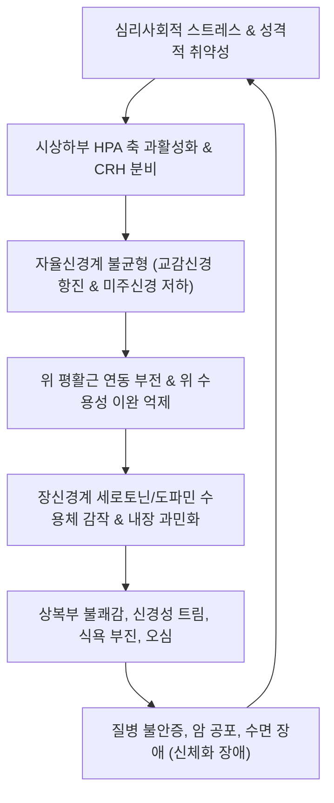
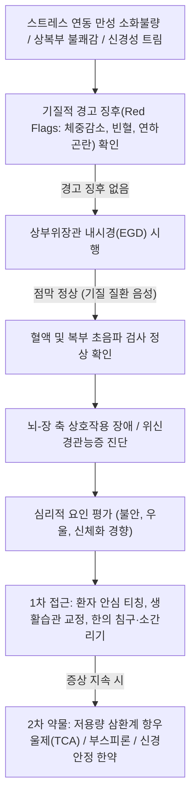

# 🩺 위신경관능증 (Gastric Neurosis / Disorders of Gut-Brain Interaction)

> **핵심 3줄 요약 (Key Summary)**:
> - 📍 병소 부위 & 해부·병태생리: 뇌-장 축(Gut-Brain Axis) 상호작용 장애 및 자율신경계(교감-미주신경) 불균형으로 인해 기질적 소화기 질환 없이 위장관 감각 과민성과 운동 장애, 중추성 감정 조절 장애가 결합되어 발생하는 기능성 위장관 질환(신경성 위염).
> - 🚩 전형적 임상 양상: 심리적 스트레스나 감정 변화에 직접 연동되는 명치 부위의 모호한 불쾌감, 위완창통, 잦은 신경성 트림(Belching), 식욕 부진, 오심, 불면 및 불안증 동반.
> - 🛠️ 핵심 검사 & 치료 전략: 상부위장관 내시경(EGD)으로 기질적 병변 완전 배제, 심리 척도 평가(HADS 등), 저용량 중추 신경조절제(TCA, 세로토닌 제제, 부스피론) 투여, 인지행동치료 및 한의 소간리기(시호소간탕, 분심기음)·침구 치료.
> - ⚠️ 응급 의뢰 레드플래그: 진행성 체중 감소, 지속적 구토, 연하곤란, 흑색변/토혈 등 위장관 출혈 소견, 55세 이상 신규 발병, 자살 사고 동반 중증 우울증.

---

## 📌 목차
1. [질환 개요 & 해부학적 병태생리](#1-질환-개요--해부학적-병태생리)
2. [병태생리 메커니즘 & 생체역학적 악순환 네트워크](#2-병태생리-메커니즘--생체역학적-악순환-네트워크)
3. [임상 증상 & 이학적 검사(Physical Exam) 알고리즘](#3-임상-증상--이학적-검사physical-exam-알고리즘)
4. [감별 진단 매트릭스 (Differential Diagnosis)](#4-감별-진단-매트릭스-differential-diagnosis)
5. [한의 통합 치료 프로토콜 (침·약침·추나·한약)](#5-한의-통합-치료-프로토콜-침약침추나한약)
6. [양방 치료 & 병용·의뢰 기준 (Conventional Treatment & Referral)](#6-양방-치료--병용의뢰-기준-conventional-treatment--referral)
7. [재활 운동 & 생활습관 티칭 가이드](#7-재활-운동--생활습관-티칭-가이드)
8. [💡 사용자 진료실 핵심 필기 & 임상 노하우 (Melt-In 잔여 심화 집약)](#8--사용자-진료실-핵심-필기--임상-노하우-melt-in-잔여-심화-집약)
9. [출처 및 학술 참고 문헌 (References)](#9-출처-및-학술-참고-문헌-references)

---

## 1. 질환 개요 & 해부학적 병태생리

### 1) 개념 및 명칭의 변천
[[위신경관능증]](Gastric Neurosis, 胃神經官能症)은 과거 임상의학에서 위장의 기질적 병변(궤양, 암, 염증)이 발견되지 않으면서 정신신체적(Psychosomatic) 요인에 의해 만성적인 위장관 증상이 반복되는 질환군을 통칭하던 전통적 진단명이다. 현대 신경소화기학(Neurogastroenterology) 및 로마 IV(Rome IV) 기준에서는 **'뇌-장 축 상호작용 장애(Disorders of Gut-Brain Interaction, DGBI)'** 중 [[기능성 소화불량증]](Functional Dyspepsia), 중추 매개 복통 증후군(CAPS), 기능성 트림 장애(Functional belching disorder)와 일치한다.

- **해부생리학적 기질**:
  - 중추신경계(변연계, 시상하부, 전대상피질)와 장신경계(ENS, 아우에르바하 신경총 및 마이스너 신경총) 사이의 양방향 정보 교환 축인 [[뇌-장 축]](Brain-Gut Axis)의 조절 이상이 핵심이다.
  - 미주신경(CN X) 부교감신경로와 흉수 분절(T5~T9) 교감신경로의 동적 평형이 상실되어 위장관 평활근 긴장도 및 분비 조절이 교란된다.

### 2) 역학 및 임상적 특징
전체 소화기 내원 환자의 30~50%가 DGBI/위신경관능증 범주에 속한다. 신경이 예민한 20~40대 여성, 완벽주의 성향, 시험이나 이직 등 극심한 정신적 스트레스 노출군에서 호발한다. 환자는 극심한 고통을 호소하지만 내시경, 혈액검사, 영상의학적 검사 결과는 정상으로 나타나 꾀병으로 오해받고 의료 쇼핑(Doctor shopping)을 반복하기 쉽다.

![[위신경관능증_01_기능성소화불량로마IV정의.jpg|450]]
> [그림 1: ① 질환 개요 — 기능성 소화불량(위신경관능증)의 로마 기준 IV 4대 주요 증상 정의 도해 — 출처: 질병관리청 국가건강정보포털 (기능성 소화불량)]
![[위신경관능증_01_기능성소화불량세계유병률.jpg|450]]
> [그림 2: ① 역학 통계 — 로마 기준 III 및 IV에 따른 국가별 기능성 소화불량 유병률 비교 도해 — 출처: 질병관리청 국가건강정보포털 (기능성 소화불량)]

---

## 2. 병태생리 메커니즘 & 생체역학적 악순환 네트워크

### 1) 신경생물학적 및 신경내분비적 병태 기전
1. **중추-자율신경계 과활성화**:
   - 만성 스트레스 노출 시 시상하부-뇌하수체-부신 축([[HPA 축]])이 과활성화되어 부신피질자극호르몬분비호르몬([[CRH]])과 코르티솔 분비가 증가한다.
   - 변연계(Limbic system)의 감정 자극이 교감신경계를 흥분시켜 소화관 점막 혈관 수축 및 위 운동성 억제를 일으키고, 미주신경 활성을 저하시켜 위저부 이완을 방해한다.
2. **내장 과민성(Visceral Hypersensitivity) 증폭**:
   - 척수 후각 신경세포 및 뇌 피질 수준에서 하행성 통증 억제 기전(Descending pain inhibition)이 붕괴되어, 정상적인 위내 가스나 음식물 팽창 압력도 극심한 통증으로 왜곡 인지된다.
3. **신경전달물질의 불균형**:
   - 체내 90% 이상이 장관에 존재하는 [[세로토닌]](5-HT) 대사 이상으로 인해 장관 운동 조절과 뇌의 정서 조절이 동시에 붕괴된다.

### 2) 생체역학적 악순환 네트워크
$$\text{정신적 스트레스·불안} \longrightarrow \text{HPA 축 과항진 & 교감신경 흥분} \longrightarrow \text{위 운동 억제 & 내장 과민화} \longrightarrow \text{명치 팽만·트림·오심} \longrightarrow \text{신체화 불안 심화} \longrightarrow \text{스트레스 증폭}$$

![[위신경관능증_02_기능성소화불량병태생리.jpg|450]]
> [그림 3: ② 병태생리 기전 — 위배출능 저하, 위저부 적응 장애, 내장 과감각 등 기능성 소화불량의 핵심 병태생리 도해 — 출처: 질병관리청 국가건강정보포털 (기능성 소화불량)]
![[위신경관능증_02_장뇌축상호작용모식도.jpg|450]]
> [그림 4: ② 장-뇌 축 기전 — 미주신경, 점막 면역, 장내 미생물총 및 정서적 스트레스가 상호작용하는 장-뇌 축(Gut-Brain Axis) 개요도 — 출처: Wikimedia Commons (File:Gut-brain axis overview.jpg, CC BY 4.0)]

---

## 3. 임상 증상 & 이학적 검사(Physical Exam) 알고리즘

### 1) 임상 증상의 다채로운 표현
- **소화기 주 증상**:
  - 감정 상태(화, 불안, 우울)에 따라 증상의 기복이 심함.
  - 명치 밑이 답답하고 꽉 막힌 느낌(기체, 氣滯), 찌르는 듯하거나 쥐어짜는 듯한 통증.
  - **신경성 트림(Supragastric belching)**: 뱃속에서 나오는 가스가 아니라 불안할 때 공기를 삼켰다가 즉시 뱉어내는 연속적인 트림.
  - 신경성 식욕 부진(Anorexia), 음식 냄새만 맡아도 구역질(오심).
- **전신 및 정신신경계 증상**:
  - 두통, 어지럼증, 가슴 두근거림(심계), 목에 이물감([[매핵기]]), 불면증, 상열감, 손발 차가움.

### 2) 이학적 검사 및 진단 평가 알고리즘
1. **진찰 소견**:
   - 복벽은 유연하며, 명치 부위를 촉진할 때 주관적인 불쾌감을 호소하지만 일관된 국소 압통이나 복벽 강직, 반발압통은 전혀 없음.
   - 복식 호흡이 제한되고 흉식 호흡 위주이며 경부·승모근의 만성 과긴장 관찰.
2. **진단 검사 배제 전략**:
   - **상부위장관 내시경(EGD)**: 궤양, 미란, 위암 등 기질적 병변 없음 확인.
   - **복부 초음파/CT**: 담도계 및 췌장 질환 배제.
   - **혈액 검사**: CBC, 간기능, 전해질, 갑상선 기능 검사(갑상선 기능항진/저하증 배제).
   - **심리 척도 검사**: 병원 불안-우울 척도(HADS), 신체증상 척도(PHQ-15).

![[위신경관능증_03_자율신경장신경계연결도해.png|450]]
> [그림 5: ③ 신경성 조절 — 중추신경계(CNS), 자율신경계(교감·미주신경) 및 장신경계(아우어바흐·마이스너 신경총, 카할 간질세포)의 연결 도해 — 출처: Wikimedia Commons (File:Representation of link between central nervous system (CNS), autonomic nervous system (ANS) and enteric nervous system (ENS).png, CC BY 4.0)]

---

## 4. 감별 진단 매트릭스 (Differential Diagnosis)

| 감별 질환 | 발병 기전 및 유발 인자 | 검사 및 내시경 소견 | 감별 핵심 요점 |
| :--- | :--- | :--- | :--- |
| [[위신경관능증]] (DGBI)** | 뇌-장 축 조절 장애, 스트레스 직접 연동, 신체화 | 내시경, 영상, 혈액검사 완전 정상 | 정서 변화에 따른 증상 기복, 중추 신경조절제 반응 |
| [[만성 위염]] / 궤양** | H. pylori, NSAIDs 점막 공격 | 내시경상 점막 미란, 결절, 궤양 결손 확인 | 기질적 점막 결손 확인, 제산제/제균 치료 반응 |
| [[위식도 역류질환]] | 하부식도괄약근 이완, 산 역류 | 식도 하부 미란 또는 정상(NERD) | 전형적인 흉골 후방 작열감(Heartburn), 앙와위 악화 |
| **신경성 식욕부진증** | 체중 및 체형에 대한 왜곡된 인지 왜곡 | 극심한 저체중(BMI <17.5), 무월경 | 체중 감량을 위한 의도적 굶기 및 체형 공포 |
| **공황 장애** | 교감신경계 급격한 자율신경 폭풍 | 심전도, 심초음파 정상 | 급성 발작성 호흡곤란, 빈맥, 질식감, 죽을 것 같은 공포 |

---

## 5. 한의 통합 치료 프로토콜 (침·약침·추나·한약)

### 1) 한의 변증 진단 체계
한의학에서 위신경관능증은 [[간기범위]](肝氣犯胃), [[기체]](氣滯), [[비증]](痞證), [[울증]](鬱證), [[심비양허]](心脾兩虛)의 범주에 해당한다. 칠정(七情)의 울결로 간기(肝氣)가 횡역(橫逆)하여 비위의 승강(昇降) 기능을 파괴하는 것이 핵심 병리이다.

- **간기범위·기체열울(肝氣犯胃·氣滯熱鬱)**: 스트레스 시 명치와 옆구리가 결리고 아픔, 잦은 한숨과 트림, 감정 기복, 설홍태박백, 맥현.
- **간울비허·담탁조체(肝鬱脾虛·痰濁阻滯)**: 소화불량과 함께 만성 피로, 대변 묽음, 머리가 무겁고 어지러움, 설담태백니, 맥현완.
- **심비양허·신체허약(心脾兩虛·身體虛弱)**: 소화불량, 불면, 건망, 두근거림, 식욕 부진, 안색 창백, 설담, 맥세약.

### 2) 침구 치료 프로토콜
뇌-장 축의 자율신경계를 안정시키고 미주신경 톤을 회복시켜 위장관 평활근의 긴장과 내장 과민성을 해소한다.
- **주요 혈위**: [[중완]](CV12), [[거궐]](CV14), [[전중]](CV17), [[내관]](PC6), [[태충]](LR3), [[합곡]](LI4), [[족삼리]](ST36), [[신문]](HT7), [[백회]](GV20), [[간수]](BL18), [[심수]](BL15).
- **시술 기법**:
  - **사관혈(四關穴) 배합**: [[합곡]](LI4) - [[태충]](LR3)에 평보평사 자침하여 소간해울(疏肝解鬱) 및 전신 기기 소통.
  - **신경안정 및 흉격 개통**: [[전중]](CV17) 횡자 및 [[내관]](PC6) - [[신문]](HT7) 자침으로 가슴 답답함과 불안 완화.
  - **위장 조절**: [[중완]](CV12) - [[족삼리]](ST36) 배합.
- **치료 주기**: 주 2~3회, 20분 유침.

### 3) 약침 치료 프로토콜
- **자하거 약침**: 심비양허형 만성 신경성 쇠약 환자에게 [[심수]](BL15), [[간수]](BL18), [[족삼리]](ST36)에 주입 (총 1.0cc).
- **황련해독탕 약침**: 분노, 화병, 번조, 상열감이 심한 간울화화(肝鬱化火) 환자에게 [[전중]](CV17), [[거궐]](CV14)에 주입.

### 4) 추나 치료 프로토콜
- **후두하삼각 및 경추 이완술**: 미주신경의 두개외 출구(경정맥공) 주변 근막 긴장을 완화하여 미주신경 기능 촉진.
- **상흉추 및 흉곽 유동술(T3~T7)**: 자율신경절(교감신경간) 긴장을 정상화하고 흉식 호흡 패턴 교정.

### 5) 맞춤 한약 처방
- **시호소간탕(柴胡疏肝湯)**: [[시호]], [[작약]], [[지각]], [[천궁]], [[향부자]], [[감초]]. 간기울결로 인한 명치 및 흉협부 통증과 신경성 소화장애의 기본 처방.
- **분심기음(分心氣飲)**: [[자소엽]], [[후박]], [[진피]], [[청피]], [[지각]], [[복령]], [[반하]], [[목향]], [[대복피]]. 칠정울결로 가슴과 배가 그득하고 트림이 잦으며 기운이 막힌 것을 통하게 함.
- **귀비탕(歸脾湯)**: [[당귀]], [[용안육]], [[산조인]], [[원지]], [[인삼]], [[황기]], [[백출]], [[복신]]. 불안, 불면, 소화불량이 겹친 심비양허형 환자의 뇌-장 신경 안정.

![[위신경관능증_05_HPA스트레스축모식도.jpg|450]]
> [그림 6: ⑤ 스트레스·신경내분비 조절 — 정서적 스트레스에 의한 시상하부-뇌하수체-부신(HPA) 축(CRH-ACTH-코르티솔) 활성화 경로 도식 — 출처: Wikimedia Commons (File:The hypothalamic-pituitary-adrenal (HPA) axis.jpg, CC BY 4.0)]

---

## 6. 양방 치료 & 병용·의뢰 기준 (Conventional Treatment & Referral)

### 1) 현대의학적 단계별 치료 전략
1. **1차 접근: 질환 교육 및 지지 요법**:
   - 증상이 '가짜'가 아니며, 장과 뇌의 신경 회로가 과민해진 결과임을 명확히 설명하여 환자의 질병 불안(암 공포)을 해소.
2. **2차 약물 치료: 신경조절제(Neuromodulators)**:
   - **삼환계 항우울제(TCA)**: 아미트립틸린(Amitriptyline) 10~25mg 또는 이미프라민(Imipramine) 취침 전 투여 (내장 과민성 억제).
   - **세로토닌 작용제 / 항불안제**: 부스피론(Buspirone) 5~10mg 1일 2~3회 (위저부 수용성 이완 촉진 및 범불안 완화).
   - 필요 시 저용량 SSRI(에스시탈로프람) 또는 SNRI.
3. **정신심리치료**:
   - 소화기 전문 인지행동치료(GI-CBT), 마음챙김 명상(Mindfulness), 장 지향 최면 요법(Gut-directed hypnotherapy).

### 2) 한양방 협진 가이드라인
- 기질적 검사 정상을 확인한 후, 신경정신과적 약물(TCA, 항불안제)의 부작용(구갈, 졸림, 변비) 부담을 줄이기 위해 한약(시호소간탕, 귀비탕)과 침치료를 1차 또는 병용 치료로 적극 활용한다.
- 신체 증상과 불안 증세가 동시에 완화되는 시너지를 확인한다.

### 3) 응급 전원의뢰 기준 (Red Flags)
- 급격한 **체중 감소** 및 **영양 실조**.
- **소화관 출혈**(토혈, 흑색변, 빈혈).
- **중증 우울증 및 자살 사고(Suicidal ideation)**: 즉각적인 정신건강의학과 폐쇄병동 또는 응급실 의뢰.

---

## 7. 재활 운동 & 생활습관 티칭 가이드

### 1) 자율신경 안정 이완 훈련
- **복식 호흡 및 이완 훈련**: 1일 2회, 회당 15분간 들숨 4초, 날숨 6초의 복식 호흡을 시행하여 미주신경 톤을 올리고 뇌-장 축 긴장 완화.
- **신경성 트림 행동 수정**: 트림이 나오려 할 때 입을 벌리고 턱을 젖힌 상태에서 횡격막 호흡을 하도록 지도(공기 흡입 차단).

### 2) 식생활 관리
- 식사 시 스마트폰이나 TV를 보지 않고 음식의 맛과 향에 집중하는 마음챙김 식사(Mindful eating).
- 커피, 에너지 드링크, 알코올 등 교감신경을 흥분시키는 음료 완전 중단.

---

## 8. 💡 사용자 진료실 핵심 필기 & 임상 노하우 (Melt-In 잔여 심화 집약)

### 1) 진료실 라포 형성의 핵심
- 위신경관능증 환자에게 "검사 결과 정상이니 신경 쓰지 마시고 마음 편히 가지세요"라고 말하는 것은 최악의 티칭이다. 환자는 자신이 무시당했다고 느낀다.
- **"검사상 위장에 상처나 암은 없지만, 머리와 위장을 연결하는 자율신경 회로가 스트레스로 인해 너무 팽팽하게 당겨져 있어서 작은 자극도 크게 느끼시는 것입니다"**라고 뇌-장 축을 설명해야 환자가 치료에 적극적으로 순응한다.

### 2) 분심기음과 시호소간탕의 응용
- 환자가 가슴을 치면서 "답답해서 미치겠다, 한숨을 쉬어야 좀 낫다"고 하면 분심기음을 최우선으로 고려하고,
- 명치와 옆구리가 쥐어짜듯 결리고 감정이 폭발하는 양상이면 시호소간탕을 쓴다.

---

## 9. 출처 및 학술 참고 문헌 (References)

- Hanna-Jairala I, Tack J, Drossman DA. (2026). Central and Peripheral Neuromodulators in Functional Dyspepsia and Gastroparesis: A Symptom-Based Clinical Review. *Neurogastroenterol Motil*. 38(3):e14820. PMID: 41772689.
   - **[연구 요약]**: 뇌-장 축 상호작용 장애 환자에서 내장 과민성과 중추성 통증 조절 이상을 표적으로 하는 중추 및 말초 신경조절제의 임상 효능과 처방 지침을 집대성함.
- Mohamedali Z, Amarasinghe G, Hopkins CWP. (2025). Effect of Buspirone on Upper Gastrointestinal Disorders of Gut-Brain Interaction: A Systematic Review and Meta-analysis. *J Neurogastroenterol Motil*. 31(1):25-37. PMID: 39779200.
   - **[연구 요약]**: 상부 위장관 뇌-장 축 조절 장애 환자에서 부스피론이 위 수용성 이완능 개선, 조기 포만감 완화 및 불안 감소에 미치는 효과를 체계적으로 메타분석함.
- Chamchoum E, Ghaleb J, Chamchoum N. (2026). Functional Dyspepsia: An Updated Review of Pathophysiology, Epidemiology, Clinical Manifestations, and International Management Guidelines. *Sage Open Pathol*. 14:1-18. PMID: 42491169.
   - **[연구 요약]**: 기능성 위장관 질환의 신경생리학적 병태, 내장 과민성 및 국제 진료 지침의 다학제적 통합 치료 접근법을 포괄적으로 정리함.
