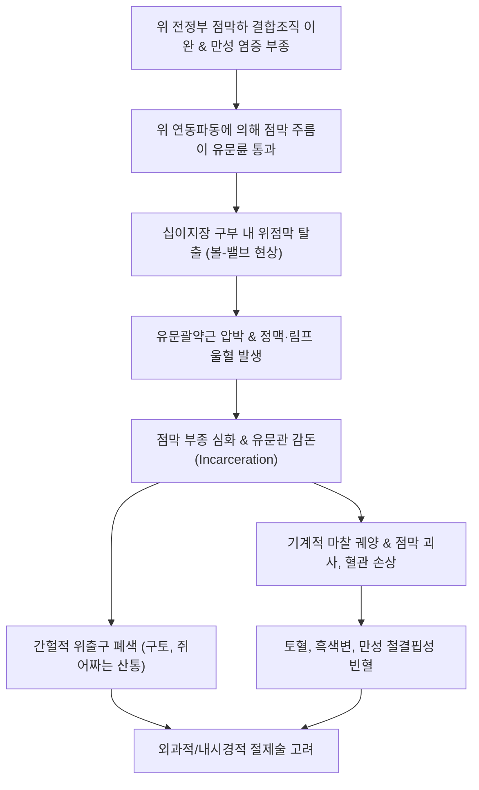
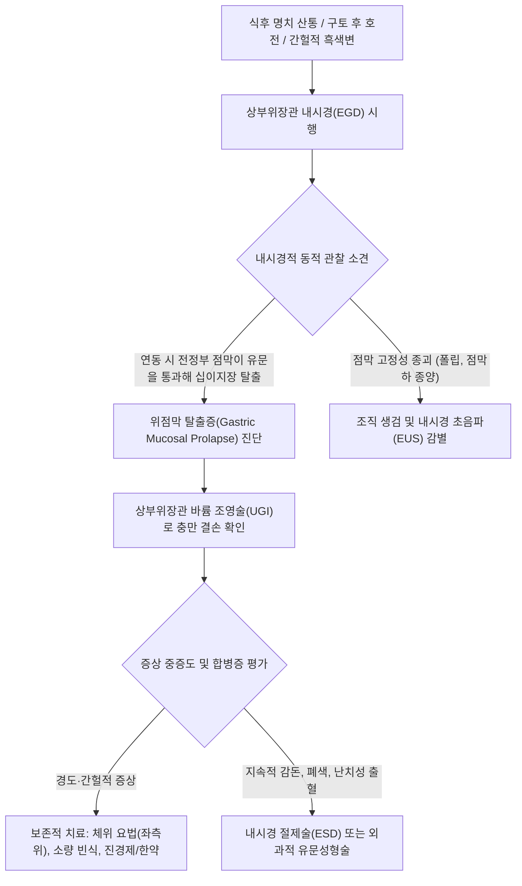

# 🩺 위점막 탈출증 (Gastric Mucosal Prolapse)

> **핵심 3줄 요약 (Key Summary)**:
> - 📍 병소 부위 & 해부·병태생리: 위 전정부(Antrum)의 과도하게 이완되거나 비후된 점막 및 점막하층 주름이 위 연동운동에 의해 유문관(Pyloric canal)을 통과하여 십이지장 구부(Duodenal bulb) 내로 탈출(순행성)하거나, 심한 구토 시 식도 하부로 탈출(역행성)하는 해부기계적 질환.
> - 🚩 전형적 임상 양상: 상복부(명치)의 간헐적 쥐어짜는 듯한 산통(Colic), 오심, 구토, 식후 팽만감, 탈출 점막의 유문부 감돈(Incarceration) 및 마찰에 의한 미란·출혈(토혈, 흑색변, 빈혈).
> - 🛠️ 핵심 검사 & 치료 전략: 상부위장관 바륨 조영술(십이지장 구부 내 버섯 모양/우산 모양의 전형적 충만 결손) 및 상부위장관 내시경(EGD: 유문륜을 넘어 십이지장으로 슬라이딩하는 점막 주름 직접 확인), 체위 요법, 항콜린제/위장관조절제, 감돈 지속 시 내시경 절제술 또는 유문성형술.
> - ⚠️ 응급 의뢰 레드플래그: 탈출 점막의 완전 감돈 및 교액(Strangulation)으로 인한 괴사 의심(극심한 지속성 복통, 복벽 강직), 대량 위장관 출혈(토혈, 저혈량성 쇼크).

---

## 📌 목차
1. [질환 개요 & 해부학적 병태생리](#1-질환-개요--해부학적-병태생리)
2. [병태생리 메커니즘 & 생체역학적 악순환 네트워크](#2-병태생리-메커니즘--생체역학적-악순환-네트워크)
3. [임상 증상 & 이학적 검사(Physical Exam) 알고리즘](#3-임상-증상--이학적-검사physical-exam-알고리즘)
4. [감별 진단 매트릭스 (Differential Diagnosis)](#4-감별-진단-매트릭스-differential-diagnosis)
5. [한의 통합 치료 프로토콜 (침·약침·추나·한약)](#5-한의-통합-치료-프로토콜-침약침추나한약)
6. [양방 치료 & 병용·의뢰 기준 (Conventional Treatment & Referral)](#6-양방-치료--병용의뢰-기준-conventional-treatment--referral)
7. [재활 운동 & 생활습관 티칭 가이드](#7-재활-운동--생활습관-티칭-가이드)
8. [💡 사용자 진료실 핵심 필기 & 임상 노하우 (Melt-In 잔여 심화 집약)](#8--사용자-진료실-핵심-필기--임상-노하우-melt-in-잔여-심화-집약)
9. [출처 및 학술 참고 문헌 (References)](#9-출처-및-학술-참고-문헌-references)

---

## 1. 질환 개요 & 해부학적 병태생리

### 1) 정의 및 해부학적 분류
[[위점막 탈출증]](Gastric Mucosal Prolapse)은 위벽의 고유근층(Muscularis propria)과 점막하층(Submucosa) 사이의 결합 조직이 선천적 또는 후천적으로 이완되어, 느슨해진 위 점막 주름이 위장의 강한 수축력에 밀려 정상적인 해부학적 경계를 벗어나 인접 장기로 밀려 들어가는 질환이다.

- **순행성 위점막 탈출증(Anterograde Prolapse, 전정부-십이지장 탈출)**:
  - 가장 흔한 형태이다. 위 전정부(Antrum)의 비후된 점막 주름이 [[유문]](Pylorus)을 통과하여 [[십이지장]] 구부(Bulb) 내로 일시적 또는 간헐적으로 탈출한다.
  - 마치 공(Ball)이 밸브(Valve)를 막는 듯한 **볼-밸브 증후군(Ball-valve syndrome)**을 유발하여 간헐적인 유문부 폐색과 점막 울혈을 초래한다.
- **역행성 위점막 탈출증(Retrograde Prolapse, 위-식도 역행 탈출)**:
  - 심한 구역질이나 구토 시 흉강 내 음압과 복강 내 양압의 극단적 압력차로 인해 위 분문부 점막이 하부 식도 내로 역행 탈출하는 드문 형태이다. 말로리-바이스 증후군(Mallory-Weiss tear)의 원인이 되기도 한다.

### 2) 역학 및 유발 요인
모든 연령에서 발생할 수 있으나 만성 위염, 비후성 위염 환자 및 30~60대 성인에서 주로 진단된다. 위염에 의한 만성 점막 부종, 위 전정부의 과도한 연동운동(Hyperperistalsis), 불규칙한 식습관, 만성 변비나 기침에 의한 복압 상승이 주요 유발 인자이다. 유문 폴립(용종)이나 점막하 종양이 선도점(Lead point)으로 작용하여 탈출을 조장하는 경우도 흔하다.

---

## 2. 병태생리 메커니즘 & 생체역학적 악순환 네트워크

### 1) 기계적 마찰, 감돈 및 허혈 손상 기전
1. **점막하 결합조직 이완**:
   - 점막근판과 고유근층을 연결하는 콜라겐 섬유망이 약화되어 점막층이 근층 위를 자유롭게 미끄러진다.
2. **연동운동에 의한 전방 추진**:
   - 음식물이 유입되면 전정부의 강력한 연동파동이 느슨한 점막 주름을 앞으로 밀어내어 유문륜(Pyloric ring)으로 밀어 넣는다.
3. **유문부 감돈 및 혈류 차단**:
   - 좁은 유문관을 통과한 점막은 유문괄약근에 의해 조여져 정맥 및 림프 환류가 차단된다.
   - 울혈(Congestion), 심한 부종, 점막하 출혈(Ecchymosis)이 발생하여 탈출된 점막 덩어리가 더욱 비대해지는 악순환이 시작된다.
4. **점막 미란, 궤양 및 상부위장관 출혈**:
   - 십이지장 점막 및 위산에 노출된 탈출 점막 표면에 마찰 궤양과 미란이 발생하여 잠혈 또는 육안적 [[위장관 출혈]](토혈, 흑색변)을 일으킨다.
   - 심한 경우 유문부 완전 폐색으로 위 내용물 배출이 차단된다.

---

## 3. 임상 증상 & 이학적 검사(Physical Exam) 알고리즘

### 1) 임상 증상 분석
- **통증 양상**:
  - 명치(상복부)의 간헐적인 쥐어짜는 듯한 통증(Crampy epigastric pain).
  - 식후 1~2시간에 악화되는 경향이 있으며, 좌측와위(Left lateral decubitus)를 취하거나 구토를 하고 나면 탈출된 점막이 정복(Reduction)되면서 통증이 씻은 듯이 사라지는 특징이 있음.
- **소화 장애 증상**:
  - 식후 조기 팽만감, 오심, 반복적인 음식물 구토, 트림.
- **출혈 징후**:
  - 감돈된 점막의 미란으로 인한 소화관 출혈: 흑색변(Melena), 커피색 토혈, 원인 미상의 만성 [[철분 결핍성 빈혈]].

### 2) 이학적 검사 및 진단 평가 알고리즘
1. **진찰 소견**:
   - 발작기에는 상복부(명치 우측)에 국소적 압통이 관찰될 수 있으며, 간혹 위 팽만으로 인한 진수음(Succussion splash) 청진 가능.
   - 통증이 소실된 간헐기에는 복부 진찰상 완전히 정상 소견.
2. **영상 및 내시경 진단 검사**:
   - **상부위장관 조영술(UGI Series)**:
     - 진단적 가치가 매우 높음. 십이지장 구부 내로 돌출된 점막 주름에 의해 나타나는 전형적인 **버섯 모양(Mushroom-like) 또는 우산 모양(Umbrella-like) 충만 결손** 관찰.
   - **상부위장관 내시경(EGD)**:
     - 연동운동 시 위 전정부의 비후된 점막 주름이 유문륜을 넘어 십이지장으로 미끄러져 들어갔다가 빠져나오는 동적(Dynamic) 변화를 직접 관찰.
     - 탈출 점막의 부종, 발적, 표재성 미란 및 마찰성 궤양 확인.
     - 선도점 역할을 하는 점막하 종양(Lipoma, IFP 등) 유무 감별.

---

## 4. 감별 진단 매트릭스 (Differential Diagnosis)

| 감별 질환 | 통증 특성 및 악화 요인 | 내시경 및 영상 소견 | 감별 핵심 요점 |
| :--- | :--- | :--- | :--- |
| **[[위점막 탈출증]]** | 식후 간헐적 산통, **구토 또는 좌측위 시 완화**, 흑변 | UGI상 **십이지장 구부 내 버섯 모양 결손**, 내시경 연동 시 탈출 | 동적(Dynamic) 슬라이딩 탈출, 체위에 따른 증상 변화 |
| **[[소화성 궤양 질환]]** | 공복통/야간통(십이지장), 식사 직후 악화(위) | 내시경 점막 결손, 궤양 백태 및 기저부 확인 | 고정된 기질적 점막 결손, H. pylori 연관 |
| **[[유문 협착증]]** | 지속적이고 반복적인 분출성 구토, 체중 감소 | 유문관 협착, 위 확장, 내시경 통과 불가 | 비가역적인 유문관 협착, 반흔 또는 악성 종양 기인 |
| **위 선종 / 전정부 폴립** | 무증상 또는 간헐적 소화불량 | 유문륜 근처의 고정된 유경성/무경성 융기 병변 | 종괴가 유문으로 탈출할 수 있으나 본체는 신생물임 |
| **담도 산통 ([[담석증]])** | 기름진 식사 후 우상복부 극심한 산통, 수시간 지속 | 복부 초음파상 담낭 내 담석, 음향 음영 | 우상복부/견갑골 방사통, 구토해도 통증 지속 |

---

## 5. 한의 통합 치료 프로토콜 (침·약침·추나·한약)

### 1) 한의 변증 진단 체계
한의학에서 위점막 탈출증은 [[위완통]](胃脘痛), [[구토]](嘔吐), [[비만]](痞滿), [[중기하함]](中氣下陷)의 범주에 속한다. 비위(脾胃)의 기운이 극도로 허약하여 장기를 지탱하고 거섭(擧攝, 붙잡아 올림)하는 힘이 떨어져 점막이 아래로 처지고, 위기(胃氣)가 울체되어 역상(逆上)하는 병기이다.

- **비허기함·중기하함(脾虛氣陷·中氣下陷)**: 식후 복부 하추감(밑이 빠질 듯함), 무기력, 안색 황백, 대변 묽음, 설담태백, 맥침완무력.
- **위기상역·기체혈어(胃氣上逆·氣滯血瘀)**: 쥐어짜는 듯한 명치 통증, 구토, 찌르는 듯한 고정통, 간헐적 흑변, 설자암, 맥현삽.
- **담음정체·식체불화(痰飲停滯·食滯不化)**: 명치 진수음, 트림, 오심, 답답함, 설태백니, 맥활.

### 2) 침구 치료 프로토콜
위장의 중기(中氣)를 끌어올리고 승제(升提) 작용을 도모하며, 유문부 평활근의 비정상적 연축을 이완시킨다.
- **주요 혈위**: [[백회]](GV20, 승양거함의 요혈), [[중완]](CV12), [[하완]](CV10), [[기해]](CV6), [[족삼리]](ST36), [[내관]](PC6), [[공손]](SP4), [[양구]](ST34), [[비수]](BL20), [[위수]](BL21).
- **시술 기법**:
  - **승양익기(升陽益氣) 배합**: [[백회]](GV20)에 후방으로 사자(斜刺) 0.5~1촌 자침 및 간접구(뜸) 시술로 하함된 기운을 견인.
  - **위장 경련 완화**: 급성 발작성 산통 시 [[양구]](ST34, 극혈)와 [[내관]](PC6)에 강자극 사법으로 자침하여 유문괄약근 경련 해소.
  - **건비보원**: [[중완]](CV12) - [[족삼리]](ST36)에 온침 요법 적용.
- **치료 주기**: 주 2~3회, 20분 유침.

### 3) 약침 치료 프로토콜
- **자하거 약침 / 산삼약침**: 중기하함 및 점막하 결합조직 무력 환자의 [[백회]](GV20), [[족삼리]](ST36), [[비수]](BL20)에 주입 (총 1.0cc).
- **중성어혈 약침**: 유문부 감돈에 의한 울혈 및 자통 완화를 위해 [[격수]](BL17), [[위수]](BL21)에 심부 주입.

### 4) 추나 치료 프로토콜
- **내장기 승제 도수 기법(Visceral Manipulation - Gastric Elevation)**: 환자를 앙와위로 눕히고 양 무릎을 굴곡시킨 상태에서, 시술자가 양손으로 하복부 및 위 하연을 지지하여 호흡 날숨에 맞추어 상방(두측)으로 부드럽게 견인하여 탈출 점막의 정복을 보조.
- **상부 요추 및 골반 교정**: 요천추 안정성을 확보하여 복강 내 압력 분산 유도.

### 5) 맞춤 한약 처방
- **보중익기탕(補中益氣湯) 가미방**: [[황기]], [[인삼]], [[백출]], [[당귀]], [[진피]], [[승마]], [[시호]], [[감초]]에 [[지실]], [[작약]] 가미. 승제(升提) 작용으로 이완된 위 점막과 위벽 조직의 긴장도를 회복시키는 근본 처방.
- **선복대자석탕(旋覆代赭石湯)**: [[선복화]], [[대자석]], [[반하]], [[인삼]], [[대추]], [[생강]], [[감초]]. 트림, 오심, 구토 등 위기상역 증상이 극심할 때 탁월한 강기화담(降氣化痰) 효과.
- **작약감초탕(芍藥甘草湯) 합 안중산**: 유문부 연축에 의한 급성 쥐어짜는 복통 발작 시 평활근을 이완시키고 신속한 진통 유도.

---

## 6. 양방 치료 & 병용·의뢰 기준 (Conventional Treatment & Referral)

### 1) 현대의학적 단계별 관리 지침
1. **보존적 내과 치료 (1차 요법)**:
   - **체위 요법(Postural Therapy)**: 식사 후 또는 복통 발작 시 **좌측와위(Left lateral decubitus)**를 취하도록 지도. 해부학적으로 위의 대만이 아래로 향하게 하여 탈출된 전정부 점막이 중력에 의해 유문륜에서 뒤로 빠져나오도록 유도.
   - **소화기 약물 요법**:
     - 항콜린제 / 진경제: 디사이클로민(Dicyclomine), 티로프라미드(Tiropramide) 등으로 과도한 위 연동운동 및 유문 연축 억제.
     - 양성자펌프억제제(PPI): 탈출된 점막의 마찰 궤양 및 미란 치유, 산 분비 억제.
     - 소화효소제 보충.
2. **외과적 및 내시경적 중재술 (2차 요법)**:
   - **내시경적 절제술(ESD/EMR)**: 선도점 역할을 하는 유경성 폴립이나 점막하 종양이 동반된 경우 내시경적으로 병변을 절제하여 탈출 차단.
   - **수술적 치료**: 보존적 치료에 불응하는 반복적인 유문 폐색, 심한 궤양 출혈, 교액 괴사 발생 시 시행:
     - 유문성형술(Pyloroplasty): 좁아진 유문관을 넓혀 점막 감돈 방지.
     - 헐렁한 전정부 점막 부분 절제술 또는 위아전절제술(Subtotal gastrectomy).

### 2) 한양방 협진 가이드라인
- 급성 발작기에는 양방의 체위 요법과 진경제/PPI로 탈출 정복과 궤양 치유를 도모한다.
- 만성 회복기에는 한약(보중익기탕)과 침구 치료(백회 간접구)로 위벽 지지 인대의 탄력성을 개선하여 재탈출을 예방한다.

### 3) 응급 전원의뢰 기준 (Red Flags)
- **감돈 및 교액(Strangulation) 의심**: 좌측와위나 진경제에도 호전되지 않는 극심한 지속성 상복부 복통, 판자형 복벽 강직, 고열.
- **대량 상부위장관 출혈**: 흑색변 지속, 대량 토혈, 저혈압, 빈맥.
- **완전 위출구 폐색**: 음식물 섭취 불가, 지속적인 탈수와 전해질 불균형.

---

## 7. 재활 운동 & 생활습관 티칭 가이드

### 1) 식사 요령 및 식단
- **소량 빈식**: 1회 식사량을 줄여 위장의 과도한 팽창과 강력한 연동운동 유발을 방지.
- **유동식 위주 섭취**: 급성기에는 죽, 미음 등 부드러운 음식을 섭취하여 유문관을 통과할 때의 기계적 마찰 최소화.
- **식후 자세 지도**: 식사 후 최소 30분간 좌측으로 비스듬히 눕거나 기대어 휴식 취하기.

### 2) 일상생활 주의사항
- 복압을 급격히 올리는 무거운 물건 들기, 심한 기침, 변비 시 배에 과도하게 힘주기 금지.
- 꽉 조이는 복대나 바지 착용을 피하여 상복부 외적 압박 배제.

---

## 8. 💡 사용자 진료실 핵심 필기 & 임상 노하우 (Melt-In 잔여 심화 집약)

### 1) 진료실 진단 결정타
- 환자가 "밥만 먹으면 1~2시간 뒤에 명치가 쥐어짜듯 아픈데, 이상하게 **왼쪽으로 누우면 쑥 내려가면서 안 아파요**"라고 말하거나 "토하고 나면 싹 가라앉아요"라고 진술하면 위점막 탈출증을 1순위로 확신해야 한다.
- 내시경 의사들이 검사 중 공기를 주입하여 위를 펴놓은 상태에서는 탈출이 잘 관찰되지 않아 "약간의 위염만 있습니다"라고 판독하기 쉬우므로, 증상이 전형적일 경우 상부위장관 조영술(UGI)을 권유해야 한다.

### 2) 보중익기탕 처방의 묘미
- 보중익기탕에서 황기와 인삼은 기운을 돋우고, **승마와 시호**는 아래로 처진 장기를 위로 끌어올리는 승제(升提) 작용의 핵심이다.
- 위점막 탈출증 환자에게 투약할 때는 승마와 시호의 용량을 약간 증량하고, 지실(枳實)을 소량 배합하여 기운의 승강(昇降) 밸런스를 맞추어줄 때 임상 효과가 배가된다.

---

## 9. 출처 및 학술 참고 문헌 (References)

- Wang X, Ma R, Ma J. (2024). Endoscopic submucosal dissection for the treatment of a large inflammatory fibroid polyp in the gastric antrum prolapsing into the duodenum: A case report. *Medicine (Baltimore)*. 103(16):e37890. PMID: 38640263.
   - **[연구 요약]**: 위 전정부의 병변이 유문관을 통해 십이지장으로 탈출하여 간헐적 위출구 폐색을 유발하는 병태 기전과 내시경적 점막하 박리술(ESD)을 통한 성공적 치료 증례를 보고함.
- Kotb M, Abdelaziz M, Abdelmeguid Y. (2021). Gastroduodenal Intussusception Due to Gastric Mucosal Prolapse Polyp in a 2-Year-Old Child. *Fetal Pediatr Pathol*. 40(5):448-452. PMID: 31986949.
   - **[연구 요약]**: 위점막 탈출증 및 용종이 유문륜을 통과하여 위십이지장 중첩증과 장관 폐색을 유발하는 임상 양상, 영상학적 진단 및 수술적 치료를 분석함.
- Young GP, Thomas RJ, Wall AJ. (1976). Retrograde gastric mucosal prolapse as a cause of haematemesis. *Med J Aust*. 2(13):488-489. PMID: 994943.
   - **[연구 요약]**: 심한 구토와 복압 상승에 의해 발생하는 역행성 위점막 탈출증이 상부위장관 출혈(토혈)의 주요 원인이 됨을 임상적으로 규명함.
