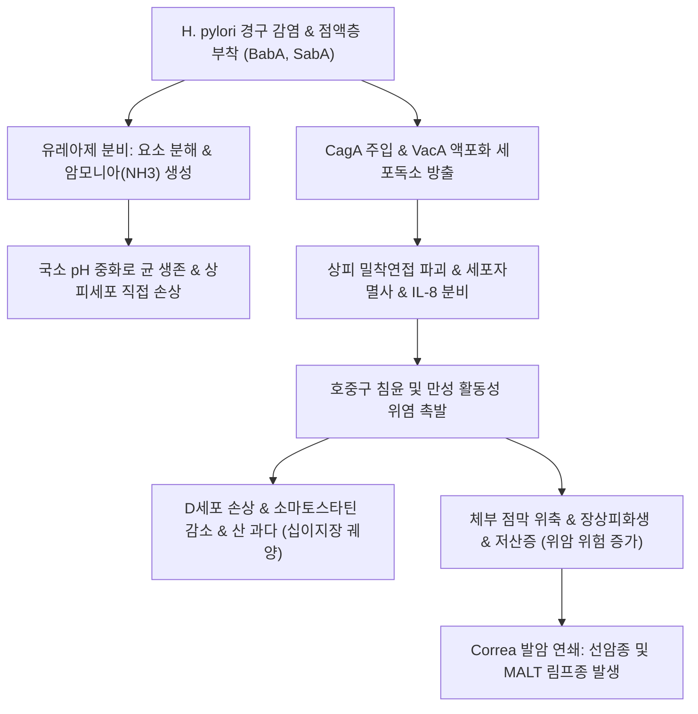
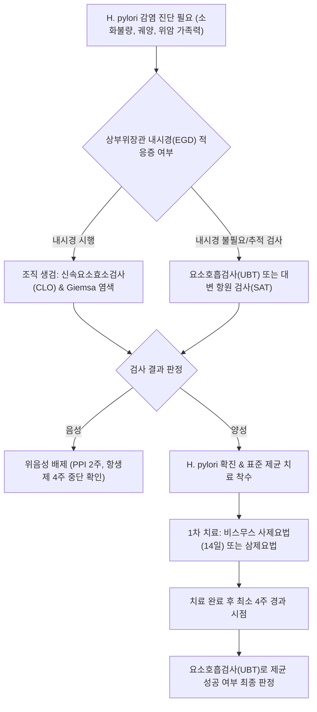

# 🩺 헬리코박터 파일로리균 감염 (Helicobacter pylori Infection)

> **핵심 3줄 요약 (Key Summary)**:
> - 📍 병소 부위 & 해부·병태생리: 위 점막 상피 표면 및 점액층에 기생하는 그람음성 미호기성 나선형 간균으로, 유레아제(Urease) 효소와 세포독소(CagA, VacA)를 통해 위 점막 방어 장벽을 파괴하고 만성 활동성 위염, 소화성 궤양, 위 MALT 림프종 및 위 선암종을 유발하는 제1군 발암원.
> - 🚩 전형적 임상 양상: 대다수는 무증상이나, 감염 지속 시 만성 소화불량, 상복부 팽만감, 속쓰림, 공복통(소화성 궤양 동반 시), 만성 피로 및 철결핍성 빈혈 발생.
> - 🛠️ 핵심 검사 & 치료 전략: 비침습적 검사(요소호흡검사 UBT, 대변 항원 검사), 침습적 검사(내시경 조직 신속요소효소검사 CLO, 조직 병리 염색), 표준 1차 14일 비스무스 사제요법 또는 동시치료/순차치료, 제균 성공 확인(치료 종료 4주 후 UBT) 및 한의 소간건비·청열제균 처방 병용.
> - ⚠️ 응급 의뢰 레드플래그: 위궤양 출혈(토혈, 흑색변), 천공 의심(급성 판자형 복벽 강직), 위암 의심 징후(원인 불명의 체중 감소, 빈혈, 연하곤란, 복부 종괴).

---

## 📌 목차
1. [질환 개요 & 해부학적 병태생리](#1-질환-개요--해부학적-병태생리)
2. [병태생리 메커니즘 & 생체역학적 악순환 네트워크](#2-병태생리-메커니즘--생체역학적-악순환-네트워크)
3. [임상 증상 & 이학적 검사(Physical Exam) 알고리즘](#3-임상-증상--이학적-검사physical-exam-알고리즘)
4. [감별 진단 매트릭스 (Differential Diagnosis)](#4-감별-진단-매트릭스-differential-diagnosis)
5. [한의 통합 치료 프로토콜 (침·약침·추나·한약)](#5-한의-통합-치료-프로토콜-침약침추나한약)
6. [양방 치료 & 병용·의뢰 기준 (Conventional Treatment & Referral)](#6-양방-치료--병용의뢰-기준-conventional-treatment--referral)
7. [재활 운동 & 생활습관 티칭 가이드](#7-재활-운동--생활습관-티칭-가이드)
8. [💡 사용자 진료실 핵심 필기 & 임상 노하우 (Melt-In 잔여 심화 집약)](#8--사용자-진료실-핵심-필기--임상-노하우-melt-in-잔여-심화-집약)
9. [출처 및 학술 참고 문헌 (References)](#9-출처-및-학술-참고-문헌-references)

---

## 1. 질환 개요 & 해부학적 병태생리

### 1) 미생물학적 및 해부학적 특성
[[헬리코박터 파일로리균 감염]](Helicobacter pylori Infection)은 사람의 위 점막에 서식하는 그람음성 나선균(Microaerophilic spiral bacterium)에 의해 발생하는 만성 감염증이다. 강력한 강산($\text{pH } 1.0\sim 2.0$) 환경인 위 내강에서 생존할 수 있는 유일무이한 병원체로, 세계보건기구(WHO) 산하 국제암연구소(IARC)에서 지정한 **제1군 발암물질(Group 1 Carcinogen)**이다.

- **해부학적 서식 위치**:
  - 위 점막 표면의 점액층(Mucus layer) 내부 및 위 점막 상피세포의 첨부(Apical surface)에 주로 군집을 이룬다. 점막하층이나 혈관 내로 직접 침습하지는 않는다.
  - 감염 초기에는 위산 분비가 적은 위 전정부(Antrum)에 주로 군집하나, 질환이 만성화되면서 위 체부(Body) 및 저부(Fundus)로 상행하여 범위염(Pangastritis) 및 점막 위축을 초래한다.
  - 편모(Flagella)를 이용해 점도 높은 점액층을 헤엄치며, 부착소(BabA, SabA)를 통해 위 상피 표면 수용체에 견고히 부착한다.

### 2) 역학 및 감염 경로
전 세계 인구의 약 50%가 감염되어 있으며, 국내 성인 감염률은 과거 60~70%에서 최근 위생 개선으로 40~50% 수준으로 감소하는 추세이다. 주된 전파 경로는 구강-구강(Oral-to-oral) 또는 분변-구강(Fecal-to-oral) 경로이며, 주로 영유아기에 가족 내에서 감염된다. 자연 치유되는 경우는 거의 없으며 평생 지속적인 만성 염증을 유발한다.

![[헬리코박터_파일로리균_감염_01_전자현미경소견.jpg|450]]
> [그림 1: ① 병원체 형태 — 나선형 균체와 다수의 편모(Flagella)를 가진 헬리코박터 파일로리(H. pylori)의 투과전자현미경 소견 — 출처: Wikimedia Commons (File:EMpylori.jpg, PD/Free use)]
![[헬리코박터_파일로리균_감염_01_나선균편모구조도해.png|450]]
> [그림 2: ① 해부·미생물학적 구조 — 위 점액층 굴착 운동을 가능하게 하는 헬리코박터 파일로리의 나선형 형태 및 극성 편모 모식도(5μm 척도) — 출처: Wikimedia Commons (File:Helicobacter pylori diagram.png, CC BY-SA 3.0)]

---

## 2. 병태생리 메커니즘 & 생체역학적 악순환 네트워크

### 1) 독력 인자(Virulence Factors) 및 점막 손상 기전
1. **유레아제(Urease) 분비와 산 중화**:
   - 균체 표면의 유레아제 효소가 위의 요소를 이산화탄소($\text{CO}_2$)와 암모니아($\text{NH}_3$)로 분해한다. 생성된 암모니아는 강알칼리성으로 균체 주위에 중성 미세환경(Microenvironment)을 형성하여 위산으로부터 균을 보호하지만, 상피세포에는 강력한 세포독소로 작용한다.
2. **세포독소 매개 점막 파괴**:
   - [[CagA]](Cytotoxin-associated gene A)**: IV형 분비계를 통해 상피세포 내로 직접 주입된다. 숙주 세포 내에서 인산화되어 SHP-2 단백질과 결합, 세포 골격 변형(Hummingbird phenotype), 밀착연접 파괴, 증식 및 염증 신호([[NF-kappaB]])를 촉진한다.
   - [[VacA]](Vacuolating cytotoxin A)**: 상피세포 내로 침투하여 액포 형성(Vacuolation), 미토콘드리아 손상 및 세포자멸사(Apoptosis)를 유도한다.
3. **만성 면역 반응과 Correa 발암 연쇄(Correa's Cascade)**:
   - 호중구와 림프구가 침윤하여 [[IL-8]], TNF-alpha, 활성산소([[ROS]])를 방출한다.
   - **표재성 만성 위염 $\longrightarrow$ 위축성 위염 $\longrightarrow$ [[장상피화생]] $\longrightarrow$ 이형성증(Dysplasia) $\longrightarrow$ [[조기 위암]](Gastric Adenocarcinoma)**으로 진행하는 Correa 발암 모델의 핵심 시동 인자이다.
   - B세포 만성 자극으로 [[위 MALT 림프종]](MALT lymphoma)을 유발하며, 제균 치료만으로 약 70~80%에서 완전 관해를 이끌어낼 수 있다.

![[헬리코박터_파일로리균_감염_02_우레아제단백구조.png|450]]
> [그림 3: ② 산 중화 병태생리 — 요소를 암모니아와 이산화탄소로 분해하여 위산 환경을 중화시키는 H. pylori 우레아제(Urease) 효소의 3차원 분자 구조 도해 — 출처: Wikimedia Commons (File:Helicobacter Pylori Urease.png, PD)]
![[헬리코박터_파일로리균_감염_02_면역조직화학염색.jpg|450]]
> [그림 4: ② 점막 군집화 병리 — 위 점막 생검 면역조직화학염색(IHC)에서 위소와 표면 상피에 다수 군집한 갈색의 H. pylori 균체 — 출처: Wikimedia Commons (File:Immunohistochemical detection of Helicobacter pylori histopathology.jpg, CC BY-SA 3.0)]

---

## 3. 임상 증상 & 이학적 검사(Physical Exam) 알고리즘

### 1) 임상 증상 전개
- **무증상 감염 (80~90%)**: 감염자 대부분은 뚜렷한 증상을 자각하지 못함.
- **활동성 위염 및 소화불량 (10~20%)**:
  - 만성 상복부 팽만감, 소화불량, 잦은 트림, 조기 포만감.
  - 명치 부위의 불쾌감 및 식후 쓰림.
- [[소화성 궤양 질환]] 동반 시**:
  - 공복통, 야간통(십이지장 궤양), 식후 통증(위궤양), 흑색변, 토혈.
- **위외 증상(Extra-gastric Manifestations)**:
  - 원인 불명의 철결핍성 빈혈, 면역혈소판감소증([[ITP]]), 비타민 B12 결핍.

### 2) 이학적 검사 및 진단 평가 알고리즘
1. **진찰 소견**: 복부 진찰상 대개 정상이거나 명치 부위의 가벼운 압통 관찰.
2. **진단 검사 방법 (침습적 vs 비침습적)**:
   - **비침습적 검사**:
     - **요소호흡검사(Urea Breath Test, UBT)**: 민감도 및 특이도 95% 이상. $^{13}\text{C}$ 또는 $^{14}\text{C}$ 표지 요소를 복용한 후 호기 내 표지 $\text{CO}_2$를 측정. **제균 치료 성공 판정의 표준 검사(Gold Standard)**.
     - **대변 항원 검사(Stool Antigen Test, SAT)**: UBT와 동등한 신뢰도, 소아 및 호기 채취 곤란 환자에서 유용.
     - **혈청 항체 검사(Serum IgG)**: 과거 감염과 현재 감염을 감별할 수 없으므로 제균 판정용으로는 사용 불가.
   - **침습적 검사(내시경 생검 필요)**:
     - **신속요소효소검사(Rapid Urease Test, CLO test)**: 생검 조직을 요소-페놀레드 배지에 넣어 암모니아 생성에 따른 색 변화(황색 $\to$ 적색) 관찰.
     - 조직병리학적 검사: Giemsa, Warthin-Starry 은염색으로 균체 확인 및 위축/장상피화생 평가.
   - **⚠️ 검사 전 필수 주의사항**: 정확한 결과를 위해 **PPI는 최소 2주간**, **항생제 및 비스무스는 최소 4주간 중단** 후 검사 시행(위음성 방지).

![[헬리코박터_파일로리균_감염_03_요소호기검사키트.jpg|450]]
> [그림 5: ③ 비침습적 진단 및 제균 판정 — 동위원소 표지 요소 정제 복용 전후 호기를 채취하는 요소호기검사(UBT) 키트 실사 — 출처: Wikimedia Commons (File:Urea breath test kit.jpg, CC BY-SA 4.0)]

---

## 4. 감별 진단 매트릭스 (Differential Diagnosis)

| 감별 질환 | 병인 및 특성 | H. pylori 검사 소견 | 주요 감별 요점 |
| :--- | :--- | :--- | :--- |
| [[헬리코박터 파일로리균 감염]] | 박테리아 만성 감염, CagA/VacA 매개 염증 | **CLO(+), UBT(+), 대변항원(+)** | 제균 치료 시 위염 및 궤양 완치, 암 위험 감소 |
| **NSAIDs 유발성 위장병증** | 소염진통제에 의한 프로스타글란딘 합성 억제 | H. pylori 음성일 수 있음 (단, 중복 감염 흔함) | 약물 복용력 명확, 약물 중단 및 PPI 투여로 호전 |
| **자가면역성 위염 (A형 위염)** | $\text{H}^+/\text{K}^+\text{-ATPase}$ 자가항체에 의한 체부 위축 | 대개 음성 (단, 선행 촉발 인자 가능성) | 항벽세포 항체(APCA) 양성, 악성 빈혈, 가스트린 극단 상승 |
| [[기능성 소화불량증]] | 뇌-장 축 상호작용 장애, 내장 과민성 | H. pylori 양성일 수도 있으나 제균 후에도 증상 지속 가능 | 기질적 병변 없음, 신경조절제 및 기능성 치료 필요 |
| [[위 MALT 림프종]] | 만성 H. pylori 감염에 의한 B세포 종양화 | H. pylori 감염률 90% 이상 | 병리 조직학적 확진, H. pylori 제균이 1차 완치 요법 |

---

## 5. 한의 통합 치료 프로토콜 (침·약침·추나·한약)

### 1) 한의 변증 진단 체계
한의학에서 헬리코박터 파일로리균 감염증은 [[위완통]](胃脘痛), [[비증]](痞證), [[습열위완]](濕熱胃脘), [[비위허약]](脾胃虛弱)의 범주에 속한다. 병원균(사기, 邪氣)에 해당하는 습열독(濕熱毒)이 중초에 울체되고, 정기(正氣)에 해당하는 비위의 기혈이 손상되어 발생하는 사정상박(邪正相搏)의 병기이다.

- **비위습열·열독조체(脾胃濕熱·熱毒阻滯)**: 명치가 쓰리고 화끈거림, 입안이 텁텁하고 냄새가 남, 구갈이 있으나 찬물을 조금만 마심, 설홍태황니, 맥활삭.
- **간위불화·기체열울(肝胃不和·氣滯熱鬱)**: 스트레스 시 속쓰림 악화, 잦은 트림, 가슴 답답함, 설홍태박황, 맥현.
- **비위허약·한열착잡(脾胃虛弱·寒熱錯雜)**: 소화불량이 오래되어 기운이 없고 찬 것을 먹으면 설사하나 명치는 쓰리고 답답함(반하사심탕증), 설담홍태백황협잡.

### 2) 침구 치료 프로토콜
위점막의 항염증 면역 환경을 강화하고 자율신경계 조절을 통해 위산 분비와 위벽 혈류를 정상화한다.
- **주요 혈위**: [[중완]](CV12), [[하완]](CV10), [[족삼리]](ST36), [[내관]](PC6), [[공손]](SP4), [[합곡]](LI4), [[태충]](LR3), [[곡지]](LI11), [[비수]](BL20), [[위수]](BL21).
- **시술 기법**:
  - **청열해독 및 사열(瀉熱)**: 습열이 왕성한 경우 [[곡지]](LI11), [[내정]](ST44)에 사법(瀉法) 자침하여 위열(胃熱) 제거.
  - **건비화위(健脾和胃)**: [[중완]](CV12) - [[족삼리]](ST36)에 평보평사 또는 보법 자침하여 점막 면역 장벽 강화.
  - **흉격 소통**: [[내관]](PC6) - [[공손]](SP4) 팔맥교회혈 배합.
- **치료 주기**: 주 2~3회, 20분 유침.

### 3) 약침 치료 프로토콜
- **황련해독탕 약침**: 습열독이 심한 활동성 위염 환자에게 [[중완]](CV12), [[거궐]](CV14)에 점적 주입하여 H. pylori 유발 염증 사이토카인 억제 (0.5~1.0cc).
- **자하거 약침**: 장기 감염으로 위축성 위염 및 장상피화생이 동반된 비허 환자에게 [[족삼리]](ST36), [[비수]](BL20)에 주입하여 점막 재생 유도.

### 4) 추나 치료 프로토콜
- **흉추 분절 가동술(T5~T9)**: 위 신경 지배 분절의 정상화를 유도하여 위점막 국소 혈류 개선.
- **복부 림프 및 혈류 순환 도수 기법**: 상복부 근막을 부드럽게 이완시켜 장간막 림프 순환 촉진.

### 5) 맞춤 한약 처방 (항균 및 제균 보조)
- **반하사심탕(半夏瀉心湯)**: [[반하]], [[황련]], [[황금]], [[건강]], [[인삼]], [[대추]], [[감초]]. 신개고항(辛開苦降)의 배합으로 황련과 황금의 베르베린(Berberine) 성분이 H. pylori 균체 증식을 직접 억제하고 염증을 완화하는 대표 처방.
- **연령고본단(延齡固本丹) 및 이진탕 가미방**: [[포공영]](민들레), [[금은화]], [[패모]], [[연교]] 등 천연 청열해독 항균 약재를 대거 배합하여 균체 침습과 위점막 염증 억제.
- **향사육군자탕(香砂六君子湯)**: 비위허약이 뚜렷한 만성 위축 환자의 점막 방어 인자(중탄산염, 점액 분비) 강화.

![[헬리코박터_파일로리균_감염_05_신속요소분해효소검사.jpg|450]]
> [그림 6: ⑤ 내시경 침습적 검사 — 위 전정부·체부 생검 조직의 우레아제 활성을 색 변화로 판독하는 신속요소분해효소검사(RUT) 키트 실사 — 출처: Wikimedia Commons (File:Rapid Urease Test.jpg, CC BY-SA 4.0)]

---

## 6. 양방 치료 & 병용·의뢰 기준 (Conventional Treatment & Referral)

### 1) 현대의학적 표준 제균 요법 지침 (Maastricht VI 기준)
1. **1차 표준 제균 요법 (14일 요법 권고)**:
   - **비스무스 기반 사제요법 (Bismuth Quadruple Therapy, BQT)**: 클라리스로마이신 내성률이 15% 이상인 한국 등 지역에서 1차 표준으로 우선 권고:
     - PPI(표준용량 1일 2회) + 비스무스(Bismuth subcitrate 300mg 1일 4회) + 메트로니다졸(Metronidazole 500mg 1일 3회) + 테트라사이클린(Tetracycline 500mg 1일 4회).
   - **클라리스로마이신 기반 삼제요법 (PAC 14일)**: 클라리스로마이신 내성 검사 음성인 경우에 한해 사용 (PPI + 아목시실린 1000mg 1일 2회 + 클라리스로마이신 500mg 1일 2회).
   - **동시치료(Concomitant therapy)**: PPI + 아목시실린 + 클라리스로마이신 + 메트로니다졸 14일 병용.
2. **2차 제균 요법 (1차 삼제요법 실패 시)**:
   - 비스무스 사제요법(BQT) 14일 투여.
3. **3차 제균 요법 (구제 요법, Rescue Therapy)**:
   - 레보플록사신(Levofloxacin) 기반 삼제요법 또는 감수성 검사 후 맞춤 처방.
4. **제균 판정 (Test of Cure)**:
   - 항생제 복용 종료 후 최소 4주, PPI 중단 최소 2주 경과 후 **요소호흡검사(UBT)**를 시행하여 제균 성공 여부를 반드시 확인.

### 2) 한양방 협진 가이드라인
- **항생제 복용 순응도 개선**: 비스무스 사제요법 복용 시 심한 오심, 구토, 미각 이상, 설사, 복통 등 소화기 부작용으로 환자의 약 20%가 복용을 중단하여 내성균이 발생한다. 이때 한약(이진탕, 곽향정기산, 반하사심탕)을 병용 투여하면 항생제 부작용을 유의하게 억제하여 완약률(복약 순응도)을 90% 이상으로 끌어올릴 수 있다.
- **제균 성공률 향상**: 한약의 베르베린(황련), 플라보노이드 성분은 H. pylori의 바이오필름(Biofilm) 형성을 파괴하여 항생제의 침투력을 극대화한다.

### 3) 응급 전원의뢰 기준 (Red Flags)
- **소화성 궤양 출혈**: 대량 토혈, 흑색변, 실신, 쇼크.
- **위 천공**: 급성 칼로 찌르는 듯한 복통과 판자형 복벽 강직.
- **위암 의심**: 설명되지 않는 진행성 체중 감소, 연하곤란, 조기 포만감, 쇄골상부 림프절 비대(Virchow's node).
- **MALT 림프종 확진**: 혈액종양내과 및 소화기내과 협진을 통한 병기 설정 및 추적 내시경 의뢰.

---

## 7. 재활 운동 & 생활습관 티칭 가이드

### 1) 감염 예방 및 위생 수칙
- **식기 공유 금지**: 찌개나 국을 여러 사람이 숟가락으로 함께 떠먹는 식습관을 중단하고 개인 접시 사용.
- **유아 구강 수유 금지**: 음식을 어른이 씹어서 아이에게 먹이거나, 숟가락을 입으로 불어 식히는 행위 절대 금지.
- **손 씻기 철저**: 화장실 이용 후, 식사 전 비누로 30초 이상 손 씻기.

### 2) 식이 조절
- **짠 음식과 탄 음식 금지**: 고염식(젓갈, 염장식품)과 탄 음식(발암물질)은 위 점막을 손상시켜 H. pylori의 발암성을 수배 이상 증폭시킴.
- **신선한 채소와 과일 섭취**: 비타민 C, E 등 항산화 물질이 풍부한 식품은 위 점막 내 발암성 니트로소 화합물 형성을 억제함.
- **금연 필수**: 흡연은 제균 성공률을 낮추고 재발률을 높임.

---

## 8. 💡 사용자 진료실 핵심 필기 & 임상 노하우 (Melt-In 잔여 심화 집약)

### 1) 진료실 복약 티칭의 핵심
- 헬리코박터 제균 약을 처방받은 환자들은 약의 개수가 너무 많고(한 번에 6~8알), 입에서 쓴맛이 나며 속이 메스꺼워 도중에 임의로 약을 끊는 경우가 허다하다.
- 환자에게 **"중간에 하루라도 빼먹거나 끊으면 균이 약에 내성을 가져서 다음에는 어떤 약으로도 죽지 않는 슈퍼 박테리아가 됩니다. 아무리 속이 불편해도 14일 치를 끝까지 다 드셔야 위암과 궤양을 평생 막을 수 있습니다"**라고 강력히 동기부여를 해야 한다.
- 복약 중 발생하는 속쓰림과 메스꺼움은 생강차나 반하사심탕 엑스제를 함께 복용하도록 지도하면 수월하게 완주한다.

### 2) 황련과 포공영의 임상 활용
- 한의학적으로 H. pylori 감염 환자는 설진 상 혀 중앙에 노란 이끼(황니태, 黃膩苔)가 끼어 있는 전형적인 습열증을 보인다.
- 이때 황련(黃連)과 포공영(蒲公英)을 전탕액에 가미하면 점막 염증이 빠르게 가라앉고 입냄새(구취)가 신속히 사라진다.

---

## 9. 출처 및 학술 참고 문헌 (References)

- Poowanawittayakom N, Goosenberg E. (2026). Helicobacter Pylori. *StatPearls*. PMID: 30480966.
   - **[연구 요약]**: 헬리코박터 파일로리의 미생물학적 특성, 유레아제 및 세포독소 매개 병태생리, 진단 검사법(요소호흡검사, 생검) 및 최신 항생제 제균 프로토콜을 체계적으로 기술함.
- Malfertheiner P, Megraud F, Rokkas T. (2022). Management of Helicobacter pylori infection: the Maastricht VI/Florence consensus report. *Gut*. 71(9):1724-1762. PMID: 35944925.
   - **[연구 요약]**: 마스트리히트 VI 유럽 합의 보고서로 H. pylori 감염 진단, 클라리스로마이신 내성 극복을 위한 14일 비스무스 사제요법 가이드라인 및 위암 예방 제균 원칙을 확립함.
- Lanas A, Chan FKL. (2017). Peptic ulcer disease. *Lancet*. 390(10094):613-624. PMID: 28242110.
   - **[연구 요약]**: 헬리코박터 파일로리 감염과 소화성 궤양 발생의 인과 기전, 역학 및 점막 장벽 손상과 합병증 예방을 위한 제균 치료 효과를 종합 분석함.

---

## 📎 개념 학습 보충 (2026-10-29 논문 연계)
> 논문에서의 역할 — 제균 요법에 **한약·천연물을 병용했을 때의 제균율과 안전성**을 합성한 메타분석이다. 기존 제균 프로토콜은 유지하고, 병용의 근거 등급과 순서만 추가한다(PMID 42280436).

- **효과 크기**: 9편 합성에서 병용군 제균율 RR 1.20(95% CI 1.14~1.27, I²=33%). 총유효율 RR 1.19(1.14~1.25, I²=0%)이나 이는 중국식 복합 지표로 국제 통용성이 없다.
- **근거 등급**: GRADE로 제균율 '낮음', 총유효율·미생물 지표 '매우 낮음'. 포함 연구 대부분이 중국 단일기관이고 대조군이 위약이 아닌 경우가 많아 기대효과가 섞였다 — **1차 처방 근거로 쓰지 않는다.**
- **병용 3단계 순서(실전)**: ① 제균 시작 3~5일 전부터 위장 증상 완화 목적([[반하]]·[[진피]]·[[생강]] 계열)으로 좁게 준비 ② 제균 2주는 항생제·비스무트 부담이 크므로 새 처방을 늘리지 않음 ③ 제균 종료 4주 뒤 요소호기검사로 판정한 후 위점막 회복·장내 환경 복원 목적의 본 처방을 4~8주.
- **안전성 신호**: 한 연구에서 한약 + 오메프라졸 병용군 3명에게 간효소 상승(중등도~중증 2명)이 보고됐다. 4주 이상 병용 시 기저·4주째 AST·ALT 확인, 음주력·지방간 환자는 2주 간격으로 좁힌다.
- **환자 설명**: "제균약을 먹는 2주 동안은 한약을 새로 시작하지 말고, 제균이 확인된 뒤에 위를 보호하는 한약을 시작하자"가 순응도를 높인다.
- 관련: [[장내 미생물]] · [[프로바이오틱스]] · [[PPI]] · [[위염]] · [[만성 위염]] · [[2026-10-29_통합의학약리학_개념학습]] 3번
