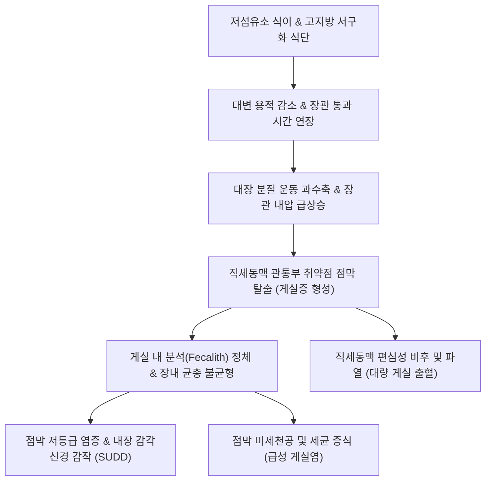
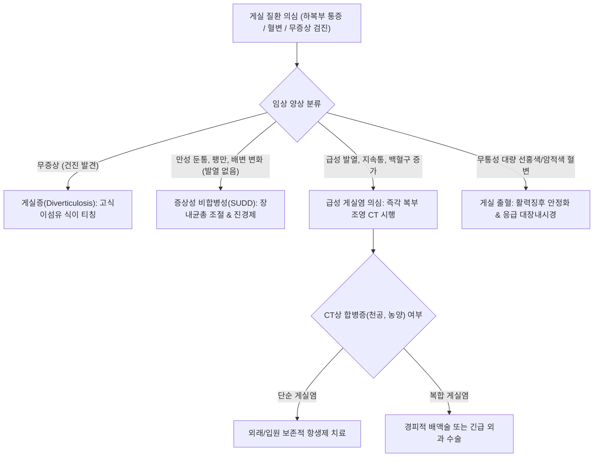

# 🩺 게실 질환의 정의 (Diverticular Disease of the Colon)

> **핵심 3줄 요약 (Key Summary)**:
> - 📍 병소 부위 & 해부·병태생리: 대장벽의 고유근층 결손 부위(영양 혈관인 직세동맥이 근층을 관통하는 취약점)를 통해 점막 및 점막하층이 장막하로 낭상 돌출하는 가성 게실(Pseudodiverticulum) 형성 스펙트럼 총칭.
> - 🚩 전형적 임상 양상: 무증상 게실증(Diverticulosis)부터 증상성 비합병성 게실 질환(SUDD: 좌하복부 둔통, 배변 습관 변화), 급성 염증/미세천공을 동반한 게실염(Diverticulitis), 게실 출혈(Diverticular bleeding)에 이르는 광범위한 질환군.
> - 🛠️ 핵심 검사 & 치료 전략: 복부 조영 CT(게실염 및 합병증 진단의 표준), 대장내시경(출혈 부위 확인 및 지혈, 암 감별), 고식이섬유 식이, 장관 비흡수성 항생제(리팍시민), 한의 대장습열·기체어혈 변증 치료.
> - ⚠️ 응급 의뢰 레드플래그: 게실 파열에 의한 범발성 복막염(판자형 복벽 강직, 반발압통), 대량 하부위장관 출혈(혈변, 저혈량성 쇼크), 골반강 농양 및 장폐색 징후.

---

## 📌 목차
1. [질환 개요 & 해부학적 병태생리](#1-질환-개요--해부학적-병태생리)
2. [병태생리 메커니즘 & 생체역학적 악순환 네트워크](#2-병태생리-메커니즘--생체역학적-악순환-네트워크)
3. [임상 증상 & 이학적 검사(Physical Exam) 알고리즘](#3-임상-증상--이학적-검사physical-exam-알고리즘)
4. [감별 진단 매트릭스 (Differential Diagnosis)](#4-감별-진단-매트릭스-differential-diagnosis)
5. [한의 통합 치료 프로토콜 (침·약침·추나·한약)](#5-한의-통합-치료-프로토콜-침약침추나한약)
6. [양방 치료 & 병용·의뢰 기준 (Conventional Treatment & Referral)](#6-양방-치료--병용의뢰-기준-conventional-treatment--referral)
7. [재활 운동 & 생활습관 티칭 가이드](#7-재활-운동--생활습관-티칭-가이드)
8. [💡 사용자 진료실 핵심 필기 & 임상 노하우 (Melt-In 잔여 심화 집약)](#8--사용자-진료실-핵심-필기--임상-노하우-melt-in-잔여-심화-집약)
9. [출처 및 학술 참고 문헌 (References)](#9-출처-및-학술-참고-문헌-references)

---

## 1. 질환 개요 & 해부학적 병태생리

### 1) 게실 질환(Diverticular Disease)의 광범위한 스펙트럼 정의
[[게실 질환의 정의|게실 질환]](Diverticular Disease)은 소화관 벽의 일부가 주머니(Diverticulum) 형태로 외측으로 돌출된 해부학적 변화와, 이로 인해 유발되는 모든 임상적 스펙트럼을 포괄하는 상위 개념이다. 임상적으로 다음 네 가지 주요 범주로 체계화된다.
1. [[게실증]](Diverticulosis)**: 대장벽에 게실이 존재하는 무증상 상태(전체 게실 보유자의 80~85%).
2. **증상성 비합병성 게실 질환(Symptomatic Uncomplicated Diverticular Disease, SUDD)**: 명백한 육안적 염증(게실염) 없이 지속적이거나 간헐적인 하복부 통증, 복부 팽만, 배변 장애를 호소하는 상태.
3. [[게실염]](Diverticulitis)**: 게실 입구 폐색 및 미세천공(Microperforation)으로 인해 발생하는 급성 감염·염증성 질환(단순성 vs 복잡성).
4. **게실 출혈(Diverticular Bleeding)**: 게실 기저부의 직세동맥이 파열되어 발생하는 무통성 대량 하부위장관 출혈.

### 2) 해부학적 발생 부위 및 진성·가성 게실의 차이
- **가성 게실(False / Pseudodiverticulum)**: 후천적으로 발생하며 점막과 점막하층만 돌출되고 고유근층이 결여된 주머니이다. 서구와 한국을 포함한 성인 대장 게실의 95% 이상이 이에 해당한다. 대장벽을 관통하는 직세동맥(Vasa recta) 진입 부위의 결합조직 틈새가 해부학적 약점으로 작용한다.
- **진성 게실(True Diverticulum)**: 장벽 전층(점막, 근층, 장막)이 모두 돌출된 형태로, 선천적인 [[메켈 게실]](Meckel's diverticulum)이나 맹장 선천 게실이 해당한다.
- **지리적·해부학적 분포 차이**:
  - **서구인**: 좌측 대장, 특히 **S상결장(Sigmoid colon, 90% 이상)**에 압도적으로 호발한다.
  - **동양인(한국인 포함)**: **우측 대장(맹장 및 상행결장, 70~80%)**에 호발하는 경향을 보이나, 최근 서구화된 식습관으로 인해 좌측 게실 빈도가 급격히 증가하고 있다.

![[게실_질환의_정의_01_선천성진성메켈게실도해.jpg|450]]
> [그림 1: ① 진성 게실의 정의 — 난황관 잔유물에서 기원하여 장벽 전층(점막·점막하층·근육층)이 돌출되는 선천성 진성 게실(메켈 게실) 도해 — 출처: 질병관리청 국가건강정보포털 (메켈 게실)]
![[게실_질환의_정의_01_에스결장게실모식도.jpg|450]]
> [그림 2: ① 가성 게실의 해부학 — 결장띠(Taeniae coli) 사이의 장벽 취약부를 따라 다발성으로 돌출된 에스결장 게실 모식도 — 출처: Wikimedia Commons (File:Sigmoid diverticulum (diagram).jpg, CC BY-SA 4.0)]

---

## 2. 병태생리 메커니즘 & 생체역학적 악순환 네트워크

### 1) 라플라스의 법칙(Laplace's Law)과 생체역학적 내압 상승
장관 내압($P$)은 장관 반경($R$)에 반비례하고 벽 장력($T$)에 비례한다($P = T/R$).
- **식이섬유 부족**: 저섬유소 식이는 대변 부피를 감소시키고 수분 함량을 떨어뜨려 단단한 소변괴를 형성한다.
- **분절 운동(Segmentation) 과항진**: 결장이 대변을 추진하기 위해 분절성 환상근 수축을 과도하게 일으키며, 직경이 가장 좁은 S상결장에서 장관 내압이 폭발적으로 상승한다.
- **낭상 탈출**: 높아진 내압이 직세동맥 관통부의 취약한 대장벽 틈새로 점막을 밀어내어 주머니를 형성한다.

### 2) 신경-근육 조절 장애 및 만성 저등급 염증
- 장신경계(ENS)의 아세틸콜린 수용체 과민성 및 일산화질소(NO) 억제 신경 결핍으로 근층 비후(Myochosis)가 초래된다.
- 게실 내 대변 정체(Fecalith) $\to$ 장내 미생물총 불균형(Dysbiosis) $\to$ 점막 방어 장벽 손상 및 만성 저등급 염증 $\to$ 지각신경 과민화로 만성 복통(SUDD) 발생.

![[게실_질환의_정의_02_대장분절해부도해.jpg|450]]
> [그림 3: ② 동서양 호발 부위 해부 — 동양인 호발 부위인 우측 대장(맹장·상행결장)과 서양인 호발 부위인 좌측 에스결장의 대장 분절 해부 도해 — 출처: Wikimedia Commons (File:Colon illustration lg.jpg, CC BY-SA 4.0)]
![[게실_질환의_정의_02_가성게실조직학소견.jpg|450]]
> [그림 4: ② 가성 게실 조직학 — 고유근층의 결손 틈을 통해 점막과 점막하층만 외측으로 탈출한 가성 게실(Pseudodiverticulum)의 H&E 조직 소견 — 출처: Wikimedia Commons (File:Histopathology of a false diverticulum of the gallbladder.jpg, CC0)]

---

## 3. 임상 증상 & 이학적 검사(Physical Exam) 알고리즘

### 1) 임상 증상 분석
- **게실증(Diverticulosis)**: 대부분 무증상. 대장내시경 검진 시 우연히 발견.
- **증상성 비합병성 게실 질환(SUDD)**:
  - 좌하복부(서구형) 또는 우하복부(동양형)의 묵직한 둔통 및 경련성 통증.
  - 가스 팽만감, 배변 후 일시적 통증 완화, 설사와 변비의 반복(과민대장증후군 유사).
- **게실염(Diverticulitis)**: 지속적인 복통, 발열, 오한, 백혈구 증가, 배변 습관 급변.
- **게실 출혈(Diverticular Bleeding)**: 복통 없이 갑작스럽게 쏟아지는 대량의 선홍색 또는 암적색 혈변(Hematochezia).

### 2) 이학적 검사 및 진단 평가 알고리즘
1. **복부 촉진**:
   - SUDD: 좌하복부(S상결장 부위) 또는 우하복부에 가벼운 압통 관찰 가능, 복벽 강직 없음.
   - 게실염 동반 시: 현저한 압통, 국소 반발압통, 때로는 염증성 종괴(Phlegmon) 촉지.
2. **진단 검사 체계**:
   - **복부 전산화단층촬영(Abdominal CT with IV contrast)**: 게실 질환의 합병증(염증, 농양, 천공, 누공) 진단의 최고 표준(민감도 >95%).
   - **대장내시경(Colonoscopy)**:
     - 게실증 및 출혈 병소 확인, 악성 대장암 배제에 필수.
     - **⚠️ 급성 게실염 활동기에는 천공 위험으로 인해 절대 금기**, 염증 호전 6~8주 후 시행.

![[게실_질환의_정의_03_대장내시경게실개구부.jpg|450]]
> [그림 5: ③ 임상 스펙트럼 확인 — 대장내시경 검사 중 염증 징후 없이 우연히 발견된 2개의 무증상 결장 게실 개구부 — 출처: Wikimedia Commons (File:Diverticulosis (two diverticula) 02.jpg, CC BY-SA 3.0)]

---

## 4. 감별 진단 매트릭스 (Differential Diagnosis)

| 감별 질환 | 호발 부위 및 통증 특성 | 영상 및 검사 소견 | 감별 핵심 포인트 |
| :--- | :--- | :--- | :--- |
| [[게실 질환의 정의]](SUDD)** | 좌하복부/우하복부 만성 둔통, 배변 연관 | CT상 장벽 비후 경미, 대장내시경 게실 다발 | 발열·염증 수치 정상, 대장암 및 IBD 배제 필수 |
| [[급성 게실염]] | 좌하복부/우하복부 지속성 격통, 발열 | CT상 **게실 주위 지방 침윤(Fat stranding)**, 장벽 비후 | 급성 염증 징후(발열, CRP 상승), 복통 지속 |
| [[과민대장증후군]](IBS)** | 복통, 배변 후 완화, 복부 팽만 | 내시경 및 CT 완전 정상 | 50세 이전 호발, 배변 형태와 직결, 야간 증상 없음 |
| [[결장암]] | 배변 습관 변화, 혈변, 체중 감소, 빈혈 | CT상 불규칙한 종괴, 림프절 비대, 대장내시경 종양 | 50세 이상, 궤양성 융기 종괴 확인 및 병리 생검 확진 |
| [[급성 충수염]] | 명치 통증 후 **우하복부(McBurney점) 이동통** | CT상 충수 직경 >6mm, 충수 결석, 맹장 주위 침윤 | 동양인 우측 게실염과 매우 유사하여 CT 감별 필수 |

---

## 5. 한의 통합 치료 프로토콜 (침·약침·추나·한약)

### 1) 한의 변증 진단 체계
한의학에서 게실 질환은 [[복통]](腹痛), [[변비]](便秘), [[설사]](泄瀉), [[장옹]](腸癰, 염증기), [[변혈]](便血, 출혈기)의 범주에 속한다. 대장 전도(傳導) 기능의 장애와 중초 기체, 습열 어혈의 울체가 주된 병리이다.

- **대장습열·기체어혈(大腸濕熱·氣滯瘀血)**: 하복부 팽만통, 후중감(배변 후 잔변감), 변비와 무른 변의 교대, 설홍태황니, 맥활삭.
- **기체어혈·장락불통(氣滯瘀血·腸絡不通)**: 하복부 고정성 찌르는 듯한 통증, 야간 악화, 배변 곤란, 설자암, 맥현삽.
- **비신양허·장도무력(脾腎陽虛·腸道無力)**: 노인성 게실 질환, 하복부 냉통, 무기력, 소화불량, 변비, 설담태백, 맥침세.

### 2) 침구 치료 프로토콜
대장 연동운동을 정상화하고 장관 내압을 분산시키며 복강 내 혈류를 개선한다.
- **주요 혈위**: [[천추]](ST25, 대장 모혈), [[대장수]](BL25), [[상거허]](ST37, 대장 하합혈), [[족삼리]](ST36), [[기해]](CV6), [[관원]](CV4), [[태충]](LR3), [[합곡]](LI4).
- **시술 기법**:
  - **대장 기능 정상화**: [[천추]](ST25)와 [[상거허]](ST37)에 2~10Hz 전침을 적용하여 대장 유효 운동성 촉진 및 비정상 분절 수축 억제.
  - **진통 배합**: 사관혈([[합곡]]-[[태충]]) 자침으로 기기 소통.
  - **허약형 온구**: 노인성 비허 환자에게 [[관원]](CV4), [[대장수]](BL25) 뜸 치료 병용.
- **치료 주기**: 주 2~3회, 20분 유침.

### 3) 약침 치료 프로토콜
- **황련해독탕 약침**: 습열성 하복부 둔통 및 장내 미세염증 완화를 위해 [[천추]](ST25), [[기해]](CV6)에 점적 주입 (0.5~1.0cc).
- **중성어혈 약침**: 고정성 하복부 통증 환자의 [[대장수]](BL25), [[차료]](BL32)에 주입.

### 4) 추나 치료 프로토콜
- **요천추 및 골반 교정 기법**: 대장 및 골반 장기의 부교감신경(S2~S4 골반내장신경) 경로를 정상화하기 위한 천골 및 장골 부정렬 교정.
- **복부 내장기 이완술**: 하복부 결장 주위 근막을 부드럽게 이완하여 장관 긴장도 완화.

### 5) 맞춤 한약 처방
- **마자인환(麻子仁丸)**: [[마자인]], [[작약]], [[지실]], [[후박]], [[대황]], [[행인]]. 장조변비(腸燥便秘)로 장관 내압이 상승하는 것을 예방하고 대변을 부드럽게 배출시키는 기본 방제.
- **대황목단피탕(大黃牡丹皮湯) 가미방**: [[대황]], [[목단피]], [[도인]], [[동과자]], [[망초]]. 습열과 어혈이 뭉쳐 장옹(게실염 전구기)으로 발전하는 것을 방지하는 청열해독 거어 처방.
- **시호소간탕(柴胡疏肝湯) 합 작약감초탕(芍藥甘草湯)**: 스트레스성 장경련 및 하복부 쥐어짜는 복통 완화.

![[게실_질환의_정의_05_결장팽기주름및게실내시경.jpg|450]]
> [그림 6: ⑤ 단계별 감별 및 관리 — 비후된 결장 반월주름(Haustral folds) 사이에 형성된 게실 주머니의 내시경 소견 — 출처: Wikimedia Commons (File:Diverticulosis 2.jpg, CC BY-SA 3.0)]

---

## 6. 양방 치료 & 병용·의뢰 기준 (Conventional Treatment & Referral)

### 1) 현대의학적 단계별 치료 전략
1. **무증상 게실증(Diverticulosis)**: 특별한 약물 치료 불필요. 점진적 고식이섬유 섭취(하루 25~35g) 권고.
2. **증상성 비합병성 게실 질환(SUDD)**:
   - **리팍시민(Rifaximin)**: 비흡수성 경구 항생제로 장내 세균총 불균형을 교정하고 가스 생성을 억제 (400mg 1일 2회, 매월 7일간 주기적 투여).
   - 진경제(메베베린, 오티로늄): 분절성 경련 통증 완화.
   - 프로바이오틱스 및 수용성 식이섬유(차전자피).
3. **급성 게실염**: 보존적 수액 요법, 항생제 요법, 복합성 병변(농양) 시 경피적 배액술.
4. **게실 출혈**: 응급 대장내시경 지혈술(내시경 밴드 결찰술 EBL, 클립 결찰술), 혈관조영 색전술(TAE).

### 2) 한양방 협진 가이드라인
- 무증상 및 SUDD 단계에서는 한약(마자인환, 시호소간탕)과 침치료로 대장 연동 리듬을 회복시키고 장내 압력을 낮추어 게실염이나 출혈로의 이행을 방지한다.
- 50세 이상 환자에서 게실 질환 의심 증상이 발생하면 반드시 양방 대장내시경을 통해 결장암 유무를 먼저 확인하도록 티칭한다.

### 3) 응급 전원의뢰 기준 (Red Flags)
- 하복부의 **극심한 급성 지속성 통증** 및 **고열(>38.3℃)**, 오한.
- 신체 진찰상 **판자형 복벽 강직** 및 **반발압통**(천공성 복막염 의심).
- 대량의 무통성 **선홍색/암적색 혈변** 및 어지럼증, 빈맥, 혈압 강하(게실 출혈).
- 대변 및 방귀 배출 완전 중단(기계적 장폐색 의심).

---

## 7. 재활 운동 & 생활습관 티칭 가이드

### 1) 식이 요법의 과학적 교정
- **풍부한 수분 및 섬유질 섭취**: 하루 1.5~2L의 충분한 미온수 섭취와 함께 통곡물, 채소, 해조류 등 섬유질 섭취 증량.
- **과거 금기 식품의 교정(Myth Buster)**: 과거 견과류, 씨앗류, 팝콘이 게실 입구를 막는다고 금기시했으나, 대규모 전향적 연구에서 오히려 견과류 섭취군에서 게실염 발생률이 낮음이 입증되었으므로 **견과류나 씨앗류를 억지로 제한할 필요 없음**.
- **붉은 육류 및 고지방식 제한**: 적색육 섭취는 대장 게실염 위험을 유의하게 증가시킴.

### 2) 일상 활동 관리
- **규칙적인 유산소 운동**: 하루 30분 이상의 활보나 조깅은 결장 연동운동을 촉진하여 장관 내압을 낮춤.
- **배변 습관 개선**: 변의를 참지 않고 즉시 배변하며, 변기에 10분 이상 앉아 과도하게 힘주는 행위 금지.

---

## 8. 💡 사용자 진료실 핵심 필기 & 임상 노하우 (Melt-In 잔여 심화 집약)

### 1) 우측 게실염과 맹장염의 진료실 감별 포인트
- 한국인 환자가 "오른쪽 아랫배가 아프다"며 내원했을 때, 젊은 층에서는 급성 충수염이 흔하지만 40~60대에서는 **우측 대장(맹장/상행결장) 게실염**의 빈도가 매우 높다.
- 통증이 체한 듯 명치에서 시작해 우하복부로 이동했다면 충수염 가능성이 높고, 처음부터 우하복부가 국소적으로 아프며 수일 전부터 은은한 통증이 있었다면 게실염을 먼저 의심해야 한다. 두 질환 모두 복부 CT가 필수이다.

### 2) 마자인환의 임상 운용 노하우
- 변비가 심해 변이 염소똥처럼 단단하게 나오는 노인 환자에게 자극성 하제(센나, 비사코딜)를 장기 투약하면 장관 분절 수축이 악화되어 게실 발생을 촉진한다.
- 이때 마자인환을 쓰면 진액을 보충하면서 장관 평활근의 자극 없이 윤활 배변을 유도하여 게실 환자에게 가장 안전하고 이상적인 하제가 된다.

---

## 9. 출처 및 학술 참고 문헌 (References)

- Bach K, Menon G, Goosenberg E. (2026). Diverticular Disease of the Colon. *StatPearls*. PMID: 31082154.
   - **[연구 요약]**: 대장 게실 질환의 광범위한 스펙트럼, 역학, 가성 게실의 해부학적 병태생리, 진단적 영상 기준 및 단계별 임상 관리 지침을 체계적으로 기술함.
- Peery AF, Strate LL, Stollman N. (2026). ACG Clinical Guideline: Colonic Diverticulitis. *Am J Gastroenterol*. 121(7):1380-1402. PMID: 42390126.
   - **[연구 요약]**: 미국소화기학회 최신 임상 가이드라인으로 대장 게실 질환의 전반적 임상 스펙트럼, 급성 단순성 및 복합성 게실염 진단과 최신 약물·외과적 치료 기준을 확립함.
- Phan HS, Strate LL. (2025). Management of Colonic Diverticular Disease in the Older Adult. *Curr Gastroenterol Rep*. 27(1):15-28. PMID: 40542969.
   - **[연구 요약]**: 고령 환자에서 호발하는 대장 게실 질환의 특성, 허약성 평가, 비수술적 및 보존적 약물 치료와 게실 출혈 및 천공 관리 지침을 제시함.
