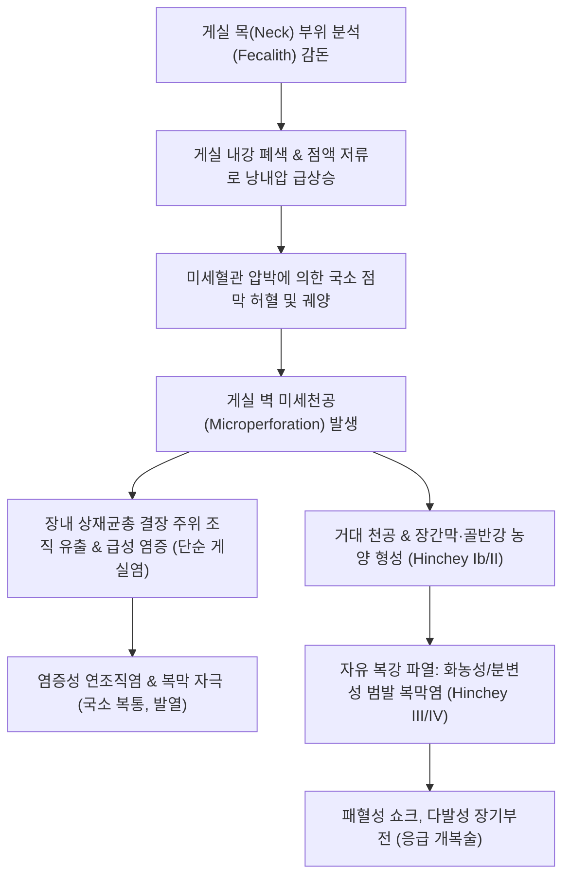
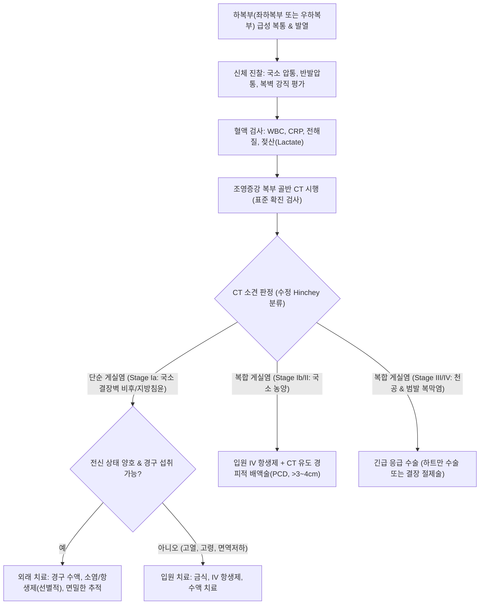

# 🩺 게실염 (Diverticulitis)

> **핵심 3줄 요약 (Key Summary)**:
> - 📍 병소 부위 & 해부·병태생리: 대장 게실 내강의 분석(Fecalith) 정체 및 장내 압력 상승으로 인한 게실벽 허혈, 점막 미세천공(Microperforation) 또는 거대천공으로 게실벽 및 주위 장간막 지방조직으로 파급되는 급성 염증성 질환.
> - 🚩 전형적 임상 양상: 서구형은 좌하복부(S상결장), 동양형은 우하복부(맹장·상행결장)의 지속적인 급성 복통, 국소 복벽 압통, 미열(37.5~38.5℃), 오심, 백혈구 증가증 및 CRP 상승.
> - 🛠️ 핵심 검사 & 치료 전략: 조영증강 복부 골반 CT(게실 주위 지방 침윤, 장벽 비후, 농양 확인으로 Hinchey 병기 판정), 급성기 대장내시경 금기, 단순 게실염은 외래 경구 수액/식이 조절, 복합 게실염은 입원 광범위 항생제(시프로플록사신+메트로니다졸) 및 경피적 배액술, 한의 대황목단피탕·패장초 치료.
> - ⚠️ 응급 의뢰 레드플래그: 게실 파열에 의한 범발성 복막염(판자형 복벽 강직, 반발압통), 패혈성 쇼크, 골반강 거대 농양, 방광누공(분변뇨, 기뇨), 장폐색.

---

## 📌 목차
1. [질환 개요 & 해부학적 병태생리](#1-질환-개요--해부학적-병태생리)
2. [병태생리 메커니즘 & 생체역학적 악순환 네트워크](#2-병태생리-메커니즘--생체역학적-악순환-네트워크)
3. [임상 증상 & 이학적 검사(Physical Exam) 알고리즘](#3-임상-증상--이학적-검사physical-exam-알고리즘)
4. [감별 진단 매트릭스 (Differential Diagnosis)](#4-감별-진단-매트릭스-differential-diagnosis)
5. [한의 통합 치료 프로토콜 (침·약침·추나·한약)](#5-한의-통합-치료-프로토콜-침약침추나한약)
6. [양방 치료 & 병용·의뢰 기준 (Conventional Treatment & Referral)](#6-양방-치료--병용의뢰-기준-conventional-treatment--referral)
7. [재활 운동 & 생활습관 티칭 가이드](#7-재활-운동--생활습관-티칭-가이드)
8. [💡 사용자 진료실 핵심 필기 & 임상 노하우 (Melt-In 잔여 심화 집약)](#8--사용자-진료실-핵심-필기--임상-노하우-melt-in-잔여-심화-집약)
9. [출처 및 학술 참고 문헌 (References)](#9-출처-및-학술-참고-문헌-references)

---

## 1. 질환 개요 & 해부학적 병태생리

### 1) 정의 및 해부학적 특징
[[게실염]](Diverticulitis)은 대장벽에 형성된 가성 게실의 개구부가 폐색되거나 내압이 상승하여 게실벽에 미세천공이 발생하고, 이로 인해 게실벽과 주변 결장간막(Mesocolon), 복막강으로 염증이 파급되는 질환이다.
- **해부학적 호발 부위**:
  - 서구에서는 **S상결장(Sigmoid colon, >90%)** 및 하행결장에 호발하여 '좌측 급성 충수염(Left-sided appendicitis)'이라 불린다.
  - 한국인을 포함한 아시아인에서는 **맹장(Cecum) 및 상행결장(Ascending colon, 50~70%)**에 호발하여 우하복부 통증을 주소로 내원, 급성 충수염과의 감별이 최대 과제가 된다.
- **조직병리학적 특성**:
  - 점막 및 점막하층으로만 구성된 얇은 가성 게실의 맹관부(Apex)가 팽창되면서 국소 허혈성 괴사가 발생하고 장내 혐기성 및 호기성 세균이 장벽 외측으로 유출된다.

### 2) 분류 체계 (Hinchey 분류 및 수정 Hinchey 분류)
복부 CT 소견에 따라 복합성 게실염(Complicated diverticulitis)의 치료 방침을 결정하는 표준 기준이다:
- **Stage Ia**: 게실 주위 국소 연조직염(Phlegmon) 또는 결장벽에 국한된 미세 염증.
- **Stage Ib**: 결장 주위(Pericolic) 또는 장간막 내 국한성 농양(Abscess, <4cm).
- **Stage II**: 원격 골반강(Pelvic) 또는 후복막강 국한성 농양(Distant abscess).
- **Stage III**: 게실 파열에 의한 비분변성 화농성 범발 복막염(Purulent peritonitis).
- **Stage IV**: 장관 파열로 대변이 복강 내로 유출된 분변성 범발 복막염(Feculent peritonitis, 치명률 최고).

---

## 2. 병태생리 메커니즘 & 생체역학적 악순환 네트워크

### 1) 미세천공과 염증 파급 기전
1. **분석(Fecalith) 정체 및 입구 폐색**:
   - 단단하게 굳은 대변 덩어리가 게실의 좁은 목(Neck)을 막는다.
2. **점막 분비액 정체 및 내압 상승**:
   - 주머니 내 점액 분비가 지속되어 낭내 압력이 급상승한다.
3. **혈류 차단 및 점막 허혈 괴사**:
   - 벽을 통과하는 미세혈관이 압박되어 점막 허혈과 점막 방어 장벽 붕괴가 초래된다.
4. **미세천공(Microperforation) 및 세균성 감염**:
   - 대장균([[E. coli]]), 연쇄상구균, 박테로이데스 프라질리스(B. fragilis) 등 혐기성 균주가 관통하여 게실 주위 결장주위염(Peridiverticulitis)을 촉발한다.
5. **합병증으로의 이행**:
   - 대식세포와 대망(Omentum)이 천공부를 막으면 국소 연조직염(Hinchey Ia)이나 국한성 농양(Hinchey Ib/II)으로 제한되지만, 봉쇄에 실패하면 대량 천공(Hinchey III/IV), 방광·질·피부와의 [[누공]](Fistula), 또는 만성 섬유화에 의한 결장 협착 및 [[장폐색]]으로 진행한다.

---

## 3. 임상 증상 & 이학적 검사(Physical Exam) 알고리즘

### 1) 임상 증상 특징
- **지속성 복통(Constant Abdominal Pain)**:
  - 찌르거나 쥐어짜는 듯한 통증이 수일간 지속되며 점점 심해짐.
  - **좌하복부 통증**: 서구형 S상결장 게실염의 전형 소견.
  - **우하복부 통증**: 한국인 맹장/상행결장 게실염의 전형 소견.
- **전신 염증 징후**: 미열(37.5~38.5℃)에서 고열, 오한, 식욕 부진.
- **소화기 및 비뇨기 수반 증상**:
  - 오심, 구토, 변비(염증성 장관 마비) 또는 설사.
  - S상결장 염증이 인접 방광벽을 자극할 경우 빈뇨, 배뇨통, 급박뇨(Diverticulitis-induced dysuria) 동반.

### 2) 이학적 검사 소견
1. **촉진(Palpation)**:
   - 환부(좌하복부 또는 우하복부)에 뚜렷한 압통(Tenderness) 및 국소 반발압통(Rebound tenderness).
   - 심한 봉와직염이나 농양 형성 시 압통을 동반하는 단단한 종괴(Tender mass) 촉지 가능.
   - 복벽 전반의 강직(Rigidity)이 관찰되면 범발성 복막염(천공) 의심.
2. **진단 검사 체계**:
   - **조영증강 복부 골반 CT(Abdominal/Pelvic CT)**:
     - **진단 민감도 98%, 특이도 99%**.
     - 게실 주위 지방 침윤(Pericolic fat stranding), 결장벽 비후(>4mm), 장벽 비후, 게실 내강 내 조영, 농양, 복강 내 유리 가스(Pneumoperitoneum) 확진.
   - **혈액 검사**: 백혈구 증가증(Leukocytosis, 호중구 좌방이동), CRP 및 프로칼시토닌 현저한 상승.
   - **대장내시경 검사**: **급성기(발병 후 6주 이내)에는 절대 금기**. 공기 주입으로 인한 미세천공의 완전 파열 위험 때문임.

---

## 4. 감별 진단 매트릭스 (Differential Diagnosis)

| 감별 질환 | 통증 부위 및 초기 양상 | 이학적 진찰 소견 | 복부 CT 핵심 소견 |
| :--- | :--- | :--- | :--- |
| **[[게실염]] (좌측)** | 좌하복부 지속통, 배뇨통 동반 가능 | 좌하복부 압통 및 국소 반발압통 | S상결장 게실 주위 지방 침윤, 장벽 비후 |
| **[[게실염]] (우측)** | 처음부터 우하복부 통증, 미열 | 우하복부 압통 (McBurney점 외측) | 맹장/상행결장 게실 주위 염증, 충수는 정상 보존 |
| **[[급성 충수염]]** | **명치/배꼽 주위 통증 후 우하복부 이동** | 맥버니점(McBurney's point) 뚜렷한 압통 | **충수 직경 >6mm**, 충수벽 비후, 충수 결석 |
| **[[결장암]] (천공/폐색)** | 수개월간 배변 습관 변화, 혈변, 체중 감소 | 복부 종괴 촉지 가능, 빈혈 | 불규칙한 종괴, 내강 협착, 장간막 림프절 비대 |
| **난소낭종 염전 / 골반염(PID)** | 여성 하복부 급성 격통, 질 분비물 | 자궁경부 거상통(Chandelier sign) | 골반 초음파/CT상 난소 종대, 난관 수종 |
| **[[요로결석]]** | 측복부에서 서혜부로 방사되는 산통(Colic) | 늑골척추각(CVA) 타진통, 현미경적 혈뇨 | CT상 요관 내 고음영 결석, 수신증(Hydronephrosis) |

---

## 5. 한의 통합 치료 프로토콜 (침·약침·추나·한약)

### ⚠️ 급성기 진료 원칙
급성 복합성 게실염(농양, 천공 복막염)은 긴급 외과적 치료 대상이다. 한의 진료는 **경증·단순성 게실염의 외래 협진 보존 치료** 또는 **급성기 회복 후 만성 재발 방지 및 잔여 염증 조절 단계**에서 시행한다.

### 1) 한의 변증 진단 체계
한의학에서 게실염은 [[장옹]](腸癰), [[복통]](腹痛), [[습열적체]](濕熱積滯)의 범주에 속한다. 대장 내에 열독과 습담이 엉키고 기혈이 어혈로 응체되어 발생하는 옹양(癰瘍) 병기이다.

- **장옹초기·습열어체(腸癰初期·濕熱瘀滯)**: 하복부 국소 창통 및 작열감, 발열, 오한, 변비 또는 후중 이질, 설홍태황니, 맥활삭.
- **열독치성·어열괴결(熱毒熾盛·瘀熱塊結)**: 지속적인 극심한 복통, 압통 및 국소 종괴 촉지, 고열, 구갈, 설홍강태황조, 맥홍삭.
- **정허사련·기음양허(正虛邪戀·氣陰兩虛)**: 급성기 호전 후 은은한 하복부 잔여통, 피로, 무른 변, 식욕 부진, 설담태백.

### 2) 침구 치료 프로토콜
대장의 열독을 식히고 장벽 혈류를 원활히 하여 염증성 부종을 흡수시킨다.
- **주요 혈위**: [[천추]](ST25), [[상거허]](ST37), [[곡지]](LI11), [[족삼리]](ST36), [[합곡]](LI4), [[태충]](LR3), [[대장수]](BL25), [[장옹혈]](란미혈/阑尾穴 또는 대장 반응점).
- **시술 기법**:
  - **청열해독 및 사열(瀉熱)**: [[곡지]](LI11)와 [[상거허]](ST37)에 강자극 사법 자침.
  - **국소 배혈**: 환부 복벽에 직접 강자극을 주지 않고, 원위 취혈 위주([[합곡]], [[태충]], [[상거허]])로 장관 연동 긴장을 완화.
- **치료 주기**: 주 2~3회, 20분 유침.

### 3) 약침 치료 프로토콜
- **황련해독탕 약침**: 습열 염증기 환자의 [[천추]](ST25), [[대장수]](BL25)에 주입하여 장관 국소 염증성 사이토카인 분비 억제 (각 0.5cc).
- **중성어혈 약침**: 잔여 어혈 및 유착 방지를 위해 [[차료]](BL32) 주입.

### 4) 맞춤 한약 처방
- **대황목단피탕(大黃牡丹皮湯)**: [[대황]], [[목단피]], [[도인]], [[동과자]], [[망초]]. 장옹(腸癰)을 치료하는 최고의 고금 명방. 활혈화어(活血化瘀)와 사하통변(瀉下通便)을 통해 게실 내 정체된 분석과 독소를 신속히 배출하고 농양 형성을 차단.
- **패장산(敗醬散) 및 은화패장산**: [[금은화]], [[패장초]], [[포공영]], [[의이인]], [[단삼]]. 장관 내 세균성 염증과 미세 농양을 배농·소염시키는 한방 천연 항생 처방.
- **시호소간탕(柴胡疏肝湯) 합 백작약감초탕**: 급성기 소퇴 후 지속되는 장경련성 하복부 통증 완화.

---

## 6. 양방 치료 & 병용·의뢰 기준 (Conventional Treatment & Referral)

### 1) 현대의학적 단계별 치료 전략 (ACG & WSES 가이드라인)
1. **단순 게실염(Uncomplicated Diverticulitis, Hinchey Ia)**:
   - **선별적 항생제 사용(Selective Antibiotic Use)**: 최근 ACG/WSES 지침은 전신 증상이 없고 면역 저하가 없는 단순 게실염 환자에서 **항생제 루틴 투여를 권고하지 않음**. 충분한 수분 섭취, 단기 유동식 식이, 아세트아미노펜 진통 조절만으로 90% 이상 자연 호전됨.
   - 단, 고령, 면역 억제제 복용, CRP 현저한 상승, 당뇨병 환자는 조기 경구 항생제 투여.
   - 경구 항생제: 시프로플록사신(Ciprofloxacin 500mg bid) + 메트로니다졸(Metronidazole 500mg tid), 또는 아목시실린/클라불란산(Augmentin 875/125mg bid) 7~10일.
2. **복합성 게실염(Complicated Diverticulitis, Hinchey Ib~IV)**:
   - **입원 및 정맥 항생제**: 3세대 세팔로스포린 + 메트로니다졸 IV, 또는 피페라실린/타조바크탐 IV.
   - **경피적 농양 배액술(Percutaneous Drainage, PCD)**: 직경 $\ge 3\sim 4\,\text{cm}$ 크기의 골반강/결장주위 농양은 CT 유도하 배액관 유치(수술 없이 호전 유도).
   - **외과적 응급 수술**:
     - Hinchey III/IV(범발 복막염) 또는 배액술 실패 시: **하트만 수술(Hartmann's procedure)**(병변 절제 및 결장루 조성) 또는 1차 결장 절제 및 문합술(Primary resection with anastomosis) 시행.
3. **추적 대장내시경**: 급성 염증 소퇴 후 **6~8주 시점에 반드시 대장내시경을 시행**하여 게실염으로 오인된 결장암(Colon cancer) 동반 여부를 최종 감별해야 함.

### 2) 응급 전원의뢰 기준 (Red Flags)
- **복막염 징후**: 복벽 판자형 강직, 현저한 반발압통, 기침이나 진동 시 극심한 통증.
- **패혈성 쇼크**: 수축기 혈압 <90 mmHg, 심박수 >100회/분, 의식 저하, 무뇨.
- **대장-방광 누공(Colovesical fistula)**: 소변에 공기가 섞여 나옴(Pneumaturia), 대변 찌꺼기가 섞여 나옴(Fecaluria), 반복적인 난치성 요로감염.

---

## 7. 재활 운동 & 생활습관 티칭 가이드

### 1) 식이 단계별 전환 요령
- **급성 활동기**: 맑은 유동식(미음, 보리차)으로 장관 휴식 유도.
- **회복기**: 부드러운 죽, 익힌 생선, 두부 등 저잔사식(Low-residue diet).
- **관해 유지기**: 점진적으로 고식이섬유 식이(하루 25~35g)로 전환하여 변비 방지 및 장관 내압 하강.

### 2) 생활 습관 관리
- **NSAIDs 및 아스피린 복용 주의**: 소염진통제는 게실 천공 및 게실 출혈의 가장 강력한 독립적 위험 인자이므로 복용을 극력 피하고 타이레놀로 대체.
- **적정 체중 유지 및 금연**: 비만과 흡연은 복합성 게실염의 유의한 위험 인자임.

---

## 8. 💡 사용자 진료실 핵심 필기 & 임상 노하우 (Melt-In 잔여 심화 집약)

### 1) 우측 게실염(한국인 다발)의 진료실 감별 팁
- 40~50대 성인이 "우하복부가 묵직하게 아프다"며 내원했을 때, 충수염 수술을 이미 받은 환자라면 당연히 우측 게실염을 1순위로 지목해야 한다.
- 만약 충수절제술을 받지 않았다 하더라도, 발열이 경미하고 환자의 전신 상태가 비교적 양호하면서 우하복부 압통점의 위치가 맥버니점보다 약간 외측 상방(상행결장 부위)에 위치한다면 게실염을 강력히 의심하고 CT를 의뢰해야 한다.

### 2) 대황목단피탕 투약 시점의 중요성
- 게실염 초기, 즉 복부 CT상 미세 침윤만 있고 복막 자극이 심하지 않은 단순 게실염 단계에서 대황목단피탕을 단기(2~3일) 투약하여 숙변과 어혈을 시원하게 배출시키면 농양 형성 단계로 넘어가지 않고 빠르게 염증이 소퇴된다.
- 단, 복벽 강직이 있거나 천공이 의심되는 환자에게 사하제를 쓰면 천공을 악화시키므로 절대 금기이다.

---

## 9. 출처 및 학술 참고 문헌 (References)

- Peery AF, Strate LL, Stollman N. (2026). ACG Clinical Guideline: Colonic Diverticulitis. *Am J Gastroenterol*. 121(7):1380-1402. PMID: 42390126.
   - **[연구 요약]**: 미국소화기학회 최신 결장 게실염 임상 가이드라인으로 단순 게실염에서의 선별적 항생제 사용 원칙, 복합성 게실염의 입원·배액술 기준 및 내시경 추적 지침을 확립함.
- Gunby SA, Strate LL. (2024). Acute Colonic Diverticulitis. *Annals of Internal Medicine*. 180(3):ITC33-ITC48. PMID: 38466995.
   - **[연구 요약]**: 급성 결장 게실염의 역학, 병태생리적 미세천공 메커니즘, 복부 CT 기반 영상 진단 및 장기 재발 예방을 위한 식이·생활습관 관리 지침을 집대성함.
- Sartelli M, Weber DG, Kluger Y. (2020). 2020 update of the WSES guidelines for the management of acute colonic diverticulitis in the emergency setting. *World J Emerg Surg*. 15:32. PMID: 32381121.
   - **[연구 요약]**: 세계응급외과학회(WSES)의 급성 결장 게실염 응급 진료 지침으로 Hinchey 병기 분류, 복합성 병변에서의 비수술적 중재술 및 응급 수술 알고리즘을 제시함.
