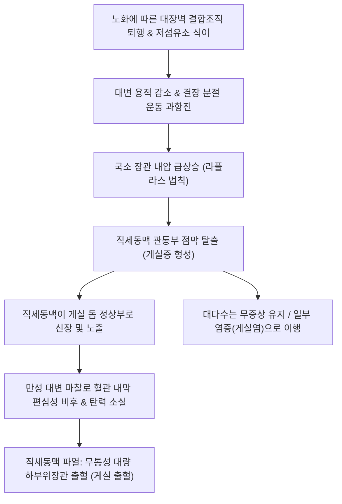
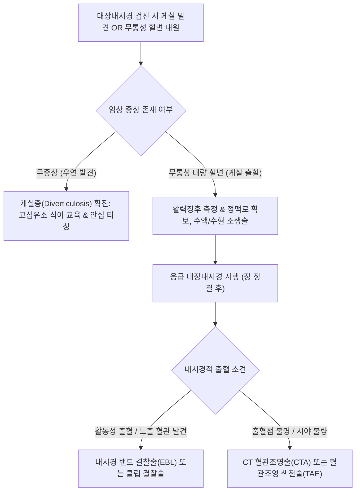

# 🩺 게실증 (Diverticulosis)

> **핵심 3줄 요약 (Key Summary)**:
> - 📍 병소 부위 & 해부·병태생리: 대장벽의 직세동맥(Vasa recta) 관통 결합조직 틈새로 점막 및 점막하층이 낭상으로 탈출하여 근층이 결여된 가성 게실(Pseudodiverticulum)이 다발성으로 존재하는 해부학적 상태.
> - 🚩 전형적 임상 양상: 대다수(80~85%)는 평생 무증상으로 대장내시경 검진 시 우연히 발견되나, 일부에서 간헐적 복부 팽만, 변비, 또는 직세동맥 파열에 의한 무통성 대량 하부위장관 출혈(게실 출혈) 발생.
> - 🛠️ 핵심 검사 & 치료 전략: 대장내시경(게실 형태, 개수, 출혈점 확인), 복부 조영 CT(염증 동반 여부 감별), 고식이섬유 식단(하루 25~35g), 충분한 수분 섭취, 출혈 시 내시경 밴드 결찰술(EBL) 또는 클립 결찰술.
> - ⚠️ 응급 의뢰 레드플래그: 무통성 대량 선홍색/암적색 혈변(혈역학적 불안정, 실신, 쇼크), 급성 복통 및 발열(게실염 또는 천공으로의 이행 의심).

---

## 📌 목차
1. [질환 개요 & 해부학적 병태생리](#1-질환-개요--해부학적-병태생리)
2. [병태생리 메커니즘 & 생체역학적 악순환 네트워크](#2-병태생리-메커니즘--생체역학적-악순환-네트워크)
3. [임상 증상 & 이학적 검사(Physical Exam) 알고리즘](#3-임상-증상--이학적-검사physical-exam-알고리즘)
4. [감별 진단 매트릭스 (Differential Diagnosis)](#4-감별-진단-매트릭스-differential-diagnosis)
5. [한의 통합 치료 프로토콜 (침·약침·추나·한약)](#5-한의-통합-치료-프로토콜-침약침추나한약)
6. [양방 치료 & 병용·의뢰 기준 (Conventional Treatment & Referral)](#6-양방-치료--병용의뢰-기준-conventional-treatment--referral)
7. [재활 운동 & 생활습관 티칭 가이드](#7-재활-운동--생활습관-티칭-가이드)
8. [💡 사용자 진료실 핵심 필기 & 임상 노하우 (Melt-In 잔여 심화 집약)](#8--사용자-진료실-핵심-필기--임상-노하우-melt-in-잔여-심화-집약)
9. [출처 및 학술 참고 문헌 (References)](#9-출처-및-학술-참고-문헌-references)

---

## 1. 질환 개요 & 해부학적 병태생리

### 1) 정의 및 해부학적 특성
[[게실증]](Diverticulosis)은 염증이나 합병증 없이 대장벽에 게실 주머니가 형성되어 존재하는 무증상 또는 단순 잠복 상태를 뜻한다.
- **해부학적 구조**:
  - 대부분의 대장 게실은 점막과 점막하층만 밀려 나온 **가성 게실(Pseudodiverticulum)**이다.
  - 결장벽의 고유근층은 종주근이 세 개의 띠(결장유선, Taeniae coli)로 모여 있고, 장간막 결장유선(Mesenteric taenia)과 비장간막 결장유선(Antimesenteric taenia) 사이로 영양 동맥인 직세동맥(Vasa recta)이 환상근층(Circular muscle)을 관통한다. 이 관통 지점의 결합조직 부위가 선천적·역학적 취약점이 되어 주머니가 형성된다.
- **연령별 유병률**:
  - 노화에 따른 결장벽 콜라겐 및 엘라스틴 섬유의 퇴행성 변화로 40세 미만에서는 5% 미만이나, 60세 이상에서는 30~50%, 80세 이상에서는 60~70%까지 유병률이 급증한다.

### 2) 동양인과 서구인의 해부학적 차이
- **서구형(좌측 게실증)**: S상결장과 하행결장에 집중되며, 근층 비후(Myochosis)와 저섬유소 식이에 의한 내압 상승이 주원인이다.
- **동양형(우측 게실증)**: 맹장과 상행결장에 주로 발생하며, 유전적 소인 및 결합조직 취약성이 주원인으로 작용하여 비교적 젊은 연령층에서도 흔히 발견된다.

![[게실증_01_대장해부구조도해.png|450]]
> [그림 1: ① 대장 해부 구조 — 게실증이 발생하는 상행결장, 횡행결장, 하행결장 및 에스결장(Sigmoid colon)의 해부학적 구조 도해 — 출처: Wikimedia Commons (File:Blausen 0603 LargeIntestine Anatomy.png, CC BY 3.0)]
![[게실증_01_대장게실증육안병리표본.jpg|450]]
> [그림 2: ① 게실증 육안 병리 — 결장 내강을 따라 다발성 주머니 모양 함입구가 형성된 비염증성 대장 게실증(Diverticulosis) 육안 표본 — 출처: Wikimedia Commons (File:Gross pathology of diverticulosis.jpg, CC0)]

---

## 2. 병태생리 메커니즘 & 생체역학적 악순환 네트워크

### 1) 역학적 내압 상승과 게실 출혈의 분자 기전
1. **장관 내압과 게실 형성**:
   - 섬유소 섭취 부족으로 대변의 용적이 작고 굳어지면, 결장은 장 내용물을 추진하기 위해 강력한 분절 수축(Segmentation)을 유발한다.
   - 내압 상승이 지속되면서 직세동맥 진입 부위로 점막이 헤르니아(탈출)된다.
2. **게실 출혈(Diverticular Bleeding)의 발생 기전**:
   - 게실이 장벽 외측으로 돌출될 때, 직세동맥(Vasa recta)은 게실 돔(Dome)의 정상부를 가로질러 주행하게 된다.
   - 관강 내 대변괴의 지속적인 기계적 마찰과 전단 응력(Shear stress)으로 인해 혈관 내막이 편심성 비후(Eccentric intimal thickening)와 중막 박약화(Media thinning)를 겪는다.
   - 결국 혈관벽이 파열되면서 동맥성 대량 출혈이 발생한다. 게실 출혈은 우측 대장 게실에서 더 빈번하며, 성인 하부위장관 출혈 원인의 30~50%를 차지하는 가장 흔한 원인이다.

![[게실증_02_대장게실증전슬라이드조직학.jpg|450]]
> [그림 3: ② 점막 탈출 기전 — 비후된 고유근층(윤상근) 틈새로 점막과 점막하층이 플라스크 형태로 탈출한 대장 게실증 전슬라이드 조직 소견 — 출처: Wikimedia Commons (File:Colon diverticulosis whole slide.jpg, CC BY-SA 3.0)]
![[게실증_02_에스결장장막측게실돌출육안소견.jpg|450]]
> [그림 4: ② 장막측 게실 돌출 — 에스결장 장막면과 복막수(Appendices epiploicae) 사이로 다수의 게실 주머니가 돌출된 육안 병리 소견 — 출처: Wikimedia Commons (File:Diverticula, sigmoid colon.jpg, PD)]

---

## 3. 임상 증상 & 이학적 검사(Physical Exam) 알고리즘

### 1) 임상 증상 스펙트럼
- **무증상기 (80~85%)**:
  - 아무런 증상이 없으며, 건강검진 대장내시경이나 복부 CT에서 우연히 발견됨.
- **경미한 장관 불쾌감**:
  - 만성적인 변비, 간헐적인 가스 팽만감, 묵직한 하복부 불쾌감.
- **게실 출혈(Diverticular Bleeding)**:
  - **무통성(Painless)**: 복통이나 압통 없이 갑작스럽게 쏟아지는 다량의 선홍색(Hematochezia) 또는 적갈색 혈변.
  - 환자는 대변을 보러 화장실에 갔다가 피만 한 바가지 쏟았다고 표현함.
  - 대량 출혈 시 기립성 어지럼증, 식은땀, 빈맥, 실신, 저혈압 유발. 약 70~80%는 자연 지혈되나 20~30%는 재출혈을 일으킴.

### 2) 이학적 검사 및 진단 평가 알고리즘
1. **신체 진찰**:
   - 무증상 게실증: 복부 진찰상 완전히 정상.
   - 게실 출혈 시: 활력징후(혈압, 맥박) 평가가 최우선. 복부는 부드럽고 압통이 없음(무통성이 핵심 감별점). 직장수지검사(DRE)상 신선 혈변 확인.
2. **진단 검사 체계**:
   - **대장내시경(Colonoscopy)**:
     - 게실의 개수, 위치, 입구 형태 확인.
     - 출혈 시 활동성 분출 출혈, 노출 혈관, 부착 혈괴를 확인하고 즉각적인 지혈술 시행.
   - **복부 CT**: 게실염의 동반 유무 확인 및 출혈 시 조영제 유출(Extravasation) 확인.
   - **적혈구 스캔 / 혈관조영술(Angiography)**: 대장내시경으로 출혈점을 찾지 못한 활동성 대량 출혈 환자에서 시행.

![[게실증_03_복부CT다발성게실소견.png|450]]
> [그림 5: ③ 영상 진단 — 복부 CT 축상면에서 에스결장 벽을 따라 다발성 공기 음영 주머니(붉은 화살표)로 관찰되는 대장 게실증 — 출처: Wikimedia Commons (File:DivertDiseaseMark.png, CC BY-SA 4.0)]

---

## 4. 감별 진단 매트릭스 (Differential Diagnosis)

| 감별 질환 | 통증 유무 및 주 증상 | 내시경 및 영상 소견 | 감별 핵심 포인트 |
| :--- | :--- | :--- | :--- |
| [[게실증]] (단순)** | **무증상**, 간혹 변비나 팽만감 | 대장 점막에 다발성 함요(주머니) 관찰 | 염증 소견 없음, 점막 정상 |
| **게실 출혈** | **무통성 대량 혈변**, 복통 없음 | 게실 내강 또는 개구부에서 동맥성 출혈 확인 | 통증이 전혀 없는 돌발성 대량 혈변 |
| [[결장암]] / 직장암** | 배변 습관 변화, 잠혈/소량 혈변, 빈혈 | 대장 내강의 불규칙한 궤양성 융기 종괴 | 대량 출혈보다 만성 소량 출혈 및 체중 감소 |
| **혈관이형성증(Angiodysplasia)** | 무통성 혈변, 고령, 만성 빈혈 | 우측 대장의 거미줄 모양 편평성 확장 혈관 | 주로 맹장/상행결장, 게실 주머니 없이 점막 모세혈관 확장 |
| [[허혈성 대장염]] | **급성 좌하복부 경련통 후 혈변** | 비장곡·하행결장 점막 부종, 청색 미란 | **통증이 선행**한 후 소량 혈변(게실 출혈과 반대) |

---

## 5. 한의 통합 치료 프로토콜 (침·약침·추나·한약)

### 1) 한의 변증 진단 체계
한의학에서 단순 게실증은 [[변비]](便秘), [[비만]](痞滿), [[허증]](虛證)의 범주에 속하며, 게실 출혈은 [[변혈]](便血), [[장풍]](腸風), [[혈변]](血便)의 범주에 해당한다. 대장 진액 부족(腸燥)과 비기허약(脾氣虛弱)으로 인해 장벽의 긴장도가 떨어지는 것이 근본이다.

- **장조진갈·변비불통(腸燥津竭·便秘不通)**: 대변이 양똥처럼 굳고 건조함, 배변 곤란, 구갈, 피로, 설홍소태, 맥세삭.
- **비불통혈·기혈양허(脾不統血·氣血兩虛)**: 비기가 허하여 혈액을 통섭하지 못해 발생하는 무통성 혈변, 안색 창백, 어지럼증, 사지무력, 설담태백, 맥세약무력.
- **대장습열·장락손상(大腸濕熱·腸絡損傷)**: 혈변의 색이 암적색이며 뒤가 묵직함, 설홍태황니.

### 2) 침구 치료 프로토콜
대장 점막의 혈류를 개선하고 진액 분비를 촉진하며, 평활근의 과도한 분절 수축을 완화한다.
- **주요 혈위**: [[천추]](ST25), [[대장수]](BL25), [[상거허]](ST37), [[족삼리]](ST36), [[비수]](BL20), [[지구]](TE6), [[조해]](KI6), [[백회]](GV20).
- **시술 기법**:
  - **윤장통변(潤腸通便)**: [[지구]](TE6) - [[조해]](KI6) 배합으로 신음(腎陰)을 자양하고 진액을 장도로 수송.
  - **대장 기능 정상화**: [[천추]](ST25)와 [[상거허]](ST37)에 평보평사 자침.
  - **비불통혈성 출혈 회복기**: [[은백]](SP1, 뜸 치료), [[백회]](GV20), [[족삼리]](ST36)로 지혈 및 기운 보강.
- **치료 주기**: 주 2~3회, 20분 유침.

### 3) 맞춤 한약 처방
- **마자인환(麻子仁丸) 및 증액탕(增液湯)**: [[마자인]], [[작약]], [[지실]], [[후박]], [[현삼]], [[맥문동]], [[생지황]]. 장관 진액을 보충하고 대변을 부드럽게 윤활시켜 결장 내압 상승을 원천 차단하는 최적의 처방.
- **귀비탕(歸脾湯) 합 황토탕(黃土湯)**: 게실 출혈 후 빈혈 및 만성 출혈 경향 환자에게 비기(脾氣)를 돋우고 통혈(統血) 기능을 정상화하여 지혈 및 조혈 촉진.
- **괴화산(槐花散) 가미방**: [[괴화]], [[측백엽]], [[형개수]], [[지각]]에 [[지유]], [[삼칠근]]을 배합하여 장관 혈락 손상을 청열지혈.

![[게실증_05_대장내시경다발성게실.jpg|450]]
> [그림 6: ⑤ 내시경 확인 및 추적 관리 — 대장내시경에서 장벽 결손부를 따라 원형 함몰구로 관찰되는 다발성 결장 게실 — 출처: Wikimedia Commons (File:Colon diverticulum.jpg, CC BY-SA 4.0)]

---

## 6. 양방 치료 & 병용·의뢰 기준 (Conventional Treatment & Referral)

### 1) 현대의학적 관리 지침
1. **단순 게실증(Diverticulosis)**:
   - 질병이 아닌 '해부학적 변형'임을 설명하여 과도한 불안 해소.
   - 점진적인 고식이섬유 식이(하루 25~35g) 섭취 지도.
   - 변비 완화제(부피형 완하제: 차전자피 등) 활용.
2. **게실 출혈(Diverticular Bleeding)**:
   - **초기 소생술**: 대구경 정맥로 확보, 생리식염수 수액 소생술, 혈색소 <7~8 g/dL 시 농축적혈구 수혈.
   - **응급 대장내시경 지혈술**:
     - **내시경 밴드 결찰술(Endoscopic Band Ligation, EBL)**: 게실 내 출혈 혈관을 주머니째 흡인하여 밴드로 묶는 술식으로 재출혈률이 가장 낮음.
     - 내시경 클립 결찰술(Hemoclip), 에피네프린 국소 주입술.
   - **혈관조영 색전술(Transcatheter Arterial Embolization, TAE)**: 내시경 지혈 실패 시 미세 카테터로 출혈 직세동맥 코일 색전.

### 2) 응급 전원의뢰 기준 (Red Flags)
- **혈역학적 불안정**: 다량의 혈변과 함께 발생하는 저혈압(SBP <90 mmHg), 빈맥(HR >100회/분), 어지럼증, 실신.
- **수혈 요구량 증가**: 수혈에도 불구하고 혈색소 수치가 지속 하강하는 대량 출혈.
- **급성 복통 및 발열 동반**: 무통성이어야 할 게실증에서 급성 통증과 발열이 발생하면 게실염 또는 천공으로의 이행 징후이므로 즉각 복부 CT 의뢰.

---

## 7. 재활 운동 & 생활습관 티칭 가이드

### 1) 장내 압력 완화를 위한 식단
- **고식이섬유 식품군**: 현미, 귀리, 브로콜리, 사과, 버섯, 미역 등 수용성 및 불용성 섬유소를 골고루 섭취.
- **충분한 수분 공급**: 섬유소만 많이 먹고 물을 적게 마시면 오히려 대변이 딱딱해지므로 하루 1.5~2L 이상의 물 섭취 필수.
- **씨앗류 섭취 허용**: 과거 참깨, 토마토 씨앗 등이 게실에 낀다는 속설은 근거가 없음이 밝혀졌으므로 특별히 제한하지 않음.

### 2) 배변 및 생활 습관
- 배변 시 발밑에 15~20cm 높이의 발판(Squatty potty)을 두어 치골직장근을 이완시키고 복압 상승 없이 자연스러운 배변 유도.
- 장시간 앉아있는 습관을 피하고 규칙적인 걷기 운동 실천.

---

## 8. 💡 사용자 진료실 핵심 필기 & 임상 노하우 (Melt-In 잔여 심화 집약)

### 1) 내시경 검진 환자 안심 상담법
- 대장내시경 검사 후 "선생님, 대장에 게실 주머니가 여러 개 생겼다는데 큰 병인가요? 수술해야 하나요?"라며 사색이 되어 묻는 환자가 많다.
- 이때 **"피부에 생기는 주름살처럼 장벽이 나이가 들면서 탄력이 떨어져 생긴 작은 주머니일 뿐입니다. 10명 중 8명은 평생 아무 문제 없이 살아가시니 겁먹으실 필요 전혀 없으며, 변비가 생기지 않도록 물과 채소를 충분히 드시면 됩니다"**라고 안심시키는 것이 최고의 명약이다.

### 2) 무통성 혈변 환자의 대처
- 노인 환자가 "배는 하나도 안 아픈데 대변기 가득 피를 쏟았다"며 한의원에 오면, 치핵(치질)으로 섣불리 단정하지 말고 반드시 게실 출혈 또는 혈관이형성증을 의심하여 즉시 대장내시경이 가능한 병원으로 의뢰해야 한다.

---

## 9. 출처 및 학술 참고 문헌 (References)

- Nallapeta NS et al. (2023). Diverticulosis. *StatPearls Publishing*. PMID: 28613522.
   - **[연구 요약]**: 대장 게실증의 역학, 직세동맥 관통부의 해부학적 취약점, 라플라스 법칙에 기반한 내압 상승 메커니즘 및 무증상기 생활습관 관리 지침을 기술함.
- Meine GC, Santo P, Delgado LM. (2026). Endoscopic therapies for colonic diverticular bleeding: a systematic review and meta-analysis. *Surg Endosc*. 40(2):412-426. PMID: 41466134.
   - **[연구 요약]**: 대장 게실 출혈 환자에서 내시경 밴드 결찰술(EBL)과 클립 결찰술(Hemoclip)의 조기 지혈 성공률과 장기 재출혈 예방 효과를 비교 메타분석함.
- Ichita C, Kishino T, Aoki T. (2026). Updated evidence on epidemiology, diagnosis, and treatment for colonic diverticular bleeding. *DEN Open*. 6(1):e70034. PMID: 40330864.
   - **[연구 요약]**: 대장 게실 출혈의 최신 역학적 추이, 긴급 대장내시경 진단 접근법, 내시경적 지혈술 및 혈관조영 색전술(TAE)의 다학제 치료 알고리즘을 제시함.
