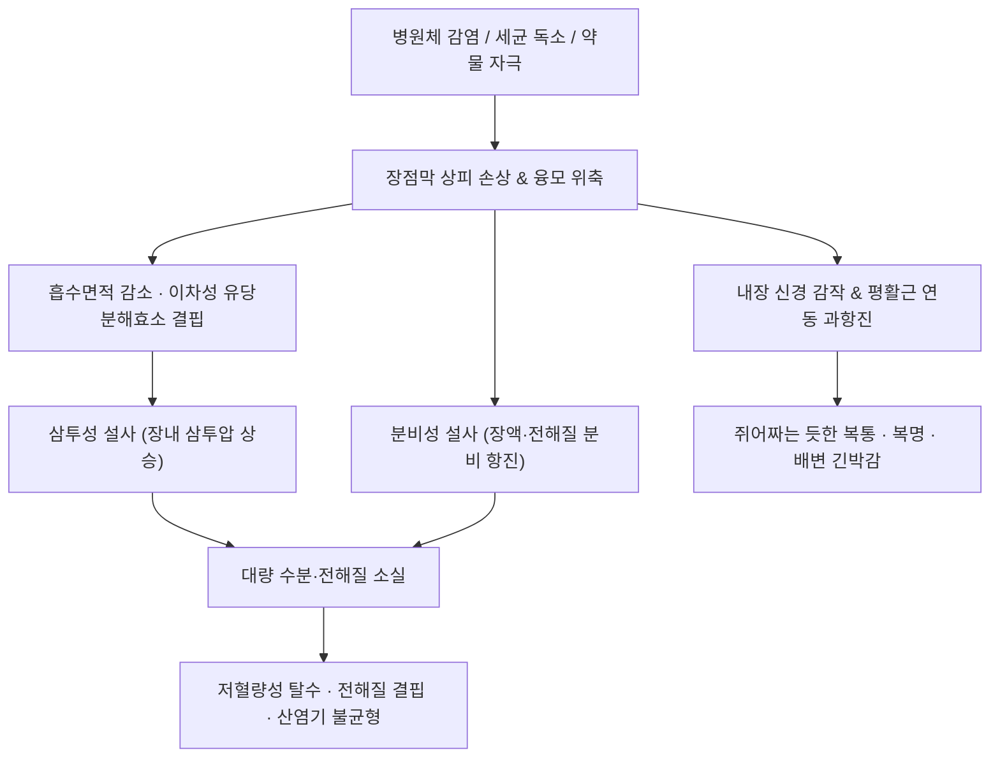
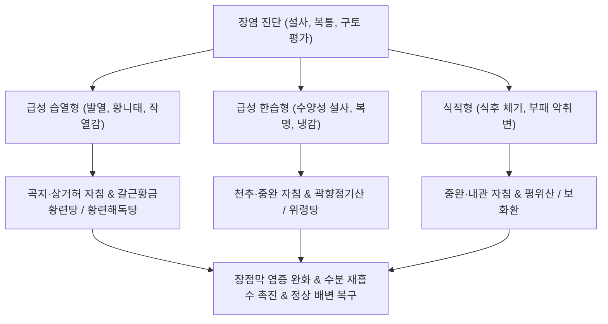

# 장염 (Enteritis / 腸炎, ICD-10 A09 · A08 · K52.9)

> **상위 분류**: [[소화기 질환]] > 하부위장관 질환 > 급성 감염성 장염
> **핵심 3줄 요약 (Key Summary)**:
> - 📍 병소 부위 & 해부·병태생리: 소장(십이지장·공장·회장) 및 대장 점막의 염증으로, 상피세포 손상 → 융모 위축 → 흡수면적 감소(소장 융모, 미세융모)와 장액·전해질 분비 증가가 동시에 일어나 **삼투성 + 분비성 설사**가 혼합되어 나타난다. 장운동 항진과 내장 감각 과민(장근층신경총, 점막하신경총, 미주신경)이 복통·연축의 기원이다.
> - 🚩 전형적 임상 양상 & 3대 징후: **[[설사]](수양성/혈성) · [[급성 복통|복통]](배꼽주위 또는 하복부) · 구역·구토**가 3대 주소증이며, 여기에 발열·식욕부진·탈수 징후(구강건조, 소변량 감소, 기립성 어지럼)가 동반된다.
> - 🛠️ 핵심 감별 검사 & 한·양방 다각적 치료 전략: 복부 시진–청진–타진–촉진 순서의 복부 이학적 검사, 탈수 평가, CBC/CRP/전해질, 대변 배양·PCR이 핵심. 한의학적으로는 습열·한습·식적·비위허약 변증에 따라 침([[중완(CV12)|중완]], [[천추(ST25)|천추]], [[족삼리(ST36)|족삼리]], 상거허, [[음릉천(SP9)|음릉천]]) + 약침 + 복부 수기 + 한약([[곽향정기산]], [[갈근금련탕]], [[삼령백출산]] 등)을 통합 적용한다.
> - ⚠️ 응급 의뢰 레드플래그 & 악화 요인: 혈변·흑색변, 고열(38.5℃ 이상 지속), 반발통·방어성 긴장 등 복막자극징후([[복막염]]), 담즙성/분변성 구토([[장폐색]]), 12시간 이상 소변 정지, 의식 변화·경련, 심한 탈수. **혈성 설사·발열 동반 시 지사제(로페라마이드 등) 임의 복용 절대 금지**.

---

## 📌 목차
1. [질환 개요 & 해부학적 병태생리](#1-질환-개요--해부학적-병태생리)
2. [병태생리 메커니즘 & 생체역학적 악순환 네트워크](#2-병태생리-메커니즘--생체역학적-악순환-네트워크)
3. [임상 증상 & 이학적 검사(Physical Exam) 알고리즘](#3-임상-증상--이학적-검사physical-exam-알고리즘)
4. [감별 진단 매트릭스 (Differential Diagnosis)](#4-감별-진단-매트릭스-differential-diagnosis)
5. [한의 통합 치료 프로토콜 (침·약침·추나·한약)](#5-한의-통합-치료-프로토콜-침약침추나한약)
6. [양방 치료 & 병용·의뢰 기준 (Conventional Treatment & Referral)](#6-양방-치료--병용의뢰-기준-conventional-treatment--referral)
7. [재활 운동 & 생활습관 티칭 가이드](#7-재활-운동--생활습관-티칭-가이드)
8. [💡 사용자 진료실 핵심 필기 & 임상 노하우 (Melt-In 잔여 심화 집약)](#8--사용자-진료실-핵심-필기--임상-노하우-melt-in-잔여-심화-집약)
9. [출처 및 학술 참고 문헌 (References)](#9-출처-및-학술-참고-문헌-references)

---

## 1. 질환 개요 & 해부학적 병태생리

- **질환 정의 및 분류**:
  - **장염(enteritis)** 은 위장관, 그중에서도 **소장(십이지장·공장·회장)** 및 **대장** 점막에 염증이 발생한 상태를 통칭한다. 위 점막까지 함께 침범하면 **위장관염(gastroenteritis)** 이라 부르며, 임상에서는 두 용어가 거의 혼용된다.
  - **원인별 분류**:
    - 감염성: 바이러스성(노로바이러스, 로타바이러스, 아데노바이러스), 세균성(살모넬라, 캄필로박터, 시겔라, 병원성 대장균), 기생충성.
    - 비감염성: 약물성(NSAIDs, 항생제), 방사선성, 염증성 장질환([[궤양성 대장염]]·[[크론병]])(궤양성 대장염, 크론병), 허혈성, 호산구성 장염.
  - **경과별 분류**: 급성(14일 미만, 대부분 바이러스 및 식중독성) / 지속성(14~30일) / 만성(30일 이상).
- **관련 해부학적 구조물**:
  - **소화관 벽 구조**: 점막(상피–고유판–점막근육판) → 점막하층 → 근층(윤상근·종주근) → 장막. 염증은 주로 점막·점막하층에서 시작된다.
  - **흡수 단위**: 소장 융모(villi)와 그 표면의 미세융모(brush border)가 흡수 표면적의 대부분을 담당한다. 성숙 융모 상피세포가 바이러스 등에 의해 손상되면 흡수 표면적이 급감하고, 음와(crypt) 세포의 분비가 상대적으로 항진되어 **흡수 저하와 분비 항진**이 동시에 일어난다.
  - **부위별 특징**: 십이지장(담즙·췌액 중화), 공장(영양소 흡수의 중심), 회장(담즙산·비타민 B12 재흡수).
  - **신경 조절계**: 미주신경(부교감)과 장벽 내 점막하신경총(Meissner) · 장근층신경총(Auerbach)이 국소 연동 반사를 담당한다.

---

## 2. 병태생리 메커니즘 & 생체역학적 악순환 네트워크

### 1) 병태생리학적 손상 기전
- **바이러스성 장염**: 장 상피세포 내로 침입하여 세포 융해와 융모 위축을 초래함. 흡수 면적이 급감하고 미세융모 브러시보더의 이당류 분해효소(특히 락타아제)가 파괴되어 이차성 유당불내증과 삼투성 설사가 발생함.
- **세균성 장염**: 장독소(Enterotoxin)에 의해 cAMP/cGMP 경로가 활성화되어 전해질 분비가 폭증하거나(비침습형), 장점막 상피 전층을 직접 침범하여 궤양과 점액혈변을 유발함(침습형).
- **내장 감각 과민**: 국소 염증 매개체(세로토닌, 프로스타글란딘, 히스타민)가 장벽 내 구심성 신경을 감작시켜 사소한 장관 팽창에도 심한 복통과 긴박감을 느끼게 됨.

---

## 3. 임상 증상 & 이학적 검사(Physical Exam) 알고리즘

### 1) 주요 임상 증상
- **[[설사]]**: 급성 수양성 설사(바이러스·독소성) 또는 점액혈변(침습성 세균).
- **[[급성 복통|복통]]**: 배꼽 주위 또는 하복부의 간헐적인 쥐어짜는 산통. 배변 후 일시적으로 완화되는 경향.
- **오심 및 구토**: 위장관 전반의 역연동으로 초기에 빈발.
- **탈수 징후**: 구강 점막 건조, 피부 긴장도 저하, 소변량 감소, 기립성 어지럼증.

### 2) 필수 이학적 검사법 (Physical Examination)
- **복부 청진 (Auscultation)**: 반드시 촉진 전에 시행. 장음이 분당 30회 이상으로 매우 항진되어 있거나 고음의 물소리 청진.
- **복부 촉진 (Palpation)**: 복부 전반의 경미한 미만성 압통. (※ 우하복부 국소 압통은 충수염, 반발통 및 판자상 강직은 복막염 의심).
- **탈수 평가 세트**: 활력징후(맥박수, 기립성 혈압 변화), 피부 긴장도(Turgor), 모세혈관 재충만 시간(CRT).

---

## 4. 감별 진단 매트릭스 (Differential Diagnosis)

| 감별 질환 | 호발 병소 및 원인 | 주소증 차이점 | 특이적 이학적 검사 소견 |
| :--- | :--- | :--- | :--- |
| **[[장염]] (본 질환)** | 소장·대장 점막, 바이러스·세균·독소 | 수양성/혈성 설사, 배꼽주위 산통, 구역 | 복부 미만성 압통, 장음 항진, 탈수 징후 |
| **[[급성 충수염]]** | 충수 돌기 폐쇄·감염 | 통증이 배꼽 주위에서 우하복부로 이동 | McBurney 점 압통, Rovsing 징후 양성 |
| **염증성 장질환([[궤양성 대장염]]·[[크론병]])** | 대장·소장, 자가면역성 만성 염증 | 만성 점액혈변, 야간 설사, 체중감소 | 직장수지검사 혈변 흔적, 빈혈 소견 |
| **[[과민성 장 증후군]]** | 기질적 병변 없음, 뇌-장축 이상 | 배변 후 호전되는 복통, 야간 증상 없음 | 발열·탈수·혈변 없음, 전신 상태 양호 |
| **[[장폐색]]** | 수술 후 유착, 탈장, 종양 | 복부 팽만, 분변성 구토, 가스 배출 정지 | 초기 금속성 장음, 후기 장음 소실 |

---

## 5. 한의 통합 치료 프로토콜 (침·약침·추나·한약)

한의학에서 장염은 설사(泄瀉), 복통(腹痛), 구토(嘔吐)의 범주에 속하며, 습열(濕熱), 한습(寒濕), 식적(食積), 비위허약(脾胃虛弱)으로 변증한다.

### 1) 침구 치료 (Acupuncture)
- **급성기 배혈**:
  - [[중완(CV12)|중완]], [[천추(ST25)|천추]]: 위와 대장의 모혈로서 장관 연동 이상을 안정시키고 복통 완화.
  - [[족삼리(ST36)|족삼리]], 상거허(ST37): 위경의 하합혈로서 장관 점막 혈류를 개선하고 염증성 삼출 억제.
  - [[내관]](PC6), 공손(SP4): 오심과 구토를 억제하는 팔맥교회혈.
  - [[음릉천(SP9)|음릉천]], [[곡지(LI11)|곡지]]: 장내 습열 독소를 사하고 수분을 분리 배출.
- **만성·허한기 온구 요법**:
  - 배가 차고 묽은 변을 자주 보는 환자에게 관원(CV4)과 신궐(CV8)에 온침 및 뜸 치료를 병행.

### 2) 약침 요법
- **황련해독탕 약침**: 급성 발열성 습열 장염 환자의 천추(ST25)와 족삼리(ST36)에 각 0.2~0.3 cc 주입하여 점막 부종 해소.

### 3) 한약물 요법
- **급성 습열(濕熱) 장염**: [[갈근금련탕]](葛根芩連湯) 또는 [[황련해독탕]](黃連解毒湯) 가미.
- **서습(暑濕) 및 식중독성 장염**: [[곽향정기산]](藿香正氣散) (구토와 설사가 겹치는 위장관염의 제1명방).
- **식적(食積)성 장염**: [[평위산]](平胃散) 또는 보화환(保和丸).
- **만성 비위허약(脾胃虛弱) 장염**: [[삼령백출산]](蔘苓白朮散) 또는 향사육군자탕.

---

## 6. 양방 치료 & 병용·의뢰 기준 (Conventional Treatment & Referral)

### 1) 표준 약물 치료 (Medical Management)
- **수액 및 전해질 공급 (Rehydration, 핵심 치료)**:
  - 경증~중등도: 경구 수액 용액(ORS)을 소량씩 자주 복용하도록 지도.
  - 중증 탈수: 정맥 결정질 수액(하트만액, 0.9% 생리식염수)을 신속 투여.
- **진토제 (Antiemetics)**:
  - 심한 구역·구토로 경구 수액 복용이 불가능한 경우 Ondansetron (4~8mg 경구붕해정 또는 정맥주사)을 투여하여 구토를 신속히 억제하고 경구 섭취를 유도.
- **지사제 (Antidiarrheals) 적응증과 주의사항**:
  - **Racecadotril (100mg tid)**: 장운동 억제 없이 장액 분비만 차단하므로 안전하게 활용 가능.
  - **Diosmectite (스멕타 3g tid)**: 장내 점막을 도포하고 세균 및 독소를 흡착하여 배출.
  - **Loperamide 주의**: 단순 비감염성 또는 경증 여행자 설사에는 유효하나, **발열 또는 혈변이 동반된 침습성 세균 장염에는 사용 절대 금기** (독소 저류 및 중독성 거대결장 유발).
- **항생제 요법**:
  - 대부분의 바이러스성 장염에는 항생제를 투여하지 않음. 면역저하자, 고령자, 중증 패혈증 징후 또는 세균 배양 양성 확인 시에 한해 Ciprofloxacin (500mg bid) 또는 Azithromycin (500mg qd) 투여.

### 2) 한·양방 병용 판단 기준 (Combination Therapy)
- 급성기 탈수 방지를 위해 양방 경구 수액 요법(ORS)을 적극 시행하면서, 한의 곽향정기산 및 침구(천추, 족삼리) 치료를 병용하면 설사 기간 단축 및 복부 산통 완화에 탁월한 시너지를 발휘함.
- **주의**: 스멕타(Diosmectite) 등 흡착성 지사제 복용 시 한약 성분도 함께 흡착될 수 있으므로 **최소 2시간의 복용 간격**을 유지함.

### 3) 양방·전문과 긴급 의뢰 기준 (Referral Criteria)
- 38.5℃ 이상의 고열이 48시간 이상 지속되는 경우.
- 육안적 점액혈변 또는 흑색변 배출.
- 복부 촉진 시 명확한 반발통 및 복벽 강직 등 복막 자극 징후 동반 시 ([[복막염]] 의심).
- 담즙성 또는 분변성 구토 및 가스 배출의 완전 정지 ([[장폐색]] 의심).
- 12시간 이상의 소변 정지, 기립성 실신, 혼미 등 중증 저혈량성 쇼크 징후 발생 시 즉시 종합병원 응급의료센터로 전원.

---

## 7. 재활 운동 & 생활습관 티칭 가이드

- **수분·전해질 보충 (1순위)**:
  - 소량씩 자주(5–10분 간격) 섭취. 맹물만 다량 섭취 시 저나트륨혈증이 유발될 수 있으므로 ORS나 이온 음료를 희석하여 음용.
- **식이 전개 단계**:
  - 급성기 24시간: 미음, 쌀죽 등 저자극·저잔사식.
  - 회복기: 바나나, 죽, 토스트 중심 식사.
  - 설사 회복 후에도 1~2주간은 유제품(이차성 유당불내증 예방), 카페인, 기름진 음식, 매운 음식을 철저히 배제.
- **복부 안정 및 온열 요법**:
  - 배가 차고 묽은 변을 보는 경우 복부 온찜질 15분 적용 (※ 발열 및 혈변 동반 시에는 온찜질 금기).
- **철저한 손 씻기**:
  - 화장실 이용 후, 식사 전 비누로 30초 이상 흐르는 물에 손 씻기 (가족 간 2차 전파 차단).

---

## 8. 💡 사용자 진료실 핵심 필기 & 임상 노하우 (Melt-In 잔여 심화 집약)

### 1) 실전 문진 체크리스트 (내원 3분 안에 확인)
1. **"언제부터였나요? 하루에 몇 번 보시나요?"** — 48시간 이내 = 급성 감염성 가능성↑, 2주 이상 = 만성·기질적 원인 재검토.
2. **"변에 피가 섞였나요? 검은 변이었나요?"** — 혈변은 지사제 금기 + 외과적 의뢰 트리거.
3. **"열이 있었나요? 체온은 몇 도였나요?"** — 38.5℃ 이상 지속은 침습성 감염 시사.
4. **"최근 항생제를 드셨나요? 입원하신 적 있나요?"** — C. difficile 및 원내 감염 스크리닝.
5. **"최근 여행·외식·단체 급식·회식이 있었나요?"** — 집단 발생 및 식중독 독소성 원인.
6. **"지금 소변은 잘 나오나요? 어지럽지는 않으세요?"** — 탈수 중증도 즉시 평가 (소변 정지 = 응급 수액 필요).
7. **"무엇을 먹으면 더 심해지나요?"** — 유제품 악화 시 이차성 유당불내증 의심.

### 2) 치료 순서 및 손맛 노하우
- **복부 촉진은 반드시 청진 후**: 장음이 항진되어 있으면 장염·초기 폐색, 들리지 않으면 마비성 장마비·복막염으로 방향을 잡는다. 장음 소실 상태에서 복부 심부 수기는 절대 금기.
- **자침 순서는 원위부 → 국소부**: 먼저 사지의 ST36·SP9·LI4·PC6로 전신 반응을 유도하고, 이후 복부혈(CV12·ST25)에 자침하면 복통·긴박감 반응이 부드러워진다.
- **급성기 복부혈 자극은 '얕게, 짧게'**: 급성 설사·구역이 심한 환자에서는 CV12·ST25를 깊게 자극하면 복통이 오히려 증가할 수 있으므로 얕은 직침과 10분 내외의 짧은 유침으로 시작한다.
- **약침 주입 각도**: ST25는 복직근을 통과하므로 피부에 대해 90° 직자, 주입 전 흡인(aspiration) 후 소량씩 주입한다.

### 3) 환자 티칭 스크립트 (그대로 읽어주는 멘트)
- **탈수 설명**: "설사는 물만 잃는 게 아니라 전해질도 같이 잃습니다. 맹물만 드시면 더 어지러울 수 있으니 이온 보충 음료나 끓인 죽물을 조금씩 자주 드셔야 합니다."
- **식이 설명**: "지금 장 점막이 손상된 상태라 우유, 커피, 기름진 음식은 회복을 늦춥니다. 최소 1~2주간 유제품을 쉬어주세요."
- **지사제 주의**: "열이 나거나 피가 섞인 변에 시중 지사제를 임의로 드시면 독소가 장 안에 갇혀 더 위험해질 수 있습니다."

---

## 9. 출처 및 학술 참고 문헌 (References)

1. Flynn TG, Olortegui MP. (2024). Viral gastroenteritis. *Lancet*, 403(10430):961-974. [PMID: 38340741](https://pubmed.ncbi.nlm.nih.gov/38340741/)
   - [연구 요약]: 바이러스성 위장관염의 최신 역학, 병태생리, 진단 검사, 경구 재수화 요법 및 예방 전략을 집대성한 세미나 리뷰.
2. Abbas A, Zimmer AJ. (2021). Viral Enteritis in Solid-Organ Transplantation. *Viruses*, 13(10):1999. [PMID: 34696449](https://pubmed.ncbi.nlm.nih.gov/34696449/)
   - [연구 요약]: 고형 장기 이식 수혜자 및 면역저하자에서 발생하는 바이러스성 장염의 임상적 특성, 진단 및 치료 프로토콜 고찰.
3. Fry RD. (1990). Infectious enteritis. A collective review. *Dis Colon Rectum*, 33(6):520-527. [PMID: 2190764](https://pubmed.ncbi.nlm.nih.gov/2190764/)
   - [연구 요약]: 감염성 장염의 원인체 스펙트럼, 임상 양상, 감별 진단 및 치료적 접근을 체계화한 고전적 종합 종설.
