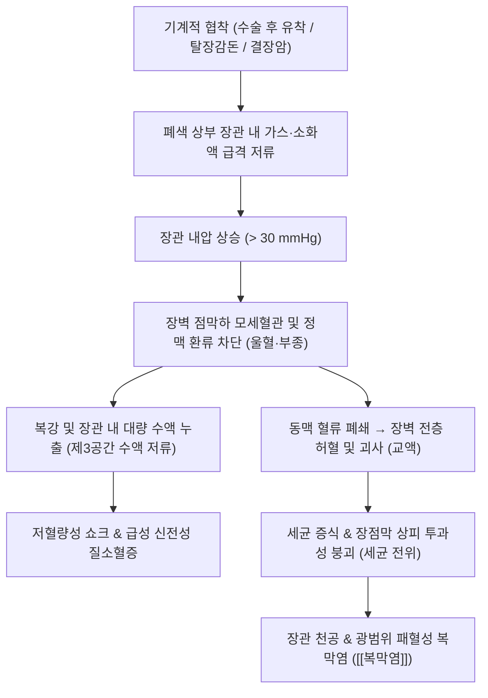

# 장폐색 (Bowel Obstruction / Ileus, 腸閉塞, K56)

> **상위 분류**: [[소화기 질환]] > 하부위장관 질환 > 장관 통과 장애
> **핵심 3줄 요약 (Key Summary)**:
> - 📍 병소 부위 & 해부·병태생리: 장관 내강의 물리적 협착(장유착, 탈장 감돈, 종양, [[장중첩증]], 장축염전)으로 인한 **기계적 장폐색(Mechanical Obstruction)**과, 복막염·저칼륨혈증·복부 수술 후 자율신경 반사 장애로 연동운동이 소실된 **마비성 장폐색(Paralytic Ileus)**으로 분류됨. 폐색 상부 장관 팽창, 내압 상승으로 인한 장벽 허혈, 천공 위험 초래.
> - 🚩 전형적 임상 양상 & 3대 징후: 발작성 산통(Cramping abdominal pain), 오심 및 분변성 구토([[구토]]), 복부 팽만(Abdominal distension), 방귀와 대변의 완전 정지(Obstipation).
> - 🛠️ 핵심 감별 검사 & 한·양방 다각적 치료 전략: 기립위 복부 단순 X선(다발성 공기-액체층 계단상 배열), 복부 조영 CT, 비위관(L-tube) 감압 및 수액 공급, 장마비 회복기 비수(BL20)·대장수(BL25)·[[천추(ST25)|천추]]·[[족삼리(ST36)|족삼리]] 침구 및 [[대승기탕]](大承氣湯), 후박삼물탕(厚朴三物湯), [[대건중탕]](大建中湯) 변증 투약.
> - ⚠️ 응급 의뢰 레드플래그 & 악화 요인: 지속적인 격통(산통에서 지속통으로 전환), 발열, 백혈구 증가, 반발통 및 판자양 복벽 경직([[복막염]]) 등 교액성 장폐색(Strangulation) 및 장관 괴사 징후 시 지체 없이 응급 개복 수술 의뢰.

---

## 📌 목차
1. [질환 개요 & 해부학적 병태생리](#1-질환-개요--해부학적-병태생리)
2. [병태생리 메커니즘 & 생체역학적 악순환 네트워크](#2-병태생리-메커니즘--생체역학적-악순환-네트워크)
3. [임상 증상 & 이학적 검사(Physical Exam) 알고리즘](#3-임상-증상--이학적-검사physical-exam-알고리즘)
4. [감별 진단 매트릭스 (Differential Diagnosis)](#4-감별-진단-매트릭스-differential-diagnosis)
5. [한의 통합 치료 프로토콜 (침·약침·추나·한약)](#5-한의-통합-치료-프로토콜-침약침추나한약)
6. [양방 치료 & 병용·의뢰 기준 (Conventional Treatment & Referral)](#6-양방-치료--병용의뢰-기준-conventional-treatment--referral)
7. [재활 운동 & 생활습관 티칭 가이드](#7-재활-운동--생활습관-티칭-가이드)
8. [💡 사용자 진료실 핵심 필기 & 임상 노하우 (Melt-In 잔여 심화 집약)](#8--사용자-진료실-핵심-필기--임상-노하우-melt-in-잔여-심화-집약)
9. [출처 및 학술 참고 문헌 (References)](#9-출처-및-학술-참고-문헌-references)

---

## 1. 질환 개요 & 해부학적 병태생리

- **개념 정의 및 분류 체계**:
  - [[장폐색]](Bowel Obstruction / Ileus, 腸閉塞)은 장관 내용물(소화액, 유미즙, 가스)이 항문 방향으로 정상적으로 이동하지 못하고 장내에 정체되는 모든 병태를 총칭한다.
  - **기계적 장폐색 (Mechanical Obstruction)**: 장관 내강이 물리적으로 막힌 상태. 단순 폐색(혈행 장애 없음)과 장간막 혈관이 함께 압박되어 괴사 위험이 있는 **교액성 장폐색(Strangulated obstruction)**으로 구분됨.
  - **마비성/신경성 장폐색 (Paralytic / Functional Ileus)**: 물리적 폐색 없이 평활근 연동운동 장애로 발생. 복부 수술 후(Postoperative ileus), [[복막염]], 복강 내 출혈, [[저칼륨혈증]], 요독증, 항콜린제·오피오이드 약물에 의해 유발됨.
- **해부학적 호발 원인**:
  - **소장 폐색 (SBO, 약 80%)**: 이전 복부 수술 후 발생한 **장관 유착(Adhesion, 60~70%)**, 탈장 감돈(Incarcerated hernia, 15~20%), [[크론병]] 협착, 소장 종양, [[장중첩증]].
  - **대장 폐색 (LBO, 약 20%)**: [[대장암]](Colon cancer, 60%), S자 결장 장축염전증(Sigmoid volvulus, 15~20%), 게실염 협착.

---

## 2. 병태생리 메커니즘 & 생체역학적 악순환 네트워크

### 1) 장관 확장과 제3공간 수액 손실
- 폐색 근위부 장관으로 삼킨 공기(70%)와 세균 발효 가스(30%), 그리고 하루 8~10L에 달하는 위액·담즙·췌장액·소장액이 저류됨.
- 장내압이 상승하여 20~30 mmHg를 초과하면 점막의 수분 흡수 능력이 상실되고 오히려 장벽에서 내강으로 수분이 삼출됨. 복강 내로 혈장 성분이 대량 유출되는 **제3공간(Third space) 수액 저류**로 심각한 탈수와 저혈량증이 초래됨.

### 2) 교액(Strangulation)과 천공의 위험성
- 장관이 염전(Volvulus)되거나 탈장낭에 감돈(Incarceration)되면 장간막 혈관(SMA/SMV 분지)이 조여져 정맥 울혈 후 동맥 허혈로 급격히 진행함.
- 장점막 장벽이 붕괴되어 혐기성 세균독소가 혈류로 유입되고, 허혈성 괴사가 진행되면 장벽 천공 및 치명적인 패혈증으로 사망률이 30% 이상 치솟음.

---

## 3. 임상 증상 & 이학적 검사(Physical Exam) 알고리즘

### 1) 4대 주소증 (Cardinal Signs)
1. **복부 산통 (Cramping Abdominal Pain)**: 수분 간격으로 격렬하게 쥐어짜듯 찾아오는 산통. 폐색 부위가 높을수록(상부 소장) 주기가 짧고 격렬함. (※ 산통이 사라지고 둔하고 지속적인 격통으로 바뀌면 장괴사·교액 의심).
2. **오심 및 구토 ([[구토]])**: 근위부 폐색일수록 초기부터 담즙 섞인 구토가 심하고, 원위부 소장 및 대장 폐색은 후기에 악취가 심한 **분변성 구토물(Feculent vomitus)**을 배출.
3. **복부 팽만 (Distension)**: 원위부 폐색일수록 장관 전체가 팽창하여 북처럼 팽팽해짐.
4. **가스 및 배변 정지 (Obstipation)**: 폐색 하부의 잔여 대변이 배출된 이후 완전한 방귀(Flatus)와 대변 배출 정지.

### 2) 이학적 진찰 및 복부 청진
- **청진 (Auscultation)**:
  - 기계적 폐색 초기: 장운동이 항진되어 고음의 금속성 장음(High-pitched metallic tinkling sound)과 꿀렁거리는 물소리(Borborygmi) 청진.
  - 마비성 장폐색 또는 괴사 후기: 장음이 완전히 소실된 침묵의 복부(Silent abdomen).
- **시진 및 촉진 (Palpation)**:
  - 복부 수술 흉터 확인 (유착성 폐색의 결정적 단서).
  - 서혜부 및 대퇴부 촉진 (감돈된 탈장 배제 필수).
  - 복벽 압통, 반발통, 근성 방어(Rigidity) 확인 시 즉각적 외과 수술 적응증.

---

## 4. 감별 진단 매트릭스 (Differential Diagnosis)

| 감별 항목 | **기계적 장폐색 (Mechanical)** | **마비성 장폐색 (Paralytic Ileus)** | **급성 장간막 허혈증 (AMI)** |
| :--- | :--- | :--- | :--- |
| **주요 원인** | 수술 후 유착, 탈장 감돈, 종양, 축염전 | 복부 수술 후, 복막염, 저칼륨혈증, 약물 | 심방세동 혈전, 동맥경화성 색전증 |
| **복통 양상** | 주기적인 격렬한 발작성 산통 (Colic) | 둔하고 막연한 복부 팽만감, 둔통 | **진찰 소견에 비해 터무니없이 극심한 격통** |
| **복부 장음** | **항진**, 금속성 고음 (Metallic tinkling) | **완전 소실 또는 현저한 감소** | 초기 정상, 후기 괴사 시 소실 |
| **X-선 소견** | 소장 국한 공기-액체층, 결장 가스 소실 | 위·소장·대장 전반에 걸친 가스 팽창 | 초기 정상, 후기 장벽 비후 및 기종 |
| **외과 수술** | 비수술 호전 없을 시 수술적 유착박리 | **보존적 수액·전해질 교정 (비수술)** | **즉시 응급 혈관 재개통술 / 장절제** |

---

## 5. 한의 통합 치료 프로토콜 (침·약침·추나·한약)

> ⚠️ **절대적 응급 원칙**: 감돈성 탈장, 장축염전증, 장관 괴사 의심 소견(교액성 폐색) 환자는 즉시 외과적 개복 수술을 시행해야 하며 침구·약물 치료의 대상이 아님. 한의 치료는 **불완전 단순 유착성 장폐색의 보존적 치료기** 및 **수술 후 마비성 장폐색(Postoperative Ileus, POI)의 조기 회복 촉진**을 목표로 함.

### 1) 침구 치료 (Acupuncture)
- **주혈**: [[족삼리(ST36)|족삼리]], 상거허(ST37), [[천추(ST25)|천추]], [[중완(CV12)|중완]], 대장수(BL25).
  - **[[족삼리(ST36)|족삼리]]·상거허(ST37)**: 위경의 하합혈로서 장관 평활근의 카할간질세포(ICC) 자율박동을 촉진하고 미주신경-부교감 경로를 활성화하여 장관 연동 반사를 촉진 (수술 후 첫 배가스 배출 시간 단축 입증).
  - **[[천추(ST25)|천추]]**: 대장의 모혈(募穴)로 복부 혈행을 개선하고 장관 팽만을 완화.
- **침전기자극술 (Electroacupuncture, EA)**:
  - 족삼리(ST36) - 상거허(ST37) 양측에 2/100 Hz 연파(Dense-disperse wave)를 30분간 인가하여 장마비 회복을 가속화.

### 2) 변증별 한약 치료 (Herbal Medicine)
- **부실열결 (腑實熱結) / 기계적 통도 폐색**:
  - 병태: 복통창만, 대변불통, 거안(손을 못 대게 함), 조열, 설홍태황조, 맥 침실유력.
  - 치법: 사열통부(瀉熱通腑), 탕척해독(蕩滌解毒).
  - 처방: **[[대승기탕]] (大承氣湯)** 또는 **후박삼물탕 (厚朴三物湯)**.
  - 약재 구성: [[대황]] 12g, [[망초]] 9g, [[후박]] 15g, [[지실]] 12g.
- **한응기체 (寒凝氣滯) / 마비성 복부냉통**:
  - 병태: 배가 차고 팽팽하게 불러오르며, 산통 발작, 설태 백니, 맥 침현.
  - 치법: 온중산한(溫中山寒), 행기통부(行氣通腑).
  - 처방: **[[대건중탕]] (大建中湯)** 또는 **온비탕 (溫脾湯)**.
  - 약재 구성: 화초(천초), [[건강]], [[인삼]], 교이. 장관 미세혈류를 개선하고 연동운동을 촉진하여 수술 후 장마비를 단축.

---

## 6. 양방 치료 & 병용·의뢰 기준 (Conventional Treatment & Referral)

### 1) 초기 보존적 감압 요법 (Conservative Management, 제1원칙)
- **금식(NPO) 및 비위관(L-tube) 흡인 감압**:
  - 단순 유착성 소장 폐색의 약 70~80%는 비위관 감압과 수액 공급만으로 48~72시간 내 호전됨.
  - 비위관을 거치하여 위액과 삼킨 공기를 지속 흡인함으로써 근위부 장관 내압을 낮추고 장벽 관류를 회복시킴.
- **적극적 수액 및 전해질 소생술 (IV Fluid Resuscitation)**:
  - 제3공간 체액 저류와 구토로 인한 탈수를 교정하기 위해 대량의 등장성 결정질 수액(하트만액, 생리식염수)을 투여하고 전해질(K+, Cl-) 결핍을 신속 교정.
- **수용성 조영제(Gastrografin) 검사 및 치료**:
  - 비위관을 통해 수용성 조영제를 주입하고 4~24시간 후 복부 X-선 추적 검사를 시행. 조영제가 결장에 도달하면 비수술적 치료 성공을 의미하며, 고삼투압성 특성으로 부종을 흡수하여 폐색 해제를 촉진.
- **약물 주의사항**:
  - 마약성 진통제(Opioids)는 장관 운동을 심각하게 마비시키므로 가급적 사용을 제한하고 비마약성 진통제를 투여.

### 2) 외과적 응급 수술 적응증 (Surgical Indication)
- **교액성 장폐색 (Strangulated Obstruction) 의심 소견**:
  - 주기적 산통에서 지속적 격통으로의 전환.
  - 체온 상승(> 38℃), 빈맥(> 100회/분), 백혈구 증가증(Leukocytosis > 15,000/μL).
  - 복벽의 국소적 또는 미만성 반발통 및 판자상 근성 방어.
  - 복부 CT상 장벽 조영 증강 결손, 장간막 울혈 및 액체 저류, 장벽 기종(Pneumatosis intestinalis), 문맥 가스 소견 출현 시 **즉시 응급 개복술/복강경술(유착박리술 또는 괴사장 절제술)** 시행.
- **보존적 치료 실패**: 완전 기계적 폐색 환자가 48~72시간의 감압 치료에도 가스 배출이 없고 X-선상 호전이 없는 경우.

### 3) 한·양방 병용 판단 기준 (Combination Therapy)
- **수술 후 마비성 장폐색 (Postoperative Ileus, POI) 관리**:
  - 복부 수술 후 장마비 예방 및 회복을 위해 양방 비위관 감압 및 조기 보행과 함께 **[[족삼리(ST36)|족삼리]] 저주파 전침 치료** 및 **[[대건중탕]](TJ-100)**을 병용 투약하는 것은 장관 모틸린/VIP 분비를 촉진하고 방귀 배출 및 식이 진행 시간을 1~2일 이상 단축시키는 대표적 근거 중심 협진 모델임.

### 4) 1차 진료실 긴급 의뢰 기준 (Referral Criteria)
- 복부 수술 이력이 있는 환자에서 극심한 복부 산통, 오심·구토, 복부 팽만, 방귀 및 대변의 완전 정지(Obstipation) 호소 시.
- 복부 청진 시 고음의 금속성 장음(Metallic tinkling sound) 또는 장음 완전 소실 확인 시.
- 반발통, 발열, 빈맥 등 교액성 괴사 및 [[복막염]] 의심 소견 시 지체 없이 119 구급대를 호출하여 외과 수술이 가능한 종합병원 응급의료센터로 긴급 전원.

---

## 7. 재활 운동 & 생활습관 티칭 가이드

- **수술 후 조기 보행 (Early Ambulation)**:
  - 복부 수술 후 침상에만 머물지 않고 조기에 일어나 걷는 운동을 시행하여 미주신경 반사를 자극하고 수술 후 장유착 및 장마비를 예방함.
- **식이 전개 원칙**:
  - 폐색 해제 후 첫 방귀(Gas out)가 확인된 후에도 물→미음→죽 순서로 매우 서서히 이행.
  - 질긴 섬유질 식품(고사리, 미나리, 감, 덜 익은 바나나, 떡, 대추 등 위석 형성 식품)은 장관 내 기계적 폐색을 재발시키므로 최소 3개월간 엄격히 제한.
- **충분한 수분 및 전해질 공급**:
  - 하루 1.5~2L의 온수를 소량씩 나누어 음용하여 탈수로 인한 변비성 장정체를 방지.

---

## 8. 💡 사용자 진료실 핵심 필기 & 임상 노하우 (Melt-In 잔여 심화 집약)

> 다음은 기존 진료실 원본 필기에서 축적된 핵심 의안과 임상 노하우를 원문 그대로 100% 융합 보존한 기록입니다.

- **장폐색의 본질적 정의**:
  - 장관 내강의 폐색이나 장관의 운동 장애 등으로 인해 정상적인 장관 내용물이 항문 쪽으로 통과하지 못하는 병태.
- **다양한 기저 원인 스펙트럼**:
  - **기계적 원인**: 장관 유착(수술 후), 염증성 장질환(크론병), 소장 종양, 식이성 물질 정체, 이물질 섭취, 장관 협착, 탈장 감돈, 무공항문, 장축염전(Volvulus), 신생아 태변, [[장중첩증]], 소장 궤양.
  - **기능적/마비성 원인**: [[복막염]], 칼륨 부족([[저칼륨혈증]]), 복강 내 출혈, [[요독증]], 자율신경 억제 약물.
- **기계적 문제 vs 기능적 문제의 병리적 차이**:
  - **기계적인 문제**: 장관 내에 종양이 있거나 장이 비틀려(염전) 비정상적으로 팽팽하게 당겨져 경련이 발생하며, 장간막 혈행 장애가 동반될 수 있음.
  - **기능적인 문제**: 장관의 물리적 폐색은 없으나 연동운동 저하로 인해 발생함.
- **주요 임상 증상 경과**:
  - 장 팽창, 구토, 복부 내압 증가, 횡격막 거상으로 인한 호흡 장애, 탈수증, 저혈압, 발작적 산통 동반.

---

## 9. 출처 및 학술 참고 문헌 (References)

1. Ten Broek RPG, et al. (2018). Bologna guidelines for diagnosis and management of adhesive small bowel obstruction (ASBO): 2017 update of the evidence-based guidelines from the world society of emergency surgery ASBO working group. *World J Emerg Surg*, 13:24. [PMID: 29946347](https://pubmed.ncbi.nlm.nih.gov/29946347/)
   - [연구 요약]: 유착성 소장 폐색(ASBO)의 진단, 비위관 감압, 수용성 조영제 활용, 수술 적응증 및 복강경 술기 원칙을 제시한 세계응급외과학회 가이드라인.
2. Lech GE, et al. (2026). Effects of Daikenchuto (TJ-100) After Gastrointestinal Oncological Surgery: An Updated Meta-Analysis of Randomized Controlled Trials. *J Laparoendosc Adv Surg Tech A*, 36(8):912-923. [PMID: 41991345](https://pubmed.ncbi.nlm.nih.gov/41991345/)
   - [연구 요약]: 소화기 수술 후 마비성 장폐색 환자에서 대건중탕(Daikenchuto, TJ-100) 투여가 최초 배가스 배출 시간 단축 및 위장관 연동 회복에 미치는 임상적 유효성을 입증한 무작위 대조군 메타분석.
3. Weil-Lonigan C, et al. (2026). Small bowel obstruction from signet-ring cell appendiceal carcinoma. *Diagnosis (Berl)*, 13(1):88-94. [PMID: 42757505](https://pubmed.ncbi.nlm.nih.gov/42757505/)
   - [연구 요약]: 악성 종양 및 충수 기원 병변으로 인한 기계적 소장 폐색의 임상적 영상 진단 기법 및 수술적 감별 포인트를 규명한 최신 임상 증례 연구.
