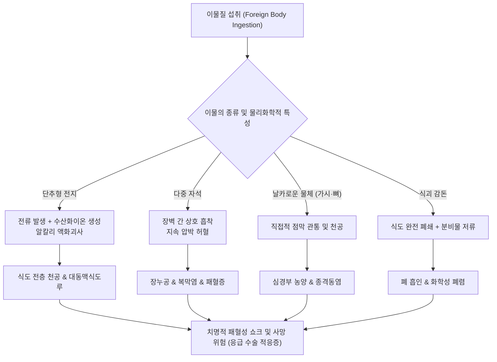

# 🩺 소화관 내 이물질 (Gastrointestinal Foreign Bodies)

> **핵심 3줄 요약 (Key Summary)**:
> - 📍 병소 부위 & 해부·병태생리: 섭취된 이물질이 상부 식도 괄약근(윤상인두근), 대동맥궁 압박부, 좌측 주기관지 교차부, 하부 식도 괄약근(LES), 유문부, 트라이츠 인대, 회맹판 등 생리적 협착부에 감돈되어 점막 손상, 괴사, 천공 및 종격동염·복막염을 유발함.
> - 🚩 전형적 임상 양상: 삼킴곤란(연하곤란), 연하통, 흉골 후방 동통, 타액 분비 과다(침흘림), 구토, 오심, 위장관 폐쇄 징후, 복통 및 천공 발생 시 복막자극 징후.
> - 🛠️ 핵심 검사 & 치료 전략: 단순 X선(경부·흉부·복부 2방향), 저선량 CT, 응급 상부위장관 내시경(단추형 전지·날카로운 물체·자석 2개 이상·완전 식도 폐쇄는 즉각 응급 내시경 제거).
> - ⚠️ 응급 의뢰 레드플래그: 식도 내 단추형 전지 감돈(2시간 내 액화괴사·누공 형성), 복수 자석 삼킴(장벽 협착 괴사), 뾰족한 이물(생선가시·이쑤시개·틀니 고리), 활력징후 불안정, 피하기종, 급성 복막염 징후.

---

## 📌 목차
1. [질환 개요 & 해부학적 병태생리](#1-질환-개요--해부학적-병태생리)
2. [병태생리 메커니즘 & 생체역학적 악순환 네트워크](#2-병태생리-메커니즘--생체역학적-악순환-네트워크)
3. [임상 증상 & 이학적 검사(Physical Exam) 알고리즘](#3-임상-증상--이학적-검사physical-exam-알고리즘)
4. [감별 진단 매트릭스 (Differential Diagnosis)](#4-감별-진단-매트릭스-differential-diagnosis)
5. [한의 통합 치료 프로토콜 (침·약침·추나·한약)](#5-한의-통합-치료-프로토콜-침약침추나한약)
6. [양방 치료 & 병용·의뢰 기준 (Conventional Treatment & Referral)](#6-양방-치료--병용의뢰-기준-conventional-treatment--referral)
7. [재활 운동 & 생활습관 티칭 가이드](#7-재활-운동--생활습관-티칭-가이드)
8. [💡 사용자 진료실 핵심 필기 & 임상 노하우 (Melt-In 잔여 심화 집약)](#8--사용자-진료실-핵심-필기--임상-노하우-melt-in-잔여-심화-집약)
9. [출처 및 학술 참고 문헌 (References)](#9-출처-및-학술-참고-문헌-references)

---

## 1. 질환 개요 & 해부학적 병태생리

![[소화관내이물질_01_역사도판.png|450]]
> [그림 1: 1909년 도판 'Foreign Bodies in Human Stomach' — 사람 위에서 꺼낸 25개의 삼킨 물체(숟가락·포크·나이프·못·단추 등)를 실제 크기의 약 1/3로 그린 그림으로, 삼킨 이물의 종류가 얼마나 다양한지 보여준다 — 출처: Wikimedia Commons — File:Foreign Bodies In Human Stomach.jpg (Public domain)]

소화관 내 이물질(Gastrointestinal Foreign Bodies)은 구강을 통해 의도적 혹은 우발적으로 섭취된 비음식성 물체나 저작되지 않은 식괴(Food Bolus)가 소화관 내강에 정체되거나 합병증을 유발하는 상태를 총칭한다. 소아에서는 장난감 부품, 동전, 단추형 건전지, 자석의 오연이 흔하며, 성인에서는 생선 가시, 닭뼈, 의치(틀니 부속), 약포지(PTP 포장) 및 고기 식괴 감돈(Meat bolus impaction)이 주를 이룬다. 섭취된 이물질의 80~90%는 치료적 개입 없이 자발적으로 위장관을 통과하여 대변으로 배출되나, 10~20%는 내시경적 제거가 필요하며 약 1% 미만에서는 천공, 장폐색, 대출혈 등의 합병증으로 인해 외과적 개복/복강경 수술이 요구된다.

### 해부학적 감돈 호발 부위 (Physiological Narrowings)
위장관 내강에는 내경이 좁아지는 생리적 협착 부위가 존재하며, 이물질 감돈의 80% 이상이 이곳에서 발생한다:
1. **식도 협착부**:
   - **제1협착부 (윤상인두근부, C6 레벨)**: 상부 식도 괄약근 부위로, 이물질이 가장 빈번하게 걸리는 위치(전체 식도 이물의 약 70%).
   - **제2협착부 (대동맥궁 및 좌측 주기관지 교차부, T4-T5 레벨)**: 기관지 및 흉부 대동맥과 인접하여 날카로운 이물 관통 시 대동맥식도루(Aortoesophageal fistula) 같은 치명적 합병증 발생 위험.
   - **제3협착부 (횡격막 식도열공 및 하부 식도 괄약근, T10-T11 레벨)**: 소화기성 협착, [[식도 열공 탈장]], [[식도게실]]이나 호산구성 식도염 병변이 있는 경우 식괴 감돈의 호발처.
2. **위 및 십이지장 협착부**:
   - **유문부(Pylorus)**: 직경 2cm 이상 또는 길이 5cm 이상의 이물질은 유문륜을 통과하지 못하고 위에 정체됨.
   - **십이지장 C-loop 및 트라이츠 인대(Ligament of Treitz)**: 후복벽에 고정된 급격한 만곡 부위로 장 천공의 호발 부위.
3. **원위부 소장 및 대장 협착부**:
   - **회맹판(Ileocecal valve)**: 회장 말단에서 맹장으로 이어지는 협착부로, 소장을 무사히 통과한 이물질이 최종적으로 걸리기 쉬움.
   - **충수돌기 개구부(Appendiceal orifice)**: 가느다란 바늘이나 납탄 등이 충수 내로 진입하여 충수염 유발 가능.
   - **구불결장-직장 경계부 및 항문관(Anal canal)**: 항문 괄약근 및 직장 점막 주름에 걸려 출혈이나 항문 주위 농양 형성.

---

## 2. 병태생리 메커니즘 & 생체역학적 악순환 네트워크

### 1) 기전별 조직 손상 네트워크
- **기계적 압박 및 점막 허혈 괴사**: 이물이 관경에 꽉 끼면 점막 모세혈관 순환이 차단되어 허혈성 괴사, 궤양 형성, 전벽 천공으로 진행함.
- **화학적·전기적 조직 손상 (단추형 전지, Button Battery)**:
  - 식도 내 저류 시 국소 전류가 식도 수분과 반응하여 음극에서 수산화이온($OH^-$)을 생성, 급격한 액화괴사(Liquefactive necrosis)를 일으킴.
  - 전지 외피 융해로 인한 알칼리 전해액 누출 및 물리적 압박이 결합되어 **섭취 후 불과 2시간 이내에 전층 천공, 기관식도루, 대동맥 누공**을 유발하는 초응급 상황을 초래함.
- **자기적 결합 손상 (다중 자석 섭취, Multiple Magnets)**:
  - 2개 이상의 자석 또는 자석과 금속체를 시간차를 두고 삼킨 경우, 서로 다른 장관 루프(장벽 사이)를 사이에 두고 강한 인력으로 흡착됨.
  - 협착된 장벽에 지속적 허혈과 압박괴사가 일어나 장천공, 장누공, 장중첩증, 장염전 및 범발성 복막염으로 발전함.
- **날카로운 이물에 의한 관통 (Sharp-pointed Objects)**:
  - 이쑤시개, 낚싯바늘, 생선가시, 닭뼈 등은 장 연동운동에 의해 벽을 뚫고 나가 간농양, 흉강 내 종격동염, 대혈관 손상 등의 심각한 합병증을 유발함.

---

## 3. 임상 증상 & 이학적 검사(Physical Exam) 알고리즘

![[소화관내이물질_03_내시경이물.png|450]]
> [그림 2: 위 내시경 소견 — 위 안에 길게 뻗은 금속 이물(식기)이 보이고, 내시경 기구로 잡아 회수하는 장면이 위아래 두 패널로 제시되어 있다 — 출처: Wikimedia Commons — File:Foreign Body.jpg (Public domain)]

### 1) 임상 증상
- **상부 식도 정체**: 삼킴곤란, 연하통, 흉골 상부 이물감, 침흘림(타액 연하 불능), 경부 통증, 호흡곤란, 천명(기관 압박 시).
- **하부 식도 및 위 정체**: 흉골 하부 둔통, 심와부 불편감, 조기 포만감, 구토, 오심.
- **소장 및 대장 통과 지연·폐쇄**: 간헐적 산통(Cramping abdominal pain), 복부 팽만, 장음 항진 후 소실, 배변 및 가스 배출 중단.
- **천공 및 감염 합병증**: 고열, 오한, 흉통, 경부 종창, 복벽 경직(Defensing), 반발압통(Rebound tenderness).

### 2) 이학적 검사 및 진단 알고리즘
1. **구강 및 인후두 진찰**: 설압자 및 간접후두경을 이용한 편도선, 구개인두궁, 설근부 검진(가시 확인).
2. **경부 촉진**: 피하기종(Subcutaneous emphysema, 눈 밟는 소리 Crépitus) 확인 시 식도 천공의 강력한 증거.
3. **복부 진찰**: 시진(팽만), 청진(장음 항진/마비), 타진(고창음), 촉진(국소 압통 및 반발통 확인).
4. **영상 검사**:
   - **단순 방사선 검사(X-ray)**: 경부 측면, 흉부 전후/측면, 복부 앙와위/기립위 촬영. 방사선 불투과성 이물(금속, 동전, 뼈)의 위치 확인. 단추형 건전지는 정면상 이중 테두리(Double-ring/Halo sign), 측면상 계단 모양(Step-off sign)을 보임.
   - **경부·흉부·복부 CT**: 방사선 투과성 이물(플라스틱, 얇은 나무 이쑤시개, 얇은 생선가시)의 위치 파악, 천공 여부(유리 가스 Free air), 종격동염, 농양 형성 여부를 평가하는 골드 스탠다드.

---

## 4. 감별 진단 매트릭스 (Differential Diagnosis)

| 감별 질환 | 호발 연령 및 특이 기왕력 | 주소증 및 임상적 차이점 | 방사선 / 내시경 소견 | 응급도 및 감별 핵심 포인트 |
| :--- | :--- | :--- | :--- | :--- |
| **소화관 내 이물질** | 전 연령 (소아·고령자 호발) | 섭취력 뚜렷, 돌발성 연하통, 침흘림, 이물감 | 단순 X선상 불투과성 음영, CT상 이물 확인, 내시경 직시 | 이물 성상(전지, 자석 등)에 따른 분초를 다투는 응급 제거 |
| [[역류성 식도염]] | 성인, 비만, 음주·야식력 | 만성 흉통, 가슴쓰림, 산역류, 식후 악화 | 위내시경 검사상 하부식도 점막 파손(LA 분류) | 이물 섭취력 없음, 만성 경과, 제산제 반응 |
| **식도 정맥류 파열** | 만성 [[간경변증]], 알코올성 간질환 | 대량 토혈(Melena/Hematemesis), 저혈압 쇼크 | 내시경상 식도 정맥류 울혈 및 활동성 출혈 | 선행 간경변증 징후, 복수, 황달 동반 |
| [[위궤양]] 천공 | 중장년, NSAIDs 복용자, [[위염]] 병력 | 돌발성 심와부 격통, 판상 복부 경직, 쇼크 | 복부 단순 촬영상 횡격막 하 유리 가스(Free air) | 이물 섭취력 없음, 궤양 천공부 봉합 수술 필요 |
| **기계적 장폐색** | 복부 수술력(유착), 탈장 환자 | 복부 산통, 구토, 복부 팽만, 가스 배출 중지 | 복부 X선상 다발성 장관 기종 및 계단식 공기-액체층 | 개복 수술력 확인, 감돈 탈장 여부 감별 |
| **인후두 신경증 (매핵기)** | 스트레스 호발, 여성 다빈도 | 뱉어도 안 나오고 삼켜도 안 넘어감, 식사 시 호전 | 후두경 및 식도 검사상 기질적 병변 전혀 없음 | 음식 섭취 시 오히려 이물감이 경감되는 특징 |

---

## 5. 한의 통합 치료 프로토콜 (침·약침·추나·한약)

> ⚠️ **한의 1차 진료 원칙 및 한계 설정**:
> 소화관 내 이물질의 급성 정체, 배터리/자석/날카로운 이물 섭취, 식도 폐쇄 및 복부 천공 징후가 의심되는 경우 **한의원 내에서의 치료적 지체는 절대 금기**이며 즉시 상급 병원 응급실로 전원한다.
> 본 프로토콜은 **내시경 등으로 이물이 안전하게 제거된 후의 점막 손상 회복기**, 혹은 **무해하고 둥근 미세 이물이 위장관을 자연 통과하도록 관찰 판정을 받은 비응급 환자의 위장관 운동 촉진 및 통증 완화 보조 요법**에 한하여 적용한다.

### 1) 침구 치료 프로토콜
- **위장관 평활근 긴장 완화 및 연동운동 정상화**:
  - [[족삼리]](ST36), [[상거허]](ST37): 위장관 연동운동 조절 및 복통 경감.
  - [[중완]](CV12), [[하완]](CV10): 위부 정체 개선, 소화관 평활근 긴장 완화.
  - [[내관]](PC6), [[공손]](SP4): 충맥·음유맥 배혈을 통한 구역·구토 진정, 흉격 압박감 해소.
  - [[천추]](ST25), [[기해]](CV6): 대장 운화 기능 촉진 및 잔여 분변·미세 이물 배출 유도.
- **자침 기법**: 평보평사법(平補平瀉法) 위주로 자침하며, 복부 경직이 있는 부위에는 강자극을 피하고 원격 취혈을 활용함.

### 2) 약침 치료 (점막 회복 및 염증 제어)
- **적용 대상**: 내시경적 이물 적출술 후 잔여 인후통, 흉골 후방통, 경증의 위 점막 찰과상.
- **혈위 및 처방**:
  - 황련해독탕 약침 또는 소염약침: [[인영]](ST9), [[천돌]](CV22) 주변 피하/근막 천자(0.2~0.3cc)를 통해 식도 주변부 연부조직 염증 반응 완화.
  - 신바로약침 또는 중성어혈약침: 배수혈인 [[격수]](BL17), [[비수]](BL20), [[위수]](BL21)에 주입(부위당 0.5cc)하여 국소 혈류 개선 및 미세 손상 치유 촉진.

### 3) 추나 및 수기 요법
- **주의사항**: 이물이 체내에 잔류하는 상태에서의 복부 추나 및 강한 흉추 압박 교정은 **장기 천공 및 이물 감돈을 악화시킬 수 있으므로 절대 금기**.
- **회복기 시술**: 이물 배출 확인 후 흉곽 호흡 제한 및 횡격막 긴장이 잔존할 때, 횡격막 이완 기법(Diaphragmatic release) 및 흉곽 유연성 확보를 위한 부드러운 관절가동추나 시행.

### 4) 한약 처방 (변증별 가감)
- **비응급 관찰기 완화 소적(消積)·통변(通便)**:
  - **대승기탕(大承氣湯)** 또는 **소승기탕(小承氣湯) 가감**: 둥글고 매끄러운 둔성 이물이 위를 지나 대장에 머물러 배출이 지연될 때, 사하통변(瀉下通便)하여 분변과 함께 이물을 배출시킴 (단, 날카로운 물체나 자석에는 금기).
- **식괴 감돈 배출 후 비위 불화(脾胃不和) 및 식적(食積)**:
  - **평위산(平胃散)** 합 **이진탕(二陳湯)**: 식괴 정체로 인한 위기울체(胃氣鬱滯), 심와부 답답함, 소화불량 해소.
  - 처방 구성: [[창출]], [[후박]], [[진피]], [[반하]], [[복령]], [[감초]], [[생강]], [[대추]].
- **점막 손상 회복기 (기음양허, 氣陰兩虛)**:
  - **맥문동탕(麥門동탕)** 또는 **보중익기탕(補中益氣湯) 가감**: 이물 자극으로 인한 인후·식도 점막 작열감, 건조감 완화.

---

## 6. 양방 치료 & 병용·의뢰 기준 (Conventional Treatment & Referral)

![[소화관내이물질_06_동전처치경과.png|450]]
> [그림 3: 삼킨 동전 315례의 위치별 경과 흐름도 — 식도 80례 중 증상이 있는 34례는 전원 내시경 처치, 무증상 46례 중 12례 자연배출·34례(74%) 처치였고, 위 26례와 장 209례는 대부분 자연배출되었다 — 출처: Europe PMC — Frontiers in Pediatrics (2026) PMCID PMC13703468, coins ingestion cohort (Open access (Europe PMC))]

### 1) 약물 치료 (Medication)
- **식괴 감돈 응급 처치제 (근이완 목적)**:
  - 글루카곤(Glucagon) 1mg 정맥 주사: 하부 식도 괄약근 이완을 유도하여 식괴의 자발적 위 진입을 꾀함 (성공률 30~50% 내외로 제한적, 구토 유발 주의).
- **점막 보호 및 산 분비 억제제**:
  - 양성자 펌프 억제제([[PPI]], 예: Pantoprazole, Esomeprazole) 정주 또는 경구 투여: 내시경 시술 전후 식도 및 위 점막의 산 유도 2차 손상 예방.
  - 점막 피복제(Sucralfate): 궤양 및 찰과상 부위 보호.
- **예방적 항생제**:
  - 식도 천공 의심 또는 중증 점막 손상 동반 시 혐기성균 커버 광범위 항생제(Ceftriaxone + Metronidazole 또는 Piperacillin/Tazobactam) 즉시 투여.

### 2) 비수술적 시술 (내시경적 제거술, Endoscopic Intervention)
내시경적 제거는 위장관 이물 치료의 핵심 표준 치료(Standard of Care)이다:
- **기구 선택**: 올가미(Snare), 이물겸자(Rat-tooth forceps, Alligator forceps), 회수용 그물망(Roth net), 투명 캡(Endoscopic cap), 보호용 오버튜브(Overtube, 날카로운 이물 적출 시 인두·식도 점막 보호 목적).
- **식괴 감돈 치료**: 푸시 테크닉(Push technique, 원위부 협착이 없음을 확인 후 조심스럽게 위 내로 밀어 넣음) 또는 회수 기구를 이용한 분할 적출.

### 3) 응급도별 개입 타이밍 가이드라인 (ESGE/ESPGHAN Guidelines)
1. **응급 내시경 (Emergent, 골든타임 2~6시간 이내)**:
   - 식도 내 **단추형 건전지(Button battery)** 감돈.
   - 식도 내 **날카로운 물체(Sharp-pointed foreign body)**.
   - 식도 내 **완전 폐쇄(Complete esophageal obstruction)** (침을 삼키지 못하고 흘리는 상태).
2. **준응급 내시경 (Urgent, 24시간 이내)**:
   - 식도 내 기타 둔성 이물.
   - 위 내 단추형 건전지(소아의 경우 직경 20mm 이상, 증상 동반 시).
   - 위 또는 십이지장 내 자석 2개 이상 또는 자석+자성체.
   - 위 또는 십이지장 내 날카로운 물체, 길이 5cm 이상 또는 직경 2~2.5cm 이상의 이물.
3. **선택적 내시경 또는 경과 관찰 (Non-urgent / Conservative)**:
   - 위 내 무증상 둔성 소형 이물(동전 등): 3~4주까지 자연 배출 관찰 가능.
   - 십이지장을 통과하여 소장에 진입한 무증상 이물: 매일 대변 확인 및 주 1회 단순 X선 추적.

### 4) 수술 적응증 (Surgical Indication)
- 내시경적 접근 및 제거가 실패한 경우.
- 식도, 위, 장관 전층 천공으로 인한 기흉, 종격동염, 복막염 발생.
- 제어되지 않는 활동성 소화관 대출혈.
- 장폐색 및 장누공 형성, 장벽 허혈 괴사.

### 5) 양방·전문과 응급 의뢰 기준 (Referral Criteria)
- 🚨 **즉각적인 119 구급 이송 및 상급종합병원 응급실 의뢰**:
  - 단추형 건전지, 복수 자석, 면도날, 바늘, 뼈 등 고위험 이물 섭취 병력.
  - 심한 흉골통, 연하 불능, 경부 피하기종(목에서 바스락거리는 소리).
  - 복부 팽만과 함께 판자처럼 단단한 복벽 경직, 반발통, 고열, 빈맥, 혈압 저하 등 패혈증 전조 증상.

---

## 7. 재활 운동 & 생활습관 티칭 가이드

### 1) 식이 및 섭식 습관 지도
- **급성 섭취 직후 금기**:
  - 억지로 밥 한 숟가락을 삼키거나 토하게 하는 민간요법은 **절대 금기** (가시나 뼈가 식도벽을 더 깊게 찔러 대혈관 파열이나 종격동 천공을 유발함).
  - 즉시 일체의 음식 및 물 섭취를 중단하고 금식(NPO) 상태를 유지하여 응급 내시경 및 마취 준비.
- **고위험군 예방 수칙**:
  - 고령자 및 틀니 착용자: 생선 가시, 닭뼈 분리 시 주의, 저작 기능을 과신하여 큰 고기 덩어리를 급하게 삼키지 않도록 지도.
  - 소아 보호자 교육: 장난감 배터리실 나사 고정 확인, 강력 네오디뮴 자석 장난감 가정 내 반입 금지.
  - 약 복용 지도: PTP(Press Through Package) 알약 포장재를 가위로 오려둔 채 복용하다 은박 포장지 모서리를 삼키는 사고가 빈발하므로, 복용 직전 낱개 포장을 완전히 벗겨 복용하도록 교육.

### 2) 생활 및 배변 모니터링
- 십이지장을 통과하여 경과 관찰 중인 환자의 경우:
  - 매일 대변을 헤쳐 이물질이 체외로 배출되었는지 직접 육안 확인.
  - 발열, 복통, 구토 발생 시 배출 전이라도 즉시 응급실로 방문하도록 지도.

---

## 8. 💡 사용자 진료실 핵심 필기 & 임상 노하우 (Melt-In 잔여 심화 집약)

### 1) 진료실 문진 시 3대 핵심 체크리스트
- **"정확히 무엇을 삼켰는가?"**: 금속, 배터리, 자석, 플라스틱, 동물 뼈, 알약 포장지 여부를 확인하고, 동일 제품이 있다면 실물을 지참하도록 요청.
- **"삼킨 지 몇 시간이 경과했는가?"**: 단추형 전지는 2시간 이내에 식도 점막을 파괴하므로 경과 시간 확인이 최우선임.
- **"침을 삼킬 수 있는가?"**: 환자가 침을 삼키지 못하고 종이컵에 뱉어내고 있다면 식도가 완전히 막힌 상태로, 분비물 흡인으로 인한 질식 및 흡인성 폐렴 위험이 있어 즉시 흡인 장비가 구비된 응급실로 보내야 함.

### 2) 민간요법의 위험성에 대한 단호한 환자 티칭
- 생선 가시가 목에 걸렸을 때 "맨밥을 한 숟가락 꿀꺽 삼키라"는 조언은 한의원 진료실에서 환자들이 가장 흔히 저지르는 치명적 실수이다.
- 가시가 편도나 인두벽에 얕게 박혀 있을 때는 이비인후과 후두경으로 1분 만에 뺄 수 있으나, 밥을 삼키는 순간 가시가 깊숙이 밀려들어가 식도 천공을 유발하고 개흉 수술로 이어질 수 있음을 강력하게 경고해야 한다.

---

## 9. 출처 및 학술 참고 문헌 (References)

1. Luo, F., et al. (2026). Management of dental-origin gastrointestinal foreign bodies: a proposed site-based, risk-stratified framework for multidisciplinary care. *Clin Oral Investig*, 30(10):. PMID: 42832118.

2. Ledder, O., et al. (2026). Foreign body ingestions in children and adolescents: A position paper of the European Society for Pediatric Gastroenterology, Hepatology, and Nutrition (ESPGHAN) endoscopy special interest group. *J Pediatr Gastroenterol Nutr*, 83(3):539-554. PMID: 42383497.

3. Birk, M., et al. (2016). Removal of foreign bodies in the upper gastrointestinal tract in adults: European Society of Gastrointestinal Endoscopy (ESGE) Clinical Guideline. *Endoscopy*, 48(5):489-96. PMID: 26862844.

---

## 관련 노트

- [[역류성 식도염]]
- [[식도 열공 탈장]]
- [[식도게실]]
- [[위궤양]]
- [[위염]]
- [[간경변증]]
- [[족삼리]]
- [[상거허]]
- [[중완]]
- [[하완]]
- [[내관]]
- [[공손]]
- [[천추]]
- [[기해]]
- [[인영]]
- [[천돌]]
- [[격수]]
- [[비수]]
- [[위수]]
- [[창출]]
- [[후박]]
- [[진피]]
- [[반하]]
- [[복령]]
- [[감초]]
- [[생강]]
- [[대추]]
- [[맥문동탕]]
- [[보중익기탕]]
- [[PPI]]
