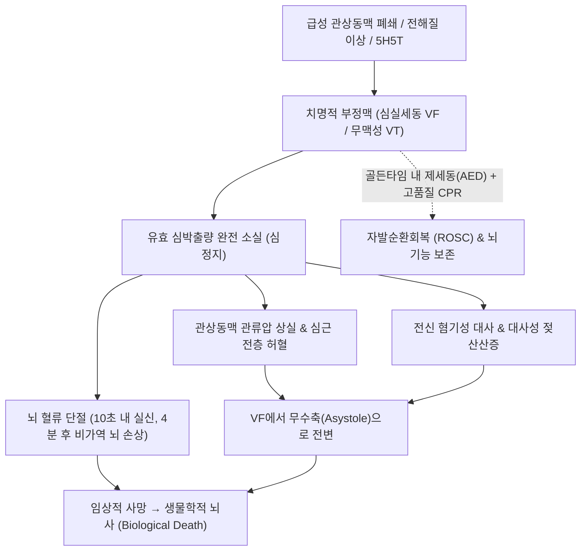

# 🩺 심장마비 (심정지 / 급성 심장사, Cardiac Arrest / Sudden Cardiac Death)

> **핵심 3줄 요약 (Key Summary)**:
> - 📍 병소 부위 & 해부·병태생리: 심장의 기계적 펌프 기능이 돌발적으로 중단되어 전신 혈류 및 뇌 관류가 즉각 상실됨. 주된 전기생리학적 기전은 제세동 가능 리듬(심실세동 VF, 무맥성 심실빈맥 pVT)과 비제세동 리듬(무수축 Asystole, 무맥성 전기활동 PEA).
> - 🚩 전형적 임상 양상: 수 초 내 돌발적인 의식 소실, 무호흡 또는 비정상적인 임종 호흡(Agonal gasps), 대퇴동맥/경동맥 맥박 소실, 창백 및 청색증.
> - 🛠️ 핵심 검사 & 치료 전략: 즉각적인 고품질 심폐소생술(CPR, 분당 100~120회, 깊이 5~6cm) 및 신속한 자동제세동기(AED) 적용. 전문심장소생술(ACLS: 에피네프린, 아미오다론 투여, 가역적 원인 5H5T 교정), 자발순환회복(ROSC) 후 목표체온유지치료(TTM) 및 관상동맥 중재술(PCI).
> - ⚠️ 응급 의뢰 레드플래그: 심정지 발생 4~5분 후부터 비가역적 뇌신경 세포 사멸 시작. 1초의 지체 없이 119 신고, AED 요청 및 가슴 압박을 즉각 개시해야 하는 최고 수준의 초응급 상황.

---

## 📌 목차
1. [질환 개요 & 해부학적 병태생리](#1-질환-개요--해부학적-병태생리)
2. [병태생리 메커니즘 & 생체역학적 악순환 네트워크](#2-병태생리-메커니즘--생체역학적-악순환-네트워크)
3. [임상 증상 & 이학적 검사(Physical Exam) 알고리즘](#3-임상-증상--이학적-검사physical-exam-알고리즘)
4. [감별 진단 매트릭스 (Differential Diagnosis)](#4-감별-진단-매트릭스-differential-diagnosis)
5. [한의 통합 치료 프로토콜 (침·약침·추나·한약)](#5-한의-통합-치료-프로토콜-침약침추나한약)
6. [양방 치료 & 병용·의뢰 기준 (Conventional Treatment & Referral)](#6-양방-치료--병용의뢰-기준-conventional-treatment--referral)
7. [재활 운동 & 생활습관 티칭 가이드](#7-재활-운동--생활습관-티칭-가이드)
8. [💡 사용자 진료실 핵심 필기 & 임상 노하우 (Melt-In 잔여 심화 집약)](#8--사용자-진료실-핵심-필기--임상-노하우--melt-in-잔여-심화-집약)
9. [출처 및 학술 참고 문헌 (References)](#9-출처-및-학술-참고-문헌-references)

---

## 1. 질환 개요 & 해부학적 병태생리

심장마비 혹은 심정지(Cardiac Arrest)는 심장이 효과적으로 수축하지 못하여 혈액 순환이 급격히 중단된 상태를 말한다. 심근경색증(Myocardial Infarction)이 관상동맥 폐쇄에 의한 '배관(Plumbing)의 문제'라면, 심정지는 치명적 부정맥으로 인해 펌프가 멈추는 '전기(Electrical)의 문제'이다. 치료적 개입이 수 분 내에 이루어지지 않으면 비가역적인 뇌 손상과 생물학적 사망(Brain death & Biological death)에 이른다.

### 전기생리학적 4대 심정지 리듬 (Cardiac Arrest Rhythms)
1. **제세동 가능 리듬 (Shockable Rhythms, 즉각 제세동 적응증)**:
   - **[[심실 세동]](Ventricular Fibrillation, VF)**: 심실 근육이 제각기 무질서하게 파르르 떨리는 상태로, 심박출량이 0이 됨. 병원 밖 심정지(OHCA) 초기 70% 이상의 주원인.
   - **무맥성 심실빈맥 (Pulseless Ventricular Tachycardia, pVT)**: 심실에서 기원하는 극도로 빠른 빈맥으로 인해 심실 이완기 충만이 전혀 이루어지지 않아 맥박이 촉지되지 않는 상태.
2. **비제세동 리듬 (Non-shockable Rhythms, 전기 충격 무효, CPR 및 원인 교정 우선)**:
   - **무맥성 전기활동 (Pulseless Electrical Activity, PEA)**: 심전도상 전기적 복합파(QRS)는 관찰되나 기계적 심근 수축이 없거나 심박출을 내지 못해 맥박이 만져지지 않는 상태 (저혈량, 긴장성 기흉, 심장 눌림증 등 5H5T 원인 다수).
   - **무수축 (Asystole)**: 심장의 전기적 및 기계적 활동이 완전히 소실되어 평평한 선(Flatline)을 나타내는 상태. 예후가 가장 불량함.

---

## 2. 병태생리 메커니즘 & 생체역학적 악순환 네트워크

### 1) 허혈 및 재관류 손상 기전
- **전신 허혈-저산소증 (Ischemia-Hypoxia)**:
  - 심정지 발생 즉시 뇌 관류압이 0으로 떨어지며, 10~15초 내 의식 소실, 4~5분 경과 시 뇌세포의 ATP 고갈 및 세포독성 부종(Cytotoxic edema), 비가역적 뇌손상 시작.
  - 심근 허혈로 인해 심실 근육 내 젖산 축적, 대사성 산증, 막전위 불안정 가속.
- **가역적 원인 네트워크 (Reversible Causes: 5H & 5T)**:
  - **5H**: 저혈량증(Hypovolemia), 저산소증(Hypoxia), 수소이온 산증(Hydrogen ion/Acidosis), 저칼륨혈증/고칼륨혈증(Hypo/Hyperkalemia), 저체온증(Hypothermia).
  - **5T**: 긴장성 [[기흉]](Tension pneumothorax), 심장 눌림증(Tamponade, cardiac), 독소/약물중독(Toxins), 폐색전증(Thrombosis, pulmonary), 관상동맥혈전증(Thrombosis, coronary).

---

## 3. 임상 증상 & 이학적 검사(Physical Exam) 알고리즘

### 1) 주요 임상 증상
- **전조 증상 (수 분~수 시간 전)**: 심한 흉통, 흉부 압박감, 호흡곤란, 심계항진, 식은땀, 어지럼증 (단, 50%는 전조 없이 급사).
- **심정지 직후 증상**:
  - 돌발적인 의식 소실 및 쓰러짐.
  - 무호흡 또는 헐떡거리는 임종 호흡(비정상 호흡, Agonal gasps: 초심자가 정상 호흡으로 착각하기 쉬움).
  - 경동맥(성인) 및 대퇴동맥 맥박 소실.
  - 산동(동공 산대 및 대광반사 소실).

### 2) 이학적 검사 및 진단 알고리즘 (AHA 2025 BLS 기준)
1. **현장 안전 확인 및 반응 확인**: 환자의 어깨를 두드리며 "괜찮으세요?" 확인.
2. **도움 요청 및 119 신고, AED 요청**: 주변인을 특정하여 명확히 지목.
3. **호흡 및 맥박 동시 확인 (10초 이내)**:
   - 환자의 호흡 유무 및 비정상 호흡 확인 + 경동맥 맥박 촉지.
   - **맥박이 확실하지 않거나 10초 이내에 확신이 서지 않으면 즉시 심정지로 간주하고 가슴 압박 시작**.

---

## 4. 감별 진단 매트릭스 (Differential Diagnosis)

| 감별 질환 | 의식 상태 및 호흡 | 경동맥 맥박 | 심전도 소견 | 감별 핵심 및 응급 처치 |
| :--- | :--- | :--- | :--- | :--- |
| **심장마비 (심정지)** | **완전 소실 / 무호흡 or 헐떡임** | **맥박 절대 없음** | **VF, pVT, PEA, Asystole** | **즉각 가슴 압박 및 AED 적용 (초응급)** |
| **단순 미주신경성 [[실신]]** | 일시적 소실 (수십 초 내 회복) | **맥박 정상 촉지** | 동서맥 또는 정상 굴리듬 | 앙와위 유지 및 하지 거상, 맥박 유지됨 |
| **급성 뇌전증 발작 (경련)** | 의식 소실, 전신 강직-간대 | **맥박 촉지됨 (빈맥)** | 정상 굴빈맥, 뇌파 이상 | 기도 확보 및 손상 방지, 맥박 유지됨 |
| **질식 (기도 이물 폐쇄)** | 청색증, 말을 못함, 의식 저하 | 초기 맥박 있음 $\rightarrow$ 점차 정지 | 초기 빈맥 $\rightarrow$ 서맥 $\rightarrow$ PEA | 하임리히법(Heimlich) 즉각 시행, 정지 시 CPR |
| **중증 혼수 (저혈당 쇼크 등)** | 의식 소실, 호흡 유지 | **맥박 촉지됨** | 정상 또는 서맥 | 혈당 측정(간이 BST), 50% 포도당 IV 투여 |

---

## 5. 한의 통합 치료 프로토콜 (침·약침·추나·한약)

> 🚨 **한의 진료실 심정지 발생 시 절대적 행동 원칙**:
> 환자가 한의원 내에서 의식을 잃고 심정지가 발생한 경우, **침 시술, 약침, 한약 투여는 절대 금기**이다.
> 의료법상 한의사는 의료인으로서 **즉각적인 119 구급대 호출 및 제세동기(AED) 부착, 표준 심폐소생술(CPR)을 가슴 압박 중단 없이 지속**해야 한다.
> 본 섹션의 한의 중재는 **자발순환회복(ROSC) 후 중환자실 집중 치료 및 급성기 관상동맥 치료가 완전히 종료된 후의 '심정지 후 증후군(Post-cardiac arrest syndrome) 및 신경학적 재활기'**에 한하여 적용한다.

### 1) 심정지 후 뇌기능 회복 침구 치료 (회복기)
- **성뇌개규(醒腦開竅) 및 소통경락**:
  - [[인중]](GV26), [[백회]](GV20), [[사신총]](EX-HN1): 뇌 혈류 순환 개선 및 인지기능 자극.
  - [[내관]](PC6), [[노궁]](PC8): 심신(心神)을 안정시키고 심근 수축력 및 자율신경 안정.
  - [[용천]](KI1), [[족삼리]](ST36): 전신 기혈 순환 촉진, 하지 근력 회복.

### 2) 심근 재활 및 허혈 후 회복 한약 처방 (회복기)
- **심기허·심양허(心氣虛·心陽虛)형 (심박출량 저하, 피로, 호흡곤란, 사지 냉증)**:
  - **보심탕(補心湯)** 또는 **생맥산(生脈散)** 합 **사역탕(四逆湯) 가감**:
  - 심근 에너지를 보충하고 심혈관 산소 이용 효율 증대.
  - 처방 구성: [[인삼]], [[맥문동]], [[오미자]], [[부자]], [[건강]], [[감초]], [[단삼]], [[원지]].
- **어혈조체(瘀血阻滯)형 (관상동맥 허혈 후 흉민, 자통, 미세순환 부전)**:
  - **혈부축어탕(血府逐瘀湯) 가감**:
  - 관상동맥 미세 순환을 개선하고 혈전 형성 억제.
  - 구성: [[도인]], [[홍화]], [[당귀]], [[생지황]], [[천궁]], [[적작약]], [[우슬]], [[시호]], [[지각]], [[길경]], [[감초]].

---

## 6. 양방 치료 & 병용·의뢰 기준 (Conventional Treatment & Referral)

### 1) 기본소생술 (BLS, 2025 AHA Guidelines)
- **가슴 압박(Chest Compression)**:
  - 위치: 흉골 아래쪽 절반(젖꼭지 연결선 중앙).
  - 깊이: 성인 최소 5cm, 6cm 초과 금지.
  - 속도: 분당 100~120회.
  - 완전한 이완(Full chest recoil) 보장, 압박 중단 최소화($<10$초).
- **자동제세동기 (AED)**: 도착 즉시 전원을 켜고 패드 부착, 심장 리듬 분석 시 접촉 금지, 제세동 필요 시 버튼 누른 즉시 가슴 압박 재개.

### 2) 전문심장소생술 (ACLS) 및 약물
- **제세동(Defibrillation)**: Biphasic $120\sim 200\text{ J}$ shock.
- **약물 요법**:
  - **에피네프린 (Epinephrine)**: 1mg IV/IO 매 3~5분마다 투여 (말초 혈관 수축을 통한 관상동맥 및 뇌 관류압 유지).
  - **아미오다론 (Amiodarone)**: 제세동 불응성 VF/pVT 시 1차 300mg 정주, 2차 150mg 정주 (대체제: 리도카인 Lidocaine).

### 3) 자발순환회복(ROSC) 후 통합 치료
- **목표체온유지치료 (TTM / Therapeutic Hypothermia)**:
  - 심정지 후 혼수 상태 환자에서 허혈-재관류 뇌손상을 최소화하기 위해 $32\sim 36^\circ\text{C}$로 최소 24시간 동안 체온 유지.
- **응급 관상동맥 조영술 및 중재술 (Coronary Angiography & PCI)**:
  - 심전도상 STEMI 소견이 있거나 심인성 원인이 강력히 의심될 때 즉시 폐색된 관상동맥 재개통.

### 4) 절대적 응급 프로토콜
- 🚨 **즉각적인 119 출동 및 원내 비상 방송 (Code Blue)**:
  - 의식과 호흡이 없는 환자 발견 즉시 CPR 시작과 동시에 제세동기를 요청하고 응급의료센터로 이송.

---

## 7. 재활 운동 & 생활습관 티칭 가이드

### 1) 심장 재활 (Cardiac Rehabilitation)
- 회복기 환자의 경우 전문 심장 재활 프로그램에 참여하여 점진적인 유산소 운동(심전도 감시 하 트레드밀, 고정식 자전거) 시행.
- 무거운 무게를 드는 발살바(Valsalva) 유발 근력 운동은 흉강내압을 올려 심근 산소 소모를 급증시키므로 금기.

### 2) 심장마비 2차 예방 생활 수칙
- **금연**: 흡연은 관상동맥 경련과 급성 혈전 형성을 유발하므로 완전 금연 필수.
- **가족 교육**: 환자의 직계 가족에게 심폐소생술(CPR) 및 AED 사용법을 반드시 실습 교육받도록 권고.

---

## 8. 💡 사용자 진료실 핵심 필기 & 임상 노하우 (Melt-In 잔여 심화 집약)

### 1) "숨을 헐떡이고 있으니 숨은 쉬는 것 아닌가요?"라는 치명적 착각
- 심정지 발생 직후 환자의 40~50%에서 턱을 쳐들며 '컥, 컥'하고 불규칙하게 헐떡이는 **임종 호흡(Agonal gasps)**이 나타난다.
- 이는 뇌간의 척수 반사일 뿐 실제 폐포 환기가 전혀 이루어지지 않는 **심정지 상태**이다.
- 이를 정상 호흡으로 오인하여 가슴 압박을 지체하는 것이 환자를 사망에 이르게 하는 가장 흔한 원인이므로, "비정상적인 헐떡임은 무호흡과 같다"는 원칙을 뼈에 새겨야 한다.

### 2) 한의원 내 AED 비치 및 분기별 모의 훈련
- 한의원은 노인, 만성 심혈관 질환자, 척추관 협착증 등 고령층 환자가 밀집하는 1차 의료기관이다.
- 원내 자동제세동기(AED)의 패드 유효기간과 배터리를 매월 점검하고, 모든 직원이 119 신고부터 가슴 압박 인계까지 3분 내에 유기적으로 수행하는 시뮬레이션을 정기적으로 실시해야 한다.

---

## 9. 출처 및 학술 참고 문헌 (References)

1. Part 7: Adult Basic Life Support: 2025 American Heart Association Guidelines for Cardiopulmonary Resuscitation and Emergency Cardiovascular Care. (2025). *Circulation*, 152(16_suppl_2):S467-S484. PMID: 41122888.

2. Advanced Cardiac Life Support (ACLS). (2025). *StatPearls*, ():. PMID: 40198051.

3. [Post return of spontaneous circulation : initial care]. (2026). *Rev Med Suisse*, 22(956):1510-1514. PMID: 42682117.

---

## 관련 노트

- [[심실 세동]]
- [[기흉]]
- [[실신]]
- [[인중]]
- [[백회]]
- [[내관]]
- [[노궁]]
- [[용천]]
- [[족삼리]]
- [[인삼]]
- [[맥문동]]
- [[오미자]]
- [[부자]]
- [[건강]]
- [[감초]]
- [[단삼]]
- [[도인]]
- [[홍화]]
- [[당귀]]
- [[생지황]]
- [[천궁]]
- [[적작약]]
- [[보심탕]]
- [[생맥산]]
- [[사역탕]]
- [[혈부축어탕]]
