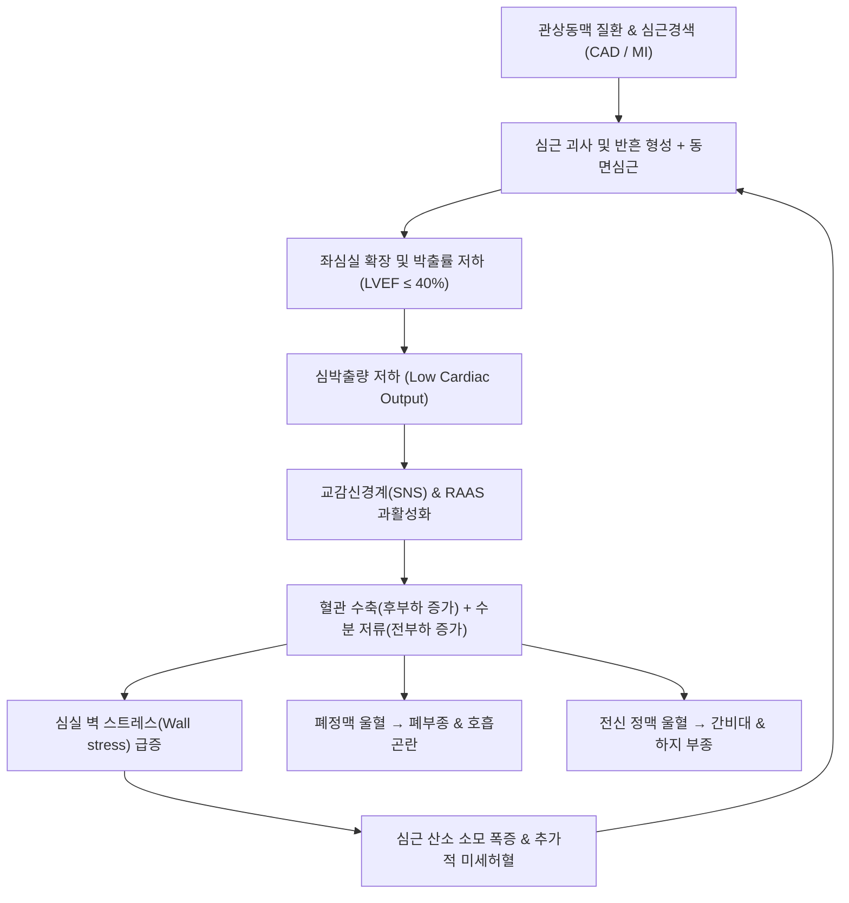

# 🩺 허혈성 심근병증 (Ischemic Cardiomyopathy, ICM)

> **핵심 3줄 요약 (Key Summary)**:
> - 📍 병소 부위 & 해부·병태생리: 다발성 관상동맥 질환 및 과거 심근경색으로 인한 좌심실 심근세포의 광범위한 괴사, 반흔 형성, 동면심근(Hibernating myocardium), 심실 확장 및 전역성 좌심실 박출률 저하(HFrEF, LVEF $\le 40\%$).
> - 🚩 전형적 임상 양상: 울혈성 심부전 징후(노력성 호흡곤란, 기좌호흡, 발작성 야간 호흡곤란, 하지 오목부종, 피로감), 협심통, 경정맥 확장, 제3심음(S3 gallop), 폐 악설음.
> - 🛠️ 핵심 검사 & 치료 전략: 심초음파(LVEF 저하, 국소/전반적 벽운동 장애), 관상동맥 조영술(CAG), 심장 MRI(생존심근 및 지연조영증강 LGE 평가), NT-proBNP. 가이드라인 기반 4대 심부전 표준 약물(GDMT: ARNI/ACEI, 베타차단제, MRA, SGLT2i) + 생존심근 확인 시 관상동맥 재개통술(CABG/PCI).
> - ⚠️ 응급 의뢰 레드플래그: 급성 비대상성 심부전(ADHF)에 의한 폐부종, 심인성 쇼크(수축기혈압 $<90\text{ mmHg}$, 차가운 사지, 핍뇨), 치명적 심실성 부정맥(심실빈맥 VT / 심실세동 VF), 안정 시 난치성 흉통.

---

## 📌 목차
1. [질환 개요 & 해부학적 병태생리](#1-질환-개요--해부학적-병태생리)
2. [병태생리 메커니즘 & 생체역학적 악순환 네트워크](#2-병태생리-메커니즘--생체역학적-악순환-네트워크)
3. [임상 증상 & 이학적 검사(Physical Exam) 알고리즘](#3-임상-증상--이학적-검사physical-exam-알고리즘)
4. [감별 진단 매트릭스 (Differential Diagnosis)](#4-감별-진단-매트릭스-differential-diagnosis)
5. [한의 통합 치료 프로토콜 (침·약침·추나·한약)](#5-한의-통합-치료-프로토콜-침약침추나한약)
6. [양방 치료 & 병용·의뢰 기준 (Conventional Treatment & Referral)](#6-양방-치료--병용의뢰-기준-conventional-treatment--referral)
7. [재활 운동 & 생활습관 티칭 가이드](#7-재활-운동--생활습관-티칭-가이드)
8. [💡 사용자 진료실 핵심 필기 & 임상 노하우 (Melt-In 잔여 심화 집약)](#8--사용자-진료실-핵심-필기--임상-노하우--melt-in-잔여-심화-집약)
9. [출처 및 학술 참고 문헌 (References)](#9-출처-및-학술-참고-문헌-references)

---

## 1. 질환 개요 & 해부학적 병태생리

![[허혈성심근병증_01_죽상경화진행.png|450]]
> [그림 1: 죽상경화 진행 단면 도해 — 정상 혈관에서 지질 침착, 섬유성 죽종(fibrous atheroma), 석회화·파열 단계로 내강이 점점 좁아지는 과정을 4단계로 보여준다. 만성 허혈이 심근 수축력 저하로 이어지는 출발점이다 — 출처: Wikimedia Commons — File:Atherosclerosis diagram.png (Public domain)]

허혈성 심근병증(Ischemic Cardiomyopathy, ICM)은 심각한 관상동맥 질환(CAD)으로 인한 만성적인 심근 허혈과 심근경색으로 좌심실 기능 장애가 초래된 상태를 의미한다. 심부전(Heart Failure)의 가장 흔한 원인 질환으로, 전체 박출률 감소 심부전(HFrEF) 환자의 50~60% 이상을 차지한다.

### 해부학적 심근 리모델링 및 심근 생존능
1. **좌심실 리모델링 (Left Ventricular Remodeling)**:
   - 심근경색 후 괴사된 부위는 콜라겐 섬유화 반흔(Scar)으로 대체되어 얇아지고 신장됨.
   - 비경색 부위의 심근세포는 증가된 벽 스트레스(Wall stress)를 감당하기 위해 비대해지며, 결국 좌심실이 구형(Spherical)으로 확장되고 수축기 박출력이 저하됨.
2. **동면심근 (Hibernating Myocardium)**:
   - 만성적인 저관류 상태에서 심근세포가 사멸을 피하기 위해 스스로 대사와 수축 기능을 최소한으로 억제한 '잠자는 심근'.
   - 관상동맥 우회술(CABG)이나 중재술(PCI)로 혈류가 재개통되면 수축 기능을 회복할 수 있는 가역적 조직.
3. **기절심근 (Stunned Myocardium)**:
   - 급성 일과성 허혈 후 혈류는 재개통되었으나 산화 스트레스와 칼슘 과부하로 수일~수주간 수축 기능 장애가 일시적으로 지속되는 상태.

---

## 2. 병태생리 메커니즘 & 생체역학적 악순환 네트워크

![[허혈성심근병증_02_섬유아세포활성화.png|450]]
> [그림 2: 심근 손상 후 섬유화 4단계 도해 — ① 심근 스트레스·손상(심근세포 사멸, 염증세포 침윤) → ② 섬유아세포 활성화와 FAP 발현 → ③ 세포외기질 재구성(교원질 침착·교차결합) → ④ 심근 수축력 저하·전도 이상 등 심근에 미치는 결과로 이어진다 — 출처: Europe PMC — Int J Mol Sci 27:8901 Fig.1 (PMC13666141) (CC BY (Europe PMC OA))]

![[허혈성심근병증_03_리모델링시간축.png|450]]
> [그림 3: 심근 리모델링의 시간축 도해 — 급성 손상 직후 심근세포 사멸과 염증에서 시작해 섬유아세포 활성화·교원질 침착·성숙 흉터로 진행되는 과정을 시간 경과에 따라 배치하고, 각 시기에 맞는 생체표지자(FAP PET 등)와 조직 검사 소견을 함께 표시했다 — 출처: Europe PMC — Int J Mol Sci 27:8901 Fig.2 (PMC13666141) (CC BY (Europe PMC OA))]

### 1) 신경호르몬계 활성화와 생체역학적 악순환
- **심박출량 저하와 신경호르몬계 과활성화**:
  - 심박출량 감소 $\rightarrow$ 교감신경계(SNS) 과활성화(노르에피네프린 증가) 및 레닌-안지오텐신-알도스테론계(RAAS) 활성화.
  - 전신 혈관 수축으로 인한 후부하(Afterload) 증가, 나트륨 및 수분 저류로 인한 전부하(Preload) 증가.
  - 초기에는 일시적 보상 기전이나 장기적으로는 심근세포 독성, 심근 아폽토시스(Apoptosis) 및 섬유화를 촉진함.
- **라플라스 법칙(Laplace's Law)과 심근 산소 소모**:
  - 벽 스트레스 $\sigma = \frac{P \cdot r}{2h}$ (내압 $P$, 내경 $r$, 벽 두께 $h$).
  - 심실이 확장될수록($r$ 증가) 벽 스트레스가 급증하여 심근 산소 요구량이 폭증함. 관상동맥 협착으로 산소 공급은 제한되어 허혈이 악화되는 치명적 악순환 형성.

---

## 3. 임상 증상 & 이학적 검사(Physical Exam) 알고리즘

### 1) 주요 임상 증상
- **좌심부전 (폐울혈 및 저심박출량 증상)**:
  - **노력성 호흡곤란 (DOE)**: 계단이나 평지를 걸을 때 숨이 참 (NYHA Functional Class).
  - **기좌호흡 (Orthopnea)**: 누우면 정맥 환류 증가로 숨이 차서 베개를 2~3개 받치고 자야 함.
  - **발작성 야간 호흡곤란 (PND)**: 잠든 지 1~2시간 후 심한 호흡곤란과 기침으로 잠에서 깸.
  - 만성 피로, 뇌 관류 저하로 인한 집중력 감퇴.
- **우심부전 (전신 정맥 울혈 증상)**:
  - 양측 하지 오목부종(Pitting edema), 복부 팽만, 소화불량, 식욕 부진.
- **협심증 동반**: 흉골 하부 쥐어짜는 듯한 압박감, 방사통(좌측 어깨, 턱).

### 2) 이학적 검사 및 진단 검사 알고리즘
1. **진찰 소견**:
   - 심장 청진: 제3심음(S3 Gallop: 급격한 심실 충만음), 수축기 심잡음(승모판막 폐쇄부전 MR 동반 시).
   - 폐 청진: 양측 폐 하부의 양측성 악설음(Bilateral basal crackles).
   - 혈관 진찰: 경정맥 확장(JVD, 목정맥 팽대 $\ge 3\text{ cm}$), 간경정맥 역류 양성(Hepatojugular reflux).
2. **혈액 검사**:
   - **BNP / NT-proBNP**: 심실벽 신장 시 분비되는 바이오마커로, 심부전 진단 및 배제, 예후 평가의 핵심 ($NT\text{-proBNP} > 125\text{ pg/mL}$ 비임상, $> 300\text{ pg/mL}$ 급성 호흡곤란).
   - Troponin I/T (심근 손상 지속 여부), 신기능(BUN/Cr), 전해질.
3. **영상 검사**:
   - **심초음파(Echocardiography, 필수)**: 좌심실 구혈률(LVEF) 산출, 국소 벽운동 장애(RWMA), 심실 확장도, 판막 질환 평가.
   - **심장 MRI (CMR)**: 지연조영증강(Late Gadolinium Enhancement, LGE)을 통해 심근 반흔의 투벽성(Transmurality)을 평가하여 재개통술 후 기능 회복 가능성(동면심근) 판정.
   - **관상동맥 조영술(CAG)**: 협착 부위 확인 및 스텐트/수술 계획 수립.

---

## 4. 감별 진단 매트릭스 (Differential Diagnosis)

![[허혈성심근병증_04_진단접근순서도.png|450]]
> [그림 4: 원인불명 심근병증의 진단 접근 순서도 — 임상 평가와 검사실 검사에서 시작해 심초음파·도플러, 추가 영상(CMR·핵의학), 관상동맥 평가, 유전자 검사, 심근 조직검사로 분기하며, 마지막에 허혈성·판막성·선천성·침윤성 심근병증이 함께 존재할 수 있다는 통합 판정으로 모인다 — 출처: Europe PMC — Diagnostics 16:3126 Fig.2 (PMC13664619) (CC BY (Europe PMC OA))]

| 감별 질환 | 관상동맥 질환 유무 | 심초음파 / MRI 소견 | 바이오마커 특이점 | 감별 핵심 포인트 |
| :--- | :--- | :--- | :--- | :--- |
| **허혈성 심근병증 (ICM)** | **다발성 중증 CAD (혈관 협착 $>70\%$)** | 분절성 벽운동 장애(RWMA), 심내막하~투벽성 LGE | NT-proBNP 상승, Troponin 미세 상승 | 심근경색 병력, 관상동맥 침범 영역과 일치하는 벽운동 장애 |
| **확장성 심근병증 (DCM)** | 관상동맥 정상 또는 비의의성 경미 협착 | 전반적 저운동(Global hypokinesia), 중간층(Mid-wall) LGE | NT-proBNP 상승 | 허혈 소견 없음, 유전/바이러스/알코올/특발성 |
| **비후성 심근병증 (HCM)** | 관상동맥 대개 정상 | 비대칭성 심실중격 비후(ASH), 수축기 전방운동(SAM) | 대개 정상~경도 상승 | 좌심실 비대 우세, 유출로 폐색, 유전성 질환 |
| **타코츠보 심근증 (스트레스성)** | 관상동맥 완전 정상 | 심첨부 풍선 확장(Apical ballooning), 기저부 과수축 | Troponin 일시적 상승 후 정상화 | 심리적/신체적 극심한 스트레스 후 발생, 가역적 회복 |
| **만성 폐쇄성 폐질환 ([[COPD]])** | 심질환 무관 또는 이차적 | 좌심실 수축력 정상, 우심실 비대(Cor pulmonale) | BNP 대개 정상 (우심부전 시 제외) | 흡연력, 폐기능 검사(PFT)상 폐쇄성 환기 장애 |

---

## 5. 한의 통합 치료 프로토콜 (침·약침·추나·한약)

> ⚠️ **허혈성 심근병증 관리의 안전 원칙**:
> 허혈성 심근병증은 심부전과 치명적 부정맥으로 인한 급사 위험이 높은 중증 순환기 질환이다. **현대 심부전 4대 표준 약제(GDMT) 복용을 절대 임의 중단시켜서는 안 된다.**
> 한의 치료는 **양방 심부전 약물과의 병용 하에 심근 혈류 미세순환 개선, 피로 및 호흡곤란 완화, 심부전 환자의 운동 내성(Exercise tolerance) 증진 및 삶의 질 개선을 위한 통합 보조 요법**으로 접근한다.

### 1) 침구 치료 프로토콜
- **익기활혈(益氣活血) 및 통양행수(通陽行水)**:
  - [[내관]](PC6): 심포경 락혈, 심박출량 개선, 심근 허혈 손상 보호, 자율신경 조절.
  - [[단중]](CV17): 심포의 모혈이자 기회(氣會), 흉민, 호흡곤란, 흉통 완화.
  - [[심수]](BL15), [[궐음수]](BL14): 배수혈을 통한 관상동맥 혈류 개선 및 심근 수축력 보조.
  - [[족삼리]](ST36), [[풍륭]](ST40): 비위 운화 촉진, 체내 담음(痰飮) 및 부종 배출.
  - [[수분]](CV9), [[기해]](CV6): 수분 대사 조절, 복부 팽만 및 부종 완화.
- **자침 기법**: 유침 시간 동안 환자를 반좌위(Semi-Fowler's position)로 편안하게 유지하며 강자극을 피함.

### 2) 약침 치료 (심근 대사 보조)
- **적용 혈위**: [[단중]](CV17), [[내관]](PC6), [[심수]](BL15).
- **처방 약침**:
  - 중성어혈약침 또는 단삼약침: 미세혈관 혈류 개선 및 혈전 예방을 위해 부위당 0.2~0.3cc 주입.
  - 자하거 약침: 심신양허(心腎兩虛)형 만성 쇠약 환자의 체력 회복을 위해 심수, 신수([[BL23]])에 0.5cc 주입.

### 3) 한약 처방 (변증별 가감)
- **기허혈어(氣虛血瘀)형 (안정기 다빈도, 흉민, 흉통, 피로, 자색 설태, 세삽맥)**:
  - **보양환오탕(補陽還五湯)** 또는 **관심2호방(冠心II號方) 가감**:
  - 원기를 크게 보하고 어혈을 제거하여 심근 허혈을 개선함.
  - 처방 구성: [[황기]](대량 30~60g), [[당귀]], [[적작약]], [[천궁]], [[도인]], [[홍화]], [[지룡]], [[단삼]].
- **양허수범(陽虛水氾)형 (심부전 악화기, 사지 부종, 호흡곤란, 냉증, 뇨량 감소)**:
  - **진무탕(眞武湯)** 가감:
  - 비신(脾腎)의 양기를 북돋워 전신에 넘친 수음(水飮)을 이뇨시킴.
  - 구성: [[부자]], [[백출]], [[복령]], [[백작약]], [[생강]]. (수종이 심하면 저령, 차전자, 상백피 가미).
- **심신양허(心腎兩虛)형 (만성 호흡곤란, 야간 기침, 심계, 식은땀, 어지럼증)**:
  - **생맥산(生脈散)** 합 **육미지황탕(六味地黃湯) 가감**:
  - 구성: [[인삼]], [[맥문동]], [[오미자]], [[숙지황]], [[산약]], [[산수유]], [[택사]], [[목단피]], [[복령]].

---

## 6. 양방 치료 & 병용·의뢰 기준 (Conventional Treatment & Referral)

### 1) 가이드라인 기반 4대 표준 약물 치료 (GDMT for HFrEF)
사망률을 낮추기 위해 박출률 저하 심부전(LVEF $\le 40\%$) 환자에게 반드시 조기 병용해야 하는 4개 핵심 축:
1. **ARNI (안지오텐신 수용체-네프릴리신 억제제)**: 사쿠비트릴/발사르탄 (Sacubitril/Valsartan, 엔트레스토) $\rightarrow$ ACEI보다 우선 권고.
2. **베타차단제 (Beta-blockers)**: 카베딜롤(Carvedilol), 메토프롤롤 숙시네이트(Metoprolol succinate), 비소프롤롤(Bisoprolol) $\rightarrow$ 심근 산소 소모 감소 및 돌연사 예방.
3. **MRA (무기질코르티코이드 수용체 길항제)**: 스피로놀락톤(Spironolactone), 에플레레논(Eplerenone) $\rightarrow$ 심근 섬유화 억제.
4. **SGLT2 억제제 (SGLT2 Inhibitors)**: 다파글리플로진(Dapagliflozin), 엠파글리플로진(Empagliflozin) $\rightarrow$ 심근 대사 개선, 입원 및 사망률 유의한 감소.
- **울혈 완화제**: 루프 이뇨제(Furosemide, Torsemide) $\rightarrow$ 증상 조절 목적 (수분 저류 배출).

### 2) 관상동맥 재개통술 (Revascularization)
- **CABG (관상동맥 우회술)**: STICH 연구에 근거하여, 생존심근이 확인된 다혈관 질환 또는 좌주간지 질환 동반 ICM 환자에서 약물 단독 대비 장기 사망률을 유의하게 낮춤.
- **PCI (경피적 관상동맥 중재술)**: 수술 고위험군이거나 국소 병변 시 스텐트 삽입술.

### 3) 기구 치료 (Device Therapy)
- **ICD (삽입형 제세동기)**: 최적 약물 치료 3개월 후에도 LVEF $\le 35\%$ 유지 시 치명적 심실 부정맥에 의한 급사 예방을 위해 삽입.
- **CRT (심장 재동기화 치료)**: LVEF $\le 35\%$, 동율동, 좌각차단(LBBB, QRS $\ge 150\text{ ms}$) 동반 시 심실 동기화 회복.

### 4) 양방·전문과 응급 의뢰 기준 (Referral Criteria)
- 🚨 **급성 비대상성 심부전 (ADHF) 악화**:
  - 누워서 숨을 쉬지 못하는 기좌호흡, 분홍빛 거품 가래, 양측 폐 전반의 수포음.
- 🚨 **심인성 쇼크 전조**:
  - 수축기혈압 $<90\text{ mmHg}$, 차갑고 축축한 사지, 소변량 급감($<0.5\text{ mL/kg/hr}$), 의식 혼미.
- 🚨 심실빈맥(VT) 의심 소견 (실신, 심계항진과 동반된 저혈압).

---

## 7. 재활 운동 & 생활습관 티칭 가이드

### 1) 수분 및 염분 제한 수칙
- **염분 제한**: 일일 나트륨 섭취량 $2\text{ g}$ (소금 약 5g) 미만으로 제한. 국물 요리(찌개, 라면) 섭취 금지.
- **수분 섭취**: 중증 심부전이나 저나트륨혈증 동반 시 하루 수분 섭취량을 $1.5\sim 2.0\text{ L}$ 이내로 제한.
- **매일 아침 체중 측정**: 기상 직후 소변을 본 후 동일한 조건에서 체중 측정. **3일 이내에 $2\text{ kg}$ 이상 급격히 체중이 늘면** 체액 저류 신호이므로 즉시 이뇨제 조절 상담.

### 2) 심장 재활 및 운동
- 안정기 환자는 주 3~5회, 30분 정도의 가벼운 유산소 운동(평지 산책) 권장.
- 흉통, 어지럼증, 숨가쁨이 나타나면 즉시 중단하고 휴식.

---

## 8. 💡 사용자 진료실 핵심 필기 & 임상 노하우 (Melt-In 잔여 심화 집약)

### 1) "심장병 환자에게 감기약(소염진통제) 한 포가 치명타가 된다"
- 허혈성 심근병증 환자가 관절통이나 감기로 내원했을 때, **NSAIDs(이부프로펜, 나프록센 등)의 처방 및 복용은 절대 금기**이다.
- NSAIDs는 신장의 프로스타글란딘 합성을 차단하여 수분과 나트륨 저류를 유발하고 혈관을 수축시켜 급성 심부전 악화(Decompensation)를 촉발하는 가장 흔한 의원성 요인이다.
- 진통이 필요한 경우 아세트아미노펜(타이레놀)을 안전하게 활용해야 한다.

### 2) 기좌호흡(Orthopnea) 문진의 기술
- 환자에게 "숨이 차십니까?"라고만 묻지 말고, **"밤에 잘 때 베개를 몇 개 베고 주무십니까? 평평하게 누우면 가슴이 답답해서 앉아 계셔야 합니까?"**라고 구체적으로 물어야 한다.
- 베개 수가 1개에서 2~3개로 늘어났다면 좌심실 이완기말 압력이 급상승하여 폐부종으로 넘어가기 직전의 명백한 위험 신호이다.

---

## 9. 출처 및 학술 참고 문헌 (References)

1. State-of-the-art management of ischemic cardiomyopathy: integrating diagnostic pathways, revascularization strategies, and guideline-directed therapy. (2026). *Heart Fail Rev*, 31(4):. PMID: 42209870.

2. Cardiac MRI-guided therapeutics in ischemic cardiomyopathy: impact on heart-team consensus and outcomes. (2026). *Front Cardiovasc Med*, 13:1620984. PMID: 42761026.

3. Extracellular Vesicles as Biomarkers and Non-Surgical Therapeutics in Cardiovascular Diseases. (2026). *J Clin Med*, 15(4):. PMID: 41753224.

---

## 관련 노트

- [[심실 세동]]
- [[COPD]]
- [[내관]]
- [[단중]]
- [[심수]]
- [[궐음수]]
- [[족삼리]]
- [[풍륭]]
- [[수분]]
- [[기해]]
- [[신수]]
- [[황기]]
- [[당귀]]
- [[적작약]]
- [[천궁]]
- [[도인]]
- [[홍화]]
- [[지룡]]
- [[단삼]]
- [[부자]]
- [[백출]]
- [[복령]]
- [[백작약]]
- [[생강]]
- [[인삼]]
- [[맥문동]]
- [[오미자]]
- [[숙지황]]
- [[보양환오탕]]
- [[진무탕]]
- [[생맥산]]
- [[육미지황탕]]
