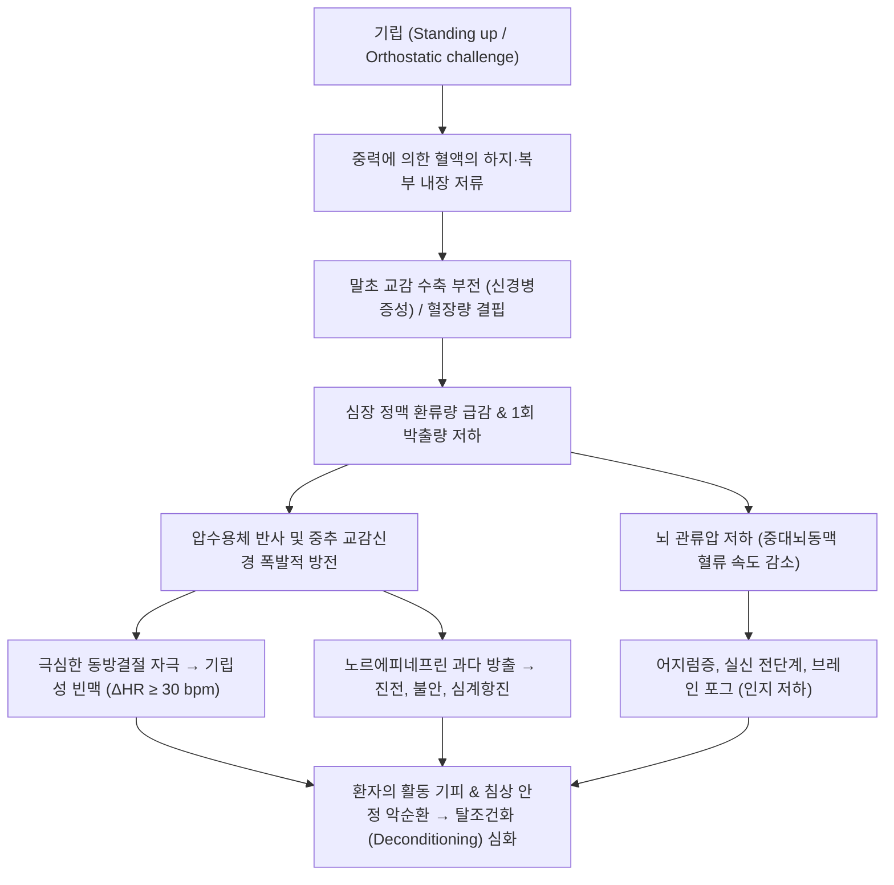

# 🩺 기립성 빈맥 증후군 (Postural Orthostatic Tachycardia Syndrome, POTS)

> **핵심 3줄 요약 (Key Summary)**:
> - 📍 병소 부위 & 해부·병태생리: 자율신경계 기능 부전(Dysautonomia)으로 기립 시 하지 및 내장 혈관의 교감신경 매개 혈관 수축 부전, 과도한 혈액의 중력성 하강(Venous pooling), 정맥 환류량 감소에 대한 대상성 심장 교감신경 과활성화 및 빈맥.
> - 🚩 전형적 임상 양상: 기립 후 10분 이내 현저한 심박수 상승($\ge 30\text{ bpm}$, 12~19세는 $\ge 40\text{ bpm}$) 또는 $\ge 120\text{ bpm}$ 도달(단, 기립성 저혈압 없음). 동반 증상으로 어지럼증, 심계항진, 브레인 포그(Brain fog), 만성 피로, 실신 전단계, 사지 말단 청색증.
> - 🛠️ 핵심 검사 & 치료 전략: 기립 경사 테이블 검사(HUTT) 또는 능동적 기립 검사(Active stand test 10분). 비약물 치료(수분 $2\sim 3\text{ L}$ 및 염분 $8\sim 10\text{ g}$ 증량, 복부·하지 압박 스타킹, 누워서 타는 리컴번트 자전거 운동), 약물 치료(베타차단제, 이바브라딘, 미도드린, 플루드로코르티손).
> - ⚠️ 응급 의뢰 레드플래그: 반복적인 실신(Syncope)으로 인한 두부 외상 위험, 기립성 저혈압(수축기 20 / 이완기 10 mmHg 이상 급격한 하강 동반 시 다른 신경퇴행성 자율신경부전 감별), 서맥-빈맥 증후군, 지속성 흉통 및 심실 부정맥 의심 소견.

---

## 📌 목차
1. [질환 개요 & 해부학적 병태생리](#1-질환-개요--해부학적-병태생리)
2. [병태생리 메커니즘 & 생체역학적 악순환 네트워크](#2-병태생리-메커니즘--생체역학적-악순환-네트워크)
3. [임상 증상 & 이학적 검사(Physical Exam) 알고리즘](#3-임상-증상--이학적-검사physical-exam-알고리즘)
4. [감별 진단 매트릭스 (Differential Diagnosis)](#4-감별-진단-매트릭스-differential-diagnosis)
5. [한의 통합 치료 프로토콜 (침·약침·추나·한약)](#5-한의-통합-치료-프로토콜-침약침추나한약)
6. [양방 치료 & 병용·의뢰 기준 (Conventional Treatment & Referral)](#6-양방-치료--병용의뢰-기준-conventional-treatment--referral)
7. [재활 운동 & 생활습관 티칭 가이드](#7-재활-운동--생활습관-티칭-가이드)
8. [💡 사용자 진료실 핵심 필기 & 임상 노하우 (Melt-In 잔여 심화 집약)](#8--사용자-진료실-핵심-필기--임상-노하우--melt-in-잔여-심화-집약)
9. [출처 및 학술 참고 문헌 (References)](#9-출처-및-학술-참고-문헌-references)

---

## 1. 질환 개요 & 해부학적 병태생리

기립성 빈맥 증후군(POTS, Postural Orthostatic Tachycardia Syndrome)은 기립 불내성(Orthostatic intolerance)을 특징으로 하는 만성 자율신경계 질환이다. 주로 15~50세의 가임기 여성(여성 대 남성 비율 약 4~5:1)에서 호발하며, 바이러스 감염 후(코로나19 후유증 Long COVID 등), 백신 접종 후, 임신, 외상, 극심한 스트레스 이후에 촉발되는 경우가 많다.

### 해부·생리학적 기립 반응과 POTS의 아형 분류
정상적인 기립 시 중력에 의해 $500\sim 1,000\text{ mL}$의 혈액이 복부 내장 혈관계 및 하지 정맥으로 이동한다. 이에 대응하여 경동맥동 및 대동맥궁의 압수용체(Baroreceptor)가 자극되어 교감신경을 활성화, 하지 혈관을 수축시키고 심박수를 분당 10~15회 소폭 올려 심박출량을 유지한다. POTS는 이 혈관 수축-심박 보상 회로의 이상으로 발생하며, 3대 주요 아형으로 나뉜다:
1. **신경병증성 POTS (Neuropathic POTS, 약 50%)**:
   - 하지 말초 교감신경(원위부 무수 C-섬유)의 선택적 탈신경 또는 기능 저하.
   - 기립 시 하지 세동맥 및 정맥 수축 부전으로 과도한 혈액의 중력성 울혈(Venous pooling) 발생.
2. **과교감신경성 POTS (Hyperadrenergic POTS, 약 30~40%)**:
   - 중추성 교감신경계 과활성화 및 노르에피네프린 청소율 저하.
   - 기립 시 혈중 노르에피네프린 농도가 비정상적으로 급증($>600\text{ pg/mL}$)하며, 빈맥뿐만 아니라 **혈압 상승(Hypertension)**, 진전, 불안, 다한증이 동반됨.
3. **저혈량성 POTS (Hypovolemic POTS)**:
   - 레닌-안지오텐신-알도스테론 축(RAAS)의 기이한 억제로 인해 만성적인 혈장량(Plasma volume) 및 적혈구량 결핍 동반.

---

## 2. 병태생리 메커니즘 & 생체역학적 악순환 네트워크

### 1) 뇌 관류 저하와 신경면역학적 네트워크
- **정맥 환류량 급감 및 1회 박출량(Stroke Volume) 저하**:
  - 기립 시 하지에 피가 쏠리고 심장으로 돌아오는 정맥 혈류가 급감함.
  - 심실 충만이 부족해져 1회 박출량이 떨어지면, 신체는 뇌 관류압을 사수하기 위해 심실 및 동방결절에 강한 교감신경 자극을 보내 **극단적인 심박수 상승(빈맥)**으로 심박출량을 보상하려 함.
- **뇌 혈류 조절 부전과 인지기능 장애 (Brain Fog)**:
  - 기립 시 뇌혈류 자가조절(Cerebral autoregulation) 기전이 무너지며 중대뇌동맥 혈류 속도가 15~20% 감소함.
  - 신경교세포 및 전두엽 피질의 저관류로 인해 작업 기억력 감퇴, 처리 속도 저하, 단어 인출 장애인 '브레인 포그'가 발생.
- **자가면역 기전과의 연관성**:
  - POTS 환자의 상당수에서 아드레날린성 수용체($\alpha_1, \beta_1, \beta_2$) 및 무스카린성 아세틸콜린 수용체($M_2, M_4$)에 대한 자가항체가 발견되며, 비만세포 활성화 증후군(MCAS) 및 과가동성 엘러스-단로스 증후군(hEDS)과의 삼중 병합이 흔함.

---

## 3. 임상 증상 & 이학적 검사(Physical Exam) 알고리즘

### 1) 주요 임상 증상
- **기립 관련 증상 (기립 시 악화, 앙와위 시 완화)**:
  - 심계항진, 심장 두근거림, 흉통, 흉부 압박감.
  - 기립 시 어지럼증, 실신 전단계(Presyncope), 시야 흐림, 터널 시야.
  - **브레인 포그(Brain fog)**: 멍함, 집중력 저하, 건망증.
- **전신 및 자율신경계 증상**:
  - 만성 피로(Chronic fatigue), 두통(경부 및 후두부의 '옷걸이 두통' Coat-hanger headache).
  - 사지 냉증, 기립 시 다리와 발이 붉은 보라색으로 변하는 말초 울혈/청색증(Acrocyanosis).
  - 소화기 증상(오심, 조기 포만감, 변비 또는 설사), 열/추위 불내성.

### 2) 이학적 검사 및 진단 기준 (2026 다학제 컨센서스)
1. **POTS 진단 기준 (모두 만족)**:
   - 기립 후 10분 이내에 **심박수가 기저치보다 30 bpm 이상 지속적으로 상승** (12~19세 청소년은 40 bpm 이상) 또는 **절대 심박수 $\ge 120\text{ bpm}$ 도달**.
   - **기립성 저혈압(Orthostatic Hypotension)이 동반되지 않아야 함** (수축기 20 mmHg 이상 또는 이완기 10 mmHg 이상의 하강 없음).
   - 증상이 최소 **3개월 이상 지속**되어야 함.
   - 빈맥을 유발할 만한 다른 기저 질환(심부전, 갑상선기능항진증, 빈혈, 탈수, 약물 등)이 배제되어야 함.
2. **진단 검사 프로토콜**:
   - **능동적 기립 검사 (NASA Lean Test / Active Stand Test)**: 앙와위 10분 안정 후 기립하여 1, 2, 3, 5, 10분에 혈압과 심박수 연속 측정.
   - **기립 경사 테이블 검사 (Head-Up Tilt Table Test, HUTT)**: 70도 경사각에서 10~45분간 심전도 및 혈압 추적.
   - 24시간 홀터 심전도(기립 무관한 부비동 빈맥 IST 배제), 심초음파(구조적 심질환 배제), 혈중 카테콜라민 측정.

---

## 4. 감별 진단 매트릭스 (Differential Diagnosis)

| 감별 질환 | 기립 시 혈압 변화 | 기립 시 심박수 변화 | 병태생리 및 임상적 특징 | 감별 핵심 포인트 |
| :--- | :--- | :--- | :--- | :--- |
| **기립성 빈맥 증후군 (POTS)** | **혈압 유지 또는 경도 상승** | **$\ge 30\text{ bpm}$ 상승 ($\ge 120$)** | 젊은 여성 호발, 말초 울혈, 브레인 포그 | **기립성 저혈압 없음**, 심박수만 단독 폭증 |
| **기립성 저혈압 (OH)** | **수축기 $\ge 20$ / 이완기 $\ge 10$ 하강** | 가변적 (신경인성 시 심박 안 오름) | 자율신경 부전, 노인, 당뇨 신경병증, 파킨슨 | **혈압의 명백한 강하가 주원인** |
| **부적절한 동성 빈맥 (IST)** | 정상 | **안정 시 $>100$, 24시간 평균 $>90$** | 누워 있어도 심박수가 항상 빠름 | 기립과 무관하게 안정 시에도 지속적인 빈맥 |
| **미주신경성 [[실신]] (VVS)** | 실신 직전 급격한 혈압·맥박 강하 | 급격한 서맥(Bradycardia) 동반 | 일시적 반사성 실신, 전구증상 후 의식 소실 | 만성적 빈맥이 아닌 일과성 에피소드 |
| **[[공황장애]] (Panic Disorder)** | 혈압 상승 가능 | 발작적 빈맥 동반 | 죽을 것 같은 공포감, 광장공포증 | **앙와위에서도 발작**, 체위 의존성이 아님 |
| **[[갑상선기능항진증]]** | 수축기 혈압 상승 | 지속적 안정 시 빈맥 | 혈청 TSH 억제, FT4 상승 | 혈액 검사로 쉽게 배제 가능 |

---

## 5. 한의 통합 치료 프로토콜 (침·약침·추나·한약)

> 💡 **한의학적 병인론 및 변증**:
> POTS는 한의학에서 **정충(怔忡)**, **심계(心悸)**, **현훈(眩暈)**, **허로(虛勞)**의 범주에 속한다. 주된 병기는 기혈부족(氣血不足)으로 맑은 양기가 두면부로 상승하지 못하는 **청양부승(淸陽不昇)**, 심기(心氣)와 심양(心陽)이 허하여 혈맥을 통솔하지 못하는 **심비양허(心脾兩虛)**, 또는 신수(腎水)가 부족하여 허화(虛火)가 위로 뜨는 **음허화왕(陰虛火旺)**이다.

### 1) 침구 치료 프로토콜
- **익기승양(益氣昇陽) 및 안신정계(安神定悸)**:
  - [[백회]](GV20): 청양을 끌어올려 기립 시 두경부 관류 개선 및 현훈 완화.
  - [[내관]](PC6), [[신문]](HT7): 심포경 및 심경을 안정시켜 발작성 빈맥, 심계항진 진정.
  - [[족삼리]](ST36), [[삼음교]](SP6): 비위 기혈을 북돋우고 하지 정맥 순환을 촉진하여 혈액 저류 완화.
  - [[태충]](LR3), [[풍지]](GB20): 교감신경 흥분 완화, 자율신경 긴장 조절.
- **자침 기법**: 평보평사법 또는 보법(補法) 위주로 자침하며, 과교감신경형 환자에게는 유침 시간 동안 조용하고 어두운 환경에서 자율신경 이완 유도.

### 2) 약침 치료 (자율신경 조절)
- **적용 혈위**: [[심수]](BL15), [[간수]](BL18), [[신수]](BL23), [[백회]](GV20).
- **처방 약침**:
  - 자하거(태반) 약침: 만성 저혈량 및 부신 기능 피로를 동반한 저혈량성·신경병증성 POTS 환자의 기혈 보강 (부위당 0.3~0.5cc).
  - 황련해독탕 약침: 가슴 답답함과 열감, 진전이 심한 과교감신경성 POTS 환자에게 [[단중]](CV17), 심수에 0.2cc 주입.

### 3) 한약 처방 (변증별 가감)
- **청양부승·기혈양허(淸陽不昇·氣血兩虛)형 (기립 시 심한 어지럼증, 피로, 무기력, 안면 창백)**:
  - **보중익기탕(補中益氣湯)** 가감 또는 **귀비탕(歸脾湯)**:
  - 기운을 끌어올리고 심비를 보하여 심계와 현훈을 동시에 다스림.
  - 처방 구성: [[황기]](승양익기), [[인삼]], [[백출]], [[당귀]], [[산조인]], [[원지]], [[용안육]], [[승마]], [[시호]], [[감초]].
- **심담허겁·교감신경항진(心膽虛怯·交感亢進)형 (가슴 두근거림, 불안, 손 떨림, 불면, 식은땀)**:
  - **온담탕(溫膽湯)** 합 **생맥산(生脈散) 가감**:
  - 담열(痰熱)을 내리고 심장을 안정시키며 진액을 보충하여 빈맥을 진정시킴.
  - 구성: [[반하]], [[진피]], [[복령]], [[지실]], [[죽여]], [[맥문동]], [[오미자]], [[인삼]], [[산치자]].
- **진액고갈·음허수휴(津液枯竭·陰虛水虧)형 (탈수 경향, 체액 부족, 야간 갈증, 구강 건조)**:
  - **증액탕(增液湯)** 합 **육미지황탕(六味地黃湯)**:
  - 혈관 내 체액량을 늘려 정맥 환류량 확보.
  - 구성: [[현삼]], [[맥문동]], [[생지황]], [[숙지황]], [[산약]], [[산수유]], [[택사]], [[복령]].

---

## 6. 양방 치료 & 병용·의뢰 기준 (Conventional Treatment & Referral)

### 1) 1차 비약물적 치료 (Non-pharmacological Core Therapy)
모든 환자에서 가장 먼저 확립해야 하는 기본 치료:
- **체액량 팽창 (Volume Expansion)**:
  - **수분 섭취**: 하루 최소 **$2.5\sim 3\text{ L}$** 이상의 물 섭취.
  - **염분 증량**: 하루 소금 **$8\sim 10\text{ g}$** (나트륨 3~4g) 섭취 (소금 알약 Salt tablets 활용).
- **물리적 압박 의복**:
  - 무릎형 스타킹은 효과가 미미함. **허벅지형 또는 팬티스타킹형 압박 스타킹(30~40 mmHg)과 복부 압박대(Abdominal binder)**를 착용하여 복부와 하지 정맥 울혈 차단.
- **물리적 대항 조치 (Counterpressure maneuvers)**:
  - 기립 중 어지러울 때 다리 꼬기, 종아리 힘주기, 스쿼트 자세 취하기.

### 2) 약물 치료 (Pharmacotherapy, 아형별 맞춤)
- **심박수 조절제**:
  - **프로프라놀롤 (Propranolol)**: 저용량(10~20mg 1일 3~4회) 베타차단제로 기립 시 빈맥 및 진전 억제.
  - **이바브라딘 (Ivabradine)**: 동방결절 If 채널 차단제로 혈압에 영향을 주지 않고 심박수만 선택적으로 낮춤.
- **혈관 수축제**:
  - **미도드린 (Midodrine)**: 말초 알파-1 효능제로 하지 혈관을 수축시켜 정맥 환류량 증대 (누웠을 때 앙와위 고혈압 주의).
- **혈장량 증가제**:
  - **플루드로코르티손 (Fludrocortisone)**: 합성 무기질코르티코이드로 신장의 나트륨 재흡수를 촉진하여 혈액량 팽창.
- **중추성 교감신경 억제제 (과교감신경형)**:
  - 클로니딘(Clonidine), 메틸도파(Methyldopa): 중추 알파-2 효능제.

### 3) 양방·전문과 응급 의뢰 기준 (Referral Criteria)
- 🚨 **실신(Syncope)으로 인한 외상 발생**:
  - 단순 실신 전단계를 넘어 기립 시 의식을 완전히 잃고 쓰러져 뇌진탕이나 골절이 발생한 경우.
- 🚨 심전도상 QTc 연장 증후군, 조기흥분 증후군(WPW), 방실 차단 등 치명적 부정맥 소견이 관찰될 때.
- 🚨 기립 시 수축기 혈압이 80 mmHg 이하로 곤두박질치는 중증 기립성 저혈압이 확인될 때.

---

## 7. 재활 운동 & 생활습관 티칭 가이드

### 1) 레빈 프로토콜 (Levine Protocol / CHOP Exercise Program)
- **수평 운동부터 시작 (Non-upright Exercise)**:
  - POTS 환자에게 서서 걷거나 달리는 운동을 시키면 심박수가 160 이상 치솟아 탈진하고 운동을 포기하게 됨.
  - 첫 1~3개월은 중력 영향을 받지 않는 **누워서 타는 자전거(Recumbent bike), 조정(Rowing machine), 수영(Swimming)** 위주로 시행.
- **점진적 기립 전환**: 하지 근육(특히 종아리 비복근·가자미근은 신체의 '제2의 심장')과 코어 근육이 강화되면 점차 일립식 자전거, 걷기 운동으로 단계적 상향.

### 2) 기상 및 식사 습관
- 아침 기상 직후 침대에서 일어나기 전 **물 500mL를 10분 내에 급속 음용** (삼투압성 교감신경 자극으로 혈압 상승 및 기립 관류 유지).
- 과식 시 소화관으로 혈류가 집중(Splanchnic pooling)되어 빈맥이 악화되므로, **소량씩 자주 나누어 먹는 저탄수화물 식단** 유지.

---

## 8. 💡 사용자 진료실 핵심 필기 & 임상 노하우 (Melt-In 잔여 심화 집약)

### 1) "공황장애나 꾀병으로 오진받고 온 20대 여성"을 대하는 법
- POTS 환자의 70% 이상은 정확한 진단을 받기 전까지 정신과에서 '공황장애', '우울증', '신경성 히스테리'로 오진받고 신경안정제를 복용하다 좌절한 상태로 한의원에 온다.
- 가슴이 뛰고 어지러운 것은 마음의 병이 아니라, **"피가 다리로 쏠려서 뇌로 안 가니까 심장이 살려고 미친 듯이 뛰는 신체적 자율신경 질환"**임을 설명해 주는 것만으로도 환자는 엄청난 심리적 해방감을 느낀다.
- 진료실에서 환자를 10분간 침대에 눕혀두었다가 일으켜 세워 3분 만에 맥박이 30 이상 치솟는 것을 맥진기와 혈압계로 직접 눈앞에서 보여주는 것이 신뢰 형성의 핵심이다.

### 2) '옷걸이 두통 (Coat-Hanger Headache)'의 임상적 가치
- 환자가 "목 뒤부터 어깨 승모근 라인이 마치 옷걸이에 걸린 것처럼 뻐근하고 당기면서 머리가 아프다"고 호소할 때, 단순 경추성 두통이나 일자목으로만 진단해서는 안 된다.
- 이는 뇌 관류 저하 시 승모근과 후두하근의 미세혈관 관류가 급격히 떨어지면서 발생하는 **기립 불내성의 교과서적 전형 징후**이다.

---

## 9. 출처 및 학술 참고 문헌 (References)

1. Postural orthostatic tachycardia syndrome (POTS) and dysautonomia: International multidisciplinary expert consensus. (2026). *Am J Med*, 139(8):. PMID: 42665152.

2. Methyldopa for hyperadrenergic postural orthostatic tachycardia syndrome: A case series of five patients. (2026). *Auton Neurosci*, 261:103387. PMID: 42696970.

3. Persistent Cognitive Dysfunction in Postural Orthostatic Tachycardia Syndrome: A Scoping Review of Neural Mechanisms, Interventions, and Critical Research Gaps. (2026). *Cureus*, 18(7):e88092. PMID: 42605371.

---

## 관련 노트

- [[실신]]
- [[공황장애]]
- [[갑상선기능항진증]]
- [[백회]]
- [[내관]]
- [[신문]]
- [[족삼리]]
- [[삼음교]]
- [[태충]]
- [[풍지]]
- [[심수]]
- [[간수]]
- [[신수]]
- [[단중]]
- [[황기]]
- [[인삼]]
- [[백출]]
- [[당귀]]
- [[산조인]]
- [[원지]]
- [[용안육]]
- [[승마]]
- [[시호]]
- [[감초]]
- [[반하]]
- [[진피]]
- [[복령]]
- [[지실]]
- [[죽여]]
- [[맥문동]]
- [[오미자]]
- [[현삼]]
- [[생지황]]
- [[보중익기탕]]
- [[귀비탕]]
- [[온담탕]]
- [[생맥산]]
- [[증액탕]]
- [[육미지황탕]]
