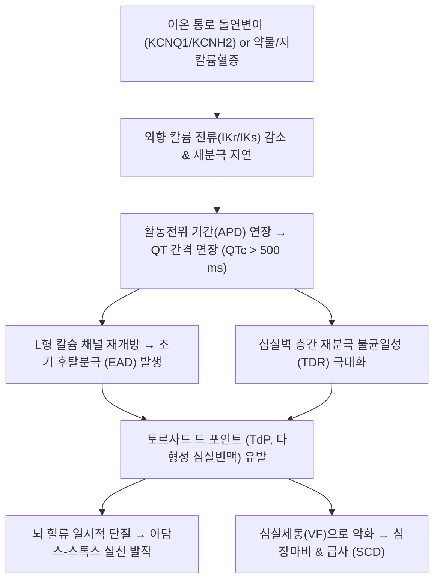

# 🩺 긴 QT 간격 증후군 (Long QT Syndrome, LQTS)

> **핵심 3줄 요약 (Key Summary)**:
> - 📍 병소 부위 & 해부·병태생리: 심근세포막의 칼륨($I_{Ks}, I_{Kr}$) 또는 나트륨($I_{Na}$) 이온 통로 유전자 변이(선천성) 혹은 약물/전해질 불균형(후천성)으로 인해 심실 재분극(Ventricular repolarization)이 비정상적으로 지연됨.
> - 🚩 전형적 임상 양상: 심전도상 QTc 간격 연장(남성 $>450\text{ ms}$, 여성 $>460\text{ ms}$, 위험선 $>500\text{ ms}$), 감정적 흥분·운동·수면 중 돌발성 실신(Syncope), 심계항진, 다형성 심실빈맥인 **토르사드 드 포인트(TdP, Torsades de Pointes)**, 심실세동에 의한 급성 심장사.
> - 🛠️ 핵심 검사 & 치료 전략: 12유도 심전도(Bazett 공식 QTc 산출), 슈워츠 진단 점수표(Schwartz score), 유전자 검사(*KCNQ1, KCNH2, SCN5A*). 1차 약물은 비선택적 베타차단제(나돌롤 Nadolol, 프로프라놀롤), 고위험군 삽입형 제세동기(ICD), 급성 TdP 발작 시 황산마그네슘($\text{MgSO}_4$) 정주.
> - ⚠️ 응급 의뢰 레드플래그: QTc $> 500\text{ ms}$, TdP 발작 확인, 운동 또는 수영 중 반복적 실신, 가족 중 젊은 연령의 급사력(Sudden cardiac death), QT 연장 유발 약물 복용 후 발생한 경련성 실신.

---

## 📌 목차
1. [질환 개요 & 해부학적 병태생리](#1-질환-개요--해부학적-병태생리)
2. [병태생리 메커니즘 & 생체역학적 악순환 네트워크](#2-병태생리-메커니즘--생체역학적-악순환-네트워크)
3. [임상 증상 & 이학적 검사(Physical Exam) 알고리즘](#3-임상-증상--이학적-검사physical-exam-알고리즘)
4. [감별 진단 매트릭스 (Differential Diagnosis)](#4-감별-진단-매트릭스-differential-diagnosis)
5. [한의 통합 치료 프로토콜 (침·약침·추나·한약)](#5-한의-통합-치료-프로토콜-침약침추나한약)
6. [양방 치료 & 병용·의뢰 기준 (Conventional Treatment & Referral)](#6-양방-치료--병용의뢰-기준-conventional-treatment--referral)
7. [재활 운동 & 생활습관 티칭 가이드](#7-재활-운동--생활습관-티칭-가이드)
8. [💡 사용자 진료실 핵심 필기 & 임상 노하우 (Melt-In 잔여 심화 집약)](#8--사용자-진료실-핵심-필기--임상-노하우--melt-in-잔여-심화-집약)
9. [출처 및 학술 참고 문헌 (References)](#9-출처-및-학술-참고-문헌-references)

---

## 1. 질환 개요 & 해부학적 병태생리

긴 QT 간격 증후군(Long QT Syndrome, LQTS)은 심전도에서 심실의 탈분극 시작부터 재분극 종료까지를 반영하는 QT 간격이 비정상적으로 연장되어, 다형성 심실빈맥인 토르사드 드 포인트(TdP) 및 급성 심장사를 유발할 수 있는 치명적인 심장 채널병증(Channelopathy)이다.

### 선천성 3대 아형과 이온 통로 병태생리
1. **LQT1 (약 40~45%, *KCNQ1* 돌연변이)**:
   - 지연정류 칼륨 전류 중 완만 성분인 $I_{Ks}$ 통로 기능 저하.
   - **촉발 요인**: 신체적 운동, 특히 **수영(Swimming)** 및 격렬한 육체 활동.
   - 심전도 특징: 기저부가 넓고 둔탁한 T파(Broad-based T wave).
2. **LQT2 (약 35~40%, *KCNH2 / HERG* 돌연변이)**:
   - 지연정류 칼륨 전류 중 신속 성분인 $I_{Kr}$ 통로 기능 저하.
   - **촉발 요인**: 감정적 흥분, 놀람, **갑작스러운 청각 자극(알람 시계 소리, 전화벨, 천둥소리)**.
   - 심전도 특징: 진폭이 낮고 노치(Notched/Bifid)가 있는 T파.
3. **LQT3 (약 8~10%, *SCN5A* 돌연변이)**:
   - 심근 나트륨 통로 $Nav1.5$의 불활성화 지연으로 후기 지속성 나트륨 전류($I_{Na-L}$) 증가.
   - **촉발 요인**: **수면 중 또는 안정 시(서맥 상태)**.
   - 심전도 특징: 긴 ST 분절 후 나타나는 좁고 뾰족한 T파.

---

## 2. 병태생리 메커니즘 & 생체역학적 악순환 네트워크

### 1) 조기 후탈분극(EAD)과 토르사드 드 포인트 발생 기전
- **재분극 지연과 활동전위 기간(APD) 연장**:
  - 외향 칼륨 전류 감소 또는 내향 나트륨/칼슘 전류 지속으로 3기 재분극이 심각하게 지연됨.
- **조기 후탈분극 (Early Afterdepolarization, EAD)**:
  - 재분극이 길어지는 동안 L형 칼슘 통로(L-type $Ca^{2+}$ channel)가 불활성화에서 회복되어 재개방됨 $\rightarrow$ 칼슘 유입으로 인한 2기 말 또는 3기 전위 역전(EAD) 발생.
- **유발 활동(Triggered Activity) 및 회귀성 부정맥**:
  - 심실 근육 내 심내막, M-세포, 심외막 간의 재분극 시간차(Transmural dispersion of repolarization, TDR)가 극대화됨.
  - EAD에 의해 유발된 조기 박동이 회귀(Reentry) 회로를 형성하여 QRS 축이 끊임없이 비틀리며 회전하는 **토르사드 드 포인트(TdP)**로 발전함.
  - TdP가 자연 정지하지 못하면 [[심실 세동]](VF)으로 퇴행하여 심정지를 유발함.

---

## 3. 임상 증상 & 이학적 검사(Physical Exam) 알고리즘

### 1) 주요 임상 증상
- **실신 (Syncope)**: TdP 발생 시 뇌 혈류가 수 초간 중단되어 쓰러짐. 종종 뇌전증(간질) 발작으로 오진되는 강직성 경련 동반.
- **심계항진 및 현훈**: 가슴이 심하게 덜컹거리거나 어지러움.
- **무증상**: 40~50%의 보인자는 평생 심전도 이상만 보이다가 감기약 복용이나 전해질 이상 시 돌연사로 첫 발현.

### 2) 심전도 측정 및 진단 점수표 (Schwartz Score)
- **QTc 간격 측정 (Bazett 공식)**:
  - $QTc = \frac{QT}{\sqrt{RR}}$ (정상 남성 $<450\text{ ms}$, 여성 $<460\text{ ms}$).
  - $QTc \ge 480\text{ ms}$ (3점), $460\sim 470\text{ ms}$ (2점), $450\text{ ms}$ 남성 (1점).
  - $QTc \ge 500\text{ ms}$는 부정맥 발생의 최고 위험 역치.
- **슈워츠 진단 점수 (Schwartz Score)**:
  - 점수 항목: QTc 간격, TdP 병력, T파 노치, 서맥, 실신력, 청각 이상(Jervell and Lange-Nielsen 증후군), 가족력.
  - **$\ge 3.5\text{점}$**: LQTS 가능성 매우 높음(확진).
  - $1.5\sim 3.0\text{점}$**: 중간 위험도 (유전자 검사 및 부하 심전도 필요).

---

## 4. 감별 진단 매트릭스 (Differential Diagnosis)

| 감별 질환 | 심전도 소견 | 촉발 상황 | 유전 / 병인 | 감별 핵심 포인트 |
| :--- | :--- | :--- | :--- | :--- |
| **선천성 긴 QT 증후군** | **기저 QTc 지속적 연장** | 운동(LQT1), 소음(LQT2), 수면(LQT3) | 유전자 변이 (*KCNQ1* 등) | 가족력 뚜렷, 유전자 양성, 평생 베타차단제 |
| **후천성 (약물성) 긴 QT** | 약물 복용 또는 저칼륨 시 연장 | 항부정맥제, 항생제, 항우울제 투약 | 약물 매개 $I_{Kr}$ 차단 | **원인 약물 중단 및 전해질 교정 시 QTc 정상화** |
| **[[브루가다 증후군]]** | 우각차단 + V1-V3 ST 상승 (Coved형) | 야간 수면 중, 발열 시 호발 | *SCN5A* 등 나트륨 통로 | QT는 정상, V1-V3 특이적 ST 분절 융기 |
| **단순 미주신경성 [[실신]]** | 정상 QTc, 동서맥 | 장시간 기립, 주사 공포, 탈수 | 반사성 자율신경 이상 | 전구증상(식은땀, 오심) 뚜렷, 심실 부정맥 없음 |
| **뇌전증 (간질 발작)** | 발작 간헐기 뇌파 이상, QTc 정상 | 수면 부족, 번쩍이는 빛 | 중추신경계 신경원 과흥분 | 항경련제 반응, 뇌파(EEG) 확진 |

---

## 5. 한의 통합 치료 프로토콜 (침·약침·추나·한약)

> ⚠️ **긴 QT 증후군 관리의 절대 안전 수칙**:
> LQTS는 치명적인 토르사드 드 포인트(TdP) 및 심실세동으로 급사할 수 있는 심실 채널병증이다. **양방 심장내과 전문의의 유전자 진단, 베타차단제 투약 및 ICD 삽입 결정을 최우선으로 준수**해야 한다.
> 한의 치료는 **심장 교감신경 긴장 완화, 스트레스성 트리거 제어, 자율신경 안정 보조 요법**으로 극히 신중하게 적용하며, **QT 연장 위험이 있는 약재의 처방을 엄격히 배제**해야 한다.

### 1) 침구 치료 프로토콜
- **청심안신(淸心安神) 및 교감신경 과흥분 억제**:
  - [[내관]](PC6), [[신문]](HT7): 심장 교감신경 긴장도를 낮추고 심박 변이도(HRV)를 개선.
  - [[백회]](GV20), [[풍지]](GB20): 신경계 긴장 완화, 놀람이나 청각 자극에 대한 과민 반응 억제.
  - [[족삼리]](ST36), [[태충]](LR3): 전신 자율신경 균형 조절.

### 2) 한약 처방 시 금기 및 주의 약재
- ⛔ **부자(附子), 천오(川烏), 초오(草烏) 절대 금기**:
  - 아코니틴(Aconitine) 성분은 전압의존성 나트륨 통로를 비가역적으로 개방하여 **치명적인 심실성 부정맥 및 TdP를 직접 유발하므로 절대 투여 금지**.
- ⚠️ 마황(麻黃) 투여 주의: 에페드린의 교감신경 흥분 작용이 LQT1/LQT2 환자의 부정맥을 유발할 수 있으므로 사용을 배제함.

### 3) 권장 한약 처방 (변증별 가감)
- **심담허겁·간기울결(心膽虛怯·肝氣鬱結)형 (소리나 놀람에 민감, 심계, 불안, 불면)**:
  - **가미온담탕(加味溫膽湯)** 또는 **안신정지환(安神定志丸) 가감**:
  - 심신을 진정시키고 담열을 식혀 감정적 흥분에 의한 심장 충격을 방어.
  - 처방 구성: [[반하]], [[진피]], [[복령]], [[지실]], [[죽여]], [[산치자]], [[원지]], [[석창포]], [[용골]], [[모려]], [[감초]].
- **심음허·수화부제(心陰虛·水火不濟)형 (심계항진, 마른 체형, 식은땀, 미열)**:
  - **천왕보심단(天王補心丹) 가감**:
  - 심장 음혈을 자양하여 허화를 내림.
  - 구성: [[생지황]], [[현삼]], [[맥문동]], [[천문동]], [[인삼]], [[백자인]], [[산조인]], [[당귀]], [[오미자]], [[원지]].

---

## 6. 양방 치료 & 병용·의뢰 기준 (Conventional Treatment & Referral)

### 1) 약물 치료 (First-line Medical Therapy)
- **비선택적 베타차단제 (Non-selective Beta-blockers, 치료의 근간)**:
  - **나돌롤 (Nadolol)** 또는 **프로프라놀롤 (Propranolol)**: 운동 및 감정적 자극에 의한 교감신경성 트리거를 차단하여 심실 재분극 불균일성을 억제함 (특히 LQT1, LQT2에서 급사 위험 80% 이상 감소).
  - 아테놀롤이나 메토프롤롤 같은 선택적 베타차단제는 예방 효과가 떨어져 권장되지 않음.
- **멕실레틴 (Mexiletine)**: 나트륨 채널 차단제로 LQT3 환자에서 지속성 나트륨 전류($I_{Na-L}$)를 차단하여 연장된 QT 간격을 직접 단축시킴.

### 2) 급성기 토르사드 드 포인트(TdP) 응급 처치
- **황산마그네슘 ($\text{MgSO}_4$)**: $1\sim 2\text{ g}$ 정맥 내 급속 주입 (EAD 억제의 1차 구원 약제, 혈중 마그네슘 수치와 무관하게 즉각 투여).
- **불안정 TdP (혈압 저하, 의식 소실)**: 즉각적인 비동기 제세동(Defibrillation).
- **일시적 심장 조율(Overdrive Pacing) 또는 이소프로테레놀**: 심박수를 분당 90~110회로 올려 활동전위 기간을 단축시키고 TdP 재발 방지.

### 3) 기구 및 수술 치료
- **삽입형 제세동기 (ICD)**: 심정지 생존자, 베타차단제 복용 중에도 실신이 반복되는 환자, QTc $> 500\text{ ms}$인 초고위험군.
- **좌측 심장 교감신경 절제술 (LCSD)**: ICD 쇼크가 반복되거나 베타차단제 불내성/금기 환자.

### 4) 양방·전문과 응급 의뢰 기준 (Referral Criteria)
- 🚨 **심전도상 QTc $\ge 500\text{ ms}$ 확인 시 즉시 부정맥 전문 심장내과 전원**.
- 🚨 운동 중, 수영 중, 또는 갑작스러운 소음에 놀란 직후 발생한 실신 병력.
- 🚨 가족 중 40세 이전의 원인 불명 돌연사(익사, 단독 교통사고 포함) 가족력이 있는 경우.

---

## 7. 재활 운동 & 생활습관 티칭 가이드

### 1) 아형별 특이적 생활습관 회피 수칙
- **LQT1 환자**: **수영(Swimming) 절대 금기** (반드시 감독관이 있더라도 경쟁적 수영 금지), 격렬한 운동 금지.
- **LQT2 환자**: **시끄러운 소음 트리거 완전 차단** (침실의 알람 시계 치우기, 휴대폰 벨소리를 진동이나 부드러운 음악으로 변경, 공포 영화 및 자극적 비디오 게임 금지).
- **LQT3 환자**: 야간 수면 중 모니터링 주의, 인터콤 설치.

### 2) QT 연장 약물(CredibleMeds 목록) 철저 회피
- 환자에게 [www.crediblemeds.org](https://www.crediblemeds.org) 웹사이트 안내.
- 감기약(항히스타민제 일부), 항생제(마크로라이드계, 퀴놀론계), 항진균제, 위장관약(돔페리돈), 항우울제 등을 복용할 때 반드시 의사·약사에게 LQTS 환자임을 고지하도록 지도.
- 구토, 설사 발생 시 저칼륨혈증이 급사를 부를 수 있으므로 즉시 전해질 음료 섭취 및 병원 방문.

---

## 8. 💡 사용자 진료실 핵심 필기 & 임상 노하우 (Melt-In 잔여 심화 집약)

### 1) "수영장이나 목욕탕에서 익사할 뻔한 적이 있습니까?"
- 어린이나 청소년이 "수영하다가 갑자기 정신을 잃고 가라앉아 건져졌다"는 병력을 이야기하면 쥐가 난 것이 아니라 **LQT1에 의한 치명적 부정맥**을 1순위로 의심해야 한다.
- 잠수 시 찬물이 안면에 닿을 때 발생하는 삼차신경-미주신경 반사와 운동 교감신경의 충돌이 LQT1 환자에서 심정지를 촉발하는 전형적 메커니즘이다.

### 2) 뇌전증으로 5년간 항경련제를 먹고 있던 아이의 심전도
- 소아 신경과에서 간질 진단을 받고 약을 먹는데도 가끔씩 기절한다는 소아 환자가 오면 반드시 심전도를 찍어 QTc를 확인해야 한다.
- 뇌파 이상 없이 실신 중 뇌 관류 저하로 팔다리를 떠는 경련(Convulsive syncope)을 뇌전증으로 오진하여, 정작 심장 급사 위험에 무방비로 노출되는 비극적인 사례가 적지 않다.

---

## 9. 출처 및 학술 참고 문헌 (References)

1. [Practical management of drug-induced long QT syndrome]. (2026). *Inn Med (Heidelb)*, 67(7):. PMID: 42420515.

2. From Molecules to Machines: An Integrative Framework Linking Molecular Pathogenesis, Multi-Factorial Risk, Risk Stratification, Clinical Management, and Artificial Intelligence in QT Prolongation and Sudden Cardiac Death. (2026). *Clin Cardiol*, 49(6):e70258. PMID: 42274161.

3. Metabolite-centric perspectives on QT prolongation: Molecular mechanisms and clinical implications beyond the parent drug. (2026). *Heart Rhythm*, 23(7):1380-1390. PMID: 41407240.

---

## 관련 노트

- [[심실 세동]]
- [[실신]]
- [[공황장애]]
- [[브루가다 증후군]]
- [[내관]]
- [[신문]]
- [[백회]]
- [[풍지]]
- [[족삼리]]
- [[태충]]
- [[반하]]
- [[진피]]
- [[복령]]
- [[지실]]
- [[죽여]]
- [[산치자]]
- [[원지]]
- [[석창포]]
- [[생지황]]
- [[현삼]]
- [[맥문동]]
- [[인삼]]
- [[산조인]]
- [[가미온담탕]]
- [[천왕보심단]]
