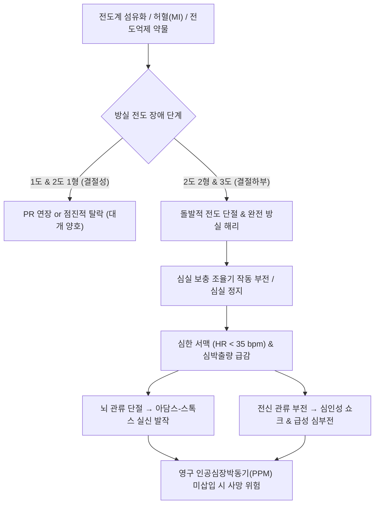

# 🩺 방실 차단 (Atrioventricular Block, AV Block)

> **핵심 3줄 요약 (Key Summary)**:
> - 📍 병소 부위 & 해부·병태생리: 심방에서 심실로의 전기 자극 전도가 방실결절(AV node) 또는 히스-푸르키네 섬유속(His-Purkinje system) 수준에서 지연되거나 간헐적/완전 차단됨. 섬유화(레네그르/레브 병), 허혈(하벽 심근경색), 미주신경 항진, 전도 억제 약물 등이 주원인.
> - 🚩 전형적 임상 양상: 1도(대개 무증상, PR $>0.20$초), 2도 1형(모비츠 I형/벵케바흐: PR 점진적 연장 후 QRS 탈락), 2도 2형(모비츠 II형: 일정한 PR 후 예고 없는 QRS 탈락), 3도(완전 방실 차단: 심방 P파와 심실 QRS의 완전 해리, 심한 서맥, 실신 아담스-스톡스 발작, 피로, 호흡곤란).
> - 🛠️ 핵심 검사 & 치료 전략: 12유도 심전도, 24시간 홀터 심전도. 가역적 원인(약물, 전해질) 교정. 증상성 서맥 시 아트로핀/임시 박동조율기, 모비츠 II형 및 3도 완전 방실 차단은 **영구 인공심장박동기(Permanent Pacemaker, PPM)** 삽입의 절대 적응증.
> - ⚠️ 응급 의뢰 레드플래그: 3도 완전 방실 차단, 모비츠 II형 2도 차단, 심박수 $<40\text{ bpm}$의 중증 서맥, 심실 정지(Ventricular standstill)에 의한 실신(Adams-Stokes syncope), 혈역학적 불안정(저혈압, 흉통, 심부전 증상).

---

## 📌 목차
1. [질환 개요 & 해부학적 병태생리](#1-질환-개요--해부학적-병태생리)
2. [병태생리 메커니즘 & 생체역학적 악순환 네트워크](#2-병태생리-메커니즘--생체역학적-악순환-네트워크)
3. [임상 증상 & 이학적 검사(Physical Exam) 알고리즘](#3-임상-증상--이학적-검사physical-exam-알고리즘)
4. [감별 진단 매트릭스 (Differential Diagnosis)](#4-감별-진단-매트릭스-differential-diagnosis)
5. [한의 통합 치료 프로토콜 (침·약침·추나·한약)](#5-한의-통합-치료-프로토콜-침약침추나한약)
6. [양방 치료 & 병용·의뢰 기준 (Conventional Treatment & Referral)](#6-양방-치료--병용의뢰-기준-conventional-treatment--referral)
7. [재활 운동 & 생활습관 티칭 가이드](#7-재활-운동--생활습관-티칭-가이드)
8. [💡 사용자 진료실 핵심 필기 & 임상 노하우 (Melt-In 잔여 심화 집약)](#8--사용자-진료실-핵심-필기--임상-노하우--melt-in-잔여-심화-집약)
9. [출처 및 학술 참고 문헌 (References)](#9-출처-및-학술-참고-문헌-references)

---

## 1. 질환 개요 & 해부학적 병태생리

방실 차단(Atrioventricular Block, AV Block)은 동방결절(SA node)에서 정상적으로 생성된 심방의 탈분극 파동이 심실로 전도되는 과정에서 속도가 늦어지거나(지연) 일부 또는 전부가 통과하지 못하는(차단) 심장 전도계 장애이다.

### 해부학적 전도 경로와 차단 수준별 4단계 분류
1. **1도 방실 차단 (First-degree AV Block)**:
   - 심방 자극이 모두 심실로 전도되지만, 전도 시간이 지연됨.
   - 심전도상 **PR 간격이 $0.20\text{초(200 ms)}$ 이상**으로 고정 연장됨. 병소는 대개 방실결절 내부(Nodal level).
2. **2도 1형 방실 차단 (Second-degree Mobitz Type I / Wenckebach)**:
   - 전도 시간이 한 박동씩 점진적으로 길어지다가(PR 간격 점증) 마침내 1개의 P파 뒤에 QRS파가 탈락함.
   - 주로 방실결절 자체의 가역적 전도 피로로 발생하며, 예후가 비교적 양호함.
3. **2도 2형 방실 차단 (Second-degree Mobitz Type II)**:
   - PR 간격이 일정하게 유지되다가 아무런 예고 없이 돌발적으로 QRS파가 탈락함.
   - 병소는 방실결절 하부인 **히스속(Bundle of His) 또는 각(Bundle branches)** 수준(Infranodal level). 3도 완전 차단으로 급격히 진행할 위험이 매우 높음.
4. **3도 완전 방실 차단 (Third-degree / Complete Heart Block, CHB)**:
   - 심방의 어떤 전기 신호도 심실로 전달되지 않음.
   - 심방은 동방결절 속도(분당 60~100회)로 뛰고, 심실은 독립적인 하부 보충 조율기(Escape pacemaker: 접합부 $40\sim 60\text{ bpm}$ 또는 심실 고유 $20\sim 40\text{ bpm}$)에 의해 독자적으로 수축하여 **완전한 방실 해리(AV dissociation)**를 나타냄.

---

## 2. 병태생리 메커니즘 & 생체역학적 악순환 네트워크

### 1) 기전별 조직 손상 및 전도 장애
- **특발성 섬유화 퇴행성 질환 (Lenègre-Lev disease)**: 고령화에 따른 심장 골격 및 전도계 섬유화 변성(노인성 방실 차단의 가장 흔한 원인).
- **관상동맥 허혈 (하벽 vs 전벽 심근경색)**:
  - **급성 하벽 심근경색 (RCA 폐색)**: 방실결절동맥(AV nodal artery) 혈류 차단 및 미주신경 반사(Bezold-Jarisch 반사)로 일과성 모비츠 I형 또는 3도 차단 발생 (대개 며칠 내 가역적 회복).
  - **급성 전벽 심근경색 (LAD 폐색)**: 중격 동맥 차단으로 양측 각(Bilateral bundle branches)의 광범위한 괴사 유발 $\rightarrow$ 급성 모비츠 II형 및 광범위 전벽 3도 차단 (불응성, 영구 손상, 치사율 극히 높음).
- **혈역학적 악순환과 아담스-스톡스 증후군**:
  - 심박수가 $30\sim 40\text{ bpm}$ 이하로 떨어지면 1회 박출량 보상 한계를 초과하여 심박출량이 급감함.
  - 심실 보충 박동이 수 초간 시작되지 않는 **심실 정지(Ventricular standstill)** 발생 시 급격한 뇌 허혈로 쓰러지는 **아담스-스톡스 발작(Adams-Stokes attack)** 및 급사 초래.

---

## 3. 임상 증상 & 이학적 검사(Physical Exam) 알고리즘

### 1) 주요 임상 증상
- **경증 (1도, 무증상 2도 1형)**: 무증상이거나 가벼운 피로감, 운동 시 호흡곤란.
- **중증 (모비츠 II형, 3도 완전 방실 차단)**:
  - 심한 어지럼증, 눈앞이 캄캄해짐, 실신(Syncope), 무기력증.
  - 서맥성 심부전 징후(노력성 호흡곤란, 부종).
  - 흉부 쿵 내려앉는 느낌 또는 서맥으로 인한 대상성 강한 박동감.

### 2) 이학적 검사 및 진단 검사 소견
1. **신체 진찰**:
   - 맥박 촉지: 분당 30~50회의 규칙적이거나 불규칙적인 심한 서맥.
   - 경정맥 시진: 3도 방실 차단 시 삼첨판이 닫힌 상태에서 심방이 수축할 때 경정맥으로 강한 파동이 솟구치는 **대포 A파(Cannon 'a' waves)** 관찰.
   - 심음 청진: 3도 차단 시 제1심음(S1)의 강도가 매 박동마다 달라짐(Changing intensity of S1).
2. **12유도 심전도 (Gold Standard)**:
   - P파와 QRS파의 간격, 비율, 연관성을 측정하여 1도, 2도(I형/II형), 3도 차단 감별.
   - 3도 차단 시 QRS가 좁으면(Narrow QRS) 접합부 보충 조율(양호), QRS가 넓으면(Wide QRS) 심실 보충 조율(불안정).
3. **가역적 원인 검사**: 혈청 전해질(고칼륨혈증), 디곡신 농도, 갑상선 기능, 심근효소 수치(급성 허혈 배제).

---

## 4. 감별 진단 매트릭스 (Differential Diagnosis)

| 감별 질환 | 심전도 P파와 QRS파 관계 | PR 간격 특성 | 위험도 및 임상적 의의 |
| :--- | :--- | :--- | :--- |
| **1도 방실 차단** | 1:1 전도 유지 (모든 P파 전도) | **$> 0.20$초로 고정 연장** | 매우 양호, 치료 불필요 |
| **2도 1형 (Wenckebach)** | 3:2, 4:3 전도 등 간헐적 탈락 | **점진적으로 길어지다 탈락** | 비교적 양호, 운동선수 수면 중 흔함 |
| **2도 2형 (Mobitz II)** | 2:1, 3:1 전도 등 간헐적 탈락 | **일정하게 유지되다 돌발 탈락** | **높음, 3도 완전 차단으로 급속 진행** |
| **3도 완전 방실 차단** | **P파와 QRS파의 완전 분리 (해리)** | 일정치 않음 (P-P, R-R 독자적) | **최고 위험 (아담스-스톡스 실신, PPM 필수)** |
| **동정지 (Sinus Arrest)** | P파 자체가 발생하지 않음 | 차단 간격 동안 P-QRS 모두 없음 | 동방결절 기능 부전(SSS, 병든동결절) |

---

## 5. 한의 통합 치료 프로토콜 (침·약침·추나·한약)

> ⚠️ **방실 차단 관리의 절대 안전 수칙**:
> 모비츠 II형 2도 차단 및 3도 완전 방실 차단은 심박출량 급감과 심실 정지로 실신과 급사를 초래하는 구조적·전기적 전도계 질환이다. **이러한 고위험 방실 차단에 대한 인공심장박동기(PPM) 삽입을 지체하거나 한방 단독 치료로 해결하려 해서는 절대 안 된다.**
> 한의 치료는 **원인 질환이 없는 경증 1도 차단, 미주신경 긴장 항진으로 인한 일과성 2도 1형 차단, 또는 박동기 삽입 후 기혈 부족으로 인한 만성 피로·무기력감 완화 보조 요법**에 한하여 적용한다.

### 1) 침구 치료 프로토콜
- **통양보기(通陽益氣) 및 자율신경 조절**:
  - [[내관]](PC6): 심포경 락혈, 심박수 조절 및 미주신경 과흥분 완화.
  - [[단중]](CV17), [[심수]](BL15): 심장의 양기를 북돋우고 흉민, 서맥성 호흡곤란 완화.
  - [[족삼리]](ST36), [[관원]](CV4): 보기생혈(補氣生血), 전신 활력 증진.
  - [[백회]](GV20): 승양익기, 서맥으로 인한 어지럼증 개선.

### 2) 한약 처방 (변증별 가감)
- **심신양허·명문화쇠(心腎陽虛·命門火衰)형 (노인성 서맥, 피로, 냉증, 어지럼증, 사지 무력)**:
  - **사역탕(四逆湯)** 또는 **마황부자세신탕(麻黃附子細辛湯) 가감**:
  - 심장의 양기를 크게 북돋워 전도계를 자극함 (단, 심실 부정맥 유발 위험이 있으므로 혈압과 심전도를 주의 깊게 관찰).
  - 구성: [[부자]], [[건강]], [[감초]], [[인삼]], [[육계]].
- **기혈양허(氣血兩虛)형 (1도 차단 환자의 피로, 무기력, 심계, 안면 창백)**:
  - **보중익기탕(補中益氣湯)** 합 **생맥산(生脈散) 가감**:
  - 구성: [[황기]], [[인삼]], [[백출]], [[당귀]], [[맥문동]], [[오미자]], [[진피]], [[감초]].

---

## 6. 양방 치료 & 병용·의뢰 기준 (Conventional Treatment & Referral)

### 1) 급성기 응급 약물 치료 (증상성 서맥 시)
- **아트로핀 (Atropine)**: 0.5~1mg 정맥 주사 (항콜린 작용으로 방실결절 전도 촉진. 단, 히스속 하부 모비츠 II형에는 효과 없음).
- **베타 작용제**: 이소프로테레놀(Isoproterenol), 도파민(Dopamine), 에피네프린(Epinephrine) 정맥 점적.
- **임시 박동조율기 (Temporary Pacing)**: 경피적(Transcutaneous) 또는 경정맥(Transvenous) 임시 페이싱.

### 2) 영구 인공심장박동기 (Permanent Pacemaker, PPM) 삽입 적응증 (Class I)
1. **3도 완전 방실 차단 (증상 유무와 무관하게 거의 전원 적응증)**.
2. **모비츠 II형 2도 방실 차단 (증상 유무와 무관하게 적응증)**.
3. 증상이 동반된 모비츠 I형 2도 방실 차단.
4. 서맥으로 인한 혈역학적 저하, 심부전 증상, 실신을 동반한 모든 방실 차단.

### 3) 가역적 원인 약물 중단
- 방실결절 전도를 억제하는 약물 전면 재검토 및 중단: **베타차단제, 비디히드로피리딘계 CCB([[베라파밀]], [[딜티아젬]]), 디곡신(Digoxin), 아미오다론**.

### 4) 양방·전문과 응급 의뢰 기준 (Referral Criteria)
- 🚨 **심박수 $< 40\text{ bpm}$의 중증 서맥 및 실신(Syncope) 병력 확인 시 즉시 119 응급실 의뢰**.
- 🚨 심전도상 모비츠 II형 또는 3도 완전 방실 차단 확인 시 즉시 심장내과(부정맥 클리닉) 전원.

---

## 7. 재활 운동 & 생활습관 티칭 가이드

### 1) 인공심장박동기(PPM) 삽입 환자 생활 수칙
- **전자기장 주의**: 강력한 자기장(MRI 검사 시 사전 기기 모드 전환 필수), 스마트폰을 박동기 삽입 부위(흉벽) 바로 위 주머니에 넣지 않기.
- **상지 운동 제한**: 시술 후 4~6주간 전극선 탈락을 막기 위해 시술 부위 팔을 어깨 위로 과도하게 들어 올리는 동작 금지.

### 2) 일상생활 주의사항
- 실신을 유발할 수 있는 갑작스러운 체위 변경 자제.
- 감기약이나 위장관약 복용 시 서맥을 유발하는 성분이 있는지 확인.

---

## 8. 💡 사용자 진료실 핵심 필기 & 임상 노하우 (Melt-In 잔여 심화 집약)

### 1) "맥박이 분당 38회인데 어르신이 전혀 안 어지럽다고 하십니다"
- 고령의 노인 환자가 심한 서맥(HR 30~40회)에도 뇌 관류 감소에 서서히 적응하여 주관적 어지럼증을 덜 호소하는 경우가 있다.
- 그러나 이는 적응한 것이 아니라 언제든 심실 정지(Ventricular standstill)로 급사할 수 있는 시한폭탄 상태이다. "증상이 없으니 괜찮다"고 방치하면 안 되며, 즉시 심전도를 확인하고 박동기 삽입을 위해 상급병원으로 보내야 한다.

### 2) 혈압약(베타차단제)과 한의원의 맥진
- 한의원에 내원하는 고령 고혈압 환자 중 맥박이 분당 50회 미만으로 느리게 뛰는 환자의 70%는 양방에서 베타차단제나 딜티아젬을 복용 중이다.
- 환자가 피로와 기력 저하를 호소할 때 단순 기허(氣虛)로만 보지 말고, 약물 유인성 방실 차단이나 과도한 서맥이 심박출량을 떨어뜨린 것은 아닌지 처방전을 대조해야 한다.

---

## 9. 출처 및 학술 참고 문헌 (References)

1. Pacemaker Therapy: Indications and Recommendations. (2026). *Am Fam Physician*, 113(6):. PMID: 42301859.

2. Atrioventricular Block. (2025). *StatPearls*, ():. PMID: 29083636.

3. First-Degree Heart Block. (2025). *StatPearls*, ():. PMID: 28846254.

---

## 관련 노트

- [[실신]]
- [[심장마비]]
- [[내관]]
- [[단중]]
- [[심수]]
- [[족삼리]]
- [[관원]]
- [[백회]]
- [[부자]]
- [[건강]]
- [[감초]]
- [[인삼]]
- [[육계]]
- [[황기]]
- [[백출]]
- [[당귀]]
- [[맥문동]]
- [[오미자]]
- [[사역탕]]
- [[마황부자세신탕]]
- [[보중익기탕]]
- [[생맥산]]
- [[베라파밀]]
- [[딜티아젬]]
